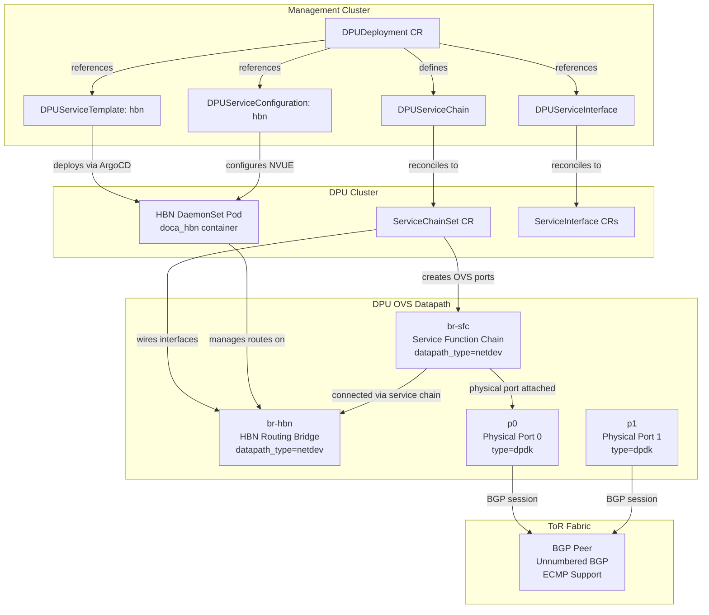
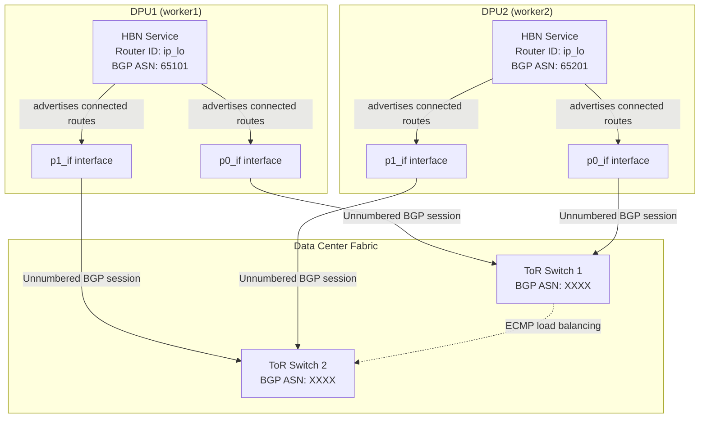
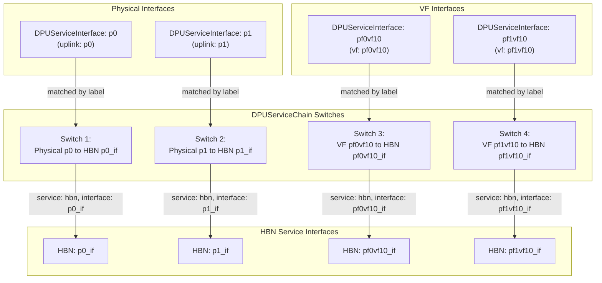
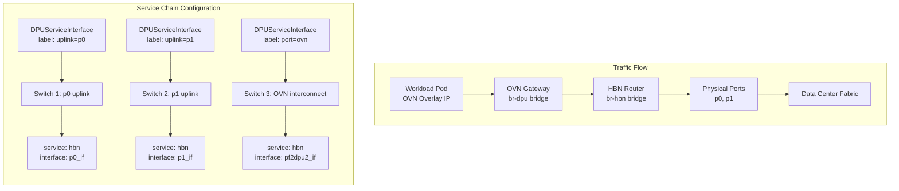
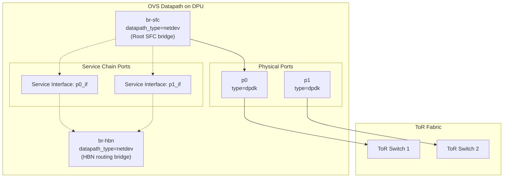

<!-- source: DeepWiki mcp.deepwiki.com · repo NVIDIA/doca-platform · page 5.2 Host Based Networking (HBN) · fetched 2026-10-26 -->

# Host Based Networking (HBN)

Relevant source files

The following files were used as context for generating this wiki page:

- [docs/public/user-guides/host-trusted/use-cases/hbn-ovnk-snap/README.md](docs/public/user-guides/host-trusted/use-cases/hbn-ovnk-snap/README.md)
- [docs/public/user-guides/host-trusted/use-cases/hbn-ovnk/README.md](docs/public/user-guides/host-trusted/use-cases/hbn-ovnk/README.md)
- [docs/public/user-guides/host-trusted/use-cases/hbn-snap/README.md](docs/public/user-guides/host-trusted/use-cases/hbn-snap/README.md)
- [docs/public/user-guides/host-trusted/use-cases/hbn-snap/manifests/04.1-dpudeployment-installation-nvme/dpuflavor.yaml](docs/public/user-guides/host-trusted/use-cases/hbn-snap/manifests/04.1-dpudeployment-installation-nvme/dpuflavor.yaml)
- [docs/public/user-guides/host-trusted/use-cases/hbn-snap/manifests/04.2-dpudeployment-installation-virtiofs/dpuflavor.yaml](docs/public/user-guides/host-trusted/use-cases/hbn-snap/manifests/04.2-dpudeployment-installation-virtiofs/dpuflavor.yaml)
- [docs/public/user-guides/host-trusted/use-cases/hbn/README.md](docs/public/user-guides/host-trusted/use-cases/hbn/README.md)
- [docs/public/user-guides/host-trusted/use-cases/hbn/manifests/04-dpudeployment-installation/hbn-dpuflavor.yaml](docs/public/user-guides/host-trusted/use-cases/hbn/manifests/04-dpudeployment-installation/hbn-dpuflavor.yaml)
- [docs/public/user-guides/host-trusted/use-cases/ovnk/README.md](docs/public/user-guides/host-trusted/use-cases/ovnk/README.md)
- [docs/public/user-guides/host-trusted/use-cases/passthrough/README.md](docs/public/user-guides/host-trusted/use-cases/passthrough/README.md)
- [docs/public/user-guides/zero-trust/use-cases/hbn-snap/README.md](docs/public/user-guides/zero-trust/use-cases/hbn-snap/README.md)
- [docs/public/user-guides/zero-trust/use-cases/hbn-snap/manifests/03.1-dpudeployment-installation-nvme/dpuflavor.yaml](docs/public/user-guides/zero-trust/use-cases/hbn-snap/manifests/03.1-dpudeployment-installation-nvme/dpuflavor.yaml)
- [docs/public/user-guides/zero-trust/use-cases/hbn-snap/manifests/03.2-dpudeployment-installation-virtiofs/dpuflavor.yaml](docs/public/user-guides/zero-trust/use-cases/hbn-snap/manifests/03.2-dpudeployment-installation-virtiofs/dpuflavor.yaml)
- [docs/public/user-guides/zero-trust/use-cases/hbn/README.md](docs/public/user-guides/zero-trust/use-cases/hbn/README.md)
- [docs/public/user-guides/zero-trust/use-cases/hbn/manifests/03.1-dpudeployment-installation-pf/hbn-dpuflavor.yaml](docs/public/user-guides/zero-trust/use-cases/hbn/manifests/03.1-dpudeployment-installation-pf/hbn-dpuflavor.yaml)
- [docs/public/user-guides/zero-trust/use-cases/hbn/manifests/03.2-dpudeployment-installation-pf-vf/hbn-dpuflavor.yaml](docs/public/user-guides/zero-trust/use-cases/hbn/manifests/03.2-dpudeployment-installation-pf-vf/hbn-dpuflavor.yaml)
- [docs/public/user-guides/zero-trust/use-cases/passthrough/README.md](docs/public/user-guides/zero-trust/use-cases/passthrough/README.md)
- [docs/public/user-guides/zero-trust/use-cases/vpc/README.md](docs/public/user-guides/zero-trust/use-cases/vpc/README.md)

## Purpose and Scope

This document describes the Host Based Networking (HBN) DPU service in the DOCA Platform Framework (DPF). HBN provides BGP-based routing functionality on the DPU, enabling dynamic route advertisement and ECMP (Equal-Cost Multi-Path) routing for workload traffic. HBN acts as a BGP peer to Top-of-Rack (ToR) switches, allowing the DPU to participate in data center routing topologies.

For information about OVN-based overlay networking, see [OVN Kubernetes CNI Acceleration](#5.1). For VPC isolation architectures, see [VPC Networking and Network Isolation](#5.3). For general service deployment concepts, see [DPUService Resources](#4.2).

## Overview

HBN is a containerized service running on the DPU that implements BGP routing protocols. It integrates with the DPU's OVS datapath to provide routing capabilities for workload traffic exiting the DPU through its physical uplink ports. HBN can operate standalone or in combination with other networking services like OVN Kubernetes and DOCA SNAP storage.

**Sources:** [docs/public/user-guides/host-trusted/use-cases/hbn/README.md:11-11](), [docs/public/user-guides/host-trusted/use-cases/hbn-ovnk/README.md:9-9]()

## Architecture Components

### System Architecture

HBN Architecture with Resource Flow

**Sources:** [docs/public/user-guides/host-trusted/use-cases/hbn-ovnk/README.md:9-11](), [docs/public/user-guides/zero-trust/use-cases/hbn/README.md:14-15]()

### Key Components

| Component | Type | Purpose | Key Details |
|-----------|------|---------|-------------|
| `hbn` service | DPUService | Main HBN service deployed via DPUDeployment | Runs as DaemonSet on DPU nodes |
| `doca_hbn` container | Container Image | HBN routing daemon implementing BGP | Image from NGC: `nvcr.io/nvidia/doca/doca_hbn` |
| `br-hbn` | OVS Bridge | Dedicated netdev datapath bridge for HBN | Created in DPUFlavor `rawConfigScript` |
| `br-sfc` | OVS Bridge | Service function chaining root bridge | Physical ports attached here |
| `p0_if`, `p1_if` | Service Interface Names | HBN service interface names for physical ports | Suffix `_if` indicates HBN-managed interface |
| `pf2dpu2_if` | Service Interface Name | HBN interface for connecting to other services | Used in OVN integration |

**Interface Naming Convention:** HBN service interfaces use a `_if` suffix (e.g., `p0_if`, `p1_if`) to distinguish the logical service interface name from the underlying physical port name (e.g., `p0`, `p1`). This naming pattern is consistent across all HBN deployments.

**Sources:** [docs/public/user-guides/host-trusted/use-cases/hbn-ovnk/README.md:115-115](), [docs/public/user-guides/host-trusted/use-cases/hbn/README.md:70-70]()

## BGP Routing Architecture

### BGP Peering Model

HBN implements BGP routing on the DPU to enable dynamic route advertisement to the data center fabric. The typical deployment uses unnumbered BGP sessions between the DPU and ToR switches, enabling ECMP routing across multiple physical uplinks.

BGP Topology with ECMP

**Sources:** [docs/public/user-guides/zero-trust/use-cases/hbn/README.md:25-28](), [docs/public/user-guides/host-trusted/use-cases/hbn-ovnk/README.md:19-20]()

### Configuration via NVUE

HBN is configured through the `DPUServiceConfiguration` resource using NVUE (NVIDIA User Experience) YAML format. The configuration includes parameters for BGP Autonomous Systems, Router IDs, and interface types.

**Key Configuration Elements:**
- **Loopback interface (`lo`)**: Provides stable Router ID.
- **Physical interfaces (`p0_if`, `p1_if`)**: Configured as switched ports (type: `swp`) with high MTU (typically 9000).
- **Service interface (`pf2dpu2_if`)**: Interconnect to other services with IP allocation.
- **BGP configuration**: ASN, router ID, and BGP enable settings.

**Sources:** [docs/public/user-guides/host-trusted/use-cases/hbn-ovnk/README.md:46-47](), [docs/public/user-guides/zero-trust/use-cases/hbn-snap/README.md:25-27]()

## Deployment Models

### Standalone HBN

HBN can be deployed as the primary networking service on the DPU, providing L3 routing for all workload traffic. In this mode, HBN directly manages physical uplinks and host-facing VF interfaces.

Service Chain Configuration for Standalone HBN

**Sources:** [docs/public/user-guides/host-trusted/use-cases/hbn/README.md:39-45]()

### HBN with OVN Kubernetes

HBN can be combined with OVN Kubernetes to provide underlay routing while OVN handles overlay networking for pods. In this configuration, HBN manages both physical uplinks and the interconnect to OVN.

HBN + OVN Integration Architecture

**Sources:** [docs/public/user-guides/host-trusted/use-cases/hbn-ovnk/README.md:9-11](), [docs/public/user-guides/host-trusted/use-cases/hbn-ovnk/README.md:71-78]()

### HBN with SNAP Storage

HBN can provide routing for SNAP storage traffic, enabling remote storage access through the DPU's high-speed network.

**Use Case:** Storage traffic between the DPU and the remote storage system (e.g., SPDK target) goes through a VXLAN interface. HBN acts as the peer and advertises routes over BGP to allow for ECMP from the DPU.

**Sources:** [docs/public/zero-trust/use-cases/hbn-snap/README.md:25-30](), [docs/public/user-guides/host-trusted/use-cases/hbn-snap/README.md:11-13]()

## OVS Bridge Configuration

### DPUFlavor OVS Configuration

The `DPUFlavor` resource configures the OVS bridges during DPU provisioning. For HBN deployments, both `br-sfc` and `br-hbn` bridges are typically created via the `ovs.rawConfigScript` field.

**Key Configuration Details:**
- **br-sfc**: The root bridge where physical ports (e.g., `p0`) are attached as `type=dpdk` ports with `hw-offload=true`.
- **br-hbn**: The bridge dedicated to HBN service routing, also using `datapath_type=netdev`.
- Both bridges are set to `fail_mode=secure` to prevent flooding when the control plane is disconnected.
- The script ensures existing default bridges (like `ovsbr1`) are removed to avoid conflicts.

**Sources:** [docs/public/zero-trust/use-cases/hbn/manifests/03.2-dpudeployment-installation-pf-vf/hbn-dpuflavor.yaml:73-107](), [docs/public/user-guides/host-trusted/use-cases/hbn-ovnk/README.md:39-40]()

### Bridge Topology and Port Wiring

OVS Bridge Topology for HBN

**Bridge Roles:**
- **br-sfc**: Root bridge where physical ports are attached. All traffic enters/exits through this bridge. [docs/public/zero-trust/use-cases/hbn/manifests/03.2-dpudeployment-installation-pf-vf/hbn-dpuflavor.yaml:96-102]()
- **br-hbn**: Logical bridge managed by HBN service. Connected to br-sfc via service chain interfaces. [docs/public/zero-trust/use-cases/hbn/manifests/03.2-dpudeployment-installation-pf-vf/hbn-dpuflavor.yaml:103-107]()

**Sources:** [docs/public/zero-trust/use-cases/hbn/manifests/03.2-dpudeployment-installation-pf-vf/hbn-dpuflavor.yaml:73-107]()

## Service Configuration

### DPUServiceTemplate

The `DPUServiceTemplate` defines the Helm chart and repository for deploying HBN. It specifies the `doca-hbn` chart and the repository URL (typically NVIDIA's Helm NGC registry).

**Sources:** [docs/public/user-guides/host-trusted/use-cases/hbn/README.md:64-74](), [docs/public/zero-trust/use-cases/hbn/README.md:72-80]()

### DPUServiceConfiguration

The `DPUServiceConfiguration` provides deployment-specific values, including the container image URL and tag for the `doca_hbn` service.

**Sources:** [docs/public/user-guides/host-trusted/use-cases/hbn/README.md:68-71](), [docs/public/zero-trust/use-cases/hbn/README.md:75-77]()

### DPUServiceInterface Definitions

HBN requires `DPUServiceInterface` resources for each port it manages. These interfaces are labeled (e.g., `uplink: p0`) so they can be selected by the `DPUServiceChain` to wire connectivity to the HBN service.

**Sources:** [docs/public/user-guides/host-trusted/use-cases/hbn-ovnk/README.md:73-78](), [docs/public/user-guides/host-trusted/use-cases/hbn/README.md:41-45]()

## Integration with Other Services

### OVN Kubernetes Integration

When combined with OVN Kubernetes, HBN provides underlay routing while OVN manages the pod overlay network.
- **OVN Service**: Handles overlay networking (GENEVE tunnels).
- **HBN Service**: Provides BGP-based underlay routing for external connectivity.
- **Service Chain**: Wires OVN's gateway to HBN's routing domain.

**Sources:** [docs/public/user-guides/host-trusted/use-cases/hbn-ovnk/README.md:9-11](), [docs/public/user-guides/host-trusted/use-cases/hbn-ovnk-snap/README.md:9-11]()

### SNAP Storage Integration

When combined with SNAP storage services:
1. **HBN** routes storage traffic to remote storage targets (SPDK targets).
2. **SNAP** emulates NVMe or VirtioFS devices for the host.
3. Storage traffic flows through HBN-managed VXLAN tunnels to reach the fabric.

**Sources:** [docs/public/zero-trust/use-cases/hbn-snap/README.md:27-32](), [docs/public/user-guides/host-trusted/use-cases/hbn-snap/README.md:11-13]()

## Network Topology and Prerequisites

### ToR Switch Configuration

HBN requires the Top of Rack (ToR) switch to support:
1. **BGP and EVPN**: For dynamic routing and overlay support.
2. **Unnumbered BGP**: For peering with DPU ports without static IP assignment.
3. **ECMP**: To allow load balancing across multiple DPU uplinks.

**Sources:** [docs/public/user-guides/host-trusted/use-cases/hbn-ovnk/README.md:19-20](), [docs/public/zero-trust/use-cases/hbn-snap/README.md:25-28]()

### Infrastructure Prerequisites

- **Bluefield 3**: Requires Bluefield 3 DPUs with at least 32GB of RAM for HBN and OVN combined use cases. [docs/public/user-guides/host-trusted/use-cases/hbn-ovnk/README.md:25-25]()
- **MTU**: The host high-speed port MTU should be statically set to 1500. [docs/public/user-guides/host-trusted/use-cases/hbn-ovnk/README.md:47-47]()
- **DHCP**: Host high-speed ports (PF0) must have DHCP enabled. [docs/public/user-guides/host-trusted/use-cases/hbn-ovnk/README.md:46-46]()

**Sources:** [docs/public/user-guides/host-trusted/use-cases/hbn-ovnk/README.md:25-47]()

---

