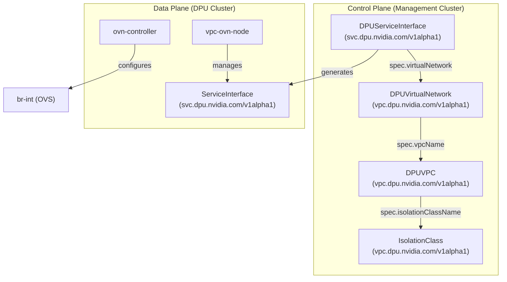
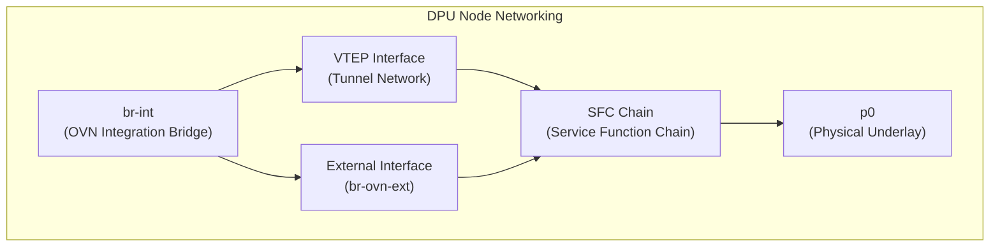

<!-- source: DeepWiki mcp.deepwiki.com · repo NVIDIA/doca-platform · page 5.3 VPC Networking and Network Isolation · fetched 2026-10-26 -->

# VPC Networking and Network Isolation

<details>
<summary>Relevant source files</summary>

The following files were used as context for generating this wiki page:

- [docs/public/advanced-configuration/dpuservices/ovnvpc/README.md](docs/public/advanced-configuration/dpuservices/ovnvpc/README.md)
- [docs/public/advanced-configuration/dpuservices/ovnvpc/examples/reference-isolationclass.yaml](docs/public/advanced-configuration/dpuservices/ovnvpc/examples/reference-isolationclass.yaml)
- [docs/public/user-guides/zero-trust/use-cases/vpc/manifests/04.2-vpc-ovn-dpudeployment/dpuserviceconfig-vpc-ovn-node.yaml](docs/public/user-guides/zero-trust/use-cases/vpc/manifests/04.2-vpc-ovn-dpudeployment/dpuserviceconfig-vpc-ovn-node.yaml)
- [docs/public/user-guides/zero-trust/use-cases/vpc/manifests/05-vpc-resources/ovn-isolation-class.yaml](docs/public/user-guides/zero-trust/use-cases/vpc/manifests/05-vpc-resources/ovn-isolation-class.yaml)
- [test/e2e/config-provisioning-snap.yaml](test/e2e/config-provisioning-snap.yaml)
- [test/e2e/config-provisioning-zt-physical-bf4-weave.yaml](test/e2e/config-provisioning-zt-physical-bf4-weave.yaml)
- [test/e2e/servicefunctionchain.go](test/e2e/servicefunctionchain.go)
- [test/e2e/vpcovn.go](test/e2e/vpcovn.go)
- [test/e2e/vpcovn_test.go](test/e2e/vpcovn_test.go)
- [test/e2e/weave.go](test/e2e/weave.go)
- [test/e2e/weave_physical.go](test/e2e/weave_physical.go)
- [test/e2e/weave_physical_test.go](test/e2e/weave_physical_test.go)
- [test/e2e/weave_test.go](test/e2e/weave_test.go)
- [test/objects/application/vpc/dpuservice-vpc-ovn-node.yaml](test/objects/application/vpc/dpuservice-vpc-ovn-node.yaml)
- [test/utils/dpuservice/dpuservice.go](test/utils/dpuservice/dpuservice.go)
- [test/utils/netshoot/netshoot.go](test/utils/netshoot/netshoot.go)
- [test/utils/vpc/ovn/ovnutils.go](test/utils/vpc/ovn/ovnutils.go)

</details>


## Overview

VPC (Virtual Private Cloud) Networking provides multi-tenant network isolation in the DOCA Platform Framework using OVN (Open Virtual Network). Each VPC creates an isolated network domain with its own routing tables, DHCP services, and external connectivity. Multiple virtual networks can exist within a VPC, with configurable policies controlling traffic between them.

The primary isolation mechanism is tenant-based: each `DPUVPC` resource is associated with a tenant identifier, and DPU nodes are labeled to indicate which tenant they serve. Traffic between different VPCs is blocked by default, while traffic within a VPC can be controlled via the `interNetworkAccess` flag.

> **Note**: OVN VPC is currently a technology preview feature and is not recommended for production use [docs/public/advanced-configuration/dpuservices/ovnvpc/README.md:5-7]().

**Key Capabilities:**
- **Multi-tenant Network Isolation**: Create isolated VPCs for different tenants with guaranteed separation [docs/public/advanced-configuration/dpuservices/ovnvpc/README.md:16]().
- **Virtual Network Management**: Support logical segments with DHCP and custom IP addressing [docs/public/advanced-configuration/dpuservices/ovnvpc/README.md:17]().
- **External Connectivity**: Configurable external routing with NAT/masquerading capabilities [docs/public/advanced-configuration/dpuservices/ovnvpc/README.md:18]().
- **Hardware Acceleration**: Leverages DPU hardware for high-performance networking [docs/public/advanced-configuration/dpuservices/ovnvpc/README.md:19]().
- **Kubernetes Integration**: Native Kubernetes resources (`DPUVPC`, `DPUVirtualNetwork`) for declarative management [docs/public/advanced-configuration/dpuservices/ovnvpc/README.md:21]().

Sources: [docs/public/advanced-configuration/dpuservices/ovnvpc/README.md:1-22](), [test/e2e/vpcovn_test.go:1-100]()

## VPC Resource Model

VPC networking is configured through primary custom resources that define isolation boundaries and virtual networks.

### Resource Hierarchy and Code Entities

The following diagram associates the logical VPC components with their corresponding Kubernetes Custom Resource Definitions (CRDs) and code identifiers.


**VPC Resource Relationships and Implementation Entities**

Sources: [docs/public/advanced-configuration/dpuservices/ovnvpc/README.md:27-63](), [api/vpc/v1alpha1/types.go](), [test/e2e/vpcovn.go:427-478]()

### IsolationClass

The `IsolationClass` defines the parameters for the VPC implementation, specifically OVN database endpoints [docs/public/advanced-configuration/dpuservices/ovnvpc/README.md:121-127]():

```yaml
apiVersion: vpc.dpu.nvidia.com/v1alpha1
kind: IsolationClass
metadata:
  name: ovn.vpc.dpu.nvidia.com
spec:
  provisioner: "ovn.vpc.dpu.nvidia.com"
  parameters:
    ovn-nb-endpoint: "tcp:10.1.1.100:30041"
    ovn-sb-endpoint: "tcp:10.1.1.100:30042"
```
Sources: [docs/public/advanced-configuration/dpuservices/ovnvpc/README.md:129-151](), [docs/public/user-guides/zero-trust/use-cases/vpc/manifests/05-vpc-resources/ovn-isolation-class.yaml:1-10]()

### DPUVPC and DPUVirtualNetwork

A `DPUVPC` represents a tenant's isolated environment, while `DPUVirtualNetwork` defines the L2 segments within it.

| Resource | Key Fields | Purpose |
| :--- | :--- | :--- |
| **DPUVPC** | `spec.tenant`, `spec.nodeSelector`, `spec.interNetworkAccess` | Defines tenant ownership and if sub-networks can talk [docs/public/advanced-configuration/dpuservices/ovnvpc/README.md:157-187](). |
| **DPUVirtualNetwork** | `spec.type`, `spec.externallyRouted`, `spec.masquerade`, `spec.bridgedNetwork.ipam` | Configures L2/L3 behavior, NAT, and DHCP [docs/public/advanced-configuration/dpuservices/ovnvpc/README.md:193-210](). |

Sources: [test/e2e/vpcovn.go:427-478](), [docs/public/advanced-configuration/dpuservices/ovnvpc/README.md:157-210]()

## Implementation Architecture

The DPU-side networking is implemented using Open vSwitch (OVS) bridges and OVN controllers.

### DPU Node Bridge Topology


**DPU Internal Bridge and Interface Mapping**

Sources: [docs/public/advanced-configuration/dpuservices/ovnvpc/README.md:89-110](), [test/utils/vpc/ovn/ovnutils.go:65-73]()

### Key Components
- **OVN Central**: Runs `northd`, `nb_db`, and `sb_db` in the management cluster [docs/public/advanced-configuration/dpuservices/ovnvpc/README.md:69-70]().
- **VPC Controller**: Reconciles `DPUVPC` and `DPUVirtualNetwork` resources into OVN logical entities [docs/public/advanced-configuration/dpuservices/ovnvpc/README.md:71]().
- **OVN Controller**: Local agent on each DPU that translates OVN Southbound DB entries into OVS flows [docs/public/advanced-configuration/dpuservices/ovnvpc/README.md:74]().
- **VPC Node**: DPU-local service handling IP allocation and interface management [docs/public/advanced-configuration/dpuservices/ovnvpc/README.md:75]().

Sources: [docs/public/advanced-configuration/dpuservices/ovnvpc/README.md:65-76](), [test/utils/vpc/ovn/ovnutils.go:49-52]()

## Traffic Policies and Isolation

### Tenant-Based Isolation
Isolation is enforced by ensuring that `DPUVPC` resources only apply to nodes matching the `nodeSelector` [docs/public/advanced-configuration/dpuservices/ovnvpc/README.md:179-180](). In E2E tests, this is validated by assigning different labels (e.g., `tenant: foo` and `tenant: bar`) to DPU nodes and verifying that traffic between them is blocked [test/e2e/vpcovn_test.go:792-802]().

### Intra-VPC vs Inter-VPC Traffic
- **Intra-VPC**: Controlled by `spec.interNetworkAccess`. If `true`, different `DPUVirtualNetworks` within the same `DPUVPC` can communicate [docs/public/advanced-configuration/dpuservices/ovnvpc/README.md:186]().
- **Inter-VPC**: Strictly isolated. There is no native mechanism to route between two different `DPUVPC` resources without external routing [test/e2e/vpcovn_test.go:792-802]().

### DHCP and IPAM
The system uses `DPUServiceIPAM` to manage address pools for the infrastructure:
- **VTEP Pool**: Used for VXLAN/Geneve tunnel endpoints between DPUs [test/e2e/vpcovn.go:93-101]().
- **Gateway Pool**: Used for external connectivity [test/e2e/vpcovn.go:103-111]().
- **Tenant DHCP**: Managed by the `vpc-ovn-node` service which runs a DHCP daemon [test/e2e/vpcovn.go:79-80]().

Sources: [test/e2e/vpcovn.go:93-111](), [test/e2e/vpcovn_test.go:159-166](), [test/utils/vpc/ovn/ovnutils.go:38-43]()

## Testing and Validation

The framework includes a `netshoot` utility for validating connectivity and performance [test/utils/netshoot/netshoot.go:17-40]().

### Connectivity Validation
Tests use `netshoot.RunTrafficTest` to execute `iperf3` or `ping` between pods [test/e2e/servicefunctionchain.go:67-68]().
- **MTU Validation**: The `MTUErrorParserGenerator` is used to detect packet fragmentation issues when testing specific MTU configurations (e.g., 9000 for VFs) [test/utils/netshoot/netshoot.go:197-211]().
- **Throughput**: Hardware offload is verified by checking if throughput exceeds the `throughputThreshold` of 10 Gbit/sec [test/utils/netshoot/netshoot.go:42-45]().

Sources: [test/utils/netshoot/netshoot.go:42-45](), [test/utils/netshoot/netshoot.go:197-211](), [test/e2e/vpcovn_test.go:792-802]()

---

