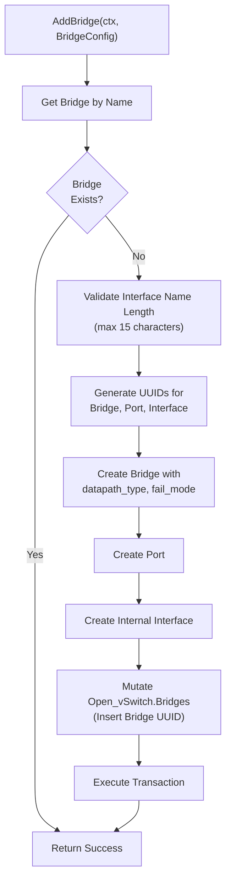
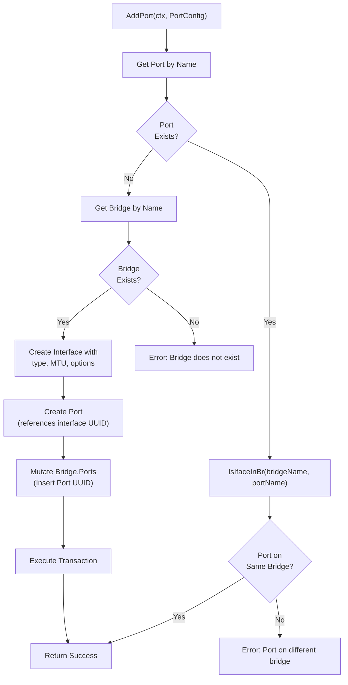
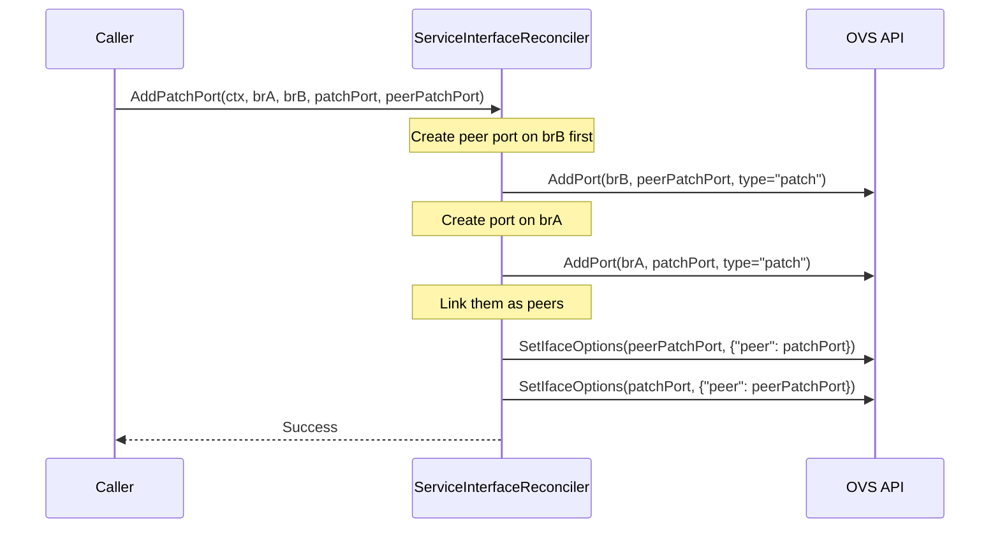

<!-- source: DeepWiki mcp.deepwiki.com · repo NVIDIA/doca-platform · page 5.4 OVS Bridge Management and Port Operations · fetched 2026-10-26 -->

# OVS Bridge Management and Port Operations

<details>
<summary>Relevant source files</summary>

The following files were used as context for generating this wiki page:

- [.golangci.yml](.golangci.yml)
- [cmd/sfc-controller/main.go](cmd/sfc-controller/main.go)
- [internal/cni/dpf-ovs-cni/pkg/ipam/ipam.go](internal/cni/dpf-ovs-cni/pkg/ipam/ipam.go)
- [internal/cni/dpf-ovs-cni/pkg/ipam/mock/ipam.go](internal/cni/dpf-ovs-cni/pkg/ipam/mock/ipam.go)
- [internal/cni/dpf-ovs-cni/pkg/ovsdb/mock/ovsdb.go](internal/cni/dpf-ovs-cni/pkg/ovsdb/mock/ovsdb.go)
- [internal/cni/dpf-ovs-cni/pkg/ovsdb/ovsdb.go](internal/cni/dpf-ovs-cni/pkg/ovsdb/ovsdb.go)
- [internal/cni/dpf-ovs-cni/plugin/ovs.go](internal/cni/dpf-ovs-cni/plugin/ovs.go)
- [internal/cni/dpf-ovs-cni/plugin/ovs_test.go](internal/cni/dpf-ovs-cni/plugin/ovs_test.go)
- [internal/cni/dpf-ovs-cni/plugin/plugin.go](internal/cni/dpf-ovs-cni/plugin/plugin.go)
- [internal/cni/dpf-ovs-cni/plugin/plugin_suite_test.go](internal/cni/dpf-ovs-cni/plugin/plugin_suite_test.go)
- [internal/cni/dpf-ovs-cni/plugin/plugin_test.go](internal/cni/dpf-ovs-cni/plugin/plugin_test.go)
- [internal/sfccontroller/controllers/custom_flows.go](internal/sfccontroller/controllers/custom_flows.go)
- [internal/sfccontroller/controllers/custom_flows_test.go](internal/sfccontroller/controllers/custom_flows_test.go)
- [internal/sfccontroller/controllers/legacy_nsi_coexistence_test.go](internal/sfccontroller/controllers/legacy_nsi_coexistence_test.go)
- [internal/sfccontroller/controllers/servicechain.go](internal/sfccontroller/controllers/servicechain.go)
- [internal/sfccontroller/controllers/servicechain_controller.go](internal/sfccontroller/controllers/servicechain_controller.go)
- [internal/sfccontroller/controllers/servicechain_test.go](internal/sfccontroller/controllers/servicechain_test.go)
- [internal/sfccontroller/controllers/serviceinterface_controller.go](internal/sfccontroller/controllers/serviceinterface_controller.go)
- [internal/sfccontroller/controllers/serviceinterface_controller_test.go](internal/sfccontroller/controllers/serviceinterface_controller_test.go)
- [internal/sfccontroller/controllers/stale.go](internal/sfccontroller/controllers/stale.go)
- [internal/sfccontroller/controllers/stale_test.go](internal/sfccontroller/controllers/stale_test.go)
- [pkg/openflow/mock_flows.go](pkg/openflow/mock_flows.go)
- [pkg/openflow/openflow.go](pkg/openflow/openflow.go)
- [pkg/openflow/openflow_test.go](pkg/openflow/openflow_test.go)
- [pkg/ovsutils/mock_ovs.go](pkg/ovsutils/mock_ovs.go)
- [pkg/ovsutils/mock_ovs_client.go](pkg/ovsutils/mock_ovs_client.go)
- [pkg/ovsutils/ovs.go](pkg/ovsutils/ovs.go)
- [pkg/ovsutils/ovs_test.go](pkg/ovsutils/ovs_test.go)
- [pkg/utils/networkhelper/implementation.go](pkg/utils/networkhelper/implementation.go)
- [pkg/utils/networkhelper/mock/networkhelper.go](pkg/utils/networkhelper/mock/networkhelper.go)
- [pkg/utils/networkhelper/types.go](pkg/utils/networkhelper/types.go)

</details>


## Purpose and Scope

This page documents the OVS (Open vSwitch) bridge and port management system used throughout the DOCA Platform Framework. The `pkg/ovsutils` package provides a Go API abstraction layer over the libovsdb client for managing OVS bridges, ports, and interfaces on DPU nodes. This system is fundamental to networking in the platform, enabling hardware-offloaded service function chaining and network isolation.

For information about how OVS bridges are used in the overall networking topology (e.g., br-sfc, br-ovn, br-hbn), see [OVN Kubernetes CNI Acceleration](5.1) and [Host Based Networking (HBN)](5.2). For VPC network isolation built on top of OVS, see [VPC Networking and Network Isolation](5.3).

**Sources:** [pkg/ovsutils/ovs.go:1-30]()

---

## OVS API Abstraction Layer

The platform wraps the `libovsdb` client library with a higher-level API that provides idempotent operations for bridge and port management. The core abstraction is the `ovsutils.API` interface, which extends the libovsdb `client.Client` with platform-specific operations.

### API Interface

The `API` interface [pkg/ovsutils/ovs.go:41-72]() provides methods for bridge lifecycle, port management, and metadata tagging via External IDs.

```go
type API interface {
	ovsclient.Client

	// Open vSwitch Commands
	SetOpenVSwitchExternalIDs(ctx context.Context, externalIDs map[string]string) error
	GetOpenVSwitchExternalIDs(ctx context.Context) (map[string]string, error)

	// Bridge Commands
	ValidateBridgeExists(ctx context.Context, bridgeName string) error
	GetBridgeNameByInterface(ctx context.Context, name string) (string, error)
	GetBridgeNameByPort(ctx context.Context, name string) (string, error)
	AddBridge(ctx context.Context, bridgeConfig BridgeConfig) error
	SetBridgeExternalIDs(ctx context.Context, name string, externalIDs map[string]string) error
	ListBridgesWithExternalIDs(ctx context.Context, externalIDs map[string]string) ([]ovsmodel.Bridge, error)
	GetBridgeWithName(ctx context.Context, name string) (*ovsmodel.Bridge, error)
	DeleteBridge(ctx context.Context, name string) error

	// Port Commands
	AddPort(ctx context.Context, portConfig PortConfig) error
	DelPort(ctx context.Context, bridgeName, portName string, opt *DelPortOpt) error
	GetPortVLANState(ctx context.Context, name string) (PortVLANState, error)
	SetPortExternalIDs(ctx context.Context, name string, externalIDs map[string]string) error

	// Interface Commands
	GetInterfaceLinkState(ctx context.Context, name string) (ovsmodel.InterfaceLinkState, error)
	ListInterfacesWithError(ctx context.Context) ([]string, error)
	SetIfaceExternalIDs(ctx context.Context, name string, externalIDs map[string]string) error
	GetIfaceWithExternalIDs(ctx context.Context, externalIDs map[string]string) (*ovsmodel.Interface, error)
	SetIfaceOptions(ctx context.Context, name string, options map[string]string) error
	IsIfaceInBr(ctx context.Context, bridgeName, portName string) (bool, error)
	GetIfaceWithName(ctx context.Context, name string) (*ovsmodel.Interface, error)
}
```

The `Client` struct [pkg/ovsutils/ovs.go:76-78]() implements this interface by embedding the `libovsdb` client.

**Sources:** [pkg/ovsutils/ovs.go:41-78]()

---

## Configuration Structures

### BridgeConfig

The `BridgeConfig` struct [pkg/ovsutils/ovs.go:213-228]() defines parameters for creating OVS bridges:

| Field | Type | Description |
|-------|------|-------------|
| `Name` | `string` | Bridge name (e.g., "br-sfc", "br-hbn") |
| `DatapathType` | `string` | Datapath type ("netdev" for DPDK, "system" for kernel) |
| `SkipCreateInternalPort`| `bool` | Skips creating the default internal port if true |
| `InternalInterfaceName` | `*string` | Optional custom name for internal interface (max 15 chars) |
| `FailMode` | `*string` | Fail mode ("secure" or "standalone") |

### PortConfig

The `PortConfig` struct [pkg/ovsutils/ovs.go:230-262]() defines parameters for adding ports:

| Field | Type | Description |
|-------|------|-------------|
| `Name` | `string` | Port/interface name |
| `BridgeName` | `string` | Target bridge name |
| `InterfaceType` | `string` | Interface type ("dpdk", "patch", "internal") |
| `MTU` | `*int` | Optional MTU size (default: 9216 for DOCA) |
| `InterfaceExternalIDs`| `map[string]string`| External IDs for the Interface row |
| `PortExternalIDs` | `map[string]string` | External IDs for the Port row |
| `InterfaceOptions` | `map[string]string` | Interface options (e.g., peer for patch ports) |
| `VLANMode` | `*ovsmodel.PortVLANMode` | VLAN mode (access, trunk, etc.) |

**Sources:** [pkg/ovsutils/ovs.go:213-262]()

---

## Bridge Management

### Bridge Creation

The `AddBridge` method [pkg/ovsutils/ovs.go:503-601]() creates an OVS bridge. The operation is idempotent—if the bridge already exists, it returns successfully without modification.

#### Bridge Creation Flow



**Key Implementation Details:**
- **Name Length Validation**: The internal interface name must be ≤15 characters due to Linux `IFNAMSIZ` limit [pkg/ovsutils/ovs.go:516-518]().
- **Transaction Atomicity**: All operations (create bridge, create port, create interface, mutate Open_vSwitch) are combined into a single OVSDB transaction [pkg/ovsutils/ovs.go:580-599]().

**Sources:** [pkg/ovsutils/ovs.go:503-601]()

### Bridge Deletion

The `DeleteBridge` method [pkg/ovsutils/ovs.go:603-661]() removes a bridge by removing its UUID from the `Open_vSwitch` table and deleting the `Bridge` row.

**Sources:** [pkg/ovsutils/ovs.go:603-661]()

---

## Port Operations

### Adding Ports

The `AddPort` method [pkg/ovsutils/ovs.go:132-211]() creates a port and interface on a bridge. It is idempotent; if the port exists on the same bridge, it succeeds [pkg/ovsutils/ovs.go:146-150]().

#### Port Addition Flow



**Sources:** [pkg/ovsutils/ovs.go:132-211]()

### Collision-Free OpenFlow Port (ofport) Allocation

In `dpf-ovs-cni`, port numbers (ofports) are deterministically hashed from the interface name to prevent collisions.

1. **Hashing**: `hashToOFPort` maps an interface name to a port in the range `[32768, 65279]` [internal/cni/dpf-ovs-cni/plugin/ovs.go:57-61]().
2. **Probing**: `resolveOFPort` performs linear probing if the hashed port is already in use [internal/cni/dpf-ovs-cni/plugin/ovs.go:78-92]().
3. **Usage Check**: `getUsedOFPorts` queries all OVS interfaces to find currently assigned ports [internal/cni/dpf-ovs-cni/plugin/ovs.go:96-127]().

**Sources:** [internal/cni/dpf-ovs-cni/plugin/ovs.go:48-127]()

---

## Patch Port Management

Patch ports create bidirectional connectivity between OVS bridges.

### Patch Port Creation

The `AddPatchPort` function [internal/sfccontroller/controllers/serviceinterface_controller.go:180-233]() creates a bidirectional patch port connection. It ensures that the peer bridge exists by attempting to add the peer port first.



**Sources:** [internal/sfccontroller/controllers/serviceinterface_controller.go:180-233]()

### Patch Port Naming Conventions

Names are derived deterministically in `getPatchPortNames` [internal/sfccontroller/controllers/serviceinterface_controller.go:146-163]():
- **Hashed Format**: `p_<brA>_to_<brB>_<hash>` where hash is derived from the `ServiceInterface` object key.
- **OVN Uplink**: `puplink<brA>to<brB>` [internal/sfccontroller/controllers/serviceinterface_controller.go:171-178]().

**Sources:** [internal/sfccontroller/controllers/serviceinterface_controller.go:146-178]()

---

## External ID Management

External IDs are used to track resource ownership.

| Key | Usage |
|-----|-------|
| `dpf-id` | Identifies the `ServiceInterface` or resource owner [pkg/ovsutils/ovs.go:119-127](). |
| `hbn_netdev` | Used by CNI to tag ports for HBN cleanup [internal/cni/dpf-ovs-cni/plugin/ovs.go:201-205](). |
| `iface-id` | OVN logical port identifier [internal/cni/dpf-ovs-cni/plugin/ovs.go:145](). |

**Sources:** [pkg/ovsutils/ovs.go:119-127](), [internal/cni/dpf-ovs-cni/plugin/ovs.go:142-156]()

---

## Stale Resource Cleanup

The system includes mechanisms to remove OVS resources that no longer correspond to active configurations.

1. **HBN Cleanup**: `cleanupStaleHbn` removes ports from `br-hbn` that are tagged with a specific `hbn_netdev` external ID [internal/cni/dpf-ovs-cni/plugin/ovs.go:201-215]().
2. **SFC Cleanup**: `StaleObjectRemover` in the SFC controller identifies and deletes ports on `br-sfc` that are not referenced by any `ServiceInterface` [internal/sfccontroller/controllers/stale.go:130-215]().

**Sources:** [internal/cni/dpf-ovs-cni/plugin/ovs.go:201-215](), [internal/sfccontroller/controllers/stale.go:130-215]()

---

## OpenFlow Operations

The platform manages OpenFlow rules on OVS bridges using the `OpenFlow` utility [pkg/openflow/openflow.go:37-42]().

### Flow Application
The `AddFlows` method [pkg/openflow/openflow.go:49-91]() writes rules to a temporary file and applies them atomically using `ovs-ofctl --bundle add-flows`.

### Meter Management
The `AddMeter` method [pkg/openflow/openflow.go:114-151]() adds OpenFlow 1.3 meters to a bridge. It handles the `OFPMMFC_METER_EXISTS` error to ensure idempotency.

**Sources:** [pkg/openflow/openflow.go:37-151]()

---

## Testing

The OVS utilities are verified via:
- **Unit Tests**: `pkg/ovsutils/ovs_test.go` covers idempotency, error conditions, and bridge/port lifecycle [pkg/ovsutils/ovs_test.go:40-245]().
- **Mocks**: `MockAPI` [pkg/ovsutils/mock_ovs.go:42-60]() allows testing controllers without a live OVSDB connection.
- **CNI Logic Tests**: `internal/cni/dpf-ovs-cni/plugin/ovs_test.go` verifies the ofport allocation and collision logic.

**Sources:** [pkg/ovsutils/ovs_test.go:40-245](), [pkg/ovsutils/mock_ovs.go:42-60](), [internal/cni/dpf-ovs-cni/plugin/ovs_test.go:46-211]()

---

