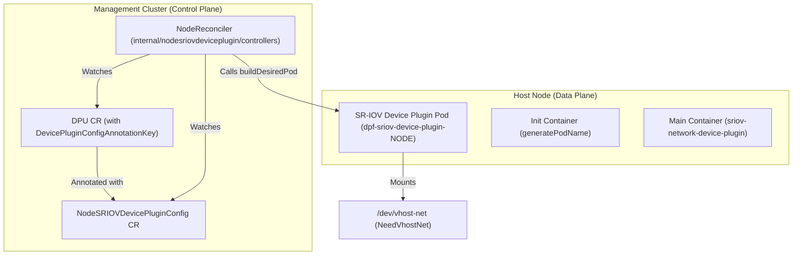
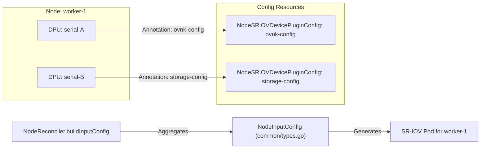

<!-- source: DeepWiki mcp.deepwiki.com · repo NVIDIA/doca-platform · page 5.5 NodeSRIOV Device Plugin and Multi-DPU Networking · fetched 2026-10-26 -->

# NodeSRIOV Device Plugin and Multi-DPU Networking

Relevant source files

The following files were used as context for generating this wiki page:

- [api/noderesources/v1alpha1/nodesriovdevicepluginconfig_types.go](api/noderesources/v1alpha1/nodesriovdevicepluginconfig_types.go)
- [api/noderesources/v1alpha1/zz_generated.deepcopy.go](api/noderesources/v1alpha1/zz_generated.deepcopy.go)
- [config/nodesriovdeviceplugin/crd/bases/noderesources.dpu.nvidia.com_nodesriovdevicepluginconfigs.yaml](config/nodesriovdeviceplugin/crd/bases/noderesources.dpu.nvidia.com_nodesriovdevicepluginconfigs.yaml)
- [deploy/charts/dpf-operator/templates/crds/apiextensions.k8s.io_v1_customresourcedefinition_nodesriovdevicepluginconfigs.noderesources.dpu.nvidia.com.yaml](deploy/charts/dpf-operator/templates/crds/apiextensions.k8s.io_v1_customresourcedefinition_nodesriovdevicepluginconfigs.noderesources.dpu.nvidia.com.yaml)
- [deploy/charts/dpu-networking/charts/sriov-device-plugin/README.md](deploy/charts/dpu-networking/charts/sriov-device-plugin/README.md)
- [deploy/charts/dpu-networking/charts/sriov-device-plugin/values.yaml](deploy/charts/dpu-networking/charts/sriov-device-plugin/values.yaml)
- [internal/nodesriovdeviceplugin/common/validate.go](internal/nodesriovdeviceplugin/common/validate.go)
- [internal/nodesriovdeviceplugin/common/validate_test.go](internal/nodesriovdeviceplugin/common/validate_test.go)
- [internal/nodesriovdeviceplugin/controllers/node_controller.go](internal/nodesriovdeviceplugin/controllers/node_controller.go)
- [internal/nodesriovdeviceplugin/controllers/node_controller_test.go](internal/nodesriovdeviceplugin/controllers/node_controller_test.go)
- [internal/nodesriovdeviceplugin/controllers/pod_test.go](internal/nodesriovdeviceplugin/controllers/pod_test.go)
- [internal/nodesriovdeviceplugin/webhooks/nodesriovdevicepluginconfig_webhook.go](internal/nodesriovdeviceplugin/webhooks/nodesriovdevicepluginconfig_webhook.go)
- [internal/nodesriovdeviceplugin/webhooks/nodesriovdevicepluginconfig_webhook_test.go](internal/nodesriovdeviceplugin/webhooks/nodesriovdevicepluginconfig_webhook_test.go)

The NodeSRIOV Device Plugin and Multi-DPU networking architecture in the DOCA Platform Framework (DPF) provides the mechanism to expose and manage SR-IOV Virtual Functions (VFs) and Scalable Functions (SFs) on host nodes. This system is critical for hardware-accelerated networking, particularly in environments where multiple DPUs are present on a single host, requiring precise orchestration of OVN-Kubernetes and Host-Based Networking (HBN) services.

## NodeSRIOVDevicePlugin Controller

The `NodeSRIOVDevicePlugin` is a DPF-managed component that automates the deployment of host-side SR-IOV device plugin pods [internal/nodesriovdeviceplugin/controllers/node_controller.go:53](). It allows DPF to expose DPU-backed VF and SF resources to the host Kubernetes cluster.

### Configuration and Deployment
The controller is managed via the `NodeSRIOVDevicePluginConfig` CRD [api/noderesources/v1alpha1/nodesriovdevicepluginconfig_types.go:153](). This configuration defines which functions are exposed as device plugin resources (e.g., `nvidia.com/pods_vf`).

Key implementation details:
*   **Resource Types**: Supports both `vf` (Virtual Function) and `sf` (Scalable Function) resource types [api/noderesources/v1alpha1/nodesriovdevicepluginconfig_types.go:37-42]().
*   **PF Index Targeting**: The configuration uses Physical Function (PF) indices [api/noderesources/v1alpha1/nodesriovdevicepluginconfig_types.go:113](). This makes the configuration resilient to interface renaming that occurs during DPU provisioning.
*   **Pod Management**: The `NodeReconciler` creates a specialized device plugin pod for each Node that has associated DPUs [internal/nodesriovdeviceplugin/controllers/node_controller.go:91-138]().
*   **Init Container Logic**: The pod includes an init container (`dpf-sriov-device-plugin-init`) that processes the `NodeInputConfig` and generates the final configuration for the SR-IOV device plugin [internal/nodesriovdeviceplugin/controllers/pod_test.go:154-166]().

### NodeSRIOV Device Plugin Workflow
The following diagram illustrates how the `NodeSRIOVDevicePluginConfig` results in resource availability for host pods.

**Diagram: NodeSRIOV Controller and Code Entities**

Sources: [internal/nodesriovdeviceplugin/controllers/node_controller.go:91-138](), [api/noderesources/v1alpha1/nodesriovdevicepluginconfig_types.go:101-107](), [internal/nodesriovdeviceplugin/controllers/pod_test.go:43-55]()

---

## Multi-DPU Networking Constraints

In scenarios where a single host worker node contains multiple DPUs, specific constraints apply to OVN-Kubernetes (OVN-K) and HBN colocalization.

### OVN-K and HBN Colocalization
In multi-DPU setups, both OVN-Kubernetes and HBN must reside on the same DPU.
*   **Bridge Conflicts**: OVN-K manages a single OVS bridge per host; running it on multiple DPUs would cause conflicting configurations.
*   **Service Chain Integration**: HBN and OVN-K are integrated via service chains, which are local to a single DPU's switching logic.

### Multi-DPU Acceleration Workflow
To maintain hardware acceleration in these environments:
1.  The `NodeSRIOVDevicePluginConfig` must be linked only to the DPU running OVN-K.
2.  The SR-IOV Device Plugin then exposes VFs exclusively from that specific DPU.
3.  The OVN-K DPU component identifies the VF representors on that specific DPU and adds them to the OVS bridge.

---

## Validation and Constraints Logic

The system implements rigorous validation to ensure that resource names and function ranges do not conflict across multiple DPUs on the same node.

### Configuration Validation
The `ValidateNodeSRIOVDevicePluginConfig` function checks for:
*   **Unique Resource Names**: Combinations of `ResourcePrefix` and `Name` must be unique within a config [internal/nodesriovdeviceplugin/common/validate.go:105-112]().
*   **Non-overlapping Ranges**: Function ranges for the same type (VF or SF) and PF index must not overlap [internal/nodesriovdeviceplugin/common/validate.go:158-160]().
*   **Cross-DPU Consistency**: The `ValidateCrossDPUResourceTypes` function ensures that if a resource name (e.g., `nvidia.com/pods_vf`) is used across different DPUs on the same node, they must share the same `Type` (either all VF or all SF) [internal/nodesriovdeviceplugin/common/validate.go:122-153]().

### Resource Definition Example
A typical `NodeSRIOVDevicePluginConfig` defines resources like this:
| Resource Name | Type | PF Index | Range | RDMA |
| :--- | :--- | :--- | :--- | :--- |
| `bf_sf` | `sf` | 0 | 1-100 | True |
| `bf_sf_trusted` | `sf` | 0 | 101-110 | False |
| `bf_vf` | `vf` | 0, 1 | All | True |

Sources: [deploy/charts/dpu-networking/charts/sriov-device-plugin/values.yaml:24-61](), [api/noderesources/v1alpha1/nodesriovdevicepluginconfig_types.go:65-95]()

---

## DPU Selection Mechanisms

DPF provides granular control for targeting services to specific DPUs through `dpuNodeSelector` and `dpuDeviceSelector`.

### dpuNodeSelector vs dpuDeviceSelector
| Selector | Scope | Purpose |
| :--- | :--- | :--- |
| `dpuNodeSelector` | Host Level | Selects the physical servers (nodes) that should participate in the deployment. |
| `dpuDeviceSelector` | Device Level | Filters specific DPU devices within the selected nodes based on labels. |

### Targeting via Custom Labels
For reliable multi-DPU distribution, custom labels are applied to `DPUDevice` objects. The `NodeReconciler` uses these relationships to determine which `NodeSRIOVDevicePluginConfig` applies to which DPU by looking up the `DPUDevicePluginConfigAnnotationKey` on the `DPU` resource [internal/nodesriovdeviceplugin/controllers/node_controller.go:95-98]().

**Diagram: Multi-DPU Configuration Mapping**

Sources: [internal/nodesriovdeviceplugin/controllers/node_controller.go:107-110](), [internal/nodesriovdeviceplugin/controllers/node_controller_test.go:149-166]()

---

## Pod Lifecycle and Reconciliation

The `NodeReconciler` manages the lifecycle of the device plugin pods:
*   **Creation**: Triggered when a Node has at least one DPU with a valid config annotation and the DPU status is `HostNetworkReady` [internal/nodesriovdeviceplugin/controllers/node_controller_test.go:120-123]().
*   **Updates**: If the `NodeSRIOVDevicePluginConfig` or the set of DPUs changes, the controller calculates a new hash. If the hash differs from the `PodObjectHashAnnotationKey`, the pod is recreated [internal/nodesriovdeviceplugin/controllers/node_controller.go:124-138]().
*   **Cleanup**: When a Node is deleted or all DPUs are removed, the `ensureNoPod` function deletes the managed pods [internal/nodesriovdeviceplugin/controllers/node_controller.go:147-163]().
*   **Backoff**: If pods enter a terminal state (Failed), the controller uses `FailedPodsBackoff` to avoid hot-looping [internal/nodesriovdeviceplugin/controllers/node_controller.go:59-61]().

Sources: [internal/nodesriovdeviceplugin/controllers/node_controller.go:166-190](), [internal/nodesriovdeviceplugin/controllers/pod_test.go:118-127]()

---

