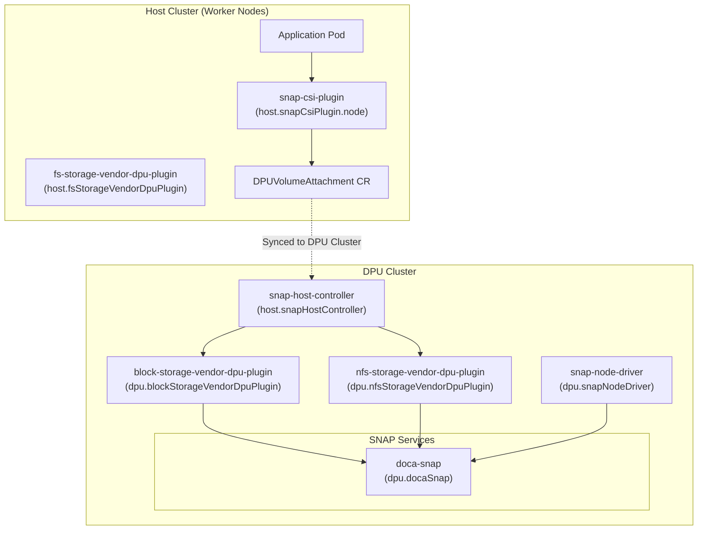
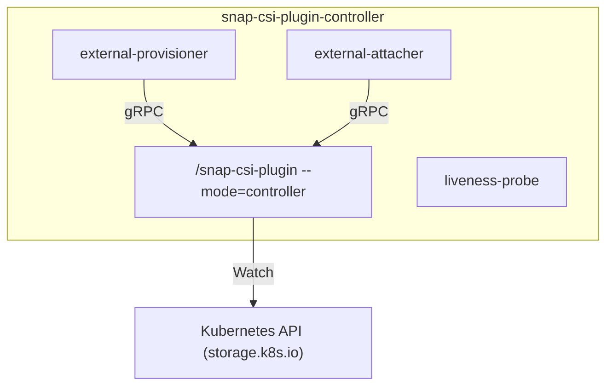

<!-- source: DeepWiki mcp.deepwiki.com · repo NVIDIA/doca-platform · page 6 Storage Integration · fetched 2026-10-26 -->

# Storage Integration

Relevant source files

The following files were used as context for generating this wiki page:

- [docs/public/user-guides/host-trusted/use-cases/hbn-ovnk-snap/manifests/05-dpudeployment-installation/dpuservicetemplate_spdk-csi-controller-dpu.yaml](docs/public/user-guides/host-trusted/use-cases/hbn-ovnk-snap/manifests/05-dpudeployment-installation/dpuservicetemplate_spdk-csi-controller-dpu.yaml)
- [docs/public/user-guides/host-trusted/use-cases/hbn-snap/manifests/04.1-dpudeployment-installation-nvme/spdk-csi-controller-dpu-dpuservicetemplate.yaml](docs/public/user-guides/host-trusted/use-cases/hbn-snap/manifests/04.1-dpudeployment-installation-nvme/spdk-csi-controller-dpu-dpuservicetemplate.yaml)
- [docs/public/user-guides/zero-trust/use-cases/hbn-snap/manifests/03.1-dpudeployment-installation-nvme/spdk-csi-controller-dpu-dpuservicetemplate.yaml](docs/public/user-guides/zero-trust/use-cases/hbn-snap/manifests/03.1-dpudeployment-installation-nvme/spdk-csi-controller-dpu-dpuservicetemplate.yaml)
- [dpuservices/storage/chart/README.md](dpuservices/storage/chart/README.md)
- [dpuservices/storage/chart/templates/_validate.tpl](dpuservices/storage/chart/templates/_validate.tpl)
- [dpuservices/storage/chart/templates/dpu_block-storage-vendor-dpu-plugin.yaml](dpuservices/storage/chart/templates/dpu_block-storage-vendor-dpu-plugin.yaml)
- [dpuservices/storage/chart/templates/dpu_doca-snap.yaml](dpuservices/storage/chart/templates/dpu_doca-snap.yaml)
- [dpuservices/storage/chart/templates/dpu_fs-storage-vendor-dpu-plugin.yaml](dpuservices/storage/chart/templates/dpu_fs-storage-vendor-dpu-plugin.yaml)
- [dpuservices/storage/chart/templates/dpu_nfs-storage-vendor-dpu-plugin.yaml](dpuservices/storage/chart/templates/dpu_nfs-storage-vendor-dpu-plugin.yaml)
- [dpuservices/storage/chart/templates/dpu_snap-node-driver.yaml](dpuservices/storage/chart/templates/dpu_snap-node-driver.yaml)
- [dpuservices/storage/chart/templates/host_snap-csi-plugin.yaml](dpuservices/storage/chart/templates/host_snap-csi-plugin.yaml)
- [dpuservices/storage/chart/templates/host_snap-host-controller.yaml](dpuservices/storage/chart/templates/host_snap-host-controller.yaml)
- [dpuservices/storage/chart/values.yaml](dpuservices/storage/chart/values.yaml)
- [dpuservices/storage/chart/values.yaml.tmpl](dpuservices/storage/chart/values.yaml.tmpl)
- [dpuservices/storage/examples/_src/manifests/spdk-csi/spdk-csi-controller-dpu-dpuservicetemplate.yaml](dpuservices/storage/examples/_src/manifests/spdk-csi/spdk-csi-controller-dpu-dpuservicetemplate.yaml)
- [dpuservices/storage/examples/scenarios/README.md](dpuservices/storage/examples/scenarios/README.md)
- [dpuservices/storage/examples/scenarios/non-trusted-host/nvme-hotplug-pf/spdk-csi-controller-dpu-dpuservicetemplate.yaml](dpuservices/storage/examples/scenarios/non-trusted-host/nvme-hotplug-pf/spdk-csi-controller-dpu-dpuservicetemplate.yaml)
- [dpuservices/storage/examples/scenarios/non-trusted-host/nvme-static-pf/spdk-csi-controller-dpu-dpuservicetemplate.yaml](dpuservices/storage/examples/scenarios/non-trusted-host/nvme-static-pf/spdk-csi-controller-dpu-dpuservicetemplate.yaml)
- [dpuservices/storage/examples/scenarios/non-trusted-host/nvme-vf-on-static-pf/spdk-csi-controller-dpu-dpuservicetemplate.yaml](dpuservices/storage/examples/scenarios/non-trusted-host/nvme-vf-on-static-pf/spdk-csi-controller-dpu-dpuservicetemplate.yaml)
- [dpuservices/storage/examples/scenarios/trusted-k8s-cluster/nvme-hotplug-pf/spdk-csi-controller-dpu-dpuservicetemplate.yaml](dpuservices/storage/examples/scenarios/trusted-k8s-cluster/nvme-hotplug-pf/spdk-csi-controller-dpu-dpuservicetemplate.yaml)
- [dpuservices/storage/examples/scenarios/trusted-k8s-cluster/nvme-vf-on-static-pf/spdk-csi-controller-dpu-dpuservicetemplate.yaml](dpuservices/storage/examples/scenarios/trusted-k8s-cluster/nvme-vf-on-static-pf/spdk-csi-controller-dpu-dpuservicetemplate.yaml)
- [internal/storage/snap/storage-vendor-dpu-plugin/nfs-storage-vendor-dpu-plugin/storage_vendor_dpu_grpc.go](internal/storage/snap/storage-vendor-dpu-plugin/nfs-storage-vendor-dpu-plugin/storage_vendor_dpu_grpc.go)

## Purpose and Scope

This document describes DPU-offloaded storage in the DOCA Platform Framework using DOCA SNAP (Storage Acceleration Platform). It covers how storage services are deployed to DPUs, how they integrate with Kubernetes through CSI (Container Storage Interface), and how storage traffic flows through the DPU networking infrastructure.

For details on the underlying architecture and SPDK requirements, see [SNAP Storage System](#6.1).

## Storage Architecture Overview

The DPF storage integration consists of three primary layers:

1.  **Host Layer**: CSI plugins and vendor plugins running on worker nodes.
2.  **DPU Layer**: SNAP storage services running on DPU nodes, providing emulated storage devices.
3.  **Backend Layer**: Remote storage systems (SPDK targets for block, NFS servers for filesystem).

The coordination between these layers is handled by a set of controllers and plugins that sync storage intent from the host cluster to the DPU cluster.

### Component Relationship Diagram
This diagram bridges the natural language concepts of "Host" and "DPU" storage to the specific code entities and Helm chart components.

**Sources**: [dpuservices/storage/chart/values.yaml:38-175](), [dpuservices/storage/chart/README.md:11-67](), [dpuservices/storage/examples/scenarios/README.md:141-142]()

## Storage Types and Emulation

### SNAP Block Storage (NVMe)
SNAP Block Storage provides emulated NVMe devices backed by remote SPDK targets. The NVMe devices appear as hot-plugged PCIe devices to the host. The `block-storage-vendor-dpu-plugin` manages the lifecycle of these emulated devices [dpuservices/storage/chart/README.md:11-13]().

**Key Configuration**:
- **Emulation Mode**: Set to `nvme` in the CSI plugin [dpuservices/storage/chart/values.yaml:50]().
- **Hardware Config**: In `nvme` mode, the plugin can be configured to load the NVMe driver and create VFs automatically [dpuservices/storage/chart/values.yaml:148-150]().
- **Service**: The `doca-snap` container runs with `IPC_LOCK`, `SYS_RAWIO`, and `SYS_NICE` capabilities to perform hardware emulation [dpuservices/storage/chart/README.md:32-34]().

### SNAP VirtioFS Storage
SNAP VirtioFS provides filesystem-level storage backed by remote NFS servers. It uses the `nfs-storage-vendor-dpu-plugin` on the DPU [dpuservices/storage/chart/templates/dpu_nfs-storage-vendor-dpu-plugin.yaml:54-58]() and a corresponding host-side agent.

**Key Configuration**:
- **Emulation Mode**: Set to `virtiofs` [dpuservices/storage/chart/values.yaml:49]().
- **Mounting**: The DPU plugin mounts the provider socket directory with `HostToContainer` propagation to share the SNAP socket [dpuservices/storage/chart/templates/dpu_nfs-storage-vendor-dpu-plugin.yaml:77-80]().

**Sources**: [dpuservices/storage/chart/values.yaml:47-50](), [dpuservices/storage/chart/README.md:32-35](), [dpuservices/storage/chart/templates/dpu_nfs-storage-vendor-dpu-plugin.yaml:54-85]()

## CSI and Volume Management

The system uses a cross-cluster synchronization mechanism where storage requests in the host cluster are translated into DPU-side resources.

### CSI Plugin Deployment
The `snap-csi-plugin` is split into a central controller and per-node agents. The controller manages volume lifecycle and attachments via `external-provisioner` and `external-attacher` sidecars [dpuservices/storage/chart/templates/host_snap-csi-plugin.yaml:69-100]().

**Sources**: [dpuservices/storage/chart/templates/host_snap-csi-plugin.yaml:35-111](), [dpuservices/storage/chart/values.yaml:51-134]()

### RBAC and Credentials
Deployment of the `spdk-csi-controller` requires `DPUServiceCredentialRequest` to access the DPU cluster [dpuservices/storage/examples/scenarios/README.md:75-97](). The CSI plugin itself requires permissions for `volumeattachments`, `persistentvolumes`, and `storageclasses` [dpuservices/storage/chart/templates/host_snap-csi-plugin.yaml:155-169]().

**Sources**: [dpuservices/storage/examples/scenarios/README.md:75-97](), [dpuservices/storage/chart/templates/host_snap-csi-plugin.yaml:148-175]()

## Deployment and Service Configuration

Storage components are deployed as `DaemonSets` or `Deployments`, integrated into the DPF service chain via `DPUServiceTemplate`.

| Service | Helm Key | Role |
| :--- | :--- | :--- |
| `doca-snap` | `dpu.docaSnap` | The core DOCA SNAP runtime performing emulation [dpuservices/storage/chart/README.md:22-30](). |
| `block-vendor` | `dpu.blockStorageVendorDpuPlugin` | Manages NVMe-oF connections and SNAP RPCs for block [dpuservices/storage/chart/README.md:11-13](). |
| `nfs-vendor` | `dpu.nfsStorageVendorDpuPlugin` | Manages NFS mounts and SNAP RPCs for VirtioFS [dpuservices/storage/chart/templates/dpu_nfs-storage-vendor-dpu-plugin.yaml:58-63](). |
| `snap-csi` | `host.snapCsiPlugin` | The CSI driver (Controller and Node parts) [dpuservices/storage/chart/values.yaml:40-175](). |

### Service Chain Templates
For integrated scenarios like HBN-OVNK-SNAP, the `spdk-csi-controller-dpu` is deployed using a `DPUServiceTemplate` pointing to the storage vendor charts [docs/public/user-guides/host-trusted/use-cases/hbn-ovnk-snap/manifests/05-dpudeployment-installation/dpuservicetemplate_spdk-csi-controller-dpu.yaml:3-13]().

### SNAP Runtime Configuration
The `doca-snap` service uses environment variables to locate the SPDK socket [dpuservices/storage/chart/README.md:24]() and can be configured with specific `APP_ARGS` (e.g., CPU mask) [dpuservices/storage/chart/README.md:23]().

**Sources**: [dpuservices/storage/chart/README.md:11-67](), [dpuservices/storage/chart/values.yaml:40-175](), [docs/public/user-guides/host-trusted/use-cases/hbn-ovnk-snap/manifests/05-dpudeployment-installation/dpuservicetemplate_spdk-csi-controller-dpu.yaml:1-13]()

---

