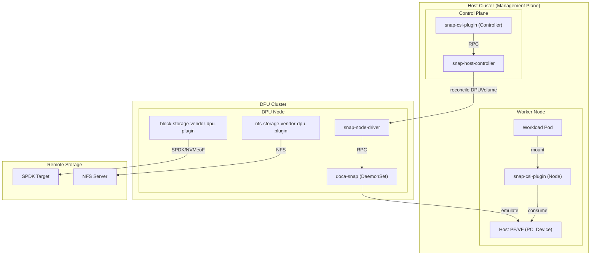
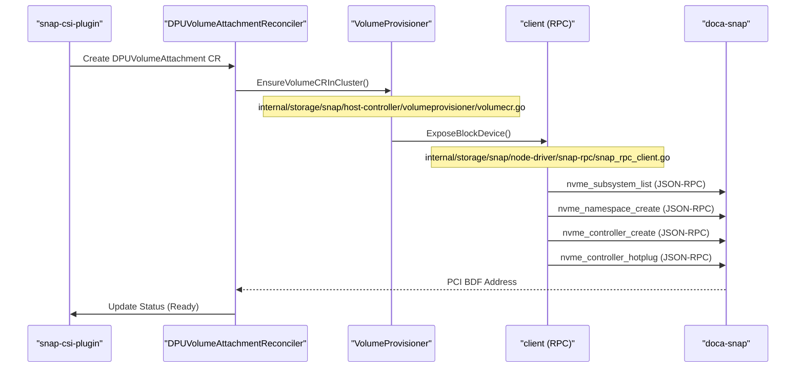

<!-- source: DeepWiki mcp.deepwiki.com · repo NVIDIA/doca-platform · page 6.1 SNAP Storage System · fetched 2026-10-26 -->

# SNAP Storage System

Relevant source files

The following files were used as context for generating this wiki page:

- [api/storage/v1alpha1/volumeattachment_types.go](api/storage/v1alpha1/volumeattachment_types.go)
- [api/storage/v1alpha1/zz_generated.deepcopy.go](api/storage/v1alpha1/zz_generated.deepcopy.go)
- [cmd/storage/snap-host-controller/main.go](cmd/storage/snap-host-controller/main.go)
- [cmd/storage/storage-vendor-dpu-plugin/fs-storage-vendor-dpu-plugin/main.go](cmd/storage/storage-vendor-dpu-plugin/fs-storage-vendor-dpu-plugin/main.go)
- [cmd/storage/storage-vendor-dpu-plugin/nfs-storage-vendor-dpu-plugin/main.go](cmd/storage/storage-vendor-dpu-plugin/nfs-storage-vendor-dpu-plugin/main.go)
- [config/storage/crd/bases/storage.dpu.nvidia.com_volumeattachments.yaml](config/storage/crd/bases/storage.dpu.nvidia.com_volumeattachments.yaml)
- [dpuservices/storage/chart/README.md](dpuservices/storage/chart/README.md)
- [dpuservices/storage/chart/templates/_dpu_nfs-storage-vendor-dpu-plugin_helpers.tpl](dpuservices/storage/chart/templates/_dpu_nfs-storage-vendor-dpu-plugin_helpers.tpl)
- [dpuservices/storage/chart/templates/_validate.tpl](dpuservices/storage/chart/templates/_validate.tpl)
- [dpuservices/storage/chart/templates/crd/storage.dpu.nvidia.com_volumeattachments.yaml](dpuservices/storage/chart/templates/crd/storage.dpu.nvidia.com_volumeattachments.yaml)
- [dpuservices/storage/chart/templates/dpu_block-storage-vendor-dpu-plugin.yaml](dpuservices/storage/chart/templates/dpu_block-storage-vendor-dpu-plugin.yaml)
- [dpuservices/storage/chart/templates/dpu_doca-snap.yaml](dpuservices/storage/chart/templates/dpu_doca-snap.yaml)
- [dpuservices/storage/chart/templates/dpu_fs-storage-vendor-dpu-plugin.yaml](dpuservices/storage/chart/templates/dpu_fs-storage-vendor-dpu-plugin.yaml)
- [dpuservices/storage/chart/templates/dpu_nfs-storage-vendor-dpu-plugin.yaml](dpuservices/storage/chart/templates/dpu_nfs-storage-vendor-dpu-plugin.yaml)
- [dpuservices/storage/chart/templates/dpu_snap-node-driver.yaml](dpuservices/storage/chart/templates/dpu_snap-node-driver.yaml)
- [dpuservices/storage/chart/templates/host_snap-csi-plugin.yaml](dpuservices/storage/chart/templates/host_snap-csi-plugin.yaml)
- [dpuservices/storage/chart/templates/host_snap-host-controller.yaml](dpuservices/storage/chart/templates/host_snap-host-controller.yaml)
- [dpuservices/storage/chart/values.yaml](dpuservices/storage/chart/values.yaml)
- [dpuservices/storage/chart/values.yaml.tmpl](dpuservices/storage/chart/values.yaml.tmpl)
- [internal/storage/snap/host-controller/common.go](internal/storage/snap/host-controller/common.go)
- [internal/storage/snap/host-controller/dpustoragepolicy_controller.go](internal/storage/snap/host-controller/dpustoragepolicy_controller.go)
- [internal/storage/snap/host-controller/dpustoragepolicy_controller_test.go](internal/storage/snap/host-controller/dpustoragepolicy_controller_test.go)
- [internal/storage/snap/host-controller/dpustoragevendor_controller.go](internal/storage/snap/host-controller/dpustoragevendor_controller.go)
- [internal/storage/snap/host-controller/dpustoragevendor_controller_test.go](internal/storage/snap/host-controller/dpustoragevendor_controller_test.go)
- [internal/storage/snap/host-controller/dpuvolume_controller.go](internal/storage/snap/host-controller/dpuvolume_controller.go)
- [internal/storage/snap/host-controller/dpuvolume_controller_test.go](internal/storage/snap/host-controller/dpuvolume_controller_test.go)
- [internal/storage/snap/host-controller/dpuvolumeattachment_controller.go](internal/storage/snap/host-controller/dpuvolumeattachment_controller.go)
- [internal/storage/snap/host-controller/dpuvolumeattachment_controller_test.go](internal/storage/snap/host-controller/dpuvolumeattachment_controller_test.go)
- [internal/storage/snap/host-controller/indexers/indexers.go](internal/storage/snap/host-controller/indexers/indexers.go)
- [internal/storage/snap/host-controller/indexers/indexers_test.go](internal/storage/snap/host-controller/indexers/indexers_test.go)
- [internal/storage/snap/host-controller/indexers/suite_test.go](internal/storage/snap/host-controller/indexers/suite_test.go)
- [internal/storage/snap/host-controller/resourcehelper/delete.go](internal/storage/snap/host-controller/resourcehelper/delete.go)
- [internal/storage/snap/host-controller/resourcehelper/delete_test.go](internal/storage/snap/host-controller/resourcehelper/delete_test.go)
- [internal/storage/snap/host-controller/suite_test.go](internal/storage/snap/host-controller/suite_test.go)
- [internal/storage/snap/host-controller/volumeprovisioner/pvc.go](internal/storage/snap/host-controller/volumeprovisioner/pvc.go)
- [internal/storage/snap/host-controller/volumeprovisioner/suite_test.go](internal/storage/snap/host-controller/volumeprovisioner/suite_test.go)
- [internal/storage/snap/host-controller/volumeprovisioner/volumecr.go](internal/storage/snap/host-controller/volumeprovisioner/volumecr.go)
- [internal/storage/snap/host-controller/volumeprovisioner/volumeprovisioner.go](internal/storage/snap/host-controller/volumeprovisioner/volumeprovisioner.go)
- [internal/storage/snap/host-controller/volumeprovisioner/volumeprovisioner_test.go](internal/storage/snap/host-controller/volumeprovisioner/volumeprovisioner_test.go)
- [internal/storage/snap/node-driver/mock/SNAPClient.go](internal/storage/snap/node-driver/mock/SNAPClient.go)
- [internal/storage/snap/node-driver/snap-rpc/snap_rpc.go](internal/storage/snap/node-driver/snap-rpc/snap_rpc.go)
- [internal/storage/snap/node-driver/snap-rpc/snap_rpc_client.go](internal/storage/snap/node-driver/snap-rpc/snap_rpc_client.go)
- [internal/storage/snap/node-driver/snap-rpc/snap_rpc_client_test.go](internal/storage/snap/node-driver/snap-rpc/snap_rpc_client_test.go)
- [internal/storage/snap/node-driver/snap-rpc/snap_rpc_test.go](internal/storage/snap/node-driver/snap-rpc/snap_rpc_test.go)
- [internal/storage/snap/node-driver/volumeattachment_controller.go](internal/storage/snap/node-driver/volumeattachment_controller.go)
- [internal/storage/snap/node-driver/volumeattachment_controller_test.go](internal/storage/snap/node-driver/volumeattachment_controller_test.go)
- [internal/storage/snap/storage-vendor-dpu-plugin/block-storage-vendor-dpu-plugin/storage_vendor_dpu_grpc.go](internal/storage/snap/storage-vendor-dpu-plugin/block-storage-vendor-dpu-plugin/storage_vendor_dpu_grpc.go)
- [internal/storage/snap/storage-vendor-dpu-plugin/block-storage-vendor-dpu-plugin/storage_vendor_dpu_grpc_test.go](internal/storage/snap/storage-vendor-dpu-plugin/block-storage-vendor-dpu-plugin/storage_vendor_dpu_grpc_test.go)
- [internal/storage/snap/storage-vendor-dpu-plugin/block-storage-vendor-dpu-plugin/storage_vendor_dpu_rpc.go](internal/storage/snap/storage-vendor-dpu-plugin/block-storage-vendor-dpu-plugin/storage_vendor_dpu_rpc.go)
- [internal/storage/snap/storage-vendor-dpu-plugin/block-storage-vendor-dpu-plugin/storage_vendor_dpu_rpc_test.go](internal/storage/snap/storage-vendor-dpu-plugin/block-storage-vendor-dpu-plugin/storage_vendor_dpu_rpc_test.go)
- [internal/storage/snap/storage-vendor-dpu-plugin/block-storage-vendor-dpu-plugin/storage_vendor_dpu_test_helpers.go](internal/storage/snap/storage-vendor-dpu-plugin/block-storage-vendor-dpu-plugin/storage_vendor_dpu_test_helpers.go)
- [internal/storage/snap/storage-vendor-dpu-plugin/nfs-storage-vendor-dpu-plugin/storage_vendor_dpu_grpc.go](internal/storage/snap/storage-vendor-dpu-plugin/nfs-storage-vendor-dpu-plugin/storage_vendor_dpu_grpc.go)

## Purpose and Scope

This document describes the SNAP (Storage Network Acceleration Protocol) storage system within the DOCA Platform Framework (DPF). SNAP enables DPU-offloaded storage by presenting emulated NVMe devices or VirtioFS filesystems to the host, while the DPU handles the actual storage I/O operations to remote targets. This offloads storage processing from the host CPU to the DPU's ARM cores and hardware acceleration capabilities.

The SNAP system within DPF is orchestrated using a set of Kubernetes controllers and CSI plugins that manage the lifecycle of storage volumes and their attachments to DPU-equipped nodes.

## Architecture Overview

The SNAP storage system consists of components distributed across three layers:

1.  **Host Layer**: Kubernetes CSI plugins and storage vendor plugins that consume storage exposed by the DPU.
2.  **DPU Layer**: SNAP service pods (`doca-snap`), node drivers, and storage vendor plugins that manage storage emulation and backend connectivity.
3.  **Remote Storage Layer**: External storage systems (SPDK targets for block storage, NFS servers for file storage).

### System Topology

Sources: [dpuservices/storage/chart/values.yaml:38-50](), [dpuservices/storage/chart/values.yaml:135-156](), [dpuservices/storage/chart/templates/host_snap-csi-plugin.yaml:6-48]()

## Component Implementation

### SNAP Host Controller
The `snap-host-controller` is the central orchestrator in the host cluster. It reconciles high-level storage CRDs and coordinates with DPU clusters.

*   **Main Entry Point**: `main.go` initializes reconcilers for `DPUVolume`, `DPUVolumeAttachment`, `DPUStorageVendor`, and `DPUStoragePolicy` [cmd/storage/snap-host-controller/main.go:179-195]().
*   **Indexers**: It uses specialized field indexers to efficiently lookup DPUs by node name and volumes by policy [internal/storage/snap/host-controller/indexers/indexers.go:20-50]().
*   **Volume Provisioning**: The `VolumeProvisioner` handles the creation of `Volume` and `PersistentVolumeClaim` objects in the target DPU clusters [internal/storage/snap/host-controller/volumeprovisioner/volumeprovisioner.go:30-60]().

### SNAP RPC Interface
The DPU-side components interact with the `doca-snap` service (SPDK-based) via a JSON-RPC interface. The `Client` interface abstracts these operations.

| Function | Code Entity | Description |
| :--- | :--- | :--- |
| **Expose Block** | `ExposeBlockDevice` | Creates NVMe namespaces and controllers on the DPU [internal/storage/snap/node-driver/snap-rpc/snap_rpc_client.go:61-173]() |
| **Expose FS** | `ExposeFSDevice` | Configures VirtioFS transports and DOCA managers [internal/storage/snap/node-driver/snap-rpc/snap_rpc_client.go:187-250]() |
| **Destroy Block** | `DestroyBlockDevice` | Detaches and destroys NVMe controllers/namespaces [internal/storage/snap/node-driver/snap-rpc/snap_rpc_client.go:36-36]() |
| **JSON-RPC Client** | `JSONRPCSnapClient` | Low-level socket handler for JSON-RPC communication [internal/storage/snap/node-driver/snap-rpc/snap_rpc.go:49-53]() |

Sources: [internal/storage/snap/node-driver/snap-rpc/snap_rpc_client.go:29-45](), [internal/storage/snap/node-driver/snap-rpc/snap_rpc.go:108-216]()

### Storage Vendor DPU Plugins
These plugins implement the gRPC `StoragePluginService` to bridge vendor-specific storage logic to the SNAP emulation layer.

*   **Block Storage**: The `StoragePluginServer` for block storage handles `GetPluginInfo` and `Probe` requests, communicating with SNAP via the socket defined by `envSNAPRPCSocketPath` [internal/storage/snap/storage-vendor-dpu-plugin/block-storage-vendor-dpu-plugin/storage_vendor_dpu_grpc.go:38-46]().
*   **NFS Storage**: Deployed as a `DaemonSet`, the NFS plugin mounts the SNAP providers socket directory to facilitate communication with the DPU storage backend [dpuservices/storage/chart/templates/dpu_nfs-storage-vendor-dpu-plugin.yaml:77-83]().

## Storage Service Chain and HBN Integration

SNAP is typically integrated with **Host Based Networking (HBN)**. In this topology, storage traffic from the SNAP service is routed through the HBN bridge to the physical network.

1.  **Interface Integration**: The SNAP service utilizes `snap_if` interfaces that are plugged into the HBN infrastructure.
2.  **Socket Paths**: Plugins communicate with SNAP via Unix Domain Sockets located at `/var/lib/nvidia/storage/snap/providers/` [internal/storage/snap/storage-vendor-dpu-plugin/block-storage-vendor-dpu-plugin/storage_vendor_dpu_grpc.go:68-68]().
3.  **HBN Role**: HBN provides the L3 connectivity (BGP/ECMP) required for the DPU to reach remote SPDK or NFS targets.

Sources: [dpuservices/storage/chart/templates/dpu_nfs-storage-vendor-dpu-plugin.yaml:77-94](), [dpuservices/storage/chart/values.yaml:23-24]()

## Data Flow: Volume Attachment

The following diagram bridges the natural language "Attach Volume" request to the specific code entities involved.

Sources: [internal/storage/snap/node-driver/snap-rpc/snap_rpc_client.go:61-173](), [internal/storage/snap/node-driver/snap-rpc/snap_rpc.go:219-240](), [cmd/storage/snap-host-controller/main.go:185-189]()

## Configuration and Requirements

### SPDK Target Requirements
SNAP Block requires a remote SPDK target. The `block-storage-vendor-dpu-plugin` communicates with this target to map remote bdevs to local emulated NVMe namespaces.

### Helm Configuration
The DPF storage chart allows granular control over which components are enabled. Only one component (e.g., `snapCsiPlugin`) should be enabled at a time per deployment instance [dpuservices/storage/chart/values.yaml:31-33]().

| Key | Default | Description |
| :--- | :--- | :--- |
| `dpu.docaSnap.enabled` | `false` | Enables the core SNAP emulation daemon [dpuservices/storage/chart/README.md:22]() |
| `host.snapCsiPlugin.enabled` | `false` | Enables the host-side CSI driver [dpuservices/storage/chart/values.yaml:43]() |
| `dpu.docaSnap.env.SNAP_SPDK_SOCK` | `/var/lib/nvidia/storage/snap/providers/nvidia/snap.sock` | Path to the SNAP RPC socket [dpuservices/storage/chart/README.md:24]() |
| `host.snapCsiPlugin.emulationMode` | `nvme` | Supports `nvme` or `virtiofs` [dpuservices/storage/chart/values.yaml:50]() |
| `dpu.docaSnap.image.repository` | `nvcr.io/nvidia/doca/doca_vfs` | The container image for the SNAP service [dpuservices/storage/chart/README.md:26]() |

Sources: [dpuservices/storage/chart/values.yaml:1-50](), [dpuservices/storage/chart/README.md:1-67]()

---

