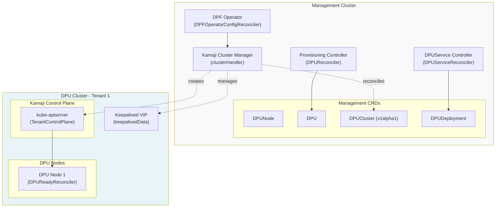
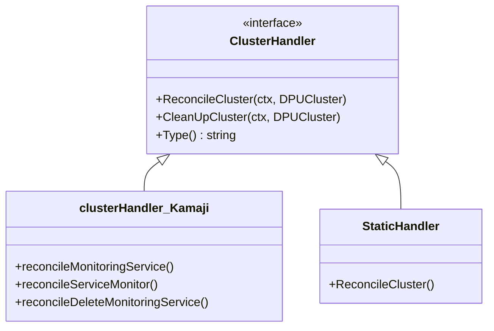

<!-- source: DeepWiki mcp.deepwiki.com · repo NVIDIA/doca-platform · page 7 DPU Cluster Management · fetched 2026-10-26 -->

# DPU Cluster Management

Relevant source files

The following files were used as context for generating this wiki page:

- [.checkov.yaml](.checkov.yaml)
- [.golangci-kal.yml](.golangci-kal.yml)
- [api/provisioning/v1alpha1/dpucluster_types.go](api/provisioning/v1alpha1/dpucluster_types.go)
- [config/dpuservice/manager/manager.yaml](config/dpuservice/manager/manager.yaml)
- [config/kamaji-cluster-manager/manager/manager.yaml](config/kamaji-cluster-manager/manager/manager.yaml)
- [config/kamaji-cluster-manager/rbac/role.yaml](config/kamaji-cluster-manager/rbac/role.yaml)
- [config/provisioning/crd/bases/provisioning.dpu.nvidia.com_dpuclusters.yaml](config/provisioning/crd/bases/provisioning.dpu.nvidia.com_dpuclusters.yaml)
- [config/provisioning/manager/manager.yaml](config/provisioning/manager/manager.yaml)
- [config/static-cluster-manager/manager/manager.yaml](config/static-cluster-manager/manager/manager.yaml)
- [config/static-cluster-manager/rbac/role.yaml](config/static-cluster-manager/rbac/role.yaml)
- [crdify.yaml](crdify.yaml)
- [deploy/charts/dpf-operator/templates/crds/apiextensions.k8s.io_v1_customresourcedefinition_dpuclusters.provisioning.dpu.nvidia.com.yaml](deploy/charts/dpf-operator/templates/crds/apiextensions.k8s.io_v1_customresourcedefinition_dpuclusters.provisioning.dpu.nvidia.com.yaml)
- [deploy/charts/dpf-operator/templates/deployment.yaml](deploy/charts/dpf-operator/templates/deployment.yaml)
- [hack/scripts/validate-manifest-checkov.sh](hack/scripts/validate-manifest-checkov.sh)
- [internal/clustermanager/controller/dpucluster_controller.go](internal/clustermanager/controller/dpucluster_controller.go)
- [internal/clustermanager/controller/dpucluster_controller_test.go](internal/clustermanager/controller/dpucluster_controller_test.go)
- [internal/clustermanager/kamaji/handler.go](internal/clustermanager/kamaji/handler.go)
- [internal/clustermanager/kamaji/handler_test.go](internal/clustermanager/kamaji/handler_test.go)
- [internal/clustermanager/kamaji/suite_test.go](internal/clustermanager/kamaji/suite_test.go)
- [internal/operator/inventory/manifests/kamaji-cluster-manager.yaml](internal/operator/inventory/manifests/kamaji-cluster-manager.yaml)
- [internal/operator/inventory/manifests/static-cluster-manager.yaml](internal/operator/inventory/manifests/static-cluster-manager.yaml)

This page documents the multi-tenant DPU cluster architecture in the DOCA Platform Framework (DPF). It covers the separation between the management cluster and DPU clusters, and the two primary cluster manager implementations: Kamaji and the Static Cluster Manager.

## Multi-Tenant Architecture Overview

The DPF system implements a multi-tenant architecture where each tenant receives an isolated Kubernetes control plane. This separation enables secure isolation between tenants while centralizing management operations within a primary management cluster.

### Control Plane Hierarchy

The following diagram illustrates the relationship between the Management Cluster and individual Tenant DPU Clusters, mapping system components to their respective code-level controllers and CRDs.

**Key Architectural Principles:**

- **Centralized Management**: The `DPFOperatorConfig` manages the lifecycle of all cluster management components.
- **Isolated Control Planes**: Each tenant receives a dedicated Kubernetes API server managed via Kamaji's `TenantControlPlane` [internal/clustermanager/kamaji/handler.go:64-64]().
- **Resource Isolation**: Tenant clusters are defined by the `DPUCluster` CRD, which specifies the `Type` (e.g., `kamaji` or `static`) and resource limits like `MaxNodes` [api/provisioning/v1alpha1/dpucluster_types.go:85-99]().
- **High Availability**: VIP-based access with Keepalived provides HA for tenant cluster APIs, configured through `ClusterEndpointSpec` [api/provisioning/v1alpha1/dpucluster_types.go:182-200]().
- **Etcd Security**: DPF supports Etcd encryption at rest for `DPUCluster` resources, including static key rotation [api/provisioning/v1alpha1/dpucluster_types.go:44-48]().

Sources:
- [api/provisioning/v1alpha1/dpucluster_types.go:35-62]()
- [internal/clustermanager/kamaji/handler.go:157-166]()
- [deploy/charts/dpf-operator/templates/crds/apiextensions.k8s.io_v1_customresourcedefinition_dpuclusters.provisioning.dpu.nvidia.com.yaml:119-126]()

## Cluster Manager Implementations

The DPF system provides two cluster manager implementations to support different deployment scenarios. These are orchestrated by the `DPFOperatorConfig` component.

### Cluster Management Logic

The system uses a common interface for reconciling clusters, implemented by different handlers based on the `ClusterType` [api/provisioning/v1alpha1/dpucluster_types.go:35-38]().

### Kamaji Integration for Multi-Tenancy
Kamaji is the default provider for DPF-managed clusters. It creates isolated Kubernetes control planes (Tenant Control Planes) on the management cluster that manage the DPU nodes.

- **Lifecycle**: The `clusterHandler` in the Kamaji package reconciles the `TenantControlPlane` and ensures the cluster is in a `Ready` phase [api/provisioning/v1alpha1/dpucluster_types.go:59-59]().
- **Networking**: It deploys Keepalived via a `DaemonSet` to provide a Virtual IP (VIP) for the control plane endpoint [internal/clustermanager/kamaji/handler.go:88-90]().
- **Monitoring**: It creates `ServiceMonitor` resources to export metrics from the tenant control plane to the management cluster's monitoring stack [internal/clustermanager/kamaji/handler.go:125-129]().
- **RBAC**: The manager requires extensive permissions to manage `TenantControlPlanes`, `Secrets`, and `ConfigMaps` [internal/operator/inventory/manifests/kamaji-cluster-manager.yaml:11-136]().

For details, see [Kamaji Integration for Multi-Tenancy](#7.1).

Sources:
- [internal/clustermanager/kamaji/handler.go:74-85]()
- [internal/clustermanager/kamaji/handler_test.go:77-99]()
- [internal/operator/inventory/manifests/kamaji-cluster-manager.yaml:214-222]()

### Static Cluster Manager
The Static Cluster Manager is used for pre-existing clusters that were not created by DPF.

- **Manual Integration**: Users provide a `kubeconfig` secret name in the `DPUCluster` spec [api/provisioning/v1alpha1/dpucluster_types.go:101-104]().
- **Immutability**: The `kubeconfig` field is immutable once set to ensure consistent connectivity to the external cluster [api/provisioning/v1alpha1/dpucluster_types.go:102-102]().
- **Deployment**: The manager is deployed as a controller manager in the `dpf-operator-system` namespace [internal/operator/inventory/manifests/static-cluster-manager.yaml]().

For details, see [Static Cluster Manager](#7.2).

Sources:
- [api/provisioning/v1alpha1/dpucluster_types.go:85-109]()
- [config/static-cluster-manager/rbac/role.yaml:7-40]()

## DPU Provisioning and Cluster Readiness

Cluster management is tightly coupled with the DPU provisioning lifecycle. A `DPUCluster` tracks its state through a defined set of phases and conditions.

| Phase | Description |
|-------|-------------|
| **Pending** | Initial state before reconciliation begins [api/provisioning/v1alpha1/dpucluster_types.go:57-57]() |
| **Creating** | Cluster resources (control plane, VIP) are being provisioned [api/provisioning/v1alpha1/dpucluster_types.go:58-58]() |
| **Ready** | The cluster is operational and reachable [api/provisioning/v1alpha1/dpucluster_types.go:59-59]() |
| **Failed** | Terminal state if reconciliation fails irrecoverably [api/provisioning/v1alpha1/dpucluster_types.go:61-61]() |

The `DPUCluster` status also tracks the `NodesCount`, representing the number of DPUs assigned to the specific cluster [api/provisioning/v1alpha1/dpucluster_types.go:121-124]().

Sources:
- [api/provisioning/v1alpha1/dpucluster_types.go:50-62]()
- [deploy/charts/dpf-operator/templates/crds/apiextensions.k8s.io_v1_customresourcedefinition_dpuclusters.provisioning.dpu.nvidia.com.yaml:20-43]()

---

