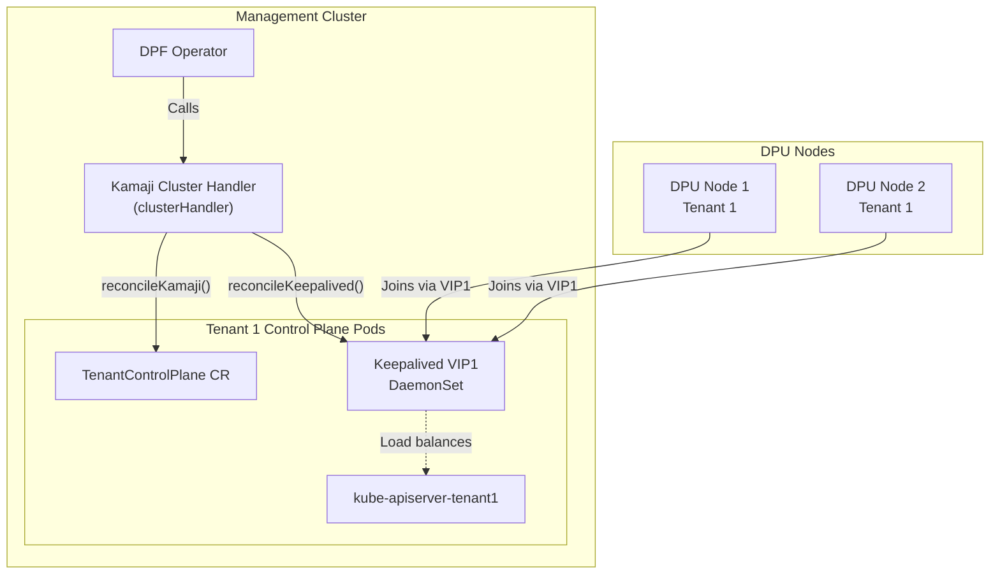
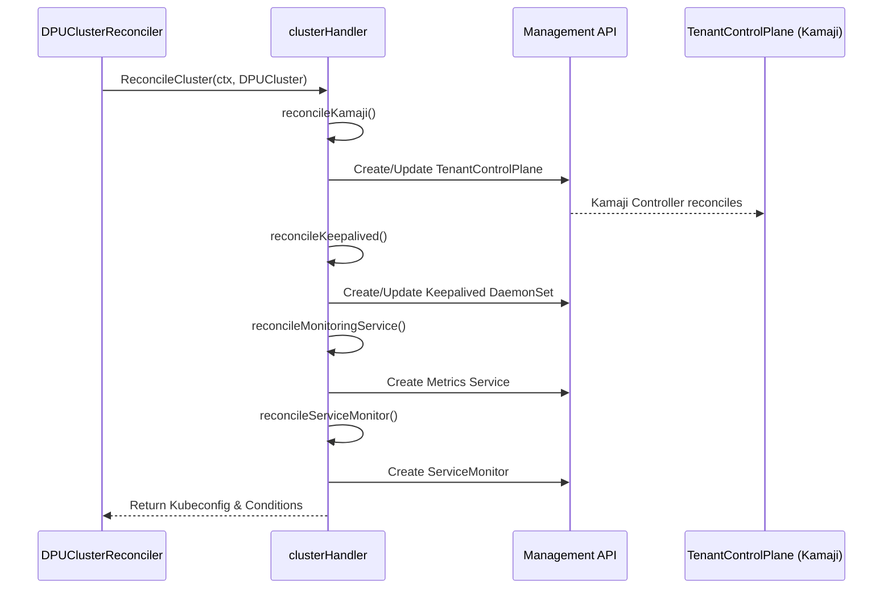

<!-- source: DeepWiki mcp.deepwiki.com · repo NVIDIA/doca-platform · page 7.1 Kamaji Integration for Multi-Tenancy · fetched 2026-10-26 -->

# Kamaji Integration for Multi-Tenancy

Relevant source files

The following files were used as context for generating this wiki page:

- [.checkov.yaml](.checkov.yaml)
- [config/dpuservice/manager/manager.yaml](config/dpuservice/manager/manager.yaml)
- [config/kamaji-cluster-manager/manager/manager.yaml](config/kamaji-cluster-manager/manager/manager.yaml)
- [config/kamaji-cluster-manager/rbac/role.yaml](config/kamaji-cluster-manager/rbac/role.yaml)
- [config/provisioning/manager/manager.yaml](config/provisioning/manager/manager.yaml)
- [config/static-cluster-manager/manager/manager.yaml](config/static-cluster-manager/manager/manager.yaml)
- [config/static-cluster-manager/rbac/role.yaml](config/static-cluster-manager/rbac/role.yaml)
- [deploy/charts/dpf-operator/templates/deployment.yaml](deploy/charts/dpf-operator/templates/deployment.yaml)
- [deploy/helmfiles/hooks/apply-dashboards.sh](deploy/helmfiles/hooks/apply-dashboards.sh)
- [deploy/helmfiles/hooks/apply-prometheus-rules.sh](deploy/helmfiles/hooks/apply-prometheus-rules.sh)
- [deploy/helmfiles/monitoring.yaml](deploy/helmfiles/monitoring.yaml)
- [deploy/helmfiles/prereqs.yaml](deploy/helmfiles/prereqs.yaml)
- [deploy/helmfiles/values/argo-cd.yaml](deploy/helmfiles/values/argo-cd.yaml)
- [deploy/helmfiles/values/kamaji.yaml](deploy/helmfiles/values/kamaji.yaml)
- [deploy/helmfiles/values/kube-prometheus-stack.yaml](deploy/helmfiles/values/kube-prometheus-stack.yaml)
- [deploy/helmfiles/values/loki.yaml](deploy/helmfiles/values/loki.yaml)
- [deploy/helmfiles/values/opentelemetry-collector.yaml](deploy/helmfiles/values/opentelemetry-collector.yaml)
- [docs/public/getting-started/helm-prerequisites.md](docs/public/getting-started/helm-prerequisites.md)
- [docs/public/platform-support.md](docs/public/platform-support.md)
- [hack/scripts/validate-manifest-checkov.sh](hack/scripts/validate-manifest-checkov.sh)
- [internal/clustermanager/controller/dpucluster_controller.go](internal/clustermanager/controller/dpucluster_controller.go)
- [internal/clustermanager/controller/dpucluster_controller_test.go](internal/clustermanager/controller/dpucluster_controller_test.go)
- [internal/clustermanager/kamaji/handler.go](internal/clustermanager/kamaji/handler.go)
- [internal/clustermanager/kamaji/handler_test.go](internal/clustermanager/kamaji/handler_test.go)
- [internal/clustermanager/kamaji/suite_test.go](internal/clustermanager/kamaji/suite_test.go)
- [internal/operator/inventory/manifests/kamaji-cluster-manager.yaml](internal/operator/inventory/manifests/kamaji-cluster-manager.yaml)
- [internal/operator/inventory/manifests/static-cluster-manager.yaml](internal/operator/inventory/manifests/static-cluster-manager.yaml)
- [test/e2e/otel.go](test/e2e/otel.go)
- [test/objects/infrastructure/kamaji-audit-policy-extra.yaml](test/objects/infrastructure/kamaji-audit-policy-extra.yaml)
- [test/objects/infrastructure/kamaji-audit-policy.yaml](test/objects/infrastructure/kamaji-audit-policy.yaml)
- [test/objects/infrastructure/kamaji-provisioning-extra.yaml](test/objects/infrastructure/kamaji-provisioning-extra.yaml)
- [test/objects/infrastructure/kamaji-provisioning.yaml](test/objects/infrastructure/kamaji-provisioning.yaml)

## Purpose and Scope

This document describes how the DPF Operator integrates with Kamaji to provide multi-tenant Kubernetes clusters on DPU infrastructure. Kamaji is used to create isolated, lightweight Kubernetes control planes for each tenant, enabling secure workload isolation while maximizing resource efficiency on DPUs.

The integration is implemented primarily in the `internal/clustermanager/kamaji` package, which provides the logic for reconciling `DPUCluster` resources of type `KamajiCluster`.

## Overview

The Kamaji integration enables the DPF Operator to create fully isolated Kubernetes control planes for each tenant workload group. Unlike traditional multi-tenancy approaches that rely on namespaces within a shared cluster, Kamaji provides true cluster-level isolation by running separate API servers, controller managers, and schedulers for each tenant.

Key characteristics:

- **Isolation**: Each tenant receives a dedicated Kubernetes control plane with separate etcd, API server, controller manager, and scheduler instances.
- **Efficiency**: Control plane components run as pods in the management cluster, avoiding the overhead of dedicated control plane nodes.
- **High Availability**: VIP-based configuration via Keepalived ensures control plane availability.
- **Scalability**: Lightweight control planes enable many tenants on shared DPU infrastructure.

**Architecture: Kamaji-Based Multi-Tenancy**

**Sources:** [internal/clustermanager/kamaji/handler.go:157-200](), [internal/clustermanager/kamaji/handler.go:217-270](), [internal/clustermanager/kamaji/handler.go:434-510]()

## Component Architecture

### Kamaji Cluster Handler

The `clusterHandler` struct in `internal/clustermanager/kamaji/handler.go` implements the management logic for Kamaji-backed clusters. It coordinates the creation of the tenant control plane, high-availability components, and monitoring integration.

**Key Functions:**
- `ReconcileCluster`: Orchestrates the reconciliation of Kamaji `TenantControlPlane` resources, Keepalived VIPs, and monitoring services [internal/clustermanager/kamaji/handler.go:158-183]().
- `reconcileKamaji`: Manages the `TenantControlPlane` CRD, including version compatibility patches and security settings. It handles compatibility for v1.34+ kubelet versions by applying specific JSON patches to remove `crashLoopBackOff` and `imagePullCredentialsVerificationPolicy` [internal/clustermanager/kamaji/handler.go:217-270](), [internal/clustermanager/kamaji/handler.go:130-146]().
- `reconcileKeepalived`: Deploys a `DaemonSet` of Keepalived pods to provide high availability for the API server [internal/clustermanager/kamaji/handler.go:434-510]().
- `reconcileMonitoringService`: Sets up a `Service` to export metrics from the tenant control plane [internal/clustermanager/kamaji/handler.go:565-595]().
- `reconcileServiceMonitor`: Creates a `ServiceMonitor` for Prometheus to scrape the metrics service [internal/clustermanager/kamaji/handler.go:618-644]().

**Data Flow: Cluster Reconciliation**

**Sources:** [internal/clustermanager/kamaji/handler.go:158-183](), [internal/clustermanager/kamaji/handler.go:217-270](), [internal/clustermanager/kamaji/handler.go:434-510](), [internal/clustermanager/kamaji/handler.go:565-595]()

## High Availability with Keepalived

DPF uses Keepalived to provide a stable Virtual IP (VIP) for the tenant control plane. This is implemented by deploying a `DaemonSet` that runs on the management cluster's master/control-plane nodes.

### VIP Configuration
- The VIP is used as the `controlPlaneEndpoint` for the cluster.
- The `clusterHandler` uses an embedded manifest (`keepalived.yaml`) and processes it as a template using the `Masterminds/sprig` library [internal/clustermanager/kamaji/handler.go:88-90]().
- The handler ensures the Keepalived `DaemonSet` is created in the same namespace as the `DPUCluster` [internal/clustermanager/kamaji/handler.go:444-450]().

### Node Affinity and Tolerations
Keepalived pods are pinned to management cluster control-plane nodes:
- **Tolerations**: `node-role.kubernetes.io/master` and `node-role.kubernetes.io/control-plane` with `NoSchedule` effect [internal/clustermanager/kamaji/handler.go:91-102]().
- **Node Affinity**: Uses `masterNodeAffinity` to require scheduling on nodes with master or control-plane roles [internal/clustermanager/kamaji/handler.go:104-123]().

## Multi-Tenancy Security and Networking

Kamaji clusters in DPF are configured with strict security and networking defaults:
- **TLS Cipher Suites**: Limited to modern, secure ciphers including `TLS_ECDHE_ECDSA_WITH_AES_128_GCM_SHA256` and `TLS_ECDHE_RSA_WITH_AES_128_GCM_SHA256` [internal/clustermanager/kamaji/handler.go:83-85]().
- **Service CIDR**: Every DPU cluster is created with a default service range of `10.96.0.0/16` [internal/clustermanager/kamaji/handler.go:79-81]().
- **Feature Gates**: Specific feature gates like `KubeletCrashLoopBackOffMax` are disabled for compatibility with DPU kubelet versions [internal/clustermanager/kamaji/handler.go:140-145]().

## Observability Integration

The Kamaji integration includes deep hooks into the DPF monitoring stack:
- **Metrics Scraping**: The `reconcileMonitoringService` creates a service that selects the tenant control plane pods [internal/clustermanager/kamaji/handler.go:565-595]().
- **Log Collection**: The OpenTelemetry Collector on the management cluster is configured to transform logs from Kamaji control plane pods. It uses a `transform/kamaji` processor to set the `cluster` attribute based on the `kamaji.clastix.io/name` label [deploy/helmfiles/values/opentelemetry-collector.yaml:97-103]().
- **Metric Relabeling**: The `kube-prometheus-stack` values include relabeling rules to add the `cluster: management` label to management-level metrics, distinguishing them from tenant metrics pushed via the OTLP receiver [deploy/helmfiles/values/kube-prometheus-stack.yaml:57-82]().

## RBAC and Deployment

The Kamaji Cluster Manager components are deployed in the `dpf-operator-system` namespace.

| Resource | Role | File Path |
|----------|------|-----------|
| `ServiceAccount` | `kamaji-cm-controller-manager` | [internal/operator/inventory/manifests/kamaji-cluster-manager.yaml:1-9]() |
| `ClusterRole` | `kamaji-cm-manager-role` | [internal/operator/inventory/manifests/kamaji-cluster-manager.yaml:11-135]() |
| `Deployment` | `kamaji-cm-controller-manager` | [internal/operator/inventory/manifests/kamaji-cluster-manager.yaml:214-305]() |

The manager requires permissions to manage `TenantControlPlane` resources, `DaemonSets` (for Keepalived), `ServiceMonitors`, and `DPFOperatorConfig` resources [internal/operator/inventory/manifests/kamaji-cluster-manager.yaml:79-109]().

**Sources:** [internal/operator/inventory/manifests/kamaji-cluster-manager.yaml:1-305](), [deploy/helmfiles/values/kamaji.yaml:1-74](), [deploy/helmfiles/prereqs.yaml:99-116]()

---

