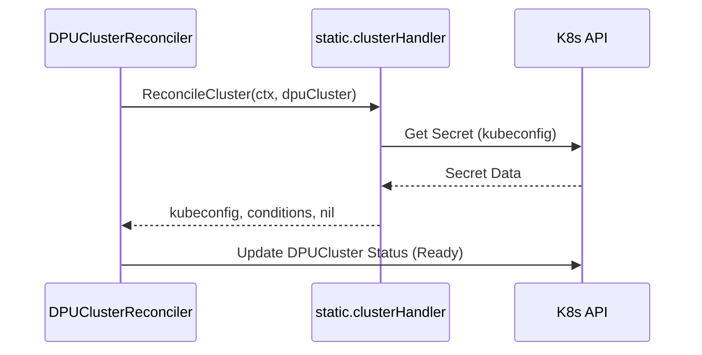

<!-- source: DeepWiki mcp.deepwiki.com · repo NVIDIA/doca-platform · page 7.2 Static Cluster Manager · fetched 2026-10-26 -->

# Static Cluster Manager

<details>
<summary>Relevant source files</summary>

The following files were used as context for generating this wiki page:

- [.checkov.yaml](.checkov.yaml)
- [cmd/kamaji-cluster-manager/main.go](cmd/kamaji-cluster-manager/main.go)
- [cmd/operator/main.go](cmd/operator/main.go)
- [cmd/servicechainset/main.go](cmd/servicechainset/main.go)
- [cmd/static-cluster-manager/main.go](cmd/static-cluster-manager/main.go)
- [cmd/storage/snap-node-driver/main.go](cmd/storage/snap-node-driver/main.go)
- [config/dpuservice/manager/manager.yaml](config/dpuservice/manager/manager.yaml)
- [config/kamaji-cluster-manager/manager/manager.yaml](config/kamaji-cluster-manager/manager/manager.yaml)
- [config/kamaji-cluster-manager/rbac/role.yaml](config/kamaji-cluster-manager/rbac/role.yaml)
- [config/provisioning/manager/manager.yaml](config/provisioning/manager/manager.yaml)
- [config/static-cluster-manager/manager/manager.yaml](config/static-cluster-manager/manager/manager.yaml)
- [config/static-cluster-manager/rbac/role.yaml](config/static-cluster-manager/rbac/role.yaml)
- [deploy/charts/dpf-operator/templates/deployment.yaml](deploy/charts/dpf-operator/templates/deployment.yaml)
- [hack/scripts/validate-manifest-checkov.sh](hack/scripts/validate-manifest-checkov.sh)
- [internal/clustermanager/controller/dpucluster_controller.go](internal/clustermanager/controller/dpucluster_controller.go)
- [internal/clustermanager/controller/dpucluster_controller_test.go](internal/clustermanager/controller/dpucluster_controller_test.go)
- [internal/clustermanager/kamaji/handler.go](internal/clustermanager/kamaji/handler.go)
- [internal/clustermanager/kamaji/handler_test.go](internal/clustermanager/kamaji/handler_test.go)
- [internal/clustermanager/kamaji/suite_test.go](internal/clustermanager/kamaji/suite_test.go)
- [internal/operator/controllers/ca_trust_bundle.go](internal/operator/controllers/ca_trust_bundle.go)
- [internal/operator/controllers/ca_trust_bundle_test.go](internal/operator/controllers/ca_trust_bundle_test.go)
- [internal/operator/controllers/reconcile_delete.go](internal/operator/controllers/reconcile_delete.go)
- [internal/operator/controllers/reconcile_delete_test.go](internal/operator/controllers/reconcile_delete_test.go)
- [internal/operator/inventory/manifests/kamaji-cluster-manager.yaml](internal/operator/inventory/manifests/kamaji-cluster-manager.yaml)
- [internal/operator/inventory/manifests/static-cluster-manager.yaml](internal/operator/inventory/manifests/static-cluster-manager.yaml)

</details>


## Purpose and Scope

The Static Cluster Manager is a system component that manages pre-existing DPU Kubernetes clusters. Unlike the Kamaji Cluster Manager which creates new isolated control planes for DPU clusters [internal/clustermanager/kamaji/handler.go:37](), the Static Cluster Manager integrates with DPU clusters that have been provisioned through external mechanisms or already exist in the infrastructure.

This component handles kubeconfig management for these clusters and integrates them with the DPU service deployment system, enabling `DPUService` resources to be deployed to statically-configured clusters.

**Sources:** [cmd/static-cluster-manager/main.go:27-30](), [internal/operator/inventory/manifests/static-cluster-manager.yaml:131-140]()

## Architecture Overview

The Static Cluster Manager runs as a standalone deployment in the management cluster. It implements the `ClusterHandler` interface, allowing the `DPUClusterReconciler` to process `DPUCluster` resources of type `Static`.

```mermaid
graph TB
    subgraph "Management Cluster"
        DPUClusterCR["DPUCluster CR<br/>(spec.type: Static)"]
        
        subgraph "static-cluster-manager Pod"
            Reconciler["DPUClusterReconciler"]
            Handler["static.clusterHandler"]
        end
        
        Secret["Kubeconfig Secret"]
    end
    
    subgraph "External DPU Cluster"
        APIServer["DPU K8s API Server"]
    end
    
    DPUClusterCR --> Reconciler
    Reconciler --> Handler
    Handler --> Secret : "Reads kubeconfig"
    Handler -. "Validates" .-> APIServer
```

**Diagram: Static Cluster Manager Architecture**

**Sources:** [cmd/static-cluster-manager/main.go:135-142](), [internal/clustermanager/controller/dpucluster_controller.go:25-40]()

## Implementation Details

### The Cluster Handler

The core logic is implemented in the `static` package. The `clusterHandler` satisfies the `controller.ClusterHandler` interface required by the generic `DPUClusterReconciler`.

| Code Entity | Type | File Path | Responsibility |
|-------------|------|-----------|----------------|
| `DPUClusterReconciler` | Struct | [internal/clustermanager/controller/dpucluster_controller.go:25-40]() | Generic controller for `DPUCluster` resources. |
| `clusterHandler` | Struct | [internal/clustermanager/static/handler.go:25-35]() | Static-specific implementation of cluster lifecycle. |
| `NewHandler` | Function | [internal/clustermanager/static/handler.go:30-35]() | Constructor for the static cluster handler. |

**Sources:** [internal/clustermanager/static/handler.go:25-35](), [cmd/static-cluster-manager/main.go:138]()

### Reconciliation Flow

When a `DPUCluster` is reconciled by the Static Cluster Manager, the following flow occurs:

1.  **Type Check**: The reconciler ensures the `DPUCluster.Spec.Type` matches `Static` [internal/clustermanager/controller/dpucluster_controller.go:45-50]().
2.  **Kubeconfig Retrieval**: The handler looks for a secret containing the kubeconfig required to access the external DPU cluster.
3.  **Status Update**: The handler returns the kubeconfig and cluster conditions to the main reconciler, which updates the `DPUCluster` status.



**Diagram: Static Reconciliation Sequence**

**Sources:** [internal/clustermanager/static/handler.go:37-45](), [cmd/static-cluster-manager/main.go:135-142]()

## Deployment and RBAC

The Static Cluster Manager is deployed as a `Deployment` with 2 replicas for high availability, utilizing leader election to ensure only one instance is active.

### Resource Requirements
- **CPU**: 10m request / 500m limit
- **Memory**: 64Mi request / 128Mi limit

**Sources:** [internal/operator/inventory/manifests/static-cluster-manager.yaml:222]()

### RBAC Permissions
The manager requires specific permissions to manage `DPUCluster` resources and handle leader election via `Leases`.

| API Group | Resources | Verbs |
|-----------|-----------|-------|
| `provisioning.dpu.nvidia.com` | `dpuclusters`, `dpuclusters/status`, `dpuclusters/finalizers` | get, list, watch, update, patch [internal/operator/inventory/manifests/static-cluster-manager.yaml:111-135]() |
| `operator.dpu.nvidia.com` | `dpfoperatorconfigs` | get, list, watch [internal/operator/inventory/manifests/static-cluster-manager.yaml:102-109]() |
| `coordination.k8s.io` | `leases` | get, list, watch, create, update, patch, delete [internal/operator/inventory/manifests/static-cluster-manager.yaml:177-187]() |
| `""` (Core) | `events`, `configmaps` | create, patch, get, list, watch [internal/operator/inventory/manifests/static-cluster-manager.yaml:18-38]() |

**Sources:** [internal/operator/inventory/manifests/static-cluster-manager.yaml:18-194]()

## Integration with DPU Service System

Once a static cluster is registered and its `DPUCluster` resource reaches the `Ready` state, the `DPUService` controller can utilize the provided kubeconfig to deploy services (such as HBN or OVN-Kubernetes) to that cluster.

1.  **Discovery**: The service deployment system identifies available clusters via `DPUCluster` resources.
2.  **Access**: The system uses the kubeconfig managed by the Static Cluster Manager to communicate with the DPU cluster's API server.
3.  **Deployment**: Manifests are applied to the DPU cluster to configure networking and storage services.

**Sources:** [cmd/static-cluster-manager/main.go:50-55](), [internal/operator/inventory/manifests/static-cluster-manager.yaml:1-9]()

## Entrypoint and Initialization

 The `main` function in `cmd/static-cluster-manager/main.go` initializes the controller manager with the following configuration:

-   **Scheme**: Includes `provisioningv1`, `operatorv1`, and standard Kubernetes types [cmd/static-cluster-manager/main.go:49-56]().
-   **Health Checks**: Registered at `/healthz` and `/readyz` using `health.APIConnectionCheck` [cmd/static-cluster-manager/main.go:145-152]().
-   **Leader Election ID**: `static-cluster-manager.dpu.nvidia.com` [cmd/static-cluster-manager/main.go:130]().

**Sources:** [cmd/static-cluster-manager/main.go:49-56](), [cmd/static-cluster-manager/main.go:125-130](), [cmd/static-cluster-manager/main.go:145-152]()

---

