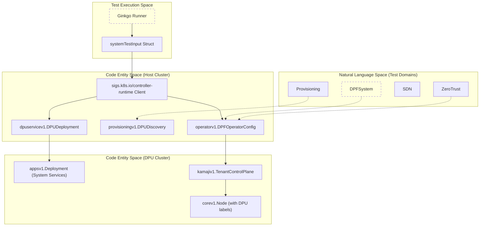
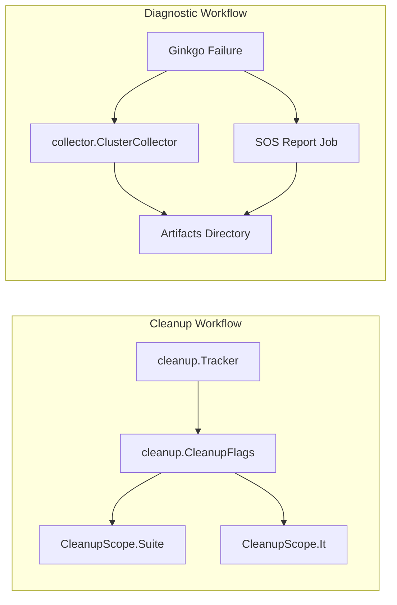

<!-- source: DeepWiki mcp.deepwiki.com · repo NVIDIA/doca-platform · page 8 Testing and Validation · fetched 2026-10-26 -->

# Testing and Validation

Relevant source files

The following files were used as context for generating this wiki page:

- [test/e2e/ci_setup_info.go](test/e2e/ci_setup_info.go)
- [test/e2e/config.go](test/e2e/config.go)
- [test/e2e/coredns.go](test/e2e/coredns.go)
- [test/e2e/doc/README.md](test/e2e/doc/README.md)
- [test/e2e/doc/zero-trust-e2e-state-machine.md](test/e2e/doc/zero-trust-e2e-state-machine.md)
- [test/e2e/dpfoperatorconfig.go](test/e2e/dpfoperatorconfig.go)
- [test/e2e/dpudeployment.go](test/e2e/dpudeployment.go)
- [test/e2e/dpuservice.go](test/e2e/dpuservice.go)
- [test/e2e/dpuservicechain.go](test/e2e/dpuservicechain.go)
- [test/e2e/dpuserviceconfigports.go](test/e2e/dpuserviceconfigports.go)
- [test/e2e/dpuservicecredentialrequest.go](test/e2e/dpuservicecredentialrequest.go)
- [test/e2e/dpuserviceipam.go](test/e2e/dpuserviceipam.go)
- [test/e2e/dpuservicenad.go](test/e2e/dpuservicenad.go)
- [test/e2e/e2e_suite_test.go](test/e2e/e2e_suite_test.go)
- [test/e2e/metrics.go](test/e2e/metrics.go)
- [test/e2e/sdn_test.go](test/e2e/sdn_test.go)
- [test/e2e/system_setup.go](test/e2e/system_setup.go)
- [test/e2e/system_test.go](test/e2e/system_test.go)
- [test/e2e/upgrade_framework_test.go](test/e2e/upgrade_framework_test.go)
- [test/e2e/upgrade_framework_unit_test.go](test/e2e/upgrade_framework_unit_test.go)
- [test/e2e/upgrade_lts_test.go](test/e2e/upgrade_lts_test.go)
- [test/e2e/utils.go](test/e2e/utils.go)
- [test/objects/infrastructure/dpunode-reboot-redfish.yaml](test/objects/infrastructure/dpunode-reboot-redfish.yaml)

This document describes the testing and validation infrastructure for the DOCA Platform Framework (DPF). It covers the end-to-end (E2E) testing framework, unit testing strategy, and security validation mechanisms used to verify the correctness of DPF components.

For information about specific test scenarios such as provisioning validation, see [Test Scenarios and Validation](#8.2). For details on the E2E testing framework implementation, see [E2E Testing Framework](#8.1). For security scanning details, see [Security Validation with Checkov](#8.3).

## Overview

The DPF testing infrastructure is built around a multi-layered strategy:

*   **Unit Testing**: Controller logic is validated using `envtest` and the `sigs.k8s.io/controller-runtime/pkg/envtest` package, providing a local control plane for rapid feedback.
*   **E2E Testing Framework**: A comprehensive suite built with Ginkgo and Gomega that runs against real or Kind-based clusters [test/e2e/e2e_suite_test.go:45-56]().
*   **Security Validation**: Static analysis of Helm charts and manifests using Checkov to ensure compliance with security best practices [.checkov.yaml:1-12]().
*   **API Validation**: Structural and functional validation of Custom Resource Definitions (CRDs) and their reconciliation cycles.

Sources: [test/e2e/e2e_suite_test.go:17-57](), [test/e2e/system_setup.go:18-67](), [.checkov.yaml:1-13]()

## Test Environment Architecture

The testing framework interacts with a management cluster (Host Cluster) and one or more DPU clusters.

**Testing Architecture Mapping**

The diagram bridges high-level test domains (Natural Language) to specific API types and runtime entities (Code Entity Space) used during validation.

Sources: [test/e2e/system_setup.go:115-169](), [test/e2e/utils.go:96-123](), [test/e2e/system_test.go:60-72]()

## E2E Testing Framework

The E2E suite is the primary mechanism for validating complex workflows. It uses a `systemTestInput` struct to maintain state across test specs [test/e2e/system_setup.go:115-169]().

*   **Context Management**: The `systemTestInput` contains parsed Kubernetes manifests, clients for multiple clusters, and cleanup flags [test/e2e/system_setup.go:115-169]().
*   **Multi-Cluster Access**: It manages `dpuClusterClient` slices to interact with tenant clusters managed by Kamaji or static cluster managers [test/e2e/utils.go:117-120]().
*   **Timeouts**: The framework defines specific budgets for DPU operations, such as `provisioningTimeout` (60m) and `dpuDeploymentReadyTimeout` (75m), to account for hardware initialization [test/e2e/utils.go:77-89]().

For details, see [E2E Testing Framework](#8.1).

Sources: [test/e2e/system_setup.go:115-169](), [test/e2e/utils.go:57-90]()

## Test Scenarios and Validation

The framework supports diverse scenarios identified by Ginkgo labels:

| Domain Label | Purpose | Key Validation Functions |
| :--- | :--- | :--- |
| `Domain.Provisioning` | DPU Lifecycle | `ProvisionDPUClusters`, `VerifyDPUClusterWithNodes` |
| `Domain.SDN` | Network Functionality | `VerifyPlainServiceFunctionChain`, `VerifyHBNOnlyServiceFunctionChain` |
| `Domain.DPFVPCOVN` | VPC Isolation | `ValidateVPCNetworkIsolation` |
| `Domain.ZeroTrust` | Security Model | `generateDPFOperatorConfig` (ZeroTrust mode overrides) |

Validation often involves checking `Ready` status conditions via the `conditions` package [test/e2e/dpudeployment.go:77-80]() and verifying metrics in KSM [test/e2e/metrics.go:62-96]().

For details, see [Test Scenarios and Validation](#8.2).

Sources: [test/e2e/utils.go:96-123](), [test/e2e/sdn_test.go:47-67](), [test/e2e/system_test.go:113-172]()

## Security Validation with Checkov

Security validation is integrated into the build pipeline using Checkov. It scans Helm charts located in `deploy/charts/` against a predefined set of policies [.checkov.yaml:1-12]().

*   **Policy Enforcement**: Checks for CPU/Memory limits (`CKV_K8S_11`, `CKV_K8S_13`), non-root execution (`CKV_K8S_40`), and liveness/readiness probes (`CKV_K8S_8`, `CKV_K8S_9`) [.checkov.yaml:2-12]().
*   **Exclusions**: The system allows for documented exclusions where DPU-specific constraints (e.g., privileged access for networking) require bypassing standard rules [.checkov.yaml:14-131]().

For details, see [Security Validation with Checkov](#8.3).

Sources: [.checkov.yaml:1-131]()

## Cleanup and Diagnostics

To maintain environment stability, the framework implements a robust cleanup and diagnostic system:

1.  **Cleanup Tracker**: A `cleanup.Tracker` manages resource deletion based on `CleanupScope` labels (e.g., `CleanupScope.Suite` vs `CleanupScope.It`) [test/e2e/e2e_suite_test.go:78-83]().
2.  **Resource Collection**: On failure, the framework uses `collector.ClusterCollector` to gather logs and object states from both host and DPU clusters [test/e2e/e2e_suite_test.go:67-73]().
3.  **SOS Reports**: For deep hardware/OS diagnostics, the suite can trigger SOS reports across the DPU fleet [test/e2e/e2e_suite_test.go:71-73]().

**Cleanup and Diagnostic Flow**

Sources: [test/e2e/e2e_suite_test.go:60-96](), [test/e2e/system_setup.go:155-168]()

---

