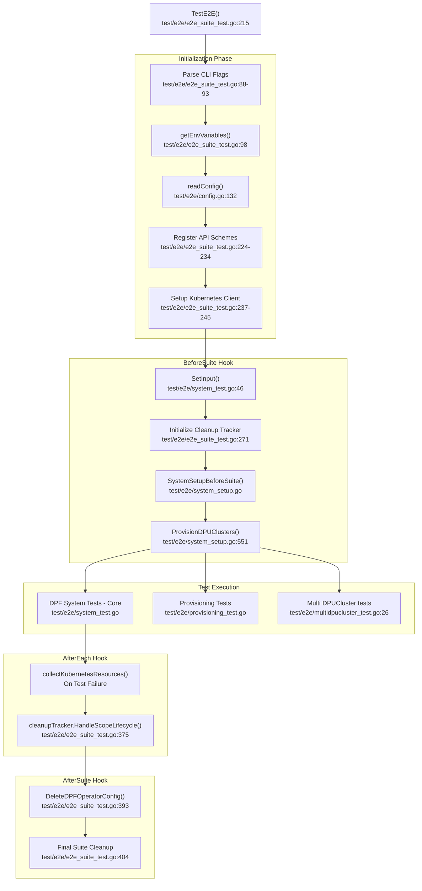
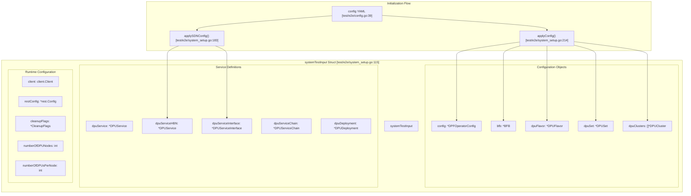
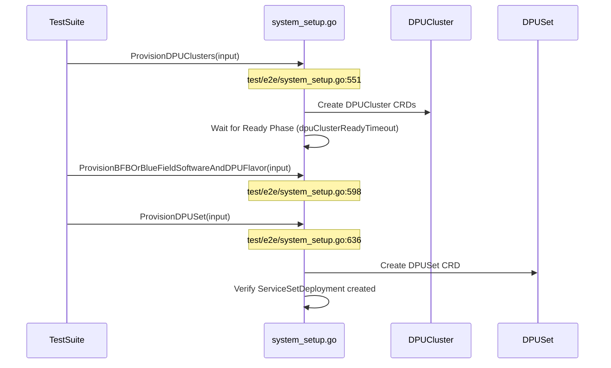

<!-- source: DeepWiki mcp.deepwiki.com · repo NVIDIA/doca-platform · page 8.1 E2E Testing Framework · fetched 2026-10-26 -->

# E2E Testing Framework

Relevant source files

The following files were used as context for generating this wiki page:

- [docs/public/developer-guides/system/local-development.md](docs/public/developer-guides/system/local-development.md)
- [hack/scripts/kind-install.sh](hack/scripts/kind-install.sh)
- [test/e2e/ci_setup_info.go](test/e2e/ci_setup_info.go)
- [test/e2e/cleanup/tracker.go](test/e2e/cleanup/tracker.go)
- [test/e2e/cleanup/tracker.md](test/e2e/cleanup/tracker.md)
- [test/e2e/cleanup/tracker_test.go](test/e2e/cleanup/tracker_test.go)
- [test/e2e/config-provisioning-multidpu-physical.yaml](test/e2e/config-provisioning-multidpu-physical.yaml)
- [test/e2e/config-provisioning-multidpucluster.yaml](test/e2e/config-provisioning-multidpucluster.yaml)
- [test/e2e/config-provisioning-multinode.yaml](test/e2e/config-provisioning-multinode.yaml)
- [test/e2e/config-provisioning-physical.yaml](test/e2e/config-provisioning-physical.yaml)
- [test/e2e/config-provisioning-zt-physical.yaml](test/e2e/config-provisioning-zt-physical.yaml)
- [test/e2e/config-provisioning.yaml](test/e2e/config-provisioning.yaml)
- [test/e2e/config-quick.yaml](test/e2e/config-quick.yaml)
- [test/e2e/config-scale.yaml](test/e2e/config-scale.yaml)
- [test/e2e/config.go](test/e2e/config.go)
- [test/e2e/coredns.go](test/e2e/coredns.go)
- [test/e2e/doc/README.md](test/e2e/doc/README.md)
- [test/e2e/doc/zero-trust-e2e-state-machine.md](test/e2e/doc/zero-trust-e2e-state-machine.md)
- [test/e2e/dpfoperatorconfig.go](test/e2e/dpfoperatorconfig.go)
- [test/e2e/dpudeployment.go](test/e2e/dpudeployment.go)
- [test/e2e/e2e_suite_test.go](test/e2e/e2e_suite_test.go)
- [test/e2e/multidpucluster.go](test/e2e/multidpucluster.go)
- [test/e2e/multidpucluster_test.go](test/e2e/multidpucluster_test.go)
- [test/e2e/snap.go](test/e2e/snap.go)
- [test/e2e/snap_test.go](test/e2e/snap_test.go)
- [test/e2e/system_setup.go](test/e2e/system_setup.go)
- [test/e2e/system_test.go](test/e2e/system_test.go)
- [test/e2e/upgrade_framework_test.go](test/e2e/upgrade_framework_test.go)
- [test/e2e/upgrade_framework_unit_test.go](test/e2e/upgrade_framework_unit_test.go)
- [test/e2e/upgrade_lts_test.go](test/e2e/upgrade_lts_test.go)
- [test/e2e/utils.go](test/e2e/utils.go)
- [test/mock/fake-fs-storage-vendor-dpu-plugin/Dockerfile](test/mock/fake-fs-storage-vendor-dpu-plugin/Dockerfile)
- [test/objects/application/dpudeployment-physical.yaml](test/objects/application/dpudeployment-physical.yaml)
- [test/objects/infrastructure/dpucluster-extra.yaml](test/objects/infrastructure/dpucluster-extra.yaml)
- [test/objects/infrastructure/dpucluster-kamaji-kind.yaml](test/objects/infrastructure/dpucluster-kamaji-kind.yaml)
- [test/objects/infrastructure/dpunode-reboot-redfish.yaml](test/objects/infrastructure/dpunode-reboot-redfish.yaml)
- [test/objects/infrastructure/dpuset-physical.yaml](test/objects/infrastructure/dpuset-physical.yaml)
- [test/objects/infrastructure/nodeport-dpucluster-extra.yaml](test/objects/infrastructure/nodeport-dpucluster-extra.yaml)
- [test/objects/infrastructure/nodeport-dpucluster.yaml](test/objects/infrastructure/nodeport-dpucluster.yaml)

The E2E Testing Framework provides comprehensive end-to-end testing infrastructure for the DOCA Platform Framework using Ginkgo v2. It orchestrates the deployment and validation of DPU provisioning, service deployment, networking, and multi-cluster management scenarios in both host-trusted and zero-trust modes.

---

## Test Suite Architecture

The E2E framework is built on Ginkgo v2 and provides a structured approach to testing DPF system components. The suite supports multiple deployment modes, cleanup strategies, and artifact collection for debugging.

Title: E2E Framework Execution Lifecycle

**Sources:** [test/e2e/e2e_suite_test.go:88-404](), [test/e2e/system_test.go:46-73](), [test/e2e/config.go:132-140]()

---

## Test Context Structure

The `systemTestInput` struct serves as the primary test context, containing all parsed manifests and runtime configuration needed for test execution. It mirrors the `config` struct but contains actual Kubernetes API objects rather than file paths.

Title: systemTestInput Data Flow

**Key Methods:**

| Method | Description | Location |
|--------|-------------|----------|
| `applyConfig()` | Loads core provisioning and service manifests from YAML files into `systemTestInput`. | [test/e2e/system_setup.go:214-311]() |
| `applySDNConfig()` | Loads SDN-specific configuration (HBN, IPAM, NAD) into `systemTestInput`. | [test/e2e/system_setup.go:183-212]() |
| `totalDPUs()` | Calculates total expected DPUs (nodes × DPUs per node). | [test/e2e/system_setup.go:318-320]() |

**Sources:** [test/e2e/system_setup.go:115-320](), [test/e2e/config.go:39-130]()

---

## Cleanup System

The cleanup system uses label-based scopes to manage resource lifecycle across test execution phases. This ensures resources are cleaned up at the appropriate time and can optionally be preserved for debugging. The system is managed by a `cleanup.Tracker`.

**Cleanup Scope Usage:**

| Scope | When to Use | Reference |
|-------|-------------|---------|
| `CleanupScope.Suite` | Resources needed for the entire test suite (e.g., `DPFOperatorConfig`, `BFB`). | [test/e2e/utils.go:93]() |
| `CleanupScope.It` | Resources created and deleted in a single test case (e.g., `DPUDeployment`). | [test/e2e/utils.go:93]() |

**Setting Cleanup Labels:**
In E2E tests, labels are applied during object creation to ensure the `cleanup.Tracker` can identify them. For example:
- `DPUDeployment` in `ValidateDPUDeploymentCreation`: [test/e2e/dpudeployment.go:73-73]()
- `DPUServiceNAD` in `ProvisionDPUDeploymentWithEachDPUJoiningADifferentDPUCluster`: [test/e2e/multidpucluster.go:58-58]()

**Sources:** [test/e2e/utils.go:92-93](), [test/e2e/e2e_suite_test.go:271-404](), [test/e2e/cleanup/tracker.go]()

---

## Test Domain Labels

Test domains categorize tests by functional area and enable selective test execution via Ginkgo label filters. These labels also trigger specific setup logic in `BeforeSuite`.

| Domain Label | Purpose | Code Identifier |
|--------------|---------|-----------------|
| `DPFSystem` | Core DPF System tests. | `Domain.DPFSystem` |
| `ZeroTrust` | Zero Trust mode tests; triggers ZT-specific `DPFOperatorConfig`. | `Domain.ZeroTrust` |
| `MultiDPUCluster` | Tests involving multiple DPU clusters. | `Domain.MultiDPUCluster` |
| `Performance` | Performance tests with extended timeouts and MTU 9000. | `Domain.Performance` |
| `Provisioning` | DPU provisioning lifecycle tests. | `Domain.Provisioning` |
| `SDN` | Software Defined Networking (HBN/OVN) tests. | `Domain.SDN` |

**Sources:** [test/e2e/utils.go:96-161]()

---

## System Setup Functions

The system setup functions orchestrate the deployment of DPF components and provisioning of DPU clusters.

Title: DPU Cluster Provisioning Sequence

**Key Functions:**

| Function | Purpose | Location |
|----------|---------|----------|
| `ProvisionDPUClusters()` | Creates `DPUCluster` resources and waits for the `Ready` condition. | [test/e2e/system_setup.go:551-595]() |
| `ProvisionDPUSet()` | Creates `DPUSet` and verifies that the `ServiceSetDeployment` is created. | [test/e2e/system_setup.go:636-685]() |
| `SetInput()` | Validates flags and config, then loads manifests into the `systemTestInput` context. | [test/e2e/system_test.go:46-73]() |

**Sources:** [test/e2e/system_setup.go:551-685](), [test/e2e/system_test.go:46-73]()

---

## Kind Cluster Setup

The E2E suite typically runs against a Kind cluster which acts as the Management Cluster. The `hack/scripts/kind-install.sh` script handles the configuration of this cluster to support DPF operations, including registry mirrors and port mappings.

**Cluster Configuration Highlights:**
- **Registry Mirrors**: Configured via `REGISTRY_MIRRORS` to speed up image pulls. [hack/scripts/kind-install.sh:93-114]()
- **NodePort Mappings**: Exposes `DPUCLUSTER_NODE_PORT` (30043) on the host for DPU cluster access. [hack/scripts/kind-install.sh:78-81]()
- **Control Plane Metrics**: Configures components to bind to `0.0.0.0` for Prometheus scraping. [hack/scripts/kind-install.sh:63-77]()

**Sources:** [hack/scripts/kind-install.sh:1-141]()

---

## Multi-DPU Cluster Testing

The framework supports scenarios where multiple DPU clusters are managed by a single DPF Operator instance.

**Scenario: DPU per Cluster**
The function `ProvisionDPUDeploymentWithEachDPUJoiningADifferentDPUCluster` validates that a `DPUDeployment` can target multiple `DPUClusters` by creating a `DPUSet` entry for each cluster with specific `DPUClusterSelector` labels.

**IPAM Validation:**
The suite validates both shared and per-cluster IPAM configurations:
*   `ValidateDPUServiceIPAMInL2ModePerDPUCluster`: Splits a CIDR manually across multiple `DPUServiceIPAM` objects using `DPUClusterSelector`. [test/e2e/multidpucluster.go:142-200]()
*   `ValidateDPUServiceIPAMInL3ModePerDPUCluster`: Similar validation for L3 mode. [test/e2e/multidpucluster.go:204-263]()

**Sources:** [test/e2e/multidpucluster.go:39-263](), [test/e2e/multidpucluster_test.go:26-92]()

---

## Upgrade Testing Framework

The suite includes dedicated phases for testing DPF Operator upgrades, specifically handling transitions from previous GA releases to current branches.

**Phases and Inputs:**
- **`installPhaseInput`**: Configures the initial environment (e.g., v25.10) and captures an artifact snapshot. [test/e2e/upgrade_framework_test.go:63-89]()
- **`validationPhaseInput`**: Validates the system after the operator upgrade, optionally performing rollouts of DPUs or dependencies. [test/e2e/upgrade_framework_test.go:94-152]()

**Rollout Exercise:**
During validation, the framework can trigger a `rolloutAllDPUs` to ensure DPUs are reprovisioned with the new DPF version and verify the `KubeletVersion` reported by the DPU. [test/e2e/upgrade_framework_test.go:109-121]()

**Sources:** [test/e2e/upgrade_framework_test.go:19-152](), [test/e2e/upgrade_test.go:30-66]()

---

