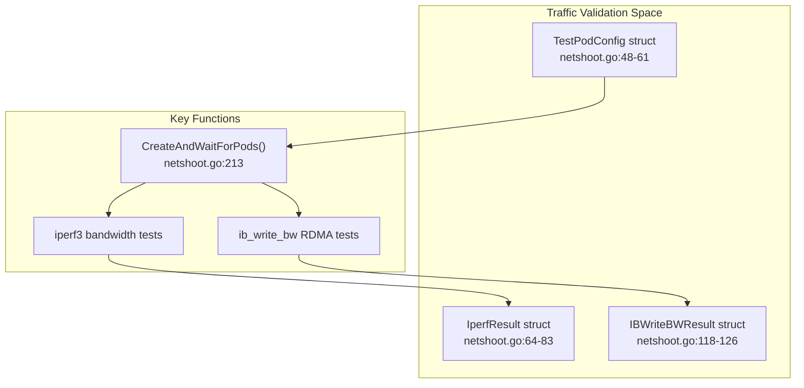
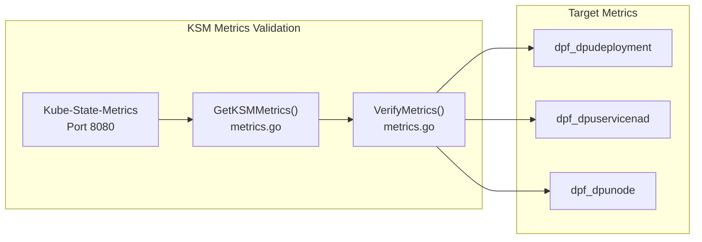

<!-- source: DeepWiki mcp.deepwiki.com · repo NVIDIA/doca-platform · page 8.2 Test Scenarios and Validation · fetched 2026-10-26 -->

# Test Scenarios and Validation

Relevant source files

The following files were used as context for generating this wiki page:

- [test/e2e/ci_setup_info.go](test/e2e/ci_setup_info.go)
- [test/e2e/config-provisioning-snap.yaml](test/e2e/config-provisioning-snap.yaml)
- [test/e2e/config-provisioning-upgrade-current.yaml](test/e2e/config-provisioning-upgrade-current.yaml)
- [test/e2e/config-provisioning-upgrade-v25.10.yaml](test/e2e/config-provisioning-upgrade-v25.10.yaml)
- [test/e2e/config-provisioning-upgrade-v26.4.yaml](test/e2e/config-provisioning-upgrade-v26.4.yaml)
- [test/e2e/config-provisioning-zt-physical-bf4-weave.yaml](test/e2e/config-provisioning-zt-physical-bf4-weave.yaml)
- [test/e2e/config.go](test/e2e/config.go)
- [test/e2e/coredns.go](test/e2e/coredns.go)
- [test/e2e/doc/README.md](test/e2e/doc/README.md)
- [test/e2e/doc/zero-trust-e2e-state-machine.md](test/e2e/doc/zero-trust-e2e-state-machine.md)
- [test/e2e/dpfoperatorconfig.go](test/e2e/dpfoperatorconfig.go)
- [test/e2e/dpudeployment.go](test/e2e/dpudeployment.go)
- [test/e2e/dpuservice.go](test/e2e/dpuservice.go)
- [test/e2e/dpuservicechain.go](test/e2e/dpuservicechain.go)
- [test/e2e/dpuserviceconfigports.go](test/e2e/dpuserviceconfigports.go)
- [test/e2e/dpuservicecredentialrequest.go](test/e2e/dpuservicecredentialrequest.go)
- [test/e2e/dpuserviceipam.go](test/e2e/dpuserviceipam.go)
- [test/e2e/dpuservicenad.go](test/e2e/dpuservicenad.go)
- [test/e2e/e2e_suite_test.go](test/e2e/e2e_suite_test.go)
- [test/e2e/metrics.go](test/e2e/metrics.go)
- [test/e2e/provisioning.go](test/e2e/provisioning.go)
- [test/e2e/provisioning_test.go](test/e2e/provisioning_test.go)
- [test/e2e/sdn_test.go](test/e2e/sdn_test.go)
- [test/e2e/servicefunctionchain.go](test/e2e/servicefunctionchain.go)
- [test/e2e/system_setup.go](test/e2e/system_setup.go)
- [test/e2e/system_test.go](test/e2e/system_test.go)
- [test/e2e/upgrade_framework_test.go](test/e2e/upgrade_framework_test.go)
- [test/e2e/upgrade_framework_unit_test.go](test/e2e/upgrade_framework_unit_test.go)
- [test/e2e/upgrade_lts_test.go](test/e2e/upgrade_lts_test.go)
- [test/e2e/upgrade_test.go](test/e2e/upgrade_test.go)
- [test/e2e/utils.go](test/e2e/utils.go)
- [test/e2e/vpcovn.go](test/e2e/vpcovn.go)
- [test/e2e/vpcovn_test.go](test/e2e/vpcovn_test.go)
- [test/e2e/weave.go](test/e2e/weave.go)
- [test/e2e/weave_physical.go](test/e2e/weave_physical.go)
- [test/e2e/weave_physical_test.go](test/e2e/weave_physical_test.go)
- [test/e2e/weave_test.go](test/e2e/weave_test.go)
- [test/objects/infrastructure/dpunode-reboot-redfish.yaml](test/objects/infrastructure/dpunode-reboot-redfish.yaml)
- [test/objects/upgrade/current/dpudeployment-physical.yaml](test/objects/upgrade/current/dpudeployment-physical.yaml)
- [test/objects/upgrade/v25.10/bfb.yaml](test/objects/upgrade/v25.10/bfb.yaml)
- [test/objects/upgrade/v25.10/dpfoperatorconfig.yaml](test/objects/upgrade/v25.10/dpfoperatorconfig.yaml)
- [test/objects/upgrade/v25.10/dpucluster.yaml](test/objects/upgrade/v25.10/dpucluster.yaml)
- [test/objects/upgrade/v25.10/dpudeployment.yaml](test/objects/upgrade/v25.10/dpudeployment.yaml)
- [test/objects/upgrade/v25.10/dpuflavor.yaml](test/objects/upgrade/v25.10/dpuflavor.yaml)
- [test/objects/upgrade/v25.10/dpuserviceconfiguration.yaml](test/objects/upgrade/v25.10/dpuserviceconfiguration.yaml)
- [test/objects/upgrade/v25.10/dpuservicetemplate.yaml](test/objects/upgrade/v25.10/dpuservicetemplate.yaml)
- [test/objects/upgrade/v26.4/dpfoperatorconfig.yaml](test/objects/upgrade/v26.4/dpfoperatorconfig.yaml)
- [test/objects/upgrade/v26.4/dpudeployment-physical.yaml](test/objects/upgrade/v26.4/dpudeployment-physical.yaml)
- [test/utils/dpuagent/sfconfig_dma.go](test/utils/dpuagent/sfconfig_dma.go)
- [test/utils/dpuagent/sfconfig_dma_test.go](test/utils/dpuagent/sfconfig_dma_test.go)
- [test/utils/dpuservice/dpuservice.go](test/utils/dpuservice/dpuservice.go)
- [test/utils/netshoot/netshoot.go](test/utils/netshoot/netshoot.go)

## Purpose and Scope

This document describes the test scenarios executed in the DOCA Platform Framework (DPF) E2E test suite and the validation mechanisms used to verify system behavior. It covers specific test cases for DPU provisioning, service deployment, networking isolation (VPC OVN), upgrades, and performance validation.

For information about the E2E testing framework infrastructure, see [E2E Testing Framework (8.1)]().

## Test Suite Organization

The E2E test suite is organized into labeled contexts that can be selectively executed. Each suite targets a specific functional domain.

### Test Suite Labels and Priorities

| Domain Label | Priority | Purpose |
| :--- | :--- | :--- |
| `Domain.DPFSystem` | 101 | Core DPF functionality and system tests [test/e2e/utils.go:59]() |
| `Domain.SDN` | 100 | Software Defined Networking and SFC tests [test/e2e/utils.go:61]() |
| `Domain.Provisioning` | 0 (Default) | DPU lifecycle and BFB installation [test/e2e/utils.go:131]() |
| `Domain.DPFVPCOVN` | 0 (Default) | VPC OVN network isolation and multi-tenancy [test/e2e/utils.go:144]() |
| `Domain.Weave` | 0 (Default) | Weave virtual networking and offload validation [test/e2e/utils.go:145]() |
| `Domain.DPFUpgrade` | 0 (Default) | Operator and DPU software upgrade paths [test/e2e/utils.go:134]() |

**Sources:** [test/e2e/utils.go:57-151]()

## DPU Provisioning Validation

Provisioning tests verify the full lifecycle of a DPU, from initial discovery to becoming a ready node in the DPU cluster.

### Provisioning Test Scenarios
- **Full Installation:** Validates BFB installation, `DPUFlavor` application, and DPU joining the cluster. The `provisioningTimeout` is set to 60 minutes to accommodate firmware updates and reboots [test/e2e/utils.go:82]().
- **Flavor Templates:** Exercises the `DPUFlavorTemplate` path where flavors are rendered per-DPU based on device-specific values [test/e2e/dpudeployment.go:56-65]().
- **Node Labeling:** Validates that node-labeling scripts defined in `DPUFlavor` correctly emit and apply labels to the resulting Kubernetes nodes [test/e2e/provisioning.go:50-57]().

**Sources:** [test/e2e/utils.go:77-89](), [test/e2e/provisioning.go:50-105]()

## Networking and Performance Validation

The framework utilizes `netshoot` pods to validate data plane integrity and performance across various topologies.

### Traffic Validation with Netshoot
The `netshoot` utility provides a standardized interface for traffic testing.

**Sources:** [test/utils/netshoot/netshoot.go:42-126](), [test/utils/netshoot/netshoot.go:213-231]()

### VPC OVN Isolation
VPC OVN tests validate tenant isolation and virtual network connectivity.

- **Single VNet Connectivity:** Verifies same-node and cross-node traffic between pods in the same `DPUVirtualNetwork` [test/e2e/vpcovn_test.go:181-210]().
- **Multi-Tenant Isolation:** Confirms that traffic is dropped between pods in different VNets or different `DPUVPC` instances [test/e2e/vpcovn_test.go:158-160]().
- **Gateway/VTEP Validation:** Validates external connectivity via OVN central and controller services [test/e2e/vpcovn_test.go:96-122]().

**Sources:** [test/e2e/vpcovn_test.go:93-210](), [test/e2e/vpcovn.go:41-42]()

### Weave Data Plane Offload
Weave tests validate the flow-controller and hardware offload capabilities.
- **RDMA Offload:** Validates that `ib_write_bw` sustains >60 Gbit/sec, indicating hardware offload is engaged [test/e2e/weave.go:84-86]().
- **OVS Metrics:** Uses custom OVS flow metrics (e.g., `weave_tx_sent`, `weave_rx_decap`) to verify that traffic is following the expected fast path [test/e2e/weave.go:123-135]().

**Sources:** [test/e2e/weave.go:46-135]()

## Service Deployment and Upgrade Validation

### DPUDeployment Lifecycle
The suite validates complex deployment scenarios, including disruptive upgrades.
- **Disruptive Upgrade Deletion:** Tests the ability to delete a `DPUDeployment` even while a disruptive upgrade (triggering DPU reboots or service pauses) is in progress [test/e2e/dpudeployment.go:101-131]().
- **Service Dependency:** Verifies that `DPUService` objects are correctly managed by ArgoCD and that the `dpu-monitoring` service is deployed to every DPU cluster [test/e2e/upgrade_test.go:50-63]().

### Upgrade Framework
The upgrade tests follow a multi-phase approach:
1.  **Install Phase:** Provisions the system using the previous GA release (e.g., v26.4.0) [test/e2e/upgrade_test.go:84-93]().
2.  **Validation Phase:** Upgrades the operator to the current HEAD and validates that existing `DPUService` instances are rolled out to the new version without configuration loss [test/e2e/upgrade_test.go:95-104]().

**Sources:** [test/e2e/dpudeployment.go:101-160](), [test/e2e/upgrade_test.go:27-105]()

## Observability and Metrics Validation

The framework validates that the system provides sufficient telemetry via Kube State Metrics (KSM).

### Metrics Verification
The suite verifies the presence of specific metrics for DPF resources:
- **DPUDeployment Metrics:** `dpf_dpudeployment_info`, `dpf_dpudeployment_status_conditions` [test/e2e/dpudeployment.go:89-92]().
- **NAD Metrics:** `dpf_dpuservicenad_status_conditions` [test/e2e/dpuservicenad.go:132-138]().

**Sources:** [test/e2e/dpudeployment.go:82-98](), [test/e2e/dpuservicenad.go:132-145](), [test/e2e/utils.go:63-69]()

## Cleanup and Diagnostic Collection

### Diagnostic Collection
Upon failure, the suite triggers automated diagnostic collection:
- **Stern Logs:** Streams logs from all system pods [test/e2e/e2e_suite_test.go:67-73]().
- **SOS Reports:** If `ENABLE_SOS_REPORTS` is set, the framework triggers DPU-side SOS report generation for deep hardware debugging [test/e2e/e2e_suite_test.go:71-72]().

### Cleanup Scopes
The framework uses a `cleanupTracker` to manage resource lifecycles:
- **CleanupScope.It:** Resources deleted after each individual test [test/e2e/dpudeployment.go:73]().
- **CleanupScope.Suite:** Resources (like `DPFOperatorConfig`) deleted only after the entire suite completes [test/e2e/system_test.go:125]().

**Sources:** [test/e2e/e2e_suite_test.go:60-84](), [test/e2e/system_setup.go:45](), [test/e2e/dpudeployment.go:73-87]()

---

