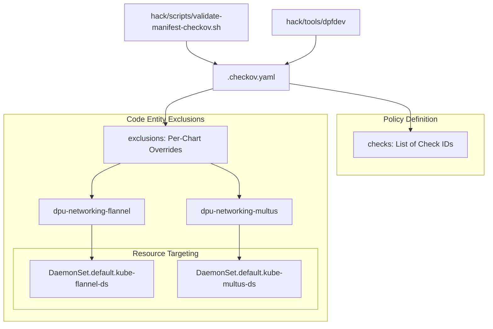
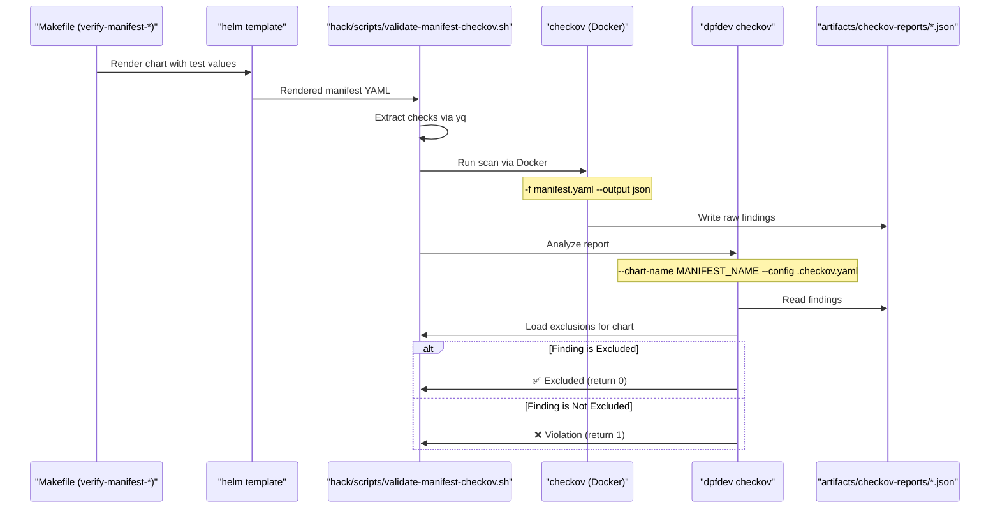

<!-- source: DeepWiki mcp.deepwiki.com · repo NVIDIA/doca-platform · page 8.3 Security Validation with Checkov · fetched 2026-10-26 -->

# Security Validation with Checkov

Relevant source files

The following files were used as context for generating this wiki page:

- [.checkov.yaml](.checkov.yaml)
- [Dockerfile.bfb-registry](Dockerfile.bfb-registry)
- [Makefile](Makefile)
- [config/dpuservice/manager/manager.yaml](config/dpuservice/manager/manager.yaml)
- [config/kamaji-cluster-manager/manager/manager.yaml](config/kamaji-cluster-manager/manager/manager.yaml)
- [config/kamaji-cluster-manager/rbac/role.yaml](config/kamaji-cluster-manager/rbac/role.yaml)
- [config/provisioning/manager/manager.yaml](config/provisioning/manager/manager.yaml)
- [config/static-cluster-manager/manager/manager.yaml](config/static-cluster-manager/manager/manager.yaml)
- [config/static-cluster-manager/rbac/role.yaml](config/static-cluster-manager/rbac/role.yaml)
- [deploy/charts/dpf-operator/templates/deployment.yaml](deploy/charts/dpf-operator/templates/deployment.yaml)
- [go.mod](go.mod)
- [go.sum](go.sum)
- [hack/scripts/validate-manifest-checkov.sh](hack/scripts/validate-manifest-checkov.sh)
- [hack/tools/dpfdev/go.mod](hack/tools/dpfdev/go.mod)
- [hack/tools/dpfdev/go.sum](hack/tools/dpfdev/go.sum)
- [hack/tools/tools.mk](hack/tools/tools.mk)
- [internal/clustermanager/controller/dpucluster_controller.go](internal/clustermanager/controller/dpucluster_controller.go)
- [internal/clustermanager/controller/dpucluster_controller_test.go](internal/clustermanager/controller/dpucluster_controller_test.go)
- [internal/clustermanager/kamaji/handler.go](internal/clustermanager/kamaji/handler.go)
- [internal/clustermanager/kamaji/handler_test.go](internal/clustermanager/kamaji/handler_test.go)
- [internal/clustermanager/kamaji/suite_test.go](internal/clustermanager/kamaji/suite_test.go)
- [internal/operator/inventory/manifests/kamaji-cluster-manager.yaml](internal/operator/inventory/manifests/kamaji-cluster-manager.yaml)
- [internal/operator/inventory/manifests/static-cluster-manager.yaml](internal/operator/inventory/manifests/static-cluster-manager.yaml)

This document describes the Checkov-based security validation system used to scan Kubernetes manifests in the DOCA Platform Framework for security and best practice violations. Checkov is a static code analysis tool that validates infrastructure-as-code against security policies defined by the Center for Internet Security (CIS) and other security frameworks.

For information about the overall build and release pipeline, see [Build and Release System](#1.2). For information about testing strategies, see [Testing and Validation](#8).

## Overview

The DPF project uses Checkov to enforce security policies across all Helm charts before they are released. The validation system:

- Scans rendered Kubernetes manifests for security violations.
- Enforces 12 specific security checks across all resources.
- Maintains a per-chart exclusion list with documented justifications in `.checkov.yaml` [[.checkov.yaml:14-16]]().
- Integrates into the `make verify` pipeline to prevent regressions [[hack/scripts/validate-manifest-checkov.sh:65-72]]().
- Generates JSON reports for CI/CD analysis [[hack/scripts/validate-manifest-checkov.sh:37-37]]().

The validation process ensures that all deployed workloads meet minimum security standards while allowing documented exceptions for components that require elevated privileges (e.g., CNI plugins, storage drivers).

**Sources:** [.checkov.yaml:1-12](), [hack/scripts/validate-manifest-checkov.sh:1-74](), [Makefile:98-98]()

## Security Checks Enforced

The `.checkov.yaml` configuration file defines 12 security checks that all manifests must satisfy:

| Check ID | Policy | Description |
|----------|--------|-------------|
| `CKV_K8S_8` | Liveness Probe | Containers must have liveness probes configured [[.checkov.yaml:2]]() |
| `CKV_K8S_9` | Readiness Probe | Containers must have readiness probes configured [[.checkov.yaml:3]]() |
| `CKV_K8S_11` | CPU Limits | CPU resource limits must be set [[.checkov.yaml:4]]() |
| `CKV_K8S_13` | Memory Limits | Memory resource limits must be set [[.checkov.yaml:5]]() |
| `CKV_K8S_15` | Image Pull Policy | Image pull policy should be `Always` [[.checkov.yaml:6]]() |
| `CKV_K8S_29` | Security Context | Security context must be applied to pods/containers [[.checkov.yaml:7]]() |
| `CKV_K8S_35` | Secrets as Files | Prefer secrets as files over environment variables [[.checkov.yaml:8]]() |
| `CKV_K8S_38` | Service Account Tokens | Mount tokens only where necessary [[.checkov.yaml:9]]() |
| `CKV_K8S_40` | High UID | Containers should run as high UID (≥10000) [[.checkov.yaml:10]]() |
| `CKV_K8S_43` | Image Digest | Images must use digest (`@sha256:...`) [[.checkov.yaml:11]]() |
| `CKV_K8S_49` | RBAC Wildcards | Minimize wildcard use in Roles/ClusterRoles [[.checkov.yaml:12]]() |

These checks align with Kubernetes security best practices and CIS Benchmark recommendations. The checks are extracted from the configuration file at validation time using `yq '.checks | join ","'` [[hack/scripts/validate-manifest-checkov.sh:60]]().

**Sources:** [.checkov.yaml:1-12](), [hack/scripts/validate-manifest-checkov.sh:60-60]()

## Configuration Architecture

The validation configuration bridges natural language security policies to specific code entities (Kubernetes Resources) via the `.checkov.yaml` file.

"Natural Language Space to Code Entity Space: Checkov Mapping"

**Configuration File Structure:**

The `.checkov.yaml` file has two main sections:

1. **Global Checks** [[.checkov.yaml:1-12]]() - Lists all check IDs that should be enforced.
2. **Per-Chart Exclusions** [[.checkov.yaml:14-16]]() - Defines exceptions for specific resources in specific charts.

Each exclusion entry contains:
- `check_id`: The Checkov check being excluded (e.g., `CKV_K8S_40`) [[.checkov.yaml:20]]().
- `resource`: The Kubernetes resource in format `Kind.namespace.name` [[.checkov.yaml:21]]().
- `evaluated_keys`: The specific field paths that fail the check [[.checkov.yaml:22-23]]().
- Comments above explaining the justification [[.checkov.yaml:19]]().

**Sources:** [.checkov.yaml:1-150](), [hack/scripts/validate-manifest-checkov.sh:35-65](), [hack/tools/dpfdev/go.mod:1-17]()

## Validation Workflow

The validation workflow integrates external security tools with the local build system defined in the `Makefile`.

"Code Execution Flow: Checkov Validation Pipeline"

**Validation Steps:**

1. **Manifest Rendering**: Helm templates the chart with test values. The `Makefile` manages the `HELM` binary version `v3.18.3` [[hack/tools/tools.mk:67]]().
2. **Checkov Execution**: The `validate-manifest-checkov.sh` script runs Checkov. The project pins Checkov via a SHA256 digest in the tools configuration [[hack/tools/tools.mk:98]]().
3. **Report Generation**: Checkov outputs a JSON report to `artifacts/checkov-reports/${MANIFEST_NAME}.json` [[hack/scripts/validate-manifest-checkov.sh:37-37]]().
4. **Report Analysis**: The `dpfdev checkov` command filters the report against documented exclusions in `.checkov.yaml` [[hack/scripts/validate-manifest-checkov.sh:65-65]]().
5. **Exit Status**: Returns 0 if all findings are excluded or if no violations exist; returns 1 otherwise [[hack/scripts/validate-manifest-checkov.sh:67-72]]().

**Sources:** [hack/scripts/validate-manifest-checkov.sh:1-74](), [hack/tools/tools.mk:67-98](), [Makefile:156-163]()

## Per-Chart Exclusion Examples

The exclusion system allows specific violations when there is a documented justification, particularly for infrastructure components requiring host-level access.

### Example: Flannel Chart
Flannel requires elevated privileges and lacks certain health probes. These are explicitly excluded in `.checkov.yaml`:

- **CKV_K8S_11/13**: CPU/Memory limits for init containers cannot be set in the upstream chart [[.checkov.yaml:19-27]]().
- **CKV_K8S_38**: Service Account tokens are required for API access [[.checkov.yaml:28-30]]().
- **CKV_K8S_29/40**: Security context and high UID are excluded because Flannel requires root privileges [[.checkov.yaml:31-35]]().
- **CKV_K8S_8/9**: Liveness/Readiness probes are not provided by Flannel [[.checkov.yaml:36-44]]().

### Example: Multus and SR-IOV
- **Multus**: Required to run as root (`CKV_K8S_40`) and requires API access (`CKV_K8S_38`) [[.checkov.yaml:56-61]]().
- **SR-IOV Device Plugin**: Required to run as root (`CKV_K8S_40`) and lacks probes (`CKV_K8S_8/9`) [[.checkov.yaml:64-75]]().

**Sources:** [.checkov.yaml:18-76]()

## Integration into Build Pipeline

The manifest verification is integrated into the standard verification pipeline via `Makefile` targets. The `Makefile` includes `hack/tools/tools.mk` to manage the lifecycle of validation binaries [[Makefile:28]]().

**Key Components and Roles:**
- **`validate-manifest-checkov.sh`**: Orchestrates the rendering, scanning, and analysis flow [[hack/scripts/validate-manifest-checkov.sh:1-75]]().
- **`.checkov.yaml`**: Central policy and exclusion store [[.checkov.yaml:1-12]]().
- **`dpfdev`**: Technical utility used to filter Checkov JSON output against the YAML exclusions [[hack/tools/dpfdev/go.mod:1-17]]().

**Sources:** [Makefile:28-28](), [hack/scripts/validate-manifest-checkov.sh:1-74](), [.checkov.yaml:1-150]()

## Embedded Controller Validation

Controllers managed by the DPF Operator, such as the `kamaji-cluster-manager`, also undergo validation. These controllers are deployed as standard Kubernetes `Deployments`.

- **Kamaji Cluster Manager**: The manifest defines a restricted `securityContext` with `runAsNonRoot: true` and `runAsUser: 65532` [[internal/operator/inventory/manifests/kamaji-cluster-manager.yaml:284-285]](). It also drops all capabilities [[internal/operator/inventory/manifests/kamaji-cluster-manager.yaml:277-278]]().
- **DPF Operator**: The `dpf-operator-controller-manager` similarly implements `automountServiceAccountToken: false` and custom `podSecurityContext` [[deploy/charts/dpf-operator/templates/deployment.yaml:34-77]]().

**Sources:** [internal/operator/inventory/manifests/kamaji-cluster-manager.yaml:274-286](), [deploy/charts/dpf-operator/templates/deployment.yaml:34-77](), [internal/clustermanager/kamaji/handler.go:74-85]()

---

