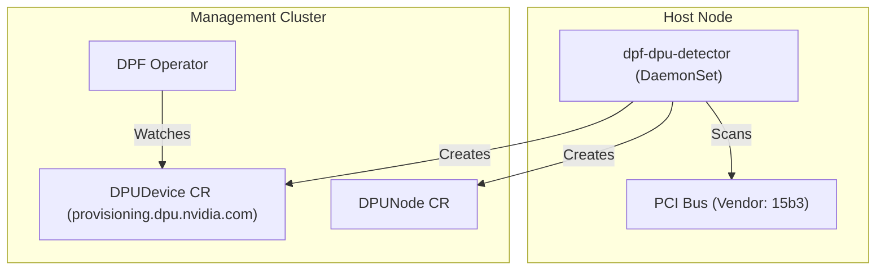
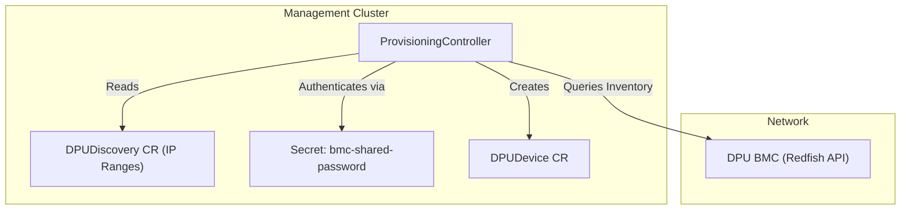

<!-- source: DeepWiki mcp.deepwiki.com · repo NVIDIA/doca-platform · page 9 Deployment Modes and Use Cases · fetched 2026-10-26 -->

# Deployment Modes and Use Cases

<details>
<summary>Relevant source files</summary>

The following files were used as context for generating this wiki page:

- [deploy/helmfiles/hooks/apply-dashboards.sh](deploy/helmfiles/hooks/apply-dashboards.sh)
- [deploy/helmfiles/hooks/apply-prometheus-rules.sh](deploy/helmfiles/hooks/apply-prometheus-rules.sh)
- [deploy/helmfiles/monitoring.yaml](deploy/helmfiles/monitoring.yaml)
- [deploy/helmfiles/prereqs.yaml](deploy/helmfiles/prereqs.yaml)
- [deploy/helmfiles/values/argo-cd.yaml](deploy/helmfiles/values/argo-cd.yaml)
- [deploy/helmfiles/values/kamaji.yaml](deploy/helmfiles/values/kamaji.yaml)
- [deploy/helmfiles/values/kube-prometheus-stack.yaml](deploy/helmfiles/values/kube-prometheus-stack.yaml)
- [deploy/helmfiles/values/loki.yaml](deploy/helmfiles/values/loki.yaml)
- [docs/public/getting-started/helm-prerequisites.md](docs/public/getting-started/helm-prerequisites.md)
- [docs/public/platform-support.md](docs/public/platform-support.md)
- [docs/public/user-guides/host-trusted/use-cases/hbn-ovnk-snap/README.md](docs/public/user-guides/host-trusted/use-cases/hbn-ovnk-snap/README.md)
- [docs/public/user-guides/host-trusted/use-cases/hbn-ovnk/README.md](docs/public/user-guides/host-trusted/use-cases/hbn-ovnk/README.md)
- [docs/public/user-guides/host-trusted/use-cases/hbn-snap/README.md](docs/public/user-guides/host-trusted/use-cases/hbn-snap/README.md)
- [docs/public/user-guides/host-trusted/use-cases/hbn/README.md](docs/public/user-guides/host-trusted/use-cases/hbn/README.md)
- [docs/public/user-guides/host-trusted/use-cases/ovnk/README.md](docs/public/user-guides/host-trusted/use-cases/ovnk/README.md)
- [docs/public/user-guides/host-trusted/use-cases/passthrough/README.md](docs/public/user-guides/host-trusted/use-cases/passthrough/README.md)
- [docs/public/user-guides/zero-trust/use-cases/hbn-snap/README.md](docs/public/user-guides/zero-trust/use-cases/hbn-snap/README.md)
- [docs/public/user-guides/zero-trust/use-cases/hbn/README.md](docs/public/user-guides/zero-trust/use-cases/hbn/README.md)
- [docs/public/user-guides/zero-trust/use-cases/passthrough/README.md](docs/public/user-guides/zero-trust/use-cases/passthrough/README.md)
- [docs/public/user-guides/zero-trust/use-cases/vpc/README.md](docs/public/user-guides/zero-trust/use-cases/vpc/README.md)

</details>


## Purpose and Scope

This document provides a high-level overview of the two primary deployment modes supported by the DOCA Platform Framework (DPF): **Host-Trusted** and **Zero-Trust**. It compares their architectural models, security postures, discovery mechanisms, and the specific networking and storage use cases they enable.

The deployment mode determines how DPUs are discovered, how the management cluster communicates with them, and the level of isolation between the host and the DPU. For detailed implementation guides and configuration examples, see [Host-Trusted Mode](#9.1) and [Zero-Trust Mode](#9.2).

## Deployment Mode Comparison

DPF supports two distinct deployment models that differ fundamentally in their trust assumptions and communication paths. The mode is selected during installation via the `DPFOperatorConfig` [docs/public/user-guides/zero-trust/use-cases/passthrough/README.md:181-187]().

| Aspect | Host-Trusted Mode | Zero-Trust Mode |
|--------|------------------|-----------------|
| **Trust Model** | Host has privileged access to DPU | Host and DPU are isolated |
| **Discovery Method** | PCI bus enumeration via DPU Detector | BMC/Redfish API via IP range scan |
| **Communication Channel** | `tmfifo`, DMS over PCIe | Redfish over management network |
| **DPU Mode Setting** | `spec.deploymentMode: host-trusted` | `spec.deploymentMode: zero-trust` |
| **Authentication** | Not required (PCI-based) | BMC credentials required |
| **Primary Use Case** | Traditional CNI offload (OVN-K) | Multi-tenant cloud / VPC / Hostless |

Sources: [docs/public/user-guides/zero-trust/use-cases/passthrough/README.md:181-187](), [docs/public/user-guides/zero-trust/use-cases/vpc/README.md:129-140]()

## High-Level Discovery Flows

### Host-Trusted Discovery (PCI-Based)

In Host-Trusted mode, the system relies on the `dpf-dpu-detector` (often referred to in code as the `DPUDetector`) running on the host to identify hardware via the PCI bus.



Sources: [docs/public/user-guides/host-trusted/use-cases/ovnk/README.md:67-74](), [docs/public/user-guides/zero-trust/use-cases/passthrough/README.md:191-193]()

### Zero-Trust Discovery (Redfish-Based)

In Zero-Trust mode, discovery happens out-of-band via the management network. The `ProvisioningController` uses the `DPUDiscovery` resource to scan IP ranges.



Sources: [docs/public/user-guides/zero-trust/use-cases/vpc/README.md:78-89](), [docs/public/user-guides/zero-trust/use-cases/vpc/README.md:129-140](), [docs/public/user-guides/zero-trust/use-cases/hbn/README.md:124-128]()

## Use Case Matrix

The following table maps deployment modes to validated use cases and services.

| Use Case | Host-Trusted | Zero-Trust | Key Components |
|----------|:------------:|:----------:|----------------|
| **OVN Kubernetes (CNI Offload)** | ✓ | ✗ | `ovn-kubernetes`, `br-ovn` |
| **Host Based Networking (HBN)** | ✓ | ✓ | `doca_hbn`, `br-hbn`, BGP/EVPN |
| **HBN + OVN Kubernetes** | ✓ | ✗ | Service Chain: HBN -> OVN |
| **SNAP Block Storage (NVMe)** | ✓ | ✓ | `doca_snap`, SPDK, `snap_if` |
| **SNAP VirtioFS** | ✓ | ✓ | `doca_vfs`, NFS |
| **OVN VPC (Multi-tenancy)** | ✗ | ✓ | `DPUVPC`, `DPUVirtualNetwork` |
| **DPU Passthrough** | ✓ | ✓ | Minimal service overhead |

Sources: [docs/public/user-guides/host-trusted/use-cases/hbn-ovnk/README.md:9-11](), [docs/public/user-guides/zero-trust/use-cases/hbn-snap/README.md:12-15](), [docs/public/user-guides/zero-trust/use-cases/vpc/README.md:9-11](), [docs/public/user-guides/host-trusted/use-cases/hbn-snap/README.md:11-13]()

## Deployment Mode Details

### Host-Trusted Mode
This mode is designed for environments where the host is trusted to manage the DPU. It uses the host's PCI bus for initial discovery. It often leverages `hostNetworkInterfaceConfigs` in the `DPUFlavor` to automatically configure host-side networking, such as setting MTU or enabling DHCP on `PF0` [docs/public/user-guides/host-trusted/use-cases/ovnk/README.md:38-40]().

For details, see [Host-Trusted Mode](#9.1).

### Zero-Trust Mode
Zero-Trust mode isolates the DPU from the host. Provisioning is performed via Redfish, and the DPU agent authenticates with the management cluster. This mode is the foundation for the OVN VPC service, providing true multi-tenant isolation where the host has no control over DPU configuration [docs/public/user-guides/zero-trust/use-cases/vpc/README.md:9-11]().

For details, see [Zero-Trust Mode](#9.2).

### Observability and Monitoring
Regardless of the deployment mode, DPF provides a comprehensive monitoring stack. This includes `kube-prometheus-stack` for metrics, `loki` for logs, and `opentelemetry-collector` for distributed tracing [deploy/helmfiles/monitoring.yaml:20-80](). Grafana dashboards are automatically deployed to visualize DPU fleet health [deploy/helmfiles/monitoring.yaml:30-37]().

For details, see [Observability and Monitoring](#9.3).

## Key Configuration Entities

The deployment mode is primarily controlled by the `spec.deploymentMode` field in the `DPFOperatorConfig` [docs/public/user-guides/zero-trust/use-cases/passthrough/README.md:181-187]().

```yaml
# Example DPFOperatorConfig for Zero-Trust
apiVersion: operator.dpu.nvidia.com/v1alpha1
kind: DPFOperatorConfig
metadata:
  name: dpfoperatorconfig
  namespace: dpf-operator-system
spec:
  deploymentMode: zero-trust
  dpuDetector:
    disable: true
```

Sources: [docs/public/user-guides/zero-trust/use-cases/passthrough/README.md:181-193]()

## Network Requirements Summary

### Host-Trusted
- **Control Plane**: OVS packages (e.g., `openvswitch-switch`) must be installed [docs/public/user-guides/host-trusted/use-cases/ovnk/README.md:27-29]().
- **Worker Nodes**: Host PF0 must have DHCP enabled; MTU typically 1500 [docs/public/user-guides/host-trusted/use-cases/ovnk/README.md:38-39]().
- **Virtual Functions**: `vf0` is reserved for provisioning, `vf1` for OVN-K [docs/public/user-guides/host-trusted/use-cases/ovnk/README.md:69-72]().

### Zero-Trust
- **BMC Network**: Out-of-band management port must be connected to the management network [docs/public/user-guides/zero-trust/use-cases/vpc/README.md:78-85]().
- **Credentials**: A `bmc-shared-password` secret must be provided in the `dpf-operator-system` namespace [docs/public/user-guides/zero-trust/use-cases/vpc/README.md:129-140]().
- **ToR Switch**: For HBN/VPC use cases, the Top of Rack switch must support BGP and EVPN [docs/public/user-guides/zero-trust/use-cases/hbn/README.md:26-28]().

Sources: [docs/public/user-guides/host-trusted/use-cases/ovnk/README.md:27-72](), [docs/public/user-guides/zero-trust/use-cases/vpc/README.md:129-140](), [docs/public/user-guides/zero-trust/use-cases/hbn/README.md:26-28]()

---

