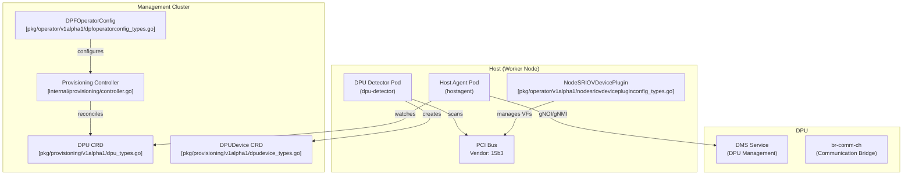
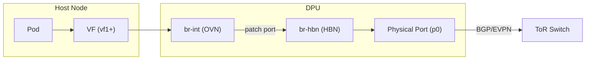
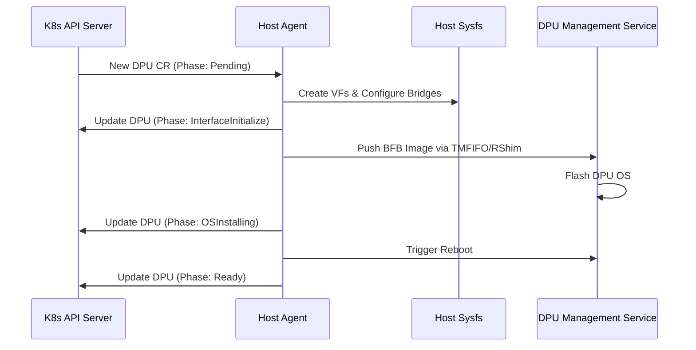

<!-- source: DeepWiki mcp.deepwiki.com · repo NVIDIA/doca-platform · page 9.1 Host-Trusted Mode · fetched 2026-10-26 -->

# Host-Trusted Mode

<details>
<summary>Relevant source files</summary>

The following files were used as context for generating this wiki page:

- [docs/public/user-guides/host-trusted/prerequisites/host-network-configuration-prerequisite.md](docs/public/user-guides/host-trusted/prerequisites/host-network-configuration-prerequisite.md)
- [docs/public/user-guides/host-trusted/prerequisites/system.md](docs/public/user-guides/host-trusted/prerequisites/system.md)
- [docs/public/user-guides/host-trusted/use-cases/hbn-ovnk-snap/README.md](docs/public/user-guides/host-trusted/use-cases/hbn-ovnk-snap/README.md)
- [docs/public/user-guides/host-trusted/use-cases/hbn-ovnk/README.md](docs/public/user-guides/host-trusted/use-cases/hbn-ovnk/README.md)
- [docs/public/user-guides/host-trusted/use-cases/hbn-snap/README.md](docs/public/user-guides/host-trusted/use-cases/hbn-snap/README.md)
- [docs/public/user-guides/host-trusted/use-cases/hbn/README.md](docs/public/user-guides/host-trusted/use-cases/hbn/README.md)
- [docs/public/user-guides/host-trusted/use-cases/ovnk/README.md](docs/public/user-guides/host-trusted/use-cases/ovnk/README.md)
- [docs/public/user-guides/host-trusted/use-cases/passthrough/README.md](docs/public/user-guides/host-trusted/use-cases/passthrough/README.md)
- [docs/public/user-guides/zero-trust/prerequisites/system.md](docs/public/user-guides/zero-trust/prerequisites/system.md)
- [docs/public/user-guides/zero-trust/use-cases/hbn-snap/README.md](docs/public/user-guides/zero-trust/use-cases/hbn-snap/README.md)
- [docs/public/user-guides/zero-trust/use-cases/hbn/README.md](docs/public/user-guides/zero-trust/use-cases/hbn/README.md)
- [docs/public/user-guides/zero-trust/use-cases/passthrough/README.md](docs/public/user-guides/zero-trust/use-cases/passthrough/README.md)
- [docs/public/user-guides/zero-trust/use-cases/vpc/README.md](docs/public/user-guides/zero-trust/use-cases/vpc/README.md)
- [hack/scripts/dpu-control-plane-setup.sh](hack/scripts/dpu-control-plane-setup.sh)

</details>


## Purpose and Scope

This document describes the Host-Trusted deployment mode in the DOCA Platform Framework (DPF). Host-Trusted mode is a deployment architecture where the host system has direct access to the DPU hardware and manages provisioning through local communication channels. This mode is suitable for environments where the host and DPU can operate within the same trust boundary, specifically leveraging in-band management rather than out-of-band BMC/Redfish interfaces used in Zero-Trust mode [docs/public/user-guides/host-trusted/prerequisites/system.md:221-224]().

## Architecture Overview

In Host-Trusted mode, DPU discovery and provisioning occur through in-band communication channels. The host maintains direct control over the DPU hardware via PCI access and local management protocols. A critical requirement is that the DPU communication channel (`br-comm-ch`) is established through a Virtual Function (VF) on the high-speed interface [docs/public/user-guides/host-trusted/prerequisites/system.md:221-224]().

### System Data Flow and Code Entities

The following diagram maps high-level system components to the specific code entities that implement them in Host-Trusted mode.

Title: Host-Trusted Component Mapping

Sources: [docs/public/user-guides/host-trusted/use-cases/ovnk/README.md:1-50](), [docs/public/user-guides/host-trusted/use-cases/hbn-ovnk/README.md:9-15](), [docs/public/user-guides/host-trusted/prerequisites/system.md:221-224]()

## Environment Variable Setup

Installation across all Host-Trusted use cases requires a common set of environment variables. These variables configure the target cluster API, network ranges, and Helm registries.

| Variable | Description | Example |
|----------|-------------|---------|
| `TARGETCLUSTER_API_SERVER_HOST` | IP of the K8s API server where DPF is installed | `10.10.10.10` |
| `DPUCLUSTER_VIP` | Reserved Virtual IP for the DPU Cluster Load Balancer | `10.10.10.50` |
| `DPUCLUSTER_INTERFACE` | Management interface for the DPU Cluster VIP | `enp1s0` |
| `REGISTRY` | NVIDIA Helm NGC registry URL | `https://helm.ngc.nvidia.com/nvidia/doca` |
| `TAG` | Version of DPF components to deploy | `v26.4.0` |
| `BFB_URL` | URL to the BlueField Bundle (BFB) image | `https://.../bundle.bfb` |
| `POD_CIDR` | CIDR used for pods in the target cluster | `10.233.64.0/18` |

Sources: [docs/public/user-guides/host-trusted/use-cases/hbn-ovnk/README.md:90-140](), [docs/public/user-guides/host-trusted/use-cases/ovnk/README.md:87-138]()

## Use Case Configurations

### 1. OVN Kubernetes Only
In this configuration, OVN Kubernetes is offloaded to the DPU as the primary CNI. On worker nodes, the CNI is accelerated, while control plane nodes run OVN-K without offloading [docs/public/user-guides/host-trusted/use-cases/ovnk/README.md:149-151]().

**Key Requirements:**
- **Control Plane**: OVS packages must be installed; out-of-band management port must have "bridge-uplink" metadata [docs/public/user-guides/host-trusted/use-cases/ovnk/README.md:27-31]().
- **Worker Nodes**: OVS packages must **not** be installed; Host PF0 must have DHCP enabled [docs/public/user-guides/host-trusted/use-cases/ovnk/README.md:33-38]().
- **Virtual Functions**: `vf0` is reserved for provisioning, `vf1` for OVN-K, and others for SR-IOV Device Plugin [docs/public/user-guides/host-trusted/use-cases/ovnk/README.md:69-73]().

### 2. HBN + OVN Kubernetes
Combines OVN-K offload with NVIDIA Host Based Networking (HBN). This requires the Top of Rack (ToR) switch to support BGP and EVPN [docs/public/user-guides/host-trusted/use-cases/hbn-ovnk/README.md:19-21]().

**Data Flow Architecture:**
Title: HBN-OVNK Service Chain Flow

Sources: [docs/public/user-guides/host-trusted/use-cases/hbn-ovnk/README.md:9-15](), [docs/public/user-guides/host-trusted/use-cases/hbn-ovnk-snap/README.md:9-15]()

### 3. HBN + OVN + SNAP Block Storage
Integrates DOCA SNAP for Block (NVMe) storage. This setup allows pods to access remote SPDK targets as local NVMe devices via the DPU [docs/public/user-guides/host-trusted/use-cases/hbn-ovnk-snap/README.md:9-11]().

**Storage Prerequisites:**
- Remote SPDK target must be reachable from DPUs [docs/public/user-guides/host-trusted/use-cases/hbn-ovnk-snap/README.md:29-31]().
- SNAP VirtioFS (alternative) requires an external NFS server reachable by the SNAP DPU service [docs/public/user-guides/host-trusted/use-cases/hbn-snap/README.md:33-38]().
- NVMe emulation must be configured in the `DPUFlavor` [docs/public/user-guides/host-trusted/use-cases/hbn-ovnk-snap/README.md:32]().

## Step-by-Step Installation

### 1. Prerequisite Dependencies
Before installing the DPF Operator, manual installation of dependencies is required. This includes `cert-manager`, `kamaji`, and `argo-cd`.

```shell
# Verify all required environment variables are set
../../../../check-required-env.sh
```
Sources: [docs/public/user-guides/host-trusted/use-cases/hbn-ovnk/README.md:157-159](), [docs/public/user-guides/host-trusted/use-cases/hbn-snap/README.md:112-116]()

### 2. DPF Operator Deployment
Deploy the operator using the `host-trusted` deployment mode via Helm.

```shell
helm upgrade --install -n dpf-operator-system dpf-operator \
  dpf-repository/dpf-operator --version=$TAG \
  --set spec.deploymentMode=host-trusted
```
Sources: [docs/public/user-guides/host-trusted/use-cases/hbn/README.md:105-111](), [docs/public/user-guides/host-trusted/use-cases/hbn/manifests/02-dpf-system-installation/operatorconfig.yaml:14]()

### 3. CNI and Service Installation
Install OVN Kubernetes using the provided Helm charts. Note that on worker nodes, the CNI is accelerated by the DPU [docs/public/user-guides/host-trusted/use-cases/hbn-ovnk/README.md:163-165]().

```shell
envsubst < manifests/01-cni-installation/helm-values/ovn-kubernetes.yml | \
  helm upgrade --install --create-namespace --namespace ovn-kubernetes ovn-kubernetes \
  ${OVN_KUBERNETES_REPO_URL}/ovn-kubernetes-chart --version ${OVN_KUBERNETES_CHART_TAG} --values -
```
Sources: [docs/public/user-guides/host-trusted/use-cases/hbn-ovnk/README.md:169-171](), [docs/public/user-guides/host-trusted/use-cases/ovnk/README.md:159-161]()

## Implementation Details: Host Agent

The `HostAgent` is the central component in Host-Trusted mode. It operates as a DaemonSet on worker nodes, bridging the Management Cluster and the physical DPU. It uses gNMI/gNOI for communication with the DPU Management Service (DMS) [docs/public/user-guides/host-trusted/use-cases/ovnk/README.md:72]().

Title: Host Agent Internal Reconciliation

Sources: [docs/public/user-guides/host-trusted/use-cases/ovnk/README.md:1-1000](), [docs/public/user-guides/host-trusted/prerequisites/system.md:221-224]()

### Discovery Logic
In Host-Trusted mode, the `dpu-detector` DaemonSet identifies hardware by scanning the local PCI bus for NVIDIA devices (Vendor ID `15b3`) and creates `DPUDevice` resources [docs/public/user-guides/host-trusted/use-cases/ovnk/README.md:150-200]().

### Troubleshooting and Diagnostics
The `Collector` utility in the codebase gathers logs and events from the DPF system, including the `dpf-operator-system` namespace. In Host-Trusted mode, ensure the DPU high-speed ports are connected, as the communication channel depends on them [docs/public/user-guides/host-trusted/prerequisites/system.md:221-224]().

Sources: [docs/public/user-guides/host-trusted/prerequisites/system.md:221-224](), [docs/public/user-guides/host-trusted/use-cases/hbn/README.md:130-134]()

---

