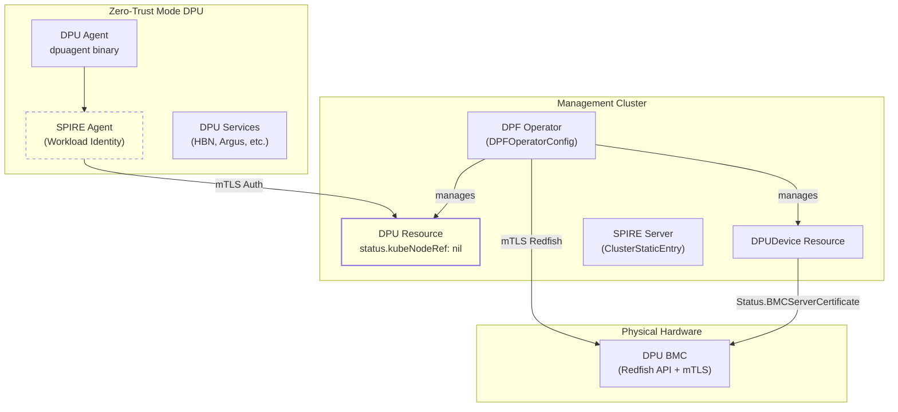
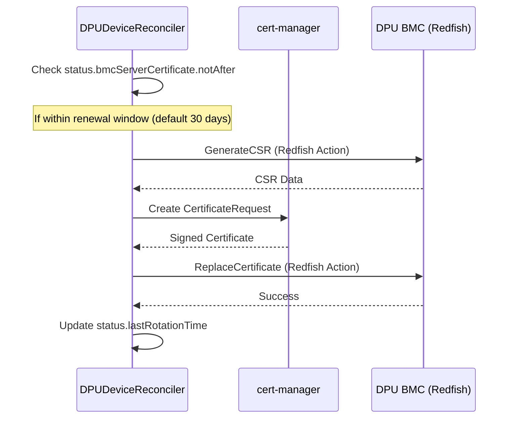
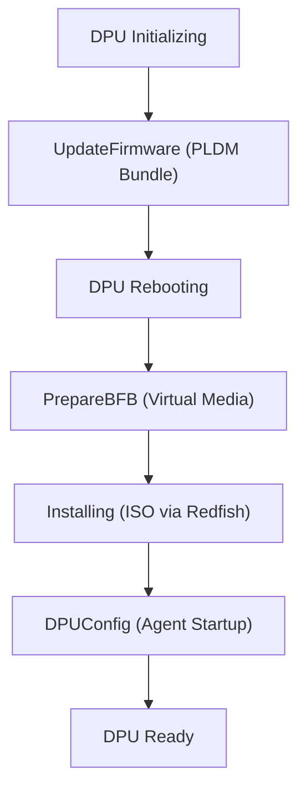

<!-- source: DeepWiki mcp.deepwiki.com · repo NVIDIA/doca-platform · page 9.2 Zero-Trust Mode · fetched 2026-10-26 -->

# Zero-Trust Mode

Relevant source files

The following files were used as context for generating this wiki page:

- [docs/public/advanced-configuration/README.md](docs/public/advanced-configuration/README.md)
- [docs/public/advanced-configuration/per-dpu-bmc-credentials.md](docs/public/advanced-configuration/per-dpu-bmc-credentials.md)
- [docs/public/advanced-configuration/service-readiness.md](docs/public/advanced-configuration/service-readiness.md)
- [docs/public/advanced-configuration/zero-trust-advanced-configuration.md](docs/public/advanced-configuration/zero-trust-advanced-configuration.md)
- [docs/public/developer-guides/api/dpudeployment.md](docs/public/developer-guides/api/dpudeployment.md)
- [docs/public/developer-guides/api/dpuset.md](docs/public/developer-guides/api/dpuset.md)
- [docs/public/operational-readiness/observability/guides/operational-readiness.md](docs/public/operational-readiness/observability/guides/operational-readiness.md)
- [docs/public/user-guides/host-trusted/prerequisites/host-network-configuration-prerequisite.md](docs/public/user-guides/host-trusted/prerequisites/host-network-configuration-prerequisite.md)
- [docs/public/user-guides/host-trusted/prerequisites/system.md](docs/public/user-guides/host-trusted/prerequisites/system.md)
- [docs/public/user-guides/host-trusted/use-cases/hbn-ovnk/manifests/05-dpudeployment-installation/dpudeployment.yaml](docs/public/user-guides/host-trusted/use-cases/hbn-ovnk/manifests/05-dpudeployment-installation/dpudeployment.yaml)
- [docs/public/user-guides/host-trusted/use-cases/hbn/manifests/04-dpudeployment-installation/dpudeployment.yaml](docs/public/user-guides/host-trusted/use-cases/hbn/manifests/04-dpudeployment-installation/dpudeployment.yaml)
- [docs/public/user-guides/host-trusted/use-cases/ovnk/manifests/05-dpudeployment-installation/dpudeployment.yaml](docs/public/user-guides/host-trusted/use-cases/ovnk/manifests/05-dpudeployment-installation/dpudeployment.yaml)
- [docs/public/user-guides/host-trusted/use-cases/ovnk/manifests/05-dpudeployment-installation/dpuflavor-ovn.yaml](docs/public/user-guides/host-trusted/use-cases/ovnk/manifests/05-dpudeployment-installation/dpuflavor-ovn.yaml)
- [docs/public/user-guides/zero-trust/prerequisites/system.md](docs/public/user-guides/zero-trust/prerequisites/system.md)
- [dpuservices/argus/DPUFlavor.yaml](dpuservices/argus/DPUFlavor.yaml)
- [dpuservices/firefly/DPUFlavor.yaml](dpuservices/firefly/DPUFlavor.yaml)
- [hack/scripts/dpu-control-plane-setup.sh](hack/scripts/dpu-control-plane-setup.sh)
- [internal/provisioning/controllers/dpu/state/rebooting_test.go](internal/provisioning/controllers/dpu/state/rebooting_test.go)
- [internal/provisioning/controllers/dpu/state/redfish/client/client.go](internal/provisioning/controllers/dpu/state/redfish/client/client.go)
- [internal/provisioning/controllers/dpu/state/redfish/diag/diag.go](internal/provisioning/controllers/dpu/state/redfish/diag/diag.go)
- [internal/provisioning/controllers/dpu/state/redfish/diag/diag_test.go](internal/provisioning/controllers/dpu/state/redfish/diag/diag_test.go)
- [internal/provisioning/controllers/dpu/state/redfish/firmware_update.go](internal/provisioning/controllers/dpu/state/redfish/firmware_update.go)
- [internal/provisioning/controllers/dpu/state/redfish/firmware_update_test.go](internal/provisioning/controllers/dpu/state/redfish/firmware_update_test.go)
- [internal/provisioning/controllers/dpu/state/redfish/installing.go](internal/provisioning/controllers/dpu/state/redfish/installing.go)
- [internal/provisioning/controllers/dpu/state/redfish/installing_test.go](internal/provisioning/controllers/dpu/state/redfish/installing_test.go)
- [internal/provisioning/controllers/dpu/state/redfish/mock/redfish.go](internal/provisioning/controllers/dpu/state/redfish/mock/redfish.go)
- [internal/provisioning/controllers/dpu/state/redfish/mock/redfish_test.go](internal/provisioning/controllers/dpu/state/redfish/mock/redfish_test.go)
- [internal/provisioning/controllers/dpu/util/reboot_helpers.go](internal/provisioning/controllers/dpu/util/reboot_helpers.go)
- [internal/provisioning/controllers/dpudevice/dpudevice_controller.go](internal/provisioning/controllers/dpudevice/dpudevice_controller.go)
- [internal/provisioning/controllers/dpudevice/dpudevice_controller_test.go](internal/provisioning/controllers/dpudevice/dpudevice_controller_test.go)

## Purpose and Scope

This document describes the zero-trust deployment mode in the DOCA Platform Framework, where DPUs operate without a trusted relationship with the host Kubernetes node. In zero-trust mode, the `DPUNode.Status.KubeNodeRef` field is not set, and the DPU agent authenticates directly to the management cluster using a dedicated client mechanism. This contrasts with host-trusted mode (see section 9.1), where DPUs are associated with and trust the host worker nodes.

Zero-trust mode is particularly relevant for bare-metal workload machines where the DPU out-of-band (OOB) management port is connected to the management network. In this mode, DPF manages the DPU lifecycle via the BMC Redfish API, and the DPU agent communicates with the management cluster over the management network.

**Sources:** [docs/public/advanced-configuration/zero-trust-advanced-configuration.md:149-155](), [internal/provisioning/controllers/dpudevice/dpudevice_controller.go:148-151](), [docs/public/advanced-configuration/README.md:14-17]()

---

## Deployment Mode Comparison

The following table summarizes the key differences between host-trusted and zero-trust deployment modes:

| Aspect | Host-Trusted Mode | Zero-Trust Mode |
|--------|-------------------|-----------------|
| **KubeNodeRef** | Set to management cluster Node name | `nil` (not set) |
| **Node Association** | DPU associated with host worker Node | No host Node association |
| **Provisioning Interface** | Host Agent / gNOI / Redfish | Exclusively Redfish (mTLS) |
| **Node Maintenance** | Can drain/taint host Node | Node effects limited (no host Node) |
| **Security Model** | Trusts host node environment | SPIFFE/SPIRE Identity & mTLS |
| **BMC Credentials** | Often shared password | Supports per-DPU unique secrets |
| **Host Reboot** | Orchestrated via host agent | Orchestrated via BMC (Redfish) |

**Sources:** [docs/public/advanced-configuration/zero-trust-advanced-configuration.md:149-155](), [internal/provisioning/controllers/dpudevice/dpudevice_controller.go:66-68](), [docs/public/advanced-configuration/per-dpu-bmc-credentials.md:7-11]()

---

## Architecture Overview

### Zero-Trust System Topology
The following diagram illustrates the relationship between the management cluster and the DPU when no host trust is established.

**Zero-Trust Mode Characteristics:**
- **Identity Bootstrapping**: DPF uses SPIRE to issue identities to DPU agents based on serial numbers. The `DPUDeviceReconciler` manages `ClusterStaticEntry` resources for each DPU [internal/provisioning/controllers/dpudevice/dpudevice_controller.go:115-117]().
- **BMC mTLS**: The provisioning controller bootstraps mTLS on the BMC by installing the DPF CA and a server certificate [docs/public/advanced-configuration/zero-trust-advanced-configuration.md:149-155]().
- **Hostless Provisioning**: DPUs can be provisioned without host-side discovery or reboot handling by setting the `hostless-` prefix on DPUNodes [internal/provisioning/controllers/dpudevice/dpudevice_controller.go:67-68]().

**Sources:** [internal/provisioning/controllers/dpudevice/dpudevice_controller.go:64-96](), [docs/public/advanced-configuration/zero-trust-advanced-configuration.md:149-158](), [docs/public/advanced-configuration/hostless-dpu-provisioning.md:1-20]()

---

## BMC mTLS and Certificate Rotation

In Zero-Trust mode, the provisioning controller communicates with the DPU BMC via Redfish over mTLS. DPF manages the full lifecycle of these certificates.

### Automatic Rotation Logic
The `DPUDeviceReconciler` monitors the expiry of the BMC server certificate and triggers rotation via cert-manager.

**Key Configuration:**
- **Validity**: BMC server certificates are issued for 365 days [internal/provisioning/controllers/dpudevice/dpudevice_controller.go:78-79]().
- **Renewal Window**: Configurable via `DPFOperatorConfig.spec.provisioningController.bmcServerCertRenewBefore`, defaulting to 30 days [internal/provisioning/controllers/dpudevice/dpudevice_controller.go:80-81]().
- **Trust Bundle**: The DPF CA trust bundle is stored in a ConfigMap named `dpf-ca-trust-bundle` [internal/provisioning/controllers/dpu/state/redfish/client/client.go:106-107]().

**Sources:** [internal/provisioning/controllers/dpudevice/dpudevice_controller.go:78-96](), [docs/public/advanced-configuration/zero-trust-advanced-configuration.md:156-172](), [internal/provisioning/controllers/dpu/state/redfish/client/client.go:75-84]()

---

## Zero-Trust Provisioning Flow

Provisioning in Zero-Trust mode relies on sequential Redfish operations to prepare the DPU, update firmware, and install the OS (BFB).

### State Machine for Zero-Trust (BlueField-4 Example)
For BF4 devices, the flow includes firmware bundle updates and ISO-based installation via Virtual Media.

**Implementation Details:**
- **Firmware Update**: The `FirmwareUpdate` handler uses Redfish `update-multipart` to push PLDM bundles [internal/provisioning/controllers/dpu/state/redfish/firmware_update.go:126-132]().
- **ISO Installation**: Uses Redfish `VirtualMedia.InsertMedia` to mount the OS ISO [internal/provisioning/controllers/dpu/state/redfish/client/client.go:62-63]().
- **Force Reset**: Uses `SOC.ForceReset` to apply changes without host intervention [internal/provisioning/controllers/dpu/state/redfish/client/client.go:94-96]().

**Sources:** [internal/provisioning/controllers/dpu/state/redfish/firmware_update.go:45-56](), [internal/provisioning/controllers/dpu/state/redfish/installing.go:94-98](), [internal/provisioning/controllers/dpu/state/redfish/client/client.go:94-96]()

---

## DPU Discovery and Manual Onboarding

In Zero-Trust environments, DPUs must be registered in the management cluster before provisioning can begin.

### Automated Discovery
The `DPUDiscovery` resource scans IP ranges for Redfish-capable BMCs.
- **Crawler**: Scans `spec.ipRangeSpec` at `scanInterval` [docs/public/advanced-configuration/zero-trust-advanced-configuration.md:33-49]().
- **Result**: Automatically creates `DPUDevice` and `DPUNode` resources [docs/public/advanced-configuration/zero-trust-advanced-configuration.md:63-68]().

### Manual Creation
For static environments, administrators can manually create resources:
1. **DPUDevice**: Contains the `bmcIp` [docs/public/advanced-configuration/zero-trust-advanced-configuration.md:101-110]().
2. **DPUNode**: Maps one or more `DPUDevice` objects to a logical node [docs/public/advanced-configuration/zero-trust-advanced-configuration.md:119-133]().

**Sources:** [docs/public/advanced-configuration/zero-trust-advanced-configuration.md:25-82](), [docs/public/advanced-configuration/zero-trust-advanced-configuration.md:89-133]()

---

## Advanced Configurations

### Hostless DPU Provisioning
In certain scenarios, such as DPUs in a chassis without a standard host OS, DPF supports "hostless" mode.
- **Node Naming**: DPUNodes must be prefixed with `hostless-` [internal/provisioning/controllers/dpudevice/dpudevice_controller.go:67]().
- **Behavior**: The controller skips host-side discovery and reboot coordination, relying entirely on BMC Redfish for power management [docs/public/advanced-configuration/hostless-dpu-provisioning.md:1-20]().

### External Certificate Authority
DPF can be configured to use an external CA (e.g., via `cert-manager` Vault or ACME issuers) instead of the internal self-signed root.
- **Configuration**: Point the `dpf-provisioning-issuer` to an existing Issuer/ClusterIssuer [internal/provisioning/controllers/dpu/state/redfish/client/client.go:110-111]().
- **Impact**: All BMC server certificates and DPU agent identities will chain to the external root [docs/public/advanced-configuration/external-certificate-authority.md:1-15]().

**Sources:** [internal/provisioning/controllers/dpudevice/dpudevice_controller.go:64-68](), [docs/public/advanced-configuration/hostless-dpu-provisioning.md:1-20](), [internal/provisioning/controllers/dpu/state/redfish/client/client.go:106-118]()

---

