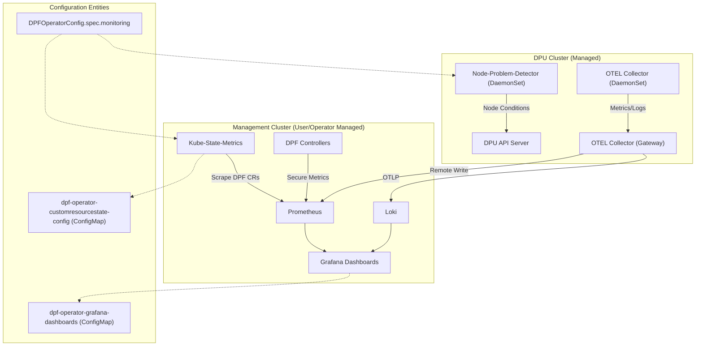
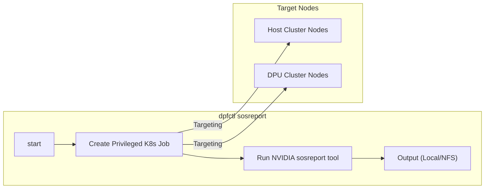

<!-- source: DeepWiki mcp.deepwiki.com · repo NVIDIA/doca-platform · page 9.3 Observability and Monitoring · fetched 2026-10-26 -->

# Observability and Monitoring

Relevant source files

The following files were used as context for generating this wiki page:

- [deploy/charts/dpf-operator/dashboards/debug/controller-runtime.json](deploy/charts/dpf-operator/dashboards/debug/controller-runtime.json)
- [deploy/charts/dpf-operator/dashboards/debug/doca-platform-framework-performance.json](deploy/charts/dpf-operator/dashboards/debug/doca-platform-framework-performance.json)
- [deploy/charts/dpf-operator/dashboards/doca-platform-framework-dpu-control-plane-performance.json](deploy/charts/dpf-operator/dashboards/doca-platform-framework-dpu-control-plane-performance.json)
- [deploy/charts/dpf-operator/dashboards/doca-platform-framework-dpu-detail.json](deploy/charts/dpf-operator/dashboards/doca-platform-framework-dpu-detail.json)
- [deploy/charts/dpf-operator/dashboards/doca-platform-framework-dpu-fleet-health.json](deploy/charts/dpf-operator/dashboards/doca-platform-framework-dpu-fleet-health.json)
- [deploy/charts/dpf-operator/dashboards/doca-platform-framework-state.json](deploy/charts/dpf-operator/dashboards/doca-platform-framework-state.json)
- [deploy/charts/dpf-operator/metrics/bfb.yaml](deploy/charts/dpf-operator/metrics/bfb.yaml)
- [deploy/charts/dpf-operator/metrics/dpfoperatorconfig.yaml](deploy/charts/dpf-operator/metrics/dpfoperatorconfig.yaml)
- [deploy/charts/dpf-operator/metrics/dpucluster.yaml](deploy/charts/dpf-operator/metrics/dpucluster.yaml)
- [deploy/charts/dpf-operator/metrics/dpudeployment.yaml](deploy/charts/dpf-operator/metrics/dpudeployment.yaml)
- [deploy/charts/dpf-operator/metrics/dpuservice.yaml](deploy/charts/dpf-operator/metrics/dpuservice.yaml)
- [deploy/charts/dpf-operator/metrics/dpuset.yaml](deploy/charts/dpf-operator/metrics/dpuset.yaml)
- [deploy/charts/dpf-operator/templates/grafana-dashboards.yaml](deploy/charts/dpf-operator/templates/grafana-dashboards.yaml)
- [deploy/charts/dpf-operator/templates/prometheus-secure-metrics-rbac.yaml](deploy/charts/dpf-operator/templates/prometheus-secure-metrics-rbac.yaml)
- [deploy/charts/dpu-networking/charts/kube-state-metrics/templates/_helpers.tpl](deploy/charts/dpu-networking/charts/kube-state-metrics/templates/_helpers.tpl)
- [deploy/charts/dpu-networking/charts/kube-state-metrics/templates/deployment.yaml](deploy/charts/dpu-networking/charts/kube-state-metrics/templates/deployment.yaml)
- [deploy/charts/dpu-networking/charts/kube-state-metrics/templates/rbac.yaml](deploy/charts/dpu-networking/charts/kube-state-metrics/templates/rbac.yaml)
- [deploy/charts/dpu-networking/charts/kube-state-metrics/templates/servicemonitor.yaml](deploy/charts/dpu-networking/charts/kube-state-metrics/templates/servicemonitor.yaml)
- [deploy/helmfiles/hooks/apply-dashboards.sh](deploy/helmfiles/hooks/apply-dashboards.sh)
- [deploy/helmfiles/hooks/apply-prometheus-rules.sh](deploy/helmfiles/hooks/apply-prometheus-rules.sh)
- [deploy/helmfiles/monitoring.yaml](deploy/helmfiles/monitoring.yaml)
- [deploy/helmfiles/prereqs.yaml](deploy/helmfiles/prereqs.yaml)
- [deploy/helmfiles/prometheus-rules/dpucluster-control-plane-aggregates.yaml](deploy/helmfiles/prometheus-rules/dpucluster-control-plane-aggregates.yaml)
- [deploy/helmfiles/values/argo-cd.yaml](deploy/helmfiles/values/argo-cd.yaml)
- [deploy/helmfiles/values/kamaji.yaml](deploy/helmfiles/values/kamaji.yaml)
- [deploy/helmfiles/values/kube-prometheus-stack.yaml](deploy/helmfiles/values/kube-prometheus-stack.yaml)
- [deploy/helmfiles/values/kube-state-metrics.yaml](deploy/helmfiles/values/kube-state-metrics.yaml)
- [deploy/helmfiles/values/loki.yaml](deploy/helmfiles/values/loki.yaml)
- [docs/public/README.md](docs/public/README.md)
- [docs/public/getting-started/helm-prerequisites.md](docs/public/getting-started/helm-prerequisites.md)
- [docs/public/operational-readiness/README.md](docs/public/operational-readiness/README.md)
- [docs/public/operational-readiness/observability/README.md](docs/public/operational-readiness/observability/README.md)
- [docs/public/operational-readiness/observability/dashboards/README.md](docs/public/operational-readiness/observability/dashboards/README.md)
- [docs/public/operational-readiness/observability/deployment/operator-managed-components.md](docs/public/operational-readiness/observability/deployment/operator-managed-components.md)
- [docs/public/operational-readiness/observability/deployment/user-managed-components.md](docs/public/operational-readiness/observability/deployment/user-managed-components.md)
- [docs/public/operational-readiness/observability/guides/README.md](docs/public/operational-readiness/observability/guides/README.md)
- [docs/public/operational-readiness/observability/prometheus-rules/README.md](docs/public/operational-readiness/observability/prometheus-rules/README.md)
- [docs/public/operational-readiness/observability/prometheus-rules/alertmanager.md](docs/public/operational-readiness/observability/prometheus-rules/alertmanager.md)
- [docs/public/operational-readiness/observability/prometheus-rules/alerts.md](docs/public/operational-readiness/observability/prometheus-rules/alerts.md)
- [docs/public/operational-readiness/observability/prometheus-rules/recording-rules.md](docs/public/operational-readiness/observability/prometheus-rules/recording-rules.md)
- [docs/public/operational-readiness/troubleshooting/dpfctl/sosreport.md](docs/public/operational-readiness/troubleshooting/dpfctl/sosreport.md)
- [docs/public/operational-readiness/upgrades/README.md](docs/public/operational-readiness/upgrades/README.md)
- [docs/public/platform-support.md](docs/public/platform-support.md)
- [docs/public/user-guides/README.md](docs/public/user-guides/README.md)

The DOCA Platform Framework (DPF) observability stack provides comprehensive monitoring, log aggregation, and health visualization for DPU fleets across management and DPU clusters. The system integrates industry-standard tools—Prometheus, Grafana, Loki, and OpenTelemetry—to surface real-time operational data, from hardware provisioning states to high-level service health [docs/public/operational-readiness/observability/deployment/user-managed-components.md:7-21]().

## Monitoring Stack Architecture

The observability infrastructure is split between user-managed components on the Host Cluster and DPF-managed collectors on DPU clusters.

### Component Overview
*   **Kube-Prometheus-Stack**: A unified stack providing Prometheus (metrics storage), Grafana (visualization), and Prometheus Operator [docs/public/operational-readiness/observability/deployment/user-managed-components.md:17-17](). It is typically deployed via Helm [deploy/helmfiles/monitoring.yaml:20-24]().
*   **Loki**: The backend for log aggregation and storage [docs/public/operational-readiness/observability/deployment/user-managed-components.md:18-18]().
*   **OpenTelemetry (OTEL) Collector**: Deployed on DPU clusters to collect logs and metrics, forwarding them via OTLP to the management cluster [docs/public/operational-readiness/observability/deployment/user-managed-components.md:166-172]().
*   **Kube-State-Metrics (KSM)**: Exposes DPF Custom Resource (CR) metrics and Kubernetes object states [docs/public/operational-readiness/observability/deployment/operator-managed-components.md:24-26]().
*   **Node-Problem-Detector (NPD)**: Monitors DPU node health (e.g., OVS process health, uplink status) and reports problems as Node conditions [docs/public/operational-readiness/observability/deployment/operator-managed-components.md:96-112]().

### Data Flow and Code Entities
The following diagram illustrates the flow of observability data from DPU nodes to the centralized Grafana dashboards.

**Observability Data Flow**

Sources: [docs/public/operational-readiness/observability/deployment/operator-managed-components.md:7-22](), [docs/public/operational-readiness/observability/deployment/user-managed-components.md:15-21](), [deploy/helmfiles/monitoring.yaml:71-80](), [deploy/charts/dpf-operator/templates/grafana-dashboards.yaml:1-14]()

---

## Metrics Collection and Integration

### Kube-State-Metrics (KSM) Integration
DPF utilizes a customized `kube-state-metrics` deployment to surface the state of DPF-specific Custom Resources.
*   **Architecture**: KSM uses a split architecture where a Host Cluster deployment connects remotely to DPU cluster API servers [docs/public/operational-readiness/observability/deployment/operator-managed-components.md:30-36]().
*   **Configuration**: KSM is configured via the `extraArgs` pointing to the `custom-resource-state-config-file` at `/etc/customresourcestate/config.yaml` [deploy/helmfiles/values/kube-state-metrics.yaml:19-20]().
*   **Resource Metrics**: It tracks IPAM resources (`IPPool`), Service Function Chaining (`ServiceChain`, `ServiceInterface`), and DPF lifecycle objects (`DPFOperatorConfig`, `DPUSet`) [docs/public/operational-readiness/observability/deployment/operator-managed-components.md:41-55](), [deploy/helmfiles/values/kube-state-metrics.yaml:64-74]().
*   **Namespace Overrides**: If KSM runs outside `dpf-operator-system`, the `kubeStateMetricsCRDMetrics.namespaceOverride` must be set so the ConfigMap lands correctly [docs/public/getting-started/helm-prerequisites.md:77-84]().

### Controller Metrics
DPF controller pods (identified by `dpu.nvidia.com/component: *-controller-manager`) expose metrics over HTTPS on a port named `metrics` [docs/public/operational-readiness/observability/deployment/user-managed-components.md:52-54](). 
*   **Scrape Configuration**: Prometheus must authenticate using a ServiceAccount token (`/var/run/secrets/kubernetes.io/serviceaccount/token`) and trust the cluster CA [docs/public/operational-readiness/observability/deployment/user-managed-components.md:60-67]().
*   **ServiceAccount**: The `kube-prometheus-stack-prometheus` ServiceAccount is typically used for these permissions [deploy/helmfiles/values/kube-prometheus-stack.yaml:174-175]().

---

## Grafana Dashboards

Dashboards are packaged as JSON files within the Helm chart and deployed as `ConfigMaps` labeled with `grafana_dashboard: "1"` [docs/public/operational-readiness/observability/dashboards/README.md:7-10](), [deploy/charts/dpf-operator/templates/grafana-dashboards.yaml:9-10]().

### Key Dashboards
| Dashboard Name | Purpose | Key Metrics / File |
| :--- | :--- | :--- |
| **DPU Fleet Health** | Overview of provisioning state, health conditions, and service readiness. | `doca-platform-framework-dpu-fleet-health.json` |
| **DPU Detail** | Per-DPU resource utilization, networking, and scheduled pods. | `doca-platform-framework-dpu-detail.json` |
| **Framework State** | Tracks DPF CR states (DPUSets, DPUServices, DPUDeployments). | `doca-platform-framework-state.json` |
| **DPUService Performance** | CPU/Memory usage of workloads on DPU clusters (requires OTEL metrics). | `doca-platform-framework-dpuservice-performance.json` |
| **DPU Control Plane** | API Server, etcd, and scheduler performance for Kamaji-managed clusters. | `doca-platform-framework-dpu-control-plane-performance.json` |
| **Alerts** | Summary of active DPF Prometheus alerts and readiness ratios. | `doca-platform-framework-alerts.json` |

Sources: [docs/public/operational-readiness/observability/dashboards/README.md:23-75](), [deploy/charts/dpf-operator/templates/grafana-dashboards.yaml:1-29]()

---

## Log Flow and Performance Monitoring

### OpenTelemetry Collector Configuration
The OTEL Collector streams two independent signals based on the configuration in `DPFOperatorConfig.spec.monitoring.openTelemetryCollector` [docs/public/operational-readiness/observability/deployment/operator-managed-components.md:166-172]():
1.  **Logs**: Collected from DPU cluster pods and forwarded via OTLP [docs/public/operational-readiness/observability/deployment/operator-managed-components.md:170-170]().
2.  **Metrics**: Scraped from every DPU node's kubelet and streamed to the management cluster with a `cluster` label [docs/public/operational-readiness/observability/deployment/operator-managed-components.md:171-171]().

### Performance Verification
The `dpfctl` tool can be used to collect diagnostics, including `sosreport` from host and DPU nodes [docs/public/operational-readiness/troubleshooting/dpfctl/sosreport.md:7-9]().

**SOS Report Collection Flow**

Sources: [docs/public/operational-readiness/troubleshooting/dpfctl/sosreport.md:19-25](), [docs/public/operational-readiness/troubleshooting/dpfctl/sosreport.md:52-63]()

---

## Upgrade Lifecycle for DPF Operator

The upgrade process follows a strict sequential policy and includes automated prevalidation to ensure system stability.

### Sequential Upgrade Policy (n-1)
DPF enforces an **n-1 upgrade policy** based on the `year.month.patchVersion` pattern [docs/public/operational-readiness/upgrades/README.md:63-65]().
*   **Supported**: v25.7.0 → v25.10.0 [docs/public/operational-readiness/upgrades/README.md:69-69]().
*   **Unsupported**: v25.4 → v25.7 (skipping releases is not supported) [docs/public/operational-readiness/upgrades/README.md:74-75]().

### Pre-Upgrade Validation
Before upgrading components, the `DPFOperatorConfig` controller performs `PreUpgradeValidationReady` checks [docs/public/operational-readiness/upgrades/README.md:109-112]():
*   **DPU State**: All DPUs must be in a terminal `Ready` state [docs/public/operational-readiness/upgrades/README.md:116-116]().
*   **Kubernetes Version Skew**: DPU kubelet versions must not be more than three minor versions behind the DPU cluster API server [docs/public/operational-readiness/upgrades/README.md:137-137]().
*   **Object Schema Validation**: Existing API objects are validated against new OpenAPI schemas [docs/public/operational-readiness/upgrades/README.md:157-157]().

### Execution and Verification
1.  **Readiness Check**: Use `dpfctl describe all --show-resources=dpfoperatorconfig` to verify the operator is ready for upgrade [docs/public/operational-readiness/upgrades/README.md:32-36]().
2.  **Helm Upgrade**: Helm dependencies (ArgoCD, Kamaji, etc.) must be installed/upgraded manually before the DPF chart [docs/public/getting-started/helm-prerequisites.md:15-18]().
3.  **Post-Upgrade**: Verify `status.version` in `DPFOperatorConfig` matches the new release [docs/public/operational-readiness/upgrades/README.md:51-52]().

Sources: [docs/public/operational-readiness/upgrades/README.md:1-175](), [docs/public/getting-started/helm-prerequisites.md:1-44]()

---

