# Page: DOCA Platform Framework Overview

# DOCA Platform Framework Overview

<details>
<summary>Relevant source files</summary>

The following files were used as context for generating this wiki page:

- [api/operator/v1alpha1/componentconfig_types.go](api/operator/v1alpha1/componentconfig_types.go)
- [api/operator/v1alpha1/dpfoperatorconfig_types.go](api/operator/v1alpha1/dpfoperatorconfig_types.go)
- [api/operator/v1alpha1/zz_generated.deepcopy.go](api/operator/v1alpha1/zz_generated.deepcopy.go)
- [cmd/provisioning/main.go](cmd/provisioning/main.go)
- [config/operator-crds/operator.dpu.nvidia.com_dpfoperatorconfigs.yaml](config/operator-crds/operator.dpu.nvidia.com_dpfoperatorconfigs.yaml)
- [deploy/charts/dpf-operator/templates/crds/apiextensions.k8s.io_v1_customresourcedefinition_dpfoperatorconfigs.operator.dpu.nvidia.com.yaml](deploy/charts/dpf-operator/templates/crds/apiextensions.k8s.io_v1_customresourcedefinition_dpfoperatorconfigs.operator.dpu.nvidia.com.yaml)
- [deploy/helmfiles/hooks/apply-dashboards.sh](deploy/helmfiles/hooks/apply-dashboards.sh)
- [deploy/helmfiles/hooks/apply-prometheus-rules.sh](deploy/helmfiles/hooks/apply-prometheus-rules.sh)
- [deploy/helmfiles/monitoring.yaml](deploy/helmfiles/monitoring.yaml)
- [deploy/helmfiles/prereqs.yaml](deploy/helmfiles/prereqs.yaml)
- [deploy/helmfiles/values/argo-cd.yaml](deploy/helmfiles/values/argo-cd.yaml)
- [deploy/helmfiles/values/kamaji.yaml](deploy/helmfiles/values/kamaji.yaml)
- [deploy/helmfiles/values/kube-prometheus-stack.yaml](deploy/helmfiles/values/kube-prometheus-stack.yaml)
- [deploy/helmfiles/values/loki.yaml](deploy/helmfiles/values/loki.yaml)
- [docs/public/developer-guides/api/api.md](docs/public/developer-guides/api/api.md)
- [docs/public/developer-guides/api/dpfoperatorconfig.md](docs/public/developer-guides/api/dpfoperatorconfig.md)
- [docs/public/getting-started/helm-prerequisites.md](docs/public/getting-started/helm-prerequisites.md)
- [docs/public/platform-support.md](docs/public/platform-support.md)
- [docs/public/user-guides/host-trusted/use-cases/hbn-ovnk-snap/README.md](docs/public/user-guides/host-trusted/use-cases/hbn-ovnk-snap/README.md)
- [docs/public/user-guides/host-trusted/use-cases/hbn-ovnk/README.md](docs/public/user-guides/host-trusted/use-cases/hbn-ovnk/README.md)
- [docs/public/user-guides/host-trusted/use-cases/hbn-snap/README.md](docs/public/user-guides/host-trusted/use-cases/hbn-snap/README.md)
- [docs/public/user-guides/host-trusted/use-cases/hbn/README.md](docs/public/user-guides/host-trusted/use-cases/hbn/README.md)
- [docs/public/user-guides/host-trusted/use-cases/ovnk/README.md](docs/public/user-guides/host-trusted/use-cases/ovnk/README.md)
- [docs/public/user-guides/host-trusted/use-cases/passthrough/README.md](docs/public/user-guides/host-trusted/use-cases/passthrough/README.md)
- [docs/public/user-guides/zero-trust/use-cases/hbn-snap/README.md](docs/public/user-guides/zero-trust/use-cases/hbn-snap/README.md)
- [docs/public/user-guides/zero-trust/use-cases/hbn/README.md](docs/public/user-guides/zero-trust/use-cases/hbn/README.md)
- [docs/public/user-guides/zero-trust/use-cases/passthrough/README.md](docs/public/user-guides/zero-trust/use-cases/passthrough/README.md)
- [docs/public/user-guides/zero-trust/use-cases/vpc/README.md](docs/public/user-guides/zero-trust/use-cases/vpc/README.md)
- [internal/operator/inventory/dpu_provisioning_controller_manifests.go](internal/operator/inventory/dpu_provisioning_controller_manifests.go)
- [internal/operator/inventory/dpu_provisioning_controller_manifests_test.go](internal/operator/inventory/dpu_provisioning_controller_manifests_test.go)
- [internal/operator/inventory/variables.go](internal/operator/inventory/variables.go)
- [internal/provisioning/controllers/dpu/util/options.go](internal/provisioning/controllers/dpu/util/options.go)
- [test/apivalidation/operator_validation_test.go](test/apivalidation/operator_validation_test.go)

</details>


The DOCA Platform Framework (DPF) is a Kubernetes-native system for provisioning and orchestrating NVIDIA BlueField DPUs in data center environments. It implements a control plane / data plane separation model where the host cluster manages DPU lifecycle while DPUs run their own managed Kubernetes clusters.

## System Architecture

DPF operates across three distinct planes:

**Management Plane**: The host Kubernetes cluster where administrators apply DPF custom resources such as `DPUDeployment`, `DPUSet`, and `BFB` [docs/public/developer-guides/api/api.md:10-12]().

**Control Plane**: DPF controllers running in the host cluster that reconcile desired state and coordinate provisioning operations.

**Data Plane**: Physical DPU hardware and their managed Kubernetes clusters that run networking and storage services.

### High-Level System Architecture

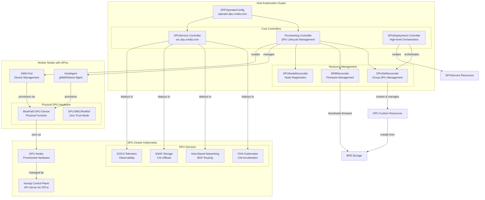

Sources:
- [cmd/provisioning/main.go:34-44]()
- [api/operator/v1alpha1/componentconfig_types.go:37-89]()
- [docs/public/developer-guides/api/api.md:7-13]()

## Control Plane vs Data Plane Separation

DPF implements strict separation between management/control operations and data plane acceleration:

**Control Plane (Host Cluster)**:
- `DPFOperatorConfig` CRD for system configuration [config/operator-crds/operator.dpu.nvidia.com_dpfoperatorconfigs.yaml:12-31]().
- Controllers that reconcile DPU state (Provisioning, DPUService, DPUDeployment).
- `DPUSet` for grouping and managing multiple DPUs [docs/public/developer-guides/api/api.md:10]().
- `BFB` (BlueField Bundle) firmware management via `BFBRegistry` [api/operator/v1alpha1/componentconfig_types.go:87-89]().
- `HostAgent` for node-level operations [cmd/provisioning/main.go:141-142]().

**Data Plane (DPU Hardware)**:
- OVS bridges (br-sfc, br-dpu, br-ovn, br-hbn) for packet processing [docs/public/user-guides/host-trusted/use-cases/hbn-ovnk/README.md:9-11]().
- SR-IOV virtual functions (VFs) for host connectivity [docs/public/user-guides/host-trusted/use-cases/hbn-ovnk/README.md:71-78]().
- Managed Kubernetes clusters via Kamaji [docs/public/getting-started/helm-prerequisites.md:29-30]().
- Service pods (OVN, HBN, SNAP, Telemetry).

### Control Plane vs Data Plane Workflow

```mermaid
graph LR
    subgraph "Management Plane"
        direction TB
        User["Cluster Admin"] -->|kubectl apply| K8sAPI["Host K8s API Server"]
        K8sAPI --> CRDs["Custom Resources<br/>DPUDeployment<br/>DPUSet<br/>DPUFlavor<br/>BFB"]
    end
    
    subgraph "Control Plane (Host Cluster)"
        direction TB
        Controllers["DPF Controllers<br/>Reconciliation Loops"]
        
        subgraph "Orchestration Layer"
            DPUDep["DPUDeployment<br/>svc.dpu.nvidia.com"]
            DPUSetCtrl["DPUSetReconciler<br/>provisioning.dpu.nvidia.com"]
        end
        
        subgraph "Execution Layer"
            HostAgentDS["HostAgent DaemonSet<br/>Per-node Operations"]
            BFBReg["BFB Registry<br/>Firmware Distribution"]
        end
        
        CRDs -->|watch| Controllers
        Controllers --> DPUDep
        Controllers --> DPUSetCtrl
        DPUSetCtrl --> HostAgentDS
        DPUSetCtrl --> BFBReg
    end
    
    subgraph "Data Plane (DPU Hardware)"
        direction TB
        
        subgraph "DPU Cluster"
            DPUAPIServer["DPU K8s API Server<br/>Kamaji Managed"]
            SvcPods["Service Pods<br/>OVN/HBN/Storage/etc"]
        end
        
        subgraph "Hardware Acceleration"
            OVS["OVS-DPDK<br/>br-sfc, br-ovn, br-hbn"]
            DPDK["DPDK Datapath<br/>Physical Ports"]
            SR_IOV["SR-IOV VFs<br/>Host Connection"]
        end
        
        DPUAPIServer --> SvcPods
        SvcPods --> OVS
        OVS --> DPDK
        OVS --> SR_IOV
    end
    
    subgraph "Workload Plane (Host Pods)"
        WorkerPods["Application Pods<br/>On Worker Nodes"]
        WorkerPods -->|VF Attachment| SR_IOV
    end
    
    HostAgentDS -.->|provisions| DPU["Physical DPU Hardware"]
    DPU -.->|boots as| DPUAPIServer
    BFBReg -.->|serves firmware| HostAgentDS
    
    DPUDep -.->|creates ArgoCD Apps| SvcPods
```

Sources:
- [internal/operator/inventory/variables.go:49-82]()
- [docs/public/user-guides/host-trusted/use-cases/hbn-ovnk/README.md:163-171]()
- [api/operator/v1alpha1/componentconfig_types.go:124-128]()

## DPU Provisioning Workflow

The provisioning system manages the complete lifecycle of DPU hardware from discovery through ready state. The workflow involves multiple phases coordinated by the `ProvisioningController` and the `HostAgent`.

### Provisioning Phases

The DPU resource moves through several phases during its lifecycle:
- `Initializing`: First phase after creation.
- `Pending`: Waiting for BFB readiness.
- `OS Installing`: Provisioning through gNOI or Redfish [api/operator/v1alpha1/componentconfig_types.go:83-85]().
- `DPU Config`: DPU agent configuring the device.
- `Ready`: DPU is fully operational.

### DPU Operational Health

DPF monitors runtime health through several mechanisms:
- `NodeSRIOVDevicePlugin`: Manages host-side SR-IOV resources [docs/public/developer-guides/api/api.md:100-104]().
- `Monitoring`: Includes `kube-state-metrics`, `node-problem-detector`, and `openTelemetryCollector` [docs/public/developer-guides/api/dpfoperatorconfig.md:141-172]().

Sources:
- [api/operator/v1alpha1/componentconfig_types.go:91-97]()
- [cmd/provisioning/main.go:83-94]()
- [docs/public/developer-guides/api/dpfoperatorconfig.md:143-156]()

## Component Architecture

The DPF system is composed of several key components that work together to manage DPU resources:

| Component Type | Component Name | Purpose |
|---------------|----------------|----------|
| Core | DPF Operator | Central controller managing all components via `DPFOperatorConfig` [config/operator-crds/operator.dpu.nvidia.com_dpfoperatorconfigs.yaml:31-33]() |
| Core | DPU Service Controller | Manages DPU service lifecycle and ArgoCD integration [docs/public/getting-started/helm-prerequisites.md:26]() |
| Core | Provisioning Controller | Handles DPU provisioning and firmware updates [api/operator/v1alpha1/componentconfig_types.go:37-40]() |
| Networking | SRIOV Device Plugin | SR-IOV device management for host VF resources [docs/public/developer-guides/api/api.md:26-30]() |
| Networking | OVN-Kubernetes | Primary CNI acceleration [docs/public/user-guides/host-trusted/use-cases/hbn-ovnk/README.md:9]() |
| Networking | HBN | Host Based Networking (BGP/EVPN) [docs/public/user-guides/host-trusted/use-cases/hbn-ovnk/README.md:9]() |
| Storage | SNAP | Storage acceleration (NVMe/VirtioFS) [docs/public/user-guides/zero-trust/use-cases/hbn-snap/README.md:12-14]() |
| Cluster | Kamaji | Managed Kubernetes control planes for DPUs [docs/public/getting-started/helm-prerequisites.md:29-30]() |

For details, see:
- [Architecture and Key Components](#1.1)
- [Build and Release System](#1.2)

Sources:
- [docs/public/platform-support.md:18-43]()
- [docs/public/developer-guides/api/api.md:7-13]()
- [internal/operator/inventory/variables.go:49-82]()

---

# Page: Architecture and Key Components

# Architecture and Key Components

<details>
<summary>Relevant source files</summary>

The following files were used as context for generating this wiki page:

- [api/operator/v1alpha1/componentconfig_common.go](api/operator/v1alpha1/componentconfig_common.go)
- [api/operator/v1alpha1/componentconfig_types.go](api/operator/v1alpha1/componentconfig_types.go)
- [api/operator/v1alpha1/dpfoperatorconfig_types.go](api/operator/v1alpha1/dpfoperatorconfig_types.go)
- [api/operator/v1alpha1/zz_generated.deepcopy.go](api/operator/v1alpha1/zz_generated.deepcopy.go)
- [cmd/provisioning/main.go](cmd/provisioning/main.go)
- [config/operator-crds/operator.dpu.nvidia.com_dpfoperatorconfigs.yaml](config/operator-crds/operator.dpu.nvidia.com_dpfoperatorconfigs.yaml)
- [config/provisioning/rbac/role.yaml](config/provisioning/rbac/role.yaml)
- [config/provisioning/webhook/manifests.yaml](config/provisioning/webhook/manifests.yaml)
- [deploy/charts/dpf-operator/templates/crds/apiextensions.k8s.io_v1_customresourcedefinition_dpfoperatorconfigs.operator.dpu.nvidia.com.yaml](deploy/charts/dpf-operator/templates/crds/apiextensions.k8s.io_v1_customresourcedefinition_dpfoperatorconfigs.operator.dpu.nvidia.com.yaml)
- [deploy/charts/dpf-operator/templates/role.yaml](deploy/charts/dpf-operator/templates/role.yaml)
- [deploy/charts/dpu-networking/Chart.lock](deploy/charts/dpu-networking/Chart.lock)
- [deploy/charts/dpu-networking/Chart.yaml](deploy/charts/dpu-networking/Chart.yaml)
- [deploy/charts/dpu-networking/README.md](deploy/charts/dpu-networking/README.md)
- [deploy/charts/dpu-networking/values.yaml](deploy/charts/dpu-networking/values.yaml)
- [docs/public/developer-guides/api/api.md](docs/public/developer-guides/api/api.md)
- [docs/public/developer-guides/api/dpfoperatorconfig.md](docs/public/developer-guides/api/dpfoperatorconfig.md)
- [internal/operator/controllers/dpfoperatorconfig_controller.go](internal/operator/controllers/dpfoperatorconfig_controller.go)
- [internal/operator/controllers/dpfoperatorconfig_controller_test.go](internal/operator/controllers/dpfoperatorconfig_controller_test.go)
- [internal/operator/controllers/object_schema_validation_test.go](internal/operator/controllers/object_schema_validation_test.go)
- [internal/operator/inventory/component_versions.go](internal/operator/inventory/component_versions.go)
- [internal/operator/inventory/dpu_provisioning_controller_manifests.go](internal/operator/inventory/dpu_provisioning_controller_manifests.go)
- [internal/operator/inventory/dpu_provisioning_controller_manifests_test.go](internal/operator/inventory/dpu_provisioning_controller_manifests_test.go)
- [internal/operator/inventory/from_dpu_service_manifests.go](internal/operator/inventory/from_dpu_service_manifests.go)
- [internal/operator/inventory/inventory.go](internal/operator/inventory/inventory.go)
- [internal/operator/inventory/manifests/provisioning-controller.yaml](internal/operator/inventory/manifests/provisioning-controller.yaml)
- [internal/operator/inventory/variables.go](internal/operator/inventory/variables.go)
- [internal/provisioning/bfbregistry/bfb_registry_creator.go](internal/provisioning/bfbregistry/bfb_registry_creator.go)
- [internal/provisioning/bfbregistry/bfb_registry_creator_test.go](internal/provisioning/bfbregistry/bfb_registry_creator_test.go)
- [internal/provisioning/controllers/dpu/dpu_controller.go](internal/provisioning/controllers/dpu/dpu_controller.go)
- [internal/provisioning/controllers/dpu/util/options.go](internal/provisioning/controllers/dpu/util/options.go)
- [internal/provisioning/webhooks/dpudiscovery_webhook.go](internal/provisioning/webhooks/dpudiscovery_webhook.go)
- [internal/provisioning/webhooks/dpudiscovery_webhook_test.go](internal/provisioning/webhooks/dpudiscovery_webhook_test.go)
- [internal/provisioning/webhooks/suite_test.go](internal/provisioning/webhooks/suite_test.go)
- [test/apivalidation/operator_validation_test.go](test/apivalidation/operator_validation_test.go)

</details>


## Purpose and Scope

This document describes the multi-layer architecture of the DOCA Platform Framework (DPF), including the management cluster components, DPU cluster structure, control plane hierarchy, and the core controllers that orchestrate DPU lifecycle management and service deployment. It focuses on how the major system components are organized and how they interact with each other.

For details on the build and release pipeline, see [Build and Release System](#1.2). For specific controller implementations, see [DPF Operator](#2), [Provisioning System](#3), [Service Deployment System](#4), and [Networking Components](#5).

---

## Multi-Layer System Architecture

The DPF system operates across three distinct layers: the **Management Cluster**, **DPU Clusters**, and the **Host Infrastructure**. The management cluster runs all operator controllers and orchestrates the entire platform, while DPU clusters provide isolated Kubernetes environments for running services on DPU nodes.

### Management Cluster

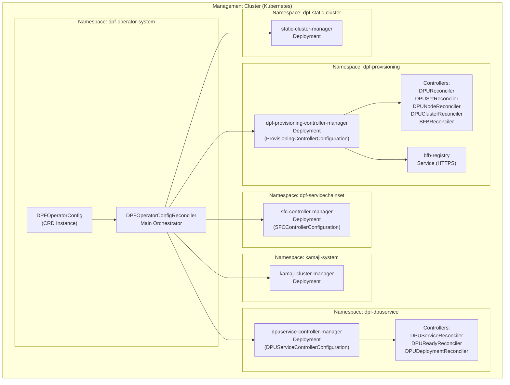

**Sources:** [cmd/provisioning/main.go:27-46](), [api/operator/v1alpha1/componentconfig_types.go:37-147](), [internal/operator/inventory/variables.go:37-123]()

The management cluster hosts all DPF operator components:

| Component | Namespace | Deployment | Primary Controllers |
|-----------|-----------|------------|-------------------|
| DPF Operator | `dpf-operator-system` | `dpf-operator-controller-manager` | `DPFOperatorConfigReconciler` |
| Provisioning Controller | `dpf-provisioning` | `dpf-provisioning-controller-manager` | `DPUReconciler`, `DPUSetReconciler`, `DPUNodeReconciler` |
| DPUService Controller | `dpf-dpuservice` | `dpuservice-controller-manager` | `DPUServiceReconciler`, `DPUReadyReconciler` |
| SFC Controller | `dpf-servicechainset` | `sfc-controller-manager` | Service chain management |
| Cluster Managers | `kamaji-system`, `dpf-static-cluster` | Kamaji/Static managers | Tenant cluster lifecycle |

**Sources:** [internal/operator/inventory/variables.go:37-123](), [api/operator/v1alpha1/componentconfig_types.go:37-147]()

---

## DPU Cluster Architecture

Each tenant receives an isolated Kubernetes cluster running on DPU nodes. The control plane components run as pods in the management cluster (via Kamaji), while workloads execute on DPU ARM processors.

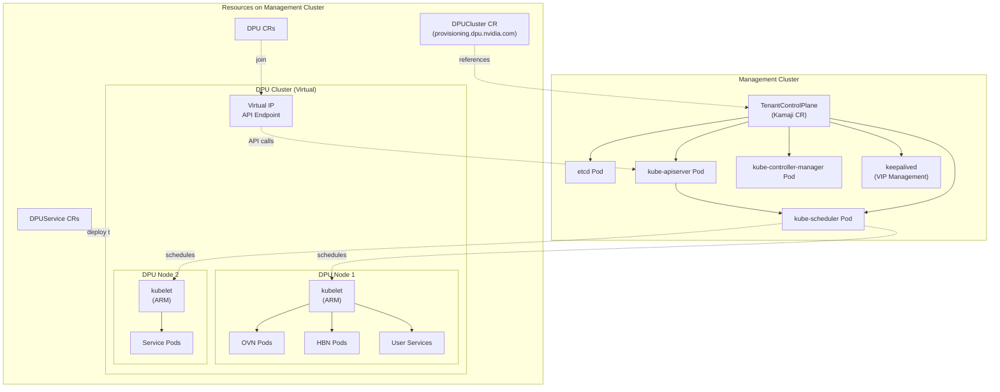

**Sources:** [cmd/provisioning/main.go:39](), [docs/public/developer-guides/api/api.md:10-13]()

The `DPUCluster` resource in the `provisioning.dpu.nvidia.com` API group represents a tenant's Kubernetes cluster. It provides the endpoint for DPUs to join after OS installation.

---

## Control Plane Hierarchy

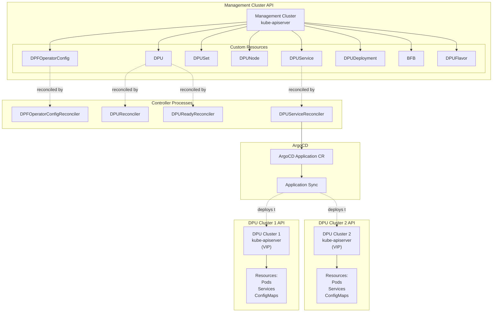

**Sources:** [docs/public/developer-guides/api/api.md:9-13](), [cmd/provisioning/main.go:34-43]()

The control plane is hierarchical:
1. **Management Cluster API** - Hosts all DPF CRDs and controller logic.
2. **DPU Cluster APIs** - Independent Kubernetes control planes for each tenant.
3. **ArgoCD** - Bridges the two, deploying applications from management cluster to DPU clusters.

---

## Core Controllers and Their Responsibilities

### DPFOperatorConfigReconciler

The central orchestrator that manages the entire DPF system lifecycle. It reads the `DPFOperatorConfig` and deploys sub-components like the provisioning controller and service controllers.

**Sources:** [internal/operator/controllers/dpfoperatorconfig_controller.go:76-84](), [config/operator-crds/operator.dpu.nvidia.com_dpfoperatorconfigs.yaml:31-32]()

### DPU Provisioning Controllers

Located in namespace `dpf-provisioning`, these controllers manage DPU hardware lifecycle.

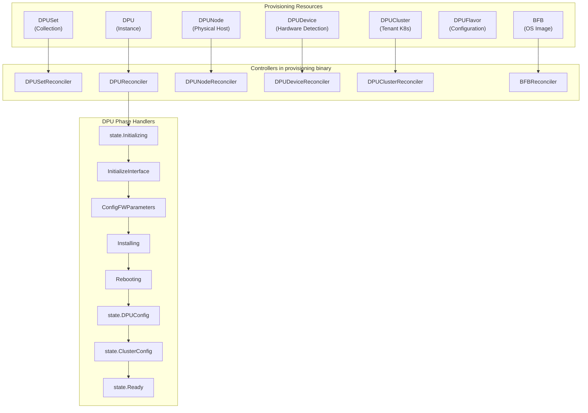

**Sources:** [cmd/provisioning/main.go:31-44](), [internal/provisioning/controllers/dpu/dpu_controller.go:83-125]()

Key controllers in the provisioning binary:
- **`DPUReconciler`**: Main state machine for DPU lifecycle [internal/provisioning/controllers/dpu/dpu_controller.go:65-69]().
- **`DPUSetReconciler`**: Manages collections of DPUs [cmd/provisioning/main.go:44]().
- **`DPUNodeReconciler`**: Manages physical host nodes and maintenance states [cmd/provisioning/main.go:41]().
- **`DPUClusterReconciler`**: Orchestrates DPU cluster lifecycle [cmd/provisioning/main.go:39]().

The `DPU` resource uses a phase-based state machine mapped in the reconciler [internal/provisioning/controllers/dpu/dpu_controller.go:83-96]():

| Phase | Description |
|-------|-------------|
| `DPUInitializing` | Initial phase after DPU creation |
| `DPUInitializeInterface` | Setting up Redfish or gNOI/DMS interface |
| `DPUConfigFWParameters` | Manipulating firmware and checking versions |
| `DPUOSInstalling` | Provisioning the DPU with a BFB image |
| `DPURebooting` | Host or DPU rebooting during installation |
| `DPUConfig` | DPU agent applying configurations |
| `DPUClusterConfig` | Node joining the tenant Kubernetes cluster |
| `DPUReady` | DPU is fully operational |

---

## Resource Dependency Model

The DPF system organizes resources into layers: Configuration, Deployment, and Infrastructure.

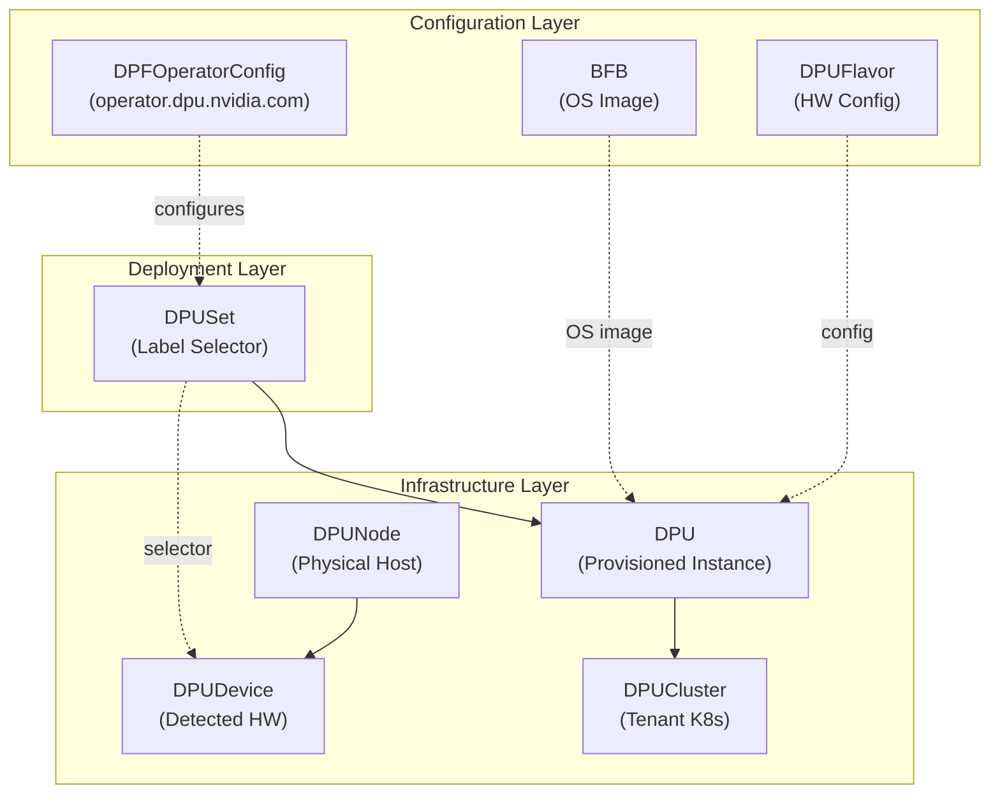

**Sources:** [cmd/provisioning/main.go:31-44](), [docs/public/developer-guides/api/api.md:10-13]()

Key resource relationships:

- **`DPUSet`** matches **`DPUDevice`** resources via label selectors and creates corresponding **`DPU`** resources.
- **`DPU`** references a **`BFB`** for the OS image and a **`DPUFlavor`** for configuration profiles.
- **`DPUDevice`** is linked to a **`DPUNode`** representing the physical host.

---

## Installation Interface Architecture

The provisioning controller supports multiple interfaces for installing the OS on DPUs:

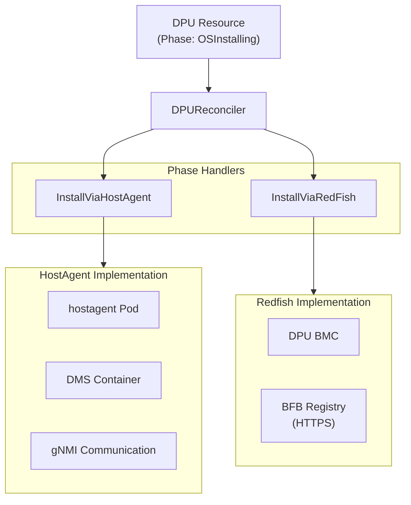

**Sources:** [api/operator/v1alpha1/componentconfig_types.go:83-85](), [internal/provisioning/controllers/dpu/dpu_controller.go:97-125](), [internal/provisioning/bfbregistry/bfb_registry_creator.go:49-51]()

The DPF system selects the interface based on the `DPFOperatorConfig` or `DPUSet` configuration:
- **`InstallViaHostAgent`**: Uses a host-side agent and DMS (Deployment Management Service) container communicating via gNMI [internal/provisioning/controllers/dpu/dpu_controller.go:98-103]().
- **`InstallViaRedFish`**: Communicates directly with the DPU BMC using the Redfish protocol [internal/provisioning/controllers/dpu/dpu_controller.go:104-110]().
- **`BFB Registry`**: An HTTPS service serving BFB images to the DPUs during installation [internal/provisioning/bfbregistry/bfb_registry_creator.go:49-51]().

---

## High Availability and Leader Election

Controllers support high availability through standard Kubernetes leader election:

- **Leader Election**: Enabled via the `--leader-elect` flag in the controller manager [cmd/provisioning/main.go:153-155]().
- **Replicas**: Configurable in `DPFOperatorConfig` for components like the provisioning controller, which defaults to 2 replicas [internal/operator/inventory/variables.go:129]().

**Sources:** [cmd/provisioning/main.go:153-155](), [internal/operator/inventory/variables.go:128-130]()

---

# Page: Build and Release System

# Build and Release System

<details>
<summary>Relevant source files</summary>

The following files were used as context for generating this wiki page:

- [.checkov.yaml](.checkov.yaml)
- [.gitignore](.gitignore)
- [Dockerfile](Dockerfile)
- [Dockerfile.bfb-registry](Dockerfile.bfb-registry)
- [Dockerfile.cni-installer](Dockerfile.cni-installer)
- [Dockerfile.dpf-system](Dockerfile.dpf-system)
- [Dockerfile.hostdriver](Dockerfile.hostdriver)
- [Dockerfile.keepalived](Dockerfile.keepalived)
- [Dockerfile.storage-host](Dockerfile.storage-host)
- [Dockerfile.storage-system](Dockerfile.storage-system)
- [Makefile](Makefile)
- [cmd/cniinstaller/main.go](cmd/cniinstaller/main.go)
- [config/dpuservice/manager/manager.yaml](config/dpuservice/manager/manager.yaml)
- [config/kamaji-cluster-manager/manager/manager.yaml](config/kamaji-cluster-manager/manager/manager.yaml)
- [config/kamaji-cluster-manager/rbac/role.yaml](config/kamaji-cluster-manager/rbac/role.yaml)
- [config/provisioning/manager/manager.yaml](config/provisioning/manager/manager.yaml)
- [config/static-cluster-manager/manager/manager.yaml](config/static-cluster-manager/manager/manager.yaml)
- [config/static-cluster-manager/rbac/role.yaml](config/static-cluster-manager/rbac/role.yaml)
- [deploy/charts/dpf-operator/templates/deployment.yaml](deploy/charts/dpf-operator/templates/deployment.yaml)
- [deploy/charts/dpu-networking/charts/cni-installer/README.md](deploy/charts/dpu-networking/charts/cni-installer/README.md)
- [deploy/charts/dpu-networking/charts/cni-installer/values.yaml](deploy/charts/dpu-networking/charts/cni-installer/values.yaml)
- [deploy/charts/dpu-networking/charts/kata-containers/README.md](deploy/charts/dpu-networking/charts/kata-containers/README.md)
- [deploy/charts/dpu-networking/charts/kata-containers/values.yaml](deploy/charts/dpu-networking/charts/kata-containers/values.yaml)
- [docs/public/advanced-configuration/dpuservices/kata-containers.md](docs/public/advanced-configuration/dpuservices/kata-containers.md)
- [dpuservices/dummydpuservice/chart/README.md](dpuservices/dummydpuservice/chart/README.md)
- [dpuservices/dummydpuservice/chart/templates/daemonset.yaml](dpuservices/dummydpuservice/chart/templates/daemonset.yaml)
- [dpuservices/dummydpuservice/chart/values.yaml](dpuservices/dummydpuservice/chart/values.yaml)
- [go.mod](go.mod)
- [go.sum](go.sum)
- [hack/scripts/validate-manifest-checkov.sh](hack/scripts/validate-manifest-checkov.sh)
- [hack/tools/dpfdev/go.mod](hack/tools/dpfdev/go.mod)
- [hack/tools/dpfdev/go.sum](hack/tools/dpfdev/go.sum)
- [hack/tools/tools.mk](hack/tools/tools.mk)
- [internal/clustermanager/controller/dpucluster_controller.go](internal/clustermanager/controller/dpucluster_controller.go)
- [internal/clustermanager/controller/dpucluster_controller_test.go](internal/clustermanager/controller/dpucluster_controller_test.go)
- [internal/clustermanager/kamaji/handler.go](internal/clustermanager/kamaji/handler.go)
- [internal/clustermanager/kamaji/handler_test.go](internal/clustermanager/kamaji/handler_test.go)
- [internal/clustermanager/kamaji/suite_test.go](internal/clustermanager/kamaji/suite_test.go)
- [internal/cniinstaller/cniinstaller.go](internal/cniinstaller/cniinstaller.go)
- [internal/cniinstaller/cniinstaller_suite_test.go](internal/cniinstaller/cniinstaller_suite_test.go)
- [internal/cniinstaller/cniinstaller_test.go](internal/cniinstaller/cniinstaller_test.go)
- [internal/operator/inventory/manifests/kamaji-cluster-manager.yaml](internal/operator/inventory/manifests/kamaji-cluster-manager.yaml)
- [internal/operator/inventory/manifests/static-cluster-manager.yaml](internal/operator/inventory/manifests/static-cluster-manager.yaml)
- [internal/release/defaults.go](internal/release/defaults.go)
- [internal/release/defaults_test.go](internal/release/defaults_test.go)
- [internal/release/manifests/defaults.yaml](internal/release/manifests/defaults.yaml)
- [internal/release/templates/defaults.yaml.tmpl](internal/release/templates/defaults.yaml.tmpl)

</details>


This document describes the Makefile-based build orchestration system that compiles binaries, generates manifests, builds multi-architecture container images, packages Helm charts, and releases artifacts for the DOCA Platform Framework (DPF).

## Overview

The DPF build system is a Makefile-based orchestration framework that automates the generation, compilation, validation, and packaging of all system components. The system is organized around a primary `Makefile` [Makefile:1-106]() that includes modular tool definitions from `hack/tools/tools.mk` [hack/tools/tools.mk:1-136]().

**Key Build Phases:**
- **Code Generation**: Kubernetes manifests (CRDs, RBAC), Go client libraries, gRPC stubs, and test mocks [Makefile:226-229]().
- **Binary Compilation**: Multi-architecture Go binaries (amd64 for host, arm64 for DPU) [Dockerfile.hostdriver:23-47]().
- **Container Image Building**: Multi-stage Dockerfiles with build-time caching and source code packaging [Dockerfile.dpf-system:1-67]().
- **Security Validation**: Checkov-based manifest scanning with configurable security policies [.checkov.yaml:1-13]().
- **Helm Chart Packaging**: Templated charts with environment variable substitution and documentation generation [Makefile:924-934]().
- **Release Coordination**: Versioned artifact publishing to container and Helm registries [Makefile:143-148]().

The build system supports both local development workflows and CI/CD pipelines, with extensive caching to minimize rebuild times.

Sources: [Makefile:1-106](), [hack/tools/tools.mk:1-136]()

## Build System Architecture

The build system consists of layered targets that feed into each other. The `make generate` target produces source code and manifests, which are then compiled into binaries by `make binary-*` targets, packaged into container images by `make docker-build-*` targets, validated by `make verify-*` targets, and finally released by `make release`.

Title: Build System Target Dependencies
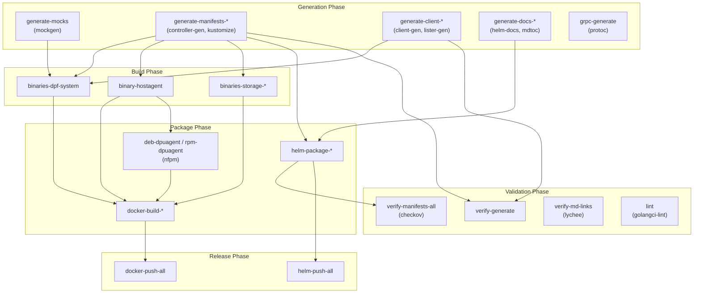

Sources: [Makefile:226-229](), [Makefile:242-243](), [Makefile:467-492](), [Makefile:630-633](), [Dockerfile.hostdriver:62-79]()

## Code Generation Pipeline

The `make generate` target orchestrates multiple code generation tools that produce Kubernetes manifests, Go client libraries, and API documentation.

Title: Code Generation Dependencies
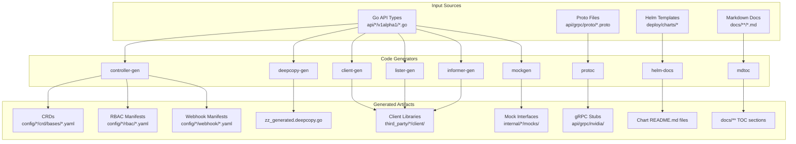

### Manifest Generation Targets

The `controller-gen` tool generates Kubernetes manifests from Go struct tags and comments:

| Target | Purpose | Output |
|--------|---------|--------|
| `generate-manifests-operator` | DPF Operator CRDs and RBAC | `config/operator-crds/` [Makefile:242-243]() |
| `generate-manifests-provisioning` | Provisioning controller manifests | `config/provisioning/crd/bases/` [Makefile:246-261]() |
| `generate-manifests-dpuservice` | DPUService controller manifests | `config/dpuservice/crd/bases/` [Makefile:270-283]() |

Sources: [Makefile:242-243](), [Makefile:246-261](), [Makefile:270-283]()

## Container Image Builds

The build system produces container images using multi-stage Dockerfiles with BuildKit caching. Images are tagged with `$REGISTRY/$IMAGE:$TAG` and support multi-architecture builds via `docker buildx`.

### Image Variants

| Image | Dockerfile | Purpose | Architectures |
|-------|------------|---------|---------------|
| `dpf-system` | [Dockerfile.dpf-system]() | Operator, provisioning, and DPUService controllers | amd64, arm64 |
| `hostdriver` | [Dockerfile.hostdriver]() | Host agent, DMS server, and DPU Agent packages | amd64, arm64 |
| `bfb-registry` | [Dockerfile.bfb-registry]() | Serves BFB images and PLDM unpacking | amd64, arm64 |
| `cni-installer` | [Dockerfile.cni-installer]() | Installs CNI binaries to DPUs | arm64 |

### Multi-Stage Build Architecture

All Dockerfiles follow a consistent multi-stage pattern to optimize caching and reduce final image size.

Title: Multi-Stage Docker Build Flow (Host Driver Example)
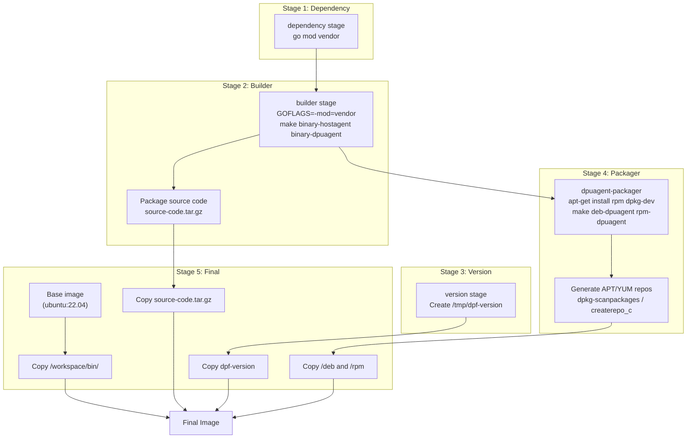

The `Dockerfile.hostdriver` demonstrates the complexity of the release system, incorporating binary compilation [Dockerfile.hostdriver:23-47](), package creation via `nfpm` [Dockerfile.hostdriver:62-79](), and repository metadata generation [Dockerfile.hostdriver:85-91]().

Sources: [Dockerfile.hostdriver:5-188](), [Dockerfile.bfb-registry:1-189](), [Dockerfile.cni-installer:1-105]()

### Source Code Packaging

All images include source code archives for compliance and debugging. Go source code is packaged by finding all `.go` files and creating a tarball:

```dockerfile
RUN mkdir src && \
    find . -name '*.go' -not -path "./hack/*" -not -path "./.gocache/*" \
    -exec cp --parents \{\}  src/ \; && \
    tar -czf source-code.tar.gz src
```

Sources: [Dockerfile.hostdriver:49-52](), [Dockerfile.bfb-registry:143-147](), [Dockerfile.cni-installer:31-36]()

## Security Validation with Checkov

The build system integrates Checkov [hack/tools/tools.mk:98]() for static analysis of Kubernetes manifests. Validation runs as part of the `verify-manifests-all` target.

### Checkov Configuration

The [.checkov.yaml]() file defines required checks and per-chart exclusions.

```yaml
checks:
- CKV_K8S_8   # Liveness Probe Should be Configured
- CKV_K8S_9   # Readiness Probe Should be Configured
- CKV_K8S_11  # CPU limits should be set
- CKV_K8S_13  # Memory limits should be set
- CKV_K8S_29  # Apply security context to your pods
- CKV_K8S_40  # Containers should run as a high UID
```

Sources: [.checkov.yaml:1-13]()

### Exclusions and Justifications

Exclusions are used to handle cases where components require specific privileges (e.g., networking controllers or CNI installers):

| Chart | Resource | Check | Justification |
|-------|----------|-------|---------------|
| `dpu-networking-flannel` | `DaemonSet.kube-flannel-ds` | CKV_K8S_29 | Flannel requires high privileges [.checkov.yaml:31-33]() |
| `dpu-networking-cni-installer` | `DaemonSet.release-name` | CKV_K8S_40 | Needs to run as root to install binaries [.checkov.yaml:120-122]() |
| `dpu-networking-kata-containers` | `DaemonSet.kata-deploy` | CKV_K8S_29 | Privileged access for binary installation [.checkov.yaml:143-146]() |

Sources: [.checkov.yaml:14-147]()

## Helm Chart Packaging

Helm charts are the primary distribution mechanism for the DPF Operator and its sub-components.

### Chart Structure

The `dpf-operator` chart [deploy/charts/dpf-operator/Chart.yaml]() manages the main controller deployment.

Key configuration values in `values.yaml` include:
- `controllerManager.image`: Overrides for the operator image.
- `kamajiEtcdDefrag`: Configures the etcd maintenance job for multi-tenant clusters.
- `kubeStateMetricsCRDMetrics`: Enables metrics collection for DPF CRDs.

### Automated Documentation

The `helm-docs` tool [hack/tools/tools.mk:119]() is used to generate README files from `values.yaml` comments. The generated documentation provides a clear reference for users.

Sources: [hack/tools/tools.mk:119](), [deploy/charts/dpu-networking/charts/kata-containers/values.yaml:1-10](), [deploy/charts/dpu-networking/charts/cni-installer/values.yaml:1-10]()

## Validation Tooling: dpfdev

The `dpfdev` tool [hack/tools/dpfdev/go.mod:1-17]() provides specialized validation capabilities, including `checkov` report analysis and internal testing.

Sources: [hack/tools/dpfdev/go.mod:1-17](), [hack/tools/dpfdev/go.sum:1-81]()

---

# Page: DPF Operator

# DPF Operator

<details>
<summary>Relevant source files</summary>

The following files were used as context for generating this wiki page:

- [api/operator/v1alpha1/componentconfig_types.go](api/operator/v1alpha1/componentconfig_types.go)
- [api/operator/v1alpha1/dpfoperatorconfig_types.go](api/operator/v1alpha1/dpfoperatorconfig_types.go)
- [api/operator/v1alpha1/zz_generated.deepcopy.go](api/operator/v1alpha1/zz_generated.deepcopy.go)
- [cmd/provisioning/main.go](cmd/provisioning/main.go)
- [config/operator-crds/operator.dpu.nvidia.com_dpfoperatorconfigs.yaml](config/operator-crds/operator.dpu.nvidia.com_dpfoperatorconfigs.yaml)
- [config/provisioning/rbac/role.yaml](config/provisioning/rbac/role.yaml)
- [config/provisioning/webhook/manifests.yaml](config/provisioning/webhook/manifests.yaml)
- [deploy/charts/dpf-operator/templates/crds/apiextensions.k8s.io_v1_customresourcedefinition_dpfoperatorconfigs.operator.dpu.nvidia.com.yaml](deploy/charts/dpf-operator/templates/crds/apiextensions.k8s.io_v1_customresourcedefinition_dpfoperatorconfigs.operator.dpu.nvidia.com.yaml)
- [deploy/charts/dpf-operator/templates/role.yaml](deploy/charts/dpf-operator/templates/role.yaml)
- [docs/public/developer-guides/api/api.md](docs/public/developer-guides/api/api.md)
- [docs/public/developer-guides/api/dpfoperatorconfig.md](docs/public/developer-guides/api/dpfoperatorconfig.md)
- [internal/operator/controllers/dpfoperatorconfig_controller.go](internal/operator/controllers/dpfoperatorconfig_controller.go)
- [internal/operator/controllers/dpfoperatorconfig_controller_test.go](internal/operator/controllers/dpfoperatorconfig_controller_test.go)
- [internal/operator/controllers/object_schema_validation_test.go](internal/operator/controllers/object_schema_validation_test.go)
- [internal/operator/inventory/dpu_provisioning_controller_manifests.go](internal/operator/inventory/dpu_provisioning_controller_manifests.go)
- [internal/operator/inventory/dpu_provisioning_controller_manifests_test.go](internal/operator/inventory/dpu_provisioning_controller_manifests_test.go)
- [internal/operator/inventory/manifests/provisioning-controller.yaml](internal/operator/inventory/manifests/provisioning-controller.yaml)
- [internal/operator/inventory/variables.go](internal/operator/inventory/variables.go)
- [internal/provisioning/bfbregistry/bfb_registry_creator.go](internal/provisioning/bfbregistry/bfb_registry_creator.go)
- [internal/provisioning/bfbregistry/bfb_registry_creator_test.go](internal/provisioning/bfbregistry/bfb_registry_creator_test.go)
- [internal/provisioning/controllers/dpu/dpu_controller.go](internal/provisioning/controllers/dpu/dpu_controller.go)
- [internal/provisioning/controllers/dpu/util/options.go](internal/provisioning/controllers/dpu/util/options.go)
- [internal/provisioning/webhooks/dpudiscovery_webhook.go](internal/provisioning/webhooks/dpudiscovery_webhook.go)
- [internal/provisioning/webhooks/dpudiscovery_webhook_test.go](internal/provisioning/webhooks/dpudiscovery_webhook_test.go)
- [internal/provisioning/webhooks/suite_test.go](internal/provisioning/webhooks/suite_test.go)
- [test/apivalidation/operator_validation_test.go](test/apivalidation/operator_validation_test.go)

</details>


The DPF (DOCA Platform Framework) Operator is the central controller component responsible for managing and orchestrating the DOCA Platform Framework system in Kubernetes environments. It handles the lifecycle and configuration of all DPF components through a declarative configuration model defined by the `DPFOperatorConfig` Custom Resource Definition (CRD) [api/operator/v1alpha1/dpfoperatorconfig_types.go:171-177]().

The operator acts as a "manager of managers," deploying and configuring sub-controllers like the `ProvisioningController` and `DPUServiceController` based on the desired state specified in the singleton `DPFOperatorConfig` resource [internal/operator/controllers/dpfoperatorconfig_controller.go:76-84]().

## Architecture Overview

The DPF Operator reconciles the system state by translating the `DPFOperatorConfig` into a set of internal `Variables` used to generate and apply Kubernetes manifests for all system components [internal/operator/inventory/variables.go:37-82]().

### System Component Relationships
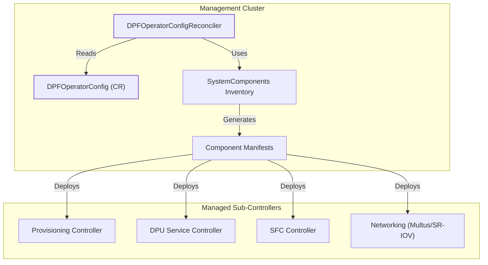
Sources: [internal/operator/controllers/dpfoperatorconfig_controller.go:76-84](), [internal/operator/inventory/variables.go:37-82](), [internal/operator/inventory/manifests/provisioning-controller.yaml:1-365]()

## Configuration Model

The operator uses a hierarchical configuration structure. The `DPFOperatorConfigSpec` allows for global settings (like `deploymentMode`) and granular per-component overrides [api/operator/v1alpha1/dpfoperatorconfig_types.go:230-282]().

### Configuration Classes
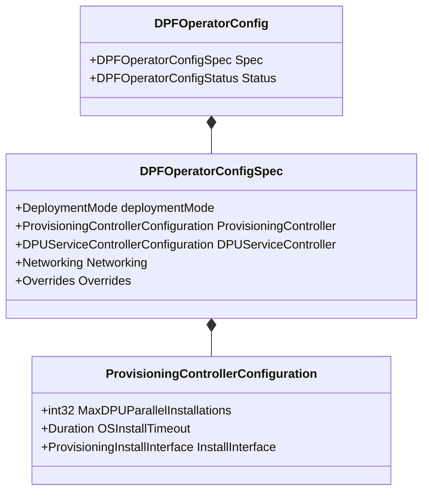
Sources: [api/operator/v1alpha1/dpfoperatorconfig_types.go:230-282](), [api/operator/v1alpha1/componentconfig_types.go:37-51]()

## Sub-Topics

### DPFOperatorConfig CRD
The `DPFOperatorConfig` is the primary API for the DPF system. It defines the `deploymentMode` (e.g., `zero-trust` vs `host-trusted`) which dictates how the entire framework, including provisioning and networking, is configured [api/operator/v1alpha1/dpfoperatorconfig_types.go:232-239](). It also manages global image pull secrets and monitoring configurations for components like `KubeStateMetrics` and `NodeProblemDetector` [api/operator/v1alpha1/dpfoperatorconfig_types.go:242-256]().

For details, see [DPFOperatorConfig CRD](#2.1).

### Operator Controller Architecture
The `DPFOperatorConfigReconciler` implements the reconciliation logic. It uses an internal `inventory` package to manage embedded manifests for various components [internal/operator/controllers/dpfoperatorconfig_controller.go:76-84](). The reconciler populates a `Variables` struct from the CRD spec, including defaults for CIDRs and OVS paths, and passes it to component generators to produce the final system state [internal/operator/inventory/variables.go:32-130]().

For details, see [Operator Controller Architecture](#2.2).

## Key Responsibilities

| Responsibility | Description | Code Reference |
| :--- | :--- | :--- |
| **Manifest Generation** | Translates high-level config into Deployment, Service, and RBAC objects. | [internal/operator/inventory/manifests/provisioning-controller.yaml:1-365]() |
| **Status Aggregation** | Summarizes the health of all sub-components into the `DPFOperatorConfig` status. | [api/operator/v1alpha1/dpfoperatorconfig_types.go:284-300]() |
| **RBAC Orchestration** | Manages `ClusterRoles` and `ClusterRoleBindings` for all DPF sub-controllers. | [deploy/charts/dpf-operator/templates/role.yaml:1-406]() |
| **BFB Registry Lifecycle** | Manages the `BFBRegistryRunnable` which ensures the BFB server is active for provisioning. | [internal/provisioning/bfbregistry/bfb_registry_creator.go:82-91]() |

## System Status Conditions

The operator tracks the system state using specific `ConditionTypes` in the status field [api/operator/v1alpha1/dpfoperatorconfig_types.go:284-300]():
- `Ready`: Indicates if the entire DPF platform is operational.
- `SystemComponentsReconciled`: Confirms all sub-controller manifests have been applied to the cluster.
- `SystemComponentsReady`: Confirms all sub-controller pods (Provisioning, Service, etc.) are running and healthy.

Sources: [api/operator/v1alpha1/dpfoperatorconfig_types.go:284-300](), [internal/operator/controllers/dpfoperatorconfig_controller.go:97-126]()

---

# Page: DPFOperatorConfig CRD

# DPFOperatorConfig CRD

<details>
<summary>Relevant source files</summary>

The following files were used as context for generating this wiki page:

- [api/operator/v1alpha1/componentconfig_types.go](api/operator/v1alpha1/componentconfig_types.go)
- [api/operator/v1alpha1/componentconfig_types_test.go](api/operator/v1alpha1/componentconfig_types_test.go)
- [api/operator/v1alpha1/dpfoperatorconfig_types.go](api/operator/v1alpha1/dpfoperatorconfig_types.go)
- [api/operator/v1alpha1/zz_generated.deepcopy.go](api/operator/v1alpha1/zz_generated.deepcopy.go)
- [cmd/provisioning/main.go](cmd/provisioning/main.go)
- [config/dpuservice/certmanager/certificate.yaml](config/dpuservice/certmanager/certificate.yaml)
- [config/nodesriovdeviceplugin/certmanager/certificate.yaml](config/nodesriovdeviceplugin/certmanager/certificate.yaml)
- [config/operator-crds/operator.dpu.nvidia.com_dpfoperatorconfigs.yaml](config/operator-crds/operator.dpu.nvidia.com_dpfoperatorconfigs.yaml)
- [config/provisioning/certmanager/certificate.yaml](config/provisioning/certmanager/certificate.yaml)
- [deploy/charts/dpf-operator/README.md](deploy/charts/dpf-operator/README.md)
- [deploy/charts/dpf-operator/templates/certificate-authority.yaml](deploy/charts/dpf-operator/templates/certificate-authority.yaml)
- [deploy/charts/dpf-operator/templates/crds/apiextensions.k8s.io_v1_customresourcedefinition_dpfoperatorconfigs.operator.dpu.nvidia.com.yaml](deploy/charts/dpf-operator/templates/crds/apiextensions.k8s.io_v1_customresourcedefinition_dpfoperatorconfigs.operator.dpu.nvidia.com.yaml)
- [deploy/charts/dpf-operator/templates/kamaji-etcd-defrag-cronjob.yaml](deploy/charts/dpf-operator/templates/kamaji-etcd-defrag-cronjob.yaml)
- [deploy/charts/dpf-operator/values.yaml](deploy/charts/dpf-operator/values.yaml)
- [docs/public/advanced-configuration/external-certificate-authority.md](docs/public/advanced-configuration/external-certificate-authority.md)
- [docs/public/developer-guides/api/api.md](docs/public/developer-guides/api/api.md)
- [docs/public/developer-guides/api/dpfoperatorconfig.md](docs/public/developer-guides/api/dpfoperatorconfig.md)
- [internal/features/features.go](internal/features/features.go)
- [internal/operator/inventory/coredns_manifests_test.go](internal/operator/inventory/coredns_manifests_test.go)
- [internal/operator/inventory/dpu_provisioning_controller_manifests.go](internal/operator/inventory/dpu_provisioning_controller_manifests.go)
- [internal/operator/inventory/dpu_provisioning_controller_manifests_test.go](internal/operator/inventory/dpu_provisioning_controller_manifests_test.go)
- [internal/operator/inventory/dpuservice_controller_manifests.go](internal/operator/inventory/dpuservice_controller_manifests.go)
- [internal/operator/inventory/dpuservice_controller_manifests_test.go](internal/operator/inventory/dpuservice_controller_manifests_test.go)
- [internal/operator/inventory/dpuservice_per_dpucluster_manifests.go](internal/operator/inventory/dpuservice_per_dpucluster_manifests.go)
- [internal/operator/inventory/manifests/nodesriovdeviceplugin-controller.yaml](internal/operator/inventory/manifests/nodesriovdeviceplugin-controller.yaml)
- [internal/operator/inventory/variables.go](internal/operator/inventory/variables.go)
- [internal/provisioning/controllers/dpu/util/options.go](internal/provisioning/controllers/dpu/util/options.go)
- [test/apivalidation/operator_validation_test.go](test/apivalidation/operator_validation_test.go)
- [test/e2e/upgrade_artifacts_test.go](test/e2e/upgrade_artifacts_test.go)

</details>


The `DPFOperatorConfig` Custom Resource Definition (CRD) is the primary configuration interface for the DOCA Platform Framework (DPF) Operator. It defines how the operator should deploy and configure various system components that manage NVIDIA DPU hardware and networking in Kubernetes environments.

For information about the DPF Operator itself, see [Operator Controller Architecture](#2.2).

## Overview

The `DPFOperatorConfig` resource is a singleton within the DPF system namespace (typically `dpf-operator-system`). It allows users to:
1. Configure and customize DPF system components (Provisioning, Service, Networking).
2. Enable/disable individual components.
3. Override container images and resource requirements.
4. Set system-wide networking parameters (MTU, Bridge names).
5. Define the `DeploymentMode` (Zero-Trust vs Host-Trusted).

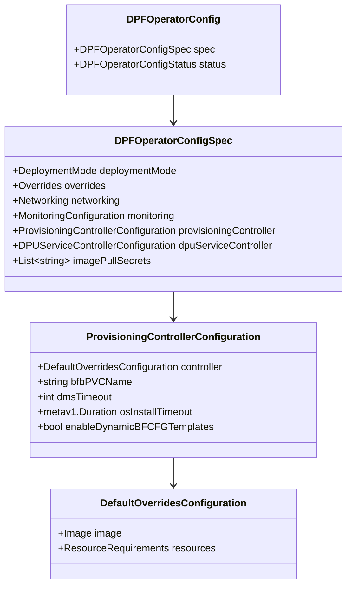
Sources: [api/operator/v1alpha1/dpfoperatorconfig_types.go:171-187](), [api/operator/v1alpha1/componentconfig_types.go:29-32](), [api/operator/v1alpha1/componentconfig_types.go:37-150]()

## Core Configuration Sections

### Deployment Mode
The `deploymentMode` field is mandatory and selects the alignment for DPU management.
*   `host-trusted`: The host is considered a trusted entity.
*   `zero-trust`: High-security mode where the DPU is isolated from the host, often utilizing Redfish/gNOI for provisioning.

Sources: [api/operator/v1alpha1/dpfoperatorconfig_types.go:185-190](), [internal/operator/inventory/variables.go:124-126]()

### Networking
Configures MTU and bridge settings for the DPF infrastructure.

| Field | Default | Description |
|-------|---------|-------------|
| `controlPlaneMTU` | 1500 | MTU for management network (e.g., DPU OOB interface). |
| `highSpeedMTU` | 1500 | MTU for high-speed data interfaces. |
| `dpuNodeOOBBridgeName` | `br-dpu` | The bridge name on host-trusted worker nodes for OOB communication. |

Sources: [api/operator/v1alpha1/dpfoperatorconfig_types.go:146-170](), [docs/public/developer-guides/api/dpfoperatorconfig.md:96-102]()

### Provisioning Controller Settings
The `ProvisioningControllerConfiguration` manages the lifecycle of DPU hardware.

*   **Timeouts**:
    *   `osInstallTimeout`: Default `60m`. Max time for OS installation in zero-trust mode.
    *   `firmwareUpdateTimeout`: Default `45m`. Max time for BF4 firmware updates.
    *   `nodeEffectRemovalTimeout`: Default `0s` (disabled). Max time for `DPUNodeMaintenance` to clear requestors.
*   **Parallelism**:
    *   `maxDPUParallelInstallations`: Default `50`. Limits concurrent DPU provisioning tasks.
*   **Storage**:
    *   `bfbPVCName`: The PersistentVolumeClaim used to store BFB images. If unset, the controller uses `hostPath` at `/var/lib/nvidia/dpf/bfb`.
*   **BFCFG Templates**:
    *   `enableDynamicBFCFGTemplates`: Enables runtime discovery of `bf.cfg` templates via ConfigMaps based on labels. Mutually exclusive with `bfCFGTemplateConfigMap`.

Sources: [api/operator/v1alpha1/componentconfig_types.go:35-36](), [api/operator/v1alpha1/componentconfig_types.go:62-66](), [api/operator/v1alpha1/componentconfig_types.go:91-152](), [cmd/provisioning/main.go:83-93](), [internal/operator/inventory/dpu_provisioning_controller_manifests.go:43-44]()

## Component Configuration Pattern

DPF uses a consistent pattern for overriding component settings. Most components (e.g., `dpuDetector`, `sfcController`, `nvipam`) follow this structure:

```yaml
spec:
  <componentName>:
    disable: false
    controller: # or 'daemon' depending on the component
      image: "my-custom-image:tag"
      resources:
        requests:
          cpu: "100m"
          memory: "128Mi"
```

### Image Overrides
The Operator enforces mutual exclusivity between legacy `image` fields and the newer `controller.image` / `daemon.image` fields via XValidation rules in the API definition.

Sources: [api/operator/v1alpha1/componentconfig_types.go:34-34](), [test/apivalidation/operator_validation_test.go:51-62]()

## System Status and Conditions

The `DPFOperatorConfigStatus` tracks the readiness of the entire DPF platform via a set of defined condition types.

| Condition Type | Description |
|----------------|-------------|
| `Ready` | Overall status of the DPF Operator configuration. |
| `PreUpgradeValidationReady` | Indicates if the system is safe to upgrade to a new version. |
| `ImagePullSecretsReconciled` | Status of propagating `imagePullSecrets` to sub-components. |
| `SystemComponentsReconciled` | Whether all enabled component manifests have been applied. |
| `SystemComponentsReady` | Whether the deployed pods for all components are currently healthy. |
| `CATrustBundleReady` | Status of the internal CA trust bundle ConfigMap maintenance. |

Sources: [api/operator/v1alpha1/dpfoperatorconfig_types.go:27-48](), [api/operator/v1alpha1/dpfoperatorconfig_types.go:207-220]()

## Implementation Data Flow

The `DPFOperatorConfig` is processed by the `DPFOperatorConfigReconciler`, which populates a `Variables` struct defined in the `inventory` package. This struct is then passed to component-specific manifest generators.

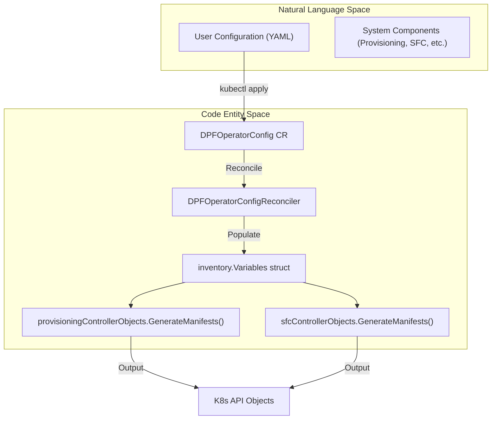

Sources: [internal/operator/inventory/variables.go:37-142](), [internal/operator/inventory/dpu_provisioning_controller_manifests.go:143-185](), [api/operator/v1alpha1/dpfoperatorconfig_types.go:171-187]()

---

# Page: Operator Controller Architecture

# Operator Controller Architecture

<details>
<summary>Relevant source files</summary>

The following files were used as context for generating this wiki page:

- [api/operator/v1alpha1/componentconfig_common.go](api/operator/v1alpha1/componentconfig_common.go)
- [cmd/kamaji-cluster-manager/main.go](cmd/kamaji-cluster-manager/main.go)
- [cmd/operator/main.go](cmd/operator/main.go)
- [cmd/servicechainset/main.go](cmd/servicechainset/main.go)
- [cmd/static-cluster-manager/main.go](cmd/static-cluster-manager/main.go)
- [cmd/storage/snap-node-driver/main.go](cmd/storage/snap-node-driver/main.go)
- [config/provisioning/rbac/role.yaml](config/provisioning/rbac/role.yaml)
- [config/provisioning/webhook/manifests.yaml](config/provisioning/webhook/manifests.yaml)
- [deploy/charts/dpf-operator/templates/role.yaml](deploy/charts/dpf-operator/templates/role.yaml)
- [deploy/charts/dpu-networking/Chart.lock](deploy/charts/dpu-networking/Chart.lock)
- [deploy/charts/dpu-networking/Chart.yaml](deploy/charts/dpu-networking/Chart.yaml)
- [deploy/charts/dpu-networking/README.md](deploy/charts/dpu-networking/README.md)
- [deploy/charts/dpu-networking/values.yaml](deploy/charts/dpu-networking/values.yaml)
- [internal/operator/controllers/ca_trust_bundle.go](internal/operator/controllers/ca_trust_bundle.go)
- [internal/operator/controllers/ca_trust_bundle_test.go](internal/operator/controllers/ca_trust_bundle_test.go)
- [internal/operator/controllers/dpfoperatorconfig_controller.go](internal/operator/controllers/dpfoperatorconfig_controller.go)
- [internal/operator/controllers/dpfoperatorconfig_controller_test.go](internal/operator/controllers/dpfoperatorconfig_controller_test.go)
- [internal/operator/controllers/object_schema_validation_test.go](internal/operator/controllers/object_schema_validation_test.go)
- [internal/operator/controllers/reconcile_delete.go](internal/operator/controllers/reconcile_delete.go)
- [internal/operator/controllers/reconcile_delete_test.go](internal/operator/controllers/reconcile_delete_test.go)
- [internal/operator/inventory/component_versions.go](internal/operator/inventory/component_versions.go)
- [internal/operator/inventory/dpuservice_per_dpucluster_manifests_test.go](internal/operator/inventory/dpuservice_per_dpucluster_manifests_test.go)
- [internal/operator/inventory/from_dpu_service_manifests.go](internal/operator/inventory/from_dpu_service_manifests.go)
- [internal/operator/inventory/from_dpu_service_manifests_test.go](internal/operator/inventory/from_dpu_service_manifests_test.go)
- [internal/operator/inventory/inventory.go](internal/operator/inventory/inventory.go)
- [internal/operator/inventory/manifests/provisioning-controller.yaml](internal/operator/inventory/manifests/provisioning-controller.yaml)
- [internal/operator/inventory/sfc_controller_manifests.go](internal/operator/inventory/sfc_controller_manifests.go)
- [internal/operator/inventory/sfc_controller_manifests_test.go](internal/operator/inventory/sfc_controller_manifests_test.go)
- [internal/operator/utils/validation.go](internal/operator/utils/validation.go)
- [internal/operator/utils/validation_test.go](internal/operator/utils/validation_test.go)
- [internal/provisioning/bfbregistry/bfb_registry_creator.go](internal/provisioning/bfbregistry/bfb_registry_creator.go)
- [internal/provisioning/bfbregistry/bfb_registry_creator_test.go](internal/provisioning/bfbregistry/bfb_registry_creator_test.go)
- [internal/provisioning/controllers/dpu/dpu_controller.go](internal/provisioning/controllers/dpu/dpu_controller.go)
- [internal/provisioning/webhooks/dpudiscovery_webhook.go](internal/provisioning/webhooks/dpudiscovery_webhook.go)
- [internal/provisioning/webhooks/dpudiscovery_webhook_test.go](internal/provisioning/webhooks/dpudiscovery_webhook_test.go)
- [internal/provisioning/webhooks/suite_test.go](internal/provisioning/webhooks/suite_test.go)
- [internal/release/version.go](internal/release/version.go)

</details>


## Purpose and Scope

This document describes the internal architecture of the DPF Operator controller, specifically the `DPFOperatorConfigReconciler` and its associated systems. It covers how the operator processes the `DPFOperatorConfig` custom resource, manages configuration through the `Variables` struct, generates Kubernetes manifests from embedded templates, and deploys sub-controllers like the Provisioning Controller and DPU Service Controller.

For details about the `DPFOperatorConfig` CRD structure and configuration options, see [DPFOperatorConfig CRD](#2.1).

## Architecture Overview

The DPF Operator follows a hierarchical controller pattern where a central `DPFOperatorConfigReconciler` manages the lifecycle of multiple sub-controllers. The architecture consists of four main layers:

Title: DPF Operator Architecture Layers
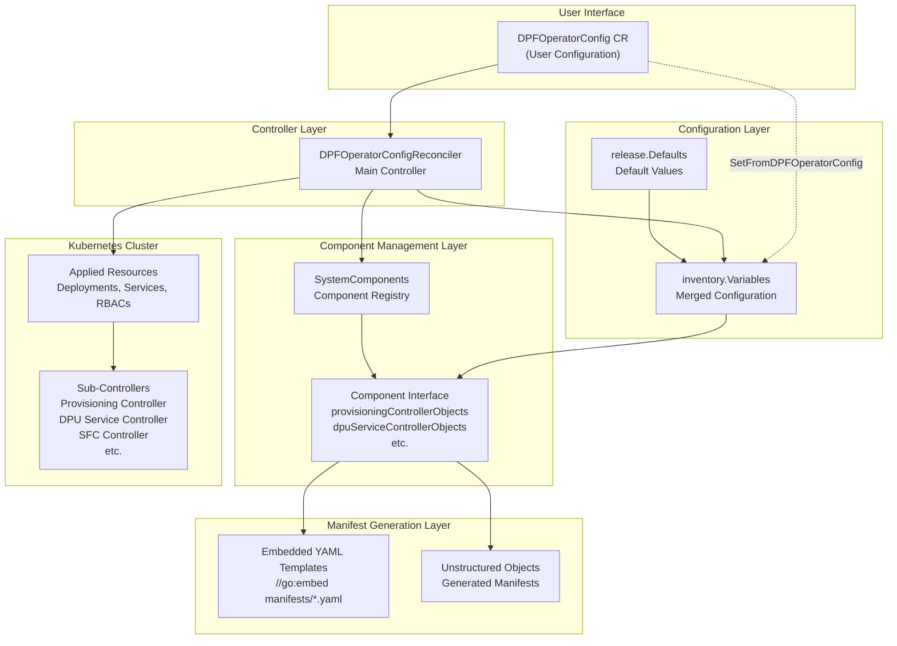
**Sources:** [internal/operator/controllers/dpfoperatorconfig_controller.go:77-84](), [internal/operator/inventory/variables.go:102-179]()

## DPFOperatorConfigReconciler

### Core Structure

The `DPFOperatorConfigReconciler` is the main controller responsible for reconciling `DPFOperatorConfig` resources. Its structure is defined as:

Title: DPFOperatorConfigReconciler Code Entities
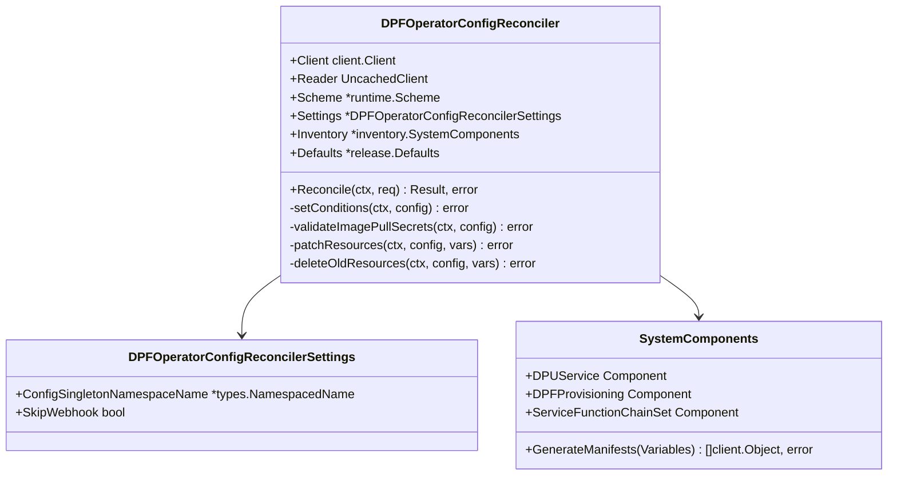

The controller restricts reconciliation to a single `DPFOperatorConfig` instance identified by the `ConfigSingletonNamespaceName` setting, which defaults to `dpfoperatorconfig` in the `dpf-operator-system` namespace.

**Sources:** [internal/operator/controllers/dpfoperatorconfig_controller.go:57-61](), [internal/operator/controllers/dpfoperatorconfig_controller.go:77-84](), [internal/operator/controllers/dpfoperatorconfig_controller.go:87-94]()

### Reconciliation Entry Point

The `Reconcile` function implements the main control loop. It handles the lifecycle of all system components by transforming the `DPFOperatorConfig` spec into a set of `Variables` which are then passed to the `Inventory` to generate the final manifests.

Key responsibilities during reconciliation:
1. **Singleton Validation**: Ensures only the designated singleton config is reconciled.
2. **Secret Validation**: Verifies all referenced `imagePullSecrets` exist.
3. **Variables Construction**: Builds merged configuration from defaults and user spec.
4. **Manifest Generation**: Generates Kubernetes manifests for all enabled components.
5. **Resource Application**: Applies manifests using server-side apply with `ForceOwnership`.
6. **Status Management**: Updates condition status to reflect current state.

**Sources:** [internal/operator/controllers/dpfoperatorconfig_controller.go:57-61](), [internal/operator/controllers/dpfoperatorconfig_controller.go:73]()

## Variables System

### Variables Structure

The `Variables` struct serves as the central configuration aggregator, merging default values with user-provided configuration. It acts as the source of truth for the manifest generation pipeline.

| Field Category | Purpose |
|----------------|---------|
| **DPU Cluster Config** | DPU cluster configurations tracked via `DPUClusters []*dpucluster.Config`. |
| **Path Configuration** | File system paths on DPU nodes (e.g., `DPUCNIBinPath`, `DPUOpenvSwitchRunPath`). |
| **Component Control** | Enable/disable components via `DisableSystemComponents map[ComponentName]bool`. |
| **Image Configuration** | Container images per component/container via `Images map[string]string`. |
| **Resource Configuration** | CPU/memory resource requirements via `Resources map[string]corev1.ResourceRequirements`. |
| **Replica Configuration** | Replica counts for controllers via `Replicas map[string]*int32`. |
| **Helm Configuration** | Helm chart URLs via `HelmCharts map[ComponentName]string`. |
| **Network Configuration** | MTU and network settings via `Networking`. |

**Sources:** [internal/operator/inventory/variables.go:102-179]()

### Variables Construction Flow

The `SetFromDPFOperatorConfig` function processes the user configuration and updates the `Variables` struct. It handles:
- **Global Overrides**: Applying global image overrides from `Spec.Overrides.Images`.
- **Component Specifics**: Extracting replicas, images, and resource requirements for components like `ProvisioningController` or `DPUServiceController`.
- **System Settings**: Mapping networking settings (MTU) and storage settings (PVC names) to the `Variables` struct.

**Sources:** [internal/operator/inventory/variables.go:181-426]()

## Manifest Generation Pipeline

### Component Interface

All system components implement the `Component` interface, which defines the contract for manifest generation:

Title: Component Interface Hierarchy
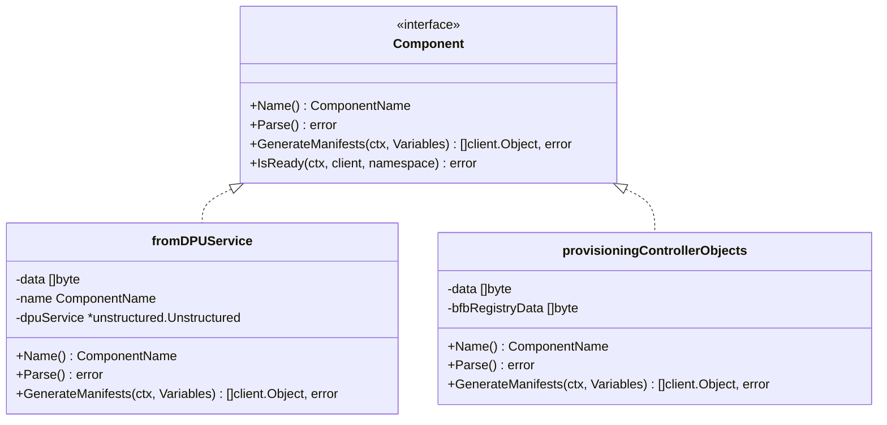

**Sources:** [internal/operator/inventory/inventory.go:30-53](), [internal/operator/inventory/from_dpu_service_manifests.go:44-49](), [internal/operator/inventory/provisioning_controller_manifests.go:35-42]()

### Manifest Generation Process

The generation process involves taking embedded YAML templates and applying "Edits" (mutations) based on the `Variables`.

1. **Parsing**: Embedded YAML is converted to `unstructured.Unstructured` objects.
2. **Filtering**: If a component is marked as disabled in `Variables.DisableSystemComponents`, no manifests are generated.
3. **Mutation**:
    - **Namespace**: Objects are moved to the target namespace.
    - **Labels**: Standard DPF labels and versioning labels are added.
    - **Images/Resources**: Deployment/DaemonSet containers are updated using `helmPathsProvider` to find the correct JSON paths in the manifests.
    - **Helm Values**: For `DPUService` objects, specific values (like `enabled: true`) are injected into the `.spec.helmChart.values`.
    - **SPIFFE**: Request workload identity if `SpiffeEnabled` is set for eligible components.

**Sources:** [internal/operator/inventory/from_dpu_service_manifests.go:80-89](), [internal/operator/inventory/from_dpu_service_manifests.go:94-117](), [internal/operator/inventory/from_dpu_service_manifests.go:119-137]()

### System Components and Sub-Controllers

The operator manages several sub-controllers and system services. Some are deployed once per management cluster, while others are instantiated per DPU cluster.

| Component | Management Mode | Role |
|-----------|-----------------|------|
| `ProvisioningController` | Single | Manages DPU lifecycle and BFB installation. |
| `DPUServiceController` | Single | Orchestrates DPU services via ArgoCD. |
| `SFCController` | Single | Manages Service Function Chains. |
| `SRIOVDevicePlugin` | Per DPU Cluster | Manages SR-IOV device plugin on DPU nodes. |
| `NVIPAMController` | Per DPU Cluster | Manages IP allocation for DPU services. |

**Sources:** [internal/operator/inventory/from_dpu_service_manifests.go:51-67](), [internal/operator/inventory/inventory.go:83-107]()

## Reconciliation Flow

### Server-Side Apply Strategy

The operator uses Kubernetes Server-Side Apply to manage resources. This ensures that the operator "owns" specific fields and can safely update them without interfering with other controllers or manual changes, while also being able to "force" state when necessary.

Title: DPF Resource Reconciliation Logic
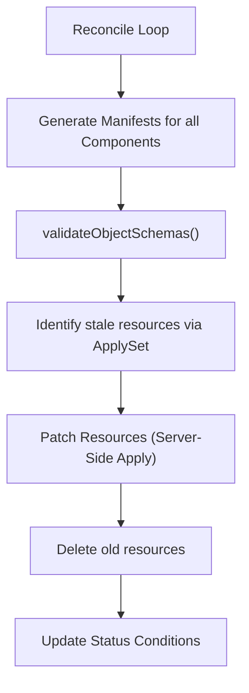

The reconciler uses `client.ForceOwnership` and a specific field owner name `dpfoperatorconfig-controller`.

**Sources:** [internal/operator/controllers/dpfoperatorconfig_controller.go:69-74](), [internal/operator/controllers/object_schema_validation.go:37-65]()

### Condition Management

The operator maintains the health of the DPF system through a set of conditions on the `DPFOperatorConfig` status:

- **Ready**: Overall system readiness.
- **SystemComponentsReconciled**: Whether manifests were successfully generated and applied.
- **ImagePullSecretsReconciled**: Whether all referenced secrets exist.
- **PreUpgradeValidationReady**: Ensures the system is in a safe state for upgrades.
- **CATrustBundleReady**: Tracks the status of CA trust bundles for secure communication.

**Sources:** [internal/operator/controllers/dpfoperatorconfig_controller.go:151-185](), [internal/operator/controllers/dpfoperatorconfig_controller_test.go:154-162]()

---

# Page: Provisioning System

# Provisioning System

<details>
<summary>Relevant source files</summary>

The following files were used as context for generating this wiki page:

- [api/provisioning/v1alpha1/dpu_types.go](api/provisioning/v1alpha1/dpu_types.go)
- [api/provisioning/v1alpha1/dpudevice_types.go](api/provisioning/v1alpha1/dpudevice_types.go)
- [api/provisioning/v1alpha1/zz_generated.deepcopy.go](api/provisioning/v1alpha1/zz_generated.deepcopy.go)
- [config/provisioning/crd/bases/provisioning.dpu.nvidia.com_dpudevices.yaml](config/provisioning/crd/bases/provisioning.dpu.nvidia.com_dpudevices.yaml)
- [config/provisioning/crd/bases/provisioning.dpu.nvidia.com_dpus.yaml](config/provisioning/crd/bases/provisioning.dpu.nvidia.com_dpus.yaml)
- [deploy/charts/dpf-operator/templates/crds/apiextensions.k8s.io_v1_customresourcedefinition_dpudevices.provisioning.dpu.nvidia.com.yaml](deploy/charts/dpf-operator/templates/crds/apiextensions.k8s.io_v1_customresourcedefinition_dpudevices.provisioning.dpu.nvidia.com.yaml)
- [deploy/charts/dpf-operator/templates/crds/apiextensions.k8s.io_v1_customresourcedefinition_dpus.provisioning.dpu.nvidia.com.yaml](deploy/charts/dpf-operator/templates/crds/apiextensions.k8s.io_v1_customresourcedefinition_dpus.provisioning.dpu.nvidia.com.yaml)
- [docs/public/advanced-configuration/per-dpu-bmc-credentials.md](docs/public/advanced-configuration/per-dpu-bmc-credentials.md)
- [internal/provisioning/controllers/dpu/state/rebooting_test.go](internal/provisioning/controllers/dpu/state/rebooting_test.go)
- [internal/provisioning/controllers/dpu/state/redfish/client/client.go](internal/provisioning/controllers/dpu/state/redfish/client/client.go)
- [internal/provisioning/controllers/dpu/state/redfish/diag/diag.go](internal/provisioning/controllers/dpu/state/redfish/diag/diag.go)
- [internal/provisioning/controllers/dpu/state/redfish/diag/diag_test.go](internal/provisioning/controllers/dpu/state/redfish/diag/diag_test.go)
- [internal/provisioning/controllers/dpu/state/redfish/firmware_update.go](internal/provisioning/controllers/dpu/state/redfish/firmware_update.go)
- [internal/provisioning/controllers/dpu/state/redfish/firmware_update_test.go](internal/provisioning/controllers/dpu/state/redfish/firmware_update_test.go)
- [internal/provisioning/controllers/dpu/state/redfish/installing.go](internal/provisioning/controllers/dpu/state/redfish/installing.go)
- [internal/provisioning/controllers/dpu/state/redfish/installing_test.go](internal/provisioning/controllers/dpu/state/redfish/installing_test.go)
- [internal/provisioning/controllers/dpu/state/redfish/mock/redfish.go](internal/provisioning/controllers/dpu/state/redfish/mock/redfish.go)
- [internal/provisioning/controllers/dpu/state/redfish/mock/redfish_test.go](internal/provisioning/controllers/dpu/state/redfish/mock/redfish_test.go)
- [internal/provisioning/controllers/dpu/util/reboot_helpers.go](internal/provisioning/controllers/dpu/util/reboot_helpers.go)
- [internal/provisioning/controllers/dpudevice/dpudevice_controller.go](internal/provisioning/controllers/dpudevice/dpudevice_controller.go)
- [internal/provisioning/controllers/dpudevice/dpudevice_controller_test.go](internal/provisioning/controllers/dpudevice/dpudevice_controller_test.go)

</details>


The Provisioning System manages the complete lifecycle of DPU (Data Processing Unit) hardware from initial discovery through operational readiness. It orchestrates multi-phase provisioning workflows, firmware installation, cluster join operations, and node maintenance coordination across diverse DPU hardware platforms.

The system supports three installation interfaces—gNOI, Redfish, and HostAgent—each optimized for different deployment environments and security models. It coordinates with the DPF Operator for configuration management and integrates with DPU cluster management for tenant isolation.

For detailed coverage of specific subsystems, see:
- [DPUSet and DPU Lifecycle Management](#3.1) — Document the DPUSet controller's reconciliation logic, DPU selection via label selectors, revision management with rolling updates, and the complete DPU state machine from Initializing to Ready
- [BFB (BlueField Bundle) Management](#3.2) — Explain the BFB registry service, how BFB images are served over HTTP, BFCFG file generation, and the BFB installation flow via different interfaces
- [Host Agent Implementation](#3.3) — Detail the host agent's architecture, its dual-container design (DMS and hostagent), communication via gNMI, and deployment in both Kubernetes and non-Kubernetes environments
- [DPUFlavor and DPUFlavorTemplate Configuration Profiles](#3.4) — Document the DPUFlavor CRD structure including GRUB parameters, nvconfig settings for SR-IOV/VFs, OVS bridge configurations, system files, and how flavors are applied during provisioning. Also document the DPUFlavorTemplate CRD for per-DPU flavor rendering from Go templates using DPUDevice.spec.values, including the dpfctl flavor-template render command.
- [DPUNode and DPUNodeMaintenance](#3.5) — Explain the DPUNode controller's management of physical hosts, reboot orchestration (external, script, gNOI), node maintenance coordination, and the DPUNodeMaintenance resource for applying node effects
- [DPU Installation State Handlers](#3.6) — Document the state-specific handlers for DPU provisioning phases, particularly the Redfish installing state with task submission/monitoring and timeout handling
- [DPU Agent Operations](#3.7) — Document the DPU-side agent's sequential operation pipeline, including NVConfig management, Sub-Function creation, kubelet configuration, reboot logic, and status reporting back to the management cluster
- [BlueField Software and BF4 Provisioning](#3.8) — Explain the BlueFieldSoftware CRD for BF4 devices, PLDM firmware bundle management, ISO-based installation via Virtual Media, and the firmware version enforcement workflow

## Architecture Overview

**Provisioning Controller Deployment**

The provisioning controller runs as a high-availability deployment in the management cluster. It manages multiple resource controllers and webhooks, utilizing a state machine to transition DPUs through provisioning phases [api/provisioning/v1alpha1/dpu_types.go:47-95]().

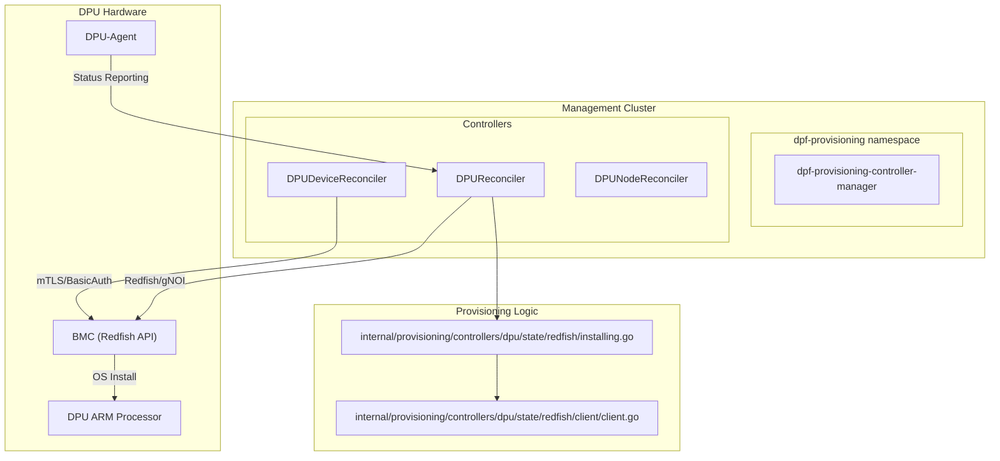

**Sources:** [api/provisioning/v1alpha1/dpu_types.go:47-95](), [internal/provisioning/controllers/dpu/state/redfish/client/client.go:48-118](), [internal/provisioning/controllers/dpu/state/redfish/installing.go:48-139]()

## Resource Hierarchy

**Resource Relationships and Ownership**

The system manages the DPU lifecycle through several layers of Custom Resources. `DPUDevice` represents the physical hardware and its BMC connectivity, while `DPU` represents the logical provisioning instance [api/provisioning/v1alpha1/dpudevice_types.go:29-56]().

```mermaid
graph TD
    DPUSet["DPUSet"]
    DPUDevice["DPUDevice (provisioning.dpu.nvidia.com)"]
    DPU["DPU (provisioning.dpu.nvidia.com)"]
    BFB["BFB"]
    BFSW["BlueFieldSoftware"]
    Flavor["DPUFlavor"]
    
    DPUSet -- "creates" --> DPU
    DPU -- "references" --> DPUDevice
    DPU -- "uses" --> BFB
    DPU -- "uses" --> BFSW
    DPU -- "uses" --> Flavor
    
    DPUDevice -- "manages" --> SPIRE["ClusterStaticEntry (spire.spiffe.io)"]
    DPUDevice -- "references" --> Secret["BMC Credentials Secret"]
```

**Key Resources:**

| Resource | Purpose | Controller |
|----------|---------|------------|
| `DPUDevice` | Physical DPU hardware identity, BMC address, and mTLS cert status [api/provisioning/v1alpha1/dpudevice_types.go:62-88]() | `DPUDeviceReconciler` |
| `DPU` | Orchestrates the provisioning state machine (Initializing -> Ready) [api/provisioning/v1alpha1/dpu_types.go:51-95]() | `DPUReconciler` |
| `BlueFieldSoftware` | Manages PLDM firmware bundles for BF4 devices [internal/provisioning/controllers/dpu/state/redfish/firmware_update.go:58-73]() | `BlueFieldSoftwareReconciler` |
| `DPUFlavor` | Configuration profile for networking and system settings [api/provisioning/v1alpha1/dpu_types.go:104-105]() | N/A (Static/Template) |

**Sources:** [api/provisioning/v1alpha1/dpudevice_types.go:29-88](), [api/provisioning/v1alpha1/dpu_types.go:51-129](), [internal/provisioning/controllers/dpudevice/dpudevice_controller.go:102-144]()

## Multi-Phase Provisioning Lifecycle

The DPU provisioning lifecycle progresses through distinct phases, each handled by specialized state handlers. The system persists state in the `DPU` resource status [api/provisioning/v1alpha1/dpu_types.go:47-95]().

**Phase Enumeration:**

| Phase | Description |
|-------|-------------|
| `Initializing` | First phase after DPU creation [api/provisioning/v1alpha1/dpu_types.go:58]() |
| `Update Firmware` | Updates DPU firmware for BlueField4 using PLDM bundles [api/provisioning/v1alpha1/dpu_types.go:66]() |
| `OS Installing` | Provisions the DPU OS (BFB) through Redfish or gNOI [api/provisioning/v1alpha1/dpu_types.go:73]() |
| `DPU Config` | DPU agent configures local system settings (nvconfig, OVS) [api/provisioning/v1alpha1/dpu_types.go:68]() |
| `Service Readiness`| Blocks until DPU services are healthy and ready for traffic [api/provisioning/v1alpha1/dpu_types.go:79]() |
| `Ready` | DPU is fully operational [api/provisioning/v1alpha1/dpu_types.go:86]() |

**Sources:** [api/provisioning/v1alpha1/dpu_types.go:47-95](), [internal/provisioning/controllers/dpu/state/redfish/installing.go:48-139]()

## Installation Interfaces

The provisioning system primarily utilizes Redfish for modern DPU hardware management, supporting both BlueField-3 and BlueField-4 [internal/provisioning/controllers/dpu/state/redfish/client/client.go:116-128]().

| Interface | Communication | Key Feature |
|-----------|---------------|-------------|
| **Redfish** | HTTPS to BMC | Supports `SimpleUpdate` for BFBs and PLDM for firmware [internal/provisioning/controllers/dpu/state/redfish/client/client.go:60-78]() |
| **mTLS** | Certificate-based | Secure BMC communication using `dpf-provisioning-redfish-client-secret` [internal/provisioning/controllers/dpu/state/redfish/client/client.go:112-117]() |
| **Virtual Media** | ISO Mounting | Used for BF4 OS installation via `InsertMedia` [internal/provisioning/controllers/dpu/state/redfish/client/client.go:61-63]() |

**Sources:** [internal/provisioning/controllers/dpu/state/redfish/client/client.go:48-128](), [internal/provisioning/controllers/dpu/state/redfish/installing.go:88-104]()

## Security and Identity

Provisioning enforces a zero-trust model by managing BMC credentials and SPIFFE identities.

- **BMC Credentials:** The `DPUDevice` controller manages per-device secrets and handles BMC factory resets [api/provisioning/v1alpha1/dpudevice_types.go:35-37]().
- **SPIFFE Identity:** The `SPIFFEDeregistrationFinalizer` ensures that DPU identities in SPIRE are cleaned up before a device is decommissioned [api/provisioning/v1alpha1/dpudevice_types.go:43-47]().
- **Certificate Rotation:** The system automatically rotates BMC mTLS server certificates using `cert-manager` integration [internal/provisioning/controllers/dpudevice/dpudevice_controller.go:78-90]().

**Sources:** [api/provisioning/v1alpha1/dpudevice_types.go:32-56](), [internal/provisioning/controllers/dpudevice/dpudevice_controller.go:146-168]()

---

# Page: DPUSet and DPU Lifecycle Management

# 3.1 DPUSet and DPU Lifecycle Management

<details>
<summary>Relevant source files</summary>

The following files were used as context for generating this wiki page:

- [api/provisioning/v1alpha1/dpu_types.go](api/provisioning/v1alpha1/dpu_types.go)
- [api/provisioning/v1alpha1/dpudevice_types.go](api/provisioning/v1alpha1/dpudevice_types.go)
- [api/provisioning/v1alpha1/dpuset_types.go](api/provisioning/v1alpha1/dpuset_types.go)
- [api/provisioning/v1alpha1/zz_generated.deepcopy.go](api/provisioning/v1alpha1/zz_generated.deepcopy.go)
- [config/provisioning/crd/bases/provisioning.dpu.nvidia.com_dpudevices.yaml](config/provisioning/crd/bases/provisioning.dpu.nvidia.com_dpudevices.yaml)
- [config/provisioning/crd/bases/provisioning.dpu.nvidia.com_dpus.yaml](config/provisioning/crd/bases/provisioning.dpu.nvidia.com_dpus.yaml)
- [config/provisioning/crd/bases/provisioning.dpu.nvidia.com_dpusets.yaml](config/provisioning/crd/bases/provisioning.dpu.nvidia.com_dpusets.yaml)
- [deploy/charts/dpf-operator/templates/crds/apiextensions.k8s.io_v1_customresourcedefinition_dpudevices.provisioning.dpu.nvidia.com.yaml](deploy/charts/dpf-operator/templates/crds/apiextensions.k8s.io_v1_customresourcedefinition_dpudevices.provisioning.dpu.nvidia.com.yaml)
- [deploy/charts/dpf-operator/templates/crds/apiextensions.k8s.io_v1_customresourcedefinition_dpus.provisioning.dpu.nvidia.com.yaml](deploy/charts/dpf-operator/templates/crds/apiextensions.k8s.io_v1_customresourcedefinition_dpus.provisioning.dpu.nvidia.com.yaml)
- [deploy/charts/dpf-operator/templates/crds/apiextensions.k8s.io_v1_customresourcedefinition_dpusets.provisioning.dpu.nvidia.com.yaml](deploy/charts/dpf-operator/templates/crds/apiextensions.k8s.io_v1_customresourcedefinition_dpusets.provisioning.dpu.nvidia.com.yaml)
- [internal/provisioning/controllers/bluefieldsoftware/bluefieldsoftware_controller.go](internal/provisioning/controllers/bluefieldsoftware/bluefieldsoftware_controller.go)
- [internal/provisioning/controllers/dpu/state/initializing.go](internal/provisioning/controllers/dpu/state/initializing.go)
- [internal/provisioning/controllers/dpu/state/initializing_test.go](internal/provisioning/controllers/dpu/state/initializing_test.go)
- [internal/provisioning/controllers/dpu/state/node_effect.go](internal/provisioning/controllers/dpu/state/node_effect.go)
- [internal/provisioning/controllers/dpu/state/node_effect_removal.go](internal/provisioning/controllers/dpu/state/node_effect_removal.go)
- [internal/provisioning/controllers/dpu/state/node_effect_removal_test.go](internal/provisioning/controllers/dpu/state/node_effect_removal_test.go)
- [internal/provisioning/controllers/dpu/state/node_effect_test.go](internal/provisioning/controllers/dpu/state/node_effect_test.go)
- [internal/provisioning/controllers/dpu/state/pending.go](internal/provisioning/controllers/dpu/state/pending.go)
- [internal/provisioning/controllers/dpu/state/pending_test.go](internal/provisioning/controllers/dpu/state/pending_test.go)
- [internal/provisioning/controllers/dpu/state/ready.go](internal/provisioning/controllers/dpu/state/ready.go)
- [internal/provisioning/controllers/dpu/state/ready_test.go](internal/provisioning/controllers/dpu/state/ready_test.go)
- [internal/provisioning/controllers/dpuset/dpuset_controller.go](internal/provisioning/controllers/dpuset/dpuset_controller.go)
- [internal/provisioning/controllers/dpuset/dpuset_controller_test.go](internal/provisioning/controllers/dpuset/dpuset_controller_test.go)
- [internal/provisioning/controllers/dpuset_controller_test.go](internal/provisioning/controllers/dpuset_controller_test.go)
- [internal/provisioning/controllers/util/dpu_agent_bootstrap.go](internal/provisioning/controllers/util/dpu_agent_bootstrap.go)
- [internal/provisioning/controllers/util/dpu_agent_bootstrap_test.go](internal/provisioning/controllers/util/dpu_agent_bootstrap_test.go)
- [internal/provisioning/dpuagent/operations/hostosinit/hostosinit_test.go](internal/provisioning/dpuagent/operations/hostosinit/hostosinit_test.go)
- [internal/provisioning/dpuagent/operations/nvconfig/resolve.go](internal/provisioning/dpuagent/operations/nvconfig/resolve.go)
- [internal/provisioning/webhooks/dpu_test.go](internal/provisioning/webhooks/dpu_test.go)
- [internal/provisioning/webhooks/dpuset_webhook.go](internal/provisioning/webhooks/dpuset_webhook.go)
- [internal/provisioning/webhooks/dpuset_webhook_test.go](internal/provisioning/webhooks/dpuset_webhook_test.go)

</details>


This document details the reconciliation logic and state machine transitions for the `DPUSet` and `DPU` resources. These controllers are responsible for orchestrating the end-to-end provisioning of BlueField DPUs, from hardware selection to a "Ready" state within a Kubernetes cluster.

## DPUSet Controller

The `DPUSet` controller ([internal/provisioning/controllers/dpuset/dpuset_controller.go:65-70]()) acts as a higher-level orchestrator, similar to a Kubernetes `Deployment`. It manages a collection of `DPU` resources based on a template and ensures the desired state is maintained across a fleet of devices.

### DPU Selection and Targeting
A `DPUSet` identifies which physical devices it should manage using label selectors. It targets `DPUDevice` resources, which represent the physical hardware discovered on the hosts.

*   **`dpuDeviceSelector`**: Defines the selector for `DPUDevices` that the `DPUSet` should target to create a corresponding `DPU` CR ([api/provisioning/v1alpha1/dpuset_types.go:50-52]()).
*   **`dpuNodeSelector`**: Selects `DPUNodes` (physical hosts) with specific labels ([api/provisioning/v1alpha1/dpuset_types.go:97-98]()).
*   **`dpuSelector`**: (Deprecated) Legacy field for selecting DPUs by labels ([api/provisioning/v1alpha1/dpuset_types.go:143-150]()).

### Revision Management and Rolling Updates
The `DPUSet` controller supports two strategies for updating DPUs when the `DPUTemplate` changes ([api/provisioning/v1alpha1/dpuset_types.go:78-90]()):

1.  **`OnDelete`**: A new `DPU` CR is only created when the user manually deletes the old `DPU` CR ([api/provisioning/v1alpha1/dpuset_types.go:85-86]()).
2.  **`RollingUpdate`**: Gradually scales down old DPUs and scales up new ones to minimize disruption ([api/provisioning/v1alpha1/dpuset_types.go:88-89]()).

The controller calculates a **template digest** ([internal/provisioning/controllers/dpuset/dpuset_controller.go:27]()) to detect changes in the specification. When a change is detected, it manages the transition according to the chosen strategy.

### DPUSet Reconciliation Flow

```mermaid
graph TD
    Start["DPUSetReconciler.Handle"] --> Validate["validateDPUSet"]
    Validate --> ListDevices["List DPUDevices via Selector"]
    ListDevices --> ListDPUs["List existing DPUs"]
    ListDPUs --> Sync["Sync Replicas"]
    Sync --> Match{"DPU matches Template?"}
    Match -- "No (Revision Mismatch)" --> Strategy{"Update Strategy?"}
    Strategy -- "RollingUpdate" --> RU["Scale down old / Create new"]
    Strategy -- "OnDelete" --> OD["Wait for manual deletion"]
    Match -- "Yes" --> CheckState["Update DPUSet Status Conditions"]
    CheckState --> End["Patch DPUSet"]

    subgraph "Logic Entities"
        DPUSetReconciler["DPUSetReconciler [internal/provisioning/controllers/dpuset/dpuset_controller.go]"]
        DPUResource["DPU CR [api/provisioning/v1alpha1/dpu_types.go]"]
    end
```
Sources: [internal/provisioning/controllers/dpuset/dpuset_controller.go:80-112](), [api/provisioning/v1alpha1/dpuset_types.go:78-100]()

## DPU Lifecycle and State Machine

The `DPU` controller manages the lifecycle of a single device. The status of a DPU is represented by the `DPUPhase` ([api/provisioning/v1alpha1/dpu_types.go:48]()).

### Phase Transitions
The DPU moves through a series of sequential phases to reach readiness:

| Phase | Description |
| :--- | :--- |
| `Initializing` | Initial state after CR creation. Validates prerequisites like `DPUDevice` and `DPUNode` existence ([api/provisioning/v1alpha1/dpu_types.go:58]()). |
| `Node Effect` | Applies taints, drains, or labels to the host node via `DPUNodeMaintenance` ([api/provisioning/v1alpha1/dpu_types.go:60]()). |
| `Pending` | Waiting for external resources like BFB images or `BlueFieldSoftware` to be ready ([api/provisioning/v1alpha1/dpu_types.go:62]()). |
| `Update Firmware` | Specifically for BlueField4, handles firmware bundle updates ([api/provisioning/v1alpha1/dpu_types.go:65-66]()). |
| `Prepare BFB` | Preparing the BFB and `bf.cfg` configuration files ([api/provisioning/v1alpha1/dpu_types.go:63-64]()). |
| `Initialize Interface` | Setting up Redfish accounts or DMS pods for communication ([api/provisioning/v1alpha1/dpu_types.go:71-72]()). |
| `OS Installing` | The actual flashing of the DPU OS/Firmware via gNOI or Redfish ([api/provisioning/v1alpha1/dpu_types.go:73-74]()). |
| `DPU Config` | DPU Agent configures internal settings such as NVConfig ([api/provisioning/v1alpha1/dpu_types.go:67-68]()). |
| `DPU Cluster Config` | Joining the DPU to the target Kubernetes cluster ([api/provisioning/v1alpha1/dpu_types.go:75-76]()). |
| `Service Readiness` | Waits for DPU services to become ready and releases host OS init holds ([api/provisioning/v1alpha1/dpu_types.go:79-82]()). |
| `Ready` | DPU is fully provisioned and operational ([api/provisioning/v1alpha1/dpu_types.go:85-86]()). |

Sources: [api/provisioning/v1alpha1/dpu_types.go:51-95]()

### Node Effect Logic
Before provisioning, the DPU controller often needs to evacuate or mark the host node to prevent workloads from being disrupted by DPU reboots. This is handled by the `NodeEffect` handler ([internal/provisioning/controllers/dpu/state/node_effect.go:35]()).

*   It creates a `DPUNodeMaintenance` object ([internal/provisioning/controllers/dpu/state/node_effect.go:80-85]()).
*   It supports various actions: `Drain`, `Taint`, `CustomLabel`, `CustomAction`, and `Hold` ([api/provisioning/v1alpha1/dpuset_types.go:35-42]()).
*   It waits for the maintenance to be applied before transitioning to the next phase ([internal/provisioning/controllers/dpu/state/node_effect.go:116-125]()).

### DPU Operational Readiness
Beyond the provisioning phases, the DPF tracks "Operational Readiness" via `DPUOperationalConditionType` ([api/provisioning/v1alpha1/dpu_types.go:132-136]()). These conditions monitor the health of the DPU after it has joined the cluster:
*   `DPUOperationalCondReady`: Summary condition for overall readiness ([api/provisioning/v1alpha1/dpu_types.go:135-136]()).
*   `DPUOperationalCondNodeProblemsReady`: Monitors host node problems via node-problem-detector ([api/provisioning/v1alpha1/dpu_types.go:137-138]()).

Sources: [api/provisioning/v1alpha1/dpu_types.go:131-150]()

## Code Entity Mapping

The following diagram bridges the high-level lifecycle concepts to the specific implementation classes and state handlers in the codebase.

```mermaid
graph LR
    subgraph "API Space"
        DPUCR["DPU CR [api/provisioning/v1alpha1/dpu_types.go]"]
        DPUSetCR["DPUSet CR [api/provisioning/v1alpha1/dpuset_types.go]"]
        DPUDeviceCR["DPUDevice CR [api/provisioning/v1alpha1/dpudevice_types.go]"]
    end

    subgraph "Controller Space"
        DSR["DPUSetReconciler [internal/provisioning/controllers/dpuset/dpuset_controller.go]"]
        DR["DPUReconciler [internal/provisioning/controllers/dpu/dpu_controller.go]"]
    end

    subgraph "State Handlers [internal/provisioning/controllers/dpu/state/]"
        SH_Init["Initializing [initializing.go]"]
        SH_NE["NodeEffect [node_effect.go]"]
        SH_Pend["Pending [pending.go]"]
        SH_Ready["Ready [ready.go]"]
    end

    DPUSetCR --> DSR
    DPUCR --> DR
    DR --> SH_Init
    DR --> SH_NE
    DR --> SH_Pend
    DR --> SH_Ready
    
    DSR -- "Manages" --> DPUCR
    DPUCR -- "References" --> DPUDeviceCR
```
Sources: [internal/provisioning/controllers/dpuset/dpuset_controller.go:65](), [api/provisioning/v1alpha1/dpu_types.go:28](), [internal/provisioning/controllers/dpu/state/node_effect.go:35](), [api/provisioning/v1alpha1/dpudevice_types.go:30]()

## Key Implementation Details

### Finalizers and Protection
To ensure clean teardown, the DPU uses `provisioning.dpu.nvidia.com/dpu-protection` ([api/provisioning/v1alpha1/dpu_types.go:52]()) and the DPUSet uses `provisioning.dpu.nvidia.com/dpuset-protection` ([api/provisioning/v1alpha1/dpuset_types.go:83]()). 

`DPUDevice` also uses a protection finalizer to prevent deletion while a DPU is actively using the hardware ([api/provisioning/v1alpha1/dpudevice_types.go:33]()).

### Revision Management
The `DPUSet` controller tracks revisions using a hash of the template. When the template changes, the controller determines which DPUs need to be updated based on the `StrategyType` ([api/provisioning/v1alpha1/dpuset_types.go:80-90]()).

### Validation
The `validateDPUSet` function ensures that when using the Redfish installation interface, disruptive `NodeEffect` actions (like `Drain`, `Taint`, or `CustomLabel`) are not allowed, as Redfish-based provisioning is designed for out-of-band management where host OS interaction might be restricted ([internal/provisioning/controllers/dpuset/dpuset_controller.go:114-123]()).

Sources: [internal/provisioning/controllers/dpuset/dpuset_controller.go:114-123](), [api/provisioning/v1alpha1/dpuset_types.go:83](), [api/provisioning/v1alpha1/dpudevice_types.go:32-34]()

---

# Page: BFB (BlueField Bundle) Management

# BFB (BlueField Bundle) Management

<details>
<summary>Relevant source files</summary>

The following files were used as context for generating this wiki page:

- [api/dpuservice/v1alpha1/dpuserviceconfiguration_types.go](api/dpuservice/v1alpha1/dpuserviceconfiguration_types.go)
- [api/provisioning/v1alpha1/bfb_types.go](api/provisioning/v1alpha1/bfb_types.go)
- [config/dpuservice/crd/bases/svc.dpu.nvidia.com_dpuserviceconfigurations.yaml](config/dpuservice/crd/bases/svc.dpu.nvidia.com_dpuserviceconfigurations.yaml)
- [config/provisioning/crd/bases/provisioning.dpu.nvidia.com_bfbs.yaml](config/provisioning/crd/bases/provisioning.dpu.nvidia.com_bfbs.yaml)
- [config/provisioning/rbac/role.yaml](config/provisioning/rbac/role.yaml)
- [config/provisioning/webhook/manifests.yaml](config/provisioning/webhook/manifests.yaml)
- [deploy/charts/dpf-operator/templates/crds/apiextensions.k8s.io_v1_customresourcedefinition_bfbs.provisioning.dpu.nvidia.com.yaml](deploy/charts/dpf-operator/templates/crds/apiextensions.k8s.io_v1_customresourcedefinition_bfbs.provisioning.dpu.nvidia.com.yaml)
- [deploy/charts/dpf-operator/templates/crds/apiextensions.k8s.io_v1_customresourcedefinition_dpuserviceconfigurations.svc.dpu.nvidia.com.yaml](deploy/charts/dpf-operator/templates/crds/apiextensions.k8s.io_v1_customresourcedefinition_dpuserviceconfigurations.svc.dpu.nvidia.com.yaml)
- [deploy/charts/dpf-operator/templates/role.yaml](deploy/charts/dpf-operator/templates/role.yaml)
- [internal/operator/controllers/dpfoperatorconfig_controller.go](internal/operator/controllers/dpfoperatorconfig_controller.go)
- [internal/operator/controllers/dpfoperatorconfig_controller_test.go](internal/operator/controllers/dpfoperatorconfig_controller_test.go)
- [internal/operator/controllers/object_schema_validation_test.go](internal/operator/controllers/object_schema_validation_test.go)
- [internal/operator/inventory/manifests/provisioning-controller.yaml](internal/operator/inventory/manifests/provisioning-controller.yaml)
- [internal/provisioning/bfbregistry/bfb_registry_creator.go](internal/provisioning/bfbregistry/bfb_registry_creator.go)
- [internal/provisioning/bfbregistry/bfb_registry_creator_test.go](internal/provisioning/bfbregistry/bfb_registry_creator_test.go)
- [internal/provisioning/controllers/bfb/bfb_controller.go](internal/provisioning/controllers/bfb/bfb_controller.go)
- [internal/provisioning/controllers/bfb/state/downloading.go](internal/provisioning/controllers/bfb/state/downloading.go)
- [internal/provisioning/controllers/bfb/state/downloading_test.go](internal/provisioning/controllers/bfb/state/downloading_test.go)
- [internal/provisioning/controllers/bfb/state/error.go](internal/provisioning/controllers/bfb/state/error.go)
- [internal/provisioning/controllers/bfb/state/error_test.go](internal/provisioning/controllers/bfb/state/error_test.go)
- [internal/provisioning/controllers/bfb/state/factory.go](internal/provisioning/controllers/bfb/state/factory.go)
- [internal/provisioning/controllers/bfb/state/initializing.go](internal/provisioning/controllers/bfb/state/initializing.go)
- [internal/provisioning/controllers/bfb/state/ready.go](internal/provisioning/controllers/bfb/state/ready.go)
- [internal/provisioning/controllers/bfb_controller_test.go](internal/provisioning/controllers/bfb_controller_test.go)
- [internal/provisioning/controllers/dpu/cloudinit/cloudinit.go](internal/provisioning/controllers/dpu/cloudinit/cloudinit.go)
- [internal/provisioning/controllers/dpu/cloudinit/cloudinit_test.go](internal/provisioning/controllers/dpu/cloudinit/cloudinit_test.go)
- [internal/provisioning/controllers/dpu/cloudinit/user-data](internal/provisioning/controllers/dpu/cloudinit/user-data)
- [internal/provisioning/controllers/dpu/dpu_controller.go](internal/provisioning/controllers/dpu/dpu_controller.go)
- [internal/provisioning/controllers/dpu/state/prepare_bfb_artifact.go](internal/provisioning/controllers/dpu/state/prepare_bfb_artifact.go)
- [internal/provisioning/controllers/dpu/state/prepare_bfb_artifact_test.go](internal/provisioning/controllers/dpu/state/prepare_bfb_artifact_test.go)
- [internal/provisioning/controllers/events/events.go](internal/provisioning/controllers/events/events.go)
- [internal/provisioning/controllers/util/download_error.go](internal/provisioning/controllers/util/download_error.go)
- [internal/provisioning/controllers/util/download_error_test.go](internal/provisioning/controllers/util/download_error_test.go)
- [internal/provisioning/webhooks/bfb_types_test.go](internal/provisioning/webhooks/bfb_types_test.go)
- [internal/provisioning/webhooks/dpudiscovery_webhook.go](internal/provisioning/webhooks/dpudiscovery_webhook.go)
- [internal/provisioning/webhooks/dpudiscovery_webhook_test.go](internal/provisioning/webhooks/dpudiscovery_webhook_test.go)
- [internal/provisioning/webhooks/suite_test.go](internal/provisioning/webhooks/suite_test.go)
- [pkg/bfcfg/bf.cfg.template](pkg/bfcfg/bf.cfg.template)
- [pkg/bfcfg/bfcfg.go](pkg/bfcfg/bfcfg.go)
- [pkg/bfcfg/bfcfg_test.go](pkg/bfcfg/bfcfg_test.go)

</details>


## Purpose and Scope

The BFB (BlueField Bundle) management system provides a centralized registry and lifecycle management for BlueField firmware images. A BFB image contains the operating system, drivers, and firmware components required to boot and configure NVIDIA BlueField DPU hardware. 

This document details the BFB registry service, which serves BFB images over HTTPS to DPUs during installation, the generation of `bf.cfg` (BlueField Configuration) files and cloud-init `user-data` via Go templates, and the orchestration of BFB delivery across different installation interfaces (Redfish, gNOI, and HostAgent).

## BFB Registry Service

The BFB Registry is an internal service that serves BFB files and generated configuration files over HTTPS. It is deployed by the Provisioning Controller and runs as a Pod named `bfb-registry` within the management cluster [internal/provisioning/bfbregistry/bfb_registry_creator.go:43]().

### Architecture and Data Flow

The BFB Registry utilizes an Nginx-based container that mounts a shared volume (PVC) containing BFB images. It provides a RESTful interface for DPUs to pull installation artifacts. Following the HTTPS migration, the registry serves traffic on port `8443` and requires TLS verification [internal/provisioning/bfbregistry/bfb_registry_creator.go:51]().

```mermaid
graph TD
    subgraph "ManagementCluster"
        PC["ProvisioningController (Leader)"] -- "Runs" --> BFB_RUN["BFBRegistryRunnable"]
        BFB_RUN -- "Creates" --> BFB_POD["Pod: bfb-registry"]
        BFB_RUN -- "Creates" --> BFB_SVC["Service: bfb-registry (NodePort)"]
        PVC["BFB Storage (PVC)"] -- "Mounted to" --> BFB_POD
    end

    subgraph "DPU / Host"
        HA["Host Agent / DMS"] -- "HTTPS GET :8443/bfb/" --> BFB_SVC
        D_AGENT["DPU Agent"] -- "HTTPS GET /deb" --> BFB_SVC
    end

    BFB_SVC -- "TargetPort 8443" --> BFB_POD
    BFB_POD -- "Reads" --> PVC
```
*Sources: [internal/provisioning/bfbregistry/bfb_registry_creator.go:82-91](), [internal/provisioning/bfbregistry/bfb_registry_creator.go:48-52]()*

### Registry Implementation Details
The registry is implemented as a `BFBRegistryRunnable` which is started by the provisioning manager [internal/provisioning/bfbregistry/bfb_registry_creator.go:82-93]().

- **HTTPS Migration**: The plain-HTTP listener (port 8082) has been removed. The service now uses port `8443` [internal/provisioning/bfbregistry/bfb_registry_creator.go:48-51]().
- **Certificate Management**: The registry uses a server certificate issued by the `dpf-provisioning-issuer` [internal/provisioning/bfbregistry/bfb_registry_creator.go:56-58](). The certificate includes the `KubernetesAPIServerVIP` in its SANs to ensure hostagent VIP-based downloads pass TLS verification [internal/provisioning/bfbregistry/bfb_registry_creator.go:86-90]().
- **Storage**: BFB images are stored at `/var/lib/nvidia/dpf/bfb` [internal/provisioning/bfbregistry/bfb_registry_creator.go:52]().

## BFCFG and Cloud-Init Generation

The installation process relies on two primary configuration artifacts:
1.  **`bf.cfg`**: A shell script executed by the BlueField installer (rshim/Redfish) to customize the initial OS installation [pkg/bfcfg/bfcfg.go:30]().
2.  **`user-data`**: A cloud-init configuration file written to the DPU OS seed directory to handle post-boot configuration like networking, users, and DPU agent installation [internal/provisioning/controllers/dpu/cloudinit/cloudinit.go:54-55]().

### The Template Engine
The generation logic resides in `pkg/bfcfg` and `internal/provisioning/controllers/dpu/cloudinit`.

| Component | Logic | Source |
| :--- | :--- | :--- |
| **bf.cfg Template** | Embedded default or ConfigMap-based override. | [pkg/bfcfg/bfcfg.go:75-76]() |
| **user-data Template** | Embedded `user-data` file using `text/template`. | [internal/provisioning/controllers/dpu/cloudinit/cloudinit.go:47-49]() |
| **Params Struct** | `cloudinit.Params` contains DPU-specific values (Hostname, MTU, SPIFFE settings). | [internal/provisioning/controllers/dpu/cloudinit/cloudinit.go:66-114]() |

### Code Entity Association: Configuration Rendering
This diagram shows how the DPU reconciler resolves parameters to generate the final installation scripts.

```mermaid
flowchart LR
    DPU["provisioningv1.DPU"] --> Resolve["cloudinit.ResolveParams"]
    Flavor["provisioningv1.DPUFlavor"] --> Resolve
    
    subgraph "Rendering Logic"
        Resolve --> Params["cloudinit.Params"]
        Params --> GenUserData["cloudinit.GenerateUserData"]
        Params --> GenBFCFG["bfcfg.Generate"]
        
        GenUserData -- "Uses" --> UDT["internal/provisioning/controllers/dpu/cloudinit/user-data"]
        GenBFCFG -- "Uses" --> BFT["pkg/bfcfg/bf.cfg.template"]
    end
    
    GenUserData --> Out1["user-data file"]
    GenBFCFG --> Out2["bf.cfg script"]
```
*Sources: [internal/provisioning/controllers/dpu/cloudinit/cloudinit.go:159-175](), [pkg/bfcfg/bfcfg.go:117-149]()*

## BFB Installation Flow

The `DPUReconciler` maps DPU phases to specific state handlers based on the `DPUInstallInterface` configured in the `DPUOptions` [internal/provisioning/controllers/dpu/dpu_controller.go:97-125]().

### Interface Specific Handlers

| Interface | Phase: DPUOSInstalling Handler | Implementation Detail |
| :--- | :--- | :--- |
| **HostAgent / gNOI** | `hostagent.Installing` | Leverages the Host Agent to push BFB over rshim. [internal/provisioning/controllers/dpu/dpu_controller.go:102]() |
| **Redfish** | `redfish.Installing` | Submits an OS installation task to the BMC. [internal/provisioning/controllers/dpu/dpu_controller.go:107]() |

### BFB Resource Lifecycle
The `BFB` Custom Resource (CR) tracks the availability and metadata of a specific bundle.

1.  **Downloading**: The controller fetches the image from the specified URL [internal/provisioning/controllers/bfb/state/downloading.go:25]().
2.  **Ready**: Once downloaded, the controller extracts versions (BSP, DOCA, Firmware) and updates the status [api/provisioning/v1alpha1/bfb_types.go:94-122]().

## Security and Identity Integration

A critical part of BFB management is the injection of identity during provisioning.

- **SPIFFE Mode**: If `SpiffeMode` is enabled in `Params`, the `user-data` template renders configuration for the `spire-agent`, `spiffe-helper`, and the `dpu-hw-attestor` [internal/provisioning/controllers/dpu/cloudinit/user-data:95-170]().
- **CA Trust**: The `CATrustBundle` is written to `/usr/local/share/ca-certificates/dpf-ca.crt` on the DPU to ensure the DPU OS trusts the `bfb-registry` HTTPS server [internal/provisioning/controllers/dpu/cloudinit/user-data:197-202]().
- **RBAC**: The provisioning manager role includes permissions to manage `bfbs`, `bfbs/status`, and `bfbs/finalizers` [internal/operator/inventory/manifests/provisioning-controller.yaml:314-344]().

Sources:
- BFB Registry Creation: [internal/provisioning/bfbregistry/bfb_registry_creator.go]()
- DPU Phase Handlers: [internal/provisioning/controllers/dpu/dpu_controller.go]()
- Cloud-init Params: [internal/provisioning/controllers/dpu/cloudinit/cloudinit.go]()
- Cloud-init Template: [internal/provisioning/controllers/dpu/cloudinit/user-data]()
- BFB API Types: [api/provisioning/v1alpha1/bfb_types.go]()

---

# Page: Host Agent Implementation

# Host Agent Implementation

<details>
<summary>Relevant source files</summary>

The following files were used as context for generating this wiki page:

- [cmd/dpuagent/main_linux_test.go](cmd/dpuagent/main_linux_test.go)
- [cmd/hostagent/app/server.go](cmd/hostagent/app/server.go)
- [cmd/hostagent/main.go](cmd/hostagent/main.go)
- [cmd/hostagent/options/options.go](cmd/hostagent/options/options.go)
- [cmd/hostagent/subcmds/root.go](cmd/hostagent/subcmds/root.go)
- [cmd/hostagent/subcmds/rundms.go](cmd/hostagent/subcmds/rundms.go)
- [cmd/hostagent/subcmds/serve.go](cmd/hostagent/subcmds/serve.go)
- [docs/public/advanced-configuration/host-installation-for-non-k8s-env/non-k8s-host-installation.md](docs/public/advanced-configuration/host-installation-for-non-k8s-env/non-k8s-host-installation.md)
- [docs/public/advanced-configuration/multi-dpu-ovnk-hbn.md](docs/public/advanced-configuration/multi-dpu-ovnk-hbn.md)
- [docs/public/release-notes/README.md](docs/public/release-notes/README.md)
- [docs/public/release-notes/v25.10.0.md](docs/public/release-notes/v25.10.0.md)
- [docs/public/release-notes/v25.10.1.md](docs/public/release-notes/v25.10.1.md)
- [docs/public/release-notes/v26.4.0.md](docs/public/release-notes/v26.4.0.md)
- [docs/public/release-notes/v26.4.1.md](docs/public/release-notes/v26.4.1.md)
- [internal/provisioning/controllers/dpu/state/hostagent/installing.go](internal/provisioning/controllers/dpu/state/hostagent/installing.go)
- [internal/provisioning/controllers/dpunode/util/option.go](internal/provisioning/controllers/dpunode/util/option.go)
- [internal/provisioning/controllers/node_controller_test.go](internal/provisioning/controllers/node_controller_test.go)
- [internal/provisioning/controllers/util/dms/util.go](internal/provisioning/controllers/util/dms/util.go)
- [internal/provisioning/controllers/util/future/future.go](internal/provisioning/controllers/util/future/future.go)
- [internal/provisioning/controllers/util/future/future_test.go](internal/provisioning/controllers/util/future/future_test.go)
- [internal/provisioning/controllers/util/reboot/util.go](internal/provisioning/controllers/util/reboot/util.go)
- [internal/provisioning/hostagent/controller.go](internal/provisioning/hostagent/controller.go)
- [internal/provisioning/hostagent/networkmanager/network_manager.go](internal/provisioning/hostagent/networkmanager/network_manager.go)
- [internal/provisioning/hostagent/networkmanager/network_manager_test.go](internal/provisioning/hostagent/networkmanager/network_manager_test.go)
- [internal/provisioning/hostagent/networkmanager/network_req.go](internal/provisioning/hostagent/networkmanager/network_req.go)
- [internal/provisioning/hostagent/networkmanager/network_req_test.go](internal/provisioning/hostagent/networkmanager/network_req_test.go)
- [internal/provisioning/hostagent/networkmanager/suite_test.go](internal/provisioning/hostagent/networkmanager/suite_test.go)
- [internal/provisioning/hostagent/nodemanager/nodemanager.go](internal/provisioning/hostagent/nodemanager/nodemanager.go)
- [internal/provisioning/hostagent/phase/configfw/configfw.go](internal/provisioning/hostagent/phase/configfw/configfw.go)
- [internal/provisioning/hostagent/phase/install/install.go](internal/provisioning/hostagent/phase/install/install.go)
- [internal/provisioning/hostagent/phase/interfaceinit/interface_initialize.go](internal/provisioning/hostagent/phase/interfaceinit/interface_initialize.go)
- [internal/provisioning/hostagent/phase/interfaceinit/interface_initialize_test.go](internal/provisioning/hostagent/phase/interfaceinit/interface_initialize_test.go)
- [internal/provisioning/hostagent/phase/network/hostnetwork.go](internal/provisioning/hostagent/phase/network/hostnetwork.go)
- [internal/provisioning/hostagent/phase/reboot/reboot.go](internal/provisioning/hostagent/phase/reboot/reboot.go)
- [internal/provisioning/hostagent/phase/reboot/store.go](internal/provisioning/hostagent/phase/reboot/store.go)
- [internal/provisioning/hostagent/phase/reboot/store_test.go](internal/provisioning/hostagent/phase/reboot/store_test.go)
- [internal/provisioning/hostagent/phase/reboot/sync.go](internal/provisioning/hostagent/phase/reboot/sync.go)
- [internal/provisioning/hostagent/phase/reboot/sync_test.go](internal/provisioning/hostagent/phase/reboot/sync_test.go)
- [internal/provisioning/hostagent/service/installation_service.go](internal/provisioning/hostagent/service/installation_service.go)
- [internal/provisioning/hostagent/service/installation_service_test.go](internal/provisioning/hostagent/service/installation_service_test.go)
- [internal/provisioning/hostagent/service/types/types.go](internal/provisioning/hostagent/service/types/types.go)
- [internal/provisioning/hostagent/util/cmd_test.go](internal/provisioning/hostagent/util/cmd_test.go)
- [internal/provisioning/hostagent/util/network.go](internal/provisioning/hostagent/util/network.go)
- [internal/provisioning/hostagent/util/network_test.go](internal/provisioning/hostagent/util/network_test.go)
- [internal/provisioning/hostagent/util/pci.go](internal/provisioning/hostagent/util/pci.go)
- [internal/provisioning/hostagent/util/pci_test.go](internal/provisioning/hostagent/util/pci_test.go)

</details>


The host agent is a critical component of the DPF provisioning system that runs on each worker node to manage DPU hardware. It provides the bridge between Kubernetes control plane operations and the physical DPU devices attached to the host. The host agent architecture supports two deployment modes: as a Kubernetes pod with dual containers or as standalone systemd services in non-Kubernetes environments.

## Architecture Overview

The host agent implements a dual-process design where two separate processes run on each host:

**Host Agent Architecture**
```mermaid
graph TB
    subgraph "WorkerNode"
        subgraph "HostAgentPod_SystemdServices"
            DMS["DMS Container/Service<br/>'internal/provisioning/hostagent/service'"]
            HostAgent["HostAgent Container/Service<br/>'internal/provisioning/hostagent'"]
        end
        
        subgraph "HostSystem"
            Rshim["rshim driver"]
            DBus["D-Bus"]
            Netplan["netplan"]
            NM["NetworkManager / systemd-networkd"]
        end
        
        DPU["DPU Hardware"]
    end
    
    subgraph "ManagementCluster"
        ProvCtrl["Provisioning Controller"]
        DPU_CR["DPU CRD"]
    end
    
    ProvCtrl -->|"gNOI/gNMI"| DMS
    ProvCtrl -->|"manages"| HostAgent
    DMS -->|"gNMI commands"| Rshim
    HostAgent -->|"UpdateStatus()"| DPU_CR
    HostAgent -->|"network config"| NM
    HostAgent -->|"reboot"| DBus
    Rshim -->|"PCIe/USB"| DPU
```

| Component | Process | Primary Functions |
|-----------|---------|-------------------|
| **DMS** | `/hostagent rundms` | gNMI/gNOI server, command execution, DPU communication [internal/provisioning/controllers/util/dms/util.go:43]() |
| **Host Agent** | `/hostagent serve` | BFB installation, network configuration, reboot orchestration [internal/provisioning/controllers/util/dms/util.go:44]() |
| **rshim** | Kernel driver | Low-level DPU communication channel [internal/provisioning/controllers/util/dms/util.go:42]() |

Sources: [internal/provisioning/controllers/util/dms/util.go:39-49](), [cmd/hostagent/subcmds/serve.go:48-129](), [internal/provisioning/hostagent/nodemanager/nodemanager.go:77-86]()

## Dual-Container Design

In Kubernetes deployments, the host agent runs as a single pod with two containers that share certain resources but serve distinct purposes:

**Container Configuration**
```mermaid
graph TB
    subgraph "HostAgentPod"
        subgraph "dmsContainer"
            DMSBin["/hostagent rundms"]
            RshimCmd["rshim --force"]
        end
        
        subgraph "hostagentContainer"
            HABin["/hostagent serve"]
            HAFlags["--bfb-registry-address<br/>--reboot-method<br/>--custom-script-name"]
        end
        
        subgraph "SharedVolumes"
            Dev["/dev (hostPath)"]
            Sys["/sys (hostPath)"]
            LibModules["/lib/modules (hostPath)"]
            DMSImage["/tmp/dms (emptyDir)"]
            DPFLocal["/var/lib/dpf (hostPath)"]
            SystemdDBus["/var/run/dbus/system_bus_socket"]
            NetplanDir["/etc/netplan"]
        end
    end
    
    DMSBin --> Dev
    DMSBin --> Sys
    DMSBin --> DMSImage
    HABin --> Dev
    HABin --> DPFLocal
    HABin --> SystemdDBus
    HABin --> NetplanDir
```

### DMS Container

The DMS container provides the gNMI/gNOI server interface for remote management:

- **Entrypoint**: `rshim --force --foreground` followed by `/hostagent rundms` [internal/provisioning/controllers/util/dms/util.go:131-138](), [internal/provisioning/controllers/util/dms/util.go:175]()
- **Purpose**: Exposes gNMI endpoints for command execution and status queries.
- **Privileges**: Runs with `privileged: true` security context [internal/provisioning/controllers/util/dms/util.go:169-171]()
- **Key Volumes**: `/dev`, `/sys`, `/tmp/dms`, `/var/run/dbus/system_bus_socket` [internal/provisioning/controllers/util/dms/util.go:146-168]().

### HostAgent Container

The host agent container performs the actual provisioning operations:

- **Entrypoint**: `/hostagent serve --bfb-registry-address=<addr> [--reboot-method=<method>] [--custom-script-name=<script>]` [internal/provisioning/controllers/util/dms/util.go:187-189]()
- **Purpose**: Downloads and installs BFB images, configures networking, manages reboots.
- **Network Management**: Uses `networkmanager.NetworkManager` to configure VFs and OOB bridges [internal/provisioning/hostagent/networkmanager/network_manager.go:85-93]().
- **Privileges**: Runs with `privileged: true` security context [internal/provisioning/controllers/util/dms/util.go:182-184]()

Sources: [internal/provisioning/controllers/util/dms/util.go:103-240]()

## Host Management Service

The `InstallationService` runs within the HostAgent container and provides a REST API for DPUs to communicate back to the host and management cluster:

**Installation Service API**
| Endpoint | Method | Function |
|----------|--------|----------|
| `/update-status` | POST | Updates DPU CR status with agent conditions and startup time [internal/provisioning/hostagent/service/installation_service.go:112-116]() |
| `/get-object` | GET | Proxies requests to the K8s API to retrieve specific objects [internal/provisioning/hostagent/service/installation_service.go:117-125]() |
| `/configure-host-vfs` | POST | Triggers host-side VF and bridge configuration [internal/provisioning/hostagent/service/installation_service.go:132-135]() |
| `/trigger-reboot` | POST | Initiates DPU or Host reboot based on the configured method [internal/provisioning/hostagent/service/installation_service.go:136-140]() |
| `/deb/`, `/rpm/` | GET | Serves agent packages to DPUs over the `tmfifo_net` interface [internal/provisioning/hostagent/service/installation_service.go:153-154]() |

### Networking Topology
The service listens on IPv6 link-local addresses (`fe80::1`) on `tmfifo_net` interfaces created by the rshim driver [internal/provisioning/hostagent/service/installation_service.go:53-60](). It also provides an HTTP forward proxy on port `11030` to allow DPUs to reach external resources like the BFB registry [internal/provisioning/hostagent/service/installation_service.go:181-182]().

Sources: [internal/provisioning/hostagent/service/installation_service.go:102-160]()

## Network Configuration

The `NetworkManager` manages host-side networking for DPUs, including SR-IOV VFs and OOB bridges:

- **Backend Detection**: Automatically detects `NetworkManager` or `systemd-networkd` [internal/provisioning/hostagent/networkmanager/network_manager.go:99-103]().
- **VF Management**: Ensures VFs are unmanaged by the host's primary network stack to avoid conflicts [internal/provisioning/hostagent/networkmanager/network_manager.go:106-108]().
- **OOB Bridge**: Creates and manages the Out-of-Band bridge (default: `br-dpu`) for DPU control plane traffic [internal/provisioning/hostagent/util/network.go:78]().
- **Persistence**: Saves network requests to a local directory to persist configuration across reboots [internal/provisioning/hostagent/networkmanager/network_manager.go:142-170]().

Sources: [internal/provisioning/hostagent/networkmanager/network_manager.go:63-133](), [internal/provisioning/hostagent/util/network.go:96-154]()

## Node and Device Registration

The `NodeManager` is responsible for registering the host and its DPUs in the Kubernetes API:

1. **DPUDevice Registration**: Discovers DPUs via sysfs and creates `DPUDevice` CRs for each [internal/provisioning/hostagent/nodemanager/nodemanager.go:127-172]().
2. **DPUNode Registration**: Creates a `DPUNode` CR representing the physical host, including hardware labels and reboot capabilities [internal/provisioning/hostagent/nodemanager/nodemanager.go:174-250]().
3. **Status Reporting**: Periodically updates the `DPUNode` status [internal/provisioning/hostagent/nodemanager/nodemanager.go:79-85]().

Sources: [internal/provisioning/hostagent/nodemanager/nodemanager.go:62-124]()

## Non-Kubernetes Deployment

For non-Kubernetes worker nodes, the host agent is deployed as systemd services using `containerd` to run the hostdriver image:

| Service | Function |
|---------|----------|
| `rshim.service` | Manages the rshim driver for DPU communication [docs/public/advanced-configuration/host-installation-for-non-k8s-env/non-k8s-host-installation.md:142-143]() |
| `dpf-dmsd.service` | Runs the DMS server container [docs/public/advanced-configuration/host-installation-for-non-k8s-env/non-k8s-host-installation.md:116-140]() |
| `dpf-host-agent.service` | Runs the Host Agent container with bootstrap kubeconfig [docs/public/advanced-configuration/host-installation-for-non-k8s-env/non-k8s-host-installation.md:153-176]() |

The `dpf-host-agent.service` uses a bootstrap kubeconfig to register with the management cluster and acquire a permanent client certificate [docs/public/advanced-configuration/host-installation-for-non-k8s-env/non-k8s-host-installation.md:21-60]().

Sources: [docs/public/advanced-configuration/host-installation-for-non-k8s-env/non-k8s-host-installation.md:1-176]()

---

# Page: DPUFlavor and DPUFlavorTemplate Configuration Profiles

# DPUFlavor and DPUFlavorTemplate Configuration Profiles

<details>
<summary>Relevant source files</summary>

The following files were used as context for generating this wiki page:

- [api/provisioning/v1alpha1/dpuflavor_types.go](api/provisioning/v1alpha1/dpuflavor_types.go)
- [config/provisioning/crd/bases/provisioning.dpu.nvidia.com_dpuflavors.yaml](config/provisioning/crd/bases/provisioning.dpu.nvidia.com_dpuflavors.yaml)
- [deploy/charts/dpf-operator/templates/crds/apiextensions.k8s.io_v1_customresourcedefinition_dpuflavors.provisioning.dpu.nvidia.com.yaml](deploy/charts/dpf-operator/templates/crds/apiextensions.k8s.io_v1_customresourcedefinition_dpuflavors.provisioning.dpu.nvidia.com.yaml)
- [docs/public/developer-guides/api/dpuflavor.md](docs/public/developer-guides/api/dpuflavor.md)
- [docs/public/developer-guides/api/dpuflavortemplate.md](docs/public/developer-guides/api/dpuflavortemplate.md)
- [docs/public/release-notes/v26.10.0.md](docs/public/release-notes/v26.10.0.md)
- [docs/public/user-guides/host-trusted/use-cases/hbn-ovnk-snap/manifests/05-dpudeployment-installation/dpuflavor.yaml](docs/public/user-guides/host-trusted/use-cases/hbn-ovnk-snap/manifests/05-dpudeployment-installation/dpuflavor.yaml)
- [docs/public/user-guides/host-trusted/use-cases/hbn-ovnk/manifests/05-dpudeployment-installation/dpuflavor-hbn-ovnk.yaml](docs/public/user-guides/host-trusted/use-cases/hbn-ovnk/manifests/05-dpudeployment-installation/dpuflavor-hbn-ovnk.yaml)
- [docs/public/user-guides/host-trusted/use-cases/hbn-snap/manifests/04.1-dpudeployment-installation-nvme/dpuflavor.yaml](docs/public/user-guides/host-trusted/use-cases/hbn-snap/manifests/04.1-dpudeployment-installation-nvme/dpuflavor.yaml)
- [docs/public/user-guides/host-trusted/use-cases/hbn-snap/manifests/04.2-dpudeployment-installation-virtiofs/dpuflavor.yaml](docs/public/user-guides/host-trusted/use-cases/hbn-snap/manifests/04.2-dpudeployment-installation-virtiofs/dpuflavor.yaml)
- [docs/public/user-guides/host-trusted/use-cases/hbn/manifests/04-dpudeployment-installation/hbn-dpuflavor.yaml](docs/public/user-guides/host-trusted/use-cases/hbn/manifests/04-dpudeployment-installation/hbn-dpuflavor.yaml)
- [docs/public/user-guides/zero-trust/use-cases/hbn-snap/manifests/03.1-dpudeployment-installation-nvme/dpuflavor.yaml](docs/public/user-guides/zero-trust/use-cases/hbn-snap/manifests/03.1-dpudeployment-installation-nvme/dpuflavor.yaml)
- [docs/public/user-guides/zero-trust/use-cases/hbn-snap/manifests/03.2-dpudeployment-installation-virtiofs/dpuflavor.yaml](docs/public/user-guides/zero-trust/use-cases/hbn-snap/manifests/03.2-dpudeployment-installation-virtiofs/dpuflavor.yaml)
- [docs/public/user-guides/zero-trust/use-cases/hbn/manifests/03.1-dpudeployment-installation-pf/hbn-dpuflavor.yaml](docs/public/user-guides/zero-trust/use-cases/hbn/manifests/03.1-dpudeployment-installation-pf/hbn-dpuflavor.yaml)
- [docs/public/user-guides/zero-trust/use-cases/hbn/manifests/03.2-dpudeployment-installation-pf-vf/hbn-dpuflavor.yaml](docs/public/user-guides/zero-trust/use-cases/hbn/manifests/03.2-dpudeployment-installation-pf-vf/hbn-dpuflavor.yaml)
- [internal/provisioning/dpuagent/operations/nodelabels/node_labels.go](internal/provisioning/dpuagent/operations/nodelabels/node_labels.go)
- [internal/provisioning/dpuagent/operations/nodelabels/node_labels_test.go](internal/provisioning/dpuagent/operations/nodelabels/node_labels_test.go)
- [internal/provisioning/dpuagent/operations/nvconfig/nvconfig.go](internal/provisioning/dpuagent/operations/nvconfig/nvconfig.go)
- [internal/provisioning/dpuagent/operations/nvconfig/nvconfig_test.go](internal/provisioning/dpuagent/operations/nvconfig/nvconfig_test.go)
- [internal/provisioning/dpuagent/operations/nvconfig/resolve_test.go](internal/provisioning/dpuagent/operations/nvconfig/resolve_test.go)
- [internal/provisioning/webhooks/dpuflavor_webhook.go](internal/provisioning/webhooks/dpuflavor_webhook.go)
- [internal/provisioning/webhooks/dpuflavor_webhook_test.go](internal/provisioning/webhooks/dpuflavor_webhook_test.go)
- [test/apivalidation/provisioning_api_validation_test.go](test/apivalidation/provisioning_api_validation_test.go)
- [test/e2e/dpuservice_tenant_namespace.go](test/e2e/dpuservice_tenant_namespace.go)
- [test/objects/application/dpuserviceconfig-hbn-tenant.yaml](test/objects/application/dpuserviceconfig-hbn-tenant.yaml)
- [test/objects/infrastructure/dpuflavor-hbn-ovn.yaml](test/objects/infrastructure/dpuflavor-hbn-ovn.yaml)
- [test/objects/infrastructure/dpuflavor-physical.yaml](test/objects/infrastructure/dpuflavor-physical.yaml)
- [test/objects/infrastructure/dpuflavor.yaml](test/objects/infrastructure/dpuflavor.yaml)
- [test/objects/infrastructure/dpuflavortemplate-physical.yaml](test/objects/infrastructure/dpuflavortemplate-physical.yaml)

</details>


## Purpose and Scope

`DPUFlavor` is a Kubernetes Custom Resource Definition (CRD) that defines reusable configuration profiles for DPU provisioning. A `DPUFlavor` encapsulates all hardware and software configuration parameters needed to prepare a DPU for a specific use case, including firmware settings (`nvconfig`), kernel parameters (`grub`), network configuration, OVS bridge topology, and custom system files.

`DPUFlavorTemplate` extends this by allowing per-DPU customization using Go templates, where values are sourced from the `DPUDevice` resource. This enables unique settings (like MAC addresses or specific IDs) while maintaining a common profile structure.

## DPUFlavor in the Provisioning Workflow

`DPUFlavor` resources are referenced by `DPUSet` or `DPUDeployment` objects. During the provisioning cycle, the DPU Agent (running on the host or DPU) reads the `DPUFlavor` spec to apply low-level configurations.

### Entity Relationship Diagram

The following diagram maps the high-level configuration domains to the specific code entities defined in the `DPUFlavor` API.

```mermaid
graph TD
    subgraph "provisioning.dpu.nvidia.com/v1alpha1"
        Flavor["DPUFlavor (CRD)"]
        Spec["DPUFlavorSpec"]
        Grub["DPUFlavorGrub"]
        NV["NVConfig"]
        NIC["NicConfiguration"]
        OVS["DPUFlavorOVS"]
        Files["ConfigFile"]
        SF["ScalableFunction"]
    end

    Flavor --> Spec
    Spec -->|grub| Grub
    Spec -->|nvconfig| NV
    Spec -->|ewNicConfigurations| NIC
    Spec -->|ovs| OVS
    Spec -->|configFiles| Files
    Spec -->|scalableFunctions| SF

    subgraph "System Targets"
        Kernel["/etc/default/grub"]
        MlxConfig["mlxconfig (Firmware)"]
        OVSDB["OVS DB / ovs-vsctl"]
        FS["DPU Filesystem"]
        MDEV["Mellanox Scalable Functions"]
    end

    Grub -.->|configures| Kernel
    NV -.->|configures| MlxConfig
    NIC -.->|configures| MlxConfig
    OVS -.->|configures| OVSDB
    Files -.->|writes to| FS
    SF -.->|creates| MDEV
```
Sources: [api/provisioning/v1alpha1/dpuflavor_types.go:35-118](), [config/provisioning/crd/bases/provisioning.dpu.nvidia.com_dpuflavors.yaml:40-200]()

## DPUFlavor Resource Structure

The `DPUFlavor` resource is defined in `api/provisioning/v1alpha1/dpuflavor_types.go`. Key characteristics include:
- **Immutability**: The `DPUFlavorSpec` is immutable once created to ensure consistency across a DPU fleet [api/provisioning/v1alpha1/dpuflavor_types.go:34-35]().
- **Scope**: It is a namespaced resource, typically residing in `dpf-operator-system` [config/provisioning/crd/bases/provisioning.dpu.nvidia.com_dpuflavors.yaml:16-16]().

### Configuration Domains

#### 1. GRUB and Sysctl
The `grub` field defines kernel boot parameters, while `sysctl` manages runtime kernel parameters.
- `KernelParameters`: A list of strings applied to the DPU's boot loader (e.g., `hugepagesz=2048kB`) [api/provisioning/v1alpha1/dpuflavor_types.go:133-137]().
- `Sysctl`: Parameters applied via `sysctl -w` on the DPU, stored in `/etc/sysctl.d/99-dpf.conf` [docs/public/developer-guides/api/dpuflavor.md:32-32]().

#### 2. NVConfig (Firmware Settings)
The `nvconfig` section configures firmware-level parameters through `mlxconfig`.
- **Device Selectors**: Supports wildcard `*` (applies to all devices) or specific ports like `p0`, `p1` [api/provisioning/v1alpha1/dpuflavor_types.go:42-45]().
- **Validation**: If `*` is used, it must be the only entry in the list [api/provisioning/v1alpha1/dpuflavor_types.go:48-49]().
- **Force Mode**: Some parameters hidden by firmware (e.g., `FORCE_ETH_PCI_SUBCLASS`) require `force: true` to bypass `mlxconfig q` deferral filters [docs/public/developer-guides/api/dpuflavor.md:143-154]().

#### 3. OVS Configuration
The `ovs` section contains a `rawConfigScript` [api/provisioning/v1alpha1/dpuflavor_types.go:145-149](). This shell script is executed on the DPU to:
- Initialize DOCA settings (e.g., `other_config:doca-init=true`) [test/objects/infrastructure/dpuflavor.yaml:91-91]().
- Create bridges like `br-sfc` and `br-hbn` [test/objects/infrastructure/dpuflavor.yaml:107-112]().
- Configure hardware offload (`hw-offload=true`) [test/objects/infrastructure/dpuflavor.yaml:93-93]().

#### 4. Scalable Functions (SFs)
Configures sub-functions on the DPU. Currently, only the `dma` type is supported, primarily for SNAP services on BlueField-4 socket-direct systems [api/provisioning/v1alpha1/dpuflavor_types.go:126-131]().
- `count`: Number of SFs to create (must be 1 for `dma`) [api/provisioning/v1alpha1/dpuflavor_types.go:134-134]().
- `sfNumStart`: The SF number to start allocation from (defaults to 8000 for `dma`) [docs/public/developer-guides/api/dpuflavor.md:66-66]().

#### 5. Configuration Files and Node Labeling
The `configFiles` array allows writing arbitrary files. A key use case is DPU node labeling:
- Scripts placed in `/var/lib/dpf/dpuagent/node-label-scripts/` are executed by the DPU agent [docs/public/release-notes/v26.10.0.md:31-31]().
- Output format: `key-suffix=value` is converted to `scripts.dpu.nvidia.com/key-suffix=value` labels on the Kubernetes Node [docs/public/release-notes/v26.10.0.md:31-31]().

## DPUFlavorTemplate

`DPUFlavorTemplate` allows generating `DPUFlavor` resources dynamically for each DPU. It uses Go templates in its `spec` and resolves variables from `DPUDevice.spec.values`.

### Template Rendering Logic
The `dpfctl` tool provides a `flavor-template render` command to preview how a template will be materialized for a specific device [docs/public/developer-guides/api/dpuflavor.md:342-342]().

```mermaid
graph LR
    subgraph "Input"
        Template["DPUFlavorTemplate"]
        Device["DPUDevice.spec.values"]
    end

    subgraph "Process"
        Renderer["Go Template Engine"]
    end

    subgraph "Output"
        Flavor["DPUFlavor (Materialized)"]
    end

    Template --> Renderer
    Device --> Renderer
    Renderer --> Flavor
```

## Implementation and Data Flow

The `DPUFlavor` is processed by the DPU Agent in a sequential pipeline.

### NVConfig Application (mlxconfig)
The `ConfigureNVConfig` operation handles firmware settings. It supports two modes:
1. **Legacy Mode**: Resets target devices, then applies all parameters.
2. **Device Query Mode**: Uses `--with_default set`, querying `mlxconfig q` first to defer parameters that firmware hasn't exposed yet (e.g., parameters gated by another setting) [internal/provisioning/dpuagent/operations/nvconfig/nvconfig.go:145-152]().

### Configuration Application Flow

```mermaid
sequenceDiagram
    participant K8s as Management Cluster (K8s)
    participant Agent as DPU Agent (Host/DPU)
    participant Bash as bash.Run
    participant FW as mlxconfig

    K8s->>Agent: DPUFlavor CR Data
    Note over Agent: Reconcile Configuration
    Agent->>Bash: Write ConfigFiles & Scripts
    Agent->>Agent: EnsureResolved (PCI to Params mapping)
    alt Device Query Mode
        Agent->>FW: mlxconfig -d [PCI] q
        Agent->>FW: mlxconfig -d [PCI] --with_default set [Params]
    else Legacy Mode
        Agent->>FW: mlxconfig -d [PCI] reset
        Agent->>FW: mlxconfig -d [PCI] set [Params]
    end
    Agent->>Bash: Execute OVS rawConfigScript
    Agent->>Agent: Check for Reboot Required
```
Sources: [internal/provisioning/dpuagent/operations/nvconfig/nvconfig.go:93-153](), [test/objects/infrastructure/dpuflavor.yaml:81-121]()

## Technical Reference: Resource Management

The `DPUFlavor` acts as a resource gate for DPU placement:
- `dpuResources`: Total minimum resources (CPU, Memory) required on the DPU for this flavor [api/provisioning/v1alpha1/dpuflavor_types.go:76-81]().
- `systemReservedResources`: Resources consumed by the OS, OVS, and DPF system that are *not* available for DPU Services [api/provisioning/v1alpha1/dpuflavor_types.go:82-86]().

## Validation Logic
The system enforces strict validation via Webhooks and CEL (Common Expression Language) rules:
- **Immutability**: The entire spec is protected by `self == oldSelf` [api/provisioning/v1alpha1/dpuflavor_types.go:34-34]().
- **NVConfig Uniqueness**: Each device entry in `nvconfig` must be unique (case-insensitive) [api/provisioning/v1alpha1/dpuflavor_types.go:50-50]().
- **Template Exclusivity**: `DPUTemplateSpec` (used in `DPUSet`) must specify exactly one of `dpuFlavor` or `dpuFlavorTemplate` [test/apivalidation/provisioning_api_validation_test.go:126-162]().

Sources: [api/provisioning/v1alpha1/dpuflavor_types.go:34-72](), [internal/provisioning/webhooks/dpuflavor_webhook_test.go:144-224](), [test/apivalidation/provisioning_api_validation_test.go:126-162]()

---

# Page: DPUNode and DPUNodeMaintenance

# DPUNode and DPUNodeMaintenance

<details>
<summary>Relevant source files</summary>

The following files were used as context for generating this wiki page:

- [api/provisioning/v1alpha1/dpunode_types.go](api/provisioning/v1alpha1/dpunode_types.go)
- [config/provisioning/crd/bases/provisioning.dpu.nvidia.com_dpunodes.yaml](config/provisioning/crd/bases/provisioning.dpu.nvidia.com_dpunodes.yaml)
- [deploy/charts/dpf-operator/templates/crds/apiextensions.k8s.io_v1_customresourcedefinition_dpunodes.provisioning.dpu.nvidia.com.yaml](deploy/charts/dpf-operator/templates/crds/apiextensions.k8s.io_v1_customresourcedefinition_dpunodes.provisioning.dpu.nvidia.com.yaml)
- [docs/public/developer-guides/api/dpunode.md](docs/public/developer-guides/api/dpunode.md)
- [internal/provisioning/controllers/dpu/state/dpu_config.go](internal/provisioning/controllers/dpu/state/dpu_config.go)
- [internal/provisioning/controllers/dpu/state/dpu_config_test.go](internal/provisioning/controllers/dpu/state/dpu_config_test.go)
- [internal/provisioning/controllers/dpu/state/redfish/client/reset_test.go](internal/provisioning/controllers/dpu/state/redfish/client/reset_test.go)
- [internal/provisioning/controllers/dpu/state/redfish/rebooting.go](internal/provisioning/controllers/dpu/state/redfish/rebooting.go)
- [internal/provisioning/controllers/dpu/state/redfish/rebooting_test.go](internal/provisioning/controllers/dpu/state/redfish/rebooting_test.go)
- [internal/provisioning/controllers/dpu/state/suite_test.go](internal/provisioning/controllers/dpu/state/suite_test.go)
- [internal/provisioning/controllers/dpu_controller_test.go](internal/provisioning/controllers/dpu_controller_test.go)
- [internal/provisioning/controllers/dpunode/dpunode_controller.go](internal/provisioning/controllers/dpunode/dpunode_controller.go)
- [internal/provisioning/controllers/dpunode/dpunode_controller_test.go](internal/provisioning/controllers/dpunode/dpunode_controller_test.go)
- [internal/provisioning/controllers/dpunode/node_controller.go](internal/provisioning/controllers/dpunode/node_controller.go)
- [internal/provisioning/controllers/dpunode/node_controller_test.go](internal/provisioning/controllers/dpunode/node_controller_test.go)
- [internal/provisioning/controllers/dpunode/suite_test.go](internal/provisioning/controllers/dpunode/suite_test.go)
- [internal/provisioning/controllers/dpunode_controller_test.go](internal/provisioning/controllers/dpunode_controller_test.go)
- [internal/provisioning/controllers/dpunodemaintenance/dpunodemaintenance_controller.go](internal/provisioning/controllers/dpunodemaintenance/dpunodemaintenance_controller.go)
- [internal/provisioning/controllers/dpunodemaintenance/dpunodemaintenance_controller_test.go](internal/provisioning/controllers/dpunodemaintenance/dpunodemaintenance_controller_test.go)
- [internal/provisioning/controllers/dpunodemaintenance_controller_test.go](internal/provisioning/controllers/dpunodemaintenance_controller_test.go)
- [internal/provisioning/controllers/dpuset/suite_test.go](internal/provisioning/controllers/dpuset/suite_test.go)
- [internal/provisioning/controllers/util/util.go](internal/provisioning/controllers/util/util.go)
- [internal/provisioning/controllers/util/util_test.go](internal/provisioning/controllers/util/util_test.go)
- [test/mock/dms/pkg/controllers/hostagent_server.go](test/mock/dms/pkg/controllers/hostagent_server.go)

</details>


This document describes the DPUNode and DPUNodeMaintenance custom resources and their controllers, which manage physical hosts with DPUs attached and coordinate maintenance operations across these hosts.

**DPUNode** represents a physical x86 host with one or more DPU (Data Processing Unit) devices attached. It manages host-level operations including reboot orchestration, host agent upgrades, and readiness tracking. [api/provisioning/v1alpha1/dpunode_types.go:7-11](), [docs/public/developer-guides/api/dpunode.md:7-11]()

**DPUNodeMaintenance** coordinates node maintenance operations by applying node effects (drain, taint, labels, custom actions) while enforcing safety constraints to prevent disrupting too many hosts simultaneously. [internal/provisioning/controllers/dpunodemaintenance/dpunodemaintenance_controller.go:47-51]()

---

## DPUNode Resource

The `DPUNode` CR represents a physical x86 host that contains one or more DPU devices. It serves as the anchor point for host-level operations and tracks the readiness of the entire host. [docs/public/developer-guides/api/dpunode.md:9-11]()

### Specification Fields

| Field | Type | Description |
|-------|------|-------------|
| `nodeRebootMethod` | `NodeRebootMethod` | Defines how the host should be rebooted. Options: `external`, `script`, `hostAgent`, `none`, `gNOI` (deprecated) |
| `dpus` | `[]DPURef` | References to DPUDevice objects attached to this host |
| `nodeDMSAddress` | `DMSAddress` | (Deprecated) IP and port where DMS is exposed |

**Sources:** [api/provisioning/v1alpha1/dpunode_types.go:155-177](), [docs/public/developer-guides/api/dpunode.md:22-31]()

### NodeRebootMethod Options

Exactly one of the fields below must be set; the API server defaults `nodeRebootMethod` to `{hostAgent: {}}` when omitted. [api/provisioning/v1alpha1/dpunode_types.go:123-124](), [docs/public/developer-guides/api/dpunode.md:34]()

```go
type NodeRebootMethod struct {
    GNOI      *GNOI      // Deprecated: Use HostAgent instead
    HostAgent *HostAgent // Use host agent to reboot
    External  *External  // Reboot via external means
    Script    *Script    // Execute custom reboot script
    None      *None      // Skip host reboot (for hostless devices)
}
```
**Sources:** [api/provisioning/v1alpha1/dpunode_types.go:124-145]()

*   **External Reboot**: User manually reboots the host. The controller waits for the `dpunode-external-reboot-required` annotation to be removed. [internal/provisioning/controllers/dpunode/dpunode_controller.go:593-605]()
*   **Script Reboot**: A ConfigMap containing a pod template is referenced. The controller creates a Job from this template to execute the reboot script. [internal/provisioning/controllers/dpunode/dpunode_controller.go:449-460]()
*   **HostAgent/gNOI Reboot**: The host agent or DMS pod reboots the host programmatically. [docs/public/developer-guides/api/dpunode.md:38-41]()
*   **None**: Used for hostless devices where DPF manages the DPU reboot directly through Redfish, skipping the host-level reboot logic. [api/provisioning/v1alpha1/dpunode_types.go:141-144]()

### Status Fields

| Field | Type | Description |
|-------|------|-------------|
| `conditions` | `[]metav1.Condition` | Status conditions tracking host state |
| `dpuInstallInterface` | `string` | Interface used for DPU installation (`gNOI`, `hostAgent`, `redfish`) |
| `kubeNodeRef` | `string` | Name of the Kubernetes Node object (if host is in cluster) |
| `rebootInProgress` | `bool` | Indicates if host is currently rebooting |
| `rebootMethod` | `string` | Aggregated host-level reboot method (`PowerCycle`, `SystemLevelReset`) |

**Sources:** [api/provisioning/v1alpha1/dpunode_types.go:185-215](), [docs/public/developer-guides/api/dpunode.md:60-70]()

---

## DPUNode Controller Architecture

The DPUNode controller (`DPUNodeReconciler`) manages the lifecycle of physical hosts, coordinates reboots, and tracks host readiness. [internal/provisioning/controllers/dpunode/dpunode_controller.go:88-95]()

### Controller Structure and Data Flow

```mermaid
graph TB
    subgraph "DPUNodeReconciler Components"
        DNR["DPUNodeReconciler"]
        DNR --> Client["client.Client"]
        DNR --> Options["dnutil.HostAgentPodOptions"]
        DNR --> Recorder["record.EventRecorder"]
    end
    
    subgraph "Main Reconciliation Logic"
        Reconcile["Reconcile()"] --> HandleDeletion["handleDeletionAndFinalizer()"]
        HandleDeletion --> SyncNodeRef["Sync KubeNodeRef<br/>Labels/Annotations"]
        SyncNodeRef --> HandleReboot["HandleRebootSync()"]
        HandleReboot --> SetInstallInterface["Set DPUInstallInterface"]
        SetInstallInterface --> HandleUpgrade["handleHostAgentUpgrade()"]
        HandleUpgrade --> UpdateReady["Update Ready condition"]
    end
    
    subgraph "Reboot Coordination"
        HandleReboot --> CheckMethod{"nodeRebootMethod?"}
        CheckMethod -->|External| ProcessExternal["proccessExternalReboot()"]
        CheckMethod -->|Script| CreateJob["createScriptJob()"]
        
        ProcessExternal --> SetAnnotation["provisioning.dpu.nvidia.com/dpunode-external-reboot-required"]
        CreateJob --> JobCheck{"Job status?"}
        JobCheck -->|Succeeded| CleanupJob["Clean up & complete"]
        JobCheck -->|Failed| RetryOrFail{"ConfigMap changed?"}
    end
```
**Sources:** [internal/provisioning/controllers/dpunode/dpunode_controller.go:88-194](), [internal/provisioning/controllers/dpunode/dpunode_controller.go:215-300]()

### Reconciliation Logic

The main reconciliation loop performs the following operations:

1.  **Deletion Handling**: When a `DPUNode` is being deleted, the controller deletes all associated `DPU` and `DPUDevice` objects and removes the finalizer `provisioning.dpu.nvidia.com/dpunode-protection`. [internal/provisioning/controllers/dpunode/dpunode_controller.go:142-144](), [api/provisioning/v1alpha1/dpunode_types.go:31]()
2.  **Node Synchronization**: If the `DPUNode` has an owner reference to a Kubernetes `Node`, it copies labels and annotations from Node to `DPUNode`. [internal/provisioning/controllers/dpunode/dpunode_controller.go:155-165]()
3.  **Reboot Synchronization**: Coordinates host reboots based on `nodeRebootMethod` when DPUs reach the `DPURebooting` phase. [internal/provisioning/controllers/dpunode/dpunode_controller.go:230-245](), [internal/provisioning/controllers/dpu/state/dpu_config.go:104-112]()
4.  **Host Agent Upgrade**: For non-Kubernetes environments, manages host agent upgrades by checking DPF version labels. [internal/provisioning/controllers/dpunode/dpunode_controller.go:277-285]()
5.  **Readiness Evaluation**: Determines if the host is ready by checking `DPUNodeMaintenance` status and DPU phases. [internal/provisioning/controllers/dpunode/dpunode_controller.go:293-298]()

**Sources:** [internal/provisioning/controllers/dpunode/dpunode_controller.go:88-300]()

---

## Host Reboot Methods

### Aggregated Reboot Intent

On a multi-DPU host, `status.rebootMethod` carries the most disruptive operation requested by any child DPU. `PowerCycle` (reboot Host, DPU BMC, and DPU OS) takes precedence over `SystemLevelReset` (reboot Host OS only). [docs/public/developer-guides/api/dpunode.md:72-90]()

### Script Reboot Implementation

The controller executes a custom reboot script by wrapping a `PodTemplateSpec` from a `ConfigMap` into a `batchv1.Job`. [internal/provisioning/controllers/dpunode/dpunode_controller.go:449-460]()

Key environment variables injected into the Job:
*   `DPUNODE_NAME`: The name of the `DPUNode`. [internal/provisioning/controllers/dpunode/dpunode_controller.go:63]()
*   `DPUNODE_REBOOT_METHOD`: The aggregated reboot method. [internal/provisioning/controllers/dpunode/dpunode_controller.go:71]()
*   `DPUNODE_REBOOT_METHODS_PER_DPU`: A comma-separated list of `<dpu-name>=<method>`. [internal/provisioning/controllers/dpunode/dpunode_controller.go:76]()

The controller also mounts a `dpf-pod-info` volume containing pod labels and annotations via the Downward API. [internal/provisioning/controllers/dpunode/dpunode_controller.go:57-62]()

**Sources:** [internal/provisioning/controllers/dpunode/dpunode_controller.go:53-83](), [internal/provisioning/controllers/dpunode/dpunode_controller.go:664-778]()

---

## DPUNodeMaintenance Resource

The `DPUNodeMaintenance` CR coordinates maintenance operations on hosts by applying node effects while enforcing safety constraints. [internal/provisioning/controllers/dpunodemaintenance/dpunodemaintenance_controller.go:47-51]()

### Specification Fields

| Field | Type | Description |
|-------|------|-------------|
| `dpuNodeName` | `string` | Name of the DPUNode to apply maintenance to |
| `nodeEffect` | `NodeEffect` | The effect to apply (Drain, Taint, CustomLabel, CustomAction, Hold) |
| `requestor` | `[]string` | List of requestors requiring this maintenance |

**Sources:** [api/provisioning/v1alpha1/dpunodemaintenance_types.go:102-109]()

### Safety Mechanisms

The controller enforces two primary safety constraints:

1.  **MaxUnavailableDPUNodes**: Limits the number of hosts that can be in a not-ready state simultaneously. The default is `50`. [internal/provisioning/controllers/dpunodemaintenance/dpunodemaintenance_controller.go:50](), [internal/provisioning/controllers/dpunodemaintenance/dpunodemaintenance_controller.go:130-136]()
2.  **MultiDPUOperationsSyncWaitTime**: For hosts with multiple DPUs, the controller waits for all DPUs on the same host to reach the maintenance phase before applying disruptive actions. [internal/provisioning/controllers/dpunodemaintenance/dpunodemaintenance_controller.go:283-300]()

**Sources:** [internal/provisioning/controllers/dpunodemaintenance/dpunodemaintenance_controller.go:124-137](), [internal/provisioning/controllers/dpunodemaintenance/dpunodemaintenance_controller.go:253-300]()

---

## Node Effect Implementations

The `DPUNodeMaintenanceReconciler` handles different effect types:

| Effect | Implementation Detail |
|--------|-----------------------|
| **Drain** | Creates a `NodeMaintenance` CR for the `maintenance-operator`. [internal/provisioning/controllers/dpunodemaintenance/dpunodemaintenance_controller.go:397-425]() |
| **Taint** | Adds a specific taint to the target Kubernetes `Node`. [internal/provisioning/controllers/dpunodemaintenance/dpunodemaintenance_controller.go:478-490]() |
| **CustomLabel** | Applies user-defined labels to the target Kubernetes `Node`. [internal/provisioning/controllers/dpunodemaintenance/dpunodemaintenance_controller.go:351-360]() |
| **CustomAction** | Executes a custom logic pod via a `batchv1.Job`. [internal/provisioning/controllers/dpunodemaintenance/dpunodemaintenance_controller.go:523-550]() |
| **Hold** | Sets a `hold` annotation and stops until manually resumed. [internal/provisioning/controllers/dpunodemaintenance/dpunodemaintenance_controller.go:614-629]() |

**Sources:** [internal/provisioning/controllers/dpunodemaintenance/dpunodemaintenance_controller.go:351-629]()

---

## System Coordination

```mermaid
graph LR
    subgraph "Natural Language Space"
        H["Physical Host"]
        M["Maintenance Request"]
        R["Reboot Trigger"]
    end

    subgraph "Code Entity Space"
        DN["DPUNode CRD<br/>(dpunode_types.go)"]
        DNM["DPUNodeMaintenance CRD<br/>(dpunodemaintenance_types.go)"]
        DNC["DPUNodeReconciler<br/>(dpunode_controller.go)"]
        MC["DPUNodeMaintenanceReconciler<br/>(dpunodemaintenance_controller.go)"]
        DPU["DPU CRD<br/>(dpu_types.go)"]
    end

    H -- "represented by" --> DN
    M -- "managed by" --> DNM
    DNM -- "processed by" --> MC
    DN -- "reconciled by" --> DNC
    DPU -- "triggers reboot via" --> DNC
    MC -- "updates status on" --> DN
```
**Sources:** [internal/provisioning/controllers/dpunode/dpunode_controller.go:17-51](), [internal/provisioning/controllers/dpunodemaintenance/dpunodemaintenance_controller.go:17-45]()

### DPUNode Controller Watches
The `DPUNodeReconciler` sets up watches for the following resources to ensure timely updates:
*   `provisioningv1.DPUNode`: Primary resource. [internal/provisioning/controllers/dpunode/dpunode_controller.go:782]()
*   `corev1.Node`: To sync labels and annotations. [internal/provisioning/controllers/dpunode/dpunode_controller.go:785-787]()
*   `provisioningv1.DPU`: To monitor phase transitions (e.g., to `DPURebooting`). [internal/provisioning/controllers/dpunode/dpunode_controller.go:792-794]()
*   `batchv1.Job`: To track script-based reboot progress. [internal/provisioning/controllers/dpunode/dpunode_controller.go:799-801]()

**Sources:** [internal/provisioning/controllers/dpunode/dpunode_controller.go:780-805]()

---

# Page: DPU Installation State Handlers

# DPU Installation State Handlers

<details>
<summary>Relevant source files</summary>

The following files were used as context for generating this wiki page:

- [docs/public/advanced-configuration/per-dpu-bmc-credentials.md](docs/public/advanced-configuration/per-dpu-bmc-credentials.md)
- [internal/provisioning/controllers/dpu/state/deleting.go](internal/provisioning/controllers/dpu/state/deleting.go)
- [internal/provisioning/controllers/dpu/state/dpu_cluster_config.go](internal/provisioning/controllers/dpu/state/dpu_cluster_config.go)
- [internal/provisioning/controllers/dpu/state/dpu_cluster_config_test.go](internal/provisioning/controllers/dpu/state/dpu_cluster_config_test.go)
- [internal/provisioning/controllers/dpu/state/prepare_bfb.go](internal/provisioning/controllers/dpu/state/prepare_bfb.go)
- [internal/provisioning/controllers/dpu/state/prepare_bfb_test.go](internal/provisioning/controllers/dpu/state/prepare_bfb_test.go)
- [internal/provisioning/controllers/dpu/state/rebooting_test.go](internal/provisioning/controllers/dpu/state/rebooting_test.go)
- [internal/provisioning/controllers/dpu/state/redfish/client/client.go](internal/provisioning/controllers/dpu/state/redfish/client/client.go)
- [internal/provisioning/controllers/dpu/state/redfish/client/rshim_test.go](internal/provisioning/controllers/dpu/state/redfish/client/rshim_test.go)
- [internal/provisioning/controllers/dpu/state/redfish/config_fw_params.go](internal/provisioning/controllers/dpu/state/redfish/config_fw_params.go)
- [internal/provisioning/controllers/dpu/state/redfish/config_fw_params_test.go](internal/provisioning/controllers/dpu/state/redfish/config_fw_params_test.go)
- [internal/provisioning/controllers/dpu/state/redfish/diag/diag.go](internal/provisioning/controllers/dpu/state/redfish/diag/diag.go)
- [internal/provisioning/controllers/dpu/state/redfish/diag/diag_test.go](internal/provisioning/controllers/dpu/state/redfish/diag/diag_test.go)
- [internal/provisioning/controllers/dpu/state/redfish/firmware_update.go](internal/provisioning/controllers/dpu/state/redfish/firmware_update.go)
- [internal/provisioning/controllers/dpu/state/redfish/firmware_update_test.go](internal/provisioning/controllers/dpu/state/redfish/firmware_update_test.go)
- [internal/provisioning/controllers/dpu/state/redfish/initialize_interface.go](internal/provisioning/controllers/dpu/state/redfish/initialize_interface.go)
- [internal/provisioning/controllers/dpu/state/redfish/initialize_interface_test.go](internal/provisioning/controllers/dpu/state/redfish/initialize_interface_test.go)
- [internal/provisioning/controllers/dpu/state/redfish/installing.go](internal/provisioning/controllers/dpu/state/redfish/installing.go)
- [internal/provisioning/controllers/dpu/state/redfish/installing_test.go](internal/provisioning/controllers/dpu/state/redfish/installing_test.go)
- [internal/provisioning/controllers/dpu/state/redfish/mock/redfish.go](internal/provisioning/controllers/dpu/state/redfish/mock/redfish.go)
- [internal/provisioning/controllers/dpu/state/redfish/mock/redfish_test.go](internal/provisioning/controllers/dpu/state/redfish/mock/redfish_test.go)
- [internal/provisioning/controllers/dpu/state/redfish/perform_arm_force_restart.go](internal/provisioning/controllers/dpu/state/redfish/perform_arm_force_restart.go)
- [internal/provisioning/controllers/dpu/state/redfish/perform_arm_force_restart_test.go](internal/provisioning/controllers/dpu/state/redfish/perform_arm_force_restart_test.go)
- [internal/provisioning/controllers/dpu/util/arm_restart_tracker.go](internal/provisioning/controllers/dpu/util/arm_restart_tracker.go)
- [internal/provisioning/controllers/dpu/util/capacity.go](internal/provisioning/controllers/dpu/util/capacity.go)
- [internal/provisioning/controllers/dpu/util/join_command.go](internal/provisioning/controllers/dpu/util/join_command.go)
- [internal/provisioning/controllers/dpu/util/join_command_test.go](internal/provisioning/controllers/dpu/util/join_command_test.go)
- [internal/provisioning/controllers/dpu/util/reboot_helpers.go](internal/provisioning/controllers/dpu/util/reboot_helpers.go)
- [internal/provisioning/controllers/dpudevice/dpudevice_controller.go](internal/provisioning/controllers/dpudevice/dpudevice_controller.go)
- [internal/provisioning/controllers/dpudevice/dpudevice_controller_test.go](internal/provisioning/controllers/dpudevice/dpudevice_controller_test.go)
- [internal/provisioning/controllers/suite_test.go](internal/provisioning/controllers/suite_test.go)
- [test/mock/dms/pkg/controllers/dms_server_test.go](test/mock/dms/pkg/controllers/dms_server_test.go)

</details>


This document describes the state-specific handlers used during DPU provisioning phases. These handlers implement the logic for each phase of the DPU provisioning lifecycle, with particular focus on the Redfish installing state handler which manages BFB installation via Redfish API, task monitoring, and timeout handling.

For information about the overall DPU lifecycle state machine, see [DPUSet and DPU Lifecycle Management](#3.1). For details on installation interfaces (Redfish, gNOI, HostAgent), see [Host Agent Implementation](#3.3).

---

## Handler Architecture

State handlers are functions that implement the logic for each phase of DPU provisioning. The DPU controller maintains a map of phase-to-handler mappings and invokes the appropriate handler during reconciliation based on the current DPU phase.

### Phase Handler Interface

All phase handlers conform to the signature used by the `PhaseHandlerFunc` type (implied by usage in the DPU reconciler):

```go
type PhaseHandlerFunc func(context.Context, *provisioningv1.DPU, *dutil.ControllerContext) (provisioningv1.DPUStatus, error)
```

**Parameters:**
- `context.Context` - Request context with optional metadata.
- `*provisioningv1.DPU` - Current DPU resource being reconciled.
- `*dutil.ControllerContext` - Controller dependencies including client, scheme, recorder, and configuration options. [internal/provisioning/controllers/dpu/util/capacity.go:34-40]()

**Returns:**
- `provisioningv1.DPUStatus` - Next status for the DPU (may include phase transition).
- `error` - Error if handler execution failed (triggers requeue with backoff).

```mermaid
graph TD
    DPUReconcile["DPUReconciler.Reconcile()"]
    GetHandler["handlers[dpu.Status.Phase]"]
    ExecuteHandler["handler(ctx, dpu, ctrlCtx)"]
    UpdateStatus["Update DPU Status"]
    
    DPUReconcile --> GetHandler
    GetHandler --> ExecuteHandler
    ExecuteHandler --> UpdateStatus
    
    ExecuteHandler -->|"Returns"| NextStatus["provisioningv1.DPUStatus"]
    ExecuteHandler -->|"Returns"| Error["error"]
    
    NextStatus --> MayContain["May contain:<br/>- Phase transition<br/>- Condition updates<br/>- Status fields"]
```

**Sources:** [internal/provisioning/controllers/dpu/state/redfish/installing.go:48-50](), [internal/provisioning/controllers/dpu/state/redfish/initialize_interface.go:49-51]()

---

## Handler Registration

Handlers are registered in the provisioning controller's main function based on the configured `DPUInstallInterface`. Common handlers apply to all interfaces, while interface-specific handlers vary by installation method.

### Interface-Specific Handlers (Redfish)

The Redfish interface includes specific handlers for hardware interaction phases, firmware updates, and ARM restarts.

```mermaid
graph TD
    subgraph "Redfish_State_Handlers"
        RF_Init["InitializeInterface<br/>redfish.InitializeInterface"]
        RF_UpdateFW["UpdateFirmware<br/>redfish.FirmwareUpdate"]
        RF_Restart["PerformArmForceRestart<br/>redfish.PerformArmForceRestart"]
        RF_Install["OSInstalling<br/>redfish.Installing"]
    end
    
    subgraph "Code_Entities"
        InitFunc["internal/provisioning/controllers/dpu/state/redfish/initialize_interface.go"]
        FWFunc["internal/provisioning/controllers/dpu/state/redfish/firmware_update.go"]
        RestartFunc["internal/provisioning/controllers/dpu/state/redfish/perform_arm_force_restart.go"]
        InstallFunc["internal/provisioning/controllers/dpu/state/redfish/installing.go"]
    end

    RF_Init -.-> InitFunc
    RF_UpdateFW -.-> FWFunc
    RF_Restart -.-> RestartFunc
    RF_Install -.-> InstallFunc
```

**Sources:** [internal/provisioning/controllers/dpu/state/redfish/initialize_interface.go:49](), [internal/provisioning/controllers/dpu/state/redfish/firmware_update.go:45](), [internal/provisioning/controllers/dpu/state/redfish/perform_arm_force_restart.go:60](), [internal/provisioning/controllers/dpu/state/redfish/installing.go:48]()

---

## Redfish Installing State Handler

The Redfish installing state handler (`redfish.Installing`) manages BFB installation via the Redfish API. This handler is the most complex due to its asynchronous task-based nature and timeout handling requirements. [internal/provisioning/controllers/dpu/state/redfish/installing.go:48]()

### Handler Flow

```mermaid
stateDiagram-v2
    [*] --> CheckDeletion: Handler Entry
    
    CheckDeletion --> CheckTimeout: DPU not deleting
    CheckDeletion --> BlockDeletion: DPU deletion requested
    BlockDeletion --> CheckTimeout: Log warning, continue
    
    CheckTimeout --> GetDevice: Within timeout
    CheckTimeout --> TimeoutError: Timeout exceeded
    
    GetDevice --> CreateClient: Get DPUDevice
    CreateClient --> BF4_Check: Create TLS client
    
    BF4_Check --> BF4_Flow: DPUType == BlueField4
    BF4_Check --> BF3_Flow: DPUType == BlueField3
    
    BF3_Flow --> SubmitTask: BFBTransferred condition not true
    SubmitTask --> [*]: Return with RedfishTaskID
    
    BF3_Flow --> MonitorTask: RedfishTaskID exists
    MonitorTask --> MarkTransferred: PercentComplete == 100
    
    MarkTransferred --> GetSystem: Clear RedfishTaskID
    
    GetSystem --> WaitAgent: BootProgress != OsIsRunning
    WaitAgent --> [*]: Return (requeue)
    
    GetSystem --> RemoveFromMap: AgentStatus.LastStartupTime set
    RemoveFromMap --> TransitionConfig: Phase = DPUConfig
    
    TimeoutError --> ErrorState: Phase = DPUError
    ErrorState --> [*]
```

**Sources:** [internal/provisioning/controllers/dpu/state/redfish/installing.go:48-139]()

### Task Submission and Monitoring (BF3)

For BlueField 3, the handler uses `submitAndMonitorBfbInstallTask`. [internal/provisioning/controllers/dpu/state/redfish/installing.go:102]()

1. **Submit**: Calls `client.InstallBFB` using the `SimpleUpdate` Redfish action. [internal/provisioning/controllers/dpu/state/redfish/client/client.go:60]()
2. **Monitor**: Polls `redfish/v1/TaskService/Tasks`. [internal/provisioning/controllers/dpu/state/redfish/client/client.go:65]()
3. **Completion**: When the task is complete, it marks `DPUCondBFBTransferred`. [internal/provisioning/controllers/dpu/state/redfish/installing.go:100-104]()

### BlueField 4 Installation Flow

For BF4, the flow uses Virtual Media and ISO-based installation:
1. **ISO Insertion**: Uses `VirtualMedia.InsertMedia` to mount the OS ISO. [internal/provisioning/controllers/dpu/state/redfish/client/client.go:62]()
2. **Boot Target**: Sets the boot target to Virtual Media via `installOsBf4`. [internal/provisioning/controllers/dpu/state/redfish/installing.go:97]()

### Timeout and Diagnostics

The handler implements installation timeout based on `ctrlCtx.Options.OSInstallTimeout`. [internal/provisioning/controllers/dpu/state/redfish/installing.go:59]()
If a timeout occurs, it performs a "best-effort rail hint" by checking the BMC System Event Log (SEL) for hardware issues like `12V_ATX` low voltage or PCIe power drops. [internal/provisioning/controllers/dpu/state/redfish/installing.go:64](), [internal/provisioning/controllers/dpu/state/redfish/client/client.go:101]()

---

## ARM Force Restart Handler

The `redfish.PerformArmForceRestart` handler executes multi-reboot cycles required for BIOS/Secure Boot settings to take effect. [internal/provisioning/controllers/dpu/state/redfish/perform_arm_force_restart.go:60]()

### Multi-Reboot Logic
1. **Tracker**: Uses an `ArmRestartTracker` to track attempts and timestamps. [internal/provisioning/controllers/dpu/state/redfish/perform_arm_force_restart.go:70](), [internal/provisioning/controllers/dpu/util/arm_restart_tracker.go:27]()
2. **Interval**: Enforces a `MinRestartInterval` (90 seconds) between restarts to allow UEFI processing. [internal/provisioning/controllers/dpu/state/redfish/perform_arm_force_restart.go:41]()
3. **Action**: Triggers a BMC-level hardware reset using `ComputerSystem.Reset` (BF3) or `Oem/NvidiaChassis.Reset` (BF4). [internal/provisioning/controllers/dpu/state/redfish/client/client.go:87-93]()

```mermaid
graph LR
    Start["InitializeInterface"] -->|"Requires Restart"| Restart["PerformArmForceRestart"]
    Restart -->|"Execute Reset"| BMC["BMC Hardware Reset"]
    BMC -->|"Wait 90s"| CheckCount{"All Restarts Done?"}
    CheckCount -->|"No"| Restart
    CheckCount -->|"Yes"| Start
```

**Sources:** [internal/provisioning/controllers/dpu/state/redfish/perform_arm_force_restart.go:147-162]()

---

## Firmware Update Handler (BF4)

The `redfish.FirmwareUpdate` handler manages PLDM firmware bundles for BF4 devices. [internal/provisioning/controllers/dpu/state/redfish/firmware_update.go:45]()

1. **Check Versions**: Compares current BMC, ERoT, and SBIOS versions against the `BlueFieldSoftware` spec via `checkFirmwareVersions`. [internal/provisioning/controllers/dpu/state/redfish/firmware_update.go:129-149]()
2. **Update**: If versions mismatch, it uploads the PLDM bundle via `update-multipart`. [internal/provisioning/controllers/dpu/state/redfish/client/client.go:78]()
3. **Reboot**: Transitions to `DPURebooting` to apply the firmware. [internal/provisioning/controllers/dpu/state/redfish/firmware_update.go:119]()

---

## Summary of Redfish API Constants

The handlers interact with the following key Redfish endpoints defined in the client:

| Endpoint Purpose | Redfish URI Path |
|------------------|------------------|
| BFB Installation | `redfish/v1/UpdateService/Actions/UpdateService.SimpleUpdate` |
| Task Monitoring | `redfish/v1/TaskService/Tasks` |
| Virtual Media | `redfish/v1/Managers/{MANAGER_ID}/VirtualMedia/{MEDIA_ID}/Actions/VirtualMedia.InsertMedia` |
| Multipart Update | `redfish/v1/UpdateService/update-multipart` |
| System Reset | `redfish/v1/Systems/{SYSTEM_ID}/Actions/ComputerSystem.Reset` |
| Event Log (SEL) | `redfish/v1/Systems/{SYSTEM_ID}/LogServices/SEL/Entries` |
| Chassis Reset | `redfish/v1/Chassis/{CHASSIS_ID}/Actions/Oem/NvidiaChassis.Reset` |

**Sources:** [internal/provisioning/controllers/dpu/state/redfish/client/client.go:48-101]()

---

# Page: DPU Agent Operations

# DPU Agent Operations

<details>
<summary>Relevant source files</summary>

The following files were used as context for generating this wiki page:

- [api/provisioning/v1alpha1/dpuflavor_types.go](api/provisioning/v1alpha1/dpuflavor_types.go)
- [cmd/dpuagent/main.go](cmd/dpuagent/main.go)
- [cmd/dpuagent/opts/options.go](cmd/dpuagent/opts/options.go)
- [config/provisioning/crd/bases/provisioning.dpu.nvidia.com_dpuflavors.yaml](config/provisioning/crd/bases/provisioning.dpu.nvidia.com_dpuflavors.yaml)
- [deploy/charts/dpf-operator/templates/crds/apiextensions.k8s.io_v1_customresourcedefinition_dpuflavors.provisioning.dpu.nvidia.com.yaml](deploy/charts/dpf-operator/templates/crds/apiextensions.k8s.io_v1_customresourcedefinition_dpuflavors.provisioning.dpu.nvidia.com.yaml)
- [docs/public/developer-guides/api/dpuflavor.md](docs/public/developer-guides/api/dpuflavor.md)
- [internal/provisioning/dpuagent/ca_trust_bundle_watch.go](internal/provisioning/dpuagent/ca_trust_bundle_watch.go)
- [internal/provisioning/dpuagent/dpuagent.go](internal/provisioning/dpuagent/dpuagent.go)
- [internal/provisioning/dpuagent/dpuagent_test.go](internal/provisioning/dpuagent/dpuagent_test.go)
- [internal/provisioning/dpuagent/operations/containerd/containerd.go](internal/provisioning/dpuagent/operations/containerd/containerd.go)
- [internal/provisioning/dpuagent/operations/containerd/containerd_test.go](internal/provisioning/dpuagent/operations/containerd/containerd_test.go)
- [internal/provisioning/dpuagent/operations/dpumode/dpumode.go](internal/provisioning/dpuagent/operations/dpumode/dpumode.go)
- [internal/provisioning/dpuagent/operations/dpumode/dpumode_test.go](internal/provisioning/dpuagent/operations/dpumode/dpumode_test.go)
- [internal/provisioning/dpuagent/operations/kubelet/kubelet.go](internal/provisioning/dpuagent/operations/kubelet/kubelet.go)
- [internal/provisioning/dpuagent/operations/kubelet/kubelet_test.go](internal/provisioning/dpuagent/operations/kubelet/kubelet_test.go)
- [internal/provisioning/dpuagent/operations/netplan/netplan.go](internal/provisioning/dpuagent/operations/netplan/netplan.go)
- [internal/provisioning/dpuagent/operations/netplan/netplan_test.go](internal/provisioning/dpuagent/operations/netplan/netplan_test.go)
- [internal/provisioning/dpuagent/operations/nicprovisioning/nicprovisioning.go](internal/provisioning/dpuagent/operations/nicprovisioning/nicprovisioning.go)
- [internal/provisioning/dpuagent/operations/nicprovisioning/nicprovisioning_test.go](internal/provisioning/dpuagent/operations/nicprovisioning/nicprovisioning_test.go)
- [internal/provisioning/dpuagent/operations/nvconfig/nvconfig.go](internal/provisioning/dpuagent/operations/nvconfig/nvconfig.go)
- [internal/provisioning/dpuagent/operations/nvconfig/nvconfig_test.go](internal/provisioning/dpuagent/operations/nvconfig/nvconfig_test.go)
- [internal/provisioning/dpuagent/operations/nvconfig/resolve_test.go](internal/provisioning/dpuagent/operations/nvconfig/resolve_test.go)
- [internal/provisioning/dpuagent/operations/reboot/reboot.go](internal/provisioning/dpuagent/operations/reboot/reboot.go)
- [internal/provisioning/dpuagent/operations/reboot/reboot_test.go](internal/provisioning/dpuagent/operations/reboot/reboot_test.go)
- [internal/provisioning/dpuagent/operations/sfconfig/dma.go](internal/provisioning/dpuagent/operations/sfconfig/dma.go)
- [internal/provisioning/dpuagent/operations/sfconfig/sfconfig.go](internal/provisioning/dpuagent/operations/sfconfig/sfconfig.go)
- [internal/provisioning/dpuagent/operations/sfconfig/sfconfig_test.go](internal/provisioning/dpuagent/operations/sfconfig/sfconfig_test.go)
- [internal/provisioning/dpuagent/operations/type.go](internal/provisioning/dpuagent/operations/type.go)
- [internal/provisioning/dpuagent/operations/vfmac/vfmac.go](internal/provisioning/dpuagent/operations/vfmac/vfmac.go)
- [internal/provisioning/dpuagent/util/util.go](internal/provisioning/dpuagent/util/util.go)
- [internal/provisioning/dpuagent/util/util_test.go](internal/provisioning/dpuagent/util/util_test.go)
- [internal/provisioning/utils/netplan/netplan.go](internal/provisioning/utils/netplan/netplan.go)
- [internal/provisioning/utils/netplan/netplan_test.go](internal/provisioning/utils/netplan/netplan_test.go)
- [internal/provisioning/utils/pci/pci.go](internal/provisioning/utils/pci/pci.go)
- [internal/provisioning/utils/pci/pci_test.go](internal/provisioning/utils/pci/pci_test.go)
- [internal/provisioning/webhooks/dpuflavor_webhook.go](internal/provisioning/webhooks/dpuflavor_webhook.go)
- [internal/provisioning/webhooks/dpuflavor_webhook_test.go](internal/provisioning/webhooks/dpuflavor_webhook_test.go)
- [pkg/vfmac/README.md](pkg/vfmac/README.md)
- [pkg/vfmac/vfmac.go](pkg/vfmac/vfmac.go)
- [pkg/vfmac/vfmac_test.go](pkg/vfmac/vfmac_test.go)
- [test/apivalidation/provisioning_api_validation_test.go](test/apivalidation/provisioning_api_validation_test.go)
- [test/objects/infrastructure/dpuflavor-physical-bf4.yaml](test/objects/infrastructure/dpuflavor-physical-bf4.yaml)

</details>


The DPU Agent is a specialized binary that runs on the DPU ARM subsystem to perform host-local provisioning tasks. It executes a sequential pipeline of operations to configure the network, system parameters, hardware settings (NVConfig), and the local Kubernetes environment (kubelet) before reporting its status back to the management cluster.

## Execution Pipeline

The `DPUAgent` manages a series of `Operation` objects defined in `internal/provisioning/dpuagent/operations/type.go`. Each operation is executed until success, with retries governed by a configurable interval.

### Operation Sequence
The agent executes the following operations in order:

1.  **Kernel and Network Setup**: Loads required kernel modules and applies Netplan configurations for OOB and communication channels [internal/provisioning/dpuagent/dpuagent.go:92-94]().
2.  **Identity and Discovery**: Retrieves the latest `DPU` resource from the management cluster and identifies physical NIC ports [internal/provisioning/dpuagent/dpuagent.go:96]().
3.  **Hardware Provisioning**: Performs NIC firmware updates (for BF4/Astra) and applies `nvconfig` settings using the `mlxconfig` tool [internal/provisioning/dpuagent/dpuagent.go:107-108]().
4.  **System Configuration**: Manages OS packages, systemd services, sysctl parameters, and GRUB kernel command-line arguments [internal/provisioning/dpuagent/dpuagent.go:99-104]().
5.  **Reboot Management**: Orchestrates necessary reboots if hardware or kernel changes require them [internal/provisioning/dpuagent/dpuagent.go:109]().
6.  **Virtualization and Networking**: Configures DPU modes, creates Sub-Functions (SFs), sets VF MAC addresses, and runs OVS configuration scripts [internal/provisioning/dpuagent/dpuagent.go:111-113]().
7.  **Kubelet Lifecycle**: Removes built-in BlueField kubelet configurations, generates new bootstrap configurations, and starts the kubelet to join the DPU cluster [internal/provisioning/dpuagent/dpuagent.go:115-116]().
8.  **Status Reporting**: Reports final node labels and conditions back to the management cluster [internal/provisioning/dpuagent/dpuagent.go:117-118]().

### Code Entity Mapping: Agent Pipeline
The following diagram maps the logical execution stages to the specific implementation classes and functions.

Title: "DPU Agent Operation Pipeline"
```mermaid
graph TD
    subgraph "PipelineOrchestration"
        Main["main() [cmd/dpuagent/main.go]"] --> NewAgent["NewDPUAgent() [internal/provisioning/dpuagent/dpuagent.go]"]
        NewAgent --> Run["Run() [internal/provisioning/dpuagent/dpuagent.go]"]
    end

    subgraph "OperationInterface"
        Execute["Execute(context.Context, *Context)"]
        Skip["ShouldSkip(*Context)"]
        UpdateStatus["ShouldUpdateStatusBeforeContinue(*Context)"]
    end

    Run --> |"Loop"| Execute
    Execute --> NIC["NICProvisioning [operations/nicprovisioning/nicprovisioning.go]"]
    Execute --> NV["ConfigureNVConfig [operations/nvconfig/nvconfig.go]"]
    Execute --> RB["HandleReboot [operations/reboot/reboot.go]"]
    Execute --> SF["CreateSF [operations/sfconfig/sfconfig.go]"]
    Execute --> KB["ConfigureKubelet [operations/kubelet/kubelet.go]"]

    NIC -.-> |"Update"| Status["AgentStatus [api/provisioning/v1alpha1]"]
```
Sources: [internal/provisioning/dpuagent/dpuagent.go:89-125](), [internal/provisioning/dpuagent/operations/type.go:34-43](), [cmd/dpuagent/main.go:77-127]()

## Hardware and NIC Provisioning

### NVConfig Management
The `ConfigureNVConfig` operation manages hardware parameters on the ConnectX controllers. It supports two modes:
*   **Legacy (Boot-ID based)**: Resets all target PCI devices and then applies the full parameter list from the `DPUFlavor` [internal/provisioning/dpuagent/operations/nvconfig/nvconfig.go:129-146]().
*   **Device-Query (RebootMethodDiscovery)**: Uses `--with_default set` to avoid unnecessary resets. It queries the current state and only applies changes if they differ from the default or current values [internal/provisioning/dpuagent/operations/nvconfig/nvconfig.go:148-174]().

### BF4 Astra Provisioning
For BlueField-4 devices, the `NICProvisioning` operation handles Astra-specific firmware and configuration. It downloads firmware from the BFB registry, starts a local DMS (Device Management Service) server, and applies Spectrum-X configurations [internal/provisioning/dpuagent/operations/nicprovisioning/nicprovisioning.go:116-175]().

Sources: [internal/provisioning/dpuagent/operations/nvconfig/nvconfig.go:80-176](), [internal/provisioning/dpuagent/operations/nicprovisioning/nicprovisioning.go:79-94]()

## Reboot Orchestration

The agent determines if a reboot is necessary based on `mlxconfig` output or changes to the GRUB configuration.

### Reboot Logic and Methods
The `HandleReboot` operation evaluates the required reboot method:
*   **RebootMethodPowerCycle**: Required for critical hardware changes (e.g., `DELAY_HOST_OS_INIT`) [internal/provisioning/dpuagent/operations/reboot/reboot.go:80-88]().
*   **RebootMethodSystemLevelReset**: Triggers a host-level shutdown [internal/provisioning/dpuagent/operations/reboot/reboot.go:167-168]().
*   **RebootMethodFirmwareReset**: Uses `mlxfwreset` for non-disruptive NIC resets when possible [internal/provisioning/dpuagent/operations/reboot/reboot.go:169-170]().
*   **RebootMethodDPUWarmReboot**: Used for kernel command-line changes [internal/provisioning/dpuagent/operations/reboot/reboot.go:171-172]().

Title: "Reboot Decision Flow"
```mermaid
graph TD
    Start["HandleReboot.Execute()"] --> GetMethod["getRebootMethod()"]
    GetMethod --> Discovery{"Discovery Enabled?"}
    
    Discovery -- "Yes" --> DeviceQuery["Query mlxfwreset/mlxconfig"]
    Discovery -- "No" --> BootID["Compare Current vs Initial BootID"]
    
    DeviceQuery --> Result{"Method?"}
    BootID --> Result
    
    Result -- "NoAction" --> Done["Set RebootMethodNoAction"]
    Result -- "PowerCycle" --> PC["execPowerCycle() -> Block"]
    Result -- "SystemLevelReset" --> SLR["execSystemLevelReset() -> shutdown -h"]
    Result -- "WarmReboot" --> WR["execWarmReboot() -> kexec/reboot"]
```
Sources: [internal/provisioning/dpuagent/operations/reboot/reboot.go:128-176](), [internal/provisioning/dpuagent/operations/reboot/reboot.go:47-76]()

## Kubelet Configuration and Node Joining

The agent prepares the DPU to join the DPU cluster by configuring the local `kubelet`.

### Operation Sequence
1.  **RemoveBuiltinKubelet**: Deletes the default factory kubelet configuration (e.g., `90-kubelet-bluefield.conf`) to prevent conflicts with the DPF-managed kubelet [internal/provisioning/dpuagent/operations/kubelet/kubelet.go:83-97]().
2.  **ConfigureKubelet**: 
    *   Retrieves a bootstrap token from a Secret in the management cluster [internal/provisioning/dpuagent/operations/kubelet/kubelet.go:223-225]().
    *   Generates a `bootstrap-kubelet.conf` and a `config.yaml` for the kubelet [internal/provisioning/dpuagent/operations/kubelet/kubelet.go:230-250]().
    *   Creates a systemd drop-in file (`10-bf.conf`) to point the kubelet to these configuration files [internal/provisioning/dpuagent/operations/kubelet/kubelet.go:50-59]().
3.  **StartKubelet**: Disables the kubelet from starting automatically on boot (to ensure SFs are created first) and then starts it manually [internal/provisioning/dpuagent/operations/kubelet/kubelet.go:142-157]().

Sources: [internal/provisioning/dpuagent/operations/kubelet/kubelet.go:17-39](), [internal/provisioning/dpuagent/operations/kubelet/kubelet.go:159-184]()

## Status Reporting

Throughout the pipeline, the agent maintains an in-memory `AgentStatus` struct within the `operations.Context`.

### Data Flow
*   **Condition Updates**: Each operation reports its success or failure by updating a `metav1.Condition` in the status [internal/provisioning/dpuagent/dpuagent.go:164-168]().
*   **Synchronization**: The agent periodically patches the `DPU` resource in the management cluster using `updateStatusUntilSuccess`. This ensures that the provisioning controller can track progress and handle timeouts [internal/provisioning/dpuagent/dpuagent.go:131-136]().
*   **Completion Marker**: Once all operations finish, the agent writes a `configuration-complete` file to `/run/dpu-agent` to signal readiness to other local processes [internal/provisioning/dpuagent/dpuagent.go:71-73]().

Sources: [internal/provisioning/dpuagent/dpuagent.go:131-136](), [internal/provisioning/dpuagent/operations/type.go:73-75](), [internal/provisioning/dpuagent/dpuagent.go:156-175]()

---

# Page: BlueField Software and BF4 Provisioning

# BlueField Software and BF4 Provisioning

<details>
<summary>Relevant source files</summary>

The following files were used as context for generating this wiki page:

- [api/provisioning/v1alpha1/bluefield_types.go](api/provisioning/v1alpha1/bluefield_types.go)
- [config/provisioning/crd/bases/provisioning.dpu.nvidia.com_bluefieldsoftwares.yaml](config/provisioning/crd/bases/provisioning.dpu.nvidia.com_bluefieldsoftwares.yaml)
- [deploy/charts/dpf-operator/templates/crds/apiextensions.k8s.io_v1_customresourcedefinition_bluefieldsoftwares.provisioning.dpu.nvidia.com.yaml](deploy/charts/dpf-operator/templates/crds/apiextensions.k8s.io_v1_customresourcedefinition_bluefieldsoftwares.provisioning.dpu.nvidia.com.yaml)
- [internal/provisioning/controllers/bluefieldsoftware/state/deleting.go](internal/provisioning/controllers/bluefieldsoftware/state/deleting.go)
- [internal/provisioning/controllers/bluefieldsoftware/state/downloading.go](internal/provisioning/controllers/bluefieldsoftware/state/downloading.go)
- [internal/provisioning/controllers/bluefieldsoftware/state/downloading_test.go](internal/provisioning/controllers/bluefieldsoftware/state/downloading_test.go)
- [internal/provisioning/controllers/bluefieldsoftware/state/error.go](internal/provisioning/controllers/bluefieldsoftware/state/error.go)
- [internal/provisioning/controllers/bluefieldsoftware/state/error_test.go](internal/provisioning/controllers/bluefieldsoftware/state/error_test.go)
- [internal/provisioning/controllers/bluefieldsoftware/state/extracting.go](internal/provisioning/controllers/bluefieldsoftware/state/extracting.go)
- [internal/provisioning/controllers/bluefieldsoftware/state/extracting_test.go](internal/provisioning/controllers/bluefieldsoftware/state/extracting_test.go)
- [internal/provisioning/controllers/bluefieldsoftware/state/ready.go](internal/provisioning/controllers/bluefieldsoftware/state/ready.go)
- [internal/provisioning/controllers/bluefieldsoftware/util/task.go](internal/provisioning/controllers/bluefieldsoftware/util/task.go)
- [internal/provisioning/controllers/bluefieldsoftware/util/task_test.go](internal/provisioning/controllers/bluefieldsoftware/util/task_test.go)
- [internal/provisioning/controllers/bluefieldsoftware_controller_test.go](internal/provisioning/controllers/bluefieldsoftware_controller_test.go)
- [test/e2e/config-provisioning-zt-physical-bf4.yaml](test/e2e/config-provisioning-zt-physical-bf4.yaml)
- [test/objects/application/dpudeployment-zerotrust-bf4.yaml](test/objects/application/dpudeployment-zerotrust-bf4.yaml)
- [test/objects/infrastructure/bluefieldsoftware-bf4.yaml](test/objects/infrastructure/bluefieldsoftware-bf4.yaml)
- [test/objects/infrastructure/dpuset-zerotrust-bf4.yaml](test/objects/infrastructure/dpuset-zerotrust-bf4.yaml)

</details>


This page documents the provisioning workflow for BlueField-4 (BF4) devices, focusing on the `BlueFieldSoftware` Custom Resource Definition (CRD), PLDM firmware bundle management, and ISO-based installation via Redfish Virtual Media.

## Overview

BlueField-4 provisioning introduces a distinct lifecycle compared to previous generations. While BF3 relies on BlueField Bundles (BFB) for unified updates, BF4 utilizes a decomposed approach involving **PLDM Firmware Bundles** for hardware components (BMC, ERoT, UEFI) and **OS ISOs** for the operating system installation [api/provisioning/v1alpha1/bluefield_types.go:91-118](). The DPF Provisioning Controller orchestrates these via Redfish APIs, enforcing specific firmware versions before proceeding to OS installation.

## BlueFieldSoftware CRD

The `BlueFieldSoftware` resource acts as a registry for the artifacts required to provision a BF4 DPU. It manages the downloading, extraction, and version tracking of firmware and OS images.

### Resource Structure
The `BlueFieldSpec` defines the source URLs for the required components:
*   `osIso`: The ISO image used for the DPU OS installation [api/provisioning/v1alpha1/bluefield_types.go:95]().
*   `pldmFwBundle`: A map of PSID to PLDM firmware bundle URLs used for baseline DPU updates. Keys are matched case-insensitively against the BMC-reported `DPUDevice` status PSID [api/provisioning/v1alpha1/bluefield_types.go:97-103]().
*   `platformPldmFwBundle`: Optional bundle for E/W NIC firmware updates [api/provisioning/v1alpha1/bluefield_types.go:105-109]().
*   `nicFw`: Direct link to NIC firmware binary, mutually exclusive with `platformPldmFwBundle` [api/provisioning/v1alpha1/bluefield_types.go:111-117]().

### Lifecycle State Machine
The `BlueFieldSoftware` controller transitions through the following phases:
1.  **Initializing**: Initial state upon creation [api/provisioning/v1alpha1/bluefield_types.go:51]().
2.  **Downloading**: The controller fetches the remote artifacts to local storage (typically a PV mounted on the controller). It implements a retry mechanism with a maximum of 3 attempts per component [internal/provisioning/controllers/bluefieldsoftware/state/downloading.go:45,52-57]().
3.  **Extracting**: PLDM bundles are unpacked using a specialized service (accessible via Unix Domain Socket at `/var/run/dpf/pldm-unpack.sock`) to identify individual component versions [internal/provisioning/controllers/bluefieldsoftware/state/extracting.go:45-47,85-111]().
4.  **Ready**: Artifacts are validated, extracted, and available for DPU provisioning [api/provisioning/v1alpha1/bluefield_types.go:57]().
5.  **Error**: A state entered after terminal failures or exhausted retries. The controller may attempt to retry recoverable errors within a `RetryWindow` of 30 minutes [internal/provisioning/controllers/bluefieldsoftware/state/error.go:32-38]().

**Sources:** [api/provisioning/v1alpha1/bluefield_types.go:33-75](), [internal/provisioning/controllers/bluefieldsoftware/state/downloading.go:60-90](), [internal/provisioning/controllers/bluefieldsoftware/state/error.go:40-79]()

---

## BF4 Provisioning Workflow

Provisioning a BF4 DPU involves a multi-stage process handled by the DPU controller when targeting BF4 hardware.

### Firmware Version Enforcement
Before OS installation, the controller ensures the DPU hardware is running the exact versions specified in the `BlueFieldSoftware` status.

1.  **Verification**: The controller queries the BMC via Redfish to check current versions of BMC, ERoT, SBIOS, and NIC firmware [internal/provisioning/controllers/bluefieldsoftware/state/extracting_test.go:69-76]().
2.  **Update**: If versions mismatch, the controller triggers a PLDM bundle update. In certain environments, a force flag `provisioning.dpu.nvidia.com/force-fw-update` can be used to allow downgrades or overrides [test/objects/infrastructure/dpuset-zerotrust-bf4.yaml:15-19]().
3.  **Finalization**: Completion is tracked in the `BlueFieldSoftware` status to prevent redundant extractions if the pod restarts [internal/provisioning/controllers/bluefieldsoftware/state/extracting.go:121-125]().

### ISO Installation via Virtual Media
Once firmware is aligned, the OS is installed using Redfish Virtual Media:
*   **Virtual Media Insertion**: The controller provides the URI to the `osIso` hosted by the DPF registry.
*   **Boot Target Configuration**: The boot source is configured to ensure the DPU boots from the mounted ISO.
*   **Version Tracking**: The `BluefieldSoftwareVersions` struct tracks the user-facing DOCA version and raw OS ISO version derived from the filename [api/provisioning/v1alpha1/bluefield_types.go:142-150]().

---

## Technical Architecture Diagrams

### BlueField Software Extraction Data Flow
This diagram associates the code entities involved in the extraction process with the system components.

```mermaid
graph TD
    subgraph "Natural Language Space"
        User["User/Admin"]
        Firmware["PLDM Firmware"]
    end

    subgraph "Code Entity Space (DPF Operator)"
        BFS_CR["provisioningv1.BlueFieldSoftware CR"]
        BFS_EXT["blueFieldSoftwareExtractingState"]
        UNPACK_REQ["unpackRequest struct"]
        UNPACK_RES["unpackResponse struct"]
    end

    subgraph "System/Filesystem Space"
        UDS["/var/run/dpf/pldm-unpack.sock"]
        BFB_DIR["/bfb/components"]
        UNPACK_BIN["PLDM Unpack Service"]
    end

    User -->|Creates| BFS_CR
    BFS_EXT -->|Handle()| BFS_CR
    BFS_EXT -->|callPldmUnpackService()| UDS
    UDS -.->|JSON| UNPACK_BIN
    UNPACK_BIN -->|Write Artifacts| BFB_DIR
    BFS_EXT -->|applyUnpackedComponentsToDownloaded()| BFS_CR
    BFS_EXT -.->|Uses| UNPACK_REQ
    UNPACK_BIN -.->|Returns| UNPACK_RES
```
**Sources:** [internal/provisioning/controllers/bluefieldsoftware/state/extracting.go:44-84](), [internal/provisioning/controllers/bluefieldsoftware/state/extracting.go:134-144](), [internal/provisioning/controllers/bluefieldsoftware/state/extracting.go:198-204]()

### Component Download and Retry Logic
This diagram illustrates the association between the `BlueFieldSoftware` state and the internal task management.

```mermaid
graph TD
    subgraph "Code Entities"
        DOWN_STATE["blueFieldSoftwareDownloadingState"]
        TASK_MAP["butil.DownloadingTaskMap"]
        RETRY_MAP["downloadRetryCounter (sync.Map)"]
        FUTURE["future.Future"]
    end

    subgraph "Logic Flow"
        PROC_COMP["processComponent()"]
        NEW_DOWN["handleNewDownload()"]
        ERR_HAND["handleDownloadError()"]
    end

    DOWN_STATE --> PROC_COMP
    PROC_COMP -->|Check Task| TASK_MAP
    PROC_COMP -->|New Task| NEW_DOWN
    NEW_DOWN -->|Start Download| FUTURE
    FUTURE -->|Error| ERR_HAND
    ERR_HAND -->|Increment| RETRY_MAP
    ERR_HAND -->|Max Retries?| TERMINAL["BlueFieldSoftwarePhase = Error"]
```
**Sources:** [internal/provisioning/controllers/bluefieldsoftware/state/downloading.go:48-53](), [internal/provisioning/controllers/bluefieldsoftware/state/downloading.go:109-123](), [internal/provisioning/controllers/bluefieldsoftware/state/downloading.go:142-185](), [internal/provisioning/controllers/bluefieldsoftware/util/task.go:32]()

## Component Management Utility
The `internal/provisioning/controllers/bluefieldsoftware/util` package provides critical helpers for filename generation and task naming to prevent collisions in shared storage.

| Function | Purpose | Reference |
| :--- | :--- | :--- |
| `PldmTaskName` | Generates distinct download task names per PSID | [internal/provisioning/controllers/bluefieldsoftware/util/task.go:123-129]() |
| `PldmComponentFilename` | Creates on-disk filenames incorporating Namespace, Name, and PSID | [internal/provisioning/controllers/bluefieldsoftware/util/task.go:134-142]() |
| `SpecURLForComponent` | Resolves URLs for single-valued components (ISO, Platform Bundle) | [internal/provisioning/controllers/bluefieldsoftware/util/task.go:55-65]() |
| `FilenameFromHTTPURL` | Sanitizes and extracts the base filename from a remote URL | [internal/provisioning/controllers/bluefieldsoftware/util/task.go:84-104]() |

**Sources:** [internal/provisioning/controllers/bluefieldsoftware/util/task.go:1-142]()

---

# Page: Service Deployment System

# Service Deployment System

<details>
<summary>Relevant source files</summary>

The following files were used as context for generating this wiki page:

- [api/dpuservice/v1alpha1/dpudeployment_types.go](api/dpuservice/v1alpha1/dpudeployment_types.go)
- [api/dpuservice/v1alpha1/dpuservice_types.go](api/dpuservice/v1alpha1/dpuservice_types.go)
- [api/dpuservice/v1alpha1/zz_generated.deepcopy.go](api/dpuservice/v1alpha1/zz_generated.deepcopy.go)
- [cmd/dpuservice/main.go](cmd/dpuservice/main.go)
- [config/dpuservice/crd/bases/svc.dpu.nvidia.com_dpudeployments.yaml](config/dpuservice/crd/bases/svc.dpu.nvidia.com_dpudeployments.yaml)
- [config/dpuservice/crd/bases/svc.dpu.nvidia.com_dpuservices.yaml](config/dpuservice/crd/bases/svc.dpu.nvidia.com_dpuservices.yaml)
- [config/dpuservice/crd/bases/svc.dpu.nvidia.com_dpuservicetemplates.yaml](config/dpuservice/crd/bases/svc.dpu.nvidia.com_dpuservicetemplates.yaml)
- [config/dpuservice/rbac/role.yaml](config/dpuservice/rbac/role.yaml)
- [deploy/charts/dpf-operator/templates/crds/apiextensions.k8s.io_v1_customresourcedefinition_dpudeployments.svc.dpu.nvidia.com.yaml](deploy/charts/dpf-operator/templates/crds/apiextensions.k8s.io_v1_customresourcedefinition_dpudeployments.svc.dpu.nvidia.com.yaml)
- [deploy/charts/dpf-operator/templates/crds/apiextensions.k8s.io_v1_customresourcedefinition_dpuservices.svc.dpu.nvidia.com.yaml](deploy/charts/dpf-operator/templates/crds/apiextensions.k8s.io_v1_customresourcedefinition_dpuservices.svc.dpu.nvidia.com.yaml)
- [deploy/charts/dpf-operator/templates/crds/apiextensions.k8s.io_v1_customresourcedefinition_dpuservicetemplates.svc.dpu.nvidia.com.yaml](deploy/charts/dpf-operator/templates/crds/apiextensions.k8s.io_v1_customresourcedefinition_dpuservicetemplates.svc.dpu.nvidia.com.yaml)
- [internal/argocd/utils.go](internal/argocd/utils.go)
- [internal/argocd/utils_test.go](internal/argocd/utils_test.go)
- [internal/dpuservice/controllers/dpudeployment_controller.go](internal/dpuservice/controllers/dpudeployment_controller.go)
- [internal/dpuservice/controllers/dpudeployment_controller_dpuservice.go](internal/dpuservice/controllers/dpudeployment_controller_dpuservice.go)
- [internal/dpuservice/controllers/dpudeployment_controller_dpuservicechain.go](internal/dpuservice/controllers/dpudeployment_controller_dpuservicechain.go)
- [internal/dpuservice/controllers/dpudeployment_controller_dpuserviceinterface.go](internal/dpuservice/controllers/dpudeployment_controller_dpuserviceinterface.go)
- [internal/dpuservice/controllers/dpudeployment_controller_node.go](internal/dpuservice/controllers/dpudeployment_controller_node.go)
- [internal/dpuservice/controllers/dpudeployment_controller_node_test.go](internal/dpuservice/controllers/dpudeployment_controller_node_test.go)
- [internal/dpuservice/controllers/dpudeployment_controller_test.go](internal/dpuservice/controllers/dpudeployment_controller_test.go)
- [internal/dpuservice/controllers/dpuready_controller.go](internal/dpuservice/controllers/dpuready_controller.go)
- [internal/dpuservice/controllers/dpuready_controller_conditions.go](internal/dpuservice/controllers/dpuready_controller_conditions.go)
- [internal/dpuservice/controllers/dpuready_controller_conditions_test.go](internal/dpuservice/controllers/dpuready_controller_conditions_test.go)
- [internal/dpuservice/controllers/dpuready_controller_test.go](internal/dpuservice/controllers/dpuready_controller_test.go)
- [internal/dpuservice/controllers/dpuservice_controller.go](internal/dpuservice/controllers/dpuservice_controller.go)
- [internal/dpuservice/controllers/dpuservice_controller_test.go](internal/dpuservice/controllers/dpuservice_controller_test.go)
- [internal/dpuservice/controllers/indexers.go](internal/dpuservice/controllers/indexers.go)
- [internal/dpuservice/controllers/suite_test.go](internal/dpuservice/controllers/suite_test.go)
- [internal/operator/inventory/manifests/dpuservice-controller.yaml](internal/operator/inventory/manifests/dpuservice-controller.yaml)
- [internal/provisioning/webhooks/dpucluster_types_test.go](internal/provisioning/webhooks/dpucluster_types_test.go)
- [test/apivalidation/dpuservice_api_validation_test.go](test/apivalidation/dpuservice_api_validation_test.go)

</details>


## Purpose and Scope

The Service Deployment System orchestrates the deployment and lifecycle management of services on DPUs through the `DPUDeployment` custom resource. This system provides declarative service deployment with dependency resolution, version coordination, and automated upgrade management. It bridges the provisioning system (see [Provisioning System](#3)) with the actual service workloads running on DPUs.

For details on individual service components, see the following child pages:
- [DPUDeployment Orchestration](#4.1) — Detailed reconciliation flow, version matching, and revision management.
- [DPUService Resources](#4.2) — Service lifecycle, ArgoCD integration, and maintenance mechanisms.
- [Service Chains and Interfaces](#4.3) — Topology definitions and OVS bridge mapping.
- [DPUReady and Operational Conditions](#4.4) — Readiness monitoring and node taint management.
- [DPUService Catalog and Built-in Services](#4.5) — Documentation of available services like HBN, Argus, and Firefly.

## System Architecture

The Service Deployment System centers on the `DPUDeployment` custom resource, which aggregates configuration from multiple dependency resources and generates child resources that implement the actual deployment.

### Core Architecture and Entity Mapping

The following diagram maps high-level architectural components to their corresponding code entities.

**Diagram: Service Deployment Entity Mapping**
```mermaid
graph TB
    subgraph "Natural Language Space"
        Orchestrator["Deployment Orchestrator"]
        Workload["Service Workload"]
        NetworkPort["Network Interface"]
        Topology["Service Topology"]
    end

    subgraph "Code Entity Space (svc.dpu.nvidia.com/v1alpha1)"
        DPUDep["DPUDeployment"]
        DPUSvc["DPUService"]
        DPUSvcIfc["DPUServiceInterface"]
        DPUSvcChain["DPUServiceChain"]
    end

    subgraph "Controllers (internal/dpuservice/controllers/)"
        DDCtrl["DPUDeploymentReconciler"]
        DSCtrl["DPUServiceReconciler"]
        DRCtrl["DPUReadyReconciler"]
    end

    Orchestrator --- DPUDep
    Workload --- DPUSvc
    NetworkPort --- DPUSvcIfc
    Topology --- DPUSvcChain

    DDCtrl -->|"Reconciles"| DPUDep
    DSCtrl -->|"Reconciles"| DPUSvc
    DRCtrl -->|"Monitors"| DPUSvc
    DDCtrl -->|"Generates"| DPUSvc
    DDCtrl -->|"Generates"| DPUSvcIfc
    DDCtrl -->|"Generates"| DPUSvcChain
```

**Sources:**
- [internal/dpuservice/controllers/dpudeployment_controller.go:96-125]()
- [internal/dpuservice/controllers/dpuservice_controller.go:73-86]()
- [internal/dpuservice/controllers/dpuready_controller.go:63-74]()
- [api/dpuservice/v1alpha1/dpudeployment_types.go:102-108]()

## DPUDeployment Custom Resource

The `DPUDeployment` CRD is the primary entry point for users to define their DPU environment. It coordinates BFB/BlueFieldSoftware, DPUFlavors, and multiple DPUServices.

| Section | Purpose | Key Fields |
|---------|---------|------------|
| `spec.dpus` | DPU provisioning configuration | `bfb`, `blueFieldSoftware`, `dpuSets[]` |
| `spec.services` | Service deployment configuration | Map of service name to `DPUDeploymentServiceConfiguration` |
| `spec.serviceChains` | Network topology definition | `switches[]` and `upgradePolicy` |

The controller validates dependencies and applies the `DPUDeploymentFinalizer` [api/dpuservice/v1alpha1/dpudeployment_types.go:31-31]() to ensure referenced resources like `BFB` or `DPUFlavor` are not deleted while in use.

**Sources:**
- [api/dpuservice/v1alpha1/dpudeployment_types.go:111-135]()
- [api/dpuservice/v1alpha1/dpudeployment_types.go:168-175]()

## Controller Reconciliation Flow

The `DPUDeploymentReconciler` follows a strict sequence to ensure infrastructure is ready before deploying workloads. It uses a topological sort to handle service dependencies defined via `DependsOn`.

**Diagram: DPUDeployment Reconciliation Logic**
```mermaid
flowchart TD
    Start["Reconcile()"] --> PreReqs["prepareDependencies()<br/>(BFB, Flavor, Configs)"]
    PreReqs --> Sort["servicesTopologicalSort()<br/>(Resolve DependsOn)"]
    Sort --> SvcRec["reconcileDPUServices()<br/>(Create/Update DPUService)"]
    SvcRec --> IfcRec["reconcileDPUServiceInterfaces()<br/>(Map to OVS/NAD)"]
    IfcRec --> ChainRec["reconcileDPUServiceChain()<br/>(Connect Switches)"]
    ChainRec --> SetRec["reconcileDPUSets()<br/>(Trigger Provisioning)"]
    SetRec --> Summary["updateSummary()<br/>(Aggregate Status)"]
    
    subgraph "Functions in internal/dpuservice/controllers/"
        PreReqs
        Sort
        SvcRec
        IfcRec
        ChainRec
    end
```

**Sources:**
- [internal/dpuservice/controllers/dpudeployment_controller.go:250-368]()
- [internal/dpuservice/controllers/dpudeployment_controller_dpuservice.go:62-105]()
- [internal/dpuservice/controllers/dpudeployment_controller_dpuserviceinterface.go:47-56]()

## Service Lifecycle and GitOps Integration

The `DPUService` controller acts as a bridge to **ArgoCD**. It manages the lifecycle of services by creating `Application` resources in the management cluster that target DPU clusters.

- **Templating**: The `DPUDeployment` controller uses `templateDPUServiceConfigurationValues` [internal/dpuservice/controllers/dpudeployment_controller_dpuservice.go:120-125]() to inject dynamic values from dependent services into Helm charts.
- **Revision Management**: Uses `calculateDPUServiceVersionDigest` [internal/dpuservice/controllers/dpudeployment_controller_dpuservice.go:127-127]() to track configuration changes and trigger upgrades.
- **GitOps**: The `DPUServiceReconciler` creates `argov1.Application` resources [internal/dpuservice/controllers/dpuservice_controller.go:100-100]() to handle the actual deployment of Helm charts on the DPUs.

For details, see [DPUService Resources](#4.2).

**Sources:**
- [internal/dpuservice/controllers/dpuservice_controller.go:127-160]()
- [internal/dpuservice/controllers/dpudeployment_controller_dpuservice.go:127-140]()

## Service Chains and Network Topology

Network connectivity between services is defined via `DPUServiceChain`. The system maps `DPUDeploymentSwitch` definitions to logical switches and ports.

- **Interfaces**: Managed via `DPUServiceInterface`, which identifies specific interfaces of a `DPUService` using the `ServiceInterfaceInterfaceNameLabel` [internal/dpuservice/controllers/dpudeployment_controller.go:59-60]().
- **Connectivity**: The `reconcileDPUServiceChain` function ensures that logical network paths between services are established as defined in the `DPUDeployment` spec.

For details, see [Service Chains and Interfaces](#4.3).

**Sources:**
- [api/dpuservice/v1alpha1/dpudeployment_types.go:137-148]()
- [internal/dpuservice/controllers/dpudeployment_controller_dpuserviceinterface.go:122-132]()

## Upgrade and Readiness Management

The system supports disruptive and non-disruptive updates through the `UpgradePolicy` [api/dpuservice/v1alpha1/dpudeployment_types.go:150-158]().

- **Disruptive Updates**: When `applyNodeEffect` is true, the controller creates new resource revisions and coordinates with the `DPUReadyReconciler` to manage node taints.
- **Node Tainting**: The `DPUReadyReconciler` applies the `dpu.nvidia.com/dpu-ready` taint with `NoSchedule` effect [internal/dpuservice/controllers/dpuready_controller.go:77-80]() to host worker nodes when DPUs are not ready.
- **Maintenance**: Coordinates with `DPUNodeMaintenance` to ensure services are ready before allowing a DPU to return to service.

For details, see [DPUDeployment Orchestration](#4.1) and [DPUReady and Operational Conditions](#4.4).

**Sources:**
- [api/dpuservice/v1alpha1/dpudeployment_types.go:161-166]()
- [internal/dpuservice/controllers/dpudeployment_controller_dpuservice.go:148-174]()
- [internal/dpuservice/controllers/dpuready_controller.go:95-133]()

---

# Page: DPUDeployment Orchestration

# DPUDeployment Orchestration

<details>
<summary>Relevant source files</summary>

The following files were used as context for generating this wiki page:

- [api/dpuservice/v1alpha1/dpudeployment_types.go](api/dpuservice/v1alpha1/dpudeployment_types.go)
- [api/dpuservice/v1alpha1/zz_generated.deepcopy.go](api/dpuservice/v1alpha1/zz_generated.deepcopy.go)
- [config/dpuservice/crd/bases/svc.dpu.nvidia.com_dpudeployments.yaml](config/dpuservice/crd/bases/svc.dpu.nvidia.com_dpudeployments.yaml)
- [deploy/charts/dpf-operator/templates/crds/apiextensions.k8s.io_v1_customresourcedefinition_dpudeployments.svc.dpu.nvidia.com.yaml](deploy/charts/dpf-operator/templates/crds/apiextensions.k8s.io_v1_customresourcedefinition_dpudeployments.svc.dpu.nvidia.com.yaml)
- [docs/public/advanced-configuration/README.md](docs/public/advanced-configuration/README.md)
- [docs/public/advanced-configuration/service-readiness.md](docs/public/advanced-configuration/service-readiness.md)
- [docs/public/advanced-configuration/zero-trust-advanced-configuration.md](docs/public/advanced-configuration/zero-trust-advanced-configuration.md)
- [docs/public/developer-guides/api/dpudeployment.md](docs/public/developer-guides/api/dpudeployment.md)
- [docs/public/developer-guides/api/dpuset.md](docs/public/developer-guides/api/dpuset.md)
- [docs/public/operational-readiness/observability/guides/operational-readiness.md](docs/public/operational-readiness/observability/guides/operational-readiness.md)
- [docs/public/user-guides/host-trusted/use-cases/hbn-ovnk/manifests/05-dpudeployment-installation/dpudeployment.yaml](docs/public/user-guides/host-trusted/use-cases/hbn-ovnk/manifests/05-dpudeployment-installation/dpudeployment.yaml)
- [docs/public/user-guides/host-trusted/use-cases/hbn/manifests/04-dpudeployment-installation/dpudeployment.yaml](docs/public/user-guides/host-trusted/use-cases/hbn/manifests/04-dpudeployment-installation/dpudeployment.yaml)
- [docs/public/user-guides/host-trusted/use-cases/ovnk/manifests/05-dpudeployment-installation/dpudeployment.yaml](docs/public/user-guides/host-trusted/use-cases/ovnk/manifests/05-dpudeployment-installation/dpudeployment.yaml)
- [docs/public/user-guides/host-trusted/use-cases/ovnk/manifests/05-dpudeployment-installation/dpuflavor-ovn.yaml](docs/public/user-guides/host-trusted/use-cases/ovnk/manifests/05-dpudeployment-installation/dpuflavor-ovn.yaml)
- [dpuservices/argus/DPUFlavor.yaml](dpuservices/argus/DPUFlavor.yaml)
- [dpuservices/firefly/DPUFlavor.yaml](dpuservices/firefly/DPUFlavor.yaml)
- [internal/dpuservice/controllers/dpudeployment_controller.go](internal/dpuservice/controllers/dpudeployment_controller.go)
- [internal/dpuservice/controllers/dpudeployment_controller_dpuservice.go](internal/dpuservice/controllers/dpudeployment_controller_dpuservice.go)
- [internal/dpuservice/controllers/dpudeployment_controller_dpuservicechain.go](internal/dpuservice/controllers/dpudeployment_controller_dpuservicechain.go)
- [internal/dpuservice/controllers/dpudeployment_controller_dpuserviceinterface.go](internal/dpuservice/controllers/dpudeployment_controller_dpuserviceinterface.go)
- [internal/dpuservice/controllers/dpudeployment_controller_test.go](internal/dpuservice/controllers/dpudeployment_controller_test.go)
- [test/apivalidation/dpuservice_api_validation_test.go](test/apivalidation/dpuservice_api_validation_test.go)

</details>


## Purpose and Scope

The `DPUDeploymentReconciler` is the high-level orchestration controller responsible for managing the complete lifecycle of DPU-based services. It coordinates the creation and management of child resources (DPUSets, DPUServices, DPUServiceChains, and DPUServiceInterfaces) based on a declarative `DPUDeployment` specification. This page covers the controller internals, dependency resolution, version coordination, and disruptive upgrade handling.

For information about the DPUService resources themselves and their lifecycle, see [DPUService Resources](#4.2). For details on service chains and interface management, see [Service Chains and Interfaces](#4.3).

Sources: [internal/dpuservice/controllers/dpudeployment_controller.go:53-55](), [api/dpuservice/v1alpha1/dpudeployment_types.go:133-149]()

## Architecture Overview

```mermaid
graph TB
    subgraph "Input Resources"
        DD["DPUDeployment"]
        BFB["BFB"]
        DPUFlavor["DPUFlavor"]
        DST["DPUServiceTemplate"]
        DSC["DPUServiceConfiguration"]
    end
    
    subgraph "DPUDeploymentReconciler"
        direction TB
        Reconcile["Reconcile()"]
        
        subgraph "Reconciliation Functions"
            PrepDeps["prepareDependencies()"]
            GetDeps["getDependencies()"]
            MarkDeps["markAllCurrentDependencies()"]
            CleanDeps["cleanAllStaleDependencies()"]
            VerifyVer["verifyVersionMatching()"]
            VerifyRes["verifyResourceFitting()"]
            ConstructIF["constructDPUServiceInterfaceNames()"]
            RecDPUSvc["reconcileDPUServices()"]
            ServicesSort["servicesTopologicalSort()"]
            RecDPUSIF["reconcileDPUServiceInterfaces()"]
            RecDPUSC["reconcileDPUServiceChain()"]
            RecDPUSets["reconcileDPUSets()"]
        end
    end
    
    subgraph "Created Child Resources"
        DPUSet["provisioningv1.DPUSet"]
        DPUService["dpuservicev1.DPUService"]
        DPUSIF["dpuservicev1.DPUServiceInterface"]
        DPUSC["dpuservicev1.DPUServiceChain"]
    end
    
    DD --> Reconcile
    BFB --> GetDeps
    DPUFlavor --> GetDeps
    DST --> GetDeps
    DSC --> GetDeps
    
    Reconcile --> PrepDeps
    PrepDeps --> GetDeps
    PrepDeps --> MarkDeps
    PrepDeps --> CleanDeps
    PrepDeps --> VerifyVer
    VerifyVer --> VerifyRes
    VerifyRes --> ConstructIF
    ConstructIF --> RecDPUSvc
    RecDPUSvc --> ServicesSort
    RecDPUSvc --> RecDPUSIF
    RecDPUSIF --> RecDPUSC
    RecDPUSC --> RecDPUSets
    
    RecDPUSvc --> DPUService
    RecDPUSIF --> DPUSIF
    RecDPUSC --> DPUSC
    RecDPUSets --> DPUSet
```

**DPUDeploymentReconciler Function Flow**

The controller implements a staged reconciliation pattern where each phase validates dependencies before proceeding. The `Reconcile()` function orchestrates the overall flow, calling specialized functions for each phase. Dependencies are loaded and marked first, followed by version and resource validation, and finally child resource creation in dependency order.

Sources: [internal/dpuservice/controllers/dpudeployment_controller.go:197-248](), [internal/dpuservice/controllers/dpudeployment_controller.go:254-368]()

## Controller Structure

The `DPUDeploymentReconciler` is defined at [internal/dpuservice/controllers/dpudeployment_controller.go:97-100]():

| Field | Type | Purpose |
|-------|------|---------|
| `Client` | `client.Client` | Kubernetes API client for resource operations |
| `Scheme` | `*runtime.Scheme` | Runtime scheme for type registration |

### Controller Setup

The `SetupWithManager()` function at [internal/dpuservice/controllers/dpudeployment_controller.go:109-125]() configures:

**Primary Resource:**
- `DPUDeployment` - Main reconciliation target

**Watched Dependencies:**
- `BFB` → triggers `BFBToDPUDeployment()` handler
- `BlueFieldSoftware` → triggers `BlueFieldSoftwareToDPUDeployment()` handler
- `DPUFlavor` → triggers `DPUFlavorToDPUDeployment()` handler
- `DPUFlavorTemplate` → triggers `DPUFlavorTemplateToDPUDeployment()` handler
- `DPUServiceConfiguration` → triggers `DPUServiceConfigurationToDPUDeployment()` handler
- `DPUServiceTemplate` → triggers `DPUServiceTemplateToDPUDeployment()` handler

**Owned Child Resources:**
- `DPUService` - Service pods
- `DPUServiceChain` - Network topology
- `DPUServiceInterface` - Network interfaces
- `DPUSet` - Provisioning sets

Each dependency handler lists all DPUDeployments that reference the changed resource and enqueues them for reconciliation.

Sources: [internal/dpuservice/controllers/dpudeployment_controller.go:109-125](), [internal/dpuservice/controllers/dpudeployment_controller.go:128-145](), [internal/dpuservice/controllers/dpudeployment_controller.go:148-165]()

## Dependency Management

### Dependency Loading

The `dpuDeploymentDependencies` struct at [internal/dpuservice/controllers/dpudeployment_controller.go:189-194]() holds all required dependencies:

```go
type dpuDeploymentDependencies struct {
	BFB                      *provisioningv1.BFB
	DPUFlavor                *provisioningv1.DPUFlavor
	DPUServiceConfigurations map[string]*dpuservicev1.DPUServiceConfiguration
	DPUServiceTemplates      map[string]*dpuservicev1.DPUServiceTemplate
}
```

The `getDependencies()` function at [internal/dpuservice/controllers/dpudeployment_controller.go:613-666]() performs dependency resolution:

1. **BFB Lookup**: Fetches BFB from `dpuDeployment.Spec.DPUs.BFB` in the same namespace. Returns error if BFB not in `Ready` phase.
2. **DPUFlavor Lookup**: Fetches DPUFlavor from `dpuDeployment.Spec.DPUs.Flavor`.
3. **Service Dependencies**: For each entry in `dpuDeployment.Spec.Services`:
   - Fetches `DPUServiceTemplate` by name from `ServiceTemplate` field.
   - Fetches `DPUServiceConfiguration` by name from `ServiceConfiguration` field.
   - Validates `deploymentServiceName` matches the service key.
   - Checks `DPUServiceTemplate` is Ready with matching `ObservedGeneration`.

The function returns an error if any dependency is missing or not ready, preventing partial deployments.

Sources: [internal/dpuservice/controllers/dpudeployment_controller.go:189-194](), [internal/dpuservice/controllers/dpudeployment_controller.go:613-666]()

### Dependency Marking

```mermaid
graph TB
    subgraph "updateDependencies()"
        MarkAll["markAllCurrentDependencies()"]
        CleanStale["cleanAllStaleDependencies()"]
    end
    
    subgraph "markDependency()"
        AddFinalizer["controllerutil.AddFinalizer()<br/>DPUDeploymentFinalizer"]
        AddLabel["Add label:<br/>&lt;namespace&gt;_&lt;name&gt;.svc.dpu.nvidia.com/<br/>consumed-by-dpudeployment"]
    end
    
    subgraph "Dependencies Marked"
        BFB["BFB"]
        Flavor["DPUFlavor"]
        SvcConfig["DPUServiceConfiguration[]"]
        SvcTemplate["DPUServiceTemplate[]"]
    end
    
    MarkAll --> AddFinalizer
    MarkAll --> AddLabel
    
    AddFinalizer --> BFB
    AddFinalizer --> Flavor
    AddFinalizer --> SvcConfig
    AddFinalizer --> SvcTemplate
    
    AddLabel --> BFB
    AddLabel --> Flavor
    AddLabel --> SvcConfig
    AddLabel --> SvcTemplate
    
    CleanStale -.removes from.-> SvcConfig
    CleanStale -.removes from.-> SvcTemplate
    CleanStale -.removes from.-> BFB
    CleanStale -.removes from.-> Flavor
```

**Dependency Protection Mechanism**

The `markDependency()` function at [internal/dpuservice/controllers/dpudeployment_controller.go:515-537]() protects dependencies by adding:

- **Finalizer**: `dpuservicev1.DPUDeploymentFinalizer` (defined as `svc.dpu.nvidia.com/dpudeployment`) prevents deletion while referenced.
- **Label**: Key format is `<namespace>_<name>.svc.dpu.nvidia.com/consumed-by-dpudeployment` with empty value, enabling queries for resources consumed by specific DPUDeployments.

The `markAllCurrentDependencies()` function at [internal/dpuservice/controllers/dpudeployment_controller.go:400-431]() iterates through all dependencies and applies these markers.

The `cleanAllStaleDependencies()` function at [internal/dpuservice/controllers/dpudeployment_controller.go:434-512]() removes markers from resources no longer referenced.

Sources: [internal/dpuservice/controllers/dpudeployment_controller.go:400-431](), [internal/dpuservice/controllers/dpudeployment_controller.go:434-512](), [internal/dpuservice/controllers/dpudeployment_controller.go:515-537]()

## Version and Resource Validation

### Version Matching

The `verifyVersionMatching()` function at [internal/dpuservice/controllers/dpudeployment_controller.go:577-610]() validates version compatibility:

1. **Get BFB Version**: Retrieves the version string from the BFB status.
2. **Parse BFB Version**: Uses `semver.NewVersion()` to parse the version.
3. **Check Each Service**: For each `DPUServiceTemplate`:
   - Retrieves version constraints from `Status.Versions` map.
   - Parses constraint using `semver.NewConstraint()`.
   - Calls `constraint.Check(bfbVersion)` to verify compatibility.

This prevents deployment of services with incompatible version requirements, such as a service requiring a specific BlueField Bundle version that isn't provided.

Sources: [internal/dpuservice/controllers/dpudeployment_controller.go:577-610]()

### Resource Fitting

The `verifyResourceFitting()` function at [internal/dpuservice/controllers/dpudeployment_controller.go:541-574]() ensures sufficient capacity:

1. **Calculate Available Resources**: Calls `dpfutils.GetAllocatableResources()` using `DPUFlavor.Spec.DPUResources` and `DPUFlavor.Spec.SystemReservedResources`.
2. **Sum Service Requirements**: Iterates through all `DPUServiceTemplates` and accumulates totals in `corev1.ResourceList`.
3. **Check Fit**: Verifies that requested resources do not exceed available resources.

The function is called early in reconciliation to fail fast on resource constraints.

Sources: [internal/dpuservice/controllers/dpudeployment_controller.go:541-574]()

## Service Dependency Resolution

### Topological Sorting

The `servicesTopologicalSort()` function at [internal/dpuservice/controllers/dpudeployment_controller_dpuservice.go:595-656]() implements dependency ordering:

1. **Create Graph**: Initializes `simple.NewDirectedGraph()`.
2. **Add Edges**: For each service's `DependsOn` list, adds a directed edge from the service to its dependency.
3. **Topological Sort**: Calls `topo.Sort(graph)` to determine the order.
4. **Reverse Order**: Reverses the sorted list so dependencies come first.

This ensures that services are reconciled in an order that satisfies their inter-dependencies (e.g., OVN-K must be ready before HBN in certain configurations).

Sources: [internal/dpuservice/controllers/dpudeployment_controller_dpuservice.go:595-656](), [internal/dpuservice/controllers/dpudeployment_controller_dpuservice.go:102-105]()

## Child Resource Creation

### DPUService Reconciliation

The `reconcileDPUServices()` function at [internal/dpuservice/controllers/dpudeployment_controller_dpuservice.go:62-192]() orchestrates service lifecycle:

1. **Calculate Version Digest**: Calls `calculateDPUServiceVersionDigest()` using a digest of the config and template specs.
2. **Generate New Revision**: Calls `generateDPUService()` which creates a name with a random suffix and sets the `svc.dpu.nvidia.com/dpuservice-version` annotation.
3. **Match Existing Revisions**: Calls `getCurrentAndStaleDPUServices()` to find matching or old revisions.
4. **Apply Strategy**:
   - **Current Found**: Reconciles the current revision and cleans up old ones if ready.
   - **Old Found**: Handles the transition from old to new revision (potentially disruptive).
   - **None**: Creates the first revision.

Sources: [internal/dpuservice/controllers/dpudeployment_controller_dpuservice.go:62-192](), [internal/dpuservice/controllers/dpudeployment_controller_dpuservice.go:372-385]()

### Node Labeling Strategy

The controller uses a `dpuNodeLabels map[string]string` to coordinate upgrades across components.

| Function | Label Key Format | When Used |
|----------|------------------|-----------|
| `getDPUServiceVersionLabelKey()` | `svc.dpu.nvidia.com/dpuservice-<serviceName>-version` | Standard DPUServices |
| `getInClusterDPUServiceVersionLabelKey()` | `svc.dpu.nvidia.com/dpuservice-in-cluster-version-<hash>` | In-cluster DPUServices |
| `dpuServiceChainVersionLabelAnnotationKey` | `svc.dpu.nvidia.com/dpuservicechain-version` | DPUServiceChains |

These labels are applied to the `DPUSet` template, which propagates them to the DPU nodes. Node selectors in services, interfaces, and chains match these labels to target nodes running specific versions.

Sources: [internal/dpuservice/controllers/dpudeployment_controller.go:54-65](), [internal/dpuservice/controllers/dpudeployment_controller_dpuservice.go:422-431]()

### DPUServiceInterface Reconciliation

Manages network interfaces associated with services:
- Uses the same version digest as its parent DPUService.
- Reconciled via `reconcileDPUServiceInterfaces()` at [internal/dpuservice/controllers/dpudeployment_controller_dpuserviceinterface.go:47-190]().
- Cleanup is tied to the parent DPUService lifecycle.

Sources: [internal/dpuservice/controllers/dpudeployment_controller_dpuserviceinterface.go:47-190]()

### DPUServiceChain Reconciliation

Manages the switch topology and service chaining:
- Version digest calculated from the switches configuration.
- Supports disruptive upgrades when the chain configuration changes significantly.

Sources: [internal/dpuservice/controllers/dpudeployment_controller_dpuservicechain.go:40-142]()

### DPUSet Reconciliation

The final stage creates or updates DPUSets:
- Reconciled via `reconcileDPUSets()` at [internal/dpuservice/controllers/dpudeployment_controller.go:672-754]().
- Applies all collected node labels from services and chains.
- Configures `NodeEffect` (drain, taint, reboot) for disruptive changes.

Sources: [internal/dpuservice/controllers/dpudeployment_controller.go:672-754]()

## Disruptive Upgrade Handling

### Upgrade Strategy

The upgrade strategy is determined by `upgradePolicy.ShouldApplyNodeEffect()`.

**Non-Disruptive Path**:
- Updates existing revision in-place.
- Keeps same name and NodeSelector.

**Disruptive Path**:
- Generates new revision name with random suffix.
- Pauses old revisions via `pauseStaleDPUServices()`.
- Sets NodeSelector to new version label.
- DPUSets apply labels, triggering maintenance and provisioning on nodes.
- Requeues until the new revision is Ready.

Sources: [internal/dpuservice/controllers/dpudeployment_controller_dpuservice.go:228-290](), [internal/dpuservice/controllers/dpudeployment_controller_dpuservice.go:544-576]()

### Node Effect Coordination

The controller coordinates node effects through the DPUSet system. When a disruptive change is detected (`hasDisruptiveChanges=true`), the DPUSet is updated with maintenance configurations. This triggers the `DPUNodeMaintenance` system, which may drain pods and taint nodes during the DPU reprovisioning process.

Sources: [internal/dpuservice/controllers/dpudeployment_controller.go:672-754](), [api/dpuservice/v1alpha1/dpudeployment_types.go:150-166]()

## Reconciliation Flow

### Main Reconcile Loop

The `Reconcile()` function at [internal/dpuservice/controllers/dpudeployment_controller.go:197-248]() implements the main loop:

1. **Object Retrieval**: Gets DPUDeployment from cluster.
2. **Patch Setup**: Creates `patch.NewSerialPatcher()` for status updates.
3. **Deletion Check**: Routes to `reconcileDelete()` if deletion timestamp set.
4. **Finalizer Check**: Adds `DPUDeploymentFinalizer` if missing.
5. **Normal Reconciliation**: Calls `reconcile()` which executes the staged functions (PrepDeps -> Verify -> RecSvc -> RecIF -> RecChain -> RecSets).

Sources: [internal/dpuservice/controllers/dpudeployment_controller.go:197-248](), [internal/dpuservice/controllers/dpudeployment_controller.go:254-368]()

### Deletion Flow

The `reconcileDelete()` function at [internal/dpuservice/controllers/dpudeployment_controller.go:766-900]() implements ordered cleanup:

1. **Delete Non-DPUSet Children**: Deletes `DPUService`, `DPUServiceInterface`, and `DPUServiceChain` objects first.
2. **Wait for Cleanup**: Requeues until non-set children are gone.
3. **Delete DPUSets**: Deletes all `DPUSet` objects.
4. **Clean Dependencies**: Removes finalizers and labels from BFB, DPUFlavor, etc., via `releaseDependencies()`.
5. **Remove Finalizer**: Removes the DPUDeployment finalizer to allow object deletion.

Sources: [internal/dpuservice/controllers/dpudeployment_controller.go:766-900](), [internal/dpuservice/controllers/dpudeployment_controller.go:902-951]()

## Status Conditions

The controller maintains several condition types defined in `api/dpuservice/v1alpha1/dpudeployment_types.go`:

| Condition Type | Description |
|----------------|-------------|
| `PrerequisitesReady` | All dependencies (BFB, Flavor, Templates) available. |
| `VersionMatchingReady` | Service versions compatible with BFB. |
| `ResourceFittingReady` | Resources fit within DPU capacity. |
| `DPUSetsReconciled` | DPUSets created/updated. |
| `DPUServicesReconciled` | DPUServices created/updated. |
| `Ready` | Overall aggregate ready state. |

Sources: [api/dpuservice/v1alpha1/dpudeployment_types.go:51-79](), [internal/dpuservice/controllers/dpudeployment_controller.go:217-230]()

---

# Page: DPUService Resources

# DPUService Resources

<details>
<summary>Relevant source files</summary>

The following files were used as context for generating this wiki page:

- [api/dpuservice/v1alpha1/dpuservice_types.go](api/dpuservice/v1alpha1/dpuservice_types.go)
- [api/dpuservice/v1alpha1/dpuserviceconfiguration_types.go](api/dpuservice/v1alpha1/dpuserviceconfiguration_types.go)
- [api/provisioning/v1alpha1/bfb_types.go](api/provisioning/v1alpha1/bfb_types.go)
- [cmd/dpuservice/main.go](cmd/dpuservice/main.go)
- [config/dpuservice/crd/bases/svc.dpu.nvidia.com_dpuserviceconfigurations.yaml](config/dpuservice/crd/bases/svc.dpu.nvidia.com_dpuserviceconfigurations.yaml)
- [config/dpuservice/crd/bases/svc.dpu.nvidia.com_dpuservices.yaml](config/dpuservice/crd/bases/svc.dpu.nvidia.com_dpuservices.yaml)
- [config/dpuservice/crd/bases/svc.dpu.nvidia.com_dpuservicetemplates.yaml](config/dpuservice/crd/bases/svc.dpu.nvidia.com_dpuservicetemplates.yaml)
- [config/dpuservice/rbac/role.yaml](config/dpuservice/rbac/role.yaml)
- [config/provisioning/crd/bases/provisioning.dpu.nvidia.com_bfbs.yaml](config/provisioning/crd/bases/provisioning.dpu.nvidia.com_bfbs.yaml)
- [deploy/charts/dpf-operator/templates/crds/apiextensions.k8s.io_v1_customresourcedefinition_bfbs.provisioning.dpu.nvidia.com.yaml](deploy/charts/dpf-operator/templates/crds/apiextensions.k8s.io_v1_customresourcedefinition_bfbs.provisioning.dpu.nvidia.com.yaml)
- [deploy/charts/dpf-operator/templates/crds/apiextensions.k8s.io_v1_customresourcedefinition_dpuserviceconfigurations.svc.dpu.nvidia.com.yaml](deploy/charts/dpf-operator/templates/crds/apiextensions.k8s.io_v1_customresourcedefinition_dpuserviceconfigurations.svc.dpu.nvidia.com.yaml)
- [deploy/charts/dpf-operator/templates/crds/apiextensions.k8s.io_v1_customresourcedefinition_dpuservices.svc.dpu.nvidia.com.yaml](deploy/charts/dpf-operator/templates/crds/apiextensions.k8s.io_v1_customresourcedefinition_dpuservices.svc.dpu.nvidia.com.yaml)
- [deploy/charts/dpf-operator/templates/crds/apiextensions.k8s.io_v1_customresourcedefinition_dpuservicetemplates.svc.dpu.nvidia.com.yaml](deploy/charts/dpf-operator/templates/crds/apiextensions.k8s.io_v1_customresourcedefinition_dpuservicetemplates.svc.dpu.nvidia.com.yaml)
- [internal/argocd/utils.go](internal/argocd/utils.go)
- [internal/argocd/utils_test.go](internal/argocd/utils_test.go)
- [internal/dpuservice/controllers/dpudeployment_controller_node.go](internal/dpuservice/controllers/dpudeployment_controller_node.go)
- [internal/dpuservice/controllers/dpudeployment_controller_node_test.go](internal/dpuservice/controllers/dpudeployment_controller_node_test.go)
- [internal/dpuservice/controllers/dpuready_controller.go](internal/dpuservice/controllers/dpuready_controller.go)
- [internal/dpuservice/controllers/dpuready_controller_conditions.go](internal/dpuservice/controllers/dpuready_controller_conditions.go)
- [internal/dpuservice/controllers/dpuready_controller_conditions_test.go](internal/dpuservice/controllers/dpuready_controller_conditions_test.go)
- [internal/dpuservice/controllers/dpuready_controller_test.go](internal/dpuservice/controllers/dpuready_controller_test.go)
- [internal/dpuservice/controllers/dpuservice_controller.go](internal/dpuservice/controllers/dpuservice_controller.go)
- [internal/dpuservice/controllers/dpuservice_controller_test.go](internal/dpuservice/controllers/dpuservice_controller_test.go)
- [internal/dpuservice/controllers/indexers.go](internal/dpuservice/controllers/indexers.go)
- [internal/dpuservice/controllers/suite_test.go](internal/dpuservice/controllers/suite_test.go)
- [internal/dpuservice/utils/chartutils.go](internal/dpuservice/utils/chartutils.go)
- [internal/dpuservice/utils/chartutils_test.go](internal/dpuservice/utils/chartutils_test.go)
- [internal/dpuservicechain/controllers/dpuservicechain_controller_test.go](internal/dpuservicechain/controllers/dpuservicechain_controller_test.go)
- [internal/dpuservicechain/controllers/dpuserviceinterface_controller_test.go](internal/dpuservicechain/controllers/dpuserviceinterface_controller_test.go)
- [internal/operator/inventory/manifests/dpuservice-controller.yaml](internal/operator/inventory/manifests/dpuservice-controller.yaml)
- [internal/provisioning/webhooks/bfb_types_test.go](internal/provisioning/webhooks/bfb_types_test.go)
- [internal/provisioning/webhooks/dpucluster_types_test.go](internal/provisioning/webhooks/dpucluster_types_test.go)

</details>


This document describes the `DPUService` custom resource and its controller, which manages the lifecycle of workloads deployed to DPU clusters. The `DPUServiceReconciler` is responsible for creating ArgoCD applications, reconciling network interfaces, managing image pull secrets, and handling service exposure through ConfigPorts. For information about service readiness monitoring and node tainting, see [DPUReady and Operational Conditions](#4.4). For network topology and interface types, see [Service Chains and Interfaces](#4.3).

## DPUService Resource Overview

The `DPUService` CRD represents a single workload to be deployed on DPU clusters via ArgoCD. Each `DPUService` references a Helm chart and can optionally attach network interfaces, expose ports, and deploy to either DPU clusters or the host cluster.

**Key Responsibilities:**
- Create and manage ArgoCD `Application` resources for GitOps deployment [internal/dpuservice/controllers/dpuservice_controller.go:826-829]().
- Reconcile `DPUServiceInterface` attachments and inject network annotations [internal/dpuservice/controllers/dpuservice_controller.go:558-565]().
- Manage image pull secrets across DPU clusters [internal/dpuservice/controllers/dpuservice_controller.go:1212-1215]().
- Handle service exposure via `ConfigPorts` (Service and EndpointSlice creation) [internal/dpuservice/controllers/dpuservice_controller.go:1423-1428]().
- Support pause/resume for maintenance operations [internal/dpuservice/controllers/dpuservice_controller.go:1061-1065]().
- Maintain finalizers and cleanup on deletion [internal/dpuservice/controllers/dpuservice_controller.go:193-198]().

### DPUService Spec Fields

| Field | Type | Description |
|-------|------|-------------|
| `helmChart` | `HelmChart` | Source repository, chart name, version, and release name. |
| `serviceDaemonSet` | `ServiceDaemonSetValues` | Pod template configuration including node selector, resources, and annotations. |
| `serviceID` | `*string` | Unique identifier for the service, required if interfaces are provided. |
| `interfaces` | `[]string` | List of `DPUServiceInterface` names to attach. |
| `deployInCluster` | `*bool` | If true, deploys to host cluster instead of DPU clusters. |
| `dpuClusterSelector` | `*metav1.LabelSelector` | Selects which DPU clusters to target (nil = all clusters). |
| `configPorts` | `*ConfigPorts` | Configuration for exposing service ports on the host cluster. |
| `paused` | `*bool` | If true, reconciliation is paused and applications are annotated to skip sync. |

Sources: [api/dpuservice/v1alpha1/dpuservice_types.go:134-159]()

## DPUServiceReconciler Architecture

```mermaid
graph TB
    subgraph "Controller Components"
        DSR["DPUServiceReconciler"]
        RC["RemoteCache (ClusterClientProvider)"]
        Indexers["Field Indexers"]
    end
    
    subgraph "Watched Resources"
        DPUSvc["DPUService"]
        ArgoApp["ArgoCD Application"]
        Service["core/v1 Service"]
        EndpointSlice["discovery/v1 EndpointSlice"]
        DPUSvcIf["DPUServiceInterface"]
        DPUCluster["DPUCluster"]
    end
    
    subgraph "Reconciliation Phases"
        ValidateInterfaces["reconcileInterfaces()"]
        ReconcilePrereqs["reconcileApplicationPrereqs()"]
        ReconcileApps["reconcileApplication()"]
        ReconcileConfigPorts["reconcileConfigPorts()"]
        Summary["summary()"]
    end
    
    subgraph "Managed Resources"
        NS["Namespaces (DPU Clusters)"]
        ImagePullSecrets["ImagePullSecrets (Labeled)"]
        AppProject["AppProject (ArgoCD)"]
        Applications["Applications (ArgoCD)"]
        HostService["Service (Host Cluster)"]
        HostEndpointSlice["EndpointSlice (Host Cluster)"]
    end
    
    DPUSvc --> DSR
    ArgoApp --> DSR
    Service --> DSR
    EndpointSlice --> DSR
    DPUSvcIf --> DSR
    DPUCluster --> DSR
    
    DSR --> RC
    
    DSR --> ValidateInterfaces
    ValidateInterfaces --> ReconcilePrereqs
    ReconcilePrereqs --> ReconcileApps
    ReconcileApps --> ReconcileConfigPorts
    ReconcileConfigPorts --> Summary
    
    ReconcilePrereqs --> NS
    ReconcilePrereqs --> ImagePullSecrets
    ReconcilePrereqs --> AppProject
    ReconcileApps --> Applications
    ReconcileConfigPorts --> HostService
    ReconcileConfigPorts --> HostEndpointSlice
```

Sources: [internal/dpuservice/controllers/dpuservice_controller.go:72-86](), [internal/dpuservice/controllers/dpuservice_controller.go:127-160]()

### Controller Entry Point

The `DPUServiceReconciler` is initialized in `cmd/dpuservice/main.go` with a `RemoteCache` that provides access to DPU cluster clients [internal/dpuservice/controllers/suite_test.go:165-171](). It watches several resource types to trigger reconciliation:

- `DPUService` (primary resource)
- `Application` (filtered by label)
- `Service` (filtered by label) 
- `EndpointSlice` (filtered by label)
- `DPUServiceInterface` (using `requestsForDPUServiceInterface` map function)
- `DPUCluster` (mapped to relevant DPUServices)

Sources: [internal/dpuservice/controllers/dpuservice_controller.go:127-160](), [cmd/dpuservice/main.go:160-170]()

## Service Lifecycle Management

### Creation and Reconciliation Flow

```mermaid
sequenceDiagram
    participant User
    participant K8sAPI as "Management K8s API"
    participant DSR as "DPUServiceReconciler"
    participant RC as "RemoteCache"
    participant DPUCluster as "DPU Cluster API"
    
    User->>K8sAPI: Create DPUService
    K8sAPI->>DSR: Reconcile Event
    
    DSR->>DSR: reconcileInterfaces()
    Note over DSR: Validate interfaces & inject network annotations
    
    DSR->>RC: Get Cluster Clients
    
    loop For each DPU Cluster
        DSR->>DPUCluster: Ensure Namespace
        DSR->>DPUCluster: Copy ImagePullSecrets
    end
    
    DSR->>K8sAPI: Reconcile ArgoCD AppProject
    
    loop For each DPU Cluster
        DSR->>K8sAPI: Create/Update Application
        Note over DSR: Application targets specific DPU Cluster
    end
    
    DSR->>DSR: reconcileConfigPorts()
    Note over DSR: Aggregate DPU endpoints to Host Service
    
    DSR->>DSR: summary()
    Note over DSR: Aggregate Application health status
    DSR->>K8sAPI: Update DPUService Status
```

Sources: [internal/dpuservice/controllers/dpuservice_controller.go:427-526]()

### Deletion Flow

When a `DPUService` is deleted, the `reconcileDelete()` method handles cleanup:

1.  **Delete Applications**: It lists and deletes all ArgoCD `Application` resources associated with the service [internal/dpuservice/controllers/dpuservice_controller.go:206-209]().
2.  **Wait for Cleanup**: If applications still exist, it requeues the reconciliation [internal/dpuservice/controllers/dpuservice_controller.go:211-213]().
3.  **Interface Cleanup**: Removes ownership annotations from `DPUServiceInterface` resources [internal/dpuservice/controllers/dpuservice_controller.go:218-221]().
4.  **Secret Cleanup**: Deletes mirrored image pull secrets if no other services in the namespace require them [internal/dpuservice/controllers/dpuservice_controller.go:223-225]().
5.  **ConfigPort Cleanup**: Deletes host-side `Service` and `EndpointSlice` resources [internal/dpuservice/controllers/dpuservice_controller.go:227-229]().
6.  **Finalizer Removal**: Removes the `dpu.nvidia.com/dpuservice` finalizer [internal/dpuservice/controllers/dpuservice_controller.go:240-245]().

Sources: [internal/dpuservice/controllers/dpuservice_controller.go:193-245]()

## Interface Reconciliation

The `reconcileInterfaces()` function manages the attachment of network interfaces to services.

### Validation and Annotation

The controller validates that:
- The referenced `DPUServiceInterface` exists in the same namespace [internal/dpuservice/controllers/dpuservice_controller.go:585-588]().
- The interface is not already consumed by another `DPUService` [internal/dpuservice/controllers/dpuservice_controller.go:604-608]().

If valid, it adds the `dpu.nvidia.com/consumed-by` annotation to the `DPUServiceInterface` [internal/dpuservice/controllers/dpuservice_controller.go:653-655]() and injects the `k8s.v1.cni.cncf.io/networks` annotation into the pod template [internal/dpuservice/controllers/dpuservice_controller.go:722-725]().

Sources: [internal/dpuservice/controllers/dpuservice_controller.go:558-615](), [api/dpuservice/v1alpha1/dpuservice_types.go:52-53]()

### Dynamic Resource Injection

Based on the `DPUServiceNAD` associated with the interfaces, the controller calculates the required resources (e.g., SR-IOV VFs) and updates the `ServiceDaemonSet` resource requests/limits accordingly [internal/dpuservice/controllers/dpuservice_controller.go:369-425]().

Sources: [internal/dpuservice/controllers/dpuservice_controller.go:369-425]()

## ArgoCD Application Management

The controller creates one ArgoCD `Application` per DPU cluster selected by the `dpuClusterSelector` [internal/dpuservice/controllers/dpuservice_controller.go:961-965]().

**Key Application Configuration:**
- **Namespace**: Deployed into the same namespace as the `DPUService` on the DPU cluster [internal/dpuservice/controllers/dpuservice_controller.go:1020-1022]().
- **Project**: Uses `doca-platform-project-dpu` (or `doca-platform-project-host` if `deployInCluster` is true) [internal/dpuservice/controllers/dpuservice_controller.go:1016-1018]().
- **Sync Policy**: Configured for automated prune and self-heal [internal/dpuservice/controllers/dpuservice_controller.go:1030-1035]().
- **Helm Values**: The `ServiceDaemonSet` values and `ServiceID` are passed as Helm parameters [internal/dpuservice/controllers/dpuservice_controller.go:1101-1150]().

Sources: [internal/dpuservice/controllers/dpuservice_controller.go:826-959](), [internal/dpuservice/controllers/dpuservice_controller.go:961-1059]()

## ConfigPorts Feature

`ConfigPorts` allow exposing service ports from DPU clusters onto the host cluster network by creating a host-side `Service` and aggregating DPU node IPs into `EndpointSlice` resources.

### Reconciliation Mechanism

1.  **Node Discovery**: The controller identifies DPU nodes matching the service's `nodeSelector` [internal/dpuservice/controllers/dpuservice_controller.go:1830-1835]().
2.  **Address Extraction**: It retrieves the `InternalIP` of the matching nodes [internal/dpuservice/controllers/dpuservice_controller.go:1845-1850]().
3.  **Host Service**: A `Service` (type `NodePort` or `ClusterIP`) is created on the host cluster without a selector [internal/dpuservice/controllers/dpuservice_controller.go:1423-1450]().
4.  **EndpointSlice**: `EndpointSlice` resources are created, mapping the host service to the DPU node IPs [internal/dpuservice/controllers/dpuservice_controller.go:1490-1519]().

Sources: [internal/dpuservice/controllers/dpuservice_controller.go:1423-1519](), [internal/dpuservice/controllers/dpuservice_controller.go:1789-1890]()

## Pause Mechanism for Maintenance

The controller supports a pause mechanism to stop reconciliation during maintenance:

- **Manual Pause**: Setting `spec.paused: true` in the `DPUService` resource [internal/dpuservice/controllers/dpuservice_controller.go:1061-1065]().
- **Internal Pause**: The `pauseDPUServiceReconciler` atomic boolean allows global pausing of the reconciler logic (primarily for testing) [internal/dpuservice/controllers/dpuservice_controller.go:88-90]().

When paused, the controller adds the `argocd.argoproj.io/skip-reconcile: "true"` annotation to managed ArgoCD Applications to prevent ArgoCD from performing sync operations [internal/dpuservice/controllers/dpuservice_controller.go:1075-1080]().

Sources: [internal/dpuservice/controllers/dpuservice_controller.go:79-81](), [internal/dpuservice/controllers/dpuservice_controller.go:1061-1099]()

## DPUReady and Operational Conditions

The `DPUReadyReconciler` monitors the health of service pods and other operational metrics to determine if a DPU (and its host node) is ready for workloads.

### Aggregation Logic

The reconciler aggregates several conditions into a `DPUOperationalCondReady` summary:
- **NodeProblemsReady**: Checks for standard Kubernetes node pressures [internal/dpuservice/controllers/dpuready_controller_conditions.go:112]().
- **CriticalPodsReady**: Monitors pods of services labeled as `svc.dpu.nvidia.com/critical` [internal/dpuservice/controllers/dpuready_controller_conditions.go:113]().
- **InterfacesReady**: Validates that all `DPUServiceInterface` resources are in a `Ready` state [internal/dpuservice/controllers/dpuready_controller_conditions.go:115]().
- **ChainsReady**: Validates that all `DPUServiceChain` resources are in a `Ready` state [internal/dpuservice/controllers/dpuready_controller_conditions.go:116]().

Sources: [internal/dpuservice/controllers/dpuready_controller_conditions.go:111-118](), [internal/dpuservice/controllers/dpuready_controller.go:88-92]()

### Node Tainting

If a DPU node is not ready (operational conditions are not met), the reconciler can apply a taint `dpu.nvidia.com/dpu-ready` with the `NoSchedule` effect to the host node [internal/dpuservice/controllers/dpuready_controller.go:77-80](). This prevents pods from being scheduled on nodes where required DPU services are unhealthy. This behavior can be disabled via the `--disable-dpu-ready-taints` flag [cmd/dpuservice/main.go:88-89]().

Sources: [internal/dpuservice/controllers/dpuready_controller.go:74-83](), [cmd/dpuservice/main.go:105-108]()

---

# Page: Service Chains and Interfaces

# Service Chains and Interfaces

<details>
<summary>Relevant source files</summary>

The following files were used as context for generating this wiki page:

- [api/dpuservice/v1alpha1/dpuservicenad_types.go](api/dpuservice/v1alpha1/dpuservicenad_types.go)
- [api/dpuservice/v1alpha1/nodeserviceinterfaces_types.go](api/dpuservice/v1alpha1/nodeserviceinterfaces_types.go)
- [api/dpuservice/v1alpha1/serviceinterface_types.go](api/dpuservice/v1alpha1/serviceinterface_types.go)
- [config/dpuservice/crd/bases/svc.dpu.nvidia.com_dpuserviceinterfaces.yaml](config/dpuservice/crd/bases/svc.dpu.nvidia.com_dpuserviceinterfaces.yaml)
- [config/dpuservice/crd/bases/svc.dpu.nvidia.com_dpuservicenads.yaml](config/dpuservice/crd/bases/svc.dpu.nvidia.com_dpuservicenads.yaml)
- [config/dpuservice/crd/bases/svc.dpu.nvidia.com_serviceinterfaces.yaml](config/dpuservice/crd/bases/svc.dpu.nvidia.com_serviceinterfaces.yaml)
- [config/dpuservice/crd/bases/svc.dpu.nvidia.com_serviceinterfacesets.yaml](config/dpuservice/crd/bases/svc.dpu.nvidia.com_serviceinterfacesets.yaml)
- [deploy/charts/dpf-operator/templates/crds/apiextensions.k8s.io_v1_customresourcedefinition_dpuserviceinterfaces.svc.dpu.nvidia.com.yaml](deploy/charts/dpf-operator/templates/crds/apiextensions.k8s.io_v1_customresourcedefinition_dpuserviceinterfaces.svc.dpu.nvidia.com.yaml)
- [deploy/charts/dpf-operator/templates/crds/apiextensions.k8s.io_v1_customresourcedefinition_dpuservicenads.svc.dpu.nvidia.com.yaml](deploy/charts/dpf-operator/templates/crds/apiextensions.k8s.io_v1_customresourcedefinition_dpuservicenads.svc.dpu.nvidia.com.yaml)
- [deploy/charts/dpu-networking/charts/servicechainset-controller/templates/crds/svc.dpu.nvidia.com_serviceinterfaces.yaml](deploy/charts/dpu-networking/charts/servicechainset-controller/templates/crds/svc.dpu.nvidia.com_serviceinterfaces.yaml)
- [deploy/charts/dpu-networking/charts/servicechainset-controller/templates/crds/svc.dpu.nvidia.com_serviceinterfacesets.yaml](deploy/charts/dpu-networking/charts/servicechainset-controller/templates/crds/svc.dpu.nvidia.com_serviceinterfacesets.yaml)
- [deploy/charts/dpu-networking/charts/servicechainset-controller/templates/role.yaml](deploy/charts/dpu-networking/charts/servicechainset-controller/templates/role.yaml)
- [deploy/charts/dpu-networking/charts/sfc-controller/templates/crds/svc.dpu.nvidia.com_serviceinterfaces.yaml](deploy/charts/dpu-networking/charts/sfc-controller/templates/crds/svc.dpu.nvidia.com_serviceinterfaces.yaml)
- [docs/public/developer-guides/api/dpuservicechain.md](docs/public/developer-guides/api/dpuservicechain.md)
- [docs/public/developer-guides/api/dpuserviceipam.md](docs/public/developer-guides/api/dpuserviceipam.md)
- [hack/tools/dpfdev/cmd/crdify.go](hack/tools/dpfdev/cmd/crdify.go)
- [hack/tools/dpfdev/cmd/crdify_test.go](hack/tools/dpfdev/cmd/crdify_test.go)
- [hack/tools/dpfdev/cmd/test/crdify_base.yaml](hack/tools/dpfdev/cmd/test/crdify_base.yaml)
- [internal/dpuservicechain/controllers/dpuserviceipam_controller.go](internal/dpuservicechain/controllers/dpuserviceipam_controller.go)
- [internal/dpuservicechain/controllers/dpuserviceipam_controller_test.go](internal/dpuservicechain/controllers/dpuserviceipam_controller_test.go)
- [internal/dpuservicechain/controllers/dpuserviceipam_ipamallocator.go](internal/dpuservicechain/controllers/dpuserviceipam_ipamallocator.go)
- [internal/dpuservicechain/controllers/dpuserviceipam_ipamallocator_benchmark_test.go](internal/dpuservicechain/controllers/dpuserviceipam_ipamallocator_benchmark_test.go)
- [internal/dpuservicechain/controllers/dpuserviceipam_ipamallocator_test.go](internal/dpuservicechain/controllers/dpuserviceipam_ipamallocator_test.go)
- [internal/dpuservicechain/controllers/dpuservicenad_controller.go](internal/dpuservicechain/controllers/dpuservicenad_controller.go)
- [internal/dpuservicechain/controllers/dpuservicenad_controller_test.go](internal/dpuservicechain/controllers/dpuservicenad_controller_test.go)
- [internal/dpuservicechain/utils/iputils/iprange.go](internal/dpuservicechain/utils/iputils/iprange.go)
- [internal/dpuservicechain/utils/iputils/iprange_test.go](internal/dpuservicechain/utils/iputils/iprange_test.go)
- [internal/dpuservicechain/utils/iputils/iputils_suite_test.go](internal/dpuservicechain/utils/iputils/iputils_suite_test.go)
- [internal/dpuservicechain/webhooks/dpuserviceipam_webhook.go](internal/dpuservicechain/webhooks/dpuserviceipam_webhook.go)
- [internal/dpuservicechain/webhooks/dpuserviceipam_webhook_test.go](internal/dpuservicechain/webhooks/dpuserviceipam_webhook_test.go)
- [internal/pod-ipam-injector/controllers/suite_test.go](internal/pod-ipam-injector/controllers/suite_test.go)
- [internal/servicechainset/controllers/serviceinterfaceset_controller.go](internal/servicechainset/controllers/serviceinterfaceset_controller.go)
- [internal/servicechainset/controllers/serviceinterfaceset_controller_nsi_test.go](internal/servicechainset/controllers/serviceinterfaceset_controller_nsi_test.go)
- [internal/servicechainset/controllers/serviceinterfaceset_controller_test.go](internal/servicechainset/controllers/serviceinterfaceset_controller_test.go)
- [internal/servicechainset/controllers/suite_test.go](internal/servicechainset/controllers/suite_test.go)
- [internal/servicechainset/predicates/nsi_predicates.go](internal/servicechainset/predicates/nsi_predicates.go)
- [internal/sfccontroller/controllers/nodeserviceinterfaces_controller.go](internal/sfccontroller/controllers/nodeserviceinterfaces_controller.go)
- [internal/utils/interface_resolver.go](internal/utils/interface_resolver.go)
- [internal/utils/interface_resolver_test.go](internal/utils/interface_resolver_test.go)
- [internal/utils/nsi_indexer.go](internal/utils/nsi_indexer.go)
- [test/apivalidation/dpuservicenad_api_validation_test.go](test/apivalidation/dpuservicenad_api_validation_test.go)

</details>


This document describes the `DPUServiceChain` and `DPUServiceInterface` custom resources, which together define the data plane topology and wiring for services running on DPUs. These resources specify how physical network ports, logical service ports, and OVS bridges are interconnected to form the service chain architecture.

For information about deploying services through DPUDeployment, see [DPUDeployment Orchestration](#4.1). For details about the DPUService resources themselves, see [DPUService Resources](#4.2).

## Purpose and Scope

Service chains define the data plane connectivity between physical network interfaces and service endpoints on the DPU. This connectivity is realized through Open vSwitch (OVS) bridges configured during DPU provisioning. The system creates and manages several primary custom resources:

- **DPUServiceInterface**: Represents individual network ports (physical or logical) that can be attached to services [api/dpuservice/v1alpha1/serviceinterface_types.go:29]().
- **DPUServiceChain**: Defines the topology of switches and how ports are connected within those switches [docs/public/developer-guides/api/dpuservicechain.md:12-13]().
- **DPUServiceIPAM**: Manages IP address allocation for service interfaces [api/dpuservice/v1alpha1/dpuserviceipam_types.go:132]().
- **DPUServiceNAD**: Handles Network Attachment Definitions for secondary networking [api/dpuservice/v1alpha1/dpuservicenad_types.go:27]().

These resources are consumed by the **SFC (Service Function Chain) Controller** on the DPU nodes to provision the necessary network configurations [docs/public/developer-guides/api/dpuservicechain.md:21-35]().

## DPUServiceInterface Resource

A `DPUServiceInterface` represents a single network interface or port. These are used as building blocks for `DPUServiceChain` topologies.

### Interface Types

The `interfaceType` field in `ServiceInterfaceSpec` determines the underlying implementation [api/dpuservice/v1alpha1/serviceinterface_types.go:51-58]():

| Interface Type | Description |
|---------------|-------------|
| `physical`    | Represents physical network ports (e.g., `p0`, `p1`) [api/dpuservice/v1alpha1/serviceinterface_types.go:34](). |
| `pf`          | Physical Function representors, often used for host connectivity (e.g., `pf0hpf`) [api/dpuservice/v1alpha1/serviceinterface_types.go:36](). |
| `vf`          | Virtual Function representors [api/dpuservice/v1alpha1/serviceinterface_types.go:38](). |
| `service`     | Logical ports attached to a specific `DPUService` [api/dpuservice/v1alpha1/serviceinterface_types.go:44](). |
| `vlan`        | VLAN tagged interfaces [api/dpuservice/v1alpha1/serviceinterface_types.go:31](). |
| `patch`       | OVS patch ports connecting two bridges [api/dpuservice/v1alpha1/serviceinterface_types.go:42](). |
| `ovn`         | (Deprecated) OVN-specific patch port configuration [api/dpuservice/v1alpha1/serviceinterface_types.go:78-81](). |

### Logical Hierarchy

The framework uses a "Set" pattern to manage resources across multiple DPU clusters. The `ServiceInterfaceSetReconciler` handles the propagation from the management cluster to DPU clusters [internal/servicechainset/controllers/serviceinterfaceset_controller.go:76-79]().

```mermaid
graph TD
    User["User/DPUDeployment"]
    DSI["DPUServiceInterface (Host Cluster)"]
    SISet["ServiceInterfaceSet (DPU Cluster)"]
    NSI["NodeServiceInterfaces (NSI Type)"]
    SI["ServiceInterface (Target Node)"]
    SFC["SFC Controller (OVS Config)"]

    User -->|Creates| DSI
    DSI -->|Synced to| SISet
    SISet -->|ServiceInterfaceSetReconciler| NSI
    NSI -->|Generates per Node| SI
    SI -->|Consumed by| SFC
```
**Diagram: DPUServiceInterface Resource Propagation**

Sources: [docs/public/developer-guides/api/dpuservicechain.md:15-35](), [internal/servicechainset/controllers/serviceinterfaceset_controller.go:59-71](), [api/dpuservice/v1alpha1/nodeserviceinterfaces_types.go:26]()

## DPUServiceChain Resource

A `DPUServiceChain` allows users to define how to steer traffic on the DPU. It organizes interfaces into logical "switches" (which map to OVS bridges) [docs/public/developer-guides/api/dpuservicechain.md:12-13]().

### Configuration Structure

The `switches` object defines the topology. A common configuration includes:
- **ports**: A list of `serviceInterface` references identified by `matchLabels` [docs/public/developer-guides/api/dpuservicechain.md:170-175]().
- **serviceMTU**: Defines the MTU for traffic between services. Defaults to 1500 and cannot exceed the `highspeedMTU` in `DPFOperatorConfig` [docs/public/developer-guides/api/dpuservicechain.md:204-210]().

### Example Topology: p0 -> eth1 -> eth2 -> pf0hpf

In this example, traffic enters via physical port `p0`, passes through a service with two interfaces (`eth1`, `eth2`), and exits to the host via `pf0hpf` [docs/public/developer-guides/api/dpuservicechain.md:158-187]().

```mermaid
graph LR
    subgraph "br-sfc (OVS Bridge)"
        p0["p0 (Physical)"]
        eth1["eth1 (Service Interface)"]
        p0 --- eth1
    end
    subgraph "DPU Service"
        eth1 -.->|Internal Processing| eth2
    end
    subgraph "br-sfc (OVS Bridge)"
        eth2["eth2 (Service Interface)"]
        pf0hpf["pf0hpf (PF)"]
        eth2 --- pf0hpf
    end
```
**Diagram: Traffic Flow in a Service Chain**

Sources: [docs/public/developer-guides/api/dpuservicechain.md:158-214]()

## IPAM and Secondary Networking

The DPF provides integrated IP Address Management (IPAM) and secondary network support for service chains.

### DPUServiceIPAM
The `DPUServiceIPAMReconciler` manages IP pools (using `nv-ipam`) across DPU clusters [internal/dpuservicechain/controllers/dpuserviceipam_controller.go:62-67]().
- **Modes**: Supports `.spec.subnet` (shared gateway, split into chunks) and `.spec.network` (unique subnet and gateway per node) [docs/public/developer-guides/api/dpuserviceipam.md:11-21]().
- **Multi-DPUCluster**: Uses `MultiDPUClusterExclusionCalculator` to ensure non-overlapping slices across clusters [internal/dpuservicechain/controllers/dpuserviceipam_ipamallocator.go:31-32]().
- **Validation**: The `DPUServiceIPAMValidator` ensures immutability of allocation modes and address families [internal/dpuservicechain/webhooks/dpuserviceipam_webhook.go:43-45]().

### DPUServiceNAD
The `DPUServiceNAD` controller reconciles `NetworkAttachmentDefinition` objects in DPU clusters [internal/dpuservicechain/controllers/dpuservicenad_controller.go:91-96](). 
- **Resource Types**: Supports `vf`, `sf` (Scalable Function), and `veth` [api/dpuservice/v1alpha1/dpuservicenad_types.go:99-104]().
- **CNI Chaining**: Allows adding capabilities like RDMA via `chainedCNIs` [api/dpuservice/v1alpha1/dpuservicenad_types.go:128-135]().

Sources: [internal/dpuservicechain/controllers/dpuserviceipam_controller.go:82-85](), [internal/dpuservicechain/controllers/dpuservicenad_controller.go:65-70](), [docs/public/developer-guides/api/dpuserviceipam.md:117-127]()

## Implementation and Reconciliation

The framework uses a standardized pattern for reconciling host-cluster resources into DPU-cluster objects.

### Reconciliation Flow

```mermaid
sequenceDiagram
    participant User
    participant IPAM_Rec as DPUServiceIPAMReconciler
    participant NAD_Rec as DPUServicenadReconciler
    participant Remote as RemoteCache (DPU Clusters)
    participant SFC as SFC Controller (on DPU)

    User->>IPAM_Rec: Create DPUServiceIPAM
    IPAM_Rec->>Remote: reconcileObjectsInDPUClusters()
    Remote->>Remote: Create IPPool (NV-IPAM)
    
    User->>NAD_Rec: Create DPUServiceNAD
    NAD_Rec->>Remote: reconcileObjectsInDPUClusters()
    Remote->>Remote: Create NetAttachDef
    
    Remote-->>SFC: Resources Ready
    SFC->>SFC: Configure OVS Bridges/Ports
```
**Diagram: Cross-Cluster Reconciliation Flow**

### Key Reconciliation Classes
- **DPUServiceIPAMReconciler**: Manages IP pools and allocations [internal/dpuservicechain/controllers/dpuserviceipam_controller.go:62-67]().
- **DPUServicenadReconciler**: Manages NetworkAttachmentDefinitions [internal/dpuservicechain/controllers/dpuservicenad_controller.go:65-70]().
- **ServiceInterfaceSetReconciler**: Manages sets of interfaces across nodes [internal/servicechainset/controllers/serviceinterfaceset_controller.go:76-79]().

## Constraints and Validation

- **Uniqueness**: Each physical uplink port (e.g., `p0`) must be owned by exactly one `DPUServiceInterface` [docs/public/developer-guides/api/dpuservicechain.md:217-219]().
- **IPAM Pool Selection**: `matchLabels` must select exactly one address pool for each requested family (IPv4/IPv6) [docs/public/developer-guides/api/dpuservicechain.md:235-237]().
- **Namespace Restrictions**: Currently, `DPUServiceIPAM` is only supported in the `dpf-operator-system` namespace [internal/dpuservicechain/webhooks/dpuserviceipam_webhook.go:142-144]().
- **OVS Constraints**: A physical OVS port is associated with a single interface via the `dpf-id` external ID. Violations cause "flapping" readiness in the SFC controller [docs/public/developer-guides/api/dpuservicechain.md:225-229]().

Sources: [docs/public/developer-guides/api/dpuservicechain.md:215-230](), [internal/dpuservicechain/webhooks/dpuserviceipam_webhook.go:106-164](), [api/dpuservice/v1alpha1/serviceinterface_types.go:50-51]()

---

# Page: DPUReady and Operational Conditions

# DPUReady and Operational Conditions

<details>
<summary>Relevant source files</summary>

The following files were used as context for generating this wiki page:

- [api/dpuservice/v1alpha1/dpuservice_types.go](api/dpuservice/v1alpha1/dpuservice_types.go)
- [cmd/dpuservice/main.go](cmd/dpuservice/main.go)
- [config/dpuservice/crd/bases/svc.dpu.nvidia.com_dpuservices.yaml](config/dpuservice/crd/bases/svc.dpu.nvidia.com_dpuservices.yaml)
- [config/dpuservice/crd/bases/svc.dpu.nvidia.com_dpuservicetemplates.yaml](config/dpuservice/crd/bases/svc.dpu.nvidia.com_dpuservicetemplates.yaml)
- [config/dpuservice/rbac/role.yaml](config/dpuservice/rbac/role.yaml)
- [deploy/charts/dpf-operator/templates/crds/apiextensions.k8s.io_v1_customresourcedefinition_dpuservices.svc.dpu.nvidia.com.yaml](deploy/charts/dpf-operator/templates/crds/apiextensions.k8s.io_v1_customresourcedefinition_dpuservices.svc.dpu.nvidia.com.yaml)
- [deploy/charts/dpf-operator/templates/crds/apiextensions.k8s.io_v1_customresourcedefinition_dpuservicetemplates.svc.dpu.nvidia.com.yaml](deploy/charts/dpf-operator/templates/crds/apiextensions.k8s.io_v1_customresourcedefinition_dpuservicetemplates.svc.dpu.nvidia.com.yaml)
- [internal/argocd/utils.go](internal/argocd/utils.go)
- [internal/argocd/utils_test.go](internal/argocd/utils_test.go)
- [internal/dpuservice/controllers/dpudeployment_controller_node.go](internal/dpuservice/controllers/dpudeployment_controller_node.go)
- [internal/dpuservice/controllers/dpudeployment_controller_node_test.go](internal/dpuservice/controllers/dpudeployment_controller_node_test.go)
- [internal/dpuservice/controllers/dpuready_controller.go](internal/dpuservice/controllers/dpuready_controller.go)
- [internal/dpuservice/controllers/dpuready_controller_conditions.go](internal/dpuservice/controllers/dpuready_controller_conditions.go)
- [internal/dpuservice/controllers/dpuready_controller_conditions_test.go](internal/dpuservice/controllers/dpuready_controller_conditions_test.go)
- [internal/dpuservice/controllers/dpuready_controller_test.go](internal/dpuservice/controllers/dpuready_controller_test.go)
- [internal/dpuservice/controllers/dpuservice_controller.go](internal/dpuservice/controllers/dpuservice_controller.go)
- [internal/dpuservice/controllers/dpuservice_controller_test.go](internal/dpuservice/controllers/dpuservice_controller_test.go)
- [internal/dpuservice/controllers/indexers.go](internal/dpuservice/controllers/indexers.go)
- [internal/dpuservice/controllers/suite_test.go](internal/dpuservice/controllers/suite_test.go)
- [internal/operator/inventory/manifests/dpuservice-controller.yaml](internal/operator/inventory/manifests/dpuservice-controller.yaml)
- [internal/provisioning/controllers/dpu/state/node_effect.go](internal/provisioning/controllers/dpu/state/node_effect.go)
- [internal/provisioning/controllers/dpu/state/node_effect_removal.go](internal/provisioning/controllers/dpu/state/node_effect_removal.go)
- [internal/provisioning/controllers/dpu/state/node_effect_removal_test.go](internal/provisioning/controllers/dpu/state/node_effect_removal_test.go)
- [internal/provisioning/controllers/dpu/state/node_effect_test.go](internal/provisioning/controllers/dpu/state/node_effect_test.go)
- [internal/provisioning/controllers/dpu/state/ready.go](internal/provisioning/controllers/dpu/state/ready.go)
- [internal/provisioning/controllers/dpu/state/ready_test.go](internal/provisioning/controllers/dpu/state/ready_test.go)
- [internal/provisioning/webhooks/dpucluster_types_test.go](internal/provisioning/webhooks/dpucluster_types_test.go)

</details>


## Purpose and Scope

The DPUReady and Operational Conditions subsystem monitors the operational readiness of DPU nodes by tracking the status of critical services deployed on DPUs. It manages node taints to prevent workload scheduling on nodes where critical DPU services are not ready, coordinates maintenance operations by removing requestors when services become operational, and maintains a multi-condition system for tracking operational readiness on `DPU` resources.

This page focuses on the `DPUReadyReconciler` controller and its associated mechanisms. For information about DPU service deployment and lifecycle, see [DPUService Resources](#4.2). For DPU provisioning states, see [DPU Installation State Handlers](#3.6).

**Sources:** [internal/dpuservice/controllers/dpuready_controller.go:1-254]()

---

## Architecture Overview

The `DPUReadyReconciler` operates across multiple clusters, monitoring service pod status in DPU clusters while managing node resources and DPU status in the management cluster.

### DPUReady System Architecture

```mermaid
graph TB
    subgraph "Management Cluster"
        DPUReadyController["DPUReadyReconciler<br/>(dpuready_controller.go)"]
        DPUNode["DPUNode<br/>(provisioning CRD)"]
        Node["corev1.Node<br/>(Worker Host)"]
        DPUNodeMaintenance["DPUNodeMaintenance<br/>(provisioning CRD)"]
        DPU["DPU<br/>(provisioning CRD)"]
    end
    
    subgraph "DPU Cluster"
        DPUClusterNode["corev1.Node<br/>(DPU ARM Node)"]
        ServicePod1["Service Pod 1<br/>(Critical)"]
        ServicePod2["Service Pod 2"]
        ServiceChain["ServiceChain<br/>(OVS Topology)"]
        ServiceInterface["ServiceInterface<br/>(Network Port)"]
    end
    
    subgraph "Reconciliation Flow"
        ReconcileTaints["reconcileDPUReadyTaints()<br/>Taint Management"]
        ReconcileMaintenance["reconcileDPUNodeMaintenance()<br/>Maintenance Coordination"]
        ReconcileConditions["reconcileDPUOperationalConditions()<br/>Status Updates"]
    end
    
    DPUReadyController -->|"Watches"| DPUNode
    DPUReadyController -->|"Watches"| Node
    DPUReadyController -->|"Watches (via ReadyConditionChanged)"| DPU
    
    DPUReadyController -->|"Primary Reconcile"| ReconcileTaints
    ReconcileTaints -->|"Next"| ReconcileMaintenance
    ReconcileMaintenance -->|"Next"| ReconcileConditions
    
    ReconcileTaints -->|"Add/Remove taint"| Node
    ReconcileMaintenance -->|"Patch Spec.Requestor"| DPUNodeMaintenance
    ReconcileConditions -->|"Update Status"| DPU
    
    DPUReadyController -.->|"Remote Watch"| ServicePod1
    DPUReadyController -.->|"Remote Watch"| ServicePod2
    DPUReadyController -.->|"Remote Watch"| ServiceChain
    DPUReadyController -.->|"Remote Watch"| ServiceInterface
    DPUReadyController -.->|"Remote Watch"| DPUClusterNode
    
    ReconcileTaints -.->|"Check Status"| ServicePod1
    ReconcileTaints -.->|"Check Status"| ServicePod2
    ReconcileMaintenance -.->|"Check Ready"| ServiceChain
```

**Key Components:**

| Component | Type | Responsibility |
|-----------|------|---------------|
| `DPUReadyReconciler` | Controller | Orchestrates readiness monitoring and taint management. [internal/dpuservice/controllers/dpuready_controller.go:63-74]() |
| `reconcileDPUReadyTaints` | Function | Adds/removes taints based on critical service status. [internal/dpuservice/controllers/dpuready_controller.go:256-287]() |
| `reconcileDPUNodeMaintenance` | Function | Removes maintenance requestors for ready services. [internal/dpuservice/controllers/dpuready_controller.go:289-304]() |
| `reconcileDPUOperationalConditions` | Function | Updates DPU operational status conditions. [internal/dpuservice/controllers/dpuready_controller_conditions.go:56-103]() |
| `RemoteCache` | Remote Cache | Provides access to DPU cluster clients and cross-cluster watchers. [internal/dpuservice/controllers/dpuready_controller.go:67-67]() |

**Sources:** [internal/dpuservice/controllers/dpuready_controller.go:63-254](), [internal/dpuservice/controllers/dpuready_controller.go:95-133](), [internal/dpuservice/controllers/dpuready_controller_conditions.go:56-103]()

---

## Taint Management System

The controller manages the `dpu.nvidia.com/dpu-ready` taint on worker nodes to prevent scheduling when critical DPU services are not operational.

### Taint Specification

| Constant | Value | Purpose |
|----------|-------|---------|
| `taintKey` | `dpu.nvidia.com/dpu-ready` | The key for the taint applied to host worker nodes. [internal/dpuservice/controllers/dpuready_controller.go:78-78]() |
| `taintEffect` | `NoSchedule` | Prevents scheduling on non-ready host worker nodes. [internal/dpuservice/controllers/dpuready_controller.go:80-80]() |
| `hostNetworkReadyTaintEffect` | `NoExecute` | Evicts workloads if `HostNetworkReady` is not True. [internal/dpuservice/controllers/dpuready_controller.go:83-83]() |
| `dpuEnabledLabelKey` | `feature.node.kubernetes.io/dpu-enabled` | Identifies nodes requiring DPU ready checks. [internal/dpuservice/controllers/dpuready_controller.go:85-85]() |

**Sources:** [internal/dpuservice/controllers/dpuready_controller.go:77-92]()

### Taint Addition and Removal Logic

The controller evaluates critical service readiness to determine taint state:

```mermaid
stateDiagram-v2
    [*] --> CheckCriticalServices: Reconcile DPUNode
    
    CheckCriticalServices --> ListServices: Get DPUServiceList<br/>(deployInCluster=false)
    ListServices --> FilterCritical: Filter by svc.dpu.nvidia.com/critical label
    
    FilterCritical --> CheckEachDPU: For each DPU
    CheckEachDPU --> GetPods: List Pods in DPU Cluster<br/>(by nodeNameField)
    GetPods --> CheckPodStatus: Check isPodRunning()
    
    CheckPodStatus --> AggregateStatus: AND logic across DPUs
    AggregateStatus --> EvaluateCritical: isCriticalServiceReady()
    
    EvaluateCritical --> RemoveTaint: All critical<br/>services ready
    EvaluateCritical --> AddTaint: Any critical<br/>service not ready
    
    RemoveTaint --> [*]
    AddTaint --> [*]
    
    note right of AggregateStatus
        statusesAggregation():
        Service ready if ready
        on ALL DPUs
    end note
    
    note right of CheckPodStatus
        isPodRunning():
        - Phase == Running
        - PodReady condition == True
        - DeletionTimestamp == nil
    end note
```

**Implementation Details:**

| Function | Location | Purpose |
|----------|----------|---------|
| `reconcileDPUReadyTaints` | [internal/dpuservice/controllers/dpuready_controller.go:256-287]() | Main taint reconciliation logic. |
| `isCriticalServiceReady` | [internal/dpuservice/controllers/dpuready_controller.go:763-772]() | Checks if all critical services are ready. |
| `addTaintIfDoesNotExist` | [internal/dpuservice/controllers/dpuready_controller.go:667-683]() | Adds taint with strategic merge patch. |
| `removeTaintIfExists` | [internal/dpuservice/controllers/dpuready_controller.go:686-702]() | Removes taint if present. |
| `isPodRunning` | [internal/dpuservice/controllers/dpuready_controller.go:705-724]() | Validates pod is truly running and ready. |

**Zero-Trust Mode:** When `scope.node` is nil (zero-trust mode where `KubeNodeRef` is not set), taint operations are skipped as there is no management cluster node to taint. [internal/dpuservice/controllers/dpuready_controller.go:264-266]()

**Disable Taint Management:** The taint management feature can be disabled using the `DisableDPUReadyTaints` field, typically set via the `--disable-dpu-ready-taints` CLI flag. [internal/dpuservice/controllers/dpuready_controller.go:71-71](), [cmd/dpuservice/main.go:105-106]()

**Sources:** [internal/dpuservice/controllers/dpuready_controller.go:256-287](), [internal/dpuservice/controllers/dpuready_controller.go:667-724](), [cmd/dpuservice/main.go:105-108]()

---

## DPUNodeMaintenance Coordination

The controller removes maintenance requestors from `DPUNodeMaintenance` objects when the corresponding services or service chains become operational, allowing node effects (drain/cordon) to be lifted.

### Requestor Format

Requestors follow the pattern: `{namespace}_{dpuDeploymentName}_{objectName}`. [internal/dpuservice/controllers/dpuready_controller.go:351-352]()

### Maintenance Reconciliation Flow

```mermaid
sequenceDiagram
    participant R as DPUReadyReconciler
    participant DPNM as DPUNodeMaintenance
    participant DPU as DPU Cluster
    
    R->>R: getDPUNodeMaintenanceObjects()
    Note over R: List DPUNodeMaintenance<br/>where ConditionNodeEffectApplied=True
    
    R->>R: readyDPUServices()
    R->>DPU: List Pods by serviceID label
    R->>DPU: Check isPodRunning()
    DPU-->>R: servicesReadyStatus map
    
    R->>R: readyDPUServiceChains()
    R->>DPU: List ServiceChains by labels
    R->>DPU: Check Ready condition
    DPU-->>R: serviceChainsReadyStatus map
    
    loop For each DPUNodeMaintenance
        R->>R: Check if service/chain in requestors
        alt Service/Chain is ready
            R->>R: slices.DeleteFunc(requestor)
            R->>DPNM: Patch Spec.Requestor
            Note over DPNM: Requestor removed
        else Not ready
            R->>R: Keep requestor in list
        end
    end
```

**Key Functions:**

| Function | Purpose | Location |
|----------|---------|----------|
| `reconcileDPUNodeMaintenance` | Orchestrates maintenance patching. | [internal/dpuservice/controllers/dpuready_controller.go:289-304]() |
| `getDPUNodeMaintenanceObjects` | Lists maintenance objects with `NodeEffectApplied=True`. | [internal/dpuservice/controllers/dpuready_controller.go:393-414]() |
| `patchDPUNodeMaintenanceObjects` | Removes requestors for ready services. | [internal/dpuservice/controllers/dpuready_controller.go:331-379]() |
| `readyDPUServices` | Returns list of ready services. | [internal/dpuservice/controllers/dpuready_controller.go:322-329]() |
| `readyDPUServiceChains` | Returns list of ready service chains. | [internal/dpuservice/controllers/dpuready_controller.go:306-320]() |

**Sources:** [internal/dpuservice/controllers/dpuready_controller.go:289-379](), [internal/dpuservice/controllers/dpuready_controller.go:393-414]()

---

## Operational Conditions

The `reconcileDPUOperationalConditions` function maintains a multi-condition status system on `DPU` resources to track various operational aspects.

### Condition Aggregation Logic

The controller aggregates multiple operational signals into a summary `Ready` condition. [internal/dpuservice/controllers/dpuready_controller_conditions.go:86-173]()

| Condition Type | Source | Purpose |
|----------------|--------|---------|
| `NodeProblemsReady` | DPU Cluster Node Conditions | Tracks node-level health (e.g. DiskPressure). [internal/dpuservice/controllers/dpuready_controller_conditions.go:240-272]() |
| `CriticalPodsReady` | Critical Service Pods | Tracks readiness of services labeled `svc.dpu.nvidia.com/critical`. [internal/dpuservice/controllers/dpuready_controller_conditions.go:274-299]() |
| `InterfacesReady` | `ServiceInterface` status | Tracks readiness of DPU network interfaces. [internal/dpuservice/controllers/dpuready_controller_conditions.go:328-356]() |
| `ChainsReady` | `ServiceChain` status | Tracks readiness of service chain topologies. [internal/dpuservice/controllers/dpuready_controller_conditions.go:358-386]() |
| `Ready` (Summary) | `aggregateOperationalReadySummary` | Aggregate condition indicating overall DPU operational readiness. [internal/dpuservice/controllers/dpuready_controller_conditions.go:86-103]() |

**Condition State Mapping:**

| DPU/Node State | Condition Status | Reason |
|----------------|------------------|--------|
| `deletion` | `Unknown` | `AwaitingDeletion` [internal/dpuservice/controllers/dpuready_controller_conditions.go:121-132]() |
| `pending` | `Unknown` | `Pending` (Node not joined yet) [internal/dpuservice/controllers/dpuready_controller_conditions.go:133-144]() |
| `missing` | `False` | `Error` (Node was ready but disappeared) [internal/dpuservice/controllers/dpuready_controller_conditions.go:145-156]() |

**Sources:** [internal/dpuservice/controllers/dpuready_controller_conditions.go:56-173](), [internal/dpuservice/controllers/dpuready_controller_conditions.go:240-386]()

---

## Service Readiness Checks

### Service Status Evaluation

The controller evaluates service readiness by examining pod status in DPU clusters, with special handling for node selector matching. [internal/dpuservice/controllers/dpuready_controller.go:579-653]()

```mermaid
graph TB
    Start["getServicesStatusPerDPU()"]
    
    GetClient["Get DPU Cluster Client<br/>from RemoteCache"]
    ListPods["List Pods<br/>by nodeNameField index"]
    GetDPUNode["Get corev1.Node<br/>in DPU cluster"]
    
    Start --> GetClient
    GetClient --> ListPods
    GetClient --> GetDPUNode
    
    InitMap["Initialize servicesReadyStatus<br/>all services = false"]
    
    ListPods --> InitMap
    GetDPUNode --> InitMap
    
    LoopServices["For each DPUService"]
    CheckNodeSelector["Check ServiceDaemonSet.NodeSelector<br/>nodeMatchesNodeSelector()"]
    
    InitMap --> LoopServices
    LoopServices --> CheckNodeSelector
    
    SkipService["delete from status map<br/>(service not for this node)"]
    FindPod["Find pod with matching<br/>DPFServiceIDLabelKey"]
    
    CheckNodeSelector -->|"Doesn't match"| SkipService
    CheckNodeSelector -->|"Matches"| FindPod
    
    CheckRunning["isPodRunning()?"]
    SetReady["servicesReadyStatus[name] = true"]
    
    FindPod -->|"Pod found"| CheckRunning
    FindPod -->|"Pod not found"| LoopServices
    
    CheckRunning -->|"Running"| SetReady
    CheckRunning -->|"Not running"| LoopServices
```

**Sources:** [internal/dpuservice/controllers/dpuready_controller.go:579-653](), [internal/dpuservice/controllers/dpuready_controller.go:705-724]()

---

## Remote Watchers and Event Handlers

The controller registers remote watchers to monitor resources in DPU clusters and trigger reconciliation of the appropriate `DPUNode`.

### Watcher Registration

The `RemoteCache` triggers these callbacks to set up watches in tenant clusters. [internal/dpuservice/controllers/dpuready_controller.go:774-849]()

| Watcher | Resource | Predicates | Purpose |
|---------|----------|-----------|---------|
| `WatchServicePods` | `corev1.Pod` | `DPFServiceIDLabelKey` present | Trigger on service pod ready state changes. [internal/dpuservice/controllers/dpuready_controller.go:774-793]() |
| `WatchServiceChains` | `ServiceChain` | Ready condition changes | Trigger when service chain topology ready state changes. [internal/dpuservice/controllers/dpuready_controller.go:795-813]() |
| `WatchServiceInterfaces` | `ServiceInterface` | Ready condition changes | Trigger when service interface ready state changes. [internal/dpuservice/controllers/dpuready_controller.go:815-833]() |
| `WatchNodes` | `corev1.Node` | Node condition changes | Trigger on node health issues. [internal/dpuservice/controllers/dpuready_controller.go:835-849]() |

**Sources:** [internal/dpuservice/controllers/dpuready_controller.go:774-849](), [internal/dpuservice/controllers/dpuready_controller.go:859-897]()

---

## Field Indexers

The controller requires several field indexers for efficient lookups. [internal/dpuservice/controllers/indexers.go:53-147]()

| Indexer | Resource | Field | Purpose |
|---------|----------|-------|---------|
| `dpuNodeNameField` | `DPU` | `spec.dpuNodeName` | List DPUs by node name. [internal/dpuservice/controllers/indexers.go:55-60]() |
| `dpuNodeMaintenanceDPUNodeNameField` | `DPUNodeMaintenance` | `spec.dpuNodeName` | List maintenance objects by node. [internal/dpuservice/controllers/indexers.go:63-68]() |
| `dpuNodeKubeNodeRefField` | `DPUNode` | `status.kubeNodeRef` | Map corev1.Node to DPUNode. [internal/dpuservice/controllers/indexers.go:71-79]() |
| `nodeNameField` (remote) | `Pod` | `spec.nodeName` | List pods by DPU node name. [internal/dpuservice/controllers/indexers.go:114-122]() |

**Sources:** [internal/dpuservice/controllers/indexers.go:34-147]()

---

# Page: DPUService Catalog and Built-in Services

# DPUService Catalog and Built-in Services

<details>
<summary>Relevant source files</summary>

The following files were used as context for generating this wiki page:

- [docs/public/advanced-configuration/dpuservices/README.md](docs/public/advanced-configuration/dpuservices/README.md)
- [docs/public/advanced-configuration/dpuservices/argus.md](docs/public/advanced-configuration/dpuservices/argus.md)
- [docs/public/advanced-configuration/dpuservices/blueman.md](docs/public/advanced-configuration/dpuservices/blueman.md)
- [docs/public/advanced-configuration/dpuservices/doca-telemetry-service.md](docs/public/advanced-configuration/dpuservices/doca-telemetry-service.md)
- [docs/public/advanced-configuration/dpuservices/doca-weave/README.md](docs/public/advanced-configuration/dpuservices/doca-weave/README.md)
- [docs/public/advanced-configuration/dpuservices/doca-weave/vpcctl.md](docs/public/advanced-configuration/dpuservices/doca-weave/vpcctl.md)
- [docs/public/advanced-configuration/dpuservices/firefly.md](docs/public/advanced-configuration/dpuservices/firefly.md)
- [docs/public/developer-guides/architecture/component-description.md](docs/public/developer-guides/architecture/component-description.md)
- [docs/public/developer-guides/services/dpuservice-development.md](docs/public/developer-guides/services/dpuservice-development.md)
- [docs/public/developer-guides/services/storage.md](docs/public/developer-guides/services/storage.md)
- [docs/public/exec_envsubst.sh](docs/public/exec_envsubst.sh)
- [docs/public/release-notes/v24.10.0.md](docs/public/release-notes/v24.10.0.md)
- [docs/public/release-notes/v25.1.0.md](docs/public/release-notes/v25.1.0.md)
- [docs/public/release-notes/v25.1.1.md](docs/public/release-notes/v25.1.1.md)
- [docs/public/release-notes/v25.4.0.md](docs/public/release-notes/v25.4.0.md)
- [docs/public/release-notes/v25.7.0.md](docs/public/release-notes/v25.7.0.md)
- [dpuservices/argus/DPUServiceConfiguration.yaml](dpuservices/argus/DPUServiceConfiguration.yaml)
- [dpuservices/argus/DPUServiceTemplate.yaml](dpuservices/argus/DPUServiceTemplate.yaml)
- [dpuservices/dts/DPUServiceSPX.yaml](dpuservices/dts/DPUServiceSPX.yaml)
- [dpuservices/firefly/DPUServiceTemplate-dpu.yaml](dpuservices/firefly/DPUServiceTemplate-dpu.yaml)
- [dpuservices/firefly/DPUServiceTemplate-host.yaml](dpuservices/firefly/DPUServiceTemplate-host.yaml)
- [dpuservices/weave/DPUDeployment.yaml](dpuservices/weave/DPUDeployment.yaml)
- [dpuservices/weave/DPUServiceConfiguration-dhcp-agent.yaml](dpuservices/weave/DPUServiceConfiguration-dhcp-agent.yaml)
- [dpuservices/weave/DPUServiceConfiguration-flow-controller.yaml](dpuservices/weave/DPUServiceConfiguration-flow-controller.yaml)
- [dpuservices/weave/DPUServiceTemplate.yaml](dpuservices/weave/DPUServiceTemplate.yaml)

</details>


The DOCA Platform Framework (DPF) provides a catalog of built-in DPU services designed to offload networking, storage, and security tasks from the host CPU to the BlueField DPU. These services are managed via declarative Kubernetes resources, specifically `DPUServiceTemplate` and `DPUServiceConfiguration`, and are deployed as containerized workloads on the DPU cluster.

## 1. Service Catalog Overview

The DPF service catalog includes several key DOCA-based services. Each service resides in the `dpuservices/` directory, containing the necessary manifests for deployment.

### Built-in Services Summary

| Service | Name | Purpose | Key Components |
| :--- | :--- | :--- | :--- |
| **HBN** | Host Based Networking | Accelerated BGP/EVPN networking | `doca_hbn` container, `br-hbn` bridge |
| **Argus** | DOCA Argus | AI workload & container threat detection | Memory introspection, IOMMU passthrough |
| **Firefly** | DOCA Firefly | PTP time synchronization | PTP Client (DPU), PTP Monitor (Host) |
| **SNAP** | DOCA SNAP | Block (NVMe) and VirtioFS storage emulation | `doca_vfs`, SPDK/NFS integration |
| **DTS** | DOCA Telemetry | System and network telemetry collection | `DPUServiceSPX` (Service Profile Extension) |
| **Weave** | DOCA Weave | Multi-tenant overlay networking | Flow controller, DHCP agent |
| **BlueMan** | BlueField Manager | DPU management and monitoring | Local DPU health and config |

**Sources:**
- [docs/public/advanced-configuration/dpuservices/argus.md:5-18]()
- [docs/public/advanced-configuration/dpuservices/firefly.md:12-16]()
- [docs/public/advanced-configuration/dpuservices/README.md:7-32]()
- [docs/public/advanced-configuration/dpuservices/doca-weave/README.md:7-17]()

---

## 2. Configuration Model

Services are configured using a two-tier model that separates the service definition from its specific deployment instance.

### DPUServiceTemplate
Defines the "what" of a service. It points to the Helm chart source, version, and basic resource requirements.
*   **File Example:** `dpuservices/argus/DPUServiceTemplate.yaml` [dpuservices/argus/DPUServiceTemplate.yaml:1-12]()
*   **Key Field:** `spec.helmChart.source` defines the repository (e.g., `https://helm.ngc.nvidia.com/nvidia/doca`).

### DPUServiceConfiguration
Defines the "how" for a specific environment. It provides Helm values overrides, image tags, and interface mappings.
*   **File Example:** `dpuservices/firefly/DPUServiceConfiguration-dpu.yaml` [docs/public/advanced-configuration/dpuservices/firefly.md:73-121]()
*   **Key Field:** `spec.serviceConfiguration.helmChart.values` contains the specific DOCA configuration (e.g., PTP profiles).

### Service Configuration Data Flow

The following diagram shows how configuration moves from the Management Cluster to the DPU.

**Title: DPF Service Configuration Pipeline**
```mermaid
graph TD
    subgraph "Management Cluster"
        DST["DPUServiceTemplate (CRD)"]
        DSC["DPUServiceConfiguration (CRD)"]
        DD["DPUDeployment (CRD)"]
    end

    subgraph "DPF Controllers"
        DPC["DPUServiceController"]
        AC["ArgoCD Application"]
    end

    subgraph "DPU Cluster (BlueField)"
        DS_POD["Service Pod (DaemonSet)"]
        OVS["OVS Bridge (br-sfc)"]
    end

    DD -- "references" --> DST
    DD -- "references" --> DSC
    DPC -- "watches" --> DD
    DPC -- "generates" --> AC
    AC -- "deploys to DPU" --> DS_POD
    DS_POD -- "configures" --> OVS
```
**Sources:**
- [docs/public/advanced-configuration/dpuservices/firefly.md:73-180]()
- [docs/public/advanced-configuration/dpuservices/argus.md:52-87]()

---

## 3. Detailed Service Architecture

### 3.1 DOCA Weave
DOCA Weave provides east-west network isolation on BlueField 4 DPUs. It uses hardware-accelerated VXLAN encapsulation to separate tenant traffic independently of the host.

*   **Components:** 
    * `weave-flow-controller`: Manages `VirtualNetwork` and `VirtualNetworkAttachment` state in a BoltDB [docs/public/advanced-configuration/dpuservices/doca-weave/README.md:77-81]().
    * `weave-dhcp-agent`: Serves overlay DHCP on per-NIC bridges [docs/public/advanced-configuration/dpuservices/doca-weave/README.md:96-99]().
*   **API:** Exposes a `NetworkIsolation` gRPC API via `vpcctl` [docs/public/advanced-configuration/dpuservices/doca-weave/README.md:110-116]().

**Title: DOCA Weave Internal Architecture**
```mermaid
flowchart TB
  subgraph "DPU Node"
    FC["weave-flow-controller"]
    DHCP["weave-dhcp-agent"]
    DB[("BoltDB (State)")]
    OVS["OVS bridges / dataplane"]
    FC --> DB
    FC --> OVS
    DHCP --> OVS
  end
```
**Sources:**
- [docs/public/advanced-configuration/dpuservices/doca-weave/README.md:57-75]()

### 3.2 DOCA Argus
Argus provides hardware-level introspection for threat detection. It requires specific IOMMU settings in the `DPUFlavor` to allow the DPU to scan host memory.

*   **Kernel Requirements:** Must set `intel_iommu=on` and `iommu=pt` on the host [docs/public/advanced-configuration/dpuservices/argus.md:25-30]().
*   **Flavor Config:** The `DPUFlavor` for Argus enables SR-IOV and sets `INTERNAL_CPU_MODEL=1` [docs/public/advanced-configuration/dpuservices/argus.md:138-155]().

### 3.3 DOCA Firefly (PTP)
Firefly implements Precision Time Protocol (PTP). It consists of two components: a DPU component acting as a PTP client and a Host component acting as a monitor.

**Title: Firefly Multi-Component Synchronization**
```mermaid
graph LR
    subgraph "DPU (PTP Client)"
        DPU_F["firefly-dpu (Pod)"]
        DPU_CLK["DPU System Clock"]
    end

    subgraph "Host (PTP Monitor)"
        HOST_F["firefly-host (Pod)"]
        HOST_CLK["Host System Clock"]
    end

    TS["External PTP Master"] -- "L2 Sync" --> DPU_F
    DPU_F -- "sets" --> DPU_CLK
    DPU_F -- "reports state" --> HOST_F
    HOST_F -- "syncs" --> HOST_CLK
```
**Sources:**
- [docs/public/advanced-configuration/dpuservices/firefly.md:18-54]()

### 3.4 DOCA Telemetry Service (DTS)
DTS collects system and network counters (sysfs, ethtool) and exports them via Prometheus or Fluent Bit [docs/public/advanced-configuration/dpuservices/doca-telemetry-service:94-96]().

*   **SPX Mode:** Spectrum-X mode provides broader counter configuration, enabled via `dtsConfigDir: "astra_spectrum_x"` in the Helm values [docs/public/advanced-configuration/dpuservices/doca-telemetry-service:191-211]().

---

## 4. Storage Services (SNAP)
The SNAP service emulates storage devices (NVMe/VirtioFS) on the host using the BlueField DPU.

*   **Components:**
    * `SNAP CSI Plugin`: Kubernetes interface for provisioning [docs/public/developer-guides/services/storage.md:38]().
    * `DOCA SNAP`: The core emulation engine [docs/public/developer-guides/services/storage.md:41]().
    * `SNAP Node Driver`: Orchestrates SNAP RPC calls on the DPU [docs/public/developer-guides/services/storage.md:40]().
*   **Emulation Methods:** Supports NVMe over VF, hot-plugged PF, and Virtio-FS [docs/public/developer-guides/services/storage.md:29-33]().

**Title: SNAP Storage Subsystem Interaction**
```mermaid
flowchart-elk
    subgraph "DPF Control-plane"
        SHC["SNAP Host controller"]
        VCP["Vendor CSI Plugin"]
    end
    subgraph "DPU"
        SND["SNAP Node driver"]
        DS["DOCA SNAP"]
        VP["Vendor Plugin"]
    end
    SND -- "SNAP RPC API" --> DS
    SND -- "StoragePlugin gRPC API" --> VP
    VP -- "SNAP RPC API" --> DS
```
**Sources:**
- [docs/public/developer-guides/services/storage.md:51-109]()

---

## 5. Deployment Manifests

Services are deployed by creating a `DPUDeployment` resource that binds a `DPUFlavor` to the service templates.

### Example DPUDeployment for Weave
[dpuservices/weave/DPUDeployment.yaml:1-27]()
```yaml
apiVersion: svc.dpu.nvidia.com/v1alpha1
kind: DPUDeployment
metadata:
  name: doca-weave
spec:
  dpus:
    astraEnabled: true
    blueFieldSoftware: bfsw-xplane-weave
    flavor: flavor-xplane-weave
  services:
    weave-flow-controller:
      serviceTemplate: weave-flow-controller
      serviceConfiguration: weave-flow-controller
    weave-dhcp-agent:
      serviceTemplate: weave-dhcp-agent
      serviceConfiguration: weave-dhcp-agent
```

### OVS Bridge Configuration in DPUFlavor
Each service requires specific OVS bridge setups defined in the `DPUFlavor.spec.ovs.rawConfigScript`. For example, Argus setup ensures the `br-sfc` bridge is configured for netdev datapath and hardware offload.

**Bridge Setup Example:**
[docs/public/advanced-configuration/dpuservices/argus.md:182-198]()
1.  Create `br-sfc` with `datapath_type=netdev`.
2.  Add physical port `p0` to `br-sfc`.
3.  Set `hw-offload=true` for hardware acceleration.

**Sources:**
- [docs/public/advanced-configuration/dpuservices/argus.md:156-209]()
- [docs/public/advanced-configuration/dpuservices/firefly.md:224-250]()

---

# Page: Networking Components

# Networking Components

<details>
<summary>Relevant source files</summary>

The following files were used as context for generating this wiki page:

- [docs/public/user-guides/host-trusted/use-cases/hbn-ovnk-snap/README.md](docs/public/user-guides/host-trusted/use-cases/hbn-ovnk-snap/README.md)
- [docs/public/user-guides/host-trusted/use-cases/hbn-ovnk/README.md](docs/public/user-guides/host-trusted/use-cases/hbn-ovnk/README.md)
- [docs/public/user-guides/host-trusted/use-cases/hbn-snap/README.md](docs/public/user-guides/host-trusted/use-cases/hbn-snap/README.md)
- [docs/public/user-guides/host-trusted/use-cases/hbn/README.md](docs/public/user-guides/host-trusted/use-cases/hbn/README.md)
- [docs/public/user-guides/host-trusted/use-cases/ovnk/README.md](docs/public/user-guides/host-trusted/use-cases/ovnk/README.md)
- [docs/public/user-guides/host-trusted/use-cases/passthrough/README.md](docs/public/user-guides/host-trusted/use-cases/passthrough/README.md)
- [docs/public/user-guides/zero-trust/use-cases/hbn-snap/README.md](docs/public/user-guides/zero-trust/use-cases/hbn-snap/README.md)
- [docs/public/user-guides/zero-trust/use-cases/hbn/README.md](docs/public/user-guides/zero-trust/use-cases/hbn/README.md)
- [docs/public/user-guides/zero-trust/use-cases/passthrough/README.md](docs/public/user-guides/zero-trust/use-cases/passthrough/README.md)
- [docs/public/user-guides/zero-trust/use-cases/vpc/README.md](docs/public/user-guides/zero-trust/use-cases/vpc/README.md)
- [internal/cni/dpf-ovs-cni/plugin/ovs.go](internal/cni/dpf-ovs-cni/plugin/ovs.go)
- [internal/cni/dpf-ovs-cni/plugin/ovs_test.go](internal/cni/dpf-ovs-cni/plugin/ovs_test.go)
- [internal/cni/dpf-ovs-cni/plugin/plugin.go](internal/cni/dpf-ovs-cni/plugin/plugin.go)
- [internal/cni/dpf-ovs-cni/plugin/plugin_suite_test.go](internal/cni/dpf-ovs-cni/plugin/plugin_suite_test.go)
- [internal/cni/dpf-ovs-cni/plugin/plugin_test.go](internal/cni/dpf-ovs-cni/plugin/plugin_test.go)
- [internal/sfccontroller/controllers/stale_test.go](internal/sfccontroller/controllers/stale_test.go)
- [pkg/ovsutils/mock_ovs.go](pkg/ovsutils/mock_ovs.go)
- [pkg/ovsutils/mock_ovs_client.go](pkg/ovsutils/mock_ovs_client.go)
- [pkg/ovsutils/ovs.go](pkg/ovsutils/ovs.go)
- [pkg/ovsutils/ovs_test.go](pkg/ovsutils/ovs_test.go)

</details>


This document describes the networking subsystem in the DOCA Platform Framework (DPF), which provides hardware-accelerated networking capabilities for DPUs. The networking components include OVN Kubernetes CNI acceleration, Host Based Networking (HBN), VPC isolation, and OVS bridge management.

## Overview

The DPF networking architecture offloads networking functions to DPUs while providing service function chaining capabilities through Open vSwitch (OVS) bridges. The system supports multiple networking modes including OVN Kubernetes only, HBN+OVN, and HBN+OVN+SNAP configurations.

**DPF Networking Architecture**

```mermaid
graph TB
    subgraph "Physical Layer"
        P0["p0<br/>Physical Port 0"]
        P1["p1<br/>Physical Port 1"]
        PF0HPF["pf0hpf<br/>Host PF0"]
        VFs["VFs (vf2-vfN)<br/>Pod Interfaces"]
    end
    
    subgraph "OVS Bridge Layer on DPU"
        BRSFC["br-sfc<br/>Service Function Chain"]
        BRHBN["br-hbn<br/>Host Based Networking"]
        BRDPU["br-dpu<br/>OVN Kubernetes"]
        BROVN["br-ovn<br/>Intermediate Bridge"]
    end
    
    subgraph "Service Layer"
        OVNSvc["OVN Kubernetes Service"]
        HBNSvc["HBN Service<br/>BGP/EVPN"]
        SNAPSvc["SNAP Service<br/>Block Storage"]
    end
    
    P0 --> BRSFC
    P1 --> BRHBN
    PF0HPF --> BRDPU
    VFs -.allocated to.-> HostPods
    
    BRSFC --> HBNSvc
    BRHBN --> HBNSvc
    BRDPU <-.patch ports.-> BROVN
    BROVN --> OVNSvc
    
    HostPods["Host Pods<br/>with VFs"]
```

Sources: [docs/public/user-guides/host-trusted/use-cases/hbn-ovnk/README.md:9-11]() [docs/public/user-guides/host-trusted/use-cases/hbn-ovnk/README.md:71-78]() [docs/public/user-guides/host-trusted/use-cases/ovnk/README.md:36-37]()

## Networking Subsystems

### OVN Kubernetes CNI Acceleration
OVN Kubernetes is used as the primary CNI. On worker nodes, the data plane is accelerated by offloading OVS flows to the DPU hardware. Pods are connected via Virtual Functions (VFs) injected at creation time. The first two VFs (`vf0`, `vf1`) are reserved for provisioning and OVN-K infrastructure respectively [docs/public/user-guides/host-trusted/use-cases/ovnk/README.md:71-73]().
For details, see [OVN Kubernetes CNI Acceleration](#5.1).

### Host Based Networking (HBN)
HBN provides BGP and EVPN routing directly on the DPU. It integrates with the Top of Rack (ToR) switch to enable advanced routing topologies and unnumbered BGP peering [docs/public/user-guides/zero-trust/use-cases/hbn/README.md:26-28](). It is typically deployed as a `DPUService` [docs/public/user-guides/host-trusted/use-cases/hbn/README.md:11-12]().
For details, see [Host Based Networking (HBN)](#5.2).

### VPC Networking and Isolation
VPC networking enables multi-tenant isolation via OVN. It utilizes `DPUVPC` and `DPUVirtualNetwork` resources to define isolated L2/L3 domains for tenant workloads [docs/public/user-guides/zero-trust/use-cases/vpc/README.md:10-11]().
For details, see [VPC Networking and Network Isolation](#5.3).

### OVS Bridge Management
The system includes an OVS API abstraction layer in `pkg/ovsutils` for managing bridges (e.g., `br-int`, `br-sfc`) and ports. This layer handles DPDK/netdev datapath configuration and provides methods like `AddBridge` and `AddPort` [pkg/ovsutils/ovs.go:52-59]().

**OVS Utility Entity Mapping**

```mermaid
classDiagram
    class API {
        <<interface>>
        +AddBridge(ctx, config)
        +AddPort(ctx, config)
        +GetBridgeNameByInterface(ctx, name)
        +SetIfaceExternalIDs(ctx, name, ids)
    }
    class Client {
        +ovsclient.Client Client
        +ValidateBridgeExists(ctx, name)
        +GetInterfaceLinkState(ctx, name)
    }
    class BridgeConfig {
        +string Name
        +string DatapathType
        +map[string]string ExternalIDs
    }
    class PortConfig {
        +string Name
        +string BridgeName
        +string InterfaceType
        +int* MTU
    }
    API <|-- Client : implements
    Client ..> BridgeConfig : uses
    Client ..> PortConfig : uses
```

Sources: [pkg/ovsutils/ovs.go:41-72]() [pkg/ovsutils/ovs.go:81-90]() [pkg/ovsutils/ovs.go:93-105]()

For details, see [OVS Bridge Management and Port Operations](#5.4).

### NodeSRIOV Device Plugin
The `NodeSRIOVDevicePlugin` controller manages the lifecycle of SR-IOV device plugin pods on the host. It ensures that VFs are correctly discovered and allocated to Kubernetes pods [docs/public/user-guides/host-trusted/use-cases/hbn-ovnk/README.md:77-78]().
For details, see [NodeSRIOV Device Plugin and Multi-DPU Networking](#5.5).

## CNI Plugin Integration

The `DpfCNI` plugin coordinates with OVS and SR-IOV subsystems to set up pod networking. It utilizes `ovsutils` to manage the lifecycle of OVS ports and interfaces [pkg/ovsutils/ovs.go:59-60]().

**CNI Setup Flow**

```mermaid
sequenceDiagram
    participant CNI as dpf-ovs-cni
    participant OVS as OVSDB (br-int)
    participant SRIOV as SriovAPI
    participant Net as NetworkHelper

    CNI->>SRIOV: GetBridgeUplinkNameByDeviceID(deviceID)
    SRIOV-->>CNI: uplinkName
    CNI->>OVS: GetBridgeNameByInterface(uplinkName)
    OVS-->>CNI: bridgeName (e.g. br-int)
    CNI->>Net: SetupVeth/SetupVF
    CNI->>OVS: AddPort(portConfig)
```

Sources: [internal/cni/dpf-ovs-cni/plugin/plugin.go:66-71]() [internal/cni/dpf-ovs-cni/plugin/plugin.go:179-203]()

## Configuration Summary

| Feature | Key Resource / Service | Primary Use Case |
|---------|------------------------|------------------|
| **OVN-K** | `ovn-kubernetes` | Primary Pod CNI with hardware offload [docs/public/user-guides/host-trusted/use-cases/ovnk/README.md:9]() |
| **HBN** | `doca_hbn` | DPU-based BGP/EVPN routing [docs/public/user-guides/host-trusted/use-cases/hbn/README.md:11]() |
| **VPC** | `DPUVPC` | Multi-tenant network isolation [docs/public/user-guides/zero-trust/use-cases/vpc/README.md:11]() |
| **SR-IOV** | `NodeSRIOVDevicePlugin` | VF management for Pods [docs/public/user-guides/host-trusted/use-cases/hbn-ovnk/README.md:77]() |

Sources: [docs/public/user-guides/host-trusted/use-cases/hbn-ovnk/README.md:9-11]() [docs/public/user-guides/zero-trust/use-cases/vpc/README.md:10-11]() [docs/public/user-guides/host-trusted/use-cases/hbn/README.md:165-167]()

---

# Page: OVN Kubernetes CNI Acceleration

# OVN Kubernetes CNI Acceleration

<details>
<summary>Relevant source files</summary>

The following files were used as context for generating this wiki page:

- [Dockerfile.netutils](Dockerfile.netutils)
- [docs/public/user-guides/host-trusted/use-cases/hbn-ovnk-snap/README.md](docs/public/user-guides/host-trusted/use-cases/hbn-ovnk-snap/README.md)
- [docs/public/user-guides/host-trusted/use-cases/hbn-ovnk/README.md](docs/public/user-guides/host-trusted/use-cases/hbn-ovnk/README.md)
- [docs/public/user-guides/host-trusted/use-cases/hbn-snap/README.md](docs/public/user-guides/host-trusted/use-cases/hbn-snap/README.md)
- [docs/public/user-guides/host-trusted/use-cases/hbn/README.md](docs/public/user-guides/host-trusted/use-cases/hbn/README.md)
- [docs/public/user-guides/host-trusted/use-cases/ovnk/README.md](docs/public/user-guides/host-trusted/use-cases/ovnk/README.md)
- [docs/public/user-guides/host-trusted/use-cases/passthrough/README.md](docs/public/user-guides/host-trusted/use-cases/passthrough/README.md)
- [docs/public/user-guides/zero-trust/use-cases/hbn-snap/README.md](docs/public/user-guides/zero-trust/use-cases/hbn-snap/README.md)
- [docs/public/user-guides/zero-trust/use-cases/hbn/README.md](docs/public/user-guides/zero-trust/use-cases/hbn/README.md)
- [docs/public/user-guides/zero-trust/use-cases/passthrough/README.md](docs/public/user-guides/zero-trust/use-cases/passthrough/README.md)
- [docs/public/user-guides/zero-trust/use-cases/vpc/README.md](docs/public/user-guides/zero-trust/use-cases/vpc/README.md)
- [internal/pod-ipam-injector/controllers/podipam_controller.go](internal/pod-ipam-injector/controllers/podipam_controller.go)
- [internal/pod-ipam-injector/controllers/podipam_controller_nsi_test.go](internal/pod-ipam-injector/controllers/podipam_controller_nsi_test.go)
- [internal/pod-ipam-injector/controllers/podipam_controller_test.go](internal/pod-ipam-injector/controllers/podipam_controller_test.go)
- [internal/pod-ipam-injector/controllers/podrestart_controller.go](internal/pod-ipam-injector/controllers/podrestart_controller.go)
- [internal/pod-ipam-injector/controllers/podrestart_controller_test.go](internal/pod-ipam-injector/controllers/podrestart_controller_test.go)
- [test/e2e/external_test.go](test/e2e/external_test.go)
- [test/objects/performance/dpudeployment-ovn-hbn.yaml](test/objects/performance/dpudeployment-ovn-hbn.yaml)
- [test/objects/performance/dpuserviceconfig-ovn.yaml](test/objects/performance/dpuserviceconfig-ovn.yaml)
- [test/utils/utils.go](test/utils/utils.go)

</details>


## Purpose and Scope

This document describes the OVN-Kubernetes CNI acceleration system in DOCA Platform Framework (DPF), which offloads OVN-Kubernetes Container Network Interface (CNI) processing to the DPU. The system provides hardware-accelerated networking for Kubernetes pods by leveraging SR-IOV Virtual Functions (VFs) and DPU hardware offload capabilities.

This page covers:
- OVN-Kubernetes architecture with DPU offload
- CNI plugin components and their interactions
- SR-IOV VF injection mechanism via webhook
- OVS bridge topology on the DPU
- Traffic flow and hardware offload mechanisms
- IPAM integration and pod restart logic

For information about combining OVN-Kubernetes with Host Based Networking (HBN), see [Host Based Networking (HBN)](#5.2). For VPC isolation on top of OVN, see [VPC Networking and Network Isolation](#5.3). For details on how OVN is deployed as a DPUService, see [DPUService Resources](#4.2).

## Architecture Overview

OVN-Kubernetes in DPF operates in a split architecture where control plane components run on control plane nodes and data plane components run offloaded to DPU nodes. Worker nodes use accelerated networking through SR-IOV VFs that connect pods directly to the DPU hardware.

### Component Distribution

**Title: OVN-Kubernetes Component Distribution**

```mermaid
graph TB
    subgraph "Control Plane Nodes"
        ovndb["ovnkube-control-plane<br/>DaemonSet"]
        ovncp["ovnkube-master<br/>Deployment"]
    end
    
    subgraph "Worker Node Host"
        hostpf["pf0hpf<br/>Host PF0"]
        vf0["VF0<br/>Provisioning"]
        vf1["VF1<br/>OVNK Management<br/>nvidia.com/ovnk-mgmt-vf"]
        vf2plus["VF2-45<br/>Pod VFs<br/>nvidia.com/bf3-p0-vfs"]
        pod1["Pod"]
        pod2["Pod"]
        
        pod1 -->|"eth1 (VF)"| vf2plus
        pod2 -->|"eth1 (VF)"| vf2plus
    end
    
    subgraph "DPU Node"
        ovnnode["ovnkube-node<br/>DaemonSet"]
        dpucniprov["dpucniprovisioner<br/>DaemonSet"]
        ipallocator["ipallocator<br/>Deployment"]
        
        subgraph "OVS Bridges"
            brsfc["br-sfc<br/>datapath_type=netdev"]
            brdpu["br-dpu<br/>OVN managed bridge"]
            brovn["br-ovn<br/>Integration bridge"]
            p0["p0<br/>DPDK interface"]
            pf0hpfint["pf0hpf<br/>DPDK interface"]
            pbrdputobrovn["pbrdputobrovn<br/>Patch port"]
            pbrovntobrdpu["pbrovntobrdpu<br/>Patch port"]
        end
        
        ovnnode -->|"manages flows"| brdpu
        ovnnode -->|"manages flows"| brovn
        dpucniprov -->|"configures via netplan"| vf1
        
        brsfc -->|"port"| p0
        brdpu -->|"port"| pf0hpfint
        brdpu -->|"port"| pbrdputobrovn
        brovn -->|"port"| pbrovntobrdpu
        pbrdputobrovn -.->|"peer"| pbrovntobrdpu
    end
    
    subgraph "Host Kubernetes API"
        k8sapi["Kubernetes API Server"]
        webhook["ovnkubernetesresourceinjector<br/>Mutating Webhook"]
    end
    
    vf1 -.->|"management traffic"| ovnnode
    hostpf -.->|"maps to"| pf0hpfint
    vf2plus -.->|"offloaded flows"| brdpu
    
    ovndb -->|"NB/SB DB"| ovncp
    ovncp -->|"configuration"| ovnnode
    
    k8sapi -->|"pod create"| webhook
    webhook -->|"inject VF request<br/>+ NAD annotation"| k8sapi
    
    ipallocator -->|"IP allocation"| ovnnode
```

Sources: [docs/public/user-guides/host-trusted/use-cases/ovnk/README.md:9-73](), [docs/public/user-guides/host-trusted/use-cases/hbn-ovnk/README.md:161-171]()

### Key Components

The OVN-Kubernetes acceleration system consists of several key components:

| Component | Location | Resource Type | Purpose |
|-----------|----------|---------------|---------|
| `ovnkube-control-plane` | Control Plane | DaemonSet | Manages OVN NB/SB databases (northd) |
| `ovnkube-master` | Control Plane | Deployment | Cluster-wide OVN controller |
| `ovnkube-node` | DPU | DaemonSet | Configures local OVN controller and OVS flows |
| `dpucniprovisioner` | DPU | DaemonSet | Provisions VF1 on host via netplan, configures management interface |
| `ipallocator` | DPU | Deployment | Provides IPAM service for pod IP allocation |
| `ovnkubernetesresourceinjector` | Host | Deployment | Mutating admission webhook that injects VF resource requests and NAD annotations into pod specs |

The `ovnkube-node` DaemonSet is deployed via the DPU Service mechanism, running in the DPU cluster's namespace (e.g., `dpf-operator-system`) and configured to manage both `br-dpu` and `br-ovn` bridges.

Sources: [docs/public/user-guides/host-trusted/use-cases/ovnk/README.md:147-171](), [docs/public/user-guides/host-trusted/use-cases/hbn-ovnk/README.md:161-171]()

## OVS Bridge Topology

The DPU uses a three-bridge topology configured during DPU provisioning through the DPUFlavor `ovs.rawConfigScript`. This topology enables traffic to flow between physical ports, the host, and OVN overlay networks with hardware offload.

**Title: OVS Bridge Topology on DPU**

```mermaid
graph TB
    subgraph "Physical Layer"
        p0phys["p0<br/>Physical Port 0"]
        hostpf["Host PF0"]
    end
    
    subgraph "OVS Bridges"
        brsfc["br-sfc<br/>Service Function Chain Bridge"]
        brdpu["br-dpu<br/>OVN External Bridge"]
        brovn["br-ovn<br/>Integration Bridge"]
        
        p0int["p0<br/>type=dpdk<br/>mtu_request=9216"]
        pf0hpfint["pf0hpf<br/>type=dpdk<br/>mtu_request=9216"]
        pbrdputobrovn["pbrdputobrovn<br/>type=patch"]
        pbrovntobrdpu["pbrovntobrdpu<br/>type=patch"]
    end
    
    subgraph "OVN Controller"
        ovnnode["ovnkube-node"]
    end
    
    p0phys -->|"DPDK"| p0int
    hostpf -->|"DPDK"| pf0hpfint
    
    p0int -->|"port"| brsfc
    pf0hpfint -->|"port"| brdpu
    pbrdputobrovn -->|"port"| brdpu
    pbrovntobrdpu -->|"port"| brovn
    
    pbrdputobrovn -.->|"options:peer=pbrovntobrdpu"| pbrovntobrdpu
    pbrovntobrdpu -.->|"options:peer=pbrdputobrovn"| pbrdputobrovn
    
    ovnnode -->|"manages"| brdpu
    ovnnode -->|"manages"| brovn
    
    brsfc -.->|"external_ids:dpf-type=physical"| p0int
    brdpu -.->|"bridge-id=br-dpu"| brdpu
    brdpu -.->|"bridge-uplink=pbrdputobrovn"| pbrdputobrovn
```

Sources: [docs/public/advanced-configuration/dpuservices/argus.md:189-207](), [docs/public/advanced-configuration/dpuservices/firefly.md:253-271]()

### Bridge Configuration

The bridges are configured with specific OVS settings for DOCA acceleration via the DPUFlavor `ovs.rawConfigScript`:

**br-sfc (Service Function Chain Bridge)**
- Created with: `ovs-vsctl --may-exist add-br br-sfc`
- `datapath_type=netdev`: Uses DPDK-accelerated datapath
- `fail_mode=secure`: Drops packets when controller is unavailable
- Port `p0`: DPDK interface with `mtu_request=9216`
- Port `p0` marked with `external_ids:dpf-type=physical`

**br-dpu (OVN External Bridge)**
- Created with: `ovs-vsctl --may-exist add-br br-dpu`
- Managed by `ovnkube-node` (corresponds to `br-ex` in standard OVN-Kubernetes terminology)
- `datapath_type=netdev`: Uses DPDK-accelerated datapath
- `bridge-id=br-dpu`: External ID identifying this bridge
- `bridge-uplink=pbrdputobrovn`: Names the patch port to `br-ovn`
- Port `pf0hpf`: DPDK interface with `mtu_request=9216`, connects to host PF0

**br-ovn (OVN Integration Bridge)**
- Created with: `ovs-vsctl --may-exist add-br br-ovn`
- `datapath_type=netdev`: Uses DPDK-accelerated datapath
- Connected to `br-dpu` via bidirectional patch ports:
  - `pbrovntobrdpu` on `br-ovn` with `options:peer=pbrdputobrovn`
  - `pbrdputobrovn` on `br-dpu` with `options:peer=pbrovntobrdpu`

### Global OVS Settings

The DPUFlavor `ovs.rawConfigScript` configures global OVS settings via `ovs-vsctl` commands:

```bash
ovs-vsctl set Open_vSwitch . other_config:doca-init=true
ovs-vsctl set Open_vSwitch . other_config:dpdk-max-memzones=50000
ovs-vsctl set Open_vSwitch . other_config:hw-offload=true
ovs-vsctl set Open_vSwitch . other_config:pmd-quiet-idle=true
ovs-vsctl set Open_vSwitch . other_config:max-idle=20000
ovs-vsctl set Open_vSwitch . other_config:max-revalidator=5000
ovs-vsctl set Open_vSwitch . other_config:doca-congestion-threshold=60
ovs-vsctl set Open_vSwitch . other_config:flow-limit=500000
ovs-vsctl set Open_vSwitch . other_config:hw-offload-ct-unidir-udp-enabled=true
ovs-vsctl set Open_vSwitch . external-ids:ovn-bridge-datapath-type=netdev
```

| Setting | Value | Purpose |
|---------|-------|---------|
| `doca-init` | `true` | Enable DOCA acceleration framework |
| `dpdk-max-memzones` | `50000` | Increase memory zones for DPDK |
| `hw-offload` | `true` | Enable hardware flow offload to E-Switch |
| `pmd-quiet-idle` | `true` | Reduce CPU usage when idle |
| `max-idle` | `20000` | Flow idle timeout in milliseconds |
| `max-revalidator` | `5000` | Flow revalidation timeout in milliseconds |
| `doca-congestion-threshold` | `60` | Congestion control threshold |
| `flow-limit` | `500000` | Maximum number of flows |
| `hw-offload-ct-unidir-udp-enabled` | `true` | Enable unidirectional UDP connection tracking offload |
| `ovn-bridge-datapath-type` | `netdev` | OVN uses netdev (DPDK) datapath |

Sources: [docs/public/advanced-configuration/dpuservices/argus.md:166-175](), [docs/public/advanced-configuration/dpuservices/firefly.md:230-239]()

## CNI Plugin Architecture

The CNI plugin architecture for OVN-Kubernetes acceleration involves multiple components working together to provide network connectivity to pods with hardware offload.

### Pod IPAM Injection

The `PodIpamReconciler` is responsible for mutating Pod network annotations to include IPAM and MTU settings derived from `ServiceChain` and `ServiceInterface` resources.

**Title: Pod IPAM Injection Logic**

```mermaid
graph TD
    Reconcile["PodIpamReconciler.Reconcile"] --> GetNets["GetPodNetworks(pod)"]
    GetNets --> SkipCheck["shouldSkipPod?"]
    SkipCheck -- No --> PopNets["getPopulatedNetworks"]
    PopNets --> Settings["getSettingsForNetworkInterface"]
    Settings --> Mutate["mutateNetworksWithSettings"]
    Mutate --> Patch["patchPodWithoutInvalidNetworkAnnotationAndWithDigestAnnotation"]
```

Key Logic in `PodIpamReconciler`:
- **Invalid Network Handling**: The `InvalidNetworkName` ("invalid-network") is used to hold pod readiness until CNI arguments (like MTU) are correctly injected [internal/pod-ipam-injector/controllers/podipam_controller.go:57-65]().
- **Digest Mechanism**: A network digest is stored in `dpu.nvidia.com/network-digest` to track the state of the configuration applied to the pod [internal/pod-ipam-injector/controllers/podipam_controller.go:55]().
- **MTU Injection**: The controller fetches MTU from the `ServiceChain` and injects it into the CNI `args` field of the Multus `NetworkSelectionElement` [internal/pod-ipam-injector/controllers/podipam_controller.go:207-210]().

Sources: [internal/pod-ipam-injector/controllers/podipam_controller.go:47-136](), [internal/pod-ipam-injector/controllers/podipam_controller.go:170-220]()

### Pod Restart Controller

The `PodRestartController` monitors pods for changes in their underlying network configuration. If a `ServiceChain` or `ServiceInterface` changes such that the pod's `network-digest` is no longer valid, the controller restarts the pod to apply the new configuration.

**Title: Pod Restart Detection**

```mermaid
graph TD
    Start["PodRestartController.Reconcile"] --> NeedsRestart["needsRestartDueToDigestChange"]
    NeedsRestart --> GetCurrent["Calculate current digest from ServiceChain/Interface"]
    GetCurrent --> Compare["Compare with Pod Annotation: dpu.nvidia.com/network-digest"]
    Compare -- Different --> Delete["handlePodRestart (Delete Pod)"]
```

The function `needsRestartDueToDigestChange` compares the digest stored in the pod annotation with a freshly calculated digest based on the current cluster state [internal/pod-ipam-injector/controllers/podrestart_controller.go:131-181]().

Sources: [internal/pod-ipam-injector/controllers/podrestart_controller.go:76-130](), [internal/pod-ipam-injector/controllers/podrestart_controller_test.go:131-181]()

## SR-IOV VF Injection

The OVN-Kubernetes acceleration model requires each pod to have a VF attached for hardware offload. This is accomplished through a Kubernetes mutating webhook that modifies pod specifications before they are created.

### Webhook Configuration

The `ovnkubernetesresourceinjector` webhook is deployed as a Deployment in the host Kubernetes cluster.

**Mutation Logic:**
The webhook modifies pod specifications by adding:
1. **Resource Request:** Injects `nvidia.com/bf3-p0-vfs: "1"` into the first container's resource requests.
2. **Network Annotation:** Adds `k8s.v1.cni.cncf.io/networks` annotation referencing an automatically generated NetworkAttachmentDefinition.

Sources: [docs/public/user-guides/host-trusted/use-cases/ovnk/README.md:69-73](), [docs/public/user-guides/host-trusted/use-cases/hbn-ovnk/README.md:73-78]()

### VF Allocation Strategy

VFs on the host are allocated with a specific strategy:

| VF Index | Purpose | SR-IOV Resource Name | Managed By |
|----------|---------|----------------------|------------|
| VF0 | Provisioning (vf0) | N/A | DPF provisioning controller |
| VF1 | OVN-Kubernetes management | `nvidia.com/ovnk-mgmt-vf` | dpucniprovisioner DaemonSet |
| VF2-VF45 | Pod network interfaces | `nvidia.com/bf3-p0-vfs` | SR-IOV Device Plugin |

Sources: [docs/public/user-guides/host-trusted/use-cases/ovnk/README.md:69-73](), [docs/public/user-guides/host-trusted/use-cases/hbn-ovnk/README.md:73-78]()

## Traffic Flow and Hardware Offload

OVN-Kubernetes with DPU acceleration provides hardware-offloaded packet processing for pod traffic. The packet path differs between control plane nodes (software-only) and worker nodes with DPUs (hardware-offloaded).

**Title: Packet Path with Hardware Offload**

```mermaid
graph TB
    subgraph "Pod on Worker Node"
        podns["Pod Network Namespace"]
        vfpod["VF Interface in Pod<br/>(e.g., eth0)"]
    end
    
    subgraph "Host (Worker Node)"
        hostvf["VF on Host PF<br/>(e.g., VF5)"]
        hostpf["Host PF0"]
    end
    
    subgraph "DPU Hardware"
        eswitch["E-Switch<br/>(Hardware Flow Tables)"]
        dpuarm["DPU ARM Cores"]
    end
    
    subgraph "DPU OVS (Software)"
        ovsdpdk["OVS-DPDK"]
        brovn["br-ovn"]
        brsfc["br-sfc"]
        p0int["p0 (Physical Port)"]
    end
    
    subgraph "Fabric"
        fabric["Network Fabric<br/>(VXLAN Overlay)"]
    end
    
    podns -->|traffic| vfpod
    vfpod -.->|representor| hostvf
    hostvf -->|SR-IOV| hostpf
    hostpf -.->|PCIe| eswitch
    
    eswitch -->|"flow miss<br/>(first packet)"| dpuarm
    dpuarm -->|"process & program flow"| ovsdpdk
    ovsdpdk -->|"OVN processing"| brovn
    brovn -->|"patch port"| brsfc
    brsfc -->|"encapsulate VXLAN"| p0int
    p0int -->|"DPDK"| fabric
    
    eswitch -->|"flow hit<br/>(subsequent packets)<br/>OFFLOADED"| fabric
    
    style eswitch fill:#f9f9f9
    style ovsdpdk fill:#f9f9f9
```

Sources: [docs/public/advanced-configuration/dpuservices/argus.md:166-175](), [docs/public/advanced-configuration/dpuservices/ovnvpc/README.md:89-110]()

## Prerequisites and Dependencies

### Network Requirements

**Control Plane Nodes:**
- OVS packages installed (e.g., `openvswitch-switch` for Ubuntu 24.04).
- Out-of-band management port should be configured as OVS bridge port with "bridge-uplink" metadata.

**Worker Nodes:**
- OVS packages NOT installed (OVS runs on DPU, not on host).
- Only port p0 (DPU uplink) is used in this deployment.
- Host high-speed port (Host PF0) must have DHCP enabled.
- MTU of the port statically set to 1500.

**DHCP Server Requirements:**
The high-speed network requires an external DHCP server with special configuration:
- DHCP server must NOT assign a default gateway to clients.
- DHCP server must provide gateway via DHCP option 121 (classless static routes).
- Option 121 encodes a route to a "dummy" IP subnet (`169.254.99.100/32`) with next-hop = actual default gateway.

Sources: [docs/public/user-guides/host-trusted/use-cases/ovnk/README.md:25-45](), [docs/public/user-guides/host-trusted/use-cases/hbn-ovnk/README.md:25-45]()

### Kubernetes Requirements

**Node Labels and Annotations:**

Control plane nodes require:
```yaml
labels:
  k8s.ovn.org/zone-name: $KUBERNETES_NODE_NAME
```

Worker nodes require:
```yaml
labels:
  k8s.ovn.org/dpu-host: ""
  k8s.ovn.org/zone-name: $KUBERNETES_NODE_NAME
annotations:
  k8s.ovn.org/remote-zone-migrated: $KUBERNETES_NODE_NAME
```

Sources: [docs/public/user-guides/host-trusted/use-cases/ovnk/README.md:54-69](), [docs/public/user-guides/host-trusted/use-cases/hbn-ovnk/README.md:58-70]()

---

# Page: Host Based Networking (HBN)

# Host Based Networking (HBN)

<details>
<summary>Relevant source files</summary>

The following files were used as context for generating this wiki page:

- [docs/public/user-guides/host-trusted/use-cases/hbn-ovnk-snap/README.md](docs/public/user-guides/host-trusted/use-cases/hbn-ovnk-snap/README.md)
- [docs/public/user-guides/host-trusted/use-cases/hbn-ovnk/README.md](docs/public/user-guides/host-trusted/use-cases/hbn-ovnk/README.md)
- [docs/public/user-guides/host-trusted/use-cases/hbn-snap/README.md](docs/public/user-guides/host-trusted/use-cases/hbn-snap/README.md)
- [docs/public/user-guides/host-trusted/use-cases/hbn-snap/manifests/04.1-dpudeployment-installation-nvme/dpuflavor.yaml](docs/public/user-guides/host-trusted/use-cases/hbn-snap/manifests/04.1-dpudeployment-installation-nvme/dpuflavor.yaml)
- [docs/public/user-guides/host-trusted/use-cases/hbn-snap/manifests/04.2-dpudeployment-installation-virtiofs/dpuflavor.yaml](docs/public/user-guides/host-trusted/use-cases/hbn-snap/manifests/04.2-dpudeployment-installation-virtiofs/dpuflavor.yaml)
- [docs/public/user-guides/host-trusted/use-cases/hbn/README.md](docs/public/user-guides/host-trusted/use-cases/hbn/README.md)
- [docs/public/user-guides/host-trusted/use-cases/hbn/manifests/04-dpudeployment-installation/hbn-dpuflavor.yaml](docs/public/user-guides/host-trusted/use-cases/hbn/manifests/04-dpudeployment-installation/hbn-dpuflavor.yaml)
- [docs/public/user-guides/host-trusted/use-cases/ovnk/README.md](docs/public/user-guides/host-trusted/use-cases/ovnk/README.md)
- [docs/public/user-guides/host-trusted/use-cases/passthrough/README.md](docs/public/user-guides/host-trusted/use-cases/passthrough/README.md)
- [docs/public/user-guides/zero-trust/use-cases/hbn-snap/README.md](docs/public/user-guides/zero-trust/use-cases/hbn-snap/README.md)
- [docs/public/user-guides/zero-trust/use-cases/hbn-snap/manifests/03.1-dpudeployment-installation-nvme/dpuflavor.yaml](docs/public/user-guides/zero-trust/use-cases/hbn-snap/manifests/03.1-dpudeployment-installation-nvme/dpuflavor.yaml)
- [docs/public/user-guides/zero-trust/use-cases/hbn-snap/manifests/03.2-dpudeployment-installation-virtiofs/dpuflavor.yaml](docs/public/user-guides/zero-trust/use-cases/hbn-snap/manifests/03.2-dpudeployment-installation-virtiofs/dpuflavor.yaml)
- [docs/public/user-guides/zero-trust/use-cases/hbn/README.md](docs/public/user-guides/zero-trust/use-cases/hbn/README.md)
- [docs/public/user-guides/zero-trust/use-cases/hbn/manifests/03.1-dpudeployment-installation-pf/hbn-dpuflavor.yaml](docs/public/user-guides/zero-trust/use-cases/hbn/manifests/03.1-dpudeployment-installation-pf/hbn-dpuflavor.yaml)
- [docs/public/user-guides/zero-trust/use-cases/hbn/manifests/03.2-dpudeployment-installation-pf-vf/hbn-dpuflavor.yaml](docs/public/user-guides/zero-trust/use-cases/hbn/manifests/03.2-dpudeployment-installation-pf-vf/hbn-dpuflavor.yaml)
- [docs/public/user-guides/zero-trust/use-cases/passthrough/README.md](docs/public/user-guides/zero-trust/use-cases/passthrough/README.md)
- [docs/public/user-guides/zero-trust/use-cases/vpc/README.md](docs/public/user-guides/zero-trust/use-cases/vpc/README.md)

</details>


## Purpose and Scope

This document describes the Host Based Networking (HBN) DPU service in the DOCA Platform Framework (DPF). HBN provides BGP-based routing functionality on the DPU, enabling dynamic route advertisement and ECMP (Equal-Cost Multi-Path) routing for workload traffic. HBN acts as a BGP peer to Top-of-Rack (ToR) switches, allowing the DPU to participate in data center routing topologies.

For information about OVN-based overlay networking, see [OVN Kubernetes CNI Acceleration](#5.1). For VPC isolation architectures, see [VPC Networking and Network Isolation](#5.3). For general service deployment concepts, see [DPUService Resources](#4.2).

## Overview

HBN is a containerized service running on the DPU that implements BGP routing protocols. It integrates with the DPU's OVS datapath to provide routing capabilities for workload traffic exiting the DPU through its physical uplink ports. HBN can operate standalone or in combination with other networking services like OVN Kubernetes and DOCA SNAP storage.

**Sources:** [docs/public/user-guides/host-trusted/use-cases/hbn/README.md:11-11](), [docs/public/user-guides/host-trusted/use-cases/hbn-ovnk/README.md:9-9]()

## Architecture Components

### System Architecture

HBN Architecture with Resource Flow

```mermaid
graph TB
    subgraph "Management Cluster"
        DPUDeployment["DPUDeployment CR"]
        DPUSvcTemplate["DPUServiceTemplate: hbn"]
        DPUSvcConfig["DPUServiceConfiguration: hbn"]
        DPUSvcIface["DPUServiceInterface"]
        DPUSvcChain["DPUServiceChain"]
    end
    
    subgraph "DPU Cluster"
        HBNPod["HBN DaemonSet Pod<br/>doca_hbn container"]
        SvcChainSet["ServiceChainSet CR"]
        SvcIface["ServiceInterface CRs"]
    end
    
    subgraph "DPU OVS Datapath"
        br_sfc["br-sfc<br/>Service Function Chain<br/>datapath_type=netdev"]
        br_hbn["br-hbn<br/>HBN Routing Bridge<br/>datapath_type=netdev"]
        p0["p0<br/>Physical Port 0<br/>type=dpdk"]
        p1["p1<br/>Physical Port 1<br/>type=dpdk"]
    end
    
    subgraph "ToR Fabric"
        BGPPeer["BGP Peer<br/>Unnumbered BGP<br/>ECMP Support"]
    end
    
    DPUDeployment -->|"references"| DPUSvcTemplate
    DPUDeployment -->|"references"| DPUSvcConfig
    DPUDeployment -->|"defines"| DPUSvcChain
    DPUDeployment -->|"references"| DPUSvcIface
    
    DPUSvcTemplate -->|"deploys via ArgoCD"| HBNPod
    DPUSvcConfig -->|"configures NVUE"| HBNPod
    
    DPUSvcChain -->|"reconciles to"| SvcChainSet
    DPUSvcIface -->|"reconciles to"| SvcIface
    
    SvcChainSet -->|"creates OVS ports"| br_sfc
    SvcChainSet -->|"wires interfaces"| br_hbn
    
    HBNPod -->|"manages routes on"| br_hbn
    
    br_sfc -->|"connected via service chain"| br_hbn
    br_sfc -->|"physical port attached"| p0
    p0 -->|"BGP session"| BGPPeer
    p1 -->|"BGP session"| BGPPeer
```

**Sources:** [docs/public/user-guides/host-trusted/use-cases/hbn-ovnk/README.md:9-11](), [docs/public/user-guides/zero-trust/use-cases/hbn/README.md:14-15]()

### Key Components

| Component | Type | Purpose | Key Details |
|-----------|------|---------|-------------|
| `hbn` service | DPUService | Main HBN service deployed via DPUDeployment | Runs as DaemonSet on DPU nodes |
| `doca_hbn` container | Container Image | HBN routing daemon implementing BGP | Image from NGC: `nvcr.io/nvidia/doca/doca_hbn` |
| `br-hbn` | OVS Bridge | Dedicated netdev datapath bridge for HBN | Created in DPUFlavor `rawConfigScript` |
| `br-sfc` | OVS Bridge | Service function chaining root bridge | Physical ports attached here |
| `p0_if`, `p1_if` | Service Interface Names | HBN service interface names for physical ports | Suffix `_if` indicates HBN-managed interface |
| `pf2dpu2_if` | Service Interface Name | HBN interface for connecting to other services | Used in OVN integration |

**Interface Naming Convention:** HBN service interfaces use a `_if` suffix (e.g., `p0_if`, `p1_if`) to distinguish the logical service interface name from the underlying physical port name (e.g., `p0`, `p1`). This naming pattern is consistent across all HBN deployments.

**Sources:** [docs/public/user-guides/host-trusted/use-cases/hbn-ovnk/README.md:115-115](), [docs/public/user-guides/host-trusted/use-cases/hbn/README.md:70-70]()

## BGP Routing Architecture

### BGP Peering Model

HBN implements BGP routing on the DPU to enable dynamic route advertisement to the data center fabric. The typical deployment uses unnumbered BGP sessions between the DPU and ToR switches, enabling ECMP routing across multiple physical uplinks.

BGP Topology with ECMP

```mermaid
graph TB
    subgraph "Data Center Fabric"
        ToR1["ToR Switch 1<br/>BGP ASN: XXXX"]
        ToR2["ToR Switch 2<br/>BGP ASN: XXXX"]
    end
    
    subgraph "DPU1 (worker1)"
        HBN1["HBN Service<br/>Router ID: ip_lo<br/>BGP ASN: 65101"]
        p0_1["p0_if interface"]
        p1_1["p1_if interface"]
        HBN1 -->|"advertises connected routes"| p0_1
        HBN1 -->|"advertises connected routes"| p1_1
    end
    
    subgraph "DPU2 (worker2)"
        HBN2["HBN Service<br/>Router ID: ip_lo<br/>BGP ASN: 65201"]
        p0_2["p0_if interface"]
        p1_2["p1_if interface"]
        HBN2 -->|"advertises connected routes"| p0_2
        HBN2 -->|"advertises connected routes"| p1_2
    end
    
    p0_1 -->|"Unnumbered BGP session"| ToR1
    p1_1 -->|"Unnumbered BGP session"| ToR2
    p0_2 -->|"Unnumbered BGP session"| ToR1
    p1_2 -->|"Unnumbered BGP session"| ToR2
    
    ToR1 -.->|"ECMP load balancing"| ToR2
```

**Sources:** [docs/public/user-guides/zero-trust/use-cases/hbn/README.md:25-28](), [docs/public/user-guides/host-trusted/use-cases/hbn-ovnk/README.md:19-20]()

### Configuration via NVUE

HBN is configured through the `DPUServiceConfiguration` resource using NVUE (NVIDIA User Experience) YAML format. The configuration includes parameters for BGP Autonomous Systems, Router IDs, and interface types.

**Key Configuration Elements:**
- **Loopback interface (`lo`)**: Provides stable Router ID.
- **Physical interfaces (`p0_if`, `p1_if`)**: Configured as switched ports (type: `swp`) with high MTU (typically 9000).
- **Service interface (`pf2dpu2_if`)**: Interconnect to other services with IP allocation.
- **BGP configuration**: ASN, router ID, and BGP enable settings.

**Sources:** [docs/public/user-guides/host-trusted/use-cases/hbn-ovnk/README.md:46-47](), [docs/public/user-guides/zero-trust/use-cases/hbn-snap/README.md:25-27]()

## Deployment Models

### Standalone HBN

HBN can be deployed as the primary networking service on the DPU, providing L3 routing for all workload traffic. In this mode, HBN directly manages physical uplinks and host-facing VF interfaces.

Service Chain Configuration for Standalone HBN

```mermaid
graph TB
    subgraph "DPUServiceChain Switches"
        Switch1["Switch 1:<br/>Physical p0 to HBN p0_if"]
        Switch2["Switch 2:<br/>Physical p1 to HBN p1_if"]
        Switch3["Switch 3:<br/>VF pf0vf10 to HBN pf0vf10_if"]
        Switch4["Switch 4:<br/>VF pf1vf10 to HBN pf1vf10_if"]
    end
    
    subgraph "Physical Interfaces"
        p0["DPUServiceInterface: p0<br/>(uplink: p0)"]
        p1["DPUServiceInterface: p1<br/>(uplink: p1)"]
    end
    
    subgraph "VF Interfaces"
        vf_p0["DPUServiceInterface: pf0vf10<br/>(vf: pf0vf10)"]
        vf_p1["DPUServiceInterface: pf1vf10<br/>(vf: pf1vf10)"]
    end
    
    subgraph "HBN Service Interfaces"
        hbn_p0["HBN: p0_if"]
        hbn_p1["HBN: p1_if"]
        hbn_vf0["HBN: pf0vf10_if"]
        hbn_vf1["HBN: pf1vf10_if"]
    end
    
    p0 -->|"matched by label"| Switch1
    Switch1 -->|"service: hbn, interface: p0_if"| hbn_p0
    
    p1 -->|"matched by label"| Switch2
    Switch2 -->|"service: hbn, interface: p1_if"| hbn_p1
    
    vf_p0 -->|"matched by label"| Switch3
    Switch3 -->|"service: hbn, interface: pf0vf10_if"| hbn_vf0
    
    vf_p1 -->|"matched by label"| Switch4
    Switch4 -->|"service: hbn, interface: pf1vf10_if"| hbn_vf1
```

**Sources:** [docs/public/user-guides/host-trusted/use-cases/hbn/README.md:39-45]()

### HBN with OVN Kubernetes

HBN can be combined with OVN Kubernetes to provide underlay routing while OVN handles overlay networking for pods. In this configuration, HBN manages both physical uplinks and the interconnect to OVN.

HBN + OVN Integration Architecture

```mermaid
graph TB
    subgraph "Traffic Flow"
        WorkloadPod["Workload Pod<br/>OVN Overlay IP"]
        OVNGateway["OVN Gateway<br/>br-dpu bridge"]
        HBNRouter["HBN Router<br/>br-hbn bridge"]
        Physical["Physical Ports<br/>p0, p1"]
        Fabric["Data Center Fabric"]
    end
    
    WorkloadPod --> OVNGateway
    OVNGateway --> HBNRouter
    HBNRouter --> Physical
    Physical --> Fabric
    
    subgraph "Service Chain Configuration"
        direction TB
        SW1["Switch 1: p0 uplink"]
        SW2["Switch 2: p1 uplink"]
        SW3["Switch 3: OVN interconnect"]
        
        p0_iface["DPUServiceInterface<br/>label: uplink=p0"]
        p1_iface["DPUServiceInterface<br/>label: uplink=p1"]
        ovn_iface["DPUServiceInterface<br/>label: port=ovn"]
        
        hbn_p0["service: hbn<br/>interface: p0_if"]
        hbn_p1["service: hbn<br/>interface: p1_if"]
        hbn_ovn["service: hbn<br/>interface: pf2dpu2_if"]
    end
    
    p0_iface --> SW1 --> hbn_p0
    p1_iface --> SW2 --> hbn_p1
    ovn_iface --> SW3 --> hbn_ovn
```

**Sources:** [docs/public/user-guides/host-trusted/use-cases/hbn-ovnk/README.md:9-11](), [docs/public/user-guides/host-trusted/use-cases/hbn-ovnk/README.md:71-78]()

### HBN with SNAP Storage

HBN can provide routing for SNAP storage traffic, enabling remote storage access through the DPU's high-speed network.

**Use Case:** Storage traffic between the DPU and the remote storage system (e.g., SPDK target) goes through a VXLAN interface. HBN acts as the peer and advertises routes over BGP to allow for ECMP from the DPU.

**Sources:** [docs/public/zero-trust/use-cases/hbn-snap/README.md:25-30](), [docs/public/user-guides/host-trusted/use-cases/hbn-snap/README.md:11-13]()

## OVS Bridge Configuration

### DPUFlavor OVS Configuration

The `DPUFlavor` resource configures the OVS bridges during DPU provisioning. For HBN deployments, both `br-sfc` and `br-hbn` bridges are typically created via the `ovs.rawConfigScript` field.

**Key Configuration Details:**
- **br-sfc**: The root bridge where physical ports (e.g., `p0`) are attached as `type=dpdk` ports with `hw-offload=true`.
- **br-hbn**: The bridge dedicated to HBN service routing, also using `datapath_type=netdev`.
- Both bridges are set to `fail_mode=secure` to prevent flooding when the control plane is disconnected.
- The script ensures existing default bridges (like `ovsbr1`) are removed to avoid conflicts.

**Sources:** [docs/public/zero-trust/use-cases/hbn/manifests/03.2-dpudeployment-installation-pf-vf/hbn-dpuflavor.yaml:73-107](), [docs/public/user-guides/host-trusted/use-cases/hbn-ovnk/README.md:39-40]()

### Bridge Topology and Port Wiring

OVS Bridge Topology for HBN

```mermaid
graph TB
    subgraph "OVS Datapath on DPU"
        br_sfc["br-sfc<br/>datapath_type=netdev<br/>(Root SFC bridge)"]
        br_hbn["br-hbn<br/>datapath_type=netdev<br/>(HBN routing bridge)"]
        
        subgraph "Physical Ports"
            p0["p0<br/>type=dpdk"]
            p1["p1<br/>type=dpdk"]
        end
        
        subgraph "Service Chain Ports"
            svc_p0_if["Service Interface: p0_if"]
            svc_p1_if["Service Interface: p1_if"]
        end
    end
    
    subgraph "ToR Fabric"
        ToR1["ToR Switch 1"]
        ToR2["ToR Switch 2"]
    end
    
    br_sfc --> p0
    p0 --> ToR1
    p1 --> ToR2
    
    br_sfc -.-> svc_p0_if
    svc_p0_if -.-> br_hbn
    
    br_sfc -.-> svc_p1_if
    svc_p1_if -.-> br_hbn
```

**Bridge Roles:**
- **br-sfc**: Root bridge where physical ports are attached. All traffic enters/exits through this bridge. [docs/public/zero-trust/use-cases/hbn/manifests/03.2-dpudeployment-installation-pf-vf/hbn-dpuflavor.yaml:96-102]()
- **br-hbn**: Logical bridge managed by HBN service. Connected to br-sfc via service chain interfaces. [docs/public/zero-trust/use-cases/hbn/manifests/03.2-dpudeployment-installation-pf-vf/hbn-dpuflavor.yaml:103-107]()

**Sources:** [docs/public/zero-trust/use-cases/hbn/manifests/03.2-dpudeployment-installation-pf-vf/hbn-dpuflavor.yaml:73-107]()

## Service Configuration

### DPUServiceTemplate

The `DPUServiceTemplate` defines the Helm chart and repository for deploying HBN. It specifies the `doca-hbn` chart and the repository URL (typically NVIDIA's Helm NGC registry).

**Sources:** [docs/public/user-guides/host-trusted/use-cases/hbn/README.md:64-74](), [docs/public/zero-trust/use-cases/hbn/README.md:72-80]()

### DPUServiceConfiguration

The `DPUServiceConfiguration` provides deployment-specific values, including the container image URL and tag for the `doca_hbn` service.

**Sources:** [docs/public/user-guides/host-trusted/use-cases/hbn/README.md:68-71](), [docs/public/zero-trust/use-cases/hbn/README.md:75-77]()

### DPUServiceInterface Definitions

HBN requires `DPUServiceInterface` resources for each port it manages. These interfaces are labeled (e.g., `uplink: p0`) so they can be selected by the `DPUServiceChain` to wire connectivity to the HBN service.

**Sources:** [docs/public/user-guides/host-trusted/use-cases/hbn-ovnk/README.md:73-78](), [docs/public/user-guides/host-trusted/use-cases/hbn/README.md:41-45]()

## Integration with Other Services

### OVN Kubernetes Integration

When combined with OVN Kubernetes, HBN provides underlay routing while OVN manages the pod overlay network.
- **OVN Service**: Handles overlay networking (GENEVE tunnels).
- **HBN Service**: Provides BGP-based underlay routing for external connectivity.
- **Service Chain**: Wires OVN's gateway to HBN's routing domain.

**Sources:** [docs/public/user-guides/host-trusted/use-cases/hbn-ovnk/README.md:9-11](), [docs/public/user-guides/host-trusted/use-cases/hbn-ovnk-snap/README.md:9-11]()

### SNAP Storage Integration

When combined with SNAP storage services:
1. **HBN** routes storage traffic to remote storage targets (SPDK targets).
2. **SNAP** emulates NVMe or VirtioFS devices for the host.
3. Storage traffic flows through HBN-managed VXLAN tunnels to reach the fabric.

**Sources:** [docs/public/zero-trust/use-cases/hbn-snap/README.md:27-32](), [docs/public/user-guides/host-trusted/use-cases/hbn-snap/README.md:11-13]()

## Network Topology and Prerequisites

### ToR Switch Configuration

HBN requires the Top of Rack (ToR) switch to support:
1. **BGP and EVPN**: For dynamic routing and overlay support.
2. **Unnumbered BGP**: For peering with DPU ports without static IP assignment.
3. **ECMP**: To allow load balancing across multiple DPU uplinks.

**Sources:** [docs/public/user-guides/host-trusted/use-cases/hbn-ovnk/README.md:19-20](), [docs/public/zero-trust/use-cases/hbn-snap/README.md:25-28]()

### Infrastructure Prerequisites

- **Bluefield 3**: Requires Bluefield 3 DPUs with at least 32GB of RAM for HBN and OVN combined use cases. [docs/public/user-guides/host-trusted/use-cases/hbn-ovnk/README.md:25-25]()
- **MTU**: The host high-speed port MTU should be statically set to 1500. [docs/public/user-guides/host-trusted/use-cases/hbn-ovnk/README.md:47-47]()
- **DHCP**: Host high-speed ports (PF0) must have DHCP enabled. [docs/public/user-guides/host-trusted/use-cases/hbn-ovnk/README.md:46-46]()

**Sources:** [docs/public/user-guides/host-trusted/use-cases/hbn-ovnk/README.md:25-47]()

---

# Page: VPC Networking and Network Isolation

# VPC Networking and Network Isolation

<details>
<summary>Relevant source files</summary>

The following files were used as context for generating this wiki page:

- [docs/public/advanced-configuration/dpuservices/ovnvpc/README.md](docs/public/advanced-configuration/dpuservices/ovnvpc/README.md)
- [docs/public/advanced-configuration/dpuservices/ovnvpc/examples/reference-isolationclass.yaml](docs/public/advanced-configuration/dpuservices/ovnvpc/examples/reference-isolationclass.yaml)
- [docs/public/user-guides/zero-trust/use-cases/vpc/manifests/04.2-vpc-ovn-dpudeployment/dpuserviceconfig-vpc-ovn-node.yaml](docs/public/user-guides/zero-trust/use-cases/vpc/manifests/04.2-vpc-ovn-dpudeployment/dpuserviceconfig-vpc-ovn-node.yaml)
- [docs/public/user-guides/zero-trust/use-cases/vpc/manifests/05-vpc-resources/ovn-isolation-class.yaml](docs/public/user-guides/zero-trust/use-cases/vpc/manifests/05-vpc-resources/ovn-isolation-class.yaml)
- [test/e2e/config-provisioning-snap.yaml](test/e2e/config-provisioning-snap.yaml)
- [test/e2e/config-provisioning-zt-physical-bf4-weave.yaml](test/e2e/config-provisioning-zt-physical-bf4-weave.yaml)
- [test/e2e/servicefunctionchain.go](test/e2e/servicefunctionchain.go)
- [test/e2e/vpcovn.go](test/e2e/vpcovn.go)
- [test/e2e/vpcovn_test.go](test/e2e/vpcovn_test.go)
- [test/e2e/weave.go](test/e2e/weave.go)
- [test/e2e/weave_physical.go](test/e2e/weave_physical.go)
- [test/e2e/weave_physical_test.go](test/e2e/weave_physical_test.go)
- [test/e2e/weave_test.go](test/e2e/weave_test.go)
- [test/objects/application/vpc/dpuservice-vpc-ovn-node.yaml](test/objects/application/vpc/dpuservice-vpc-ovn-node.yaml)
- [test/utils/dpuservice/dpuservice.go](test/utils/dpuservice/dpuservice.go)
- [test/utils/netshoot/netshoot.go](test/utils/netshoot/netshoot.go)
- [test/utils/vpc/ovn/ovnutils.go](test/utils/vpc/ovn/ovnutils.go)

</details>


## Overview

VPC (Virtual Private Cloud) Networking provides multi-tenant network isolation in the DOCA Platform Framework using OVN (Open Virtual Network). Each VPC creates an isolated network domain with its own routing tables, DHCP services, and external connectivity. Multiple virtual networks can exist within a VPC, with configurable policies controlling traffic between them.

The primary isolation mechanism is tenant-based: each `DPUVPC` resource is associated with a tenant identifier, and DPU nodes are labeled to indicate which tenant they serve. Traffic between different VPCs is blocked by default, while traffic within a VPC can be controlled via the `interNetworkAccess` flag.

> **Note**: OVN VPC is currently a technology preview feature and is not recommended for production use [docs/public/advanced-configuration/dpuservices/ovnvpc/README.md:5-7]().

**Key Capabilities:**
- **Multi-tenant Network Isolation**: Create isolated VPCs for different tenants with guaranteed separation [docs/public/advanced-configuration/dpuservices/ovnvpc/README.md:16]().
- **Virtual Network Management**: Support logical segments with DHCP and custom IP addressing [docs/public/advanced-configuration/dpuservices/ovnvpc/README.md:17]().
- **External Connectivity**: Configurable external routing with NAT/masquerading capabilities [docs/public/advanced-configuration/dpuservices/ovnvpc/README.md:18]().
- **Hardware Acceleration**: Leverages DPU hardware for high-performance networking [docs/public/advanced-configuration/dpuservices/ovnvpc/README.md:19]().
- **Kubernetes Integration**: Native Kubernetes resources (`DPUVPC`, `DPUVirtualNetwork`) for declarative management [docs/public/advanced-configuration/dpuservices/ovnvpc/README.md:21]().

Sources: [docs/public/advanced-configuration/dpuservices/ovnvpc/README.md:1-22](), [test/e2e/vpcovn_test.go:1-100]()

## VPC Resource Model

VPC networking is configured through primary custom resources that define isolation boundaries and virtual networks.

### Resource Hierarchy and Code Entities

The following diagram associates the logical VPC components with their corresponding Kubernetes Custom Resource Definitions (CRDs) and code identifiers.

```mermaid
graph TB
    subgraph "Control Plane (Management Cluster)"
        IC["IsolationClass<br/>(vpc.dpu.nvidia.com/v1alpha1)"]
        VPC["DPUVPC<br/>(vpc.dpu.nvidia.com/v1alpha1)"]
        VNET["DPUVirtualNetwork<br/>(vpc.dpu.nvidia.com/v1alpha1)"]
        DSI["DPUServiceInterface<br/>(svc.dpu.nvidia.com/v1alpha1)"]
    end
    
    subgraph "Data Plane (DPU Cluster)"
        SI["ServiceInterface<br/>(svc.dpu.nvidia.com/v1alpha1)"]
        OVN_C["ovn-controller"]
        VPC_N["vpc-ovn-node"]
    end
    
    VPC -- "spec.isolationClassName" --> IC
    VNET -- "spec.vpcName" --> VPC
    DSI -- "spec.virtualNetwork" --> VNET
    DSI -- "generates" --> SI
    
    VPC_N -- "manages" --> SI
    OVN_C -- "configures" --> BRINT["br-int (OVS)"]
```
**VPC Resource Relationships and Implementation Entities**

Sources: [docs/public/advanced-configuration/dpuservices/ovnvpc/README.md:27-63](), [api/vpc/v1alpha1/types.go](), [test/e2e/vpcovn.go:427-478]()

### IsolationClass

The `IsolationClass` defines the parameters for the VPC implementation, specifically OVN database endpoints [docs/public/advanced-configuration/dpuservices/ovnvpc/README.md:121-127]():

```yaml
apiVersion: vpc.dpu.nvidia.com/v1alpha1
kind: IsolationClass
metadata:
  name: ovn.vpc.dpu.nvidia.com
spec:
  provisioner: "ovn.vpc.dpu.nvidia.com"
  parameters:
    ovn-nb-endpoint: "tcp:10.1.1.100:30041"
    ovn-sb-endpoint: "tcp:10.1.1.100:30042"
```
Sources: [docs/public/advanced-configuration/dpuservices/ovnvpc/README.md:129-151](), [docs/public/user-guides/zero-trust/use-cases/vpc/manifests/05-vpc-resources/ovn-isolation-class.yaml:1-10]()

### DPUVPC and DPUVirtualNetwork

A `DPUVPC` represents a tenant's isolated environment, while `DPUVirtualNetwork` defines the L2 segments within it.

| Resource | Key Fields | Purpose |
| :--- | :--- | :--- |
| **DPUVPC** | `spec.tenant`, `spec.nodeSelector`, `spec.interNetworkAccess` | Defines tenant ownership and if sub-networks can talk [docs/public/advanced-configuration/dpuservices/ovnvpc/README.md:157-187](). |
| **DPUVirtualNetwork** | `spec.type`, `spec.externallyRouted`, `spec.masquerade`, `spec.bridgedNetwork.ipam` | Configures L2/L3 behavior, NAT, and DHCP [docs/public/advanced-configuration/dpuservices/ovnvpc/README.md:193-210](). |

Sources: [test/e2e/vpcovn.go:427-478](), [docs/public/advanced-configuration/dpuservices/ovnvpc/README.md:157-210]()

## Implementation Architecture

The DPU-side networking is implemented using Open vSwitch (OVS) bridges and OVN controllers.

### DPU Node Bridge Topology

```mermaid
graph TD
    subgraph "DPU Node Networking"
        BRINT["br-int<br/>(OVN Integration Bridge)"]
        VTEP["VTEP Interface<br/>(Tunnel Network)"]
        EXT["External Interface<br/>(br-ovn-ext)"]
        P0["p0<br/>(Physical Underlay)"]
        SFC["SFC Chain<br/>(Service Function Chain)"]

        BRINT --> VTEP
        BRINT --> EXT
        VTEP --> SFC
        EXT --> SFC
        SFC --> P0
    end
```
**DPU Internal Bridge and Interface Mapping**

Sources: [docs/public/advanced-configuration/dpuservices/ovnvpc/README.md:89-110](), [test/utils/vpc/ovn/ovnutils.go:65-73]()

### Key Components
- **OVN Central**: Runs `northd`, `nb_db`, and `sb_db` in the management cluster [docs/public/advanced-configuration/dpuservices/ovnvpc/README.md:69-70]().
- **VPC Controller**: Reconciles `DPUVPC` and `DPUVirtualNetwork` resources into OVN logical entities [docs/public/advanced-configuration/dpuservices/ovnvpc/README.md:71]().
- **OVN Controller**: Local agent on each DPU that translates OVN Southbound DB entries into OVS flows [docs/public/advanced-configuration/dpuservices/ovnvpc/README.md:74]().
- **VPC Node**: DPU-local service handling IP allocation and interface management [docs/public/advanced-configuration/dpuservices/ovnvpc/README.md:75]().

Sources: [docs/public/advanced-configuration/dpuservices/ovnvpc/README.md:65-76](), [test/utils/vpc/ovn/ovnutils.go:49-52]()

## Traffic Policies and Isolation

### Tenant-Based Isolation
Isolation is enforced by ensuring that `DPUVPC` resources only apply to nodes matching the `nodeSelector` [docs/public/advanced-configuration/dpuservices/ovnvpc/README.md:179-180](). In E2E tests, this is validated by assigning different labels (e.g., `tenant: foo` and `tenant: bar`) to DPU nodes and verifying that traffic between them is blocked [test/e2e/vpcovn_test.go:792-802]().

### Intra-VPC vs Inter-VPC Traffic
- **Intra-VPC**: Controlled by `spec.interNetworkAccess`. If `true`, different `DPUVirtualNetworks` within the same `DPUVPC` can communicate [docs/public/advanced-configuration/dpuservices/ovnvpc/README.md:186]().
- **Inter-VPC**: Strictly isolated. There is no native mechanism to route between two different `DPUVPC` resources without external routing [test/e2e/vpcovn_test.go:792-802]().

### DHCP and IPAM
The system uses `DPUServiceIPAM` to manage address pools for the infrastructure:
- **VTEP Pool**: Used for VXLAN/Geneve tunnel endpoints between DPUs [test/e2e/vpcovn.go:93-101]().
- **Gateway Pool**: Used for external connectivity [test/e2e/vpcovn.go:103-111]().
- **Tenant DHCP**: Managed by the `vpc-ovn-node` service which runs a DHCP daemon [test/e2e/vpcovn.go:79-80]().

Sources: [test/e2e/vpcovn.go:93-111](), [test/e2e/vpcovn_test.go:159-166](), [test/utils/vpc/ovn/ovnutils.go:38-43]()

## Testing and Validation

The framework includes a `netshoot` utility for validating connectivity and performance [test/utils/netshoot/netshoot.go:17-40]().

### Connectivity Validation
Tests use `netshoot.RunTrafficTest` to execute `iperf3` or `ping` between pods [test/e2e/servicefunctionchain.go:67-68]().
- **MTU Validation**: The `MTUErrorParserGenerator` is used to detect packet fragmentation issues when testing specific MTU configurations (e.g., 9000 for VFs) [test/utils/netshoot/netshoot.go:197-211]().
- **Throughput**: Hardware offload is verified by checking if throughput exceeds the `throughputThreshold` of 10 Gbit/sec [test/utils/netshoot/netshoot.go:42-45]().

Sources: [test/utils/netshoot/netshoot.go:42-45](), [test/utils/netshoot/netshoot.go:197-211](), [test/e2e/vpcovn_test.go:792-802]()

---

# Page: OVS Bridge Management and Port Operations

# OVS Bridge Management and Port Operations

<details>
<summary>Relevant source files</summary>

The following files were used as context for generating this wiki page:

- [.golangci.yml](.golangci.yml)
- [cmd/sfc-controller/main.go](cmd/sfc-controller/main.go)
- [internal/cni/dpf-ovs-cni/pkg/ipam/ipam.go](internal/cni/dpf-ovs-cni/pkg/ipam/ipam.go)
- [internal/cni/dpf-ovs-cni/pkg/ipam/mock/ipam.go](internal/cni/dpf-ovs-cni/pkg/ipam/mock/ipam.go)
- [internal/cni/dpf-ovs-cni/pkg/ovsdb/mock/ovsdb.go](internal/cni/dpf-ovs-cni/pkg/ovsdb/mock/ovsdb.go)
- [internal/cni/dpf-ovs-cni/pkg/ovsdb/ovsdb.go](internal/cni/dpf-ovs-cni/pkg/ovsdb/ovsdb.go)
- [internal/cni/dpf-ovs-cni/plugin/ovs.go](internal/cni/dpf-ovs-cni/plugin/ovs.go)
- [internal/cni/dpf-ovs-cni/plugin/ovs_test.go](internal/cni/dpf-ovs-cni/plugin/ovs_test.go)
- [internal/cni/dpf-ovs-cni/plugin/plugin.go](internal/cni/dpf-ovs-cni/plugin/plugin.go)
- [internal/cni/dpf-ovs-cni/plugin/plugin_suite_test.go](internal/cni/dpf-ovs-cni/plugin/plugin_suite_test.go)
- [internal/cni/dpf-ovs-cni/plugin/plugin_test.go](internal/cni/dpf-ovs-cni/plugin/plugin_test.go)
- [internal/sfccontroller/controllers/custom_flows.go](internal/sfccontroller/controllers/custom_flows.go)
- [internal/sfccontroller/controllers/custom_flows_test.go](internal/sfccontroller/controllers/custom_flows_test.go)
- [internal/sfccontroller/controllers/legacy_nsi_coexistence_test.go](internal/sfccontroller/controllers/legacy_nsi_coexistence_test.go)
- [internal/sfccontroller/controllers/servicechain.go](internal/sfccontroller/controllers/servicechain.go)
- [internal/sfccontroller/controllers/servicechain_controller.go](internal/sfccontroller/controllers/servicechain_controller.go)
- [internal/sfccontroller/controllers/servicechain_test.go](internal/sfccontroller/controllers/servicechain_test.go)
- [internal/sfccontroller/controllers/serviceinterface_controller.go](internal/sfccontroller/controllers/serviceinterface_controller.go)
- [internal/sfccontroller/controllers/serviceinterface_controller_test.go](internal/sfccontroller/controllers/serviceinterface_controller_test.go)
- [internal/sfccontroller/controllers/stale.go](internal/sfccontroller/controllers/stale.go)
- [internal/sfccontroller/controllers/stale_test.go](internal/sfccontroller/controllers/stale_test.go)
- [pkg/openflow/mock_flows.go](pkg/openflow/mock_flows.go)
- [pkg/openflow/openflow.go](pkg/openflow/openflow.go)
- [pkg/openflow/openflow_test.go](pkg/openflow/openflow_test.go)
- [pkg/ovsutils/mock_ovs.go](pkg/ovsutils/mock_ovs.go)
- [pkg/ovsutils/mock_ovs_client.go](pkg/ovsutils/mock_ovs_client.go)
- [pkg/ovsutils/ovs.go](pkg/ovsutils/ovs.go)
- [pkg/ovsutils/ovs_test.go](pkg/ovsutils/ovs_test.go)
- [pkg/utils/networkhelper/implementation.go](pkg/utils/networkhelper/implementation.go)
- [pkg/utils/networkhelper/mock/networkhelper.go](pkg/utils/networkhelper/mock/networkhelper.go)
- [pkg/utils/networkhelper/types.go](pkg/utils/networkhelper/types.go)

</details>


## Purpose and Scope

This page documents the OVS (Open vSwitch) bridge and port management system used throughout the DOCA Platform Framework. The `pkg/ovsutils` package provides a Go API abstraction layer over the libovsdb client for managing OVS bridges, ports, and interfaces on DPU nodes. This system is fundamental to networking in the platform, enabling hardware-offloaded service function chaining and network isolation.

For information about how OVS bridges are used in the overall networking topology (e.g., br-sfc, br-ovn, br-hbn), see [OVN Kubernetes CNI Acceleration](5.1) and [Host Based Networking (HBN)](5.2). For VPC network isolation built on top of OVS, see [VPC Networking and Network Isolation](5.3).

**Sources:** [pkg/ovsutils/ovs.go:1-30]()

---

## OVS API Abstraction Layer

The platform wraps the `libovsdb` client library with a higher-level API that provides idempotent operations for bridge and port management. The core abstraction is the `ovsutils.API` interface, which extends the libovsdb `client.Client` with platform-specific operations.

### API Interface

The `API` interface [pkg/ovsutils/ovs.go:41-72]() provides methods for bridge lifecycle, port management, and metadata tagging via External IDs.

```go
type API interface {
	ovsclient.Client

	// Open vSwitch Commands
	SetOpenVSwitchExternalIDs(ctx context.Context, externalIDs map[string]string) error
	GetOpenVSwitchExternalIDs(ctx context.Context) (map[string]string, error)

	// Bridge Commands
	ValidateBridgeExists(ctx context.Context, bridgeName string) error
	GetBridgeNameByInterface(ctx context.Context, name string) (string, error)
	GetBridgeNameByPort(ctx context.Context, name string) (string, error)
	AddBridge(ctx context.Context, bridgeConfig BridgeConfig) error
	SetBridgeExternalIDs(ctx context.Context, name string, externalIDs map[string]string) error
	ListBridgesWithExternalIDs(ctx context.Context, externalIDs map[string]string) ([]ovsmodel.Bridge, error)
	GetBridgeWithName(ctx context.Context, name string) (*ovsmodel.Bridge, error)
	DeleteBridge(ctx context.Context, name string) error

	// Port Commands
	AddPort(ctx context.Context, portConfig PortConfig) error
	DelPort(ctx context.Context, bridgeName, portName string, opt *DelPortOpt) error
	GetPortVLANState(ctx context.Context, name string) (PortVLANState, error)
	SetPortExternalIDs(ctx context.Context, name string, externalIDs map[string]string) error

	// Interface Commands
	GetInterfaceLinkState(ctx context.Context, name string) (ovsmodel.InterfaceLinkState, error)
	ListInterfacesWithError(ctx context.Context) ([]string, error)
	SetIfaceExternalIDs(ctx context.Context, name string, externalIDs map[string]string) error
	GetIfaceWithExternalIDs(ctx context.Context, externalIDs map[string]string) (*ovsmodel.Interface, error)
	SetIfaceOptions(ctx context.Context, name string, options map[string]string) error
	IsIfaceInBr(ctx context.Context, bridgeName, portName string) (bool, error)
	GetIfaceWithName(ctx context.Context, name string) (*ovsmodel.Interface, error)
}
```

The `Client` struct [pkg/ovsutils/ovs.go:76-78]() implements this interface by embedding the `libovsdb` client.

**Sources:** [pkg/ovsutils/ovs.go:41-78]()

---

## Configuration Structures

### BridgeConfig

The `BridgeConfig` struct [pkg/ovsutils/ovs.go:213-228]() defines parameters for creating OVS bridges:

| Field | Type | Description |
|-------|------|-------------|
| `Name` | `string` | Bridge name (e.g., "br-sfc", "br-hbn") |
| `DatapathType` | `string` | Datapath type ("netdev" for DPDK, "system" for kernel) |
| `SkipCreateInternalPort`| `bool` | Skips creating the default internal port if true |
| `InternalInterfaceName` | `*string` | Optional custom name for internal interface (max 15 chars) |
| `FailMode` | `*string` | Fail mode ("secure" or "standalone") |

### PortConfig

The `PortConfig` struct [pkg/ovsutils/ovs.go:230-262]() defines parameters for adding ports:

| Field | Type | Description |
|-------|------|-------------|
| `Name` | `string` | Port/interface name |
| `BridgeName` | `string` | Target bridge name |
| `InterfaceType` | `string` | Interface type ("dpdk", "patch", "internal") |
| `MTU` | `*int` | Optional MTU size (default: 9216 for DOCA) |
| `InterfaceExternalIDs`| `map[string]string`| External IDs for the Interface row |
| `PortExternalIDs` | `map[string]string` | External IDs for the Port row |
| `InterfaceOptions` | `map[string]string` | Interface options (e.g., peer for patch ports) |
| `VLANMode` | `*ovsmodel.PortVLANMode` | VLAN mode (access, trunk, etc.) |

**Sources:** [pkg/ovsutils/ovs.go:213-262]()

---

## Bridge Management

### Bridge Creation

The `AddBridge` method [pkg/ovsutils/ovs.go:503-601]() creates an OVS bridge. The operation is idempotent—if the bridge already exists, it returns successfully without modification.

#### Bridge Creation Flow

```mermaid
graph TB
    Start["AddBridge(ctx, BridgeConfig)"]
    CheckExists["Get Bridge by Name"]
    Exists{"Bridge<br/>Exists?"}
    ValidateName["Validate Interface Name Length<br/>(max 15 characters)"]
    GenerateUUIDs["Generate UUIDs for<br/>Bridge, Port, Interface"]
    CreateBridge["Create Bridge with<br/>datapath_type, fail_mode"]
    CreatePort["Create Port"]
    CreateInterface["Create Internal Interface"]
    MutateOVS["Mutate Open_vSwitch.Bridges<br/>(Insert Bridge UUID)"]
    Transact["Execute Transaction"]
    Success["Return Success"]
    
    Start --> CheckExists
    CheckExists --> Exists
    Exists -->|Yes| Success
    Exists -->|No| ValidateName
    ValidateName --> GenerateUUIDs
    GenerateUUIDs --> CreateBridge
    CreateBridge --> CreatePort
    CreatePort --> CreateInterface
    CreateInterface --> MutateOVS
    MutateOVS --> Transact
    Transact --> Success
```

**Key Implementation Details:**
- **Name Length Validation**: The internal interface name must be ≤15 characters due to Linux `IFNAMSIZ` limit [pkg/ovsutils/ovs.go:516-518]().
- **Transaction Atomicity**: All operations (create bridge, create port, create interface, mutate Open_vSwitch) are combined into a single OVSDB transaction [pkg/ovsutils/ovs.go:580-599]().

**Sources:** [pkg/ovsutils/ovs.go:503-601]()

### Bridge Deletion

The `DeleteBridge` method [pkg/ovsutils/ovs.go:603-661]() removes a bridge by removing its UUID from the `Open_vSwitch` table and deleting the `Bridge` row.

**Sources:** [pkg/ovsutils/ovs.go:603-661]()

---

## Port Operations

### Adding Ports

The `AddPort` method [pkg/ovsutils/ovs.go:132-211]() creates a port and interface on a bridge. It is idempotent; if the port exists on the same bridge, it succeeds [pkg/ovsutils/ovs.go:146-150]().

#### Port Addition Flow

```mermaid
graph TB
    Start["AddPort(ctx, PortConfig)"]
    GetPort["Get Port by Name"]
    PortExists{"Port<br/>Exists?"}
    CheckBridge["IsIfaceInBr(bridgeName, portName)"]
    SameBridge{"Port on<br/>Same Bridge?"}
    GetBridgeCheck["Get Bridge by Name"]
    BridgeExists{"Bridge<br/>Exists?"}
    CreateIface["Create Interface with<br/>type, MTU, options"]
    CreatePort["Create Port<br/>(references interface UUID)"]
    MutateBridge["Mutate Bridge.Ports<br/>(Insert Port UUID)"]
    Transact["Execute Transaction"]
    Success["Return Success"]
    Error1["Error: Port on different bridge"]
    Error2["Error: Bridge does not exist"]
    
    Start --> GetPort
    GetPort --> PortExists
    PortExists -->|Yes| CheckBridge
    CheckBridge --> SameBridge
    SameBridge -->|Yes| Success
    SameBridge -->|No| Error1
    PortExists -->|No| GetBridgeCheck
    GetBridgeCheck --> BridgeExists
    BridgeExists -->|No| Error2
    BridgeExists -->|Yes| CreateIface
    CreateIface --> CreatePort
    CreatePort --> MutateBridge
    MutateBridge --> Transact
    Transact --> Success
```

**Sources:** [pkg/ovsutils/ovs.go:132-211]()

### Collision-Free OpenFlow Port (ofport) Allocation

In `dpf-ovs-cni`, port numbers (ofports) are deterministically hashed from the interface name to prevent collisions.

1. **Hashing**: `hashToOFPort` maps an interface name to a port in the range `[32768, 65279]` [internal/cni/dpf-ovs-cni/plugin/ovs.go:57-61]().
2. **Probing**: `resolveOFPort` performs linear probing if the hashed port is already in use [internal/cni/dpf-ovs-cni/plugin/ovs.go:78-92]().
3. **Usage Check**: `getUsedOFPorts` queries all OVS interfaces to find currently assigned ports [internal/cni/dpf-ovs-cni/plugin/ovs.go:96-127]().

**Sources:** [internal/cni/dpf-ovs-cni/plugin/ovs.go:48-127]()

---

## Patch Port Management

Patch ports create bidirectional connectivity between OVS bridges.

### Patch Port Creation

The `AddPatchPort` function [internal/sfccontroller/controllers/serviceinterface_controller.go:180-233]() creates a bidirectional patch port connection. It ensures that the peer bridge exists by attempting to add the peer port first.

```mermaid
sequenceDiagram
    participant Caller
    participant OVS as ServiceInterfaceReconciler
    participant OVSDB as OVS API

    Caller->>OVS: AddPatchPort(ctx, brA, brB, patchPort, peerPatchPort)
    
    Note over OVS: Create peer port on brB first
    OVS->>OVSDB: AddPort(brB, peerPatchPort, type="patch")
    
    Note over OVS: Create port on brA
    OVS->>OVSDB: AddPort(brA, patchPort, type="patch")
    
    Note over OVS: Link them as peers
    OVS->>OVSDB: SetIfaceOptions(peerPatchPort, {"peer": patchPort})
    OVS->>OVSDB: SetIfaceOptions(patchPort, {"peer": peerPatchPort})
    
    OVS-->>Caller: Success
```

**Sources:** [internal/sfccontroller/controllers/serviceinterface_controller.go:180-233]()

### Patch Port Naming Conventions

Names are derived deterministically in `getPatchPortNames` [internal/sfccontroller/controllers/serviceinterface_controller.go:146-163]():
- **Hashed Format**: `p_<brA>_to_<brB>_<hash>` where hash is derived from the `ServiceInterface` object key.
- **OVN Uplink**: `puplink<brA>to<brB>` [internal/sfccontroller/controllers/serviceinterface_controller.go:171-178]().

**Sources:** [internal/sfccontroller/controllers/serviceinterface_controller.go:146-178]()

---

## External ID Management

External IDs are used to track resource ownership.

| Key | Usage |
|-----|-------|
| `dpf-id` | Identifies the `ServiceInterface` or resource owner [pkg/ovsutils/ovs.go:119-127](). |
| `hbn_netdev` | Used by CNI to tag ports for HBN cleanup [internal/cni/dpf-ovs-cni/plugin/ovs.go:201-205](). |
| `iface-id` | OVN logical port identifier [internal/cni/dpf-ovs-cni/plugin/ovs.go:145](). |

**Sources:** [pkg/ovsutils/ovs.go:119-127](), [internal/cni/dpf-ovs-cni/plugin/ovs.go:142-156]()

---

## Stale Resource Cleanup

The system includes mechanisms to remove OVS resources that no longer correspond to active configurations.

1. **HBN Cleanup**: `cleanupStaleHbn` removes ports from `br-hbn` that are tagged with a specific `hbn_netdev` external ID [internal/cni/dpf-ovs-cni/plugin/ovs.go:201-215]().
2. **SFC Cleanup**: `StaleObjectRemover` in the SFC controller identifies and deletes ports on `br-sfc` that are not referenced by any `ServiceInterface` [internal/sfccontroller/controllers/stale.go:130-215]().

**Sources:** [internal/cni/dpf-ovs-cni/plugin/ovs.go:201-215](), [internal/sfccontroller/controllers/stale.go:130-215]()

---

## OpenFlow Operations

The platform manages OpenFlow rules on OVS bridges using the `OpenFlow` utility [pkg/openflow/openflow.go:37-42]().

### Flow Application
The `AddFlows` method [pkg/openflow/openflow.go:49-91]() writes rules to a temporary file and applies them atomically using `ovs-ofctl --bundle add-flows`.

### Meter Management
The `AddMeter` method [pkg/openflow/openflow.go:114-151]() adds OpenFlow 1.3 meters to a bridge. It handles the `OFPMMFC_METER_EXISTS` error to ensure idempotency.

**Sources:** [pkg/openflow/openflow.go:37-151]()

---

## Testing

The OVS utilities are verified via:
- **Unit Tests**: `pkg/ovsutils/ovs_test.go` covers idempotency, error conditions, and bridge/port lifecycle [pkg/ovsutils/ovs_test.go:40-245]().
- **Mocks**: `MockAPI` [pkg/ovsutils/mock_ovs.go:42-60]() allows testing controllers without a live OVSDB connection.
- **CNI Logic Tests**: `internal/cni/dpf-ovs-cni/plugin/ovs_test.go` verifies the ofport allocation and collision logic.

**Sources:** [pkg/ovsutils/ovs_test.go:40-245](), [pkg/ovsutils/mock_ovs.go:42-60](), [internal/cni/dpf-ovs-cni/plugin/ovs_test.go:46-211]()

---

# Page: NodeSRIOV Device Plugin and Multi-DPU Networking

# NodeSRIOV Device Plugin and Multi-DPU Networking

<details>
<summary>Relevant source files</summary>

The following files were used as context for generating this wiki page:

- [api/noderesources/v1alpha1/nodesriovdevicepluginconfig_types.go](api/noderesources/v1alpha1/nodesriovdevicepluginconfig_types.go)
- [api/noderesources/v1alpha1/zz_generated.deepcopy.go](api/noderesources/v1alpha1/zz_generated.deepcopy.go)
- [config/nodesriovdeviceplugin/crd/bases/noderesources.dpu.nvidia.com_nodesriovdevicepluginconfigs.yaml](config/nodesriovdeviceplugin/crd/bases/noderesources.dpu.nvidia.com_nodesriovdevicepluginconfigs.yaml)
- [deploy/charts/dpf-operator/templates/crds/apiextensions.k8s.io_v1_customresourcedefinition_nodesriovdevicepluginconfigs.noderesources.dpu.nvidia.com.yaml](deploy/charts/dpf-operator/templates/crds/apiextensions.k8s.io_v1_customresourcedefinition_nodesriovdevicepluginconfigs.noderesources.dpu.nvidia.com.yaml)
- [deploy/charts/dpu-networking/charts/sriov-device-plugin/README.md](deploy/charts/dpu-networking/charts/sriov-device-plugin/README.md)
- [deploy/charts/dpu-networking/charts/sriov-device-plugin/values.yaml](deploy/charts/dpu-networking/charts/sriov-device-plugin/values.yaml)
- [internal/nodesriovdeviceplugin/common/validate.go](internal/nodesriovdeviceplugin/common/validate.go)
- [internal/nodesriovdeviceplugin/common/validate_test.go](internal/nodesriovdeviceplugin/common/validate_test.go)
- [internal/nodesriovdeviceplugin/controllers/node_controller.go](internal/nodesriovdeviceplugin/controllers/node_controller.go)
- [internal/nodesriovdeviceplugin/controllers/node_controller_test.go](internal/nodesriovdeviceplugin/controllers/node_controller_test.go)
- [internal/nodesriovdeviceplugin/controllers/pod_test.go](internal/nodesriovdeviceplugin/controllers/pod_test.go)
- [internal/nodesriovdeviceplugin/webhooks/nodesriovdevicepluginconfig_webhook.go](internal/nodesriovdeviceplugin/webhooks/nodesriovdevicepluginconfig_webhook.go)
- [internal/nodesriovdeviceplugin/webhooks/nodesriovdevicepluginconfig_webhook_test.go](internal/nodesriovdeviceplugin/webhooks/nodesriovdevicepluginconfig_webhook_test.go)

</details>


The NodeSRIOV Device Plugin and Multi-DPU networking architecture in the DOCA Platform Framework (DPF) provides the mechanism to expose and manage SR-IOV Virtual Functions (VFs) and Scalable Functions (SFs) on host nodes. This system is critical for hardware-accelerated networking, particularly in environments where multiple DPUs are present on a single host, requiring precise orchestration of OVN-Kubernetes and Host-Based Networking (HBN) services.

## NodeSRIOVDevicePlugin Controller

The `NodeSRIOVDevicePlugin` is a DPF-managed component that automates the deployment of host-side SR-IOV device plugin pods [internal/nodesriovdeviceplugin/controllers/node_controller.go:53](). It allows DPF to expose DPU-backed VF and SF resources to the host Kubernetes cluster.

### Configuration and Deployment
The controller is managed via the `NodeSRIOVDevicePluginConfig` CRD [api/noderesources/v1alpha1/nodesriovdevicepluginconfig_types.go:153](). This configuration defines which functions are exposed as device plugin resources (e.g., `nvidia.com/pods_vf`).

Key implementation details:
*   **Resource Types**: Supports both `vf` (Virtual Function) and `sf` (Scalable Function) resource types [api/noderesources/v1alpha1/nodesriovdevicepluginconfig_types.go:37-42]().
*   **PF Index Targeting**: The configuration uses Physical Function (PF) indices [api/noderesources/v1alpha1/nodesriovdevicepluginconfig_types.go:113](). This makes the configuration resilient to interface renaming that occurs during DPU provisioning.
*   **Pod Management**: The `NodeReconciler` creates a specialized device plugin pod for each Node that has associated DPUs [internal/nodesriovdeviceplugin/controllers/node_controller.go:91-138]().
*   **Init Container Logic**: The pod includes an init container (`dpf-sriov-device-plugin-init`) that processes the `NodeInputConfig` and generates the final configuration for the SR-IOV device plugin [internal/nodesriovdeviceplugin/controllers/pod_test.go:154-166]().

### NodeSRIOV Device Plugin Workflow
The following diagram illustrates how the `NodeSRIOVDevicePluginConfig` results in resource availability for host pods.

**Diagram: NodeSRIOV Controller and Code Entities**
```mermaid
graph TD
    subgraph "Management Cluster (Control Plane)"
        Config["NodeSRIOVDevicePluginConfig CR"]
        DPU["DPU CR (with DevicePluginConfigAnnotationKey)"]
        NodeReconciler["NodeReconciler (internal/nodesriovdeviceplugin/controllers)"]
    end

    subgraph "Host Node (Data Plane)"
        Pod["SR-IOV Device Plugin Pod (dpf-sriov-device-plugin-NODE)"]
        Init["Init Container (generatePodName)"]
        Main["Main Container (sriov-network-device-plugin)"]
    end

    DPU -- "Annotated with" --> Config
    NodeReconciler -- "Watches" --> Config
    NodeReconciler -- "Watches" --> DPU
    NodeReconciler -- "Calls buildDesiredPod" --> Pod
    Pod -- "Mounts" --> VhostNet["/dev/vhost-net (NeedVhostNet)"]
```
Sources: [internal/nodesriovdeviceplugin/controllers/node_controller.go:91-138](), [api/noderesources/v1alpha1/nodesriovdevicepluginconfig_types.go:101-107](), [internal/nodesriovdeviceplugin/controllers/pod_test.go:43-55]()

---

## Multi-DPU Networking Constraints

In scenarios where a single host worker node contains multiple DPUs, specific constraints apply to OVN-Kubernetes (OVN-K) and HBN colocalization.

### OVN-K and HBN Colocalization
In multi-DPU setups, both OVN-Kubernetes and HBN must reside on the same DPU.
*   **Bridge Conflicts**: OVN-K manages a single OVS bridge per host; running it on multiple DPUs would cause conflicting configurations.
*   **Service Chain Integration**: HBN and OVN-K are integrated via service chains, which are local to a single DPU's switching logic.

### Multi-DPU Acceleration Workflow
To maintain hardware acceleration in these environments:
1.  The `NodeSRIOVDevicePluginConfig` must be linked only to the DPU running OVN-K.
2.  The SR-IOV Device Plugin then exposes VFs exclusively from that specific DPU.
3.  The OVN-K DPU component identifies the VF representors on that specific DPU and adds them to the OVS bridge.

---

## Validation and Constraints Logic

The system implements rigorous validation to ensure that resource names and function ranges do not conflict across multiple DPUs on the same node.

### Configuration Validation
The `ValidateNodeSRIOVDevicePluginConfig` function checks for:
*   **Unique Resource Names**: Combinations of `ResourcePrefix` and `Name` must be unique within a config [internal/nodesriovdeviceplugin/common/validate.go:105-112]().
*   **Non-overlapping Ranges**: Function ranges for the same type (VF or SF) and PF index must not overlap [internal/nodesriovdeviceplugin/common/validate.go:158-160]().
*   **Cross-DPU Consistency**: The `ValidateCrossDPUResourceTypes` function ensures that if a resource name (e.g., `nvidia.com/pods_vf`) is used across different DPUs on the same node, they must share the same `Type` (either all VF or all SF) [internal/nodesriovdeviceplugin/common/validate.go:122-153]().

### Resource Definition Example
A typical `NodeSRIOVDevicePluginConfig` defines resources like this:
| Resource Name | Type | PF Index | Range | RDMA |
| :--- | :--- | :--- | :--- | :--- |
| `bf_sf` | `sf` | 0 | 1-100 | True |
| `bf_sf_trusted` | `sf` | 0 | 101-110 | False |
| `bf_vf` | `vf` | 0, 1 | All | True |

Sources: [deploy/charts/dpu-networking/charts/sriov-device-plugin/values.yaml:24-61](), [api/noderesources/v1alpha1/nodesriovdevicepluginconfig_types.go:65-95]()

---

## DPU Selection Mechanisms

DPF provides granular control for targeting services to specific DPUs through `dpuNodeSelector` and `dpuDeviceSelector`.

### dpuNodeSelector vs dpuDeviceSelector
| Selector | Scope | Purpose |
| :--- | :--- | :--- |
| `dpuNodeSelector` | Host Level | Selects the physical servers (nodes) that should participate in the deployment. |
| `dpuDeviceSelector` | Device Level | Filters specific DPU devices within the selected nodes based on labels. |

### Targeting via Custom Labels
For reliable multi-DPU distribution, custom labels are applied to `DPUDevice` objects. The `NodeReconciler` uses these relationships to determine which `NodeSRIOVDevicePluginConfig` applies to which DPU by looking up the `DPUDevicePluginConfigAnnotationKey` on the `DPU` resource [internal/nodesriovdeviceplugin/controllers/node_controller.go:95-98]().

**Diagram: Multi-DPU Configuration Mapping**
```mermaid
graph LR
    subgraph "Node: worker-1"
        DPU1["DPU: serial-A"]
        DPU2["DPU: serial-B"]
    end

    subgraph "Config Resources"
        Config1["NodeSRIOVDevicePluginConfig: ovnk-config"]
        Config2["NodeSRIOVDevicePluginConfig: storage-config"]
    end

    DPU1 -- "Annotation: ovnk-config" --> Config1
    DPU2 -- "Annotation: storage-config" --> Config2

    NodeReconciler["NodeReconciler.buildInputConfig"] -- "Aggregates" --> Input["NodeInputConfig (common/types.go)"]
    Input -- "Generates" --> Pod["SR-IOV Pod for worker-1"]
```
Sources: [internal/nodesriovdeviceplugin/controllers/node_controller.go:107-110](), [internal/nodesriovdeviceplugin/controllers/node_controller_test.go:149-166]()

---

## Pod Lifecycle and Reconciliation

The `NodeReconciler` manages the lifecycle of the device plugin pods:
*   **Creation**: Triggered when a Node has at least one DPU with a valid config annotation and the DPU status is `HostNetworkReady` [internal/nodesriovdeviceplugin/controllers/node_controller_test.go:120-123]().
*   **Updates**: If the `NodeSRIOVDevicePluginConfig` or the set of DPUs changes, the controller calculates a new hash. If the hash differs from the `PodObjectHashAnnotationKey`, the pod is recreated [internal/nodesriovdeviceplugin/controllers/node_controller.go:124-138]().
*   **Cleanup**: When a Node is deleted or all DPUs are removed, the `ensureNoPod` function deletes the managed pods [internal/nodesriovdeviceplugin/controllers/node_controller.go:147-163]().
*   **Backoff**: If pods enter a terminal state (Failed), the controller uses `FailedPodsBackoff` to avoid hot-looping [internal/nodesriovdeviceplugin/controllers/node_controller.go:59-61]().

Sources: [internal/nodesriovdeviceplugin/controllers/node_controller.go:166-190](), [internal/nodesriovdeviceplugin/controllers/pod_test.go:118-127]()

---

# Page: Storage Integration

# Storage Integration

<details>
<summary>Relevant source files</summary>

The following files were used as context for generating this wiki page:

- [docs/public/user-guides/host-trusted/use-cases/hbn-ovnk-snap/manifests/05-dpudeployment-installation/dpuservicetemplate_spdk-csi-controller-dpu.yaml](docs/public/user-guides/host-trusted/use-cases/hbn-ovnk-snap/manifests/05-dpudeployment-installation/dpuservicetemplate_spdk-csi-controller-dpu.yaml)
- [docs/public/user-guides/host-trusted/use-cases/hbn-snap/manifests/04.1-dpudeployment-installation-nvme/spdk-csi-controller-dpu-dpuservicetemplate.yaml](docs/public/user-guides/host-trusted/use-cases/hbn-snap/manifests/04.1-dpudeployment-installation-nvme/spdk-csi-controller-dpu-dpuservicetemplate.yaml)
- [docs/public/user-guides/zero-trust/use-cases/hbn-snap/manifests/03.1-dpudeployment-installation-nvme/spdk-csi-controller-dpu-dpuservicetemplate.yaml](docs/public/user-guides/zero-trust/use-cases/hbn-snap/manifests/03.1-dpudeployment-installation-nvme/spdk-csi-controller-dpu-dpuservicetemplate.yaml)
- [dpuservices/storage/chart/README.md](dpuservices/storage/chart/README.md)
- [dpuservices/storage/chart/templates/_validate.tpl](dpuservices/storage/chart/templates/_validate.tpl)
- [dpuservices/storage/chart/templates/dpu_block-storage-vendor-dpu-plugin.yaml](dpuservices/storage/chart/templates/dpu_block-storage-vendor-dpu-plugin.yaml)
- [dpuservices/storage/chart/templates/dpu_doca-snap.yaml](dpuservices/storage/chart/templates/dpu_doca-snap.yaml)
- [dpuservices/storage/chart/templates/dpu_fs-storage-vendor-dpu-plugin.yaml](dpuservices/storage/chart/templates/dpu_fs-storage-vendor-dpu-plugin.yaml)
- [dpuservices/storage/chart/templates/dpu_nfs-storage-vendor-dpu-plugin.yaml](dpuservices/storage/chart/templates/dpu_nfs-storage-vendor-dpu-plugin.yaml)
- [dpuservices/storage/chart/templates/dpu_snap-node-driver.yaml](dpuservices/storage/chart/templates/dpu_snap-node-driver.yaml)
- [dpuservices/storage/chart/templates/host_snap-csi-plugin.yaml](dpuservices/storage/chart/templates/host_snap-csi-plugin.yaml)
- [dpuservices/storage/chart/templates/host_snap-host-controller.yaml](dpuservices/storage/chart/templates/host_snap-host-controller.yaml)
- [dpuservices/storage/chart/values.yaml](dpuservices/storage/chart/values.yaml)
- [dpuservices/storage/chart/values.yaml.tmpl](dpuservices/storage/chart/values.yaml.tmpl)
- [dpuservices/storage/examples/_src/manifests/spdk-csi/spdk-csi-controller-dpu-dpuservicetemplate.yaml](dpuservices/storage/examples/_src/manifests/spdk-csi/spdk-csi-controller-dpu-dpuservicetemplate.yaml)
- [dpuservices/storage/examples/scenarios/README.md](dpuservices/storage/examples/scenarios/README.md)
- [dpuservices/storage/examples/scenarios/non-trusted-host/nvme-hotplug-pf/spdk-csi-controller-dpu-dpuservicetemplate.yaml](dpuservices/storage/examples/scenarios/non-trusted-host/nvme-hotplug-pf/spdk-csi-controller-dpu-dpuservicetemplate.yaml)
- [dpuservices/storage/examples/scenarios/non-trusted-host/nvme-static-pf/spdk-csi-controller-dpu-dpuservicetemplate.yaml](dpuservices/storage/examples/scenarios/non-trusted-host/nvme-static-pf/spdk-csi-controller-dpu-dpuservicetemplate.yaml)
- [dpuservices/storage/examples/scenarios/non-trusted-host/nvme-vf-on-static-pf/spdk-csi-controller-dpu-dpuservicetemplate.yaml](dpuservices/storage/examples/scenarios/non-trusted-host/nvme-vf-on-static-pf/spdk-csi-controller-dpu-dpuservicetemplate.yaml)
- [dpuservices/storage/examples/scenarios/trusted-k8s-cluster/nvme-hotplug-pf/spdk-csi-controller-dpu-dpuservicetemplate.yaml](dpuservices/storage/examples/scenarios/trusted-k8s-cluster/nvme-hotplug-pf/spdk-csi-controller-dpu-dpuservicetemplate.yaml)
- [dpuservices/storage/examples/scenarios/trusted-k8s-cluster/nvme-vf-on-static-pf/spdk-csi-controller-dpu-dpuservicetemplate.yaml](dpuservices/storage/examples/scenarios/trusted-k8s-cluster/nvme-vf-on-static-pf/spdk-csi-controller-dpu-dpuservicetemplate.yaml)
- [internal/storage/snap/storage-vendor-dpu-plugin/nfs-storage-vendor-dpu-plugin/storage_vendor_dpu_grpc.go](internal/storage/snap/storage-vendor-dpu-plugin/nfs-storage-vendor-dpu-plugin/storage_vendor_dpu_grpc.go)

</details>


## Purpose and Scope

This document describes DPU-offloaded storage in the DOCA Platform Framework using DOCA SNAP (Storage Acceleration Platform). It covers how storage services are deployed to DPUs, how they integrate with Kubernetes through CSI (Container Storage Interface), and how storage traffic flows through the DPU networking infrastructure.

For details on the underlying architecture and SPDK requirements, see [SNAP Storage System](#6.1).

## Storage Architecture Overview

The DPF storage integration consists of three primary layers:

1.  **Host Layer**: CSI plugins and vendor plugins running on worker nodes.
2.  **DPU Layer**: SNAP storage services running on DPU nodes, providing emulated storage devices.
3.  **Backend Layer**: Remote storage systems (SPDK targets for block, NFS servers for filesystem).

The coordination between these layers is handled by a set of controllers and plugins that sync storage intent from the host cluster to the DPU cluster.

### Component Relationship Diagram
This diagram bridges the natural language concepts of "Host" and "DPU" storage to the specific code entities and Helm chart components.

```mermaid
graph TB
    subgraph "Host Cluster (Worker Nodes)"
        HostPod["Application Pod"]
        CSINode["snap-csi-plugin<br/>(host.snapCsiPlugin.node)"]
        FSVendor["fs-storage-vendor-dpu-plugin<br/>(host.fsStorageVendorDpuPlugin)"]
        VolumeAttach["DPUVolumeAttachment CR"]
    end
    
    subgraph "DPU Cluster"
        SnapController["snap-host-controller<br/>(host.snapHostController)"]
        SnapNode["snap-node-driver<br/>(dpu.snapNodeDriver)"]
        BlockVendor["block-storage-vendor-dpu-plugin<br/>(dpu.blockStorageVendorDpuPlugin)"]
        NFSVendor["nfs-storage-vendor-dpu-plugin<br/>(dpu.nfsStorageVendorDpuPlugin)"]
        
        subgraph "SNAP Services"
            DOCASnap["doca-snap<br/>(dpu.docaSnap)"]
        end
    end
    
    HostPod --> CSINode
    CSINode --> VolumeAttach
    VolumeAttach -.->|"Synced to DPU Cluster"| SnapController
    
    SnapController --> BlockVendor
    SnapController --> NFSVendor
    
    BlockVendor --> DOCASnap
    NFSVendor --> DOCASnap
    SnapNode --> DOCASnap
```
**Sources**: [dpuservices/storage/chart/values.yaml:38-175](), [dpuservices/storage/chart/README.md:11-67](), [dpuservices/storage/examples/scenarios/README.md:141-142]()

## Storage Types and Emulation

### SNAP Block Storage (NVMe)
SNAP Block Storage provides emulated NVMe devices backed by remote SPDK targets. The NVMe devices appear as hot-plugged PCIe devices to the host. The `block-storage-vendor-dpu-plugin` manages the lifecycle of these emulated devices [dpuservices/storage/chart/README.md:11-13]().

**Key Configuration**:
- **Emulation Mode**: Set to `nvme` in the CSI plugin [dpuservices/storage/chart/values.yaml:50]().
- **Hardware Config**: In `nvme` mode, the plugin can be configured to load the NVMe driver and create VFs automatically [dpuservices/storage/chart/values.yaml:148-150]().
- **Service**: The `doca-snap` container runs with `IPC_LOCK`, `SYS_RAWIO`, and `SYS_NICE` capabilities to perform hardware emulation [dpuservices/storage/chart/README.md:32-34]().

### SNAP VirtioFS Storage
SNAP VirtioFS provides filesystem-level storage backed by remote NFS servers. It uses the `nfs-storage-vendor-dpu-plugin` on the DPU [dpuservices/storage/chart/templates/dpu_nfs-storage-vendor-dpu-plugin.yaml:54-58]() and a corresponding host-side agent.

**Key Configuration**:
- **Emulation Mode**: Set to `virtiofs` [dpuservices/storage/chart/values.yaml:49]().
- **Mounting**: The DPU plugin mounts the provider socket directory with `HostToContainer` propagation to share the SNAP socket [dpuservices/storage/chart/templates/dpu_nfs-storage-vendor-dpu-plugin.yaml:77-80]().

**Sources**: [dpuservices/storage/chart/values.yaml:47-50](), [dpuservices/storage/chart/README.md:32-35](), [dpuservices/storage/chart/templates/dpu_nfs-storage-vendor-dpu-plugin.yaml:54-85]()

## CSI and Volume Management

The system uses a cross-cluster synchronization mechanism where storage requests in the host cluster are translated into DPU-side resources.

### CSI Plugin Deployment
The `snap-csi-plugin` is split into a central controller and per-node agents. The controller manages volume lifecycle and attachments via `external-provisioner` and `external-attacher` sidecars [dpuservices/storage/chart/templates/host_snap-csi-plugin.yaml:69-100]().

```mermaid
graph TD
    subgraph "snap-csi-plugin-controller"
        CSI_Main["/snap-csi-plugin --mode=controller"]
        Ext_Prov["external-provisioner"]
        Ext_Att["external-attacher"]
        Live_Probe["liveness-probe"]
    end

    Ext_Prov -->|"gRPC"| CSI_Main
    Ext_Att -->|"gRPC"| CSI_Main
    CSI_Main -->|"Watch"| K8s_API["Kubernetes API (storage.k8s.io)"]
```
**Sources**: [dpuservices/storage/chart/templates/host_snap-csi-plugin.yaml:35-111](), [dpuservices/storage/chart/values.yaml:51-134]()

### RBAC and Credentials
Deployment of the `spdk-csi-controller` requires `DPUServiceCredentialRequest` to access the DPU cluster [dpuservices/storage/examples/scenarios/README.md:75-97](). The CSI plugin itself requires permissions for `volumeattachments`, `persistentvolumes`, and `storageclasses` [dpuservices/storage/chart/templates/host_snap-csi-plugin.yaml:155-169]().

**Sources**: [dpuservices/storage/examples/scenarios/README.md:75-97](), [dpuservices/storage/chart/templates/host_snap-csi-plugin.yaml:148-175]()

## Deployment and Service Configuration

Storage components are deployed as `DaemonSets` or `Deployments`, integrated into the DPF service chain via `DPUServiceTemplate`.

| Service | Helm Key | Role |
| :--- | :--- | :--- |
| `doca-snap` | `dpu.docaSnap` | The core DOCA SNAP runtime performing emulation [dpuservices/storage/chart/README.md:22-30](). |
| `block-vendor` | `dpu.blockStorageVendorDpuPlugin` | Manages NVMe-oF connections and SNAP RPCs for block [dpuservices/storage/chart/README.md:11-13](). |
| `nfs-vendor` | `dpu.nfsStorageVendorDpuPlugin` | Manages NFS mounts and SNAP RPCs for VirtioFS [dpuservices/storage/chart/templates/dpu_nfs-storage-vendor-dpu-plugin.yaml:58-63](). |
| `snap-csi` | `host.snapCsiPlugin` | The CSI driver (Controller and Node parts) [dpuservices/storage/chart/values.yaml:40-175](). |

### Service Chain Templates
For integrated scenarios like HBN-OVNK-SNAP, the `spdk-csi-controller-dpu` is deployed using a `DPUServiceTemplate` pointing to the storage vendor charts [docs/public/user-guides/host-trusted/use-cases/hbn-ovnk-snap/manifests/05-dpudeployment-installation/dpuservicetemplate_spdk-csi-controller-dpu.yaml:3-13]().

### SNAP Runtime Configuration
The `doca-snap` service uses environment variables to locate the SPDK socket [dpuservices/storage/chart/README.md:24]() and can be configured with specific `APP_ARGS` (e.g., CPU mask) [dpuservices/storage/chart/README.md:23]().

**Sources**: [dpuservices/storage/chart/README.md:11-67](), [dpuservices/storage/chart/values.yaml:40-175](), [docs/public/user-guides/host-trusted/use-cases/hbn-ovnk-snap/manifests/05-dpudeployment-installation/dpuservicetemplate_spdk-csi-controller-dpu.yaml:1-13]()

---

# Page: SNAP Storage System

# SNAP Storage System

<details>
<summary>Relevant source files</summary>

The following files were used as context for generating this wiki page:

- [api/storage/v1alpha1/volumeattachment_types.go](api/storage/v1alpha1/volumeattachment_types.go)
- [api/storage/v1alpha1/zz_generated.deepcopy.go](api/storage/v1alpha1/zz_generated.deepcopy.go)
- [cmd/storage/snap-host-controller/main.go](cmd/storage/snap-host-controller/main.go)
- [cmd/storage/storage-vendor-dpu-plugin/fs-storage-vendor-dpu-plugin/main.go](cmd/storage/storage-vendor-dpu-plugin/fs-storage-vendor-dpu-plugin/main.go)
- [cmd/storage/storage-vendor-dpu-plugin/nfs-storage-vendor-dpu-plugin/main.go](cmd/storage/storage-vendor-dpu-plugin/nfs-storage-vendor-dpu-plugin/main.go)
- [config/storage/crd/bases/storage.dpu.nvidia.com_volumeattachments.yaml](config/storage/crd/bases/storage.dpu.nvidia.com_volumeattachments.yaml)
- [dpuservices/storage/chart/README.md](dpuservices/storage/chart/README.md)
- [dpuservices/storage/chart/templates/_dpu_nfs-storage-vendor-dpu-plugin_helpers.tpl](dpuservices/storage/chart/templates/_dpu_nfs-storage-vendor-dpu-plugin_helpers.tpl)
- [dpuservices/storage/chart/templates/_validate.tpl](dpuservices/storage/chart/templates/_validate.tpl)
- [dpuservices/storage/chart/templates/crd/storage.dpu.nvidia.com_volumeattachments.yaml](dpuservices/storage/chart/templates/crd/storage.dpu.nvidia.com_volumeattachments.yaml)
- [dpuservices/storage/chart/templates/dpu_block-storage-vendor-dpu-plugin.yaml](dpuservices/storage/chart/templates/dpu_block-storage-vendor-dpu-plugin.yaml)
- [dpuservices/storage/chart/templates/dpu_doca-snap.yaml](dpuservices/storage/chart/templates/dpu_doca-snap.yaml)
- [dpuservices/storage/chart/templates/dpu_fs-storage-vendor-dpu-plugin.yaml](dpuservices/storage/chart/templates/dpu_fs-storage-vendor-dpu-plugin.yaml)
- [dpuservices/storage/chart/templates/dpu_nfs-storage-vendor-dpu-plugin.yaml](dpuservices/storage/chart/templates/dpu_nfs-storage-vendor-dpu-plugin.yaml)
- [dpuservices/storage/chart/templates/dpu_snap-node-driver.yaml](dpuservices/storage/chart/templates/dpu_snap-node-driver.yaml)
- [dpuservices/storage/chart/templates/host_snap-csi-plugin.yaml](dpuservices/storage/chart/templates/host_snap-csi-plugin.yaml)
- [dpuservices/storage/chart/templates/host_snap-host-controller.yaml](dpuservices/storage/chart/templates/host_snap-host-controller.yaml)
- [dpuservices/storage/chart/values.yaml](dpuservices/storage/chart/values.yaml)
- [dpuservices/storage/chart/values.yaml.tmpl](dpuservices/storage/chart/values.yaml.tmpl)
- [internal/storage/snap/host-controller/common.go](internal/storage/snap/host-controller/common.go)
- [internal/storage/snap/host-controller/dpustoragepolicy_controller.go](internal/storage/snap/host-controller/dpustoragepolicy_controller.go)
- [internal/storage/snap/host-controller/dpustoragepolicy_controller_test.go](internal/storage/snap/host-controller/dpustoragepolicy_controller_test.go)
- [internal/storage/snap/host-controller/dpustoragevendor_controller.go](internal/storage/snap/host-controller/dpustoragevendor_controller.go)
- [internal/storage/snap/host-controller/dpustoragevendor_controller_test.go](internal/storage/snap/host-controller/dpustoragevendor_controller_test.go)
- [internal/storage/snap/host-controller/dpuvolume_controller.go](internal/storage/snap/host-controller/dpuvolume_controller.go)
- [internal/storage/snap/host-controller/dpuvolume_controller_test.go](internal/storage/snap/host-controller/dpuvolume_controller_test.go)
- [internal/storage/snap/host-controller/dpuvolumeattachment_controller.go](internal/storage/snap/host-controller/dpuvolumeattachment_controller.go)
- [internal/storage/snap/host-controller/dpuvolumeattachment_controller_test.go](internal/storage/snap/host-controller/dpuvolumeattachment_controller_test.go)
- [internal/storage/snap/host-controller/indexers/indexers.go](internal/storage/snap/host-controller/indexers/indexers.go)
- [internal/storage/snap/host-controller/indexers/indexers_test.go](internal/storage/snap/host-controller/indexers/indexers_test.go)
- [internal/storage/snap/host-controller/indexers/suite_test.go](internal/storage/snap/host-controller/indexers/suite_test.go)
- [internal/storage/snap/host-controller/resourcehelper/delete.go](internal/storage/snap/host-controller/resourcehelper/delete.go)
- [internal/storage/snap/host-controller/resourcehelper/delete_test.go](internal/storage/snap/host-controller/resourcehelper/delete_test.go)
- [internal/storage/snap/host-controller/suite_test.go](internal/storage/snap/host-controller/suite_test.go)
- [internal/storage/snap/host-controller/volumeprovisioner/pvc.go](internal/storage/snap/host-controller/volumeprovisioner/pvc.go)
- [internal/storage/snap/host-controller/volumeprovisioner/suite_test.go](internal/storage/snap/host-controller/volumeprovisioner/suite_test.go)
- [internal/storage/snap/host-controller/volumeprovisioner/volumecr.go](internal/storage/snap/host-controller/volumeprovisioner/volumecr.go)
- [internal/storage/snap/host-controller/volumeprovisioner/volumeprovisioner.go](internal/storage/snap/host-controller/volumeprovisioner/volumeprovisioner.go)
- [internal/storage/snap/host-controller/volumeprovisioner/volumeprovisioner_test.go](internal/storage/snap/host-controller/volumeprovisioner/volumeprovisioner_test.go)
- [internal/storage/snap/node-driver/mock/SNAPClient.go](internal/storage/snap/node-driver/mock/SNAPClient.go)
- [internal/storage/snap/node-driver/snap-rpc/snap_rpc.go](internal/storage/snap/node-driver/snap-rpc/snap_rpc.go)
- [internal/storage/snap/node-driver/snap-rpc/snap_rpc_client.go](internal/storage/snap/node-driver/snap-rpc/snap_rpc_client.go)
- [internal/storage/snap/node-driver/snap-rpc/snap_rpc_client_test.go](internal/storage/snap/node-driver/snap-rpc/snap_rpc_client_test.go)
- [internal/storage/snap/node-driver/snap-rpc/snap_rpc_test.go](internal/storage/snap/node-driver/snap-rpc/snap_rpc_test.go)
- [internal/storage/snap/node-driver/volumeattachment_controller.go](internal/storage/snap/node-driver/volumeattachment_controller.go)
- [internal/storage/snap/node-driver/volumeattachment_controller_test.go](internal/storage/snap/node-driver/volumeattachment_controller_test.go)
- [internal/storage/snap/storage-vendor-dpu-plugin/block-storage-vendor-dpu-plugin/storage_vendor_dpu_grpc.go](internal/storage/snap/storage-vendor-dpu-plugin/block-storage-vendor-dpu-plugin/storage_vendor_dpu_grpc.go)
- [internal/storage/snap/storage-vendor-dpu-plugin/block-storage-vendor-dpu-plugin/storage_vendor_dpu_grpc_test.go](internal/storage/snap/storage-vendor-dpu-plugin/block-storage-vendor-dpu-plugin/storage_vendor_dpu_grpc_test.go)
- [internal/storage/snap/storage-vendor-dpu-plugin/block-storage-vendor-dpu-plugin/storage_vendor_dpu_rpc.go](internal/storage/snap/storage-vendor-dpu-plugin/block-storage-vendor-dpu-plugin/storage_vendor_dpu_rpc.go)
- [internal/storage/snap/storage-vendor-dpu-plugin/block-storage-vendor-dpu-plugin/storage_vendor_dpu_rpc_test.go](internal/storage/snap/storage-vendor-dpu-plugin/block-storage-vendor-dpu-plugin/storage_vendor_dpu_rpc_test.go)
- [internal/storage/snap/storage-vendor-dpu-plugin/block-storage-vendor-dpu-plugin/storage_vendor_dpu_test_helpers.go](internal/storage/snap/storage-vendor-dpu-plugin/block-storage-vendor-dpu-plugin/storage_vendor_dpu_test_helpers.go)
- [internal/storage/snap/storage-vendor-dpu-plugin/nfs-storage-vendor-dpu-plugin/storage_vendor_dpu_grpc.go](internal/storage/snap/storage-vendor-dpu-plugin/nfs-storage-vendor-dpu-plugin/storage_vendor_dpu_grpc.go)

</details>


## Purpose and Scope

This document describes the SNAP (Storage Network Acceleration Protocol) storage system within the DOCA Platform Framework (DPF). SNAP enables DPU-offloaded storage by presenting emulated NVMe devices or VirtioFS filesystems to the host, while the DPU handles the actual storage I/O operations to remote targets. This offloads storage processing from the host CPU to the DPU's ARM cores and hardware acceleration capabilities.

The SNAP system within DPF is orchestrated using a set of Kubernetes controllers and CSI plugins that manage the lifecycle of storage volumes and their attachments to DPU-equipped nodes.

## Architecture Overview

The SNAP storage system consists of components distributed across three layers:

1.  **Host Layer**: Kubernetes CSI plugins and storage vendor plugins that consume storage exposed by the DPU.
2.  **DPU Layer**: SNAP service pods (`doca-snap`), node drivers, and storage vendor plugins that manage storage emulation and backend connectivity.
3.  **Remote Storage Layer**: External storage systems (SPDK targets for block storage, NFS servers for file storage).

### System Topology

```mermaid
graph TB
    subgraph "Host Cluster (Management Plane)"
        subgraph "Worker Node"
            Workload["Workload Pod"]
            CSINode["snap-csi-plugin (Node)"]
            HostPF["Host PF/VF (PCI Device)"]
        end
        
        subgraph "Control Plane"
            CSIController["snap-csi-plugin (Controller)"]
            SnapHostCtrl["snap-host-controller"]
        end
    end
    
    subgraph "DPU Cluster"
        subgraph "DPU Node"
            SNAPService["doca-snap (DaemonSet)"]
            SNAPNodeDriver["snap-node-driver"]
            BlockVendor["block-storage-vendor-dpu-plugin"]
            NFSVendor["nfs-storage-vendor-dpu-plugin"]
        end
    end
    
    subgraph "Remote Storage"
        SPDKTarget["SPDK Target"]
        NFSServer["NFS Server"]
    end
    
    Workload -->|"mount"| CSINode
    CSINode -->|"consume"| HostPF
    
    CSIController -->|"RPC"| SnapHostCtrl
    SnapHostCtrl -->|"reconcile DPUVolume"| SNAPNodeDriver
    
    SNAPNodeDriver -->|"RPC"| SNAPService
    SNAPService -->|"emulate"| HostPF
    
    BlockVendor -->|"SPDK/NVMeoF"| SPDKTarget
    NFSVendor -->|"NFS"| NFSServer
```

Sources: [dpuservices/storage/chart/values.yaml:38-50](), [dpuservices/storage/chart/values.yaml:135-156](), [dpuservices/storage/chart/templates/host_snap-csi-plugin.yaml:6-48]()

## Component Implementation

### SNAP Host Controller
The `snap-host-controller` is the central orchestrator in the host cluster. It reconciles high-level storage CRDs and coordinates with DPU clusters.

*   **Main Entry Point**: `main.go` initializes reconcilers for `DPUVolume`, `DPUVolumeAttachment`, `DPUStorageVendor`, and `DPUStoragePolicy` [cmd/storage/snap-host-controller/main.go:179-195]().
*   **Indexers**: It uses specialized field indexers to efficiently lookup DPUs by node name and volumes by policy [internal/storage/snap/host-controller/indexers/indexers.go:20-50]().
*   **Volume Provisioning**: The `VolumeProvisioner` handles the creation of `Volume` and `PersistentVolumeClaim` objects in the target DPU clusters [internal/storage/snap/host-controller/volumeprovisioner/volumeprovisioner.go:30-60]().

### SNAP RPC Interface
The DPU-side components interact with the `doca-snap` service (SPDK-based) via a JSON-RPC interface. The `Client` interface abstracts these operations.

| Function | Code Entity | Description |
| :--- | :--- | :--- |
| **Expose Block** | `ExposeBlockDevice` | Creates NVMe namespaces and controllers on the DPU [internal/storage/snap/node-driver/snap-rpc/snap_rpc_client.go:61-173]() |
| **Expose FS** | `ExposeFSDevice` | Configures VirtioFS transports and DOCA managers [internal/storage/snap/node-driver/snap-rpc/snap_rpc_client.go:187-250]() |
| **Destroy Block** | `DestroyBlockDevice` | Detaches and destroys NVMe controllers/namespaces [internal/storage/snap/node-driver/snap-rpc/snap_rpc_client.go:36-36]() |
| **JSON-RPC Client** | `JSONRPCSnapClient` | Low-level socket handler for JSON-RPC communication [internal/storage/snap/node-driver/snap-rpc/snap_rpc.go:49-53]() |

Sources: [internal/storage/snap/node-driver/snap-rpc/snap_rpc_client.go:29-45](), [internal/storage/snap/node-driver/snap-rpc/snap_rpc.go:108-216]()

### Storage Vendor DPU Plugins
These plugins implement the gRPC `StoragePluginService` to bridge vendor-specific storage logic to the SNAP emulation layer.

*   **Block Storage**: The `StoragePluginServer` for block storage handles `GetPluginInfo` and `Probe` requests, communicating with SNAP via the socket defined by `envSNAPRPCSocketPath` [internal/storage/snap/storage-vendor-dpu-plugin/block-storage-vendor-dpu-plugin/storage_vendor_dpu_grpc.go:38-46]().
*   **NFS Storage**: Deployed as a `DaemonSet`, the NFS plugin mounts the SNAP providers socket directory to facilitate communication with the DPU storage backend [dpuservices/storage/chart/templates/dpu_nfs-storage-vendor-dpu-plugin.yaml:77-83]().

## Storage Service Chain and HBN Integration

SNAP is typically integrated with **Host Based Networking (HBN)**. In this topology, storage traffic from the SNAP service is routed through the HBN bridge to the physical network.

1.  **Interface Integration**: The SNAP service utilizes `snap_if` interfaces that are plugged into the HBN infrastructure.
2.  **Socket Paths**: Plugins communicate with SNAP via Unix Domain Sockets located at `/var/lib/nvidia/storage/snap/providers/` [internal/storage/snap/storage-vendor-dpu-plugin/block-storage-vendor-dpu-plugin/storage_vendor_dpu_grpc.go:68-68]().
3.  **HBN Role**: HBN provides the L3 connectivity (BGP/ECMP) required for the DPU to reach remote SPDK or NFS targets.

Sources: [dpuservices/storage/chart/templates/dpu_nfs-storage-vendor-dpu-plugin.yaml:77-94](), [dpuservices/storage/chart/values.yaml:23-24]()

## Data Flow: Volume Attachment

The following diagram bridges the natural language "Attach Volume" request to the specific code entities involved.

```mermaid
sequenceDiagram
    participant CSI as "snap-csi-plugin"
    participant HC as "DPUVolumeAttachmentReconciler"
    participant VP as "VolumeProvisioner"
    participant RPC as "client (RPC)"
    participant SNAP as "doca-snap"

    CSI->>HC: Create DPUVolumeAttachment CR
    HC->>VP: EnsureVolumeCRInCluster()
    Note over VP: internal/storage/snap/host-controller/volumeprovisioner/volumecr.go
    VP->>RPC: ExposeBlockDevice()
    Note over RPC: internal/storage/snap/node-driver/snap-rpc/snap_rpc_client.go
    RPC->>SNAP: nvme_subsystem_list (JSON-RPC)
    RPC->>SNAP: nvme_namespace_create (JSON-RPC)
    RPC->>SNAP: nvme_controller_create (JSON-RPC)
    RPC->>SNAP: nvme_controller_hotplug (JSON-RPC)
    SNAP-->>HC: PCI BDF Address
    HC->>CSI: Update Status (Ready)
```

Sources: [internal/storage/snap/node-driver/snap-rpc/snap_rpc_client.go:61-173](), [internal/storage/snap/node-driver/snap-rpc/snap_rpc.go:219-240](), [cmd/storage/snap-host-controller/main.go:185-189]()

## Configuration and Requirements

### SPDK Target Requirements
SNAP Block requires a remote SPDK target. The `block-storage-vendor-dpu-plugin` communicates with this target to map remote bdevs to local emulated NVMe namespaces.

### Helm Configuration
The DPF storage chart allows granular control over which components are enabled. Only one component (e.g., `snapCsiPlugin`) should be enabled at a time per deployment instance [dpuservices/storage/chart/values.yaml:31-33]().

| Key | Default | Description |
| :--- | :--- | :--- |
| `dpu.docaSnap.enabled` | `false` | Enables the core SNAP emulation daemon [dpuservices/storage/chart/README.md:22]() |
| `host.snapCsiPlugin.enabled` | `false` | Enables the host-side CSI driver [dpuservices/storage/chart/values.yaml:43]() |
| `dpu.docaSnap.env.SNAP_SPDK_SOCK` | `/var/lib/nvidia/storage/snap/providers/nvidia/snap.sock` | Path to the SNAP RPC socket [dpuservices/storage/chart/README.md:24]() |
| `host.snapCsiPlugin.emulationMode` | `nvme` | Supports `nvme` or `virtiofs` [dpuservices/storage/chart/values.yaml:50]() |
| `dpu.docaSnap.image.repository` | `nvcr.io/nvidia/doca/doca_vfs` | The container image for the SNAP service [dpuservices/storage/chart/README.md:26]() |

Sources: [dpuservices/storage/chart/values.yaml:1-50](), [dpuservices/storage/chart/README.md:1-67]()

---

# Page: DPU Cluster Management

# DPU Cluster Management

<details>
<summary>Relevant source files</summary>

The following files were used as context for generating this wiki page:

- [.checkov.yaml](.checkov.yaml)
- [.golangci-kal.yml](.golangci-kal.yml)
- [api/provisioning/v1alpha1/dpucluster_types.go](api/provisioning/v1alpha1/dpucluster_types.go)
- [config/dpuservice/manager/manager.yaml](config/dpuservice/manager/manager.yaml)
- [config/kamaji-cluster-manager/manager/manager.yaml](config/kamaji-cluster-manager/manager/manager.yaml)
- [config/kamaji-cluster-manager/rbac/role.yaml](config/kamaji-cluster-manager/rbac/role.yaml)
- [config/provisioning/crd/bases/provisioning.dpu.nvidia.com_dpuclusters.yaml](config/provisioning/crd/bases/provisioning.dpu.nvidia.com_dpuclusters.yaml)
- [config/provisioning/manager/manager.yaml](config/provisioning/manager/manager.yaml)
- [config/static-cluster-manager/manager/manager.yaml](config/static-cluster-manager/manager/manager.yaml)
- [config/static-cluster-manager/rbac/role.yaml](config/static-cluster-manager/rbac/role.yaml)
- [crdify.yaml](crdify.yaml)
- [deploy/charts/dpf-operator/templates/crds/apiextensions.k8s.io_v1_customresourcedefinition_dpuclusters.provisioning.dpu.nvidia.com.yaml](deploy/charts/dpf-operator/templates/crds/apiextensions.k8s.io_v1_customresourcedefinition_dpuclusters.provisioning.dpu.nvidia.com.yaml)
- [deploy/charts/dpf-operator/templates/deployment.yaml](deploy/charts/dpf-operator/templates/deployment.yaml)
- [hack/scripts/validate-manifest-checkov.sh](hack/scripts/validate-manifest-checkov.sh)
- [internal/clustermanager/controller/dpucluster_controller.go](internal/clustermanager/controller/dpucluster_controller.go)
- [internal/clustermanager/controller/dpucluster_controller_test.go](internal/clustermanager/controller/dpucluster_controller_test.go)
- [internal/clustermanager/kamaji/handler.go](internal/clustermanager/kamaji/handler.go)
- [internal/clustermanager/kamaji/handler_test.go](internal/clustermanager/kamaji/handler_test.go)
- [internal/clustermanager/kamaji/suite_test.go](internal/clustermanager/kamaji/suite_test.go)
- [internal/operator/inventory/manifests/kamaji-cluster-manager.yaml](internal/operator/inventory/manifests/kamaji-cluster-manager.yaml)
- [internal/operator/inventory/manifests/static-cluster-manager.yaml](internal/operator/inventory/manifests/static-cluster-manager.yaml)

</details>


This page documents the multi-tenant DPU cluster architecture in the DOCA Platform Framework (DPF). It covers the separation between the management cluster and DPU clusters, and the two primary cluster manager implementations: Kamaji and the Static Cluster Manager.

## Multi-Tenant Architecture Overview

The DPF system implements a multi-tenant architecture where each tenant receives an isolated Kubernetes control plane. This separation enables secure isolation between tenants while centralizing management operations within a primary management cluster.

### Control Plane Hierarchy

The following diagram illustrates the relationship between the Management Cluster and individual Tenant DPU Clusters, mapping system components to their respective code-level controllers and CRDs.

```mermaid
graph TB
    subgraph MGMTCluster["Management Cluster"]
        DPFOp["DPF Operator<br/>(DPFOperatorConfigReconciler)"]
        ProvCtrl["Provisioning Controller<br/>(DPUReconciler)"]
        DPUSvcCtrl["DPUService Controller<br/>(DPUServiceReconciler)"]
        KamajiMgr["Kamaji Cluster Manager<br/>(clusterHandler)"]
        
        subgraph MGMTCRDS["Management CRDs"]
            DPUNode["DPUNode"]
            DPU["DPU"]
            DPUCluster["DPUCluster (v1alpha1)"]
            DPUDeployment["DPUDeployment"]
        end
    end
    
    subgraph Tenant1["DPU Cluster - Tenant 1"]
        VIP1["Keepalived VIP<br/>(keepalivedData)"]
        
        subgraph KamajiCP1["Kamaji Control Plane"]
            APIServer1["kube-apiserver<br/>(TenantControlPlane)"]
        end
        
        subgraph DPUNodes1["DPU Nodes"]
            DPUNode1["DPU Node 1<br/>(DPUReadyReconciler)"]
        end
    end
    
    DPFOp --> KamajiMgr
    KamajiMgr -.reconciles.-> DPUCluster
    KamajiMgr -.creates.-> APIServer1
    KamajiMgr -.manages.-> VIP1
    
    ProvCtrl --> DPU
    DPUSvcCtrl --> DPUDeployment
    
    APIServer1 --> DPUNode1
    
    style MGMTCluster fill:#f9f9f9
    style Tenant1 fill:#e8f4f8
```

**Key Architectural Principles:**

- **Centralized Management**: The `DPFOperatorConfig` manages the lifecycle of all cluster management components.
- **Isolated Control Planes**: Each tenant receives a dedicated Kubernetes API server managed via Kamaji's `TenantControlPlane` [internal/clustermanager/kamaji/handler.go:64-64]().
- **Resource Isolation**: Tenant clusters are defined by the `DPUCluster` CRD, which specifies the `Type` (e.g., `kamaji` or `static`) and resource limits like `MaxNodes` [api/provisioning/v1alpha1/dpucluster_types.go:85-99]().
- **High Availability**: VIP-based access with Keepalived provides HA for tenant cluster APIs, configured through `ClusterEndpointSpec` [api/provisioning/v1alpha1/dpucluster_types.go:182-200]().
- **Etcd Security**: DPF supports Etcd encryption at rest for `DPUCluster` resources, including static key rotation [api/provisioning/v1alpha1/dpucluster_types.go:44-48]().

Sources:
- [api/provisioning/v1alpha1/dpucluster_types.go:35-62]()
- [internal/clustermanager/kamaji/handler.go:157-166]()
- [deploy/charts/dpf-operator/templates/crds/apiextensions.k8s.io_v1_customresourcedefinition_dpuclusters.provisioning.dpu.nvidia.com.yaml:119-126]()

## Cluster Manager Implementations

The DPF system provides two cluster manager implementations to support different deployment scenarios. These are orchestrated by the `DPFOperatorConfig` component.

### Cluster Management Logic

The system uses a common interface for reconciling clusters, implemented by different handlers based on the `ClusterType` [api/provisioning/v1alpha1/dpucluster_types.go:35-38]().

```mermaid
classDiagram
    class ClusterHandler {
        <<interface>>
        +ReconcileCluster(ctx, DPUCluster)
        +CleanUpCluster(ctx, DPUCluster)
        +Type() string
    }
    class clusterHandler_Kamaji {
        +reconcileMonitoringService()
        +reconcileServiceMonitor()
        +reconcileDeleteMonitoringService()
    }
    class StaticHandler {
        +ReconcileCluster()
    }
    ClusterHandler <|-- clusterHandler_Kamaji
    ClusterHandler <|-- StaticHandler
```

### Kamaji Integration for Multi-Tenancy
Kamaji is the default provider for DPF-managed clusters. It creates isolated Kubernetes control planes (Tenant Control Planes) on the management cluster that manage the DPU nodes.

- **Lifecycle**: The `clusterHandler` in the Kamaji package reconciles the `TenantControlPlane` and ensures the cluster is in a `Ready` phase [api/provisioning/v1alpha1/dpucluster_types.go:59-59]().
- **Networking**: It deploys Keepalived via a `DaemonSet` to provide a Virtual IP (VIP) for the control plane endpoint [internal/clustermanager/kamaji/handler.go:88-90]().
- **Monitoring**: It creates `ServiceMonitor` resources to export metrics from the tenant control plane to the management cluster's monitoring stack [internal/clustermanager/kamaji/handler.go:125-129]().
- **RBAC**: The manager requires extensive permissions to manage `TenantControlPlanes`, `Secrets`, and `ConfigMaps` [internal/operator/inventory/manifests/kamaji-cluster-manager.yaml:11-136]().

For details, see [Kamaji Integration for Multi-Tenancy](#7.1).

Sources:
- [internal/clustermanager/kamaji/handler.go:74-85]()
- [internal/clustermanager/kamaji/handler_test.go:77-99]()
- [internal/operator/inventory/manifests/kamaji-cluster-manager.yaml:214-222]()

### Static Cluster Manager
The Static Cluster Manager is used for pre-existing clusters that were not created by DPF.

- **Manual Integration**: Users provide a `kubeconfig` secret name in the `DPUCluster` spec [api/provisioning/v1alpha1/dpucluster_types.go:101-104]().
- **Immutability**: The `kubeconfig` field is immutable once set to ensure consistent connectivity to the external cluster [api/provisioning/v1alpha1/dpucluster_types.go:102-102]().
- **Deployment**: The manager is deployed as a controller manager in the `dpf-operator-system` namespace [internal/operator/inventory/manifests/static-cluster-manager.yaml]().

For details, see [Static Cluster Manager](#7.2).

Sources:
- [api/provisioning/v1alpha1/dpucluster_types.go:85-109]()
- [config/static-cluster-manager/rbac/role.yaml:7-40]()

## DPU Provisioning and Cluster Readiness

Cluster management is tightly coupled with the DPU provisioning lifecycle. A `DPUCluster` tracks its state through a defined set of phases and conditions.

| Phase | Description |
|-------|-------------|
| **Pending** | Initial state before reconciliation begins [api/provisioning/v1alpha1/dpucluster_types.go:57-57]() |
| **Creating** | Cluster resources (control plane, VIP) are being provisioned [api/provisioning/v1alpha1/dpucluster_types.go:58-58]() |
| **Ready** | The cluster is operational and reachable [api/provisioning/v1alpha1/dpucluster_types.go:59-59]() |
| **Failed** | Terminal state if reconciliation fails irrecoverably [api/provisioning/v1alpha1/dpucluster_types.go:61-61]() |

The `DPUCluster` status also tracks the `NodesCount`, representing the number of DPUs assigned to the specific cluster [api/provisioning/v1alpha1/dpucluster_types.go:121-124]().

Sources:
- [api/provisioning/v1alpha1/dpucluster_types.go:50-62]()
- [deploy/charts/dpf-operator/templates/crds/apiextensions.k8s.io_v1_customresourcedefinition_dpuclusters.provisioning.dpu.nvidia.com.yaml:20-43]()

---

# Page: Kamaji Integration for Multi-Tenancy

# Kamaji Integration for Multi-Tenancy

<details>
<summary>Relevant source files</summary>

The following files were used as context for generating this wiki page:

- [.checkov.yaml](.checkov.yaml)
- [config/dpuservice/manager/manager.yaml](config/dpuservice/manager/manager.yaml)
- [config/kamaji-cluster-manager/manager/manager.yaml](config/kamaji-cluster-manager/manager/manager.yaml)
- [config/kamaji-cluster-manager/rbac/role.yaml](config/kamaji-cluster-manager/rbac/role.yaml)
- [config/provisioning/manager/manager.yaml](config/provisioning/manager/manager.yaml)
- [config/static-cluster-manager/manager/manager.yaml](config/static-cluster-manager/manager/manager.yaml)
- [config/static-cluster-manager/rbac/role.yaml](config/static-cluster-manager/rbac/role.yaml)
- [deploy/charts/dpf-operator/templates/deployment.yaml](deploy/charts/dpf-operator/templates/deployment.yaml)
- [deploy/helmfiles/hooks/apply-dashboards.sh](deploy/helmfiles/hooks/apply-dashboards.sh)
- [deploy/helmfiles/hooks/apply-prometheus-rules.sh](deploy/helmfiles/hooks/apply-prometheus-rules.sh)
- [deploy/helmfiles/monitoring.yaml](deploy/helmfiles/monitoring.yaml)
- [deploy/helmfiles/prereqs.yaml](deploy/helmfiles/prereqs.yaml)
- [deploy/helmfiles/values/argo-cd.yaml](deploy/helmfiles/values/argo-cd.yaml)
- [deploy/helmfiles/values/kamaji.yaml](deploy/helmfiles/values/kamaji.yaml)
- [deploy/helmfiles/values/kube-prometheus-stack.yaml](deploy/helmfiles/values/kube-prometheus-stack.yaml)
- [deploy/helmfiles/values/loki.yaml](deploy/helmfiles/values/loki.yaml)
- [deploy/helmfiles/values/opentelemetry-collector.yaml](deploy/helmfiles/values/opentelemetry-collector.yaml)
- [docs/public/getting-started/helm-prerequisites.md](docs/public/getting-started/helm-prerequisites.md)
- [docs/public/platform-support.md](docs/public/platform-support.md)
- [hack/scripts/validate-manifest-checkov.sh](hack/scripts/validate-manifest-checkov.sh)
- [internal/clustermanager/controller/dpucluster_controller.go](internal/clustermanager/controller/dpucluster_controller.go)
- [internal/clustermanager/controller/dpucluster_controller_test.go](internal/clustermanager/controller/dpucluster_controller_test.go)
- [internal/clustermanager/kamaji/handler.go](internal/clustermanager/kamaji/handler.go)
- [internal/clustermanager/kamaji/handler_test.go](internal/clustermanager/kamaji/handler_test.go)
- [internal/clustermanager/kamaji/suite_test.go](internal/clustermanager/kamaji/suite_test.go)
- [internal/operator/inventory/manifests/kamaji-cluster-manager.yaml](internal/operator/inventory/manifests/kamaji-cluster-manager.yaml)
- [internal/operator/inventory/manifests/static-cluster-manager.yaml](internal/operator/inventory/manifests/static-cluster-manager.yaml)
- [test/e2e/otel.go](test/e2e/otel.go)
- [test/objects/infrastructure/kamaji-audit-policy-extra.yaml](test/objects/infrastructure/kamaji-audit-policy-extra.yaml)
- [test/objects/infrastructure/kamaji-audit-policy.yaml](test/objects/infrastructure/kamaji-audit-policy.yaml)
- [test/objects/infrastructure/kamaji-provisioning-extra.yaml](test/objects/infrastructure/kamaji-provisioning-extra.yaml)
- [test/objects/infrastructure/kamaji-provisioning.yaml](test/objects/infrastructure/kamaji-provisioning.yaml)

</details>


## Purpose and Scope

This document describes how the DPF Operator integrates with Kamaji to provide multi-tenant Kubernetes clusters on DPU infrastructure. Kamaji is used to create isolated, lightweight Kubernetes control planes for each tenant, enabling secure workload isolation while maximizing resource efficiency on DPUs.

The integration is implemented primarily in the `internal/clustermanager/kamaji` package, which provides the logic for reconciling `DPUCluster` resources of type `KamajiCluster`.

## Overview

The Kamaji integration enables the DPF Operator to create fully isolated Kubernetes control planes for each tenant workload group. Unlike traditional multi-tenancy approaches that rely on namespaces within a shared cluster, Kamaji provides true cluster-level isolation by running separate API servers, controller managers, and schedulers for each tenant.

Key characteristics:

- **Isolation**: Each tenant receives a dedicated Kubernetes control plane with separate etcd, API server, controller manager, and scheduler instances.
- **Efficiency**: Control plane components run as pods in the management cluster, avoiding the overhead of dedicated control plane nodes.
- **High Availability**: VIP-based configuration via Keepalived ensures control plane availability.
- **Scalability**: Lightweight control planes enable many tenants on shared DPU infrastructure.

**Architecture: Kamaji-Based Multi-Tenancy**

```mermaid
graph TB
    subgraph ManagementCluster["Management Cluster"]
        DPFOp["DPF Operator"]
        KamajiHandler["Kamaji Cluster Handler<br/>(clusterHandler)"]
        
        subgraph Tenant1CP["Tenant 1 Control Plane Pods"]
            TCP1["TenantControlPlane CR"]
            API1["kube-apiserver-tenant1"]
            VIP1["Keepalived VIP1<br/>DaemonSet"]
        end
    end
    
    subgraph DPUNodes["DPU Nodes"]
        DPU1["DPU Node 1<br/>Tenant 1"]
        DPU2["DPU Node 2<br/>Tenant 1"]
    end
    
    DPFOp -->|"Calls"| KamajiHandler
    KamajiHandler -->|"reconcileKamaji()"| TCP1
    KamajiHandler -->|"reconcileKeepalived()"| VIP1
    
    VIP1 -.->|"Load balances"| API1
    DPU1 -->|"Joins via VIP1"| VIP1
    DPU2 -->|"Joins via VIP1"| VIP1
```
**Sources:** [internal/clustermanager/kamaji/handler.go:157-200](), [internal/clustermanager/kamaji/handler.go:217-270](), [internal/clustermanager/kamaji/handler.go:434-510]()

## Component Architecture

### Kamaji Cluster Handler

The `clusterHandler` struct in `internal/clustermanager/kamaji/handler.go` implements the management logic for Kamaji-backed clusters. It coordinates the creation of the tenant control plane, high-availability components, and monitoring integration.

**Key Functions:**
- `ReconcileCluster`: Orchestrates the reconciliation of Kamaji `TenantControlPlane` resources, Keepalived VIPs, and monitoring services [internal/clustermanager/kamaji/handler.go:158-183]().
- `reconcileKamaji`: Manages the `TenantControlPlane` CRD, including version compatibility patches and security settings. It handles compatibility for v1.34+ kubelet versions by applying specific JSON patches to remove `crashLoopBackOff` and `imagePullCredentialsVerificationPolicy` [internal/clustermanager/kamaji/handler.go:217-270](), [internal/clustermanager/kamaji/handler.go:130-146]().
- `reconcileKeepalived`: Deploys a `DaemonSet` of Keepalived pods to provide high availability for the API server [internal/clustermanager/kamaji/handler.go:434-510]().
- `reconcileMonitoringService`: Sets up a `Service` to export metrics from the tenant control plane [internal/clustermanager/kamaji/handler.go:565-595]().
- `reconcileServiceMonitor`: Creates a `ServiceMonitor` for Prometheus to scrape the metrics service [internal/clustermanager/kamaji/handler.go:618-644]().

**Data Flow: Cluster Reconciliation**

```mermaid
sequenceDiagram
    participant CM as DPUClusterReconciler
    participant H as clusterHandler
    participant K8s as Management API
    participant TCP as TenantControlPlane (Kamaji)

    CM->>H: ReconcileCluster(ctx, DPUCluster)
    H->>H: reconcileKamaji()
    H->>K8s: Create/Update TenantControlPlane
    K8s-->>TCP: Kamaji Controller reconciles
    H->>H: reconcileKeepalived()
    H->>K8s: Create/Update Keepalived DaemonSet
    H->>H: reconcileMonitoringService()
    H->>K8s: Create Metrics Service
    H->>H: reconcileServiceMonitor()
    H->>K8s: Create ServiceMonitor
    H-->>CM: Return Kubeconfig & Conditions
```
**Sources:** [internal/clustermanager/kamaji/handler.go:158-183](), [internal/clustermanager/kamaji/handler.go:217-270](), [internal/clustermanager/kamaji/handler.go:434-510](), [internal/clustermanager/kamaji/handler.go:565-595]()

## High Availability with Keepalived

DPF uses Keepalived to provide a stable Virtual IP (VIP) for the tenant control plane. This is implemented by deploying a `DaemonSet` that runs on the management cluster's master/control-plane nodes.

### VIP Configuration
- The VIP is used as the `controlPlaneEndpoint` for the cluster.
- The `clusterHandler` uses an embedded manifest (`keepalived.yaml`) and processes it as a template using the `Masterminds/sprig` library [internal/clustermanager/kamaji/handler.go:88-90]().
- The handler ensures the Keepalived `DaemonSet` is created in the same namespace as the `DPUCluster` [internal/clustermanager/kamaji/handler.go:444-450]().

### Node Affinity and Tolerations
Keepalived pods are pinned to management cluster control-plane nodes:
- **Tolerations**: `node-role.kubernetes.io/master` and `node-role.kubernetes.io/control-plane` with `NoSchedule` effect [internal/clustermanager/kamaji/handler.go:91-102]().
- **Node Affinity**: Uses `masterNodeAffinity` to require scheduling on nodes with master or control-plane roles [internal/clustermanager/kamaji/handler.go:104-123]().

## Multi-Tenancy Security and Networking

Kamaji clusters in DPF are configured with strict security and networking defaults:
- **TLS Cipher Suites**: Limited to modern, secure ciphers including `TLS_ECDHE_ECDSA_WITH_AES_128_GCM_SHA256` and `TLS_ECDHE_RSA_WITH_AES_128_GCM_SHA256` [internal/clustermanager/kamaji/handler.go:83-85]().
- **Service CIDR**: Every DPU cluster is created with a default service range of `10.96.0.0/16` [internal/clustermanager/kamaji/handler.go:79-81]().
- **Feature Gates**: Specific feature gates like `KubeletCrashLoopBackOffMax` are disabled for compatibility with DPU kubelet versions [internal/clustermanager/kamaji/handler.go:140-145]().

## Observability Integration

The Kamaji integration includes deep hooks into the DPF monitoring stack:
- **Metrics Scraping**: The `reconcileMonitoringService` creates a service that selects the tenant control plane pods [internal/clustermanager/kamaji/handler.go:565-595]().
- **Log Collection**: The OpenTelemetry Collector on the management cluster is configured to transform logs from Kamaji control plane pods. It uses a `transform/kamaji` processor to set the `cluster` attribute based on the `kamaji.clastix.io/name` label [deploy/helmfiles/values/opentelemetry-collector.yaml:97-103]().
- **Metric Relabeling**: The `kube-prometheus-stack` values include relabeling rules to add the `cluster: management` label to management-level metrics, distinguishing them from tenant metrics pushed via the OTLP receiver [deploy/helmfiles/values/kube-prometheus-stack.yaml:57-82]().

## RBAC and Deployment

The Kamaji Cluster Manager components are deployed in the `dpf-operator-system` namespace.

| Resource | Role | File Path |
|----------|------|-----------|
| `ServiceAccount` | `kamaji-cm-controller-manager` | [internal/operator/inventory/manifests/kamaji-cluster-manager.yaml:1-9]() |
| `ClusterRole` | `kamaji-cm-manager-role` | [internal/operator/inventory/manifests/kamaji-cluster-manager.yaml:11-135]() |
| `Deployment` | `kamaji-cm-controller-manager` | [internal/operator/inventory/manifests/kamaji-cluster-manager.yaml:214-305]() |

The manager requires permissions to manage `TenantControlPlane` resources, `DaemonSets` (for Keepalived), `ServiceMonitors`, and `DPFOperatorConfig` resources [internal/operator/inventory/manifests/kamaji-cluster-manager.yaml:79-109]().

**Sources:** [internal/operator/inventory/manifests/kamaji-cluster-manager.yaml:1-305](), [deploy/helmfiles/values/kamaji.yaml:1-74](), [deploy/helmfiles/prereqs.yaml:99-116]()

---

# Page: Static Cluster Manager

# Static Cluster Manager

<details>
<summary>Relevant source files</summary>

The following files were used as context for generating this wiki page:

- [.checkov.yaml](.checkov.yaml)
- [cmd/kamaji-cluster-manager/main.go](cmd/kamaji-cluster-manager/main.go)
- [cmd/operator/main.go](cmd/operator/main.go)
- [cmd/servicechainset/main.go](cmd/servicechainset/main.go)
- [cmd/static-cluster-manager/main.go](cmd/static-cluster-manager/main.go)
- [cmd/storage/snap-node-driver/main.go](cmd/storage/snap-node-driver/main.go)
- [config/dpuservice/manager/manager.yaml](config/dpuservice/manager/manager.yaml)
- [config/kamaji-cluster-manager/manager/manager.yaml](config/kamaji-cluster-manager/manager/manager.yaml)
- [config/kamaji-cluster-manager/rbac/role.yaml](config/kamaji-cluster-manager/rbac/role.yaml)
- [config/provisioning/manager/manager.yaml](config/provisioning/manager/manager.yaml)
- [config/static-cluster-manager/manager/manager.yaml](config/static-cluster-manager/manager/manager.yaml)
- [config/static-cluster-manager/rbac/role.yaml](config/static-cluster-manager/rbac/role.yaml)
- [deploy/charts/dpf-operator/templates/deployment.yaml](deploy/charts/dpf-operator/templates/deployment.yaml)
- [hack/scripts/validate-manifest-checkov.sh](hack/scripts/validate-manifest-checkov.sh)
- [internal/clustermanager/controller/dpucluster_controller.go](internal/clustermanager/controller/dpucluster_controller.go)
- [internal/clustermanager/controller/dpucluster_controller_test.go](internal/clustermanager/controller/dpucluster_controller_test.go)
- [internal/clustermanager/kamaji/handler.go](internal/clustermanager/kamaji/handler.go)
- [internal/clustermanager/kamaji/handler_test.go](internal/clustermanager/kamaji/handler_test.go)
- [internal/clustermanager/kamaji/suite_test.go](internal/clustermanager/kamaji/suite_test.go)
- [internal/operator/controllers/ca_trust_bundle.go](internal/operator/controllers/ca_trust_bundle.go)
- [internal/operator/controllers/ca_trust_bundle_test.go](internal/operator/controllers/ca_trust_bundle_test.go)
- [internal/operator/controllers/reconcile_delete.go](internal/operator/controllers/reconcile_delete.go)
- [internal/operator/controllers/reconcile_delete_test.go](internal/operator/controllers/reconcile_delete_test.go)
- [internal/operator/inventory/manifests/kamaji-cluster-manager.yaml](internal/operator/inventory/manifests/kamaji-cluster-manager.yaml)
- [internal/operator/inventory/manifests/static-cluster-manager.yaml](internal/operator/inventory/manifests/static-cluster-manager.yaml)

</details>


## Purpose and Scope

The Static Cluster Manager is a system component that manages pre-existing DPU Kubernetes clusters. Unlike the Kamaji Cluster Manager which creates new isolated control planes for DPU clusters [internal/clustermanager/kamaji/handler.go:37](), the Static Cluster Manager integrates with DPU clusters that have been provisioned through external mechanisms or already exist in the infrastructure.

This component handles kubeconfig management for these clusters and integrates them with the DPU service deployment system, enabling `DPUService` resources to be deployed to statically-configured clusters.

**Sources:** [cmd/static-cluster-manager/main.go:27-30](), [internal/operator/inventory/manifests/static-cluster-manager.yaml:131-140]()

## Architecture Overview

The Static Cluster Manager runs as a standalone deployment in the management cluster. It implements the `ClusterHandler` interface, allowing the `DPUClusterReconciler` to process `DPUCluster` resources of type `Static`.

```mermaid
graph TB
    subgraph "Management Cluster"
        DPUClusterCR["DPUCluster CR<br/>(spec.type: Static)"]
        
        subgraph "static-cluster-manager Pod"
            Reconciler["DPUClusterReconciler"]
            Handler["static.clusterHandler"]
        end
        
        Secret["Kubeconfig Secret"]
    end
    
    subgraph "External DPU Cluster"
        APIServer["DPU K8s API Server"]
    end
    
    DPUClusterCR --> Reconciler
    Reconciler --> Handler
    Handler --> Secret : "Reads kubeconfig"
    Handler -. "Validates" .-> APIServer
```

**Diagram: Static Cluster Manager Architecture**

**Sources:** [cmd/static-cluster-manager/main.go:135-142](), [internal/clustermanager/controller/dpucluster_controller.go:25-40]()

## Implementation Details

### The Cluster Handler

The core logic is implemented in the `static` package. The `clusterHandler` satisfies the `controller.ClusterHandler` interface required by the generic `DPUClusterReconciler`.

| Code Entity | Type | File Path | Responsibility |
|-------------|------|-----------|----------------|
| `DPUClusterReconciler` | Struct | [internal/clustermanager/controller/dpucluster_controller.go:25-40]() | Generic controller for `DPUCluster` resources. |
| `clusterHandler` | Struct | [internal/clustermanager/static/handler.go:25-35]() | Static-specific implementation of cluster lifecycle. |
| `NewHandler` | Function | [internal/clustermanager/static/handler.go:30-35]() | Constructor for the static cluster handler. |

**Sources:** [internal/clustermanager/static/handler.go:25-35](), [cmd/static-cluster-manager/main.go:138]()

### Reconciliation Flow

When a `DPUCluster` is reconciled by the Static Cluster Manager, the following flow occurs:

1.  **Type Check**: The reconciler ensures the `DPUCluster.Spec.Type` matches `Static` [internal/clustermanager/controller/dpucluster_controller.go:45-50]().
2.  **Kubeconfig Retrieval**: The handler looks for a secret containing the kubeconfig required to access the external DPU cluster.
3.  **Status Update**: The handler returns the kubeconfig and cluster conditions to the main reconciler, which updates the `DPUCluster` status.

```mermaid
sequenceDiagram
    participant R as DPUClusterReconciler
    participant H as static.clusterHandler
    participant K as K8s API
    
    R->>H: ReconcileCluster(ctx, dpuCluster)
    H->>K: Get Secret (kubeconfig)
    K-->>H: Secret Data
    H-->>R: kubeconfig, conditions, nil
    R->>K: Update DPUCluster Status (Ready)
```

**Diagram: Static Reconciliation Sequence**

**Sources:** [internal/clustermanager/static/handler.go:37-45](), [cmd/static-cluster-manager/main.go:135-142]()

## Deployment and RBAC

The Static Cluster Manager is deployed as a `Deployment` with 2 replicas for high availability, utilizing leader election to ensure only one instance is active.

### Resource Requirements
- **CPU**: 10m request / 500m limit
- **Memory**: 64Mi request / 128Mi limit

**Sources:** [internal/operator/inventory/manifests/static-cluster-manager.yaml:222]()

### RBAC Permissions
The manager requires specific permissions to manage `DPUCluster` resources and handle leader election via `Leases`.

| API Group | Resources | Verbs |
|-----------|-----------|-------|
| `provisioning.dpu.nvidia.com` | `dpuclusters`, `dpuclusters/status`, `dpuclusters/finalizers` | get, list, watch, update, patch [internal/operator/inventory/manifests/static-cluster-manager.yaml:111-135]() |
| `operator.dpu.nvidia.com` | `dpfoperatorconfigs` | get, list, watch [internal/operator/inventory/manifests/static-cluster-manager.yaml:102-109]() |
| `coordination.k8s.io` | `leases` | get, list, watch, create, update, patch, delete [internal/operator/inventory/manifests/static-cluster-manager.yaml:177-187]() |
| `""` (Core) | `events`, `configmaps` | create, patch, get, list, watch [internal/operator/inventory/manifests/static-cluster-manager.yaml:18-38]() |

**Sources:** [internal/operator/inventory/manifests/static-cluster-manager.yaml:18-194]()

## Integration with DPU Service System

Once a static cluster is registered and its `DPUCluster` resource reaches the `Ready` state, the `DPUService` controller can utilize the provided kubeconfig to deploy services (such as HBN or OVN-Kubernetes) to that cluster.

1.  **Discovery**: The service deployment system identifies available clusters via `DPUCluster` resources.
2.  **Access**: The system uses the kubeconfig managed by the Static Cluster Manager to communicate with the DPU cluster's API server.
3.  **Deployment**: Manifests are applied to the DPU cluster to configure networking and storage services.

**Sources:** [cmd/static-cluster-manager/main.go:50-55](), [internal/operator/inventory/manifests/static-cluster-manager.yaml:1-9]()

## Entrypoint and Initialization

 The `main` function in `cmd/static-cluster-manager/main.go` initializes the controller manager with the following configuration:

-   **Scheme**: Includes `provisioningv1`, `operatorv1`, and standard Kubernetes types [cmd/static-cluster-manager/main.go:49-56]().
-   **Health Checks**: Registered at `/healthz` and `/readyz` using `health.APIConnectionCheck` [cmd/static-cluster-manager/main.go:145-152]().
-   **Leader Election ID**: `static-cluster-manager.dpu.nvidia.com` [cmd/static-cluster-manager/main.go:130]().

**Sources:** [cmd/static-cluster-manager/main.go:49-56](), [cmd/static-cluster-manager/main.go:125-130](), [cmd/static-cluster-manager/main.go:145-152]()

---

# Page: Testing and Validation

# Testing and Validation

<details>
<summary>Relevant source files</summary>

The following files were used as context for generating this wiki page:

- [test/e2e/ci_setup_info.go](test/e2e/ci_setup_info.go)
- [test/e2e/config.go](test/e2e/config.go)
- [test/e2e/coredns.go](test/e2e/coredns.go)
- [test/e2e/doc/README.md](test/e2e/doc/README.md)
- [test/e2e/doc/zero-trust-e2e-state-machine.md](test/e2e/doc/zero-trust-e2e-state-machine.md)
- [test/e2e/dpfoperatorconfig.go](test/e2e/dpfoperatorconfig.go)
- [test/e2e/dpudeployment.go](test/e2e/dpudeployment.go)
- [test/e2e/dpuservice.go](test/e2e/dpuservice.go)
- [test/e2e/dpuservicechain.go](test/e2e/dpuservicechain.go)
- [test/e2e/dpuserviceconfigports.go](test/e2e/dpuserviceconfigports.go)
- [test/e2e/dpuservicecredentialrequest.go](test/e2e/dpuservicecredentialrequest.go)
- [test/e2e/dpuserviceipam.go](test/e2e/dpuserviceipam.go)
- [test/e2e/dpuservicenad.go](test/e2e/dpuservicenad.go)
- [test/e2e/e2e_suite_test.go](test/e2e/e2e_suite_test.go)
- [test/e2e/metrics.go](test/e2e/metrics.go)
- [test/e2e/sdn_test.go](test/e2e/sdn_test.go)
- [test/e2e/system_setup.go](test/e2e/system_setup.go)
- [test/e2e/system_test.go](test/e2e/system_test.go)
- [test/e2e/upgrade_framework_test.go](test/e2e/upgrade_framework_test.go)
- [test/e2e/upgrade_framework_unit_test.go](test/e2e/upgrade_framework_unit_test.go)
- [test/e2e/upgrade_lts_test.go](test/e2e/upgrade_lts_test.go)
- [test/e2e/utils.go](test/e2e/utils.go)
- [test/objects/infrastructure/dpunode-reboot-redfish.yaml](test/objects/infrastructure/dpunode-reboot-redfish.yaml)

</details>


This document describes the testing and validation infrastructure for the DOCA Platform Framework (DPF). It covers the end-to-end (E2E) testing framework, unit testing strategy, and security validation mechanisms used to verify the correctness of DPF components.

For information about specific test scenarios such as provisioning validation, see [Test Scenarios and Validation](#8.2). For details on the E2E testing framework implementation, see [E2E Testing Framework](#8.1). For security scanning details, see [Security Validation with Checkov](#8.3).

## Overview

The DPF testing infrastructure is built around a multi-layered strategy:

*   **Unit Testing**: Controller logic is validated using `envtest` and the `sigs.k8s.io/controller-runtime/pkg/envtest` package, providing a local control plane for rapid feedback.
*   **E2E Testing Framework**: A comprehensive suite built with Ginkgo and Gomega that runs against real or Kind-based clusters [test/e2e/e2e_suite_test.go:45-56]().
*   **Security Validation**: Static analysis of Helm charts and manifests using Checkov to ensure compliance with security best practices [.checkov.yaml:1-12]().
*   **API Validation**: Structural and functional validation of Custom Resource Definitions (CRDs) and their reconciliation cycles.

Sources: [test/e2e/e2e_suite_test.go:17-57](), [test/e2e/system_setup.go:18-67](), [.checkov.yaml:1-13]()

## Test Environment Architecture

The testing framework interacts with a management cluster (Host Cluster) and one or more DPU clusters.

```mermaid
graph TB
    subgraph "Test Execution Space"
        Ginkgo["Ginkgo Runner"]
        SystemTestInput["systemTestInput Struct"]
    end
    
    subgraph "Natural Language Space (Test Domains)"
        DPFSystem["DPFSystem"]
        Provisioning["Provisioning"]
        SDN["SDN"]
        ZeroTrust["ZeroTrust"]
    end

    subgraph "Code Entity Space (Host Cluster)"
        OperatorConfig["operatorv1.DPFOperatorConfig"]
        DPUDiscovery["provisioningv1.DPUDiscovery"]
        DPUDeployment["dpuservicev1.DPUDeployment"]
        TestClient["sigs.k8s.io/controller-runtime Client"]
    end

    subgraph "Code Entity Space (DPU Cluster)"
        DPUNode["corev1.Node (with DPU labels)"]
        DPUServices["appsv1.Deployment (System Services)"]
        Kamaji["kamajiv1.TenantControlPlane"]
    end

    Ginkgo --> SystemTestInput
    SystemTestInput --> TestClient
    TestClient --> OperatorConfig
    TestClient --> DPUDeployment
    
    DPFSystem -.-> OperatorConfig
    Provisioning -.-> DPUDiscovery
    ZeroTrust -.-> OperatorConfig
    
    OperatorConfig --> Kamaji
    Kamaji --> DPUNode
    DPUDeployment --> DPUServices

    style Ginkgo fill:none,stroke-dasharray: 5 5
    style DPFSystem fill:none,stroke-dasharray: 5 5
```

**Testing Architecture Mapping**

The diagram bridges high-level test domains (Natural Language) to specific API types and runtime entities (Code Entity Space) used during validation.

Sources: [test/e2e/system_setup.go:115-169](), [test/e2e/utils.go:96-123](), [test/e2e/system_test.go:60-72]()

## E2E Testing Framework

The E2E suite is the primary mechanism for validating complex workflows. It uses a `systemTestInput` struct to maintain state across test specs [test/e2e/system_setup.go:115-169]().

*   **Context Management**: The `systemTestInput` contains parsed Kubernetes manifests, clients for multiple clusters, and cleanup flags [test/e2e/system_setup.go:115-169]().
*   **Multi-Cluster Access**: It manages `dpuClusterClient` slices to interact with tenant clusters managed by Kamaji or static cluster managers [test/e2e/utils.go:117-120]().
*   **Timeouts**: The framework defines specific budgets for DPU operations, such as `provisioningTimeout` (60m) and `dpuDeploymentReadyTimeout` (75m), to account for hardware initialization [test/e2e/utils.go:77-89]().

For details, see [E2E Testing Framework](#8.1).

Sources: [test/e2e/system_setup.go:115-169](), [test/e2e/utils.go:57-90]()

## Test Scenarios and Validation

The framework supports diverse scenarios identified by Ginkgo labels:

| Domain Label | Purpose | Key Validation Functions |
| :--- | :--- | :--- |
| `Domain.Provisioning` | DPU Lifecycle | `ProvisionDPUClusters`, `VerifyDPUClusterWithNodes` |
| `Domain.SDN` | Network Functionality | `VerifyPlainServiceFunctionChain`, `VerifyHBNOnlyServiceFunctionChain` |
| `Domain.DPFVPCOVN` | VPC Isolation | `ValidateVPCNetworkIsolation` |
| `Domain.ZeroTrust` | Security Model | `generateDPFOperatorConfig` (ZeroTrust mode overrides) |

Validation often involves checking `Ready` status conditions via the `conditions` package [test/e2e/dpudeployment.go:77-80]() and verifying metrics in KSM [test/e2e/metrics.go:62-96]().

For details, see [Test Scenarios and Validation](#8.2).

Sources: [test/e2e/utils.go:96-123](), [test/e2e/sdn_test.go:47-67](), [test/e2e/system_test.go:113-172]()

## Security Validation with Checkov

Security validation is integrated into the build pipeline using Checkov. It scans Helm charts located in `deploy/charts/` against a predefined set of policies [.checkov.yaml:1-12]().

*   **Policy Enforcement**: Checks for CPU/Memory limits (`CKV_K8S_11`, `CKV_K8S_13`), non-root execution (`CKV_K8S_40`), and liveness/readiness probes (`CKV_K8S_8`, `CKV_K8S_9`) [.checkov.yaml:2-12]().
*   **Exclusions**: The system allows for documented exclusions where DPU-specific constraints (e.g., privileged access for networking) require bypassing standard rules [.checkov.yaml:14-131]().

For details, see [Security Validation with Checkov](#8.3).

Sources: [.checkov.yaml:1-131]()

## Cleanup and Diagnostics

To maintain environment stability, the framework implements a robust cleanup and diagnostic system:

1.  **Cleanup Tracker**: A `cleanup.Tracker` manages resource deletion based on `CleanupScope` labels (e.g., `CleanupScope.Suite` vs `CleanupScope.It`) [test/e2e/e2e_suite_test.go:78-83]().
2.  **Resource Collection**: On failure, the framework uses `collector.ClusterCollector` to gather logs and object states from both host and DPU clusters [test/e2e/e2e_suite_test.go:67-73]().
3.  **SOS Reports**: For deep hardware/OS diagnostics, the suite can trigger SOS reports across the DPU fleet [test/e2e/e2e_suite_test.go:71-73]().

```mermaid
graph LR
    subgraph "Cleanup Workflow"
        Tracker["cleanup.Tracker"]
        Flags["cleanup.CleanupFlags"]
        ScopeSuite["CleanupScope.Suite"]
        ScopeIt["CleanupScope.It"]
    end

    subgraph "Diagnostic Workflow"
        Fail["Ginkgo Failure"]
        Collect["collector.ClusterCollector"]
        SOS["SOS Report Job"]
        Artifacts["Artifacts Directory"]
    end

    Fail --> Collect
    Collect --> Artifacts
    Fail --> SOS
    SOS --> Artifacts

    Tracker --> Flags
    Flags --> ScopeSuite
    Flags --> ScopeIt
```

**Cleanup and Diagnostic Flow**

Sources: [test/e2e/e2e_suite_test.go:60-96](), [test/e2e/system_setup.go:155-168]()

---

# Page: E2E Testing Framework

# E2E Testing Framework

<details>
<summary>Relevant source files</summary>

The following files were used as context for generating this wiki page:

- [docs/public/developer-guides/system/local-development.md](docs/public/developer-guides/system/local-development.md)
- [hack/scripts/kind-install.sh](hack/scripts/kind-install.sh)
- [test/e2e/ci_setup_info.go](test/e2e/ci_setup_info.go)
- [test/e2e/cleanup/tracker.go](test/e2e/cleanup/tracker.go)
- [test/e2e/cleanup/tracker.md](test/e2e/cleanup/tracker.md)
- [test/e2e/cleanup/tracker_test.go](test/e2e/cleanup/tracker_test.go)
- [test/e2e/config-provisioning-multidpu-physical.yaml](test/e2e/config-provisioning-multidpu-physical.yaml)
- [test/e2e/config-provisioning-multidpucluster.yaml](test/e2e/config-provisioning-multidpucluster.yaml)
- [test/e2e/config-provisioning-multinode.yaml](test/e2e/config-provisioning-multinode.yaml)
- [test/e2e/config-provisioning-physical.yaml](test/e2e/config-provisioning-physical.yaml)
- [test/e2e/config-provisioning-zt-physical.yaml](test/e2e/config-provisioning-zt-physical.yaml)
- [test/e2e/config-provisioning.yaml](test/e2e/config-provisioning.yaml)
- [test/e2e/config-quick.yaml](test/e2e/config-quick.yaml)
- [test/e2e/config-scale.yaml](test/e2e/config-scale.yaml)
- [test/e2e/config.go](test/e2e/config.go)
- [test/e2e/coredns.go](test/e2e/coredns.go)
- [test/e2e/doc/README.md](test/e2e/doc/README.md)
- [test/e2e/doc/zero-trust-e2e-state-machine.md](test/e2e/doc/zero-trust-e2e-state-machine.md)
- [test/e2e/dpfoperatorconfig.go](test/e2e/dpfoperatorconfig.go)
- [test/e2e/dpudeployment.go](test/e2e/dpudeployment.go)
- [test/e2e/e2e_suite_test.go](test/e2e/e2e_suite_test.go)
- [test/e2e/multidpucluster.go](test/e2e/multidpucluster.go)
- [test/e2e/multidpucluster_test.go](test/e2e/multidpucluster_test.go)
- [test/e2e/snap.go](test/e2e/snap.go)
- [test/e2e/snap_test.go](test/e2e/snap_test.go)
- [test/e2e/system_setup.go](test/e2e/system_setup.go)
- [test/e2e/system_test.go](test/e2e/system_test.go)
- [test/e2e/upgrade_framework_test.go](test/e2e/upgrade_framework_test.go)
- [test/e2e/upgrade_framework_unit_test.go](test/e2e/upgrade_framework_unit_test.go)
- [test/e2e/upgrade_lts_test.go](test/e2e/upgrade_lts_test.go)
- [test/e2e/utils.go](test/e2e/utils.go)
- [test/mock/fake-fs-storage-vendor-dpu-plugin/Dockerfile](test/mock/fake-fs-storage-vendor-dpu-plugin/Dockerfile)
- [test/objects/application/dpudeployment-physical.yaml](test/objects/application/dpudeployment-physical.yaml)
- [test/objects/infrastructure/dpucluster-extra.yaml](test/objects/infrastructure/dpucluster-extra.yaml)
- [test/objects/infrastructure/dpucluster-kamaji-kind.yaml](test/objects/infrastructure/dpucluster-kamaji-kind.yaml)
- [test/objects/infrastructure/dpunode-reboot-redfish.yaml](test/objects/infrastructure/dpunode-reboot-redfish.yaml)
- [test/objects/infrastructure/dpuset-physical.yaml](test/objects/infrastructure/dpuset-physical.yaml)
- [test/objects/infrastructure/nodeport-dpucluster-extra.yaml](test/objects/infrastructure/nodeport-dpucluster-extra.yaml)
- [test/objects/infrastructure/nodeport-dpucluster.yaml](test/objects/infrastructure/nodeport-dpucluster.yaml)

</details>


The E2E Testing Framework provides comprehensive end-to-end testing infrastructure for the DOCA Platform Framework using Ginkgo v2. It orchestrates the deployment and validation of DPU provisioning, service deployment, networking, and multi-cluster management scenarios in both host-trusted and zero-trust modes.

---

## Test Suite Architecture

The E2E framework is built on Ginkgo v2 and provides a structured approach to testing DPF system components. The suite supports multiple deployment modes, cleanup strategies, and artifact collection for debugging.

Title: E2E Framework Execution Lifecycle
```mermaid
graph TB
    TestE2E["TestE2E()<br/>test/e2e/e2e_suite_test.go:215"]
    
    subgraph "Initialization Phase"
        ParseFlags["Parse CLI Flags<br/>test/e2e/e2e_suite_test.go:88-93"]
        LoadEnv["getEnvVariables()<br/>test/e2e/e2e_suite_test.go:98"]
        ReadConfig["readConfig()<br/>test/e2e/config.go:132"]
        SetupClient["Setup Kubernetes Client<br/>test/e2e/e2e_suite_test.go:237-245"]
        RegisterSchemes["Register API Schemes<br/>test/e2e/e2e_suite_test.go:224-234"]
    end
    
    subgraph "BeforeSuite Hook"
        SetInput["SetInput()<br/>test/e2e/system_test.go:46"]
        InitCleanup["Initialize Cleanup Tracker<br/>test/e2e/e2e_suite_test.go:271"]
        SystemSetup["SystemSetupBeforeSuite()<br/>test/e2e/system_setup.go"]
        ProvisionDPUs["ProvisionDPUClusters()<br/>test/e2e/system_setup.go:551"]
    end
    
    subgraph "Test Execution"
        DPFSystemTests["DPF System Tests - Core<br/>test/e2e/system_test.go"]
        ProvisioningTests["Provisioning Tests<br/>test/e2e/provisioning_test.go"]
        MultiCluster["Multi DPUCluster tests<br/>test/e2e/multidpucluster_test.go:26"]
    end
    
    subgraph "AfterEach Hook"
        CollectArtifacts["collectKubernetesResources()<br/>On Test Failure"]
        CleanupScoped["cleanupTracker.HandleScopeLifecycle()<br/>test/e2e/e2e_suite_test.go:375"]
    end
    
    subgraph "AfterSuite Hook"
        DeleteOperatorConfig["DeleteDPFOperatorConfig()<br/>test/e2e/e2e_suite_test.go:393"]
        FinalCleanup["Final Suite Cleanup<br/>test/e2e/e2e_suite_test.go:404"]
    end
    
    TestE2E --> ParseFlags
    ParseFlags --> LoadEnv
    LoadEnv --> ReadConfig
    ReadConfig --> RegisterSchemes
    RegisterSchemes --> SetupClient
    
    SetupClient --> SetInput
    SetInput --> InitCleanup
    InitCleanup --> SystemSetup
    SystemSetup --> ProvisionDPUs
    
    ProvisionDPUs --> DPFSystemTests
    ProvisionDPUs --> ProvisioningTests
    ProvisionDPUs --> MultiCluster
    
    DPFSystemTests --> CollectArtifacts
    CollectArtifacts --> CleanupScoped
    
    CleanupScoped --> DeleteOperatorConfig
    DeleteOperatorConfig --> FinalCleanup
```

**Sources:** [test/e2e/e2e_suite_test.go:88-404](), [test/e2e/system_test.go:46-73](), [test/e2e/config.go:132-140]()

---

## Test Context Structure

The `systemTestInput` struct serves as the primary test context, containing all parsed manifests and runtime configuration needed for test execution. It mirrors the `config` struct but contains actual Kubernetes API objects rather than file paths.

Title: systemTestInput Data Flow
```mermaid
graph TB
    subgraph "systemTestInput Struct [test/e2e/system_setup.go:115]"
        STI["systemTestInput"]
        
        subgraph "Configuration Objects"
            Config["config: *DPFOperatorConfig"]
            BFB["bfb: *BFB"]
            DPUFlavor["dpuFlavor: *DPUFlavor"]
            DPUSet["dpuSet: *DPUSet"]
            DPUClusters["dpuClusters: []*DPUCluster"]
        end
        
        subgraph "Service Definitions"
            DPUService["dpuService: *DPUService"]
            DPUServiceHBN["dpuServiceHBN: *DPUService"]
            DPUServiceInterface["dpuServiceInterface: *DPUServiceInterface"]
            DPUServiceChain["dpuServiceChain: *DPUServiceChain"]
            DPUDeployment["dpuDeployment: *DPUDeployment"]
        end
        
        subgraph "Runtime Configuration"
            Client["client: client.Client"]
            RestConfig["restConfig: *rest.Config"]
            CleanupFlags["cleanupFlags: *CleanupFlags"]
            NumNodes["numberOfDPUNodes: int"]
            NumDPUsPerNode["numberOfDPUsPerNode: int"]
        end
    end
    
    subgraph "Initialization Flow"
        ConfigFile["config YAML [test/e2e/config.go:39]"]
        ApplyConfig["applyConfig() [test/e2e/system_setup.go:214]"]
        ApplySDNConfig["applySDNConfig() [test/e2e/system_setup.go:183]"]
    end
    
    ConfigFile --> ApplyConfig
    ConfigFile --> ApplySDNConfig
    
    ApplyConfig --> Config
    ApplyConfig --> BFB
    ApplyConfig --> DPUFlavor
    ApplyConfig --> DPUSet
    ApplyConfig --> DPUClusters
    
    ApplySDNConfig --> DPUServiceHBN
    ApplySDNConfig --> DPUServiceInterface
```

**Key Methods:**

| Method | Description | Location |
|--------|-------------|----------|
| `applyConfig()` | Loads core provisioning and service manifests from YAML files into `systemTestInput`. | [test/e2e/system_setup.go:214-311]() |
| `applySDNConfig()` | Loads SDN-specific configuration (HBN, IPAM, NAD) into `systemTestInput`. | [test/e2e/system_setup.go:183-212]() |
| `totalDPUs()` | Calculates total expected DPUs (nodes × DPUs per node). | [test/e2e/system_setup.go:318-320]() |

**Sources:** [test/e2e/system_setup.go:115-320](), [test/e2e/config.go:39-130]()

---

## Cleanup System

The cleanup system uses label-based scopes to manage resource lifecycle across test execution phases. This ensures resources are cleaned up at the appropriate time and can optionally be preserved for debugging. The system is managed by a `cleanup.Tracker`.

**Cleanup Scope Usage:**

| Scope | When to Use | Reference |
|-------|-------------|---------|
| `CleanupScope.Suite` | Resources needed for the entire test suite (e.g., `DPFOperatorConfig`, `BFB`). | [test/e2e/utils.go:93]() |
| `CleanupScope.It` | Resources created and deleted in a single test case (e.g., `DPUDeployment`). | [test/e2e/utils.go:93]() |

**Setting Cleanup Labels:**
In E2E tests, labels are applied during object creation to ensure the `cleanup.Tracker` can identify them. For example:
- `DPUDeployment` in `ValidateDPUDeploymentCreation`: [test/e2e/dpudeployment.go:73-73]()
- `DPUServiceNAD` in `ProvisionDPUDeploymentWithEachDPUJoiningADifferentDPUCluster`: [test/e2e/multidpucluster.go:58-58]()

**Sources:** [test/e2e/utils.go:92-93](), [test/e2e/e2e_suite_test.go:271-404](), [test/e2e/cleanup/tracker.go]()

---

## Test Domain Labels

Test domains categorize tests by functional area and enable selective test execution via Ginkgo label filters. These labels also trigger specific setup logic in `BeforeSuite`.

| Domain Label | Purpose | Code Identifier |
|--------------|---------|-----------------|
| `DPFSystem` | Core DPF System tests. | `Domain.DPFSystem` |
| `ZeroTrust` | Zero Trust mode tests; triggers ZT-specific `DPFOperatorConfig`. | `Domain.ZeroTrust` |
| `MultiDPUCluster` | Tests involving multiple DPU clusters. | `Domain.MultiDPUCluster` |
| `Performance` | Performance tests with extended timeouts and MTU 9000. | `Domain.Performance` |
| `Provisioning` | DPU provisioning lifecycle tests. | `Domain.Provisioning` |
| `SDN` | Software Defined Networking (HBN/OVN) tests. | `Domain.SDN` |

**Sources:** [test/e2e/utils.go:96-161]()

---

## System Setup Functions

The system setup functions orchestrate the deployment of DPF components and provisioning of DPU clusters.

Title: DPU Cluster Provisioning Sequence
```mermaid
sequenceDiagram
    participant TestSuite
    participant system_setup.go
    participant DPUCluster
    participant DPUSet
    
    TestSuite->>system_setup.go: ProvisionDPUClusters(input)
    Note over system_setup.go: test/e2e/system_setup.go:551
    system_setup.go->>DPUCluster: Create DPUCluster CRDs
    system_setup.go->>system_setup.go: Wait for Ready Phase (dpuClusterReadyTimeout)
    
    TestSuite->>system_setup.go: ProvisionBFBOrBlueFieldSoftwareAndDPUFlavor(input)
    Note over system_setup.go: test/e2e/system_setup.go:598
    
    TestSuite->>system_setup.go: ProvisionDPUSet(input)
    Note over system_setup.go: test/e2e/system_setup.go:636
    system_setup.go->>DPUSet: Create DPUSet CRD
    system_setup.go->>system_setup.go: Verify ServiceSetDeployment created
```

**Key Functions:**

| Function | Purpose | Location |
|----------|---------|----------|
| `ProvisionDPUClusters()` | Creates `DPUCluster` resources and waits for the `Ready` condition. | [test/e2e/system_setup.go:551-595]() |
| `ProvisionDPUSet()` | Creates `DPUSet` and verifies that the `ServiceSetDeployment` is created. | [test/e2e/system_setup.go:636-685]() |
| `SetInput()` | Validates flags and config, then loads manifests into the `systemTestInput` context. | [test/e2e/system_test.go:46-73]() |

**Sources:** [test/e2e/system_setup.go:551-685](), [test/e2e/system_test.go:46-73]()

---

## Kind Cluster Setup

The E2E suite typically runs against a Kind cluster which acts as the Management Cluster. The `hack/scripts/kind-install.sh` script handles the configuration of this cluster to support DPF operations, including registry mirrors and port mappings.

**Cluster Configuration Highlights:**
- **Registry Mirrors**: Configured via `REGISTRY_MIRRORS` to speed up image pulls. [hack/scripts/kind-install.sh:93-114]()
- **NodePort Mappings**: Exposes `DPUCLUSTER_NODE_PORT` (30043) on the host for DPU cluster access. [hack/scripts/kind-install.sh:78-81]()
- **Control Plane Metrics**: Configures components to bind to `0.0.0.0` for Prometheus scraping. [hack/scripts/kind-install.sh:63-77]()

**Sources:** [hack/scripts/kind-install.sh:1-141]()

---

## Multi-DPU Cluster Testing

The framework supports scenarios where multiple DPU clusters are managed by a single DPF Operator instance.

**Scenario: DPU per Cluster**
The function `ProvisionDPUDeploymentWithEachDPUJoiningADifferentDPUCluster` validates that a `DPUDeployment` can target multiple `DPUClusters` by creating a `DPUSet` entry for each cluster with specific `DPUClusterSelector` labels.

**IPAM Validation:**
The suite validates both shared and per-cluster IPAM configurations:
*   `ValidateDPUServiceIPAMInL2ModePerDPUCluster`: Splits a CIDR manually across multiple `DPUServiceIPAM` objects using `DPUClusterSelector`. [test/e2e/multidpucluster.go:142-200]()
*   `ValidateDPUServiceIPAMInL3ModePerDPUCluster`: Similar validation for L3 mode. [test/e2e/multidpucluster.go:204-263]()

**Sources:** [test/e2e/multidpucluster.go:39-263](), [test/e2e/multidpucluster_test.go:26-92]()

---

## Upgrade Testing Framework

The suite includes dedicated phases for testing DPF Operator upgrades, specifically handling transitions from previous GA releases to current branches.

**Phases and Inputs:**
- **`installPhaseInput`**: Configures the initial environment (e.g., v25.10) and captures an artifact snapshot. [test/e2e/upgrade_framework_test.go:63-89]()
- **`validationPhaseInput`**: Validates the system after the operator upgrade, optionally performing rollouts of DPUs or dependencies. [test/e2e/upgrade_framework_test.go:94-152]()

**Rollout Exercise:**
During validation, the framework can trigger a `rolloutAllDPUs` to ensure DPUs are reprovisioned with the new DPF version and verify the `KubeletVersion` reported by the DPU. [test/e2e/upgrade_framework_test.go:109-121]()

**Sources:** [test/e2e/upgrade_framework_test.go:19-152](), [test/e2e/upgrade_test.go:30-66]()

---

# Page: Test Scenarios and Validation

# Test Scenarios and Validation

<details>
<summary>Relevant source files</summary>

The following files were used as context for generating this wiki page:

- [test/e2e/ci_setup_info.go](test/e2e/ci_setup_info.go)
- [test/e2e/config-provisioning-snap.yaml](test/e2e/config-provisioning-snap.yaml)
- [test/e2e/config-provisioning-upgrade-current.yaml](test/e2e/config-provisioning-upgrade-current.yaml)
- [test/e2e/config-provisioning-upgrade-v25.10.yaml](test/e2e/config-provisioning-upgrade-v25.10.yaml)
- [test/e2e/config-provisioning-upgrade-v26.4.yaml](test/e2e/config-provisioning-upgrade-v26.4.yaml)
- [test/e2e/config-provisioning-zt-physical-bf4-weave.yaml](test/e2e/config-provisioning-zt-physical-bf4-weave.yaml)
- [test/e2e/config.go](test/e2e/config.go)
- [test/e2e/coredns.go](test/e2e/coredns.go)
- [test/e2e/doc/README.md](test/e2e/doc/README.md)
- [test/e2e/doc/zero-trust-e2e-state-machine.md](test/e2e/doc/zero-trust-e2e-state-machine.md)
- [test/e2e/dpfoperatorconfig.go](test/e2e/dpfoperatorconfig.go)
- [test/e2e/dpudeployment.go](test/e2e/dpudeployment.go)
- [test/e2e/dpuservice.go](test/e2e/dpuservice.go)
- [test/e2e/dpuservicechain.go](test/e2e/dpuservicechain.go)
- [test/e2e/dpuserviceconfigports.go](test/e2e/dpuserviceconfigports.go)
- [test/e2e/dpuservicecredentialrequest.go](test/e2e/dpuservicecredentialrequest.go)
- [test/e2e/dpuserviceipam.go](test/e2e/dpuserviceipam.go)
- [test/e2e/dpuservicenad.go](test/e2e/dpuservicenad.go)
- [test/e2e/e2e_suite_test.go](test/e2e/e2e_suite_test.go)
- [test/e2e/metrics.go](test/e2e/metrics.go)
- [test/e2e/provisioning.go](test/e2e/provisioning.go)
- [test/e2e/provisioning_test.go](test/e2e/provisioning_test.go)
- [test/e2e/sdn_test.go](test/e2e/sdn_test.go)
- [test/e2e/servicefunctionchain.go](test/e2e/servicefunctionchain.go)
- [test/e2e/system_setup.go](test/e2e/system_setup.go)
- [test/e2e/system_test.go](test/e2e/system_test.go)
- [test/e2e/upgrade_framework_test.go](test/e2e/upgrade_framework_test.go)
- [test/e2e/upgrade_framework_unit_test.go](test/e2e/upgrade_framework_unit_test.go)
- [test/e2e/upgrade_lts_test.go](test/e2e/upgrade_lts_test.go)
- [test/e2e/upgrade_test.go](test/e2e/upgrade_test.go)
- [test/e2e/utils.go](test/e2e/utils.go)
- [test/e2e/vpcovn.go](test/e2e/vpcovn.go)
- [test/e2e/vpcovn_test.go](test/e2e/vpcovn_test.go)
- [test/e2e/weave.go](test/e2e/weave.go)
- [test/e2e/weave_physical.go](test/e2e/weave_physical.go)
- [test/e2e/weave_physical_test.go](test/e2e/weave_physical_test.go)
- [test/e2e/weave_test.go](test/e2e/weave_test.go)
- [test/objects/infrastructure/dpunode-reboot-redfish.yaml](test/objects/infrastructure/dpunode-reboot-redfish.yaml)
- [test/objects/upgrade/current/dpudeployment-physical.yaml](test/objects/upgrade/current/dpudeployment-physical.yaml)
- [test/objects/upgrade/v25.10/bfb.yaml](test/objects/upgrade/v25.10/bfb.yaml)
- [test/objects/upgrade/v25.10/dpfoperatorconfig.yaml](test/objects/upgrade/v25.10/dpfoperatorconfig.yaml)
- [test/objects/upgrade/v25.10/dpucluster.yaml](test/objects/upgrade/v25.10/dpucluster.yaml)
- [test/objects/upgrade/v25.10/dpudeployment.yaml](test/objects/upgrade/v25.10/dpudeployment.yaml)
- [test/objects/upgrade/v25.10/dpuflavor.yaml](test/objects/upgrade/v25.10/dpuflavor.yaml)
- [test/objects/upgrade/v25.10/dpuserviceconfiguration.yaml](test/objects/upgrade/v25.10/dpuserviceconfiguration.yaml)
- [test/objects/upgrade/v25.10/dpuservicetemplate.yaml](test/objects/upgrade/v25.10/dpuservicetemplate.yaml)
- [test/objects/upgrade/v26.4/dpfoperatorconfig.yaml](test/objects/upgrade/v26.4/dpfoperatorconfig.yaml)
- [test/objects/upgrade/v26.4/dpudeployment-physical.yaml](test/objects/upgrade/v26.4/dpudeployment-physical.yaml)
- [test/utils/dpuagent/sfconfig_dma.go](test/utils/dpuagent/sfconfig_dma.go)
- [test/utils/dpuagent/sfconfig_dma_test.go](test/utils/dpuagent/sfconfig_dma_test.go)
- [test/utils/dpuservice/dpuservice.go](test/utils/dpuservice/dpuservice.go)
- [test/utils/netshoot/netshoot.go](test/utils/netshoot/netshoot.go)

</details>


## Purpose and Scope

This document describes the test scenarios executed in the DOCA Platform Framework (DPF) E2E test suite and the validation mechanisms used to verify system behavior. It covers specific test cases for DPU provisioning, service deployment, networking isolation (VPC OVN), upgrades, and performance validation.

For information about the E2E testing framework infrastructure, see [E2E Testing Framework (8.1)]().

## Test Suite Organization

The E2E test suite is organized into labeled contexts that can be selectively executed. Each suite targets a specific functional domain.

### Test Suite Labels and Priorities

| Domain Label | Priority | Purpose |
| :--- | :--- | :--- |
| `Domain.DPFSystem` | 101 | Core DPF functionality and system tests [test/e2e/utils.go:59]() |
| `Domain.SDN` | 100 | Software Defined Networking and SFC tests [test/e2e/utils.go:61]() |
| `Domain.Provisioning` | 0 (Default) | DPU lifecycle and BFB installation [test/e2e/utils.go:131]() |
| `Domain.DPFVPCOVN` | 0 (Default) | VPC OVN network isolation and multi-tenancy [test/e2e/utils.go:144]() |
| `Domain.Weave` | 0 (Default) | Weave virtual networking and offload validation [test/e2e/utils.go:145]() |
| `Domain.DPFUpgrade` | 0 (Default) | Operator and DPU software upgrade paths [test/e2e/utils.go:134]() |

**Sources:** [test/e2e/utils.go:57-151]()

## DPU Provisioning Validation

Provisioning tests verify the full lifecycle of a DPU, from initial discovery to becoming a ready node in the DPU cluster.

### Provisioning Test Scenarios
- **Full Installation:** Validates BFB installation, `DPUFlavor` application, and DPU joining the cluster. The `provisioningTimeout` is set to 60 minutes to accommodate firmware updates and reboots [test/e2e/utils.go:82]().
- **Flavor Templates:** Exercises the `DPUFlavorTemplate` path where flavors are rendered per-DPU based on device-specific values [test/e2e/dpudeployment.go:56-65]().
- **Node Labeling:** Validates that node-labeling scripts defined in `DPUFlavor` correctly emit and apply labels to the resulting Kubernetes nodes [test/e2e/provisioning.go:50-57]().

**Sources:** [test/e2e/utils.go:77-89](), [test/e2e/provisioning.go:50-105]()

## Networking and Performance Validation

The framework utilizes `netshoot` pods to validate data plane integrity and performance across various topologies.

### Traffic Validation with Netshoot
The `netshoot` utility provides a standardized interface for traffic testing.

```mermaid
graph TD
    subgraph "Traffic Validation Space"
        TestPodConfig["TestPodConfig struct<br/>netshoot.go:48-61"]
        IperfResult["IperfResult struct<br/>netshoot.go:64-83"]
        IBWriteBWResult["IBWriteBWResult struct<br/>netshoot.go:118-126"]
    end

    subgraph "Key Functions"
        CreatePods["CreateAndWaitForPods()<br/>netshoot.go:213"]
        RunIperf["iperf3 bandwidth tests"]
        RunIBWrite["ib_write_bw RDMA tests"]
    end

    TestPodConfig --> CreatePods
    CreatePods --> RunIperf
    CreatePods --> RunIBWrite
    RunIperf --> IperfResult
    RunIBWrite --> IBWriteBWResult
```
**Sources:** [test/utils/netshoot/netshoot.go:42-126](), [test/utils/netshoot/netshoot.go:213-231]()

### VPC OVN Isolation
VPC OVN tests validate tenant isolation and virtual network connectivity.

- **Single VNet Connectivity:** Verifies same-node and cross-node traffic between pods in the same `DPUVirtualNetwork` [test/e2e/vpcovn_test.go:181-210]().
- **Multi-Tenant Isolation:** Confirms that traffic is dropped between pods in different VNets or different `DPUVPC` instances [test/e2e/vpcovn_test.go:158-160]().
- **Gateway/VTEP Validation:** Validates external connectivity via OVN central and controller services [test/e2e/vpcovn_test.go:96-122]().

**Sources:** [test/e2e/vpcovn_test.go:93-210](), [test/e2e/vpcovn.go:41-42]()

### Weave Data Plane Offload
Weave tests validate the flow-controller and hardware offload capabilities.
- **RDMA Offload:** Validates that `ib_write_bw` sustains >60 Gbit/sec, indicating hardware offload is engaged [test/e2e/weave.go:84-86]().
- **OVS Metrics:** Uses custom OVS flow metrics (e.g., `weave_tx_sent`, `weave_rx_decap`) to verify that traffic is following the expected fast path [test/e2e/weave.go:123-135]().

**Sources:** [test/e2e/weave.go:46-135]()

## Service Deployment and Upgrade Validation

### DPUDeployment Lifecycle
The suite validates complex deployment scenarios, including disruptive upgrades.
- **Disruptive Upgrade Deletion:** Tests the ability to delete a `DPUDeployment` even while a disruptive upgrade (triggering DPU reboots or service pauses) is in progress [test/e2e/dpudeployment.go:101-131]().
- **Service Dependency:** Verifies that `DPUService` objects are correctly managed by ArgoCD and that the `dpu-monitoring` service is deployed to every DPU cluster [test/e2e/upgrade_test.go:50-63]().

### Upgrade Framework
The upgrade tests follow a multi-phase approach:
1.  **Install Phase:** Provisions the system using the previous GA release (e.g., v26.4.0) [test/e2e/upgrade_test.go:84-93]().
2.  **Validation Phase:** Upgrades the operator to the current HEAD and validates that existing `DPUService` instances are rolled out to the new version without configuration loss [test/e2e/upgrade_test.go:95-104]().

**Sources:** [test/e2e/dpudeployment.go:101-160](), [test/e2e/upgrade_test.go:27-105]()

## Observability and Metrics Validation

The framework validates that the system provides sufficient telemetry via Kube State Metrics (KSM).

### Metrics Verification
The suite verifies the presence of specific metrics for DPF resources:
- **DPUDeployment Metrics:** `dpf_dpudeployment_info`, `dpf_dpudeployment_status_conditions` [test/e2e/dpudeployment.go:89-92]().
- **NAD Metrics:** `dpf_dpuservicenad_status_conditions` [test/e2e/dpuservicenad.go:132-138]().

```mermaid
graph LR
    subgraph "KSM Metrics Validation"
        KSM_Service["Kube-State-Metrics<br/>Port 8080"]
        MetricsGetter["GetKSMMetrics()<br/>metrics.go"]
        Verifier["VerifyMetrics()<br/>metrics.go"]
    end

    subgraph "Target Metrics"
        DPU_Dep["dpf_dpudeployment"]
        NAD_Met["dpf_dpuservicenad"]
        Node_Met["dpf_dpunode"]
    end

    KSM_Service --> MetricsGetter
    MetricsGetter --> Verifier
    Verifier --> DPU_Dep
    Verifier --> NAD_Met
    Verifier --> Node_Met
```
**Sources:** [test/e2e/dpudeployment.go:82-98](), [test/e2e/dpuservicenad.go:132-145](), [test/e2e/utils.go:63-69]()

## Cleanup and Diagnostic Collection

### Diagnostic Collection
Upon failure, the suite triggers automated diagnostic collection:
- **Stern Logs:** Streams logs from all system pods [test/e2e/e2e_suite_test.go:67-73]().
- **SOS Reports:** If `ENABLE_SOS_REPORTS` is set, the framework triggers DPU-side SOS report generation for deep hardware debugging [test/e2e/e2e_suite_test.go:71-72]().

### Cleanup Scopes
The framework uses a `cleanupTracker` to manage resource lifecycles:
- **CleanupScope.It:** Resources deleted after each individual test [test/e2e/dpudeployment.go:73]().
- **CleanupScope.Suite:** Resources (like `DPFOperatorConfig`) deleted only after the entire suite completes [test/e2e/system_test.go:125]().

**Sources:** [test/e2e/e2e_suite_test.go:60-84](), [test/e2e/system_setup.go:45](), [test/e2e/dpudeployment.go:73-87]()

---

# Page: Security Validation with Checkov

# Security Validation with Checkov

<details>
<summary>Relevant source files</summary>

The following files were used as context for generating this wiki page:

- [.checkov.yaml](.checkov.yaml)
- [Dockerfile.bfb-registry](Dockerfile.bfb-registry)
- [Makefile](Makefile)
- [config/dpuservice/manager/manager.yaml](config/dpuservice/manager/manager.yaml)
- [config/kamaji-cluster-manager/manager/manager.yaml](config/kamaji-cluster-manager/manager/manager.yaml)
- [config/kamaji-cluster-manager/rbac/role.yaml](config/kamaji-cluster-manager/rbac/role.yaml)
- [config/provisioning/manager/manager.yaml](config/provisioning/manager/manager.yaml)
- [config/static-cluster-manager/manager/manager.yaml](config/static-cluster-manager/manager/manager.yaml)
- [config/static-cluster-manager/rbac/role.yaml](config/static-cluster-manager/rbac/role.yaml)
- [deploy/charts/dpf-operator/templates/deployment.yaml](deploy/charts/dpf-operator/templates/deployment.yaml)
- [go.mod](go.mod)
- [go.sum](go.sum)
- [hack/scripts/validate-manifest-checkov.sh](hack/scripts/validate-manifest-checkov.sh)
- [hack/tools/dpfdev/go.mod](hack/tools/dpfdev/go.mod)
- [hack/tools/dpfdev/go.sum](hack/tools/dpfdev/go.sum)
- [hack/tools/tools.mk](hack/tools/tools.mk)
- [internal/clustermanager/controller/dpucluster_controller.go](internal/clustermanager/controller/dpucluster_controller.go)
- [internal/clustermanager/controller/dpucluster_controller_test.go](internal/clustermanager/controller/dpucluster_controller_test.go)
- [internal/clustermanager/kamaji/handler.go](internal/clustermanager/kamaji/handler.go)
- [internal/clustermanager/kamaji/handler_test.go](internal/clustermanager/kamaji/handler_test.go)
- [internal/clustermanager/kamaji/suite_test.go](internal/clustermanager/kamaji/suite_test.go)
- [internal/operator/inventory/manifests/kamaji-cluster-manager.yaml](internal/operator/inventory/manifests/kamaji-cluster-manager.yaml)
- [internal/operator/inventory/manifests/static-cluster-manager.yaml](internal/operator/inventory/manifests/static-cluster-manager.yaml)

</details>


This document describes the Checkov-based security validation system used to scan Kubernetes manifests in the DOCA Platform Framework for security and best practice violations. Checkov is a static code analysis tool that validates infrastructure-as-code against security policies defined by the Center for Internet Security (CIS) and other security frameworks.

For information about the overall build and release pipeline, see [Build and Release System](#1.2). For information about testing strategies, see [Testing and Validation](#8).

## Overview

The DPF project uses Checkov to enforce security policies across all Helm charts before they are released. The validation system:

- Scans rendered Kubernetes manifests for security violations.
- Enforces 12 specific security checks across all resources.
- Maintains a per-chart exclusion list with documented justifications in `.checkov.yaml` [[.checkov.yaml:14-16]]().
- Integrates into the `make verify` pipeline to prevent regressions [[hack/scripts/validate-manifest-checkov.sh:65-72]]().
- Generates JSON reports for CI/CD analysis [[hack/scripts/validate-manifest-checkov.sh:37-37]]().

The validation process ensures that all deployed workloads meet minimum security standards while allowing documented exceptions for components that require elevated privileges (e.g., CNI plugins, storage drivers).

**Sources:** [.checkov.yaml:1-12](), [hack/scripts/validate-manifest-checkov.sh:1-74](), [Makefile:98-98]()

## Security Checks Enforced

The `.checkov.yaml` configuration file defines 12 security checks that all manifests must satisfy:

| Check ID | Policy | Description |
|----------|--------|-------------|
| `CKV_K8S_8` | Liveness Probe | Containers must have liveness probes configured [[.checkov.yaml:2]]() |
| `CKV_K8S_9` | Readiness Probe | Containers must have readiness probes configured [[.checkov.yaml:3]]() |
| `CKV_K8S_11` | CPU Limits | CPU resource limits must be set [[.checkov.yaml:4]]() |
| `CKV_K8S_13` | Memory Limits | Memory resource limits must be set [[.checkov.yaml:5]]() |
| `CKV_K8S_15` | Image Pull Policy | Image pull policy should be `Always` [[.checkov.yaml:6]]() |
| `CKV_K8S_29` | Security Context | Security context must be applied to pods/containers [[.checkov.yaml:7]]() |
| `CKV_K8S_35` | Secrets as Files | Prefer secrets as files over environment variables [[.checkov.yaml:8]]() |
| `CKV_K8S_38` | Service Account Tokens | Mount tokens only where necessary [[.checkov.yaml:9]]() |
| `CKV_K8S_40` | High UID | Containers should run as high UID (≥10000) [[.checkov.yaml:10]]() |
| `CKV_K8S_43` | Image Digest | Images must use digest (`@sha256:...`) [[.checkov.yaml:11]]() |
| `CKV_K8S_49` | RBAC Wildcards | Minimize wildcard use in Roles/ClusterRoles [[.checkov.yaml:12]]() |

These checks align with Kubernetes security best practices and CIS Benchmark recommendations. The checks are extracted from the configuration file at validation time using `yq '.checks | join ","'` [[hack/scripts/validate-manifest-checkov.sh:60]]().

**Sources:** [.checkov.yaml:1-12](), [hack/scripts/validate-manifest-checkov.sh:60-60]()

## Configuration Architecture

The validation configuration bridges natural language security policies to specific code entities (Kubernetes Resources) via the `.checkov.yaml` file.

"Natural Language Space to Code Entity Space: Checkov Mapping"
```mermaid
graph TB
    CheckovConfig[".checkov.yaml"]
    
    subgraph "Policy Definition"
        Checks["checks: List of Check IDs"]
    end
    
    subgraph "Code Entity Exclusions"
        Exclusions["exclusions: Per-Chart Overrides"]
        FlannelEntity["dpu-networking-flannel"]
        MultusEntity["dpu-networking-multus"]
        
        subgraph "Resource Targeting"
            DS_Flannel["DaemonSet.default.kube-flannel-ds"]
            DS_Multus["DaemonSet.default.kube-multus-ds"]
        end
    end
    
    CheckovConfig --> Checks
    CheckovConfig --> Exclusions
    Exclusions --> FlannelEntity
    Exclusions --> MultusEntity
    FlannelEntity --> DS_Flannel
    MultusEntity --> DS_Multus
    
    ValidationScript["hack/scripts/validate-manifest-checkov.sh"]
    DPFDevBinary["hack/tools/dpfdev"]
    
    ValidationScript --> CheckovConfig
    DPFDevBinary --> CheckovConfig
```

**Configuration File Structure:**

The `.checkov.yaml` file has two main sections:

1. **Global Checks** [[.checkov.yaml:1-12]]() - Lists all check IDs that should be enforced.
2. **Per-Chart Exclusions** [[.checkov.yaml:14-16]]() - Defines exceptions for specific resources in specific charts.

Each exclusion entry contains:
- `check_id`: The Checkov check being excluded (e.g., `CKV_K8S_40`) [[.checkov.yaml:20]]().
- `resource`: The Kubernetes resource in format `Kind.namespace.name` [[.checkov.yaml:21]]().
- `evaluated_keys`: The specific field paths that fail the check [[.checkov.yaml:22-23]]().
- Comments above explaining the justification [[.checkov.yaml:19]]().

**Sources:** [.checkov.yaml:1-150](), [hack/scripts/validate-manifest-checkov.sh:35-65](), [hack/tools/dpfdev/go.mod:1-17]()

## Validation Workflow

The validation workflow integrates external security tools with the local build system defined in the `Makefile`.

"Code Execution Flow: Checkov Validation Pipeline"
```mermaid
sequenceDiagram
    participant Make as "Makefile (verify-manifest-*)"
    participant Helm as "helm template"
    participant Script as "hack/scripts/validate-manifest-checkov.sh"
    participant Checkov as "checkov (Docker)"
    participant DPFDev as "dpfdev checkov"
    participant Report as "artifacts/checkov-reports/*.json"
    
    Make->>Helm: Render chart with test values
    Helm->>Script: Rendered manifest YAML
    
    Script->>Script: Extract checks via yq
    Script->>Checkov: Run scan via Docker
    Note over Checkov: -f manifest.yaml --output json
    Checkov->>Report: Write raw findings
    
    Script->>DPFDev: Analyze report
    Note over DPFDev: --chart-name MANIFEST_NAME --config .checkov.yaml
    
    DPFDev->>Report: Read findings
    DPFDev->>Script: Load exclusions for chart
    
    alt Finding is Excluded
        DPFDev->>Script: ✅ Excluded (return 0)
    else Finding is Not Excluded
        DPFDev->>Script: ❌ Violation (return 1)
    end
```

**Validation Steps:**

1. **Manifest Rendering**: Helm templates the chart with test values. The `Makefile` manages the `HELM` binary version `v3.18.3` [[hack/tools/tools.mk:67]]().
2. **Checkov Execution**: The `validate-manifest-checkov.sh` script runs Checkov. The project pins Checkov via a SHA256 digest in the tools configuration [[hack/tools/tools.mk:98]]().
3. **Report Generation**: Checkov outputs a JSON report to `artifacts/checkov-reports/${MANIFEST_NAME}.json` [[hack/scripts/validate-manifest-checkov.sh:37-37]]().
4. **Report Analysis**: The `dpfdev checkov` command filters the report against documented exclusions in `.checkov.yaml` [[hack/scripts/validate-manifest-checkov.sh:65-65]]().
5. **Exit Status**: Returns 0 if all findings are excluded or if no violations exist; returns 1 otherwise [[hack/scripts/validate-manifest-checkov.sh:67-72]]().

**Sources:** [hack/scripts/validate-manifest-checkov.sh:1-74](), [hack/tools/tools.mk:67-98](), [Makefile:156-163]()

## Per-Chart Exclusion Examples

The exclusion system allows specific violations when there is a documented justification, particularly for infrastructure components requiring host-level access.

### Example: Flannel Chart
Flannel requires elevated privileges and lacks certain health probes. These are explicitly excluded in `.checkov.yaml`:

- **CKV_K8S_11/13**: CPU/Memory limits for init containers cannot be set in the upstream chart [[.checkov.yaml:19-27]]().
- **CKV_K8S_38**: Service Account tokens are required for API access [[.checkov.yaml:28-30]]().
- **CKV_K8S_29/40**: Security context and high UID are excluded because Flannel requires root privileges [[.checkov.yaml:31-35]]().
- **CKV_K8S_8/9**: Liveness/Readiness probes are not provided by Flannel [[.checkov.yaml:36-44]]().

### Example: Multus and SR-IOV
- **Multus**: Required to run as root (`CKV_K8S_40`) and requires API access (`CKV_K8S_38`) [[.checkov.yaml:56-61]]().
- **SR-IOV Device Plugin**: Required to run as root (`CKV_K8S_40`) and lacks probes (`CKV_K8S_8/9`) [[.checkov.yaml:64-75]]().

**Sources:** [.checkov.yaml:18-76]()

## Integration into Build Pipeline

The manifest verification is integrated into the standard verification pipeline via `Makefile` targets. The `Makefile` includes `hack/tools/tools.mk` to manage the lifecycle of validation binaries [[Makefile:28]]().

**Key Components and Roles:**
- **`validate-manifest-checkov.sh`**: Orchestrates the rendering, scanning, and analysis flow [[hack/scripts/validate-manifest-checkov.sh:1-75]]().
- **`.checkov.yaml`**: Central policy and exclusion store [[.checkov.yaml:1-12]]().
- **`dpfdev`**: Technical utility used to filter Checkov JSON output against the YAML exclusions [[hack/tools/dpfdev/go.mod:1-17]]().

**Sources:** [Makefile:28-28](), [hack/scripts/validate-manifest-checkov.sh:1-74](), [.checkov.yaml:1-150]()

## Embedded Controller Validation

Controllers managed by the DPF Operator, such as the `kamaji-cluster-manager`, also undergo validation. These controllers are deployed as standard Kubernetes `Deployments`.

- **Kamaji Cluster Manager**: The manifest defines a restricted `securityContext` with `runAsNonRoot: true` and `runAsUser: 65532` [[internal/operator/inventory/manifests/kamaji-cluster-manager.yaml:284-285]](). It also drops all capabilities [[internal/operator/inventory/manifests/kamaji-cluster-manager.yaml:277-278]]().
- **DPF Operator**: The `dpf-operator-controller-manager` similarly implements `automountServiceAccountToken: false` and custom `podSecurityContext` [[deploy/charts/dpf-operator/templates/deployment.yaml:34-77]]().

**Sources:** [internal/operator/inventory/manifests/kamaji-cluster-manager.yaml:274-286](), [deploy/charts/dpf-operator/templates/deployment.yaml:34-77](), [internal/clustermanager/kamaji/handler.go:74-85]()

---

# Page: Deployment Modes and Use Cases

# Deployment Modes and Use Cases

<details>
<summary>Relevant source files</summary>

The following files were used as context for generating this wiki page:

- [deploy/helmfiles/hooks/apply-dashboards.sh](deploy/helmfiles/hooks/apply-dashboards.sh)
- [deploy/helmfiles/hooks/apply-prometheus-rules.sh](deploy/helmfiles/hooks/apply-prometheus-rules.sh)
- [deploy/helmfiles/monitoring.yaml](deploy/helmfiles/monitoring.yaml)
- [deploy/helmfiles/prereqs.yaml](deploy/helmfiles/prereqs.yaml)
- [deploy/helmfiles/values/argo-cd.yaml](deploy/helmfiles/values/argo-cd.yaml)
- [deploy/helmfiles/values/kamaji.yaml](deploy/helmfiles/values/kamaji.yaml)
- [deploy/helmfiles/values/kube-prometheus-stack.yaml](deploy/helmfiles/values/kube-prometheus-stack.yaml)
- [deploy/helmfiles/values/loki.yaml](deploy/helmfiles/values/loki.yaml)
- [docs/public/getting-started/helm-prerequisites.md](docs/public/getting-started/helm-prerequisites.md)
- [docs/public/platform-support.md](docs/public/platform-support.md)
- [docs/public/user-guides/host-trusted/use-cases/hbn-ovnk-snap/README.md](docs/public/user-guides/host-trusted/use-cases/hbn-ovnk-snap/README.md)
- [docs/public/user-guides/host-trusted/use-cases/hbn-ovnk/README.md](docs/public/user-guides/host-trusted/use-cases/hbn-ovnk/README.md)
- [docs/public/user-guides/host-trusted/use-cases/hbn-snap/README.md](docs/public/user-guides/host-trusted/use-cases/hbn-snap/README.md)
- [docs/public/user-guides/host-trusted/use-cases/hbn/README.md](docs/public/user-guides/host-trusted/use-cases/hbn/README.md)
- [docs/public/user-guides/host-trusted/use-cases/ovnk/README.md](docs/public/user-guides/host-trusted/use-cases/ovnk/README.md)
- [docs/public/user-guides/host-trusted/use-cases/passthrough/README.md](docs/public/user-guides/host-trusted/use-cases/passthrough/README.md)
- [docs/public/user-guides/zero-trust/use-cases/hbn-snap/README.md](docs/public/user-guides/zero-trust/use-cases/hbn-snap/README.md)
- [docs/public/user-guides/zero-trust/use-cases/hbn/README.md](docs/public/user-guides/zero-trust/use-cases/hbn/README.md)
- [docs/public/user-guides/zero-trust/use-cases/passthrough/README.md](docs/public/user-guides/zero-trust/use-cases/passthrough/README.md)
- [docs/public/user-guides/zero-trust/use-cases/vpc/README.md](docs/public/user-guides/zero-trust/use-cases/vpc/README.md)

</details>


## Purpose and Scope

This document provides a high-level overview of the two primary deployment modes supported by the DOCA Platform Framework (DPF): **Host-Trusted** and **Zero-Trust**. It compares their architectural models, security postures, discovery mechanisms, and the specific networking and storage use cases they enable.

The deployment mode determines how DPUs are discovered, how the management cluster communicates with them, and the level of isolation between the host and the DPU. For detailed implementation guides and configuration examples, see [Host-Trusted Mode](#9.1) and [Zero-Trust Mode](#9.2).

## Deployment Mode Comparison

DPF supports two distinct deployment models that differ fundamentally in their trust assumptions and communication paths. The mode is selected during installation via the `DPFOperatorConfig` [docs/public/user-guides/zero-trust/use-cases/passthrough/README.md:181-187]().

| Aspect | Host-Trusted Mode | Zero-Trust Mode |
|--------|------------------|-----------------|
| **Trust Model** | Host has privileged access to DPU | Host and DPU are isolated |
| **Discovery Method** | PCI bus enumeration via DPU Detector | BMC/Redfish API via IP range scan |
| **Communication Channel** | `tmfifo`, DMS over PCIe | Redfish over management network |
| **DPU Mode Setting** | `spec.deploymentMode: host-trusted` | `spec.deploymentMode: zero-trust` |
| **Authentication** | Not required (PCI-based) | BMC credentials required |
| **Primary Use Case** | Traditional CNI offload (OVN-K) | Multi-tenant cloud / VPC / Hostless |

Sources: [docs/public/user-guides/zero-trust/use-cases/passthrough/README.md:181-187](), [docs/public/user-guides/zero-trust/use-cases/vpc/README.md:129-140]()

## High-Level Discovery Flows

### Host-Trusted Discovery (PCI-Based)

In Host-Trusted mode, the system relies on the `dpf-dpu-detector` (often referred to in code as the `DPUDetector`) running on the host to identify hardware via the PCI bus.

```mermaid
graph TD
    subgraph "Host Node"
        Detector["dpf-dpu-detector (DaemonSet)"]
        PCI["PCI Bus (Vendor: 15b3)"]
    end
    
    subgraph "Management Cluster"
        DPUDevice["DPUDevice CR (provisioning.dpu.nvidia.com)"]
        DPUNode["DPUNode CR"]
        Operator["DPF Operator"]
    end
    
    Detector -- "Scans" --> PCI
    Detector -- "Creates" --> DPUDevice
    Detector -- "Creates" --> DPUNode
    Operator -- "Watches" --> DPUDevice
```

Sources: [docs/public/user-guides/host-trusted/use-cases/ovnk/README.md:67-74](), [docs/public/user-guides/zero-trust/use-cases/passthrough/README.md:191-193]()

### Zero-Trust Discovery (Redfish-Based)

In Zero-Trust mode, discovery happens out-of-band via the management network. The `ProvisioningController` uses the `DPUDiscovery` resource to scan IP ranges.

```mermaid
graph TD
    subgraph "Management Cluster"
        DiscoveryCR["DPUDiscovery CR (IP Ranges)"]
        Secret["Secret: bmc-shared-password"]
        ProvCtrl["ProvisioningController"]
        DeviceCR["DPUDevice CR"]
    end
    
    subgraph "Network"
        Redfish["DPU BMC (Redfish API)"]
    end
    
    ProvCtrl -- "Reads" --> DiscoveryCR
    ProvCtrl -- "Authenticates via" --> Secret
    ProvCtrl -- "Queries Inventory" --> Redfish
    ProvCtrl -- "Creates" --> DeviceCR
```

Sources: [docs/public/user-guides/zero-trust/use-cases/vpc/README.md:78-89](), [docs/public/user-guides/zero-trust/use-cases/vpc/README.md:129-140](), [docs/public/user-guides/zero-trust/use-cases/hbn/README.md:124-128]()

## Use Case Matrix

The following table maps deployment modes to validated use cases and services.

| Use Case | Host-Trusted | Zero-Trust | Key Components |
|----------|:------------:|:----------:|----------------|
| **OVN Kubernetes (CNI Offload)** | ✓ | ✗ | `ovn-kubernetes`, `br-ovn` |
| **Host Based Networking (HBN)** | ✓ | ✓ | `doca_hbn`, `br-hbn`, BGP/EVPN |
| **HBN + OVN Kubernetes** | ✓ | ✗ | Service Chain: HBN -> OVN |
| **SNAP Block Storage (NVMe)** | ✓ | ✓ | `doca_snap`, SPDK, `snap_if` |
| **SNAP VirtioFS** | ✓ | ✓ | `doca_vfs`, NFS |
| **OVN VPC (Multi-tenancy)** | ✗ | ✓ | `DPUVPC`, `DPUVirtualNetwork` |
| **DPU Passthrough** | ✓ | ✓ | Minimal service overhead |

Sources: [docs/public/user-guides/host-trusted/use-cases/hbn-ovnk/README.md:9-11](), [docs/public/user-guides/zero-trust/use-cases/hbn-snap/README.md:12-15](), [docs/public/user-guides/zero-trust/use-cases/vpc/README.md:9-11](), [docs/public/user-guides/host-trusted/use-cases/hbn-snap/README.md:11-13]()

## Deployment Mode Details

### Host-Trusted Mode
This mode is designed for environments where the host is trusted to manage the DPU. It uses the host's PCI bus for initial discovery. It often leverages `hostNetworkInterfaceConfigs` in the `DPUFlavor` to automatically configure host-side networking, such as setting MTU or enabling DHCP on `PF0` [docs/public/user-guides/host-trusted/use-cases/ovnk/README.md:38-40]().

For details, see [Host-Trusted Mode](#9.1).

### Zero-Trust Mode
Zero-Trust mode isolates the DPU from the host. Provisioning is performed via Redfish, and the DPU agent authenticates with the management cluster. This mode is the foundation for the OVN VPC service, providing true multi-tenant isolation where the host has no control over DPU configuration [docs/public/user-guides/zero-trust/use-cases/vpc/README.md:9-11]().

For details, see [Zero-Trust Mode](#9.2).

### Observability and Monitoring
Regardless of the deployment mode, DPF provides a comprehensive monitoring stack. This includes `kube-prometheus-stack` for metrics, `loki` for logs, and `opentelemetry-collector` for distributed tracing [deploy/helmfiles/monitoring.yaml:20-80](). Grafana dashboards are automatically deployed to visualize DPU fleet health [deploy/helmfiles/monitoring.yaml:30-37]().

For details, see [Observability and Monitoring](#9.3).

## Key Configuration Entities

The deployment mode is primarily controlled by the `spec.deploymentMode` field in the `DPFOperatorConfig` [docs/public/user-guides/zero-trust/use-cases/passthrough/README.md:181-187]().

```yaml
# Example DPFOperatorConfig for Zero-Trust
apiVersion: operator.dpu.nvidia.com/v1alpha1
kind: DPFOperatorConfig
metadata:
  name: dpfoperatorconfig
  namespace: dpf-operator-system
spec:
  deploymentMode: zero-trust
  dpuDetector:
    disable: true
```

Sources: [docs/public/user-guides/zero-trust/use-cases/passthrough/README.md:181-193]()

## Network Requirements Summary

### Host-Trusted
- **Control Plane**: OVS packages (e.g., `openvswitch-switch`) must be installed [docs/public/user-guides/host-trusted/use-cases/ovnk/README.md:27-29]().
- **Worker Nodes**: Host PF0 must have DHCP enabled; MTU typically 1500 [docs/public/user-guides/host-trusted/use-cases/ovnk/README.md:38-39]().
- **Virtual Functions**: `vf0` is reserved for provisioning, `vf1` for OVN-K [docs/public/user-guides/host-trusted/use-cases/ovnk/README.md:69-72]().

### Zero-Trust
- **BMC Network**: Out-of-band management port must be connected to the management network [docs/public/user-guides/zero-trust/use-cases/vpc/README.md:78-85]().
- **Credentials**: A `bmc-shared-password` secret must be provided in the `dpf-operator-system` namespace [docs/public/user-guides/zero-trust/use-cases/vpc/README.md:129-140]().
- **ToR Switch**: For HBN/VPC use cases, the Top of Rack switch must support BGP and EVPN [docs/public/user-guides/zero-trust/use-cases/hbn/README.md:26-28]().

Sources: [docs/public/user-guides/host-trusted/use-cases/ovnk/README.md:27-72](), [docs/public/user-guides/zero-trust/use-cases/vpc/README.md:129-140](), [docs/public/user-guides/zero-trust/use-cases/hbn/README.md:26-28]()

---

# Page: Host-Trusted Mode

# Host-Trusted Mode

<details>
<summary>Relevant source files</summary>

The following files were used as context for generating this wiki page:

- [docs/public/user-guides/host-trusted/prerequisites/host-network-configuration-prerequisite.md](docs/public/user-guides/host-trusted/prerequisites/host-network-configuration-prerequisite.md)
- [docs/public/user-guides/host-trusted/prerequisites/system.md](docs/public/user-guides/host-trusted/prerequisites/system.md)
- [docs/public/user-guides/host-trusted/use-cases/hbn-ovnk-snap/README.md](docs/public/user-guides/host-trusted/use-cases/hbn-ovnk-snap/README.md)
- [docs/public/user-guides/host-trusted/use-cases/hbn-ovnk/README.md](docs/public/user-guides/host-trusted/use-cases/hbn-ovnk/README.md)
- [docs/public/user-guides/host-trusted/use-cases/hbn-snap/README.md](docs/public/user-guides/host-trusted/use-cases/hbn-snap/README.md)
- [docs/public/user-guides/host-trusted/use-cases/hbn/README.md](docs/public/user-guides/host-trusted/use-cases/hbn/README.md)
- [docs/public/user-guides/host-trusted/use-cases/ovnk/README.md](docs/public/user-guides/host-trusted/use-cases/ovnk/README.md)
- [docs/public/user-guides/host-trusted/use-cases/passthrough/README.md](docs/public/user-guides/host-trusted/use-cases/passthrough/README.md)
- [docs/public/user-guides/zero-trust/prerequisites/system.md](docs/public/user-guides/zero-trust/prerequisites/system.md)
- [docs/public/user-guides/zero-trust/use-cases/hbn-snap/README.md](docs/public/user-guides/zero-trust/use-cases/hbn-snap/README.md)
- [docs/public/user-guides/zero-trust/use-cases/hbn/README.md](docs/public/user-guides/zero-trust/use-cases/hbn/README.md)
- [docs/public/user-guides/zero-trust/use-cases/passthrough/README.md](docs/public/user-guides/zero-trust/use-cases/passthrough/README.md)
- [docs/public/user-guides/zero-trust/use-cases/vpc/README.md](docs/public/user-guides/zero-trust/use-cases/vpc/README.md)
- [hack/scripts/dpu-control-plane-setup.sh](hack/scripts/dpu-control-plane-setup.sh)

</details>


## Purpose and Scope

This document describes the Host-Trusted deployment mode in the DOCA Platform Framework (DPF). Host-Trusted mode is a deployment architecture where the host system has direct access to the DPU hardware and manages provisioning through local communication channels. This mode is suitable for environments where the host and DPU can operate within the same trust boundary, specifically leveraging in-band management rather than out-of-band BMC/Redfish interfaces used in Zero-Trust mode [docs/public/user-guides/host-trusted/prerequisites/system.md:221-224]().

## Architecture Overview

In Host-Trusted mode, DPU discovery and provisioning occur through in-band communication channels. The host maintains direct control over the DPU hardware via PCI access and local management protocols. A critical requirement is that the DPU communication channel (`br-comm-ch`) is established through a Virtual Function (VF) on the high-speed interface [docs/public/user-guides/host-trusted/prerequisites/system.md:221-224]().

### System Data Flow and Code Entities

The following diagram maps high-level system components to the specific code entities that implement them in Host-Trusted mode.

Title: Host-Trusted Component Mapping
```mermaid
graph TB
    subgraph "Host (Worker Node)"
        Detector["DPU Detector Pod<br/>(dpu-detector)"]
        HostAgent["Host Agent Pod<br/>(hostagent)"]
        PCI["PCI Bus<br/>Vendor: 15b3"]
        SRIOV["NodeSRIOVDevicePlugin<br/>[pkg/operator/v1alpha1/nodesriovdevicepluginconfig_types.go]"]
    end
    
    subgraph "Management Cluster"
        DPUCRD["DPU CRD<br/>[pkg/provisioning/v1alpha1/dpu_types.go]"]
        DPUDeviceCRD["DPUDevice CRD<br/>[pkg/provisioning/v1alpha1/dpudevice_types.go]"]
        ProvCtrl["Provisioning Controller<br/>[internal/provisioning/controller.go]"]
        OpConfig["DPFOperatorConfig<br/>[pkg/operator/v1alpha1/dpfoperatorconfig_types.go]"]
    end
    
    subgraph "DPU"
        DMS["DMS Service<br/>(DPU Management)"]
        br-comm-ch["br-comm-ch<br/>(Communication Bridge)"]
    end

    Detector -- "scans" --> PCI
    Detector -- "creates" --> DPUDeviceCRD
    ProvCtrl -- "reconciles" --> DPUCRD
    HostAgent -- "watches" --> DPUCRD
    HostAgent -- "gNOI/gNMI" --> DMS
    OpConfig -- "configures" --> ProvCtrl
    SRIOV -- "manages VFs" --> PCI
```
Sources: [docs/public/user-guides/host-trusted/use-cases/ovnk/README.md:1-50](), [docs/public/user-guides/host-trusted/use-cases/hbn-ovnk/README.md:9-15](), [docs/public/user-guides/host-trusted/prerequisites/system.md:221-224]()

## Environment Variable Setup

Installation across all Host-Trusted use cases requires a common set of environment variables. These variables configure the target cluster API, network ranges, and Helm registries.

| Variable | Description | Example |
|----------|-------------|---------|
| `TARGETCLUSTER_API_SERVER_HOST` | IP of the K8s API server where DPF is installed | `10.10.10.10` |
| `DPUCLUSTER_VIP` | Reserved Virtual IP for the DPU Cluster Load Balancer | `10.10.10.50` |
| `DPUCLUSTER_INTERFACE` | Management interface for the DPU Cluster VIP | `enp1s0` |
| `REGISTRY` | NVIDIA Helm NGC registry URL | `https://helm.ngc.nvidia.com/nvidia/doca` |
| `TAG` | Version of DPF components to deploy | `v26.4.0` |
| `BFB_URL` | URL to the BlueField Bundle (BFB) image | `https://.../bundle.bfb` |
| `POD_CIDR` | CIDR used for pods in the target cluster | `10.233.64.0/18` |

Sources: [docs/public/user-guides/host-trusted/use-cases/hbn-ovnk/README.md:90-140](), [docs/public/user-guides/host-trusted/use-cases/ovnk/README.md:87-138]()

## Use Case Configurations

### 1. OVN Kubernetes Only
In this configuration, OVN Kubernetes is offloaded to the DPU as the primary CNI. On worker nodes, the CNI is accelerated, while control plane nodes run OVN-K without offloading [docs/public/user-guides/host-trusted/use-cases/ovnk/README.md:149-151]().

**Key Requirements:**
- **Control Plane**: OVS packages must be installed; out-of-band management port must have "bridge-uplink" metadata [docs/public/user-guides/host-trusted/use-cases/ovnk/README.md:27-31]().
- **Worker Nodes**: OVS packages must **not** be installed; Host PF0 must have DHCP enabled [docs/public/user-guides/host-trusted/use-cases/ovnk/README.md:33-38]().
- **Virtual Functions**: `vf0` is reserved for provisioning, `vf1` for OVN-K, and others for SR-IOV Device Plugin [docs/public/user-guides/host-trusted/use-cases/ovnk/README.md:69-73]().

### 2. HBN + OVN Kubernetes
Combines OVN-K offload with NVIDIA Host Based Networking (HBN). This requires the Top of Rack (ToR) switch to support BGP and EVPN [docs/public/user-guides/host-trusted/use-cases/hbn-ovnk/README.md:19-21]().

**Data Flow Architecture:**
Title: HBN-OVNK Service Chain Flow
```mermaid
graph LR
    subgraph "Host Node"
        Pod["Pod"]
        VF["VF (vf1+)"]
    end
    
    subgraph "DPU"
        br-int["br-int (OVN)"]
        br-hbn["br-hbn (HBN)"]
        P0["Physical Port (p0)"]
    end

    Pod --> VF
    VF --> br-int
    br-int -- "patch port" --> br-hbn
    br-hbn --> P0
    P0 -- "BGP/EVPN" --> ToR["ToR Switch"]
```
Sources: [docs/public/user-guides/host-trusted/use-cases/hbn-ovnk/README.md:9-15](), [docs/public/user-guides/host-trusted/use-cases/hbn-ovnk-snap/README.md:9-15]()

### 3. HBN + OVN + SNAP Block Storage
Integrates DOCA SNAP for Block (NVMe) storage. This setup allows pods to access remote SPDK targets as local NVMe devices via the DPU [docs/public/user-guides/host-trusted/use-cases/hbn-ovnk-snap/README.md:9-11]().

**Storage Prerequisites:**
- Remote SPDK target must be reachable from DPUs [docs/public/user-guides/host-trusted/use-cases/hbn-ovnk-snap/README.md:29-31]().
- SNAP VirtioFS (alternative) requires an external NFS server reachable by the SNAP DPU service [docs/public/user-guides/host-trusted/use-cases/hbn-snap/README.md:33-38]().
- NVMe emulation must be configured in the `DPUFlavor` [docs/public/user-guides/host-trusted/use-cases/hbn-ovnk-snap/README.md:32]().

## Step-by-Step Installation

### 1. Prerequisite Dependencies
Before installing the DPF Operator, manual installation of dependencies is required. This includes `cert-manager`, `kamaji`, and `argo-cd`.

```shell
# Verify all required environment variables are set
../../../../check-required-env.sh
```
Sources: [docs/public/user-guides/host-trusted/use-cases/hbn-ovnk/README.md:157-159](), [docs/public/user-guides/host-trusted/use-cases/hbn-snap/README.md:112-116]()

### 2. DPF Operator Deployment
Deploy the operator using the `host-trusted` deployment mode via Helm.

```shell
helm upgrade --install -n dpf-operator-system dpf-operator \
  dpf-repository/dpf-operator --version=$TAG \
  --set spec.deploymentMode=host-trusted
```
Sources: [docs/public/user-guides/host-trusted/use-cases/hbn/README.md:105-111](), [docs/public/user-guides/host-trusted/use-cases/hbn/manifests/02-dpf-system-installation/operatorconfig.yaml:14]()

### 3. CNI and Service Installation
Install OVN Kubernetes using the provided Helm charts. Note that on worker nodes, the CNI is accelerated by the DPU [docs/public/user-guides/host-trusted/use-cases/hbn-ovnk/README.md:163-165]().

```shell
envsubst < manifests/01-cni-installation/helm-values/ovn-kubernetes.yml | \
  helm upgrade --install --create-namespace --namespace ovn-kubernetes ovn-kubernetes \
  ${OVN_KUBERNETES_REPO_URL}/ovn-kubernetes-chart --version ${OVN_KUBERNETES_CHART_TAG} --values -
```
Sources: [docs/public/user-guides/host-trusted/use-cases/hbn-ovnk/README.md:169-171](), [docs/public/user-guides/host-trusted/use-cases/ovnk/README.md:159-161]()

## Implementation Details: Host Agent

The `HostAgent` is the central component in Host-Trusted mode. It operates as a DaemonSet on worker nodes, bridging the Management Cluster and the physical DPU. It uses gNMI/gNOI for communication with the DPU Management Service (DMS) [docs/public/user-guides/host-trusted/use-cases/ovnk/README.md:72]().

Title: Host Agent Internal Reconciliation
```mermaid
sequenceDiagram
    participant API as K8s API Server
    participant HA as Host Agent
    participant Sysfs as Host Sysfs
    participant DMS as DPU Management Service
    
    API->>HA: New DPU CR (Phase: Pending)
    HA->>Sysfs: Create VFs & Configure Bridges
    HA->>API: Update DPU (Phase: InterfaceInitialize)
    HA->>DMS: Push BFB Image via TMFIFO/RShim
    DMS->>DMS: Flash DPU OS
    HA->>API: Update DPU (Phase: OSInstalling)
    HA->>DMS: Trigger Reboot
    HA->>API: Update DPU (Phase: Ready)
```
Sources: [docs/public/user-guides/host-trusted/use-cases/ovnk/README.md:1-1000](), [docs/public/user-guides/host-trusted/prerequisites/system.md:221-224]()

### Discovery Logic
In Host-Trusted mode, the `dpu-detector` DaemonSet identifies hardware by scanning the local PCI bus for NVIDIA devices (Vendor ID `15b3`) and creates `DPUDevice` resources [docs/public/user-guides/host-trusted/use-cases/ovnk/README.md:150-200]().

### Troubleshooting and Diagnostics
The `Collector` utility in the codebase gathers logs and events from the DPF system, including the `dpf-operator-system` namespace. In Host-Trusted mode, ensure the DPU high-speed ports are connected, as the communication channel depends on them [docs/public/user-guides/host-trusted/prerequisites/system.md:221-224]().

Sources: [docs/public/user-guides/host-trusted/prerequisites/system.md:221-224](), [docs/public/user-guides/host-trusted/use-cases/hbn/README.md:130-134]()

---

# Page: Zero-Trust Mode

# Zero-Trust Mode

<details>
<summary>Relevant source files</summary>

The following files were used as context for generating this wiki page:

- [docs/public/advanced-configuration/README.md](docs/public/advanced-configuration/README.md)
- [docs/public/advanced-configuration/per-dpu-bmc-credentials.md](docs/public/advanced-configuration/per-dpu-bmc-credentials.md)
- [docs/public/advanced-configuration/service-readiness.md](docs/public/advanced-configuration/service-readiness.md)
- [docs/public/advanced-configuration/zero-trust-advanced-configuration.md](docs/public/advanced-configuration/zero-trust-advanced-configuration.md)
- [docs/public/developer-guides/api/dpudeployment.md](docs/public/developer-guides/api/dpudeployment.md)
- [docs/public/developer-guides/api/dpuset.md](docs/public/developer-guides/api/dpuset.md)
- [docs/public/operational-readiness/observability/guides/operational-readiness.md](docs/public/operational-readiness/observability/guides/operational-readiness.md)
- [docs/public/user-guides/host-trusted/prerequisites/host-network-configuration-prerequisite.md](docs/public/user-guides/host-trusted/prerequisites/host-network-configuration-prerequisite.md)
- [docs/public/user-guides/host-trusted/prerequisites/system.md](docs/public/user-guides/host-trusted/prerequisites/system.md)
- [docs/public/user-guides/host-trusted/use-cases/hbn-ovnk/manifests/05-dpudeployment-installation/dpudeployment.yaml](docs/public/user-guides/host-trusted/use-cases/hbn-ovnk/manifests/05-dpudeployment-installation/dpudeployment.yaml)
- [docs/public/user-guides/host-trusted/use-cases/hbn/manifests/04-dpudeployment-installation/dpudeployment.yaml](docs/public/user-guides/host-trusted/use-cases/hbn/manifests/04-dpudeployment-installation/dpudeployment.yaml)
- [docs/public/user-guides/host-trusted/use-cases/ovnk/manifests/05-dpudeployment-installation/dpudeployment.yaml](docs/public/user-guides/host-trusted/use-cases/ovnk/manifests/05-dpudeployment-installation/dpudeployment.yaml)
- [docs/public/user-guides/host-trusted/use-cases/ovnk/manifests/05-dpudeployment-installation/dpuflavor-ovn.yaml](docs/public/user-guides/host-trusted/use-cases/ovnk/manifests/05-dpudeployment-installation/dpuflavor-ovn.yaml)
- [docs/public/user-guides/zero-trust/prerequisites/system.md](docs/public/user-guides/zero-trust/prerequisites/system.md)
- [dpuservices/argus/DPUFlavor.yaml](dpuservices/argus/DPUFlavor.yaml)
- [dpuservices/firefly/DPUFlavor.yaml](dpuservices/firefly/DPUFlavor.yaml)
- [hack/scripts/dpu-control-plane-setup.sh](hack/scripts/dpu-control-plane-setup.sh)
- [internal/provisioning/controllers/dpu/state/rebooting_test.go](internal/provisioning/controllers/dpu/state/rebooting_test.go)
- [internal/provisioning/controllers/dpu/state/redfish/client/client.go](internal/provisioning/controllers/dpu/state/redfish/client/client.go)
- [internal/provisioning/controllers/dpu/state/redfish/diag/diag.go](internal/provisioning/controllers/dpu/state/redfish/diag/diag.go)
- [internal/provisioning/controllers/dpu/state/redfish/diag/diag_test.go](internal/provisioning/controllers/dpu/state/redfish/diag/diag_test.go)
- [internal/provisioning/controllers/dpu/state/redfish/firmware_update.go](internal/provisioning/controllers/dpu/state/redfish/firmware_update.go)
- [internal/provisioning/controllers/dpu/state/redfish/firmware_update_test.go](internal/provisioning/controllers/dpu/state/redfish/firmware_update_test.go)
- [internal/provisioning/controllers/dpu/state/redfish/installing.go](internal/provisioning/controllers/dpu/state/redfish/installing.go)
- [internal/provisioning/controllers/dpu/state/redfish/installing_test.go](internal/provisioning/controllers/dpu/state/redfish/installing_test.go)
- [internal/provisioning/controllers/dpu/state/redfish/mock/redfish.go](internal/provisioning/controllers/dpu/state/redfish/mock/redfish.go)
- [internal/provisioning/controllers/dpu/state/redfish/mock/redfish_test.go](internal/provisioning/controllers/dpu/state/redfish/mock/redfish_test.go)
- [internal/provisioning/controllers/dpu/util/reboot_helpers.go](internal/provisioning/controllers/dpu/util/reboot_helpers.go)
- [internal/provisioning/controllers/dpudevice/dpudevice_controller.go](internal/provisioning/controllers/dpudevice/dpudevice_controller.go)
- [internal/provisioning/controllers/dpudevice/dpudevice_controller_test.go](internal/provisioning/controllers/dpudevice/dpudevice_controller_test.go)

</details>


## Purpose and Scope

This document describes the zero-trust deployment mode in the DOCA Platform Framework, where DPUs operate without a trusted relationship with the host Kubernetes node. In zero-trust mode, the `DPUNode.Status.KubeNodeRef` field is not set, and the DPU agent authenticates directly to the management cluster using a dedicated client mechanism. This contrasts with host-trusted mode (see section 9.1), where DPUs are associated with and trust the host worker nodes.

Zero-trust mode is particularly relevant for bare-metal workload machines where the DPU out-of-band (OOB) management port is connected to the management network. In this mode, DPF manages the DPU lifecycle via the BMC Redfish API, and the DPU agent communicates with the management cluster over the management network.

**Sources:** [docs/public/advanced-configuration/zero-trust-advanced-configuration.md:149-155](), [internal/provisioning/controllers/dpudevice/dpudevice_controller.go:148-151](), [docs/public/advanced-configuration/README.md:14-17]()

---

## Deployment Mode Comparison

The following table summarizes the key differences between host-trusted and zero-trust deployment modes:

| Aspect | Host-Trusted Mode | Zero-Trust Mode |
|--------|-------------------|-----------------|
| **KubeNodeRef** | Set to management cluster Node name | `nil` (not set) |
| **Node Association** | DPU associated with host worker Node | No host Node association |
| **Provisioning Interface** | Host Agent / gNOI / Redfish | Exclusively Redfish (mTLS) |
| **Node Maintenance** | Can drain/taint host Node | Node effects limited (no host Node) |
| **Security Model** | Trusts host node environment | SPIFFE/SPIRE Identity & mTLS |
| **BMC Credentials** | Often shared password | Supports per-DPU unique secrets |
| **Host Reboot** | Orchestrated via host agent | Orchestrated via BMC (Redfish) |

**Sources:** [docs/public/advanced-configuration/zero-trust-advanced-configuration.md:149-155](), [internal/provisioning/controllers/dpudevice/dpudevice_controller.go:66-68](), [docs/public/advanced-configuration/per-dpu-bmc-credentials.md:7-11]()

---

## Architecture Overview

### Zero-Trust System Topology
The following diagram illustrates the relationship between the management cluster and the DPU when no host trust is established.

```mermaid
graph TB
    subgraph "Management Cluster"
        DPFOp["DPF Operator<br/>(DPFOperatorConfig)"]
        DPU["DPU Resource<br/>status.kubeNodeRef: nil"]
        DPUDevice["DPUDevice Resource"]
        SPIRE["SPIRE Server<br/>(ClusterStaticEntry)"]
    end
    
    subgraph "Zero-Trust Mode DPU"
        DPUAgent["DPU Agent<br/>dpuagent binary"]
        SPIREAgent["SPIRE Agent<br/>(Workload Identity)"]
        DPUServices["DPU Services<br/>(HBN, Argus, etc.)"]
    end
    
    subgraph "Physical Hardware"
        BMC["DPU BMC<br/>(Redfish API + mTLS)"]
    end
    
    DPUAgent --> SPIREAgent
    SPIREAgent -->|"mTLS Auth"| DPU
    DPFOp -->|"manages"| DPU
    DPFOp -->|"manages"| DPUDevice
    
    DPFOp -->|"mTLS Redfish"| BMC
    DPUDevice -->|"Status.BMCServerCertificate"| BMC
    
    style DPU fill:none,stroke-width:2px
    style SPIREAgent fill:none,stroke-dasharray: 5 5
```

**Zero-Trust Mode Characteristics:**
- **Identity Bootstrapping**: DPF uses SPIRE to issue identities to DPU agents based on serial numbers. The `DPUDeviceReconciler` manages `ClusterStaticEntry` resources for each DPU [internal/provisioning/controllers/dpudevice/dpudevice_controller.go:115-117]().
- **BMC mTLS**: The provisioning controller bootstraps mTLS on the BMC by installing the DPF CA and a server certificate [docs/public/advanced-configuration/zero-trust-advanced-configuration.md:149-155]().
- **Hostless Provisioning**: DPUs can be provisioned without host-side discovery or reboot handling by setting the `hostless-` prefix on DPUNodes [internal/provisioning/controllers/dpudevice/dpudevice_controller.go:67-68]().

**Sources:** [internal/provisioning/controllers/dpudevice/dpudevice_controller.go:64-96](), [docs/public/advanced-configuration/zero-trust-advanced-configuration.md:149-158](), [docs/public/advanced-configuration/hostless-dpu-provisioning.md:1-20]()

---

## BMC mTLS and Certificate Rotation

In Zero-Trust mode, the provisioning controller communicates with the DPU BMC via Redfish over mTLS. DPF manages the full lifecycle of these certificates.

### Automatic Rotation Logic
The `DPUDeviceReconciler` monitors the expiry of the BMC server certificate and triggers rotation via cert-manager.

```mermaid
sequenceDiagram
    participant Controller as DPUDeviceReconciler
    participant CertManager as cert-manager
    participant BMC as DPU BMC (Redfish)
    
    Controller->>Controller: Check status.bmcServerCertificate.notAfter
    Note over Controller: If within renewal window (default 30 days)
    Controller->>BMC: GenerateCSR (Redfish Action)
    BMC-->>Controller: CSR Data
    Controller->>CertManager: Create CertificateRequest
    CertManager-->>Controller: Signed Certificate
    Controller->>BMC: ReplaceCertificate (Redfish Action)
    BMC-->>Controller: Success
    Controller->>Controller: Update status.lastRotationTime
```

**Key Configuration:**
- **Validity**: BMC server certificates are issued for 365 days [internal/provisioning/controllers/dpudevice/dpudevice_controller.go:78-79]().
- **Renewal Window**: Configurable via `DPFOperatorConfig.spec.provisioningController.bmcServerCertRenewBefore`, defaulting to 30 days [internal/provisioning/controllers/dpudevice/dpudevice_controller.go:80-81]().
- **Trust Bundle**: The DPF CA trust bundle is stored in a ConfigMap named `dpf-ca-trust-bundle` [internal/provisioning/controllers/dpu/state/redfish/client/client.go:106-107]().

**Sources:** [internal/provisioning/controllers/dpudevice/dpudevice_controller.go:78-96](), [docs/public/advanced-configuration/zero-trust-advanced-configuration.md:156-172](), [internal/provisioning/controllers/dpu/state/redfish/client/client.go:75-84]()

---

## Zero-Trust Provisioning Flow

Provisioning in Zero-Trust mode relies on sequential Redfish operations to prepare the DPU, update firmware, and install the OS (BFB).

### State Machine for Zero-Trust (BlueField-4 Example)
For BF4 devices, the flow includes firmware bundle updates and ISO-based installation via Virtual Media.

```mermaid
graph TD
    Start["DPU Initializing"] --> FW["UpdateFirmware (PLDM Bundle)"]
    FW --> Reboot1["DPU Rebooting"]
    Reboot1 --> Prep["PrepareBFB (Virtual Media)"]
    Prep --> Install["Installing (ISO via Redfish)"]
    Install --> Config["DPUConfig (Agent Startup)"]
    Config --> Ready["DPU Ready"]
```

**Implementation Details:**
- **Firmware Update**: The `FirmwareUpdate` handler uses Redfish `update-multipart` to push PLDM bundles [internal/provisioning/controllers/dpu/state/redfish/firmware_update.go:126-132]().
- **ISO Installation**: Uses Redfish `VirtualMedia.InsertMedia` to mount the OS ISO [internal/provisioning/controllers/dpu/state/redfish/client/client.go:62-63]().
- **Force Reset**: Uses `SOC.ForceReset` to apply changes without host intervention [internal/provisioning/controllers/dpu/state/redfish/client/client.go:94-96]().

**Sources:** [internal/provisioning/controllers/dpu/state/redfish/firmware_update.go:45-56](), [internal/provisioning/controllers/dpu/state/redfish/installing.go:94-98](), [internal/provisioning/controllers/dpu/state/redfish/client/client.go:94-96]()

---

## DPU Discovery and Manual Onboarding

In Zero-Trust environments, DPUs must be registered in the management cluster before provisioning can begin.

### Automated Discovery
The `DPUDiscovery` resource scans IP ranges for Redfish-capable BMCs.
- **Crawler**: Scans `spec.ipRangeSpec` at `scanInterval` [docs/public/advanced-configuration/zero-trust-advanced-configuration.md:33-49]().
- **Result**: Automatically creates `DPUDevice` and `DPUNode` resources [docs/public/advanced-configuration/zero-trust-advanced-configuration.md:63-68]().

### Manual Creation
For static environments, administrators can manually create resources:
1. **DPUDevice**: Contains the `bmcIp` [docs/public/advanced-configuration/zero-trust-advanced-configuration.md:101-110]().
2. **DPUNode**: Maps one or more `DPUDevice` objects to a logical node [docs/public/advanced-configuration/zero-trust-advanced-configuration.md:119-133]().

**Sources:** [docs/public/advanced-configuration/zero-trust-advanced-configuration.md:25-82](), [docs/public/advanced-configuration/zero-trust-advanced-configuration.md:89-133]()

---

## Advanced Configurations

### Hostless DPU Provisioning
In certain scenarios, such as DPUs in a chassis without a standard host OS, DPF supports "hostless" mode.
- **Node Naming**: DPUNodes must be prefixed with `hostless-` [internal/provisioning/controllers/dpudevice/dpudevice_controller.go:67]().
- **Behavior**: The controller skips host-side discovery and reboot coordination, relying entirely on BMC Redfish for power management [docs/public/advanced-configuration/hostless-dpu-provisioning.md:1-20]().

### External Certificate Authority
DPF can be configured to use an external CA (e.g., via `cert-manager` Vault or ACME issuers) instead of the internal self-signed root.
- **Configuration**: Point the `dpf-provisioning-issuer` to an existing Issuer/ClusterIssuer [internal/provisioning/controllers/dpu/state/redfish/client/client.go:110-111]().
- **Impact**: All BMC server certificates and DPU agent identities will chain to the external root [docs/public/advanced-configuration/external-certificate-authority.md:1-15]().

**Sources:** [internal/provisioning/controllers/dpudevice/dpudevice_controller.go:64-68](), [docs/public/advanced-configuration/hostless-dpu-provisioning.md:1-20](), [internal/provisioning/controllers/dpu/state/redfish/client/client.go:106-118]()

---

# Page: Observability and Monitoring

# Observability and Monitoring

<details>
<summary>Relevant source files</summary>

The following files were used as context for generating this wiki page:

- [deploy/charts/dpf-operator/dashboards/debug/controller-runtime.json](deploy/charts/dpf-operator/dashboards/debug/controller-runtime.json)
- [deploy/charts/dpf-operator/dashboards/debug/doca-platform-framework-performance.json](deploy/charts/dpf-operator/dashboards/debug/doca-platform-framework-performance.json)
- [deploy/charts/dpf-operator/dashboards/doca-platform-framework-dpu-control-plane-performance.json](deploy/charts/dpf-operator/dashboards/doca-platform-framework-dpu-control-plane-performance.json)
- [deploy/charts/dpf-operator/dashboards/doca-platform-framework-dpu-detail.json](deploy/charts/dpf-operator/dashboards/doca-platform-framework-dpu-detail.json)
- [deploy/charts/dpf-operator/dashboards/doca-platform-framework-dpu-fleet-health.json](deploy/charts/dpf-operator/dashboards/doca-platform-framework-dpu-fleet-health.json)
- [deploy/charts/dpf-operator/dashboards/doca-platform-framework-state.json](deploy/charts/dpf-operator/dashboards/doca-platform-framework-state.json)
- [deploy/charts/dpf-operator/metrics/bfb.yaml](deploy/charts/dpf-operator/metrics/bfb.yaml)
- [deploy/charts/dpf-operator/metrics/dpfoperatorconfig.yaml](deploy/charts/dpf-operator/metrics/dpfoperatorconfig.yaml)
- [deploy/charts/dpf-operator/metrics/dpucluster.yaml](deploy/charts/dpf-operator/metrics/dpucluster.yaml)
- [deploy/charts/dpf-operator/metrics/dpudeployment.yaml](deploy/charts/dpf-operator/metrics/dpudeployment.yaml)
- [deploy/charts/dpf-operator/metrics/dpuservice.yaml](deploy/charts/dpf-operator/metrics/dpuservice.yaml)
- [deploy/charts/dpf-operator/metrics/dpuset.yaml](deploy/charts/dpf-operator/metrics/dpuset.yaml)
- [deploy/charts/dpf-operator/templates/grafana-dashboards.yaml](deploy/charts/dpf-operator/templates/grafana-dashboards.yaml)
- [deploy/charts/dpf-operator/templates/prometheus-secure-metrics-rbac.yaml](deploy/charts/dpf-operator/templates/prometheus-secure-metrics-rbac.yaml)
- [deploy/charts/dpu-networking/charts/kube-state-metrics/templates/_helpers.tpl](deploy/charts/dpu-networking/charts/kube-state-metrics/templates/_helpers.tpl)
- [deploy/charts/dpu-networking/charts/kube-state-metrics/templates/deployment.yaml](deploy/charts/dpu-networking/charts/kube-state-metrics/templates/deployment.yaml)
- [deploy/charts/dpu-networking/charts/kube-state-metrics/templates/rbac.yaml](deploy/charts/dpu-networking/charts/kube-state-metrics/templates/rbac.yaml)
- [deploy/charts/dpu-networking/charts/kube-state-metrics/templates/servicemonitor.yaml](deploy/charts/dpu-networking/charts/kube-state-metrics/templates/servicemonitor.yaml)
- [deploy/helmfiles/hooks/apply-dashboards.sh](deploy/helmfiles/hooks/apply-dashboards.sh)
- [deploy/helmfiles/hooks/apply-prometheus-rules.sh](deploy/helmfiles/hooks/apply-prometheus-rules.sh)
- [deploy/helmfiles/monitoring.yaml](deploy/helmfiles/monitoring.yaml)
- [deploy/helmfiles/prereqs.yaml](deploy/helmfiles/prereqs.yaml)
- [deploy/helmfiles/prometheus-rules/dpucluster-control-plane-aggregates.yaml](deploy/helmfiles/prometheus-rules/dpucluster-control-plane-aggregates.yaml)
- [deploy/helmfiles/values/argo-cd.yaml](deploy/helmfiles/values/argo-cd.yaml)
- [deploy/helmfiles/values/kamaji.yaml](deploy/helmfiles/values/kamaji.yaml)
- [deploy/helmfiles/values/kube-prometheus-stack.yaml](deploy/helmfiles/values/kube-prometheus-stack.yaml)
- [deploy/helmfiles/values/kube-state-metrics.yaml](deploy/helmfiles/values/kube-state-metrics.yaml)
- [deploy/helmfiles/values/loki.yaml](deploy/helmfiles/values/loki.yaml)
- [docs/public/README.md](docs/public/README.md)
- [docs/public/getting-started/helm-prerequisites.md](docs/public/getting-started/helm-prerequisites.md)
- [docs/public/operational-readiness/README.md](docs/public/operational-readiness/README.md)
- [docs/public/operational-readiness/observability/README.md](docs/public/operational-readiness/observability/README.md)
- [docs/public/operational-readiness/observability/dashboards/README.md](docs/public/operational-readiness/observability/dashboards/README.md)
- [docs/public/operational-readiness/observability/deployment/operator-managed-components.md](docs/public/operational-readiness/observability/deployment/operator-managed-components.md)
- [docs/public/operational-readiness/observability/deployment/user-managed-components.md](docs/public/operational-readiness/observability/deployment/user-managed-components.md)
- [docs/public/operational-readiness/observability/guides/README.md](docs/public/operational-readiness/observability/guides/README.md)
- [docs/public/operational-readiness/observability/prometheus-rules/README.md](docs/public/operational-readiness/observability/prometheus-rules/README.md)
- [docs/public/operational-readiness/observability/prometheus-rules/alertmanager.md](docs/public/operational-readiness/observability/prometheus-rules/alertmanager.md)
- [docs/public/operational-readiness/observability/prometheus-rules/alerts.md](docs/public/operational-readiness/observability/prometheus-rules/alerts.md)
- [docs/public/operational-readiness/observability/prometheus-rules/recording-rules.md](docs/public/operational-readiness/observability/prometheus-rules/recording-rules.md)
- [docs/public/operational-readiness/troubleshooting/dpfctl/sosreport.md](docs/public/operational-readiness/troubleshooting/dpfctl/sosreport.md)
- [docs/public/operational-readiness/upgrades/README.md](docs/public/operational-readiness/upgrades/README.md)
- [docs/public/platform-support.md](docs/public/platform-support.md)
- [docs/public/user-guides/README.md](docs/public/user-guides/README.md)

</details>


The DOCA Platform Framework (DPF) observability stack provides comprehensive monitoring, log aggregation, and health visualization for DPU fleets across management and DPU clusters. The system integrates industry-standard tools—Prometheus, Grafana, Loki, and OpenTelemetry—to surface real-time operational data, from hardware provisioning states to high-level service health [docs/public/operational-readiness/observability/deployment/user-managed-components.md:7-21]().

## Monitoring Stack Architecture

The observability infrastructure is split between user-managed components on the Host Cluster and DPF-managed collectors on DPU clusters.

### Component Overview
*   **Kube-Prometheus-Stack**: A unified stack providing Prometheus (metrics storage), Grafana (visualization), and Prometheus Operator [docs/public/operational-readiness/observability/deployment/user-managed-components.md:17-17](). It is typically deployed via Helm [deploy/helmfiles/monitoring.yaml:20-24]().
*   **Loki**: The backend for log aggregation and storage [docs/public/operational-readiness/observability/deployment/user-managed-components.md:18-18]().
*   **OpenTelemetry (OTEL) Collector**: Deployed on DPU clusters to collect logs and metrics, forwarding them via OTLP to the management cluster [docs/public/operational-readiness/observability/deployment/user-managed-components.md:166-172]().
*   **Kube-State-Metrics (KSM)**: Exposes DPF Custom Resource (CR) metrics and Kubernetes object states [docs/public/operational-readiness/observability/deployment/operator-managed-components.md:24-26]().
*   **Node-Problem-Detector (NPD)**: Monitors DPU node health (e.g., OVS process health, uplink status) and reports problems as Node conditions [docs/public/operational-readiness/observability/deployment/operator-managed-components.md:96-112]().

### Data Flow and Code Entities
The following diagram illustrates the flow of observability data from DPU nodes to the centralized Grafana dashboards.

**Observability Data Flow**
```mermaid
graph TD
    subgraph "DPU Cluster (Managed)"
        NPD["Node-Problem-Detector (DaemonSet)"] -- "Node Conditions" --> K8S["DPU API Server"]
        OTEL_D["OTEL Collector (DaemonSet)"] -- "Metrics/Logs" --> OTEL_G
    end

    subgraph "Management Cluster (User/Operator Managed)"
        OTEL_G["OTEL Collector (Gateway)"] -- "OTLP" --> LOKI["Loki"]
        OTEL_G -- "Remote Write" --> PROM["Prometheus"]
        KSM["Kube-State-Metrics"] -- "Scrape DPF CRs" --> PROM
        CONTROLLER["DPF Controllers"] -- "Secure Metrics" --> PROM
        PROM --> GRAF["Grafana Dashboards"]
        LOKI --> GRAF
    end

    subgraph "Configuration Entities"
        DOC["DPFOperatorConfig.spec.monitoring"]
        KSM_CFG["dpf-operator-customresourcestate-config (ConfigMap)"]
        DASH_CM["dpf-operator-grafana-dashboards (ConfigMap)"]
    end

    DOC -.-> NPD
    DOC -.-> KSM
    KSM -.-> KSM_CFG
    GRAF -.-> DASH_CM
```
Sources: [docs/public/operational-readiness/observability/deployment/operator-managed-components.md:7-22](), [docs/public/operational-readiness/observability/deployment/user-managed-components.md:15-21](), [deploy/helmfiles/monitoring.yaml:71-80](), [deploy/charts/dpf-operator/templates/grafana-dashboards.yaml:1-14]()

---

## Metrics Collection and Integration

### Kube-State-Metrics (KSM) Integration
DPF utilizes a customized `kube-state-metrics` deployment to surface the state of DPF-specific Custom Resources.
*   **Architecture**: KSM uses a split architecture where a Host Cluster deployment connects remotely to DPU cluster API servers [docs/public/operational-readiness/observability/deployment/operator-managed-components.md:30-36]().
*   **Configuration**: KSM is configured via the `extraArgs` pointing to the `custom-resource-state-config-file` at `/etc/customresourcestate/config.yaml` [deploy/helmfiles/values/kube-state-metrics.yaml:19-20]().
*   **Resource Metrics**: It tracks IPAM resources (`IPPool`), Service Function Chaining (`ServiceChain`, `ServiceInterface`), and DPF lifecycle objects (`DPFOperatorConfig`, `DPUSet`) [docs/public/operational-readiness/observability/deployment/operator-managed-components.md:41-55](), [deploy/helmfiles/values/kube-state-metrics.yaml:64-74]().
*   **Namespace Overrides**: If KSM runs outside `dpf-operator-system`, the `kubeStateMetricsCRDMetrics.namespaceOverride` must be set so the ConfigMap lands correctly [docs/public/getting-started/helm-prerequisites.md:77-84]().

### Controller Metrics
DPF controller pods (identified by `dpu.nvidia.com/component: *-controller-manager`) expose metrics over HTTPS on a port named `metrics` [docs/public/operational-readiness/observability/deployment/user-managed-components.md:52-54](). 
*   **Scrape Configuration**: Prometheus must authenticate using a ServiceAccount token (`/var/run/secrets/kubernetes.io/serviceaccount/token`) and trust the cluster CA [docs/public/operational-readiness/observability/deployment/user-managed-components.md:60-67]().
*   **ServiceAccount**: The `kube-prometheus-stack-prometheus` ServiceAccount is typically used for these permissions [deploy/helmfiles/values/kube-prometheus-stack.yaml:174-175]().

---

## Grafana Dashboards

Dashboards are packaged as JSON files within the Helm chart and deployed as `ConfigMaps` labeled with `grafana_dashboard: "1"` [docs/public/operational-readiness/observability/dashboards/README.md:7-10](), [deploy/charts/dpf-operator/templates/grafana-dashboards.yaml:9-10]().

### Key Dashboards
| Dashboard Name | Purpose | Key Metrics / File |
| :--- | :--- | :--- |
| **DPU Fleet Health** | Overview of provisioning state, health conditions, and service readiness. | `doca-platform-framework-dpu-fleet-health.json` |
| **DPU Detail** | Per-DPU resource utilization, networking, and scheduled pods. | `doca-platform-framework-dpu-detail.json` |
| **Framework State** | Tracks DPF CR states (DPUSets, DPUServices, DPUDeployments). | `doca-platform-framework-state.json` |
| **DPUService Performance** | CPU/Memory usage of workloads on DPU clusters (requires OTEL metrics). | `doca-platform-framework-dpuservice-performance.json` |
| **DPU Control Plane** | API Server, etcd, and scheduler performance for Kamaji-managed clusters. | `doca-platform-framework-dpu-control-plane-performance.json` |
| **Alerts** | Summary of active DPF Prometheus alerts and readiness ratios. | `doca-platform-framework-alerts.json` |

Sources: [docs/public/operational-readiness/observability/dashboards/README.md:23-75](), [deploy/charts/dpf-operator/templates/grafana-dashboards.yaml:1-29]()

---

## Log Flow and Performance Monitoring

### OpenTelemetry Collector Configuration
The OTEL Collector streams two independent signals based on the configuration in `DPFOperatorConfig.spec.monitoring.openTelemetryCollector` [docs/public/operational-readiness/observability/deployment/operator-managed-components.md:166-172]():
1.  **Logs**: Collected from DPU cluster pods and forwarded via OTLP [docs/public/operational-readiness/observability/deployment/operator-managed-components.md:170-170]().
2.  **Metrics**: Scraped from every DPU node's kubelet and streamed to the management cluster with a `cluster` label [docs/public/operational-readiness/observability/deployment/operator-managed-components.md:171-171]().

### Performance Verification
The `dpfctl` tool can be used to collect diagnostics, including `sosreport` from host and DPU nodes [docs/public/operational-readiness/troubleshooting/dpfctl/sosreport.md:7-9]().

**SOS Report Collection Flow**
```mermaid
graph LR
    subgraph "dpfctl sosreport"
        START["start"] --> JOB["Create Privileged K8s Job"]
        JOB --> TOOL["Run NVIDIA sosreport tool"]
        TOOL --> OUT["Output (Local/NFS)"]
    end
    
    subgraph "Target Nodes"
        HOST["Host Cluster Nodes"]
        DPU["DPU Cluster Nodes"]
    end
    
    JOB -- "Targeting" --> HOST
    JOB -- "Targeting" --> DPU
```
Sources: [docs/public/operational-readiness/troubleshooting/dpfctl/sosreport.md:19-25](), [docs/public/operational-readiness/troubleshooting/dpfctl/sosreport.md:52-63]()

---

## Upgrade Lifecycle for DPF Operator

The upgrade process follows a strict sequential policy and includes automated prevalidation to ensure system stability.

### Sequential Upgrade Policy (n-1)
DPF enforces an **n-1 upgrade policy** based on the `year.month.patchVersion` pattern [docs/public/operational-readiness/upgrades/README.md:63-65]().
*   **Supported**: v25.7.0 → v25.10.0 [docs/public/operational-readiness/upgrades/README.md:69-69]().
*   **Unsupported**: v25.4 → v25.7 (skipping releases is not supported) [docs/public/operational-readiness/upgrades/README.md:74-75]().

### Pre-Upgrade Validation
Before upgrading components, the `DPFOperatorConfig` controller performs `PreUpgradeValidationReady` checks [docs/public/operational-readiness/upgrades/README.md:109-112]():
*   **DPU State**: All DPUs must be in a terminal `Ready` state [docs/public/operational-readiness/upgrades/README.md:116-116]().
*   **Kubernetes Version Skew**: DPU kubelet versions must not be more than three minor versions behind the DPU cluster API server [docs/public/operational-readiness/upgrades/README.md:137-137]().
*   **Object Schema Validation**: Existing API objects are validated against new OpenAPI schemas [docs/public/operational-readiness/upgrades/README.md:157-157]().

### Execution and Verification
1.  **Readiness Check**: Use `dpfctl describe all --show-resources=dpfoperatorconfig` to verify the operator is ready for upgrade [docs/public/operational-readiness/upgrades/README.md:32-36]().
2.  **Helm Upgrade**: Helm dependencies (ArgoCD, Kamaji, etc.) must be installed/upgraded manually before the DPF chart [docs/public/getting-started/helm-prerequisites.md:15-18]().
3.  **Post-Upgrade**: Verify `status.version` in `DPFOperatorConfig` matches the new release [docs/public/operational-readiness/upgrades/README.md:51-52]().

Sources: [docs/public/operational-readiness/upgrades/README.md:1-175](), [docs/public/getting-started/helm-prerequisites.md:1-44]()

---

# Page: API Reference

# API Reference

<details>
<summary>Relevant source files</summary>

The following files were used as context for generating this wiki page:

- [api/operator/v1alpha1/componentconfig_types.go](api/operator/v1alpha1/componentconfig_types.go)
- [api/operator/v1alpha1/dpfoperatorconfig_types.go](api/operator/v1alpha1/dpfoperatorconfig_types.go)
- [api/operator/v1alpha1/zz_generated.deepcopy.go](api/operator/v1alpha1/zz_generated.deepcopy.go)
- [api/provisioning/v1alpha1/dpu_types.go](api/provisioning/v1alpha1/dpu_types.go)
- [api/provisioning/v1alpha1/dpudevice_types.go](api/provisioning/v1alpha1/dpudevice_types.go)
- [api/provisioning/v1alpha1/zz_generated.deepcopy.go](api/provisioning/v1alpha1/zz_generated.deepcopy.go)
- [cmd/provisioning/main.go](cmd/provisioning/main.go)
- [config/operator-crds/operator.dpu.nvidia.com_dpfoperatorconfigs.yaml](config/operator-crds/operator.dpu.nvidia.com_dpfoperatorconfigs.yaml)
- [config/provisioning/crd/bases/provisioning.dpu.nvidia.com_dpudevices.yaml](config/provisioning/crd/bases/provisioning.dpu.nvidia.com_dpudevices.yaml)
- [config/provisioning/crd/bases/provisioning.dpu.nvidia.com_dpus.yaml](config/provisioning/crd/bases/provisioning.dpu.nvidia.com_dpus.yaml)
- [deploy/charts/dpf-operator/templates/crds/apiextensions.k8s.io_v1_customresourcedefinition_dpfoperatorconfigs.operator.dpu.nvidia.com.yaml](deploy/charts/dpf-operator/templates/crds/apiextensions.k8s.io_v1_customresourcedefinition_dpfoperatorconfigs.operator.dpu.nvidia.com.yaml)
- [deploy/charts/dpf-operator/templates/crds/apiextensions.k8s.io_v1_customresourcedefinition_dpudevices.provisioning.dpu.nvidia.com.yaml](deploy/charts/dpf-operator/templates/crds/apiextensions.k8s.io_v1_customresourcedefinition_dpudevices.provisioning.dpu.nvidia.com.yaml)
- [deploy/charts/dpf-operator/templates/crds/apiextensions.k8s.io_v1_customresourcedefinition_dpus.provisioning.dpu.nvidia.com.yaml](deploy/charts/dpf-operator/templates/crds/apiextensions.k8s.io_v1_customresourcedefinition_dpus.provisioning.dpu.nvidia.com.yaml)
- [docs/public/developer-guides/api/api.md](docs/public/developer-guides/api/api.md)
- [docs/public/developer-guides/api/dpfoperatorconfig.md](docs/public/developer-guides/api/dpfoperatorconfig.md)
- [internal/operator/inventory/dpu_provisioning_controller_manifests.go](internal/operator/inventory/dpu_provisioning_controller_manifests.go)
- [internal/operator/inventory/dpu_provisioning_controller_manifests_test.go](internal/operator/inventory/dpu_provisioning_controller_manifests_test.go)
- [internal/operator/inventory/variables.go](internal/operator/inventory/variables.go)
- [internal/provisioning/controllers/dpu/util/options.go](internal/provisioning/controllers/dpu/util/options.go)
- [test/apivalidation/operator_validation_test.go](test/apivalidation/operator_validation_test.go)

</details>


This document provides a comprehensive reference for all Custom Resource Definitions (CRDs) in the DOCA Platform Framework. It is organized by API group and includes field-level documentation, validation rules, and relationships between resources.

For architectural context on how these APIs are used in the system, see [Architecture and Key Components](#1.1). For specific deployment workflows, see [Provisioning System](#3) and [Service Deployment System](#4).

---

## API Groups Overview

The DOCA Platform Framework defines six API groups, each serving a specific domain within the system:

```mermaid
graph TB
    subgraph "API Groups"
        Operator["operator.dpu.nvidia.com/v1alpha1<br/>System Configuration"]
        Provisioning["provisioning.dpu.nvidia.com/v1alpha1<br/>DPU Lifecycle Management"]
        Service["svc.dpu.nvidia.com/v1alpha1<br/>Service Deployment"]
        VPC["vpc.dpu.nvidia.com/v1alpha1<br/>VPC Networking"]
        Storage["storage.dpu.nvidia.com/v1alpha1<br/>Block Storage"]
        NodeResources["noderesources.dpu.nvidia.com/v1alpha1<br/>Device Plugin Configuration"]
    end
    
    Operator -->|"configures"| Provisioning
    Operator -->|"configures"| Service
    Provisioning -->|"creates"| Service
    Service -->|"uses"| VPC
    Service -->|"uses"| Storage
    NodeResources -->|"configures"| Provisioning
```

**Sources:** [docs/public/developer-guides/api/api.md:7-14]()

---

## API Group Organization

| API Group | Purpose | Primary Resources | Page Reference |
|-----------|---------|-------------------|----------------|
| `operator.dpu.nvidia.com/v1alpha1` | System-wide configuration and component management | `DPFOperatorConfig` | [operator.dpu.nvidia.com API Group](#10.1) |
| `provisioning.dpu.nvidia.com/v1alpha1` | DPU hardware provisioning and lifecycle | `DPU`, `DPUSet`, `DPUNode`, `DPUDevice`, `BFB`, `DPUFlavor`, `DPUFlavorTemplate` | [provisioning.dpu.nvidia.com API Group](#10.2) |
| `svc.dpu.nvidia.com/v1alpha1` | Service deployment and networking primitives | `DPUDeployment`, `DPUService`, `DPUServiceChain`, `DPUServiceInterface` | [svc.dpu.nvidia.com API Group](#10.3) |
| `vpc.dpu.nvidia.com/v1alpha1` | VPC-based network isolation | `DPUVPC`, `DPUVirtualNetwork` | [vpc.dpu.nvidia.com API Group](#10.4) |
| `storage.dpu.nvidia.com/v1alpha1` | SNAP block storage configuration | `SNAPStorage` | N/A |
| `noderesources.dpu.nvidia.com/v1alpha1` | Per-node SR-IOV device plugin configuration | `NodeSRIOVDevicePluginConfig` | [operator.dpu.nvidia.com API Group](#10.1) |

**Sources:** [docs/public/developer-guides/api/api.md:7-13]()

---

## 10.1 operator.dpu.nvidia.com API Group

### Purpose
The `operator.dpu.nvidia.com/v1alpha1` API group provides the primary configuration interface for the DPF Operator. It controls system-wide settings, component enablement, and resource allocation for all DPF subsystems. For details, see [operator.dpu.nvidia.com API Group](#10.1).

### Key Resources

#### DPFOperatorConfig
The central configuration resource for the entire DPF system. A single `DPFOperatorConfig` instance controls all system components including the `ProvisioningController` and `DPUServiceController`. It supports fine-grained component toggles and resource overrides via `Variables` struct.

**Sources:** [api/operator/v1alpha1/componentconfig_types.go:37-51](), [internal/operator/inventory/variables.go:37-82](), [docs/public/developer-guides/api/dpfoperatorconfig.md:9-14]()

#### NodeSRIOVDevicePluginConfig
Defines how Virtual Functions (VFs) and Scalable Functions (SFs) are exposed as extended resources on specific nodes. It is part of the `noderesources.dpu.nvidia.com` group but managed by the operator's lifecycle logic.

**Sources:** [docs/public/developer-guides/api/api.md:100-104](), [internal/operator/inventory/variables.go:119-123]()

---

## 10.2 provisioning.dpu.nvidia.com API Group

### Purpose
The `provisioning.dpu.nvidia.com/v1alpha1` API group defines resources for managing DPU hardware lifecycle, including discovery, OS installation, configuration, and cluster membership. For details, see [provisioning.dpu.nvidia.com API Group](#10.2).

### Resource Relationships

```mermaid
graph TB
    DPUNode["DPUNode (Physical Host)"]
    DPUDevice["DPUDevice (Detected Hardware)"]
    DPUSet["DPUSet (DPU Collection)"]
    DPU["DPU (Instance)"]
    DPUCluster["DPUCluster (Tenant K8s)"]
    BFB["BFB (OS Image)"]
    DPUFlavor["DPUFlavor (Config Profile)"]
    DPUFlavorTemplate["DPUFlavorTemplate (Dynamic Profile)"]
    
    DPUNode -->|"creates"| DPUDevice
    DPUDevice -->|"matched by"| DPUSet
    DPUSet -->|"creates"| DPU
    DPU -->|"references"| BFB
    DPU -->|"references"| DPUFlavor
    DPUFlavorTemplate -->|"renders"| DPUFlavor
    DPU -->|"references"| DPUDevice
    DPU -->|"joins"| DPUCluster
```

#### Key Resources
- **DPU**: Represents a single DPU instance. Its status tracks a complex state machine (e.g., `Initializing`, `OS Installing`, `DPU Config`) defined by `DPUPhase`. [api/provisioning/v1alpha1/dpu_types.go:41-95]()
- **DPUSet**: Manages a collection of DPUs selected by `dpuDeviceSelector`, enabling batch operations and rolling updates. [api/provisioning/v1alpha1/dpuset_types.go:29-82]()
- **DPUFlavor**: Defines hardware configuration profiles applied during DPU provisioning, such as `nvconfig` parameters and `ovsConfiguration`. [api/provisioning/v1alpha1/dpuflavor_types.go:1-50]()
- **BlueFieldSoftware**: Manages firmware bundles and PLDM-based updates for BF4 devices. [cmd/provisioning/main.go:32]()

**Sources:** [api/provisioning/v1alpha1/dpu_types.go:26-114](), [api/provisioning/v1alpha1/dpuset_types.go:28-162](), [cmd/provisioning/main.go:28-45]()

---

## 10.3 svc.dpu.nvidia.com API Group

### Purpose
The `svc.dpu.nvidia.com/v1alpha1` API group defines resources for deploying services to DPU clusters, configuring service networking, and managing service chains. For details, see [svc.dpu.nvidia.com API Group](#10.3).

#### Key Resources
- **DPUDeployment**: Orchestrates the deployment of services to DPU clusters with version management and dependency validation.
- **DPUServiceInterface**: Defines network interfaces for services, supporting multiple types such as `physical`, `pf`, `vf`, and `service`. [docs/public/developer-guides/api/api.md:12]()
- **DPUServiceChain**: Defines OVS bridge topology connecting service interfaces to steer traffic. [docs/public/developer-guides/api/api.md:12]()

**Sources:** [docs/public/developer-guides/api/api.md:12](), [internal/operator/inventory/variables.go:116-118]()

---

## 10.4 vpc.dpu.nvidia.com API Group

### Purpose
The `vpc.dpu.nvidia.com/v1alpha1` API group provides VPC-based network isolation for multi-tenant DPU deployments using OVN. For details, see [vpc.dpu.nvidia.com API Group](#10.4).

#### Key Resources
- **DPUVPC**: Defines a Virtual Private Cloud for network isolation.
- **DPUVirtualNetwork**: Defines a subnet within a VPC, specifying IP ranges and VLAN parameters.

**Sources:** [docs/public/developer-guides/api/api.md:13]()

---

## Common Patterns

### Condition Management
All status-bearing resources use Kubernetes standard `Condition` types. Resources like `DPU` implement extensive condition tracking for operational readiness (e.g., `NodeProblemsReady`, `KubeletReady`).

**Sources:** [api/provisioning/v1alpha1/dpu_types.go:131-150](), [docs/public/developer-guides/api/api.md:167]()

### Resource Mapping Diagram
The following diagram bridges the natural language resource names to their internal code entity representations used in the controllers.

```mermaid
graph LR
    subgraph "Natural Language"
        ProvisioningReq["Provisioning Request"]
        ServiceDef["Service Definition"]
        NetworkingDef["Network Topology"]
        HardwareProfile["Hardware Profile"]
    end

    subgraph "Code Entity Space"
        DPU_CRD["provisioningv1.DPU"]
        DPUSet_CRD["provisioningv1.DPUSet"]
        DPUSvc_CRD["svcv1.DPUService"]
        SFC_CRD["svcv1.DPUServiceChain"]
        Flavor_CRD["provisioningv1.DPUFlavor"]
    end

    ProvisioningReq --> DPUSet_CRD
    DPUSet_CRD --> DPU_CRD
    ServiceDef --> DPUSvc_CRD
    NetworkingDef --> SFC_CRD
    HardwareProfile --> Flavor_CRD
```

**Sources:** [api/provisioning/v1alpha1/dpuset_types.go:29](), [api/provisioning/v1alpha1/dpu_types.go:28](), [api/provisioning/v1alpha1/dpuflavor_types.go:25]()

---

# Page: operator.dpu.nvidia.com API Group

# operator.dpu.nvidia.com API Group

<details>
<summary>Relevant source files</summary>

The following files were used as context for generating this wiki page:

- [api/noderesources/v1alpha1/nodesriovdevicepluginconfig_types.go](api/noderesources/v1alpha1/nodesriovdevicepluginconfig_types.go)
- [api/noderesources/v1alpha1/zz_generated.deepcopy.go](api/noderesources/v1alpha1/zz_generated.deepcopy.go)
- [api/operator/v1alpha1/componentconfig_types.go](api/operator/v1alpha1/componentconfig_types.go)
- [api/operator/v1alpha1/dpfoperatorconfig_types.go](api/operator/v1alpha1/dpfoperatorconfig_types.go)
- [api/operator/v1alpha1/zz_generated.deepcopy.go](api/operator/v1alpha1/zz_generated.deepcopy.go)
- [cmd/provisioning/main.go](cmd/provisioning/main.go)
- [config/nodesriovdeviceplugin/crd/bases/noderesources.dpu.nvidia.com_nodesriovdevicepluginconfigs.yaml](config/nodesriovdeviceplugin/crd/bases/noderesources.dpu.nvidia.com_nodesriovdevicepluginconfigs.yaml)
- [config/operator-crds/operator.dpu.nvidia.com_dpfoperatorconfigs.yaml](config/operator-crds/operator.dpu.nvidia.com_dpfoperatorconfigs.yaml)
- [deploy/charts/dpf-operator/templates/crds/apiextensions.k8s.io_v1_customresourcedefinition_dpfoperatorconfigs.operator.dpu.nvidia.com.yaml](deploy/charts/dpf-operator/templates/crds/apiextensions.k8s.io_v1_customresourcedefinition_dpfoperatorconfigs.operator.dpu.nvidia.com.yaml)
- [deploy/charts/dpf-operator/templates/crds/apiextensions.k8s.io_v1_customresourcedefinition_nodesriovdevicepluginconfigs.noderesources.dpu.nvidia.com.yaml](deploy/charts/dpf-operator/templates/crds/apiextensions.k8s.io_v1_customresourcedefinition_nodesriovdevicepluginconfigs.noderesources.dpu.nvidia.com.yaml)
- [docs/public/developer-guides/api/api.md](docs/public/developer-guides/api/api.md)
- [docs/public/developer-guides/api/dpfoperatorconfig.md](docs/public/developer-guides/api/dpfoperatorconfig.md)
- [internal/nodesriovdeviceplugin/common/validate.go](internal/nodesriovdeviceplugin/common/validate.go)
- [internal/nodesriovdeviceplugin/common/validate_test.go](internal/nodesriovdeviceplugin/common/validate_test.go)
- [internal/nodesriovdeviceplugin/controllers/node_controller.go](internal/nodesriovdeviceplugin/controllers/node_controller.go)
- [internal/nodesriovdeviceplugin/controllers/node_controller_test.go](internal/nodesriovdeviceplugin/controllers/node_controller_test.go)
- [internal/nodesriovdeviceplugin/controllers/pod_test.go](internal/nodesriovdeviceplugin/controllers/pod_test.go)
- [internal/nodesriovdeviceplugin/webhooks/nodesriovdevicepluginconfig_webhook.go](internal/nodesriovdeviceplugin/webhooks/nodesriovdevicepluginconfig_webhook.go)
- [internal/nodesriovdeviceplugin/webhooks/nodesriovdevicepluginconfig_webhook_test.go](internal/nodesriovdeviceplugin/webhooks/nodesriovdevicepluginconfig_webhook_test.go)
- [internal/operator/inventory/dpu_provisioning_controller_manifests.go](internal/operator/inventory/dpu_provisioning_controller_manifests.go)
- [internal/operator/inventory/dpu_provisioning_controller_manifests_test.go](internal/operator/inventory/dpu_provisioning_controller_manifests_test.go)
- [internal/operator/inventory/variables.go](internal/operator/inventory/variables.go)
- [internal/provisioning/controllers/dpu/util/options.go](internal/provisioning/controllers/dpu/util/options.go)
- [test/apivalidation/operator_validation_test.go](test/apivalidation/operator_validation_test.go)

</details>


## Purpose and Scope

This document describes the Custom Resource Definitions (CRDs) in the `operator.dpu.nvidia.com` API group, which contains resources for configuring the DPF Operator itself. These CRDs control the deployment and behavior of all DPF system components running in the management cluster.

For information about DPU provisioning resources, see [provisioning.dpu.nvidia.com API Group](). For service deployment resources, see [svc.dpu.nvidia.com API Group](). For VPC networking resources, see [vpc.dpu.nvidia.com API Group]().

**Sources:** [api/operator/v1alpha1/dpfoperatorconfig_types.go:1-25](), [docs/public/developer-guides/api/dpfoperatorconfig.md:7-12]()

## API Group Resources

The `operator.dpu.nvidia.com/v1alpha1` API group contains two primary resources:

| Resource | Purpose | Scope |
|----------|---------|-------|
| `DPFOperatorConfig` | Central configuration for all DPF Operator system components | Namespaced |
| `NodeSRIOVDevicePluginConfig` | Per-node SRIOV device plugin configuration | Namespaced |

**Sources:** [config/operator-crds/operator.dpu.nvidia.com_dpfoperatorconfigs.yaml:8-16](), [deploy/charts/dpf-operator/templates/crds/apiextensions.k8s.io_v1_customresourcedefinition_dpfoperatorconfigs.operator.dpu.nvidia.com.yaml:10-18]()

## DPFOperatorConfig Resource

### Overview

`DPFOperatorConfig` is the Schema for the dpfoperatorconfigs API and serves as the central configuration resource for the entire DPF Operator system. A single `DPFOperatorConfig` instance controls the deployment and configuration of all system controllers, networking components, and monitoring resources.

Title: DPFOperatorConfig Structure Overview
```mermaid
graph TB
    DPFOpConfig["DPFOperatorConfig<br/>(operator.dpu.nvidia.com/v1alpha1)"]
    
    subgraph "Core Configuration"
        Overrides["Overrides<br/>Advanced Settings"]
        Networking["Networking<br/>MTU Configuration"]
        ImagePullSecrets["ImagePullSecrets<br/>Registry Credentials"]
        Monitoring["MonitoringConfiguration"]
        DeploymentMode["DeploymentMode<br/>zero-trust/host-trusted"]
    end
    
    subgraph "Controller Components"
        ProvisioningCtrl["ProvisioningControllerConfiguration"]
        DPUSvcCtrl["DPUServiceControllerConfiguration"]
        ServiceSetCtrl["ServiceSetControllerConfiguration"]
        SFCCtrl["SFCControllerConfiguration"]
        KamajiMgr["KamajiClusterManagerConfiguration"]
        StaticMgr["StaticClusterManagerConfiguration"]
        NodeSRIOVCtrl["NodeSRIOVDevicePluginControllerConfiguration"]
    end
    
    subgraph "Networking Components"
        DPUDetector["DPUDetectorConfiguration"]
        Multus["MultusConfiguration"]
        SRIOVPlugin["SRIOVDevicePluginConfiguration"]
        Flannel["FlannelConfiguration"]
        OVSCNI["OVSCNIConfiguration"]
        NVIPAM["NVIPAMConfiguration"]
        CNIInstaller["CNIInstallerConfiguration"]
    end
    
    subgraph "Monitoring Components"
        KubeStateMetrics["KubeStateMetricsConfiguration"]
        NodeProblemDetector["NodeProblemDetectorConfiguration"]
        OTelCollector["OpenTelemetryCollectorConfiguration"]
    end
    
    DPFOpConfig --> Overrides
    DPFOpConfig --> Networking
    DPFOpConfig --> ImagePullSecrets
    DPFOpConfig --> Monitoring
    DPFOpConfig --> DeploymentMode
    
    DPFOpConfig --> ProvisioningCtrl
    DPFOpConfig --> DPUSvcCtrl
    DPFOpConfig --> ServiceSetCtrl
    DPFOpConfig --> SFCCtrl
    DPFOpConfig --> KamajiMgr
    DPFOpConfig --> StaticMgr
    DPFOpConfig --> NodeSRIOVCtrl
    
    DPFOpConfig --> DPUDetector
    DPFOpConfig --> Multus
    DPFOpConfig --> SRIOVPlugin
    DPFOpConfig --> Flannel
    DPFOpConfig --> OVSCNI
    DPFOpConfig --> NVIPAM
    DPFOpConfig --> CNIInstaller
    
    Monitoring --> KubeStateMetrics
    Monitoring --> NodeProblemDetector
    Monitoring --> OTelCollector
```

**Sources:** [api/operator/v1alpha1/dpfoperatorconfig_types.go:134-194](), [config/operator-crds/operator.dpu.nvidia.com_dpfoperatorconfigs.yaml:50-140]()

### Spec Fields

#### Core Configuration

The `DPFOperatorConfigSpec` defines the top-level configuration structure:

| Field | Type | Description | Default |
|-------|------|-------------|---------|
| `deploymentMode` | `string` | Selects `zero-trust` vs `host-trusted` alignment. | Required |
| `overrides` | `*Overrides` | Advanced settings that impact recommended behavior. | `nil` |
| `networking` | `*Networking` | MTU configuration for management and high-speed networks. | `{controlPlaneMTU: 1500}` |
| `monitoring` | `*MonitoringConfiguration` | Configuration for monitoring resources. | `nil` |
| `imagePullSecrets` | `[]string` | Secret names for pulling images for DPF components. | `[]` |

**Sources:** [api/operator/v1alpha1/dpfoperatorconfig_types.go:134-149](), [config/operator-crds/operator.dpu.nvidia.com_dpfoperatorconfigs.yaml:126-133]()

#### Component Configurations

Each system component can be configured through dedicated configuration objects:

**Controller Components:**

| Field | Type | Component Name |
|-------|------|----------------|
| `provisioningController` | `*ProvisioningControllerConfiguration` | `dpf-provisioning-controller-manager` |
| `dpuServiceController` | `*DPUServiceControllerConfiguration` | `dpuservice-controller` |
| `serviceSetController` | `*ServiceSetControllerConfiguration` | `servicechainset-controller` |
| `sfcController` | `*SFCControllerConfiguration` | `sfc-controller` |
| `kamajiClusterManager` | `*KamajiClusterManagerConfiguration` | `kamaji-cluster-manager` |
| `staticClusterManager` | `*StaticClusterManagerConfiguration` | `static-cluster-manager` |
| `nodeSRIOVDevicePluginController` | `*NodeSRIOVDevicePluginControllerConfiguration` | `nodesriovdeviceplugin-controller` |

**Sources:** [api/operator/v1alpha1/dpfoperatorconfig_types.go:150-194](), [internal/operator/inventory/dpu_provisioning_controller_manifests.go:41-42]()

### Component Configuration Patterns

All component configurations share common base structures for consistency:

Title: Component Configuration Type Hierarchy
```mermaid
graph TB
    subgraph "Base Configurations"
        BaseComponentConfig["BaseComponentConfig<br/>- Disable *bool"]
        BaseControllerConfig["BaseControllerConfig<br/>- Replicas *int32"]
        DefaultOverrides["DefaultOverridesConfiguration<br/>- ImageComponentConfig<br/>- ResourceComponentConfig"]
    end
    
    subgraph "Concrete Configurations"
        ProvisioningConfig["ProvisioningControllerConfiguration<br/>+ BaseComponentConfig<br/>+ BaseControllerConfig<br/>+ Controller *DefaultOverridesConfiguration"]
        DPUSvcConfig["DPUServiceControllerConfiguration<br/>+ BaseComponentConfig<br/>+ BaseControllerConfig<br/>+ Controller *DefaultOverridesConfiguration"]
    end
    
    BaseComponentConfig --> ProvisioningConfig
    BaseComponentConfig --> DPUSvcConfig
    BaseControllerConfig --> ProvisioningConfig
    BaseControllerConfig --> DPUSvcConfig
    DefaultOverrides --> ProvisioningConfig
    DefaultOverrides --> DPUSvcConfig
```

**Sources:** [api/operator/v1alpha1/componentconfig_types.go:27-50](), [api/operator/v1alpha1/zz_generated.deepcopy.go:55-104]()

#### DefaultOverridesConfiguration

Container-level configuration for images and resources:

| Field | Type | Description |
|-------|------|-------------|
| `image` | `string` | Reference to a container image. |
| `resources` | `*ResourceRequirements` | CPU and memory requests/limits. |

**Sources:** [api/operator/v1alpha1/componentconfig_types.go:27-30](), [config/operator-crds/operator.dpu.nvidia.com_dpfoperatorconfigs.yaml:71-125]()

### ProvisioningControllerConfiguration

Configuration specific to the Provisioning Controller, which manages DPU lifecycle:

Title: ProvisioningControllerConfiguration Details
```mermaid
graph LR
    subgraph "ProvisioningControllerConfiguration"
        Base["BaseComponentConfig<br/>disable"]
        Replicas["replicas: *int32<br/>default: 2"]
        Controller["controller:<br/>DefaultOverridesConfiguration"]
        
        subgraph "Installation Interface"
            InstallInterface["installInterface"]
            InstallViaHostAgent["InstallViaHostAgent"]
            InstallViaRedfish["InstallViaRedfish<br/>- skipDPUNodeDiscovery"]
        end
        
        subgraph "BFB Management"
            BFBConfig["bfbPVCName: *string"]
            Registry["registry:<br/>RegistryConfiguration"]
            EnableDynamicBFCFG["enableDynamicBFCFGTemplates: bool"]
        end
        
        subgraph "Timeouts"
            OSTimeout["osInstallTimeout: Duration<br/>default: 60m"]
            FWTimeout["firmwareUpdateTimeout: Duration<br/>default: 45m"]
            NodeEffectTimeout["nodeEffectRemovalTimeout: Duration<br/>default: 0s"]
        end
    end
```

**Key Configuration Fields:**

| Field | Type | Description | Default |
|-------|------|-------------|---------|
| `maxDPUParallelInstallations` | `*int32` | Max concurrent DPU installations. | `50` |
| `osInstallTimeout` | `*metav1.Duration` | Max time for OS installation in zero-trust. | `60m` |
| `firmwareUpdateTimeout` | `*metav1.Duration` | Max time for BF4 firmware update. | `45m` |
| `nodeEffectRemovalTimeout` | `*metav1.Duration` | Max time for Node Effect Removal phase. | `0s` |
| `osInstallRetries` | `int32` | Max retryable OS installation attempts. | `2` |

**Sources:** [api/operator/v1alpha1/componentconfig_types.go:35-145](), [cmd/provisioning/main.go:80-91](), [internal/provisioning/controllers/dpu/util/options.go:35-41]()

### NetworkingConfiguration

The `Networking` configuration controls MTU settings for DPU network interfaces:

| Field | Type | Description | Default | Validation |
|-------|------|-------------|---------|------------|
| `controlPlaneMTU` | `*int` | MTU for management network. | `1500` | 1280-9216 |
| `highSpeedMTU` | `*int` | MTU for high-speed interface. | `1500` | 1280-9216 |
| `dpuNodeOOBBridgeName` | `*string` | OOB bridge name on host-trusted nodes. | `br-dpu` | Max 15 chars |

**Sources:** [api/operator/v1alpha1/dpfoperatorconfig_types.go:141-175](), [docs/public/developer-guides/api/dpfoperatorconfig.md:98-102]()

### Overrides System

The `Overrides` struct exposes advanced configuration fields for customization beyond recommended defaults:

| Field | Type | Description | Default |
|-------|------|-------------|---------|
| `paused` | `*bool` | Disables all reconciliation when set to true. | `false` |
| `dpuCNIBinPath` | `*string` | Path for CNI binaries on DPU. | `/opt/cni/bin` |
| `dpuCNIConfigPath` | `*string` | Path for CNI config files on DPU. | `/etc/cni/net.d/` |
| `kubernetesAPIServerVIP` | `*string` | VIP for direct Kubernetes API access. | `nil` |
| `argoCDNamespace` | `*string` | Namespace where ArgoCD is deployed. | Config Namespace |

**Sources:** [api/operator/v1alpha1/dpfoperatorconfig_types.go:51-138](), [internal/operator/inventory/variables.go:34-41]()

### Status Conditions

The `DPFOperatorConfigStatus` tracks reconciliation progress through multiple conditions:

| Condition | Purpose |
|-----------|---------|
| `Ready` | Overall readiness of the DPF Operator system. |
| `PreUpgradeValidationReady` | Validation passed for upgrades from previous versions. |
| `ImagePullSecretsReconciled` | All specified imagePullSecrets exist. |
| `SystemComponentsReconciled` | Manifests successfully applied to cluster. |
| `SystemComponentsReady` | All deployed components are running and healthy. |

**Sources:** [api/operator/v1alpha1/dpfoperatorconfig_types.go:26-41](), [docs/public/developer-guides/api/dpfoperatorconfig.md:50-57]()

## NodeSRIOVDevicePluginConfig Resource

### Overview

`NodeSRIOVDevicePluginConfig` (API group `noderesources.dpu.nvidia.com/v1alpha1`) configures per-node SR-IOV device plugin pods. This is distinct from the global `SRIOVDevicePluginConfiguration` in the operator config.

Title: NodeSRIOVDevicePlugin Configuration Model
```mermaid
graph TB
    subgraph "NodeSRIOVDevicePluginConfig"
        Spec["NodeSRIOVDevicePluginConfigSpec"]
        DevicePluginResources["devicePluginResources[]<br/>DevicePluginResource"]
        
        subgraph "DevicePluginResource"
            Name["name: string"]
            ResourcePrefix["resourcePrefix: string"]
            Type["type: DevicePluginResourceType (vf/sf)"]
            Options["options: DevicePluginResourceOptions"]
            Ranges["ranges[]: FunctionRange"]
        end
    end
```

**Key Fields:**

| Field | Type | Description |
|-------|------|-------------|
| `name` | `string` | Resource name (e.g., `pods_vf`, `ovnk_mgmt_vf`). |
| `type` | `string` | Type of function: `vf` (Virtual Function) or `sf` (Scalable Function). |
| `ranges` | `[]FunctionRange` | Indices of functions on a specific `pfIndex`. |
| `options.isRdma` | `bool` | Enable RDMA for the resource. |
| `options.needVhostNet` | `bool` | Mounts `/dev/vhost-net` and `/dev/net/tun`. |

**Sources:** [docs/public/developer-guides/api/api.md:26-100](), [docs/public/developer-guides/api/api.md:138-154]()

## Configuration Flow to Runtime

The following diagram associates code entities with the manifest generation pipeline:

Title: Configuration to Manifest Generation Flow
```mermaid
graph TD
    DPFOpConfig["DPFOperatorConfig CR"] --> Reconciler["DPFOperatorConfigReconciler<br/>internal/operator/controllers/dpfoperatorconfig"]
    Reconciler --> Vars["Variables struct<br/>internal/operator/inventory/variables.go"]
    
    Vars --> ProvInv["provisioningControllerObjects<br/>internal/operator/inventory/dpu_provisioning_controller_manifests.go"]
    
    ProvInv --> Gen["GenerateManifests()"]
    Gen --> Edits["NewEdits().Apply()"]
    
    Edits --> Deploy["DeploymentKind<br/>dpf-provisioning-controller-manager"]
    Edits --> SVC["ServiceKind<br/>dpf-provisioning-webhook-service"]
```

**Key Implementation Details:**

1. **Variables Initialization**: `newDefaultVariables()` sets system defaults like `DPUCNIBinPath` and default component images. It also defines the `DisableSystemComponents` map which defaults several components like `StaticClusterManager` to `true` (disabled).
   - [internal/operator/inventory/variables.go:37-82]()
2. **Manifest Parsing**: `provisioningControllerObjects.Parse()` validates that the embedded manifests contain a valid Deployment for `DPFProvisioningControllerName`.
   - [internal/operator/inventory/dpu_provisioning_controller_manifests.go:76-140]()
3. **Dynamic Edits**: `dpfProvisioningDeploymentEdit()` modifies the deployment at runtime to inject variables like `DMSTimeout` and `InstallInterface`.
   - [internal/operator/inventory/dpu_provisioning_controller_manifests.go:176-185]()
4. **API Validation**: The `ProvisioningControllerConfiguration` and `DPUServiceControllerConfiguration` structs use CEL validation rules to ensure `image` (deprecated) and `controller.image` are mutually exclusive.
   - [api/operator/v1alpha1/componentconfig_types.go:34-35]()
5. **NodeSRIOV Defaults**: The `NodeSRIOVDevicePluginControllerVariables` sets the default resource prefix to `nvidia.com`.
   - [internal/operator/inventory/variables.go:119-123]()

**Sources:** [internal/operator/inventory/variables.go:31-143](), [internal/operator/inventory/dpu_provisioning_controller_manifests.go:40-185](), [api/operator/v1alpha1/componentconfig_types.go:32-50](), [test/apivalidation/operator_validation_test.go:51-140]()

---

# Page: provisioning.dpu.nvidia.com API Group

# provisioning.dpu.nvidia.com API Group

<details>
<summary>Relevant source files</summary>

The following files were used as context for generating this wiki page:

- [.golangci-kal.yml](.golangci-kal.yml)
- [api/dpuservice/v1alpha1/dpuserviceconfiguration_types.go](api/dpuservice/v1alpha1/dpuserviceconfiguration_types.go)
- [api/provisioning/v1alpha1/bfb_types.go](api/provisioning/v1alpha1/bfb_types.go)
- [api/provisioning/v1alpha1/bluefield_types.go](api/provisioning/v1alpha1/bluefield_types.go)
- [api/provisioning/v1alpha1/dpu_types.go](api/provisioning/v1alpha1/dpu_types.go)
- [api/provisioning/v1alpha1/dpucluster_types.go](api/provisioning/v1alpha1/dpucluster_types.go)
- [api/provisioning/v1alpha1/dpudevice_types.go](api/provisioning/v1alpha1/dpudevice_types.go)
- [api/provisioning/v1alpha1/dpudiscovery_types.go](api/provisioning/v1alpha1/dpudiscovery_types.go)
- [api/provisioning/v1alpha1/dpuflavor_types.go](api/provisioning/v1alpha1/dpuflavor_types.go)
- [api/provisioning/v1alpha1/zz_generated.deepcopy.go](api/provisioning/v1alpha1/zz_generated.deepcopy.go)
- [config/dpuservice/crd/bases/svc.dpu.nvidia.com_dpuserviceconfigurations.yaml](config/dpuservice/crd/bases/svc.dpu.nvidia.com_dpuserviceconfigurations.yaml)
- [config/provisioning/crd/bases/provisioning.dpu.nvidia.com_bfbs.yaml](config/provisioning/crd/bases/provisioning.dpu.nvidia.com_bfbs.yaml)
- [config/provisioning/crd/bases/provisioning.dpu.nvidia.com_bluefieldsoftwares.yaml](config/provisioning/crd/bases/provisioning.dpu.nvidia.com_bluefieldsoftwares.yaml)
- [config/provisioning/crd/bases/provisioning.dpu.nvidia.com_dpuclusters.yaml](config/provisioning/crd/bases/provisioning.dpu.nvidia.com_dpuclusters.yaml)
- [config/provisioning/crd/bases/provisioning.dpu.nvidia.com_dpudevices.yaml](config/provisioning/crd/bases/provisioning.dpu.nvidia.com_dpudevices.yaml)
- [config/provisioning/crd/bases/provisioning.dpu.nvidia.com_dpudiscoveries.yaml](config/provisioning/crd/bases/provisioning.dpu.nvidia.com_dpudiscoveries.yaml)
- [config/provisioning/crd/bases/provisioning.dpu.nvidia.com_dpuflavors.yaml](config/provisioning/crd/bases/provisioning.dpu.nvidia.com_dpuflavors.yaml)
- [config/provisioning/crd/bases/provisioning.dpu.nvidia.com_dpus.yaml](config/provisioning/crd/bases/provisioning.dpu.nvidia.com_dpus.yaml)
- [crdify.yaml](crdify.yaml)
- [deploy/charts/dpf-operator/templates/crds/apiextensions.k8s.io_v1_customresourcedefinition_bfbs.provisioning.dpu.nvidia.com.yaml](deploy/charts/dpf-operator/templates/crds/apiextensions.k8s.io_v1_customresourcedefinition_bfbs.provisioning.dpu.nvidia.com.yaml)
- [deploy/charts/dpf-operator/templates/crds/apiextensions.k8s.io_v1_customresourcedefinition_bluefieldsoftwares.provisioning.dpu.nvidia.com.yaml](deploy/charts/dpf-operator/templates/crds/apiextensions.k8s.io_v1_customresourcedefinition_bluefieldsoftwares.provisioning.dpu.nvidia.com.yaml)
- [deploy/charts/dpf-operator/templates/crds/apiextensions.k8s.io_v1_customresourcedefinition_dpuclusters.provisioning.dpu.nvidia.com.yaml](deploy/charts/dpf-operator/templates/crds/apiextensions.k8s.io_v1_customresourcedefinition_dpuclusters.provisioning.dpu.nvidia.com.yaml)
- [deploy/charts/dpf-operator/templates/crds/apiextensions.k8s.io_v1_customresourcedefinition_dpudevices.provisioning.dpu.nvidia.com.yaml](deploy/charts/dpf-operator/templates/crds/apiextensions.k8s.io_v1_customresourcedefinition_dpudevices.provisioning.dpu.nvidia.com.yaml)
- [deploy/charts/dpf-operator/templates/crds/apiextensions.k8s.io_v1_customresourcedefinition_dpudiscoveries.provisioning.dpu.nvidia.com.yaml](deploy/charts/dpf-operator/templates/crds/apiextensions.k8s.io_v1_customresourcedefinition_dpudiscoveries.provisioning.dpu.nvidia.com.yaml)
- [deploy/charts/dpf-operator/templates/crds/apiextensions.k8s.io_v1_customresourcedefinition_dpuflavors.provisioning.dpu.nvidia.com.yaml](deploy/charts/dpf-operator/templates/crds/apiextensions.k8s.io_v1_customresourcedefinition_dpuflavors.provisioning.dpu.nvidia.com.yaml)
- [deploy/charts/dpf-operator/templates/crds/apiextensions.k8s.io_v1_customresourcedefinition_dpus.provisioning.dpu.nvidia.com.yaml](deploy/charts/dpf-operator/templates/crds/apiextensions.k8s.io_v1_customresourcedefinition_dpus.provisioning.dpu.nvidia.com.yaml)
- [deploy/charts/dpf-operator/templates/crds/apiextensions.k8s.io_v1_customresourcedefinition_dpuserviceconfigurations.svc.dpu.nvidia.com.yaml](deploy/charts/dpf-operator/templates/crds/apiextensions.k8s.io_v1_customresourcedefinition_dpuserviceconfigurations.svc.dpu.nvidia.com.yaml)
- [docs/public/developer-guides/api/dpuflavor.md](docs/public/developer-guides/api/dpuflavor.md)
- [internal/provisioning/controllers/bluefieldsoftware/state/deleting.go](internal/provisioning/controllers/bluefieldsoftware/state/deleting.go)
- [internal/provisioning/controllers/bluefieldsoftware/state/downloading.go](internal/provisioning/controllers/bluefieldsoftware/state/downloading.go)
- [internal/provisioning/controllers/bluefieldsoftware/state/downloading_test.go](internal/provisioning/controllers/bluefieldsoftware/state/downloading_test.go)
- [internal/provisioning/controllers/bluefieldsoftware/state/error.go](internal/provisioning/controllers/bluefieldsoftware/state/error.go)
- [internal/provisioning/controllers/bluefieldsoftware/state/error_test.go](internal/provisioning/controllers/bluefieldsoftware/state/error_test.go)
- [internal/provisioning/controllers/bluefieldsoftware/state/extracting.go](internal/provisioning/controllers/bluefieldsoftware/state/extracting.go)
- [internal/provisioning/controllers/bluefieldsoftware/state/extracting_test.go](internal/provisioning/controllers/bluefieldsoftware/state/extracting_test.go)
- [internal/provisioning/controllers/bluefieldsoftware/state/ready.go](internal/provisioning/controllers/bluefieldsoftware/state/ready.go)
- [internal/provisioning/controllers/bluefieldsoftware/util/task.go](internal/provisioning/controllers/bluefieldsoftware/util/task.go)
- [internal/provisioning/controllers/bluefieldsoftware/util/task_test.go](internal/provisioning/controllers/bluefieldsoftware/util/task_test.go)
- [internal/provisioning/controllers/bluefieldsoftware_controller_test.go](internal/provisioning/controllers/bluefieldsoftware_controller_test.go)
- [internal/provisioning/controllers/discovery_controller_test.go](internal/provisioning/controllers/discovery_controller_test.go)
- [internal/provisioning/controllers/dpu/discovery/crawler.go](internal/provisioning/controllers/dpu/discovery/crawler.go)
- [internal/provisioning/controllers/dpu/discovery/discovery_controller.go](internal/provisioning/controllers/dpu/discovery/discovery_controller.go)
- [internal/provisioning/controllers/dpu/state/redfish/client/error_test.go](internal/provisioning/controllers/dpu/state/redfish/client/error_test.go)
- [internal/provisioning/dpuagent/operations/nvconfig/nvconfig.go](internal/provisioning/dpuagent/operations/nvconfig/nvconfig.go)
- [internal/provisioning/dpuagent/operations/nvconfig/nvconfig_test.go](internal/provisioning/dpuagent/operations/nvconfig/nvconfig_test.go)
- [internal/provisioning/dpuagent/operations/nvconfig/resolve_test.go](internal/provisioning/dpuagent/operations/nvconfig/resolve_test.go)
- [internal/provisioning/webhooks/bfb_types_test.go](internal/provisioning/webhooks/bfb_types_test.go)
- [internal/provisioning/webhooks/dpuflavor_webhook.go](internal/provisioning/webhooks/dpuflavor_webhook.go)
- [internal/provisioning/webhooks/dpuflavor_webhook_test.go](internal/provisioning/webhooks/dpuflavor_webhook_test.go)
- [test/apivalidation/provisioning_api_validation_test.go](test/apivalidation/provisioning_api_validation_test.go)

</details>


## Purpose and Scope

The `provisioning.dpu.nvidia.com` API group provides Kubernetes Custom Resource Definitions (CRDs) for managing the complete lifecycle of DPU (Data Processing Unit) hardware within a Kubernetes cluster. This API group enables automated discovery, provisioning, configuration, and cluster membership management for NVIDIA BlueField DPUs.

This document covers the resource types, their relationships, lifecycle phases, and field-level specifications. For information about the DPF Operator configuration that manages these controllers, see [operator.dpu.nvidia.com API Group](). For service deployment resources that run on provisioned DPUs, see [svc.dpu.nvidia.com API Group]().

---

## Resource Overview

The provisioning API group consists of primary resource types organized into three layers:

### Infrastructure Discovery Layer
- **DPUNode**: Physical host server containing one or more DPUs. [api/provisioning/v1alpha1/dpunode_types.go:27-28]()
- **DPUDevice**: Detected DPU hardware with firmware information and BMC connectivity. [api/provisioning/v1alpha1/dpudevice_types.go:30]()
- **DPUDiscovery**: Configuration for the crawler that discovers DPUs via BMC/Redfish. [api/provisioning/v1alpha1/dpudiscovery_types.go:28]()
- **DPUNodeMaintenance**: Coordinates node-level maintenance operations. [api/provisioning/v1alpha1/dpunodemaintenance_types.go:27]()

### Provisioning Configuration Layer
- **BFB**: BlueField Bundle containing DPU OS image. [api/provisioning/v1alpha1/bfb_types.go:27]()
- **BlueFieldSoftware**: Additional firmware (PLDM) and software components. [api/provisioning/v1alpha1/bluefield_types.go:27]()
- **DPUFlavor**: Hardware configuration profile (SR-IOV, GRUB, OVS, NVConfig). [api/provisioning/v1alpha1/dpuflavor_types.go:27]()
- **DPUFlavorTemplate**: Go-template based flavor generation for per-DPU values. [api/provisioning/v1alpha1/dpuflavortemplate_types.go:28]()

### Deployment Management Layer
- **DPUSet**: Template-based DPU collection with rolling update support. [api/provisioning/v1alpha1/dpuset_types.go:27]()
- **DPU**: Individual DPU instance with full lifecycle management. [api/provisioning/v1alpha1/dpu_types.go:28]()

Sources: [api/provisioning/v1alpha1/]()

---

## Resource Relationship Architecture

```mermaid
graph TD
    subgraph "Physical Infrastructure"
        HostNode["DPUNode<br/>(Physical Host)"]
        Device1["DPUDevice<br/>(Hardware Detection)"]
        Discovery["DPUDiscovery<br/>(Crawler Config)"]
    end
    
    subgraph "Configuration Resources"
        BFB["BFB<br/>(OS Image)"]
        BFS["BlueFieldSoftware<br/>(Firmware/PLDM)"]
        Flavor["DPUFlavor<br/>(HW Profile)"]
        Template["DPUFlavorTemplate<br/>(Flavor Generator)"]
    end
    
    subgraph "Deployment Layer"
        DPUSet["DPUSet<br/>(Template + Selector)"]
        DPU1["DPU<br/>(Instance 1)"]
    end
    
    Discovery -.->|"discovers"| Device1
    HostNode -->|"hosts"| Device1
    
    DPUSet -->|"selector matches"| Device1
    DPUSet -->|"creates"| DPU1
    
    DPU1 -->|"spec.dpuDeviceName"| Device1
    DPU1 -->|"spec.dpuNodeName"| HostNode
    
    DPU1 -->|"spec.bfb"| BFB
    DPU1 -->|"spec.blueFieldSoftware"| BFS
    DPU1 -->|"spec.dpuFlavor"| Flavor
    Template -->|"renders"| Flavor
```

**Key Relationships:**
- `DPUNode` represents the physical host and contains a list of `DPURef` in its spec. [api/provisioning/v1alpha1/dpunode_types.go:53-56]()
- `DPUSet` uses label selectors to match `DPUDevices` and create `DPU` instances. [api/provisioning/v1alpha1/dpuset_types.go:48-51]()
- `DPU` references `BFB` for OS image, `DPUFlavor` for hardware configuration, and `DPUCluster` for Kubernetes membership. [api/provisioning/v1alpha1/dpu_types.go:220-278]()
- `DPUFlavorTemplate` allows rendering `DPUFlavor` resources using values from `DPUDevice.spec.values`. [api/provisioning/v1alpha1/dpuflavortemplate_types.go:36-42]()

Sources: [api/provisioning/v1alpha1/dpu_types.go](), [api/provisioning/v1alpha1/dpuset_types.go](), [api/provisioning/v1alpha1/dpunode_types.go](), [api/provisioning/v1alpha1/dpuflavortemplate_types.go]()

---

## Controller Architecture

```mermaid
graph TB
    subgraph "Provisioning Controller Binary"
        Main["main.go<br/>setupControllers()"]
        
        DPUCtrl["DPUReconciler<br/>internal/provisioning/controllers/dpu/"]
        BFSCtrl["BlueFieldSoftwareReconciler<br/>internal/provisioning/controllers/bluefieldsoftware/"]
        DiscoveryCtrl["DiscoveryController<br/>internal/provisioning/controllers/dpu/discovery/"]
        AgentOps["DPU Agent Operations<br/>internal/provisioning/dpuagent/operations/"]
    end
    
    subgraph "State Handlers"
        RedfishHandler["Redfish Client<br/>dpu/state/redfish/"]
        GNOIHandler["gNOI Client<br/>dpu/state/gnoi/"]
        DownloadState["BFS Downloading<br/>bluefieldsoftware/state/downloading.go"]
    end
    
    Main --> DPUCtrl
    Main --> BFSCtrl
    Main --> DiscoveryCtrl
    
    DPUCtrl --> RedfishHandler
    DPUCtrl --> GNOIHandler
    BFSCtrl --> DownloadState
    DPUCtrl --> AgentOps
```

**Controller Roles:**
- `DPUReconciler`: Orchestrates the state machine for individual DPUs. [api/provisioning/v1alpha1/dpu_types.go:41-95]()
- `BlueFieldSoftwareReconciler`: Manages the lifecycle of firmware bundles, including downloading and extracting PLDM packages. [api/provisioning/v1alpha1/bluefield_types.go:51-62]()
- `DiscoveryController`: Implements the `Crawler` logic to scan network ranges for DPU BMCs. [internal/provisioning/controllers/dpu/discovery/discovery_controller.go]()
- `ConfigureNVConfig`: An agent-side operation that applies `mlxconfig` settings. [internal/provisioning/dpuagent/operations/nvconfig/nvconfig.go]()

Sources: [internal/provisioning/controllers/](), [internal/provisioning/dpuagent/operations/nvconfig/nvconfig.go]()

---

## DPU Resource

The `DPU` resource represents an individual DPU instance and is the central resource in the provisioning lifecycle.

### DPU Lifecycle Phases

The DPU transitions through various phases defined by `DPUPhase`. [api/provisioning/v1alpha1/dpu_types.go:48-95]()

| Phase | Description |
|-------|-------------|
| `Initializing` | First phase after DPU creation. |
| `Node Effect` | Controller handles node effect (taint/drain) provided by user. |
| `Update Firmware` | Updates DPU firmware for BlueField4 using PLDM bundles. [api/provisioning/v1alpha1/dpu_types.go:66]() |
| `Config FW Parameters` | Manipulates DPU firmware (e.g., set DPU mode). [api/provisioning/v1alpha1/dpu_types.go:70]() |
| `Prepare BFB` | Preparing BFB and `bf.cfg` for installation. [api/provisioning/v1alpha1/dpu_types.go:64]() |
| `OS Installing` | Provisioning through DMS gNOI or Redfish interface. [api/provisioning/v1alpha1/dpu_types.go:74]() |
| `DPU Config` | DPU agent applies `mlxconfig`, `ovs`, and `sysctl` settings. [api/provisioning/v1alpha1/dpu_types.go:68]() |
| `Service Readiness` | Waits for critical service pods to be ready. [api/provisioning/v1alpha1/dpu_types.go:82]() |
| `Ready` | DPU is fully operational. [api/provisioning/v1alpha1/dpu_types.go:86]() |

Sources: [api/provisioning/v1alpha1/dpu_types.go:48-95]()

---

## DPUFlavor Configuration Profile

`DPUFlavor` defines the desired hardware and OS configuration. It is immutable once created. [api/provisioning/v1alpha1/dpuflavor_types.go:34-35]()

### Spec Reference
- **NVConfig**: Firmware parameters applied via `mlxconfig`. Supports port-specific (`p0`, `p1`) or wildcard (`*`) targets. [api/provisioning/v1alpha1/dpuflavor_types.go:42-53]()
- **Grub**: Kernel boot parameters set in `GRUB_CMDLINE_LINUX`. [api/provisioning/v1alpha1/dpuflavor_types.go:36-38]()
- **OVS**: Open vSwitch bridge and port configuration. [api/provisioning/v1alpha1/dpuflavor_types.go:54-56]()
- **ConfigFiles**: Custom files materialized via `cloud-init` or `dpu-agent`. [api/provisioning/v1alpha1/dpuflavor_types.go:60-62]()
- **ScalableFunctions**: Configures SFs, specifically `dma` types for BlueField-4 socket-direct systems. [api/provisioning/v1alpha1/dpuflavor_types.go:106-113]()

### NVConfig Force Mechanism
Some firmware parameters are hidden until enabling parameters (like `ADVANCED_PCI_SETTINGS`) are active. The `force: true` field in `NVConfig` allows `mlxconfig` to skip the deferral filter and apply hidden parameters in a single boot cycle. [docs/public/developer-guides/api/dpuflavor.md:142-156]()

Sources: [api/provisioning/v1alpha1/dpuflavor_types.go](), [docs/public/developer-guides/api/dpuflavor.md]()

---

## BlueFieldSoftware (BFS)

`BlueFieldSoftware` manages the complex firmware bundles required for BlueField DPUs, particularly for BF4.

### Firmware Bundle Management
- **PldmFwBundle**: A map of PSID to PLDM firmware bundle URLs. Keys are matched case-insensitively against the DPU's PSID. [api/provisioning/v1alpha1/bluefield_types.go:97-103]()
- **OsIso**: Points to the OS ISO used for installation via Virtual Media (Redfish). [api/provisioning/v1alpha1/bluefield_types.go:92-95]()
- **Downloading State**: The controller uses a `DownloadingTaskMap` to track asynchronous downloads and implements retries with a `maxDownloadRetries` limit of 3. [internal/provisioning/controllers/bluefieldsoftware/state/downloading.go:43-53]()

Sources: [api/provisioning/v1alpha1/bluefield_types.go](), [internal/provisioning/controllers/bluefieldsoftware/state/downloading.go]()

---

## DPUDevice and Identity

`DPUDevice` represents the physical hardware identity and BMC management.

### Identity and Security
- **SPIFFE Identity**: For zero-trust environments, `DPUDevice` manages a `SPIFFEDeregistrationFinalizer` to ensure identity cleanup before hardware re-provisioning. [api/provisioning/v1alpha1/dpudevice_types.go:43-47]()
- **BMC MTLS**: Manages BMC server certificates and CA trust bundles. Rotation can be triggered via the `RotateBMCServerCertificateAnnotation`. [api/provisioning/v1alpha1/dpudevice_types.go:49-56]()
- **Discovery**: `DPUDevice` resources are typically created by the `DPUDiscovery` crawler which probes IP ranges for Redfish-capable BMCs. [api/provisioning/v1alpha1/dpudiscovery_types.go:30-40]()

Sources: [api/provisioning/v1alpha1/dpudevice_types.go](), [api/provisioning/v1alpha1/dpudiscovery_types.go]()

---

# Page: svc.dpu.nvidia.com API Group

# svc.dpu.nvidia.com API Group

<details>
<summary>Relevant source files</summary>

The following files were used as context for generating this wiki page:

- [api/dpuservice/v1alpha1/dpudeployment_types.go](api/dpuservice/v1alpha1/dpudeployment_types.go)
- [api/dpuservice/v1alpha1/dpuservice_credential_request_types.go](api/dpuservice/v1alpha1/dpuservice_credential_request_types.go)
- [api/dpuservice/v1alpha1/dpuservicenad_types.go](api/dpuservice/v1alpha1/dpuservicenad_types.go)
- [api/dpuservice/v1alpha1/serviceinterface_types.go](api/dpuservice/v1alpha1/serviceinterface_types.go)
- [api/dpuservice/v1alpha1/zz_generated.deepcopy.go](api/dpuservice/v1alpha1/zz_generated.deepcopy.go)
- [config/dpuservice/crd/bases/svc.dpu.nvidia.com_dpudeployments.yaml](config/dpuservice/crd/bases/svc.dpu.nvidia.com_dpudeployments.yaml)
- [config/dpuservice/crd/bases/svc.dpu.nvidia.com_dpuservicecredentialrequests.yaml](config/dpuservice/crd/bases/svc.dpu.nvidia.com_dpuservicecredentialrequests.yaml)
- [config/dpuservice/crd/bases/svc.dpu.nvidia.com_dpuserviceinterfaces.yaml](config/dpuservice/crd/bases/svc.dpu.nvidia.com_dpuserviceinterfaces.yaml)
- [config/dpuservice/crd/bases/svc.dpu.nvidia.com_dpuservicenads.yaml](config/dpuservice/crd/bases/svc.dpu.nvidia.com_dpuservicenads.yaml)
- [config/dpuservice/crd/bases/svc.dpu.nvidia.com_serviceinterfaces.yaml](config/dpuservice/crd/bases/svc.dpu.nvidia.com_serviceinterfaces.yaml)
- [config/dpuservice/crd/bases/svc.dpu.nvidia.com_serviceinterfacesets.yaml](config/dpuservice/crd/bases/svc.dpu.nvidia.com_serviceinterfacesets.yaml)
- [deploy/charts/dpf-operator/templates/crds/apiextensions.k8s.io_v1_customresourcedefinition_dpudeployments.svc.dpu.nvidia.com.yaml](deploy/charts/dpf-operator/templates/crds/apiextensions.k8s.io_v1_customresourcedefinition_dpudeployments.svc.dpu.nvidia.com.yaml)
- [deploy/charts/dpf-operator/templates/crds/apiextensions.k8s.io_v1_customresourcedefinition_dpuservicecredentialrequests.svc.dpu.nvidia.com.yaml](deploy/charts/dpf-operator/templates/crds/apiextensions.k8s.io_v1_customresourcedefinition_dpuservicecredentialrequests.svc.dpu.nvidia.com.yaml)
- [deploy/charts/dpf-operator/templates/crds/apiextensions.k8s.io_v1_customresourcedefinition_dpuserviceinterfaces.svc.dpu.nvidia.com.yaml](deploy/charts/dpf-operator/templates/crds/apiextensions.k8s.io_v1_customresourcedefinition_dpuserviceinterfaces.svc.dpu.nvidia.com.yaml)
- [deploy/charts/dpf-operator/templates/crds/apiextensions.k8s.io_v1_customresourcedefinition_dpuservicenads.svc.dpu.nvidia.com.yaml](deploy/charts/dpf-operator/templates/crds/apiextensions.k8s.io_v1_customresourcedefinition_dpuservicenads.svc.dpu.nvidia.com.yaml)
- [deploy/charts/dpu-networking/charts/servicechainset-controller/README.md](deploy/charts/dpu-networking/charts/servicechainset-controller/README.md)
- [deploy/charts/dpu-networking/charts/servicechainset-controller/templates/_helpers.tpl](deploy/charts/dpu-networking/charts/servicechainset-controller/templates/_helpers.tpl)
- [deploy/charts/dpu-networking/charts/servicechainset-controller/templates/crds/svc.dpu.nvidia.com_serviceinterfaces.yaml](deploy/charts/dpu-networking/charts/servicechainset-controller/templates/crds/svc.dpu.nvidia.com_serviceinterfaces.yaml)
- [deploy/charts/dpu-networking/charts/servicechainset-controller/templates/crds/svc.dpu.nvidia.com_serviceinterfacesets.yaml](deploy/charts/dpu-networking/charts/servicechainset-controller/templates/crds/svc.dpu.nvidia.com_serviceinterfacesets.yaml)
- [deploy/charts/dpu-networking/charts/servicechainset-controller/templates/deployment.yaml](deploy/charts/dpu-networking/charts/servicechainset-controller/templates/deployment.yaml)
- [deploy/charts/dpu-networking/charts/servicechainset-controller/templates/serviceaccount.yaml](deploy/charts/dpu-networking/charts/servicechainset-controller/templates/serviceaccount.yaml)
- [deploy/charts/dpu-networking/charts/servicechainset-controller/values.yaml](deploy/charts/dpu-networking/charts/servicechainset-controller/values.yaml)
- [deploy/charts/dpu-networking/charts/sfc-controller/templates/crds/svc.dpu.nvidia.com_serviceinterfaces.yaml](deploy/charts/dpu-networking/charts/sfc-controller/templates/crds/svc.dpu.nvidia.com_serviceinterfaces.yaml)
- [docs/public/developer-guides/api/dpuservicechain.md](docs/public/developer-guides/api/dpuservicechain.md)
- [docs/public/developer-guides/api/dpuserviceipam.md](docs/public/developer-guides/api/dpuserviceipam.md)
- [hack/tools/dpfdev/cmd/crdify.go](hack/tools/dpfdev/cmd/crdify.go)
- [hack/tools/dpfdev/cmd/crdify_test.go](hack/tools/dpfdev/cmd/crdify_test.go)
- [hack/tools/dpfdev/cmd/test/crdify_base.yaml](hack/tools/dpfdev/cmd/test/crdify_base.yaml)
- [internal/dpuservice/controllers/dpudeployment_controller.go](internal/dpuservice/controllers/dpudeployment_controller.go)
- [internal/dpuservice/controllers/dpudeployment_controller_dpuservice.go](internal/dpuservice/controllers/dpudeployment_controller_dpuservice.go)
- [internal/dpuservice/controllers/dpudeployment_controller_dpuservicechain.go](internal/dpuservice/controllers/dpudeployment_controller_dpuservicechain.go)
- [internal/dpuservice/controllers/dpudeployment_controller_dpuserviceinterface.go](internal/dpuservice/controllers/dpudeployment_controller_dpuserviceinterface.go)
- [internal/dpuservice/controllers/dpudeployment_controller_test.go](internal/dpuservice/controllers/dpudeployment_controller_test.go)
- [internal/dpuservice/controllers/dpuservice_credential_request_controller.go](internal/dpuservice/controllers/dpuservice_credential_request_controller.go)
- [internal/dpuservice/controllers/dpuservice_credential_request_controller_test.go](internal/dpuservice/controllers/dpuservice_credential_request_controller_test.go)
- [internal/dpuservicechain/controllers/dpuserviceipam_controller.go](internal/dpuservicechain/controllers/dpuserviceipam_controller.go)
- [internal/dpuservicechain/controllers/dpuserviceipam_controller_test.go](internal/dpuservicechain/controllers/dpuserviceipam_controller_test.go)
- [internal/dpuservicechain/controllers/dpuserviceipam_ipamallocator.go](internal/dpuservicechain/controllers/dpuserviceipam_ipamallocator.go)
- [internal/dpuservicechain/controllers/dpuserviceipam_ipamallocator_benchmark_test.go](internal/dpuservicechain/controllers/dpuserviceipam_ipamallocator_benchmark_test.go)
- [internal/dpuservicechain/controllers/dpuserviceipam_ipamallocator_test.go](internal/dpuservicechain/controllers/dpuserviceipam_ipamallocator_test.go)
- [internal/dpuservicechain/controllers/dpuservicenad_controller.go](internal/dpuservicechain/controllers/dpuservicenad_controller.go)
- [internal/dpuservicechain/controllers/dpuservicenad_controller_test.go](internal/dpuservicechain/controllers/dpuservicenad_controller_test.go)
- [internal/dpuservicechain/utils/iputils/iprange.go](internal/dpuservicechain/utils/iputils/iprange.go)
- [internal/dpuservicechain/utils/iputils/iprange_test.go](internal/dpuservicechain/utils/iputils/iprange_test.go)
- [internal/dpuservicechain/utils/iputils/iputils_suite_test.go](internal/dpuservicechain/utils/iputils/iputils_suite_test.go)
- [internal/dpuservicechain/webhooks/dpuserviceipam_webhook.go](internal/dpuservicechain/webhooks/dpuserviceipam_webhook.go)
- [internal/dpuservicechain/webhooks/dpuserviceipam_webhook_test.go](internal/dpuservicechain/webhooks/dpuserviceipam_webhook_test.go)
- [test/apivalidation/dpuservice_api_validation_test.go](test/apivalidation/dpuservice_api_validation_test.go)
- [test/apivalidation/dpuservicenad_api_validation_test.go](test/apivalidation/dpuservicenad_api_validation_test.go)

</details>


This page documents the Custom Resource Definitions (CRDs) in the `svc.dpu.nvidia.com/v1alpha1` API group. These resources define the service deployment and networking model for DPU-based infrastructure, enabling declarative management of workloads running on DPU clusters.

The API group provides resources for:
- **Service Deployment**: `DPUDeployment`, `DPUService`, `DPUServiceTemplate`, `DPUServiceConfiguration`
- **Network Configuration**: `DPUServiceInterface`, `DPUServiceChain`, `DPUServiceIPAM`, `DPUServiceNAD`
- **Credential Management**: `DPUServiceCredentialRequest`

## API Group Overview

The `svc.dpu.nvidia.com` API group implements a layered architecture for service deployment on DPUs. It bridges high-level user intent with low-level DPU provisioning and networking configuration.

### System Architecture and Code Entity Mapping

The following diagram maps high-level system components to their corresponding code entities and reconciliation logic.

**Diagram 1: Natural Language to Code Entity Mapping**
```mermaid
graph TB
    subgraph "Natural Language Space"
        Orchestration["Service Orchestration"]
        Instance["Service Instance"]
        Port["Network Port"]
        Topology["Network Topology"]
    end

    subgraph "Code Entity Space (svc.dpu.nvidia.com)"
        DPUDeployment["DPUDeployment<br/>(api/dpuservice/v1alpha1/dpudeployment_types.go)"]
        DPUService["DPUService<br/>(api/dpuservice/v1alpha1/dpuservice_types.go)"]
        DPUServiceInterface["DPUServiceInterface<br/>(api/dpuservice/v1alpha1/dpuserviceinterface_types.go)"]
        DPUServiceChain["DPUServiceChain<br/>(api/dpuservice/v1alpha1/dpuservicechain_types.go)"]
    end

    subgraph "Controllers (internal/dpuservice/controllers)"
        DeploymentReconciler["DPUDeploymentReconciler<br/>dpudeployment_controller.go"]
        ServiceReconciler["DPUServiceReconciler<br/>dpuservice_controller.go"]
        InterfaceReconciler["DPUServiceInterfaceReconciler<br/>dpuserviceinterface_controller.go"]
    end

    Orchestration --> DPUDeployment
    Instance --> DPUService
    Port --> DPUServiceInterface
    Topology --> DPUServiceChain

    DPUDeployment -.-> DeploymentReconciler
    DPUService -.-> ServiceReconciler
    DPUServiceInterface -.-> InterfaceReconciler
```
**Sources**: [api/dpuservice/v1alpha1/dpudeployment_types.go:102-108](), [internal/dpuservice/controllers/dpudeployment_controller.go:96-100]()

## Resource Hierarchy and Ownership

The ownership model follows Kubernetes controller patterns with garbage collection. The `DPUDeployment` acts as the root object for a set of services.

| Resource | Owned By | Finalizer |
|----------|----------|-----------|
| `DPUDeployment` | User | `dpu.nvidia.com/dpudeployment` |
| `DPUService` | `DPUDeployment` | N/A |
| `DPUServiceInterface` | `DPUDeployment` | N/A |
| `DPUServiceChain` | `DPUDeployment` | N/A |
| `DPUSet` | `DPUDeployment` | N/A |
| `DPUServiceIPAM` | User / DPF | `dpu.nvidia.com/dpuserviceipam` |
| `DPUServiceNAD` | `DPUServiceInterface` | N/A |

**Sources**: [api/dpuservice/v1alpha1/dpudeployment_types.go:31-34](), [internal/dpuservice/controllers/dpudeployment_controller.go:120-124](), [internal/dpuservicechain/controllers/dpuserviceipam_controller.go:131-135]()

## DPUDeployment

`DPUDeployment` describes a set of `DPUServices` and a `DPUServiceChain` that run on a set of DPUs with a given `BFB` (or `BlueFieldSoftware`) and `DPUFlavor` [api/dpuservice/v1alpha1/dpudeployment_types.go:92-93]().

### Reconciliation Flow

The `DPUDeploymentReconciler` implements a multi-phase reconciliation process. It watches for changes in dependencies like `BFB`, `DPUFlavor`, and `DPUServiceTemplates` [internal/dpuservice/controllers/dpudeployment_controller.go:110-125]().

**Diagram 2: DPUDeployment Reconciliation Logic**
```mermaid
sequenceDiagram
    participant R as DPUDeploymentReconciler
    participant DS as reconcileDPUSets
    participant SVC as reconcileDPUServices
    participant IF as reconcileDPUServiceInterfaces
    participant CH as reconcileDPUServiceChain

    R->>R: reconcileDependencies()
    Note right of R: Validates BFB, Flavor, Templates
    R->>DS: reconcileDPUSets()
    Note right of DS: Creates DPUSet resources
    R->>SVC: reconcileDPUServices()
    Note right of SVC: Manages DPUService lifecycle
    R->>IF: reconcileDPUServiceInterfaces()
    Note right of IF: Generates Interface names & CRDs
    R->>CH: reconcileDPUServiceChain()
    Note right of CH: Configures OVS Topology
```
**Sources**: [internal/dpuservice/controllers/dpudeployment_controller.go:110-125](), [internal/dpuservice/controllers/dpudeployment_controller_dpuservice.go:62-69](), [internal/dpuservice/controllers/dpudeployment_controller_dpuserviceinterface.go:47-56](), [internal/dpuservice/controllers/dpudeployment_controller_dpuservicechain.go:40-44]()

### Disruptive vs Non-Disruptive Updates
The controller distinguishes between changes that require a maintenance window and those that do not.
- **Disruptive Changes**: Changes to BFB, DPUFlavor, or significant service configuration changes [internal/dpuservice/controllers/dpudeployment_controller_dpuservice.go:144-160]().
- **Handling**: The controller generates a new revision with a random 5-character suffix (e.g., `-abcde`) and triggers a rolling update or maintenance mode if `applyNodeEffect` is true [internal/dpuservice/controllers/dpudeployment_controller.go:66-67](), [api/dpuservice/v1alpha1/dpudeployment_types.go:150-158]().

## DPUService

`DPUService` represents an instance of a service workload. It is created by `DPUDeployment` and is consumed by the DPU Service Controller to deploy Helm charts via ArgoCD.

### Key Spec Fields
- `ServiceID`: A digest representing the version of the service.
- `Interfaces`: A list of interface templates the service requires.
- `HelmChart`: Reference to the chart source (OCI or HTTPS).

**Sources**: [api/dpuservice/v1alpha1/dpudeployment_controller_dpuservice.go:127-140](), [internal/dpuservice/controllers/dpudeployment_controller_dpuservice.go:111-125]()

## DPUServiceInterface and DPUServiceChain

These resources manage the networking topology on the DPU.

### DPUServiceInterface
Defines a logical network port. Supported types include:
- `Physical`: Maps to a physical uplink port.
- `PF` / `VF`: SR-IOV functions.
- `Service`: Connects to another service's interface.
- `Patch`: Direct OVS patch port between components.

**Sources**: [docs/public/developer-guides/api/dpuservicechain.md:59-130](), [test/apivalidation/dpuservice_api_validation_test.go:61-68]()

### DPUServiceChain
Defines a sequence of connections between interfaces, effectively building a "service chain" on the OVS bridge. It uses `switches` to define connectivity [api/dpuservice/v1alpha1/dpudeployment_types.go:137-148]().

**Diagram 3: Service Chain Topology Flow**
```mermaid
graph LR
    subgraph "DPUServiceChain"
        Switch1["Switch 0<br/>(DPUDeploymentSwitch)"]
        Switch2["Switch 1<br/>(DPUDeploymentSwitch)"]
    end

    Uplink["Physical Port (p0)"]
    SvcIf1["Service Interface (eth1)"]
    SvcIf2["Service Interface (eth2)"]
    Host["Host Interface (pf0hpf)"]

    Uplink --- Switch1
    Switch1 --- SvcIf1
    SvcIf2 --- Switch2
    Switch2 --- Host

    Note over SvcIf1, SvcIf2: Internal Service Logic
```
**Sources**: [docs/public/developer-guides/api/dpuservicechain.md:158-187](), [api/dpuservice/v1alpha1/dpudeployment_types.go:137-148]()

## Networking Support: IPAM and NAD

### DPUServiceIPAM
`DPUServiceIPAM` manages IP allocation for service interfaces. The `DPUServiceIPAMReconciler` syncs IP pools and allocations across multiple DPU clusters [internal/dpuservicechain/controllers/dpuserviceipam_controller.go:61-67]().
- **IPFamilies**: Supports IPv4 and IPv6 explicitly via `requiredIPFamilies` [docs/public/developer-guides/api/dpuservicechain.md:217-233]().
- **Allocation Modes**: Supports `subnet` and `network` modes [docs/public/developer-guides/api/dpuservicechain.md:238-240]().

### DPUServiceNAD
`DPUServiceNAD` generates `NetworkAttachmentDefinition` (NAD) objects used by Multus CNI to attach DPU services to specific OVS bridges or physical ports.

**Sources**: [internal/dpuservicechain/controllers/dpuserviceipam_controller.go:82-85](), [internal/dpuservicechain/controllers/dpuservicenad_controller.go:1-30]()

## API Validation

The group includes extensive API validation rules to ensure configuration consistency:
- **Name Lengths**: `DPUDeployment` names are limited to 20 characters [api/dpuservice/v1alpha1/dpudeployment_types.go:101](). Service names are limited to 28 characters [api/dpuservice/v1alpha1/dpudeployment_types.go:119]().
- **Interface Constraints**: `InterfaceName` in service definitions must be between 1 and 15 characters [test/apivalidation/dpuservice_api_validation_test.go:78-83]().
- **Immutability**: Certain fields like `VirtualNetwork` in a `ServiceInterface` (for VF/PF types) are immutable once created [test/apivalidation/dpuservice_api_validation_test.go:109-122]().

**Sources**: [api/dpuservice/v1alpha1/dpudeployment_types.go:101-119](), [test/apivalidation/dpuservice_api_validation_test.go:50-130]()

---

# Page: vpc.dpu.nvidia.com API Group

# vpc.dpu.nvidia.com API Group

<details>
<summary>Relevant source files</summary>

The following files were used as context for generating this wiki page:

- [docs/public/advanced-configuration/dpuservices/ovnvpc/README.md](docs/public/advanced-configuration/dpuservices/ovnvpc/README.md)
- [docs/public/advanced-configuration/dpuservices/ovnvpc/examples/reference-isolationclass.yaml](docs/public/advanced-configuration/dpuservices/ovnvpc/examples/reference-isolationclass.yaml)
- [docs/public/user-guides/zero-trust/use-cases/vpc/manifests/04.2-vpc-ovn-dpudeployment/dpuserviceconfig-vpc-ovn-node.yaml](docs/public/user-guides/zero-trust/use-cases/vpc/manifests/04.2-vpc-ovn-dpudeployment/dpuserviceconfig-vpc-ovn-node.yaml)
- [docs/public/user-guides/zero-trust/use-cases/vpc/manifests/05-vpc-resources/ovn-isolation-class.yaml](docs/public/user-guides/zero-trust/use-cases/vpc/manifests/05-vpc-resources/ovn-isolation-class.yaml)
- [test/e2e/config-provisioning-snap.yaml](test/e2e/config-provisioning-snap.yaml)
- [test/e2e/config-provisioning-zt-physical-bf4-weave.yaml](test/e2e/config-provisioning-zt-physical-bf4-weave.yaml)
- [test/e2e/servicefunctionchain.go](test/e2e/servicefunctionchain.go)
- [test/e2e/vpcovn.go](test/e2e/vpcovn.go)
- [test/e2e/vpcovn_test.go](test/e2e/vpcovn_test.go)
- [test/e2e/weave.go](test/e2e/weave.go)
- [test/e2e/weave_physical.go](test/e2e/weave_physical.go)
- [test/e2e/weave_physical_test.go](test/e2e/weave_physical_test.go)
- [test/e2e/weave_test.go](test/e2e/weave_test.go)
- [test/objects/application/vpc/dpuservice-vpc-ovn-node.yaml](test/objects/application/vpc/dpuservice-vpc-ovn-node.yaml)
- [test/utils/dpuservice/dpuservice.go](test/utils/dpuservice/dpuservice.go)
- [test/utils/netshoot/netshoot.go](test/utils/netshoot/netshoot.go)
- [test/utils/vpc/ovn/ovnutils.go](test/utils/vpc/ovn/ovnutils.go)

</details>


## Purpose and Scope

This page documents the Custom Resource Definitions (CRDs) in the `vpc.dpu.nvidia.com/v1alpha1` API group. These resources provide Virtual Private Cloud (VPC) networking capabilities on DPU infrastructure, enabling multi-tenant network isolation and traffic policy management.

The VPC API group defines resources for:
- Creating isolated virtual networks (VPCs) on DPU clusters.
- Managing virtual networks within VPCs.
- Defining isolation parameters via `IsolationClass`.
- Enforcing tenant-based network isolation via node labels.
- Configuring inter-VPC and intra-VPC traffic policies.

The VPC OVN service is currently considered **tech preview** and enables host-to-host or pod-to-pod communication through an isolated, hardware-accelerated OVN-based overlay [docs/public/advanced-configuration/dpuservices/ovnvpc/README.md:5-12]().

---

## API Group Overview

The `vpc.dpu.nvidia.com` API group is part of the DOCA Platform Framework's networking subsystem. It implements VPC-style networking on top of OVN running on DPU clusters, providing network isolation boundaries for multi-tenant deployments.

### System Architecture and Code Entities

The VPC OVN service follows a distributed control plane model where Kubernetes CRDs in the Management Cluster are translated into OVN configurations by specialized controllers.

**Diagram: VPC Natural Language to Code Entity Space**

```mermaid
graph TB
    subgraph "Management Cluster (Control Plane)"
        DPUVPC["DPUVPC CRD<br/>vpc.dpu.nvidia.com"]
        DPUVirtualNetwork["DPUVirtualNetwork CRD<br/>vpc.dpu.nvidia.com"]
        IsolationClass["IsolationClass CRD<br/>vpc.dpu.nvidia.com"]
        VPCController["vpc-ovn-controller<br/>DPUService"]
    end
    
    subgraph "DPU Cluster (Data Plane Control)"
        OVNCentral["ovn-central<br/>(northd, nb_db, sb_db)"]
        OVNController["ovn-controller<br/>(Local Agent)"]
        VPCNode["vpc-ovn-node<br/>(Local VPC Ops)"]
    end
    
    subgraph "DPU Hardware/OVS (Data Plane)"
        BRINT["br-int<br/>(Integration Bridge)"]
        BRSFC["br-sfc<br/>(Service Bridge)"]
        P0["p0<br/>(Physical Port)"]
    end
    
    DPUVPC -- "spec.isolationClassName" --> IsolationClass
    DPUVirtualNetwork -- "spec.vpc" --> DPUVPC
    VPCController -- "manages" --> OVNCentral
    VPCNode -- "coordinates" --> OVNController
    OVNController -- "configures" --> BRINT
    BRINT -- "via SFC" --> BRSFC
    BRSFC --> P0
```
**Sources:** [docs/public/advanced-configuration/dpuservices/ovnvpc/README.md:33-63](), [test/e2e/vpcovn.go:71-76]()

---

## Resource Types

### IsolationClass

**Kind:** `IsolationClass`  
**API Version:** `vpc.dpu.nvidia.com/v1alpha1`  

An `IsolationClass` defines the implementation-specific parameters used by the VPC provisioner. It allows the decoupling of the VPC definition from the underlying SDN implementation (e.g., OVN) [docs/public/advanced-configuration/dpuservices/ovnvpc/README.md:121-127]().

| Parameter | Description |
|-----------|-------------|
| `provisioner` | The provisioner type, typically `ovn.vpc.dpu.nvidia.com` [docs/public/advanced-configuration/dpuservices/ovnvpc/README.md:139]() |
| `ovn-nb-endpoint` | The OVN Northbound database endpoint (e.g., `tcp:10.1.1.100:30041`) [docs/public/advanced-configuration/dpuservices/ovnvpc/README.md:144]() |
| `ovn-sb-endpoint` | The OVN Southbound database endpoint (e.g., `tcp:10.1.1.100:30048`) [docs/public/advanced-configuration/dpuservices/ovnvpc/README.md:148]() |

**Sources:** [docs/public/advanced-configuration/dpuservices/ovnvpc/README.md:121-151](), [docs/public/user-guides/zero-trust/use-cases/vpc/manifests/05-vpc-resources/ovn-isolation-class.yaml:2-10]()

---

### DPUVPC

**Kind:** `DPUVPC`  
**API Version:** `vpc.dpu.nvidia.com/v1alpha1`  

The `DPUVPC` resource represents a Virtual Private Cloud isolation boundary for a specific tenant. 

- **Tenant Ownership:** Defined via `spec.tenant` [docs/public/advanced-configuration/dpuservices/ovnvpc/README.md:177]().
- **Node Selection:** Uses `spec.nodeSelector` to determine which DPU nodes participate in the VPC [docs/public/advanced-configuration/dpuservices/ovnvpc/README.md:180]().
- **Inter-Network Access:** A boolean `spec.interNetworkAccess` that controls whether different `DPUVirtualNetworks` within the same VPC can route traffic to each other [docs/public/advanced-configuration/dpuservices/ovnvpc/README.md:186]().

**Sources:** [docs/public/advanced-configuration/dpuservices/ovnvpc/README.md:157-188](), [test/e2e/vpcovn.go:173-177]()

---

### DPUVirtualNetwork

**Kind:** `DPUVirtualNetwork`  
**API Version:** `vpc.dpu.nvidia.com/v1alpha1`  

The `DPUVirtualNetwork` resource defines a logical Layer 2/3 segment within a VPC. It supports:
- **Subnetting:** Defining IPv4 ranges for the segment [test/e2e/vpcovn_test.go:165-166]().
- **External Routing:** Optional NAT/masquerading for external connectivity [docs/public/advanced-configuration/dpuservices/ovnvpc/README.md:198]().
- **DHCP:** Automated IP allocation for ports attached to the network [docs/public/advanced-configuration/dpuservices/ovnvpc/README.md:197]().

**Sources:** [docs/public/advanced-configuration/dpuservices/ovnvpc/README.md:193-199](), [test/e2e/vpcovn.go:185-189]()

---

## VPC Network Implementation

### OVS Bridge Topology
The VPC OVN implementation utilizes a multi-bridge architecture on the DPU to separate overlay traffic from the physical underlay and service chains.

**Diagram: DPU VPC Bridge and Port Flow**

```mermaid
graph TD
    subgraph "DPU Node"
        BRINT["br-int<br/>(OVN Integration Bridge)"]
        VTEP["VTEP Interface<br/>(Overlay Tunnel)"]
        EXT["External Interface<br/>(NAT/Routing)"]
        SFC["br-sfc<br/>(Service Chain Bridge)"]
        P0["p0<br/>(Physical Uplink)"]
    end
    
    BRINT -- "Tunneling" --> VTEP
    BRINT -- "Routing" --> EXT
    VTEP -- "via Patch Port" --> SFC
    EXT -- "via Patch Port" --> SFC
    SFC --> P0
```
**Sources:** [docs/public/advanced-configuration/dpuservices/ovnvpc/README.md:95-110](), [test/utils/vpc/ovn/ovnutils.go:65-73]()

### Service Chain Integration
The VPC OVN functionality is delivered via a `DPUServiceChain` (typically named `vpc-ovn-vtep-ext-to-p0`) that links the OVN components to the physical network [test/utils/vpc/ovn/ovnutils.go:73]().

The required DPU Services include:
- `ovn-central` [test/utils/vpc/ovn/ovnutils.go:49]()
- `ovn-controller` [test/utils/vpc/ovn/ovnutils.go:50]()
- `vpc-ovn-controller` [test/utils/vpc/ovn/ovnutils.go:51]()
- `vpc-ovn-node` [test/utils/vpc/ovn/ovnutils.go:52]()

---

## E2E Testing and Validation

The VPC API group is validated using a comprehensive E2E suite that simulates multi-tenant environments.

### Key Validation Scenarios
1. **Single Network Traffic:** Validates connectivity between pods on the same virtual network across different nodes [test/e2e/vpcovn_test.go:181-192]().
2. **Multi-Tenant Isolation:** Creates two VPCs for different tenants ("foo" and "bar") and ensures that traffic is strictly isolated [test/e2e/vpcovn_test.go:159-160]().
3. **DHCP and MTU:** Verifies that pods receive IPs via the VPC DHCP service and that the MTU is correctly set (typically 9000 for VFs) [test/utils/vpc/ovn/ovnutils.go:46](), [test/e2e/vpcovn_test.go:141-147]().

### Netshoot Utility
The framework uses the `netshoot` package to execute network commands within test pods. It includes parsers for `iperf3` and `ib_write_bw` to validate throughput and RDMA performance [test/utils/netshoot/netshoot.go:64-126]().

```go
// Example: Creating a VPC-attached NAD for a test pod
nadName := CreateDPUIntergrationBridgeNetworkAttachmentDefinition(ctx, dpuClient, namespace, labels)
```
**Sources:** [test/utils/vpc/ovn/ovnutils.go:119-154](), [test/e2e/vpcovn_test.go:213-231]()

---

## Deployment Prerequisites

1. **IPAM Pools:** `DPUServiceIPAM` resources must be configured for the VTEP (tunnel) network and the Gateway network [test/e2e/vpcovn.go:93-111]().
   - VTEP Subnet: `20.0.0.0/16` [test/utils/vpc/ovn/ovnutils.go:38]()
   - Gateway Subnet: `40.0.0.0/16` [test/utils/vpc/ovn/ovnutils.go:41]()
2. **Node Labeling:** Nodes must be labeled with tenant identifiers (e.g., `ovn.vpc.dpu.nvidia.com/tenant=foo`) to participate in a specific `DPUVPC` [test/utils/vpc/ovn/ovnutils.go:56]().
3. **Service Interfaces:** Physical interfaces (p0) and OVN patch ports must be defined as `DPUServiceInterface` objects [test/e2e/vpcovn.go:124-132]().

**Sources:** [test/e2e/vpcovn.go:93-132](), [test/utils/vpc/ovn/ovnutils.go:33-78]()

---

# Page: Security and Identity

# Security and Identity

<details>
<summary>Relevant source files</summary>

The following files were used as context for generating this wiki page:

- [docs/public/advanced-configuration/per-dpu-bmc-credentials.md](docs/public/advanced-configuration/per-dpu-bmc-credentials.md)
- [internal/operator/controllers/spiffe_validation_test.go](internal/operator/controllers/spiffe_validation_test.go)
- [internal/provisioning/controllers/dpu/state/prepare_bfb_subject_test.go](internal/provisioning/controllers/dpu/state/prepare_bfb_subject_test.go)
- [internal/provisioning/controllers/dpu/state/rebooting_test.go](internal/provisioning/controllers/dpu/state/rebooting_test.go)
- [internal/provisioning/controllers/dpu/state/redfish/client/client.go](internal/provisioning/controllers/dpu/state/redfish/client/client.go)
- [internal/provisioning/controllers/dpu/state/redfish/diag/diag.go](internal/provisioning/controllers/dpu/state/redfish/diag/diag.go)
- [internal/provisioning/controllers/dpu/state/redfish/diag/diag_test.go](internal/provisioning/controllers/dpu/state/redfish/diag/diag_test.go)
- [internal/provisioning/controllers/dpu/state/redfish/firmware_update.go](internal/provisioning/controllers/dpu/state/redfish/firmware_update.go)
- [internal/provisioning/controllers/dpu/state/redfish/firmware_update_test.go](internal/provisioning/controllers/dpu/state/redfish/firmware_update_test.go)
- [internal/provisioning/controllers/dpu/state/redfish/installing.go](internal/provisioning/controllers/dpu/state/redfish/installing.go)
- [internal/provisioning/controllers/dpu/state/redfish/installing_test.go](internal/provisioning/controllers/dpu/state/redfish/installing_test.go)
- [internal/provisioning/controllers/dpu/state/redfish/mock/redfish.go](internal/provisioning/controllers/dpu/state/redfish/mock/redfish.go)
- [internal/provisioning/controllers/dpu/state/redfish/mock/redfish_test.go](internal/provisioning/controllers/dpu/state/redfish/mock/redfish_test.go)
- [internal/provisioning/controllers/dpu/util/reboot_helpers.go](internal/provisioning/controllers/dpu/util/reboot_helpers.go)
- [internal/provisioning/controllers/dpudevice/dpudevice_controller.go](internal/provisioning/controllers/dpudevice/dpudevice_controller.go)
- [internal/provisioning/controllers/dpudevice/dpudevice_controller_test.go](internal/provisioning/controllers/dpudevice/dpudevice_controller_test.go)
- [internal/provisioning/controllers/dpudevice/dpudevice_spiffe_envtest_test.go](internal/provisioning/controllers/dpudevice/dpudevice_spiffe_envtest_test.go)
- [internal/provisioning/controllers/dpudevice/spiffe_entry.go](internal/provisioning/controllers/dpudevice/spiffe_entry.go)
- [internal/provisioning/controllers/dpudevice/spiffe_entry_test.go](internal/provisioning/controllers/dpudevice/spiffe_entry_test.go)

</details>


The DOCA Platform Framework (DPF) implements a robust security architecture designed to support both host-trusted and zero-trust deployment models. This architecture ensures that DPU agents are cryptographically identified, BMC communications are secured via mTLS and unique credentials, and diagnostic tools provide secure visibility into the fleet.

## SPIFFE/SPIRE Identity Framework

DPF leverages the SPIFFE (Secure Production Identity Framework for Everyone) standard to provide automated, rotation-capable identities to DPU agents. This framework ensures that only authenticated DPUs can communicate with the management cluster and participate in service orchestration.

*   **Workload Identity**: Each DPU agent receives a SPIFFE ID based on its hardware identity (e.g., serial number).
*   **Trust Domain**: The system manages a SPIRE server that issues SVIDs (SPIFFE Verifiable Identity Documents) to DPU workloads.
*   **Identity Lifecycle**: The `DPUDeviceReconciler` manages the lifecycle of `ClusterStaticEntry` resources, ensuring identities are provisioned during onboarding and deregistered during deletion `[internal/provisioning/controllers/dpudevice/dpudevice_controller.go:146-155]()`.

For details, see [SPIFFE/SPIRE Identity Framework](#11.1).

## BMC Credential Management and DPU Discovery

Secure management of Baseboard Management Controller (BMC) access is critical for out-of-band DPU lifecycle operations like OS installation and firmware updates.

*   **Credential Resolution**: DPF supports both a global shared password (`bmc-shared-password`) and per-device BMC credentials stored as Kubernetes Secrets `[internal/provisioning/controllers/dpu/state/redfish/client/client.go:126-128]()`.
*   **Per-DPU Credentials**: The `DPUDevice` spec allows referencing a unique secret via `spec.bmcCredentialSecretName`, which DPF uses for all managed accounts including `root` (BF3), `admin` (BF4), and the `service` account `[docs/public/advanced-configuration/per-dpu-bmc-credentials.md:7-32]()`.
*   **mTLS Communication**: Redfish communication with the BMC is secured using mTLS. DPF manages the CA and client certificates through `cert-manager`, including automated rotation of BMC server certificates `[internal/provisioning/controllers/dpudevice/dpudevice_controller.go:78-90]()`.
*   **DPUDiscovery Crawler**: An automated component that crawls the network to discover DPU devices and register them as `DPUDevice` resources in the management cluster.

For details, see [BMC Credential Management and DPU Discovery](#11.2).

### BMC Security Context and Identity Flow

The following diagram illustrates how the `DPU` controller and `DPUDevice` controller interact with security entities to establish secure communication.

| Diagram: BMC Security Context |
| :--- |
| ```mermaid
graph TD
    subgraph "K8s_Management_Cluster"
        [DPU_CR]
        [DPUDevice_CR]
        [Secret_dpf-ca-trust-bundle]
        [Secret_dpf-provisioning-redfish-client-secret]
        [Secret_bmc-shared-password]
    end

    subgraph "Provisioning_Controller"
        NewTLSClient["rc.NewTLSClient()"]
        DPUDeviceReconciler["DPUDeviceReconciler"]
        CertManager["cert-manager.io/v1 CertificateRequest"]
    end

    subgraph "DPU_Hardware"
        BMC["BMC (Redfish API)"]
    end

    [DPU_CR] -->|Ref| [DPUDevice_CR]
    [DPUDevice_CR] -->|Address| NewTLSClient
    [Secret_dpf-ca-trust-bundle] -->|Trust_Bundle| NewTLSClient
    [Secret_dpf-provisioning-redfish-client-secret] -->|Client_Cert| NewTLSClient
    [Secret_bmc-shared-password] -->|Fallback_Auth| NewTLSClient
    
    DPUDeviceReconciler -->|Rotates_Cert| CertManager
    CertManager -->|Issues| BMC
    NewTLSClient -->|mTLS_HTTPS| BMC
``` |
**Sources:** `[internal/provisioning/controllers/dpu/state/redfish/client/client.go:88-118]()`, `[internal/provisioning/controllers/dpudevice/dpudevice_controller.go:102-120]()`, `[docs/public/advanced-configuration/per-dpu-bmc-credentials.md:12-22]()`

## Zero-Trust Authentication

In zero-trust mode, the framework assumes the host environment is potentially compromised. Security is enforced through:

*   **Host Isolation**: Disabling host-side RShim interfaces via Redfish to prevent the host from interfering with the DPU's internal management.
*   **Restricted Privileges**: For BlueField-4 devices, the controller sets host privileges to `Restricted` via the `APIHostPrivilegeConfigSettings` endpoint to limit host access to DPU hardware resources `[internal/provisioning/controllers/dpu/state/redfish/client/client.go:103-104]()`.
*   **Agent-Side Enforcement**: The DPU agent operates independently of the host, reporting status and receiving configuration only after successful SPIFFE-based authentication.

### Hardware Hardening Logic

This diagram shows the code entities involved in hardening a DPU during the provisioning lifecycle.

| Diagram: Hardware Hardening Logic |
| :--- |
| ```mermaid
graph LR
    subgraph "Provisioning_Logic"
        Installing["Installing()"]
        FirmwareUpdate["FirmwareUpdate()"]
    end

    subgraph "Redfish_Operations"
        APIHostPrivilege["APIHostPrivilegeConfigSettings"]
        APIDisableHostRshim["APIDisableHostRshim"]
        APISecureBoot["APISecureBoot"]
    end

    Installing -->|Check_Type| DPUType{DPUType}
    DPUType -- "BF4" --> APIHostPrivilege
    DPUType -- "BF3" --> APIDisableHostRshim
    
    FirmwareUpdate -->|Verify_Versions| CheckVersions["checkFirmwareVersions()"]
    CheckVersions -->|mTLS| BMC["BMC_FirmwareInventory"]
``` |
**Sources:** `[internal/provisioning/controllers/dpu/state/redfish/installing.go:88-98]()`, `[internal/provisioning/controllers/dpu/state/redfish/firmware_update.go:108-140]()`, `[internal/provisioning/controllers/dpu/state/redfish/client/client.go:74-92]()`

## dpfctl Diagnostic Tooling

`dpfctl` is the primary CLI tool for diagnosing the health and security state of the DPU fleet. It provides visibility into the complex relationship between physical hardware, Kubernetes resources, and security conditions.

*   **Describe**: Provides a tree-view of resources, showing how a `DPUSet` relates to individual `DPU` and `DPUDevice` objects.
*   **SOS Report**: Collects comprehensive logs and state information from both the management cluster and the DPU clusters for troubleshooting.
*   **Condition Reporting**: Aggregates security and operational conditions (e.g., `OSInstalled`, `FwBundleUpdated`, `Rebooted`) into a human-readable format `[internal/provisioning/controllers/dpu/state/redfish/installing.go:126-132]()`, `[internal/provisioning/controllers/dpu/state/redfish/firmware_update.go:147-148]()`.

For details, see [dpfctl Diagnostic Tooling](#11.3).

## Summary Table: Security Components

| Component | Responsibility | Relevant Code / CRDs |
| :--- | :--- | :--- |
| **Redfish Client** | Secure out-of-band management via BMC mTLS | `rc.Client`, `DPUDevice` |
| **SPIFFE Entry** | Cryptographic identity for DPU agents | `ClusterStaticEntry`, `DPUDevice` |
| **Firmware Controller** | Enforcement of secure firmware versions | `FirmwareUpdate()`, `BlueFieldSoftware` |
| **Reboot Handler** | Secure power-cycling of DPUs via HostAgent or Redfish | `StartRebooting()`, `DPUNode` |
| **Credential Manager** | Per-DPU BMC password rotation and storage | `BMCCredentialsReady`, `Secret` |

**Sources:** `[internal/provisioning/controllers/dpu/state/redfish/client/client.go:88-118]()`, `[internal/provisioning/controllers/dpudevice/dpudevice_controller.go:146-166]()`, `[internal/provisioning/controllers/dpu/state/redfish/firmware_update.go:45-73]()`, `[internal/provisioning/controllers/dpu/util/reboot_helpers.go:35-60]()`, `[docs/public/advanced-configuration/per-dpu-bmc-credentials.md:144-155]()`

---

# Page: SPIFFE/SPIRE Identity Framework

# SPIFFE/SPIRE Identity Framework

<details>
<summary>Relevant source files</summary>

The following files were used as context for generating this wiki page:

- [deploy/charts/dpu-networking/charts/spiffe-csi-driver/Chart.yaml](deploy/charts/dpu-networking/charts/spiffe-csi-driver/Chart.yaml)
- [deploy/charts/dpu-networking/charts/spiffe-csi-driver/README.md](deploy/charts/dpu-networking/charts/spiffe-csi-driver/README.md)
- [deploy/charts/dpu-networking/charts/spiffe-csi-driver/templates/_helpers.tpl](deploy/charts/dpu-networking/charts/spiffe-csi-driver/templates/_helpers.tpl)
- [deploy/charts/dpu-networking/charts/spiffe-csi-driver/templates/csidriver.yaml](deploy/charts/dpu-networking/charts/spiffe-csi-driver/templates/csidriver.yaml)
- [deploy/charts/dpu-networking/charts/spiffe-csi-driver/templates/daemonset.yaml](deploy/charts/dpu-networking/charts/spiffe-csi-driver/templates/daemonset.yaml)
- [deploy/charts/dpu-networking/charts/spiffe-csi-driver/templates/serviceaccount.yaml](deploy/charts/dpu-networking/charts/spiffe-csi-driver/templates/serviceaccount.yaml)
- [deploy/charts/dpu-networking/charts/spiffe-csi-driver/values.yaml](deploy/charts/dpu-networking/charts/spiffe-csi-driver/values.yaml)
- [internal/operator/controllers/spiffe_validation_test.go](internal/operator/controllers/spiffe_validation_test.go)
- [internal/provisioning/controllers/dpu/state/prepare_bfb_subject_test.go](internal/provisioning/controllers/dpu/state/prepare_bfb_subject_test.go)
- [internal/provisioning/controllers/dpudevice/dpudevice_spiffe_envtest_test.go](internal/provisioning/controllers/dpudevice/dpudevice_spiffe_envtest_test.go)
- [internal/provisioning/controllers/dpudevice/spiffe_entry.go](internal/provisioning/controllers/dpudevice/spiffe_entry.go)
- [internal/provisioning/controllers/dpudevice/spiffe_entry_test.go](internal/provisioning/controllers/dpudevice/spiffe_entry_test.go)

</details>


The DOCA Platform Framework (DPF) utilizes the SPIFFE (Secure Production Identity Framework for Everyone) and SPIRE (the SPIFFE Runtime Environment) to provide secure, cryptographically verifiable identities to DPU agents and services. This framework enables zero-trust authentication between the management cluster and DPUs, ensuring that only authorized workloads can interact with the control plane.

## Framework Overview

The framework manages the end-to-end lifecycle of a DPU's identity, starting from the initial hardware discovery and serial number validation through to runtime certificate rotation.

Key components of the identity framework include:
- **Trust Domain**: The identity namespace (e.g., `cluster.local`) that defines the scope of the SPIFFE IDs.
- **SPIFFE ID**: A structured URI (e.g., `spiffe://cluster.local/dpu/<serial-number>`) that uniquely identifies a DPU.
- **SVID (SPIFFE Verifiable Identity Document)**: The X.509 certificate used by the DPU agent to prove its identity.
- **ClusterStaticEntry**: A SPIRE custom resource used by the `DPUDeviceReconciler` to pre-register DPUs based on their hardware serial numbers [internal/provisioning/controllers/dpudevice/spiffe_entry.go:132-132]().

## Identity Lifecycle and Provisioning

The identity of a DPU is anchored to its physical hardware. During the provisioning process, the system validates the DPU's serial number before granting a SPIFFE identity.

### 1. Hardware Identity Extraction
The system relies on the `SerialNumber` field of the `DPUDevice` resource to form the identity [internal/provisioning/controllers/dpudevice/spiffe_entry.go:87-87](). This serial number is validated against a supported charset and length to ensure it can form a valid SPIFFE URI [internal/provisioning/controllers/dpudevice/spiffe_entry.go:91-100]().

### 2. SPIRE Registration via ClusterStaticEntry
For DPUs operating in SPIFFE mode, the `DPUDeviceReconciler` creates a `ClusterStaticEntry` (CSE). This entry acts as a manual registration in the SPIRE server.

- **Naming Convention**: CSE names are derived from the serial number using `dpuAgentClusterStaticEntryName` [internal/provisioning/controllers/dpudevice/spiffe_entry.go:91-91]().
- **Finalizer Guard**: To prevent leaking stale identities in SPIRE, the controller adds the `SPIFFEDeregistrationFinalizer` to the `DPUDevice` before creating the CSE [internal/provisioning/controllers/dpudevice/spiffe_entry.go:127-130]().
- **Selectors**: The default selector is `unix:uid:0`, which is later hardened with specific path and SHA256 selectors [internal/provisioning/controllers/dpudevice/spiffe_entry.go:46-50]().

### 3. Identity Rendering
The `spire.DPUAgentIdentityRenderer` uses Go templates defined in the `DPFOperatorConfig` to generate the final SPIFFE IDs [internal/provisioning/controllers/dpudevice/spiffe_entry.go:102-110]().

| Template Field | Purpose |
| :--- | :--- |
| `DPUAgentSPIFFEIDTemplate` | The primary ID within the SPIRE trust domain [api/operator/v1alpha1/componentconfig_types.go:174-174]() |
| `DPUAgentExchangedSPIFFEIDTemplate` | The ID used for authentication across trust boundaries [api/operator/v1alpha1/componentconfig_types.go:176-176]() |

## Provisioning Identity Flow

The following diagram illustrates how the `DPUDeviceReconciler` manages the transition from a physical device record to a registered SPIRE identity.

**DPU Identity Registration Flow**
```mermaid
sequenceDiagram
    participant DPU as DPUDevice_Resource
    participant RECON as DPUDeviceReconciler
    participant RENDER as DPUAgentIdentityRenderer
    participant SPIRE as ClusterStaticEntry_CRD

    RECON->>DPU: Check IdentityMode (SPIFFE)
    RECON->>DPU: Add SPIFFEDeregistrationFinalizer
    Note over RECON: Ensure finalizer is persisted first
    
    RECON->>RENDER: Render(dpu, dpuDevice)
    RENDER-->>RECON: Returns SPIFFEID & ParentID
    
    RECON->>SPIRE: CreateOrPatch ClusterStaticEntry
    Note right of SPIRE: Name: dpu-agent-{serial}
    
    SPIRE-->>RECON: Status: EntryID assigned
    RECON->>DPU: Update ConditionSPIFFEEntryReady (True)
```
Sources: [internal/provisioning/controllers/dpudevice/spiffe_entry.go:65-155](), [internal/provisioning/controllers/dpudevice/spiffe_entry.go:127-130]()

## RBAC and Authentication

In SPIFFE mode, Kubernetes RBAC subjects shift from traditional service accounts to SPIFFE IDs.

- **Subject Mapping**: The `dpuAgentRoleBindingSubject` function returns the literal SPIFFE ID URI for SPIFFE-enabled DPUs, rather than the `da-<dpu-name>` username used in bootstrap-token mode [internal/provisioning/controllers/dpu/state/prepare_bfb_subject_test.go:85-89]().
- **Token Skipping**: When a DPU uses SPIFFE identity, the provisioning system skips the generation of Kubernetes bootstrap tokens [internal/provisioning/controllers/dpu/state/prepare_bfb_subject_test.go:156-162]().

## Code Entity Map: SPIFFE Management

This diagram bridges the high-level identity concepts to the specific Go types and constants used in the implementation.

**Identity Logic to Code Mapping**
```mermaid
graph TD
    subgraph "Identity Templates"
        T1["DPUAgentSPIFFEIDTemplate"]
        T2["DPUAgentExchangedSPIFFEIDTemplate"]
    end

    subgraph "Controller Logic"
        RECON["DPUDeviceReconciler.reconcileSPIFFEEntry"]
        FIND["findOwningSpiffeDPU"]
        VAL["validateSPIFFEIdentityTemplates"]
    end

    subgraph "Kubernetes Resources"
        CSE["spirev1alpha1.ClusterStaticEntry"]
        FIN["provisioningv1.SPIFFEDeregistrationFinalizer"]
        COND["provisioningv1.ConditionSPIFFEEntryReady"]
    end

    T1 --> VAL
    T2 --> VAL
    RECON --> FIND
    RECON --> CSE
    RECON --> FIN
    RECON --> COND
```
Sources: [internal/provisioning/controllers/dpudevice/spiffe_entry.go:70-73](), [internal/provisioning/controllers/dpudevice/spiffe_entry.go:127-128](), [internal/operator/controllers/spiffe_validation_test.go:25-33]()

## Runtime Identity Mounting

To allow DPU services to consume the identity, the `spiffe-csi-driver` is deployed as a DaemonSet on the DPUs.

- **CSI Driver**: `csi.spiffe.io` [deploy/charts/dpu-networking/charts/spiffe-csi-driver/templates/csidriver.yaml:6-6]().
- **Socket Path**: The driver mounts the host SPIRE agent socket from `/run/spire` into workload pods [deploy/charts/dpu-networking/charts/spiffe-csi-driver/templates/daemonset.yaml:112-112]().
- **Workload API**: Pods interact with the Workload API via the socket provided by the CSI driver to retrieve their SVIDs [deploy/charts/dpu-networking/charts/spiffe-csi-driver/templates/daemonset.yaml:42-43]().

### Configuration Summary

| Feature | Configuration Path |
| :--- | :--- |
| Trust Domain | `Spec.Security.SPIFFE.SPIRETrustDomain` [internal/operator/controllers/spiffe_validation_test.go:30-30]() |
| SPIRE Server | `Spec.Security.SPIFFE.SPIREServerAddress` [internal/provisioning/controllers/dpudevice/dpudevice_spiffe_envtest_test.go:138-138]() |
| Controller Class | `Spec.Security.SPIFFE.SPIREControllerManagerClassName` [internal/provisioning/controllers/dpudevice/spiffe_entry.go:89-89]() |

Sources:
- [internal/provisioning/controllers/dpudevice/spiffe_entry.go:46-155]()
- [internal/provisioning/controllers/dpu/state/prepare_bfb_subject_test.go:41-179]()
- [deploy/charts/dpu-networking/charts/spiffe-csi-driver/templates/daemonset.yaml:37-125]()
- [internal/operator/controllers/spiffe_validation_test.go:25-82]()

---

# Page: BMC Credential Management and DPU Discovery

# BMC Credential Management and DPU Discovery

<details>
<summary>Relevant source files</summary>

The following files were used as context for generating this wiki page:

- [api/provisioning/v1alpha1/dpudiscovery_types.go](api/provisioning/v1alpha1/dpudiscovery_types.go)
- [config/provisioning/crd/bases/provisioning.dpu.nvidia.com_dpudiscoveries.yaml](config/provisioning/crd/bases/provisioning.dpu.nvidia.com_dpudiscoveries.yaml)
- [deploy/charts/dpf-operator/templates/crds/apiextensions.k8s.io_v1_customresourcedefinition_dpudiscoveries.provisioning.dpu.nvidia.com.yaml](deploy/charts/dpf-operator/templates/crds/apiextensions.k8s.io_v1_customresourcedefinition_dpudiscoveries.provisioning.dpu.nvidia.com.yaml)
- [docs/public/advanced-configuration/host-installation-for-non-k8s-env/non-k8s-host-installation.md](docs/public/advanced-configuration/host-installation-for-non-k8s-env/non-k8s-host-installation.md)
- [docs/public/advanced-configuration/multi-dpu-ovnk-hbn.md](docs/public/advanced-configuration/multi-dpu-ovnk-hbn.md)
- [docs/public/advanced-configuration/per-dpu-bmc-credentials.md](docs/public/advanced-configuration/per-dpu-bmc-credentials.md)
- [docs/public/release-notes/README.md](docs/public/release-notes/README.md)
- [docs/public/release-notes/v25.10.0.md](docs/public/release-notes/v25.10.0.md)
- [docs/public/release-notes/v25.10.1.md](docs/public/release-notes/v25.10.1.md)
- [docs/public/release-notes/v26.4.0.md](docs/public/release-notes/v26.4.0.md)
- [docs/public/release-notes/v26.4.1.md](docs/public/release-notes/v26.4.1.md)
- [internal/provisioning/controllers/discovery_controller_test.go](internal/provisioning/controllers/discovery_controller_test.go)
- [internal/provisioning/controllers/dpu/discovery/crawler.go](internal/provisioning/controllers/dpu/discovery/crawler.go)
- [internal/provisioning/controllers/dpu/discovery/discovery_controller.go](internal/provisioning/controllers/dpu/discovery/discovery_controller.go)
- [internal/provisioning/controllers/dpu/state/rebooting_test.go](internal/provisioning/controllers/dpu/state/rebooting_test.go)
- [internal/provisioning/controllers/dpu/state/redfish/client/client.go](internal/provisioning/controllers/dpu/state/redfish/client/client.go)
- [internal/provisioning/controllers/dpu/state/redfish/client/error_test.go](internal/provisioning/controllers/dpu/state/redfish/client/error_test.go)
- [internal/provisioning/controllers/dpu/state/redfish/diag/diag.go](internal/provisioning/controllers/dpu/state/redfish/diag/diag.go)
- [internal/provisioning/controllers/dpu/state/redfish/diag/diag_test.go](internal/provisioning/controllers/dpu/state/redfish/diag/diag_test.go)
- [internal/provisioning/controllers/dpu/state/redfish/firmware_update.go](internal/provisioning/controllers/dpu/state/redfish/firmware_update.go)
- [internal/provisioning/controllers/dpu/state/redfish/firmware_update_test.go](internal/provisioning/controllers/dpu/state/redfish/firmware_update_test.go)
- [internal/provisioning/controllers/dpu/state/redfish/installing.go](internal/provisioning/controllers/dpu/state/redfish/installing.go)
- [internal/provisioning/controllers/dpu/state/redfish/installing_test.go](internal/provisioning/controllers/dpu/state/redfish/installing_test.go)
- [internal/provisioning/controllers/dpu/state/redfish/mock/redfish.go](internal/provisioning/controllers/dpu/state/redfish/mock/redfish.go)
- [internal/provisioning/controllers/dpu/state/redfish/mock/redfish_test.go](internal/provisioning/controllers/dpu/state/redfish/mock/redfish_test.go)
- [internal/provisioning/controllers/dpu/util/reboot_helpers.go](internal/provisioning/controllers/dpu/util/reboot_helpers.go)
- [internal/provisioning/controllers/dpudevice/dpudevice_controller.go](internal/provisioning/controllers/dpudevice/dpudevice_controller.go)
- [internal/provisioning/controllers/dpudevice/dpudevice_controller_test.go](internal/provisioning/controllers/dpudevice/dpudevice_controller_test.go)
- [internal/provisioning/controllers/dpunode/util/option.go](internal/provisioning/controllers/dpunode/util/option.go)
- [internal/provisioning/controllers/node_controller_test.go](internal/provisioning/controllers/node_controller_test.go)
- [internal/provisioning/controllers/util/dms/util.go](internal/provisioning/controllers/util/dms/util.go)

</details>


This page details the mechanisms for managing Baseboard Management Controller (BMC) credentials and the automated discovery of DPU devices within the DOCA Platform Framework (DPF). DPF provides flexible credential resolution, supporting both shared cluster-wide passwords and unique per-DPU secrets, alongside a discovery crawler for automated inventory management.

## BMC Credential Management

DPF interacts with the DPU BMC via Redfish to perform low-level provisioning tasks such as firmware updates and OS installation. Accessing these interfaces requires authenticated credentials.

### Credential Resolution Logic
The system resolves credentials using a hierarchical lookup strategy:
1.  **Per-DPU Secret**: The controller first checks for a secret specific to the DPU device.
2.  **Shared Password**: If no specific secret is found, the system falls back to a shared cluster-wide secret named `bmc-shared-password` [internal/provisioning/controllers/dpu/state/redfish/client/client.go:126-127]().
3.  **Default Credentials**: If no secrets are provided, it defaults to the standard factory password `0penBmc` [internal/provisioning/controllers/dpu/state/redfish/client/client.go:128]().

### Secret Schema and Users
Credential requirements differ by hardware generation:
*   **BlueField-3**: Uses the `root` user [internal/provisioning/controllers/dpu/state/redfish/client/client.go:121]().
*   **BlueField-4**: Uses the `admin` user [internal/provisioning/controllers/dpu/state/redfish/client/client.go:122]().
*   **Service Account**: BlueField-4 also supports an SSH-only `service` account whose password can be managed via Redfish [internal/provisioning/controllers/dpu/state/redfish/client/client.go:125]().

Secrets must contain a `password` key [internal/provisioning/controllers/dpu/state/redfish/client/client.go:127](). For advanced security, DPF supports mTLS for Redfish communication using certificates stored in `dpf-provisioning-redfish-client-secret` (or `...-bf4` for BlueField-4) [internal/provisioning/controllers/dpu/state/redfish/client/client.go:116-117]().

### Implementation: Redfish Client Creation
The `rc.NewTLSClient` function initializes the connection to the BMC. It retrieves the necessary secrets from the Kubernetes API and configures a `resty.Client` with the appropriate TLS settings and basic authentication.

```mermaid
sequenceDiagram
    participant D as DPUDeviceReconciler
    participant K as K8s API
    participant B as BMC (Redfish)

    D->>K: Get DPUDevice (for BMCAddress)
    D->>K: Get Secret (bmc-shared-password)
    D->>K: Get mTLS Secret (dpf-provisioning-redfish-client-secret)
    Note over D: NewTLSClient [client.go:164]
    D->>B: GET /redfish/v1/ [client.go:90]
    B-->>D: 200 OK (Authenticated)
```
*Sources: [internal/provisioning/controllers/dpu/state/redfish/client/client.go:116-164](), [internal/provisioning/controllers/dpu/state/redfish/installing.go:88-92](), [internal/provisioning/controllers/dpudevice/dpudevice_controller.go:102-107]()*

---

## DPU Discovery

The DPU Discovery system automates the registration of physical DPUs into the management cluster. It utilizes a "Crawler" pattern to scan network ranges or specific host interfaces to identify available hardware.

### The Discovery Crawler
The `Crawler` is a background process that:
1.  Scans configured IP ranges or subnets.
2.  Attempts to identify DPUs by querying Redfish endpoints.
3.  Extracts hardware metadata such as Serial Number, PSID, and Model [internal/provisioning/controllers/dpu/state/redfish/mock/redfish.go:39-43]().
4.  Creates or updates `DPUDevice` Custom Resources (CRs) based on the findings.

### Data Flow: Discovery to Registration
When a device is discovered, the `DiscoveryController` reconciles the `DPUDiscovery` CRD. It maps the physical attributes found by the crawler to the `DPUDevice` specification.

| Code Entity | Role |
| :--- | :--- |
| `DPUDiscovery` CRD | Configuration for the discovery process (subnets, scan frequency) [api/provisioning/v1alpha1/dpudiscovery_types.go](). |
| `Crawler` | Logic for network scanning and Redfish probing [internal/provisioning/controllers/dpu/discovery/crawler.go](). |
| `DPUDevice` CRD | The resulting inventory object representing a physical DPU [internal/provisioning/controllers/dpudevice/dpudevice_controller.go](). |

```mermaid
graph TD
    subgraph "Natural Language Space"
        DiscoveryConfig["Discovery Configuration"]
        NetworkScan["Network Scanning"]
        HardwareInventory["Hardware Inventory"]
    end

    subgraph "Code Entity Space"
        DDC["DPUDiscovery (CRD)"]
        Crawler["Crawler (crawler.go)"]
        DDevice["DPUDevice (CRD)"]
        RC["rc.Client (client.go)"]
    end

    DiscoveryConfig --> DDC
    NetworkScan --> Crawler
    Crawler --> RC
    RC --> DDevice
    DDevice --> HardwareInventory
```
*Sources: [api/provisioning/v1alpha1/dpudiscovery_types.go](), [internal/provisioning/controllers/dpu/discovery/crawler.go](), [internal/provisioning/controllers/dpu/discovery/discovery_controller.go]()*

---

## BMC Certificate Rotation and Reset Behavior

### BMC Factory Reset
DPF supports resetting the BMC to defaults via the `APIFactoryResetBMC` endpoint [internal/provisioning/controllers/dpu/state/redfish/client/client.go:69](). Post-reset, BlueField BMCs typically require a password change before allowing access to most Redfish resources, returning a `PasswordChangeRequired` error [internal/provisioning/controllers/dpu/state/redfish/mock/redfish.go:107-110]().

### Server Certificate Rotation
The `DPUDeviceReconciler` manages the rotation of the BMC's mTLS server certificate. It integrates with `cert-manager` to request new certificates:
1.  It generates a CSR using the `APIGenerateCSR` endpoint [internal/provisioning/controllers/dpu/state/redfish/client/client.go:83]().
2.  It creates a `CertificateRequest` CR in Kubernetes [internal/provisioning/controllers/dpudevice/dpudevice_controller.go:125-134]().
3.  Once issued, it replaces the certificate on the BMC using `APIReplaceCert` [internal/provisioning/controllers/dpu/state/redfish/client/client.go:77]().

### mTLS and Trust Bundles
The provisioning controller mounts a CA trust bundle from the `dpf-ca-trust-bundle` ConfigMap [internal/provisioning/controllers/dpu/state/redfish/client/client.go:106-107](). This bundle is used to verify the BMC's server certificate during Redfish communication [internal/provisioning/controllers/dpudevice/dpudevice_controller_test.go:71-79]().

```mermaid
graph LR
    subgraph "Rotation Logic"
        DDR["DPUDeviceReconciler"]
        CM["cert-manager"]
        BMC["BMC Redfish"]
        
        DDR -- "1. GenerateCSR" --> BMC
        DDR -- "2. Create CertificateRequest" --> CM
        CM -- "3. Issue Cert" --> DDR
        DDR -- "4. ReplaceCertificate" --> BMC
    end
```
*Sources: [internal/provisioning/controllers/dpudevice/dpudevice_controller.go:78-95](), [internal/provisioning/controllers/dpu/state/redfish/client/client.go:75-84](), [internal/provisioning/controllers/dpudevice/dpudevice_controller_test.go:88-103]()*

---

## Technical Reference

### Key API Endpoints Used
*   **Password Management**: `redfish/v1/AccountService/Accounts/{USER}` [internal/provisioning/controllers/dpu/state/redfish/client/client.go:49]().
*   **Factory Reset**: `redfish/v1/Managers/{MANAGER_ID}/Actions/Manager.ResetToDefaults` [internal/provisioning/controllers/dpu/state/redfish/client/client.go:69]().
*   **Certificate Replacement**: `redfish/v1/CertificateService/Actions/CertificateService.ReplaceCertificate` [internal/provisioning/controllers/dpu/state/redfish/client/client.go:77]().
*   **Task Monitoring**: `redfish/v1/TaskService/Tasks` [internal/provisioning/controllers/dpu/state/redfish/client/client.go:65]().

### Configuration Summary Table
| Parameter | Default Value | Secret Name |
| :--- | :--- | :--- |
| Shared Password | `0penBmc` | `bmc-shared-password` |
| mTLS Client Cert (BF3) | N/A | `dpf-provisioning-redfish-client-secret` |
| mTLS Client Cert (BF4) | N/A | `dpf-provisioning-redfish-client-secret-bf4` |
| BF3 User | `root` | N/A |
| BF4 User | `admin` | N/A |
| CA Trust Bundle | N/A | `dpf-ca-trust-bundle` |

*Sources: [internal/provisioning/controllers/dpu/state/redfish/client/client.go:106-128](), [internal/provisioning/controllers/dpudevice/dpudevice_controller.go:92-94]()*

---

# Page: dpfctl Diagnostic Tooling

# dpfctl Diagnostic Tooling

<details>
<summary>Relevant source files</summary>

The following files were used as context for generating this wiki page:

- [cmd/dpfctl/cmd/describe.go](cmd/dpfctl/cmd/describe.go)
- [cmd/dpfctl/cmd/describe_all.go](cmd/dpfctl/cmd/describe_all.go)
- [cmd/dpfctl/cmd/dump.go](cmd/dpfctl/cmd/dump.go)
- [cmd/dpfctl/cmd/dump_bmc.go](cmd/dpfctl/cmd/dump_bmc.go)
- [cmd/dpfctl/cmd/sosreport.go](cmd/dpfctl/cmd/sosreport.go)
- [cmd/dpfctl/cmd/sosreport_cleanup.go](cmd/dpfctl/cmd/sosreport_cleanup.go)
- [cmd/dpfctl/cmd/sosreport_collect.go](cmd/dpfctl/cmd/sosreport_collect.go)
- [cmd/dpfctl/cmd/sosreport_download.go](cmd/dpfctl/cmd/sosreport_download.go)
- [cmd/dpfctl/cmd/sosreport_start.go](cmd/dpfctl/cmd/sosreport_start.go)
- [cmd/dpfctl/cmd/sosreport_status.go](cmd/dpfctl/cmd/sosreport_status.go)
- [docs/public/advanced-configuration/dpuflavortemplate-per-dpu-config.md](docs/public/advanced-configuration/dpuflavortemplate-per-dpu-config.md)
- [docs/public/developer-guides/api/README.md](docs/public/developer-guides/api/README.md)
- [docs/public/developer-guides/api/dpudevice.md](docs/public/developer-guides/api/dpudevice.md)
- [docs/public/developer-guides/api/dpudiscovery.md](docs/public/developer-guides/api/dpudiscovery.md)
- [docs/public/developer-guides/api/dpuserviceinterface.md](docs/public/developer-guides/api/dpuserviceinterface.md)
- [docs/public/operational-readiness/troubleshooting/dpfctl/describe.md](docs/public/operational-readiness/troubleshooting/dpfctl/describe.md)
- [docs/public/operational-readiness/troubleshooting/dpfctl/dump.md](docs/public/operational-readiness/troubleshooting/dpfctl/dump.md)
- [internal/dpfctl/bmcdump/artifacts.go](internal/dpfctl/bmcdump/artifacts.go)
- [internal/dpfctl/bmcdump/collect.go](internal/dpfctl/bmcdump/collect.go)
- [internal/dpfctl/bmcdump/collect_test.go](internal/dpfctl/bmcdump/collect_test.go)
- [internal/dpfctl/bmcdump/constants.go](internal/dpfctl/bmcdump/constants.go)
- [internal/dpfctl/bmcdump/discover.go](internal/dpfctl/bmcdump/discover.go)
- [internal/dpfctl/bmcdump/redfish.go](internal/dpfctl/bmcdump/redfish.go)
- [internal/dpfctl/bmcdump/redfish_test.go](internal/dpfctl/bmcdump/redfish_test.go)
- [internal/dpfctl/describe.go](internal/dpfctl/describe.go)
- [internal/dpfctl/describe_test.go](internal/dpfctl/describe_test.go)
- [internal/dpfctl/describe_util.go](internal/dpfctl/describe_util.go)
- [internal/dpfctl/sosreport/cluster.go](internal/dpfctl/sosreport/cluster.go)
- [internal/dpfctl/sosreport/download.go](internal/dpfctl/sosreport/download.go)
- [internal/dpfctl/sosreport/job.go](internal/dpfctl/sosreport/job.go)
- [internal/dpfctl/sosreport/job_test.go](internal/dpfctl/sosreport/job_test.go)
- [internal/dpfctl/sosreport/start.go](internal/dpfctl/sosreport/start.go)
- [internal/dpfctl/sosreport/start_test.go](internal/dpfctl/sosreport/start_test.go)
- [internal/dpfctl/sosreport/status.go](internal/dpfctl/sosreport/status.go)
- [internal/dpfctl/sosreport/wait.go](internal/dpfctl/sosreport/wait.go)
- [internal/dpfctl/sosreport/wait_test.go](internal/dpfctl/sosreport/wait_test.go)
- [internal/dpfctl/suite_test.go](internal/dpfctl/suite_test.go)
- [internal/dpfctl/tree.go](internal/dpfctl/tree.go)
- [internal/operator/controllers/object_schema_validation.go](internal/operator/controllers/object_schema_validation.go)
- [internal/operator/controllers/suite_test.go](internal/operator/controllers/suite_test.go)
- [internal/utils/tunnel/tunnel.go](internal/utils/tunnel/tunnel.go)
- [pkg/conditions/conditions.go](pkg/conditions/conditions.go)

</details>


The `dpfctl` CLI tool provides diagnostic and management capabilities for the DOCA Platform Framework (DPF). It allows administrators to visualize the state of DPF resources, collect comprehensive system logs (SOS reports) from host and DPU clusters, perform BMC diagnostic dumps, and render configuration templates.

## Describe Command and Resource Tree

The `dpfctl describe` command provides a structured view of the DPF resource hierarchy. It traverses the relationships between various Custom Resources (CRs) to build an `ObjectTree` that represents the operational state of the platform [cmd/dpfctl/cmd/describe.go:85-90]().

### Implementation and Data Flow

The `describe` command implementation is split between the CLI entry point and the internal discovery logic.

1.  **CLI Entry Point**: `cmd/dpfctl/cmd/describe.go` handles flag parsing and initializes the discovery process. It uses the Kubernetes discovery API to determine which DPF resource kinds are installed on the cluster [cmd/dpfctl/cmd/describe.go:103-131]().
2.  **Discovery Engine**: `internal/dpfctl/describe.go` contains the `Discover` function, which acts as the orchestrator [internal/dpfctl/describe.go:89-130](). It iterates through a `funcMap` of discovery functions (e.g., `DiscoverDPUServices`, `DiscoverDPUSets`, `DiscoverStorage`) to populate the `ObjectTree` [internal/dpfctl/describe.go:60-87]().
3.  **Tree Construction**: The `ObjectTree` struct (defined in `internal/dpfctl/tree.go`) maintains the relationships between objects using UIDs and ownership maps [internal/dpfctl/tree.go:69-75]().

### Resource Tree Logic

The tree construction uses several mechanisms to provide a readable output:
*   **Virtual Objects**: Used to group resources logically (e.g., "System Components" or "DPUs") even if no single CR represents that group [internal/dpfctl/describe.go:191-193]().
*   **Grouping**: Sibling objects with identical `Ready` condition status, reason, and severity are grouped to reduce noise [internal/dpfctl/tree.go:172-203]().
*   **Condition Reporting**: The tool extracts conditions from the `status` field of resources. It specifically highlights the `Ready` condition but can be configured via `--show-conditions` to display all conditions [cmd/dpfctl/cmd/describe.go:136-137]().

### Resource Discovery Diagram

This diagram illustrates how `dpfctl` maps Kubernetes API resources to the visual hierarchy.

**Resource Discovery Flow**
```mermaid
graph TD
    subgraph "CLI Layer"
        DESC["cmd/dpfctl/cmd/describe.go"]
    end

    subgraph "Discovery Engine (internal/dpfctl/describe.go)"
        DISC["Discover()"]
        D_SVC["DiscoverDPUServices()"]
        D_SET["DiscoverDPUSets()"]
        D_DEP["DiscoverDPUDeployments()"]
        D_STR["DiscoverStorage()"]
    end

    subgraph "Tree Structure (internal/dpfctl/tree.go)"
        OT["ObjectTree Struct"]
        ADD["AddMultipleWithHeader()"]
    end

    DESC --> DISC
    DISC --> D_SVC
    DISC --> D_SET
    DISC --> D_DEP
    DISC --> D_STR
    
    D_SVC --> OT
    D_SET --> OT
    D_DEP --> OT
    D_STR --> OT
    
    OT --> ADD
```
Sources: [cmd/dpfctl/cmd/describe.go:85-131](), [internal/dpfctl/describe.go:60-130](), [internal/dpfctl/tree.go:69-107]()

## SOS Report Collection

The `sosreport` subcommand automates the collection of diagnostic data using the `sosreport` tool. It orchestrates Kubernetes `Jobs` across the management (host) cluster and tenant DPU clusters [internal/dpfctl/sosreport/start.go:118-139]().

### Architecture and Multi-Cluster Support

The tool supports targets via the `--cluster` flag: `host`, `dpu`, or `all` [internal/dpfctl/sosreport/start.go:62-64]().

*   **Host Cluster**: Jobs are created directly on the management cluster nodes.
*   **DPU Clusters**: Since DPU clusters (managed by Kamaji) may not be directly reachable, `dpfctl` utilizes a tunneling mechanism (`internal/utils/tunnel`) to establish a connection to the DPU control plane and deploy the diagnostic Jobs [internal/dpfctl/sosreport/cluster.go:83-121](). The tunnel verifies apiserver reachability via `/version` before proceeding [internal/utils/tunnel/tunnel.go:130-157]().

### Job Lifecycle

The collection process follows a multi-stage pipeline:
1.  **Start**: Validates options (Namespace, Image, NFS settings, etc.) and creates a `batchv1.Job` on each target node [internal/dpfctl/sosreport/start.go:159-186]().
2.  **Execution**: The Job runs a privileged container that executes `sosreport`.
3.  **Wait**: `dpfctl` polls for Job completion, reporting init container failures such as `CrashLoopBackOff` or `OOMKilled` [internal/dpfctl/sosreport/wait.go:42-94]().
4.  **Output Modes**:
    *   **Local**: The Job keeps the pod alive after `sosreport` finishes, allowing `dpfctl` to download results.
    *   **NFS**: The Job mounts an NFS volume and copies the report directly to the server [internal/dpfctl/sosreport/start.go:38-42]().
5.  **Cleanup**: Deletes temporary Kubernetes resources (Jobs, Secrets) after completion [internal/dpfctl/sosreport/start.go:125-132]().

### SOS Report Implementation Diagram

**SOS Report Execution Flow**
```mermaid
sequenceDiagram
    participant CLI as cmd/dpfctl/cmd/sosreport_collect.go
    participant SR as internal/dpfctl/sosreport/start.go
    participant TUN as internal/utils/tunnel/tunnel.go
    participant JOB as internal/dpfctl/sosreport/job.go
    participant K8S as Kubernetes API

    CLI->>SR: Start(ctx, targets, hostClient, opts)
    SR->>TUN: NewTunneledRestConfig()
    Note over TUN: SPDY Port-Forward to Kamaji Pod
    SR->>JOB: CreateJob(node, caseID)
    JOB->>K8S: Create batchv1.Job (Privileged)
    Note over K8S: Runs sosreport
    K8S-->>SR: Job Status: Succeeded
    SR->>CLI: Ready for Download/Cleanup
```
Sources: [internal/dpfctl/sosreport/start.go:118-139](), [internal/dpfctl/sosreport/cluster.go:83-121](), [internal/utils/tunnel/tunnel.go:98-136]()

## BMC Diagnostic Dump

The `dpfctl dump-bmc` command allows for the collection of Redfish-based diagnostic dumps from DPU BMCs [cmd/dpfctl/cmd/dump_bmc.go]().

### Implementation Details
*   **Discovery**: The tool can target specific `DPUDevices` or discover all devices in the `dpf-operator-system` namespace [internal/dpfctl/bmcdump/constants.go:23]().
*   **Redfish Tasks**: It triggers `LogService.CollectDiagnosticData` actions for both `Manager` and `OEM` (CPUDiagnosticsData) types [internal/dpfctl/bmcdump/constants.go:37-48]().
*   **Credentials**: It automatically resolves BMC credentials by checking per-device secrets or the `bmc-shared-password` secret [internal/dpfctl/bmcdump/constants.go:32]().
*   **Artifacts**: Dumps are downloaded as `.tar.zst` archives from the BMC's Redfish URI once the asynchronous tasks complete [internal/dpfctl/bmcdump/constants.go:50-52]().

Sources: [internal/dpfctl/bmcdump/constants.go:21-60](), [cmd/dpfctl/cmd/dump_bmc.go]()

## Flavor Template Rendering

The `dpfctl flavor-template render` command is a utility for testing `DPUFlavorTemplate` resources. It allows developers to preview how a template will render into a `DPUFlavor` for a specific `DPUDevice` without applying the changes to the cluster.

*   **Inputs**: Requires a `DPUFlavorTemplate` and a `DPUDevice`.
*   **Logic**: It uses the `spec.values` from the `DPUDevice` to populate the Go templates defined in the `DPUFlavorTemplate`.
*   **Use Case**: Validating complex conditional logic in templates (e.g., SR-IOV configuration based on device revisions).

Sources: [docs/public/advanced-configuration/dpuflavortemplate-per-dpu-config.md]()

## Condition Reporting

The framework uses a standardized condition system defined in `pkg/conditions/conditions.go` [pkg/conditions/conditions.go:17-46](). `dpfctl` leverages this to provide a unified health status.

### Key Condition Types
| Type | Description |
| :--- | :--- |
| `Ready` | The aggregate status of the resource [pkg/conditions/conditions.go:45](). |
| `XXXReady` | Readiness of a specific sub-component (e.g., `BFBReady`). |
| `XXXReconciled` | Indicates if the reconciliation loop successfully applied changes [pkg/conditions/conditions.go:38-41](). |

### Severity and Reasons
When a resource is not ready, `dpfctl` displays the reason based on a severity hierarchy:
1.  `AwaitingDeletion` (Highest) [pkg/conditions/conditions.go:178]()
2.  `Failure` [pkg/conditions/conditions.go:179]()
3.  `Retrying` / `Pending` [pkg/conditions/conditions.go:180-181]()

The `SetSummary` function in the conditions package is responsible for aggregating these sub-conditions into the top-level `Ready` condition, which `dpfctl describe` then parses for display [pkg/conditions/conditions.go:140-173]().

Sources: [pkg/conditions/conditions.go:29-64](), [pkg/conditions/conditions.go:140-183](), [internal/dpfctl/tree.go:111-140]()

---

# Page: Glossary

# Glossary

<details>
<summary>Relevant source files</summary>

The following files were used as context for generating this wiki page:

- [api/operator/v1alpha1/componentconfig_types.go](api/operator/v1alpha1/componentconfig_types.go)
- [api/operator/v1alpha1/dpfoperatorconfig_types.go](api/operator/v1alpha1/dpfoperatorconfig_types.go)
- [api/operator/v1alpha1/zz_generated.deepcopy.go](api/operator/v1alpha1/zz_generated.deepcopy.go)
- [api/provisioning/v1alpha1/dpu_types.go](api/provisioning/v1alpha1/dpu_types.go)
- [api/provisioning/v1alpha1/dpudevice_types.go](api/provisioning/v1alpha1/dpudevice_types.go)
- [api/provisioning/v1alpha1/dpuflavor_types.go](api/provisioning/v1alpha1/dpuflavor_types.go)
- [api/provisioning/v1alpha1/zz_generated.deepcopy.go](api/provisioning/v1alpha1/zz_generated.deepcopy.go)
- [cmd/dpuagent/main.go](cmd/dpuagent/main.go)
- [cmd/provisioning/main.go](cmd/provisioning/main.go)
- [config/operator-crds/operator.dpu.nvidia.com_dpfoperatorconfigs.yaml](config/operator-crds/operator.dpu.nvidia.com_dpfoperatorconfigs.yaml)
- [config/provisioning/crd/bases/provisioning.dpu.nvidia.com_dpudevices.yaml](config/provisioning/crd/bases/provisioning.dpu.nvidia.com_dpudevices.yaml)
- [config/provisioning/crd/bases/provisioning.dpu.nvidia.com_dpuflavors.yaml](config/provisioning/crd/bases/provisioning.dpu.nvidia.com_dpuflavors.yaml)
- [config/provisioning/crd/bases/provisioning.dpu.nvidia.com_dpus.yaml](config/provisioning/crd/bases/provisioning.dpu.nvidia.com_dpus.yaml)
- [deploy/charts/dpf-operator/templates/crds/apiextensions.k8s.io_v1_customresourcedefinition_dpfoperatorconfigs.operator.dpu.nvidia.com.yaml](deploy/charts/dpf-operator/templates/crds/apiextensions.k8s.io_v1_customresourcedefinition_dpfoperatorconfigs.operator.dpu.nvidia.com.yaml)
- [deploy/charts/dpf-operator/templates/crds/apiextensions.k8s.io_v1_customresourcedefinition_dpudevices.provisioning.dpu.nvidia.com.yaml](deploy/charts/dpf-operator/templates/crds/apiextensions.k8s.io_v1_customresourcedefinition_dpudevices.provisioning.dpu.nvidia.com.yaml)
- [deploy/charts/dpf-operator/templates/crds/apiextensions.k8s.io_v1_customresourcedefinition_dpuflavors.provisioning.dpu.nvidia.com.yaml](deploy/charts/dpf-operator/templates/crds/apiextensions.k8s.io_v1_customresourcedefinition_dpuflavors.provisioning.dpu.nvidia.com.yaml)
- [deploy/charts/dpf-operator/templates/crds/apiextensions.k8s.io_v1_customresourcedefinition_dpus.provisioning.dpu.nvidia.com.yaml](deploy/charts/dpf-operator/templates/crds/apiextensions.k8s.io_v1_customresourcedefinition_dpus.provisioning.dpu.nvidia.com.yaml)
- [docs/public/developer-guides/api/api.md](docs/public/developer-guides/api/api.md)
- [docs/public/developer-guides/api/dpfoperatorconfig.md](docs/public/developer-guides/api/dpfoperatorconfig.md)
- [docs/public/developer-guides/api/dpuflavor.md](docs/public/developer-guides/api/dpuflavor.md)
- [docs/public/user-guides/host-trusted/use-cases/hbn-ovnk-snap/README.md](docs/public/user-guides/host-trusted/use-cases/hbn-ovnk-snap/README.md)
- [docs/public/user-guides/host-trusted/use-cases/hbn-ovnk/README.md](docs/public/user-guides/host-trusted/use-cases/hbn-ovnk/README.md)
- [docs/public/user-guides/host-trusted/use-cases/hbn-snap/README.md](docs/public/user-guides/host-trusted/use-cases/hbn-snap/README.md)
- [docs/public/user-guides/host-trusted/use-cases/hbn/README.md](docs/public/user-guides/host-trusted/use-cases/hbn/README.md)
- [docs/public/user-guides/host-trusted/use-cases/ovnk/README.md](docs/public/user-guides/host-trusted/use-cases/ovnk/README.md)
- [docs/public/user-guides/host-trusted/use-cases/passthrough/README.md](docs/public/user-guides/host-trusted/use-cases/passthrough/README.md)
- [docs/public/user-guides/zero-trust/use-cases/hbn-snap/README.md](docs/public/user-guides/zero-trust/use-cases/hbn-snap/README.md)
- [docs/public/user-guides/zero-trust/use-cases/hbn/README.md](docs/public/user-guides/zero-trust/use-cases/hbn/README.md)
- [docs/public/user-guides/zero-trust/use-cases/passthrough/README.md](docs/public/user-guides/zero-trust/use-cases/passthrough/README.md)
- [docs/public/user-guides/zero-trust/use-cases/vpc/README.md](docs/public/user-guides/zero-trust/use-cases/vpc/README.md)
- [dpuservices/storage/chart/README.md](dpuservices/storage/chart/README.md)
- [dpuservices/storage/chart/templates/_validate.tpl](dpuservices/storage/chart/templates/_validate.tpl)
- [dpuservices/storage/chart/templates/dpu_block-storage-vendor-dpu-plugin.yaml](dpuservices/storage/chart/templates/dpu_block-storage-vendor-dpu-plugin.yaml)
- [dpuservices/storage/chart/templates/dpu_doca-snap.yaml](dpuservices/storage/chart/templates/dpu_doca-snap.yaml)
- [dpuservices/storage/chart/templates/dpu_fs-storage-vendor-dpu-plugin.yaml](dpuservices/storage/chart/templates/dpu_fs-storage-vendor-dpu-plugin.yaml)
- [dpuservices/storage/chart/templates/dpu_nfs-storage-vendor-dpu-plugin.yaml](dpuservices/storage/chart/templates/dpu_nfs-storage-vendor-dpu-plugin.yaml)
- [dpuservices/storage/chart/templates/dpu_snap-node-driver.yaml](dpuservices/storage/chart/templates/dpu_snap-node-driver.yaml)
- [dpuservices/storage/chart/templates/host_snap-csi-plugin.yaml](dpuservices/storage/chart/templates/host_snap-csi-plugin.yaml)
- [dpuservices/storage/chart/templates/host_snap-host-controller.yaml](dpuservices/storage/chart/templates/host_snap-host-controller.yaml)
- [dpuservices/storage/chart/values.yaml](dpuservices/storage/chart/values.yaml)
- [dpuservices/storage/chart/values.yaml.tmpl](dpuservices/storage/chart/values.yaml.tmpl)
- [internal/operator/inventory/dpu_provisioning_controller_manifests.go](internal/operator/inventory/dpu_provisioning_controller_manifests.go)
- [internal/operator/inventory/dpu_provisioning_controller_manifests_test.go](internal/operator/inventory/dpu_provisioning_controller_manifests_test.go)
- [internal/operator/inventory/variables.go](internal/operator/inventory/variables.go)
- [internal/provisioning/controllers/dpu/util/options.go](internal/provisioning/controllers/dpu/util/options.go)
- [internal/provisioning/dpuagent/dpuagent.go](internal/provisioning/dpuagent/dpuagent.go)
- [internal/provisioning/dpuagent/dpuagent_test.go](internal/provisioning/dpuagent/dpuagent_test.go)
- [internal/provisioning/dpuagent/operations/nicprovisioning/nicprovisioning.go](internal/provisioning/dpuagent/operations/nicprovisioning/nicprovisioning.go)
- [internal/provisioning/dpuagent/operations/nicprovisioning/nicprovisioning_test.go](internal/provisioning/dpuagent/operations/nicprovisioning/nicprovisioning_test.go)
- [internal/provisioning/dpuagent/operations/nvconfig/nvconfig.go](internal/provisioning/dpuagent/operations/nvconfig/nvconfig.go)
- [internal/provisioning/dpuagent/operations/nvconfig/nvconfig_test.go](internal/provisioning/dpuagent/operations/nvconfig/nvconfig_test.go)
- [internal/provisioning/dpuagent/operations/nvconfig/resolve_test.go](internal/provisioning/dpuagent/operations/nvconfig/resolve_test.go)
- [internal/provisioning/dpuagent/operations/reboot/reboot.go](internal/provisioning/dpuagent/operations/reboot/reboot.go)
- [internal/provisioning/dpuagent/operations/reboot/reboot_test.go](internal/provisioning/dpuagent/operations/reboot/reboot_test.go)
- [internal/provisioning/dpuagent/operations/sfconfig/dma.go](internal/provisioning/dpuagent/operations/sfconfig/dma.go)
- [internal/provisioning/dpuagent/operations/sfconfig/sfconfig.go](internal/provisioning/dpuagent/operations/sfconfig/sfconfig.go)
- [internal/provisioning/dpuagent/operations/sfconfig/sfconfig_test.go](internal/provisioning/dpuagent/operations/sfconfig/sfconfig_test.go)
- [internal/provisioning/dpuagent/operations/type.go](internal/provisioning/dpuagent/operations/type.go)
- [internal/provisioning/webhooks/dpuflavor_webhook.go](internal/provisioning/webhooks/dpuflavor_webhook.go)
- [internal/provisioning/webhooks/dpuflavor_webhook_test.go](internal/provisioning/webhooks/dpuflavor_webhook_test.go)
- [internal/storage/snap/storage-vendor-dpu-plugin/nfs-storage-vendor-dpu-plugin/storage_vendor_dpu_grpc.go](internal/storage/snap/storage-vendor-dpu-plugin/nfs-storage-vendor-dpu-plugin/storage_vendor_dpu_grpc.go)
- [test/apivalidation/operator_validation_test.go](test/apivalidation/operator_validation_test.go)
- [test/apivalidation/provisioning_api_validation_test.go](test/apivalidation/provisioning_api_validation_test.go)
- [test/objects/infrastructure/dpuflavor-physical-bf4.yaml](test/objects/infrastructure/dpuflavor-physical-bf4.yaml)

</details>


This page provides definitions for codebase-specific terms, domain concepts, and technical jargon used within the DOCA Platform Framework (DPF). It serves as a reference for onboarding engineers to map high-level concepts to specific code entities and implementation details as of v26.10.0.

## Core Domain Concepts

### BlueField Bundle (BFB)
The BFB is a binary package containing the operating system, firmware, and drivers for the BlueField DPU. In DPF, it is managed as a Custom Resource (CR) that tracks the image's location and version.
*   **Implementation**: Defined by the `BFB` struct in [api/provisioning/v1alpha1/zz_generated.deepcopy.go:190-196]().
*   **Usage**: Linked in `DPUSet` or `DPU` specs to specify the target software version [docs/public/developer-guides/api/api.md:138-140]().

### DPU Flavor
A profile that defines the hardware and system configuration for a DPU, including `nvconfig` settings, OVS bridge topologies, and host network interface configurations.
*   **Code Entity**: `DPUFlavor` [api/provisioning/v1alpha1/dpu_types.go:162-164]().
*   **DPUFlavorTemplate**: A template mechanism that allows per-DPU flavor rendering using Go templates and values from `DPUDevice.spec.values` [api/provisioning/v1alpha1/dpu_types.go:105-106]().

### Node Effect
A mechanism used to manage the lifecycle of a host node during disruptive DPU operations (like reboots or firmware updates). This includes taints, drains, or custom labels applied to the physical host.
*   **Code Entity**: `Action` struct [api/provisioning/v1alpha1/zz_generated.deepcopy.go:32-71]().
*   **Phases**: `DPUNodeEffect` and `DPUNodeEffectRemoval` [api/provisioning/v1alpha1/dpu_types.go:59-60](), [api/provisioning/v1alpha1/dpu_types.go:83-84]().

---

## Code Entity Space Mapping

The following diagram bridges natural language concepts to the specific Go types and CRDs found in the codebase.

**Concept to Code Mapping**
```mermaid
graph TD
    subgraph "Natural Language Space"
        A["DPU Fleet Management"]
        B["Hardware Profile"]
        C["Service Orchestration"]
        D["Software Image"]
        E["Firmware Management"]
    end

    subgraph "Code Entity Space"
        A --> |"Manages"| A1["DPUSet (provisioning.v1alpha1)"]
        A1 --> |"Creates"| A2["DPU (provisioning.v1alpha1)"]
        B --> B1["DPUFlavor (provisioning.v1alpha1)"]
        B --> B2["DPUFlavorTemplate (provisioning.v1alpha1)"]
        C --> C1["DPUDeployment (svc.v1alpha1)"]
        D --> D1["BFB (provisioning.v1alpha1)"]
        E --> E1["BlueFieldSoftware (provisioning.v1alpha1)"]
    end

    style A1 stroke-dasharray: 5 5
    style A2 stroke-dasharray: 5 5
```
Sources: [api/provisioning/v1alpha1/dpu_types.go:26-32](), [api/provisioning/v1alpha1/zz_generated.deepcopy.go:190-196](), [docs/public/developer-guides/api/api.md:12-13](), [api/provisioning/v1alpha1/dpu_types.go:65-66]().

---

## Abbreviations and Jargon

| Term | Full Name | Definition | Code Reference |
| :--- | :--- | :--- | :--- |
| **DMS** | DPU Management Service | A service (often in a pod) used to communicate with DPUs via gNOI/gNMI. | [api/provisioning/v1alpha1/dpu_types.go:72-74]() |
| **HBN** | Host Based Networking | DOCA service for EVPN/BGP networking offloaded to DPU. | [docs/public/user-guides/host-trusted/use-cases/hbn-ovnk/README.md:9-9]() |
| **SNAP** | Storage, Network, Acceleration, Processing | DOCA service for NVMe/virtio-blk emulation. | [docs/public/user-guides/host-trusted/use-cases/hbn-snap/README.md:1-5]() |
| **VTEP** | VXLAN Tunnel End Point | The IP used for OVN-Kubernetes overlay encapsulation. | [docs/public/user-guides/host-trusted/use-cases/ovnk/README.md:99-103]() |
| **NVConfig** | NVIDIA Configuration | Hardware-level parameters stored in DPU non-volatile memory. | [api/provisioning/v1alpha1/dpu_types.go:30-33]() |
| **BFCFG** | BlueField Configuration | A template file (`bf.cfg`) used to configure the DPU OS during installation. | [api/operator/v1alpha1/componentconfig_types.go:53-60]() |

---

## Technical Data Flow: DPU Provisioning Phases

The DPU lifecycle moves through a series of phases defined in the `DPUPhase` enum. The `DPU` controller manages the transition between these states based on the installation interface (Redfish, gNOI, etc.).

**DPU State Machine Flow**
```mermaid
stateDiagram-v2
    [*] --> "Initializing" : [api/provisioning/v1alpha1/dpu_types.go:57-58]()
    "Initializing" --> "Node Effect" : Apply Taints/Drains
    "Node Effect" --> "Initialize Interface" : Setup DMS/Redfish [api/provisioning/v1alpha1/dpu_types.go:71-72]()
    "Initialize Interface" --> "Update Firmware" : BF4 PLDM Update [api/provisioning/v1alpha1/dpu_types.go:65-66]()
    "Update Firmware" --> "OS Installing" : BFB Transfer via gNOI/Redfish [api/provisioning/v1alpha1/dpu_types.go:73-74]()
    "OS Installing" --> "DPU Config" : In-band Agent NVConfig/SF [api/provisioning/v1alpha1/dpu_types.go:67-68]()
    "DPU Config" --> "Ready" : [api/provisioning/v1alpha1/dpu_types.go:85-86]()
    "Ready" --> "Error" : On Failure [api/provisioning/v1alpha1/dpu_types.go:87-88]()
```
Sources: [api/provisioning/v1alpha1/dpu_types.go:47-95](), [cmd/provisioning/main.go:34-44]().

---

## DPU Agent Operations

The `dpu-agent` runs on the DPU ARM subsystem and performs sequential hardware configuration steps.

**Agent Operation Sequence**
```mermaid
graph LR
    subgraph "dpu-agent Pipeline"
        NVC["Handle NVConfig"]
        SF["Handle SF Config"]
        REB["Handle Reboot"]
    end

    NVC --> SF
    SF --> REB
```
Sources: [internal/provisioning/dpuagent/operations/reboot/reboot.go:111-113](), [internal/provisioning/dpuagent/operations/nvconfig/nvconfig.go:1-5](), [internal/provisioning/dpuagent/operations/sfconfig/sfconfig.go:1-5]().

### Reboot Methods
The agent discovers the required reboot type based on `mlxconfig` and `mlxfwreset` requirements:
*   **PowerCycle**: Required for critical NVConfig changes like `INTERNAL_CPU_MODEL` [internal/provisioning/dpuagent/operations/reboot/reboot.go:80-88]().
*   **FirmwareReset**: A faster reset that avoids a full host power cycle [internal/provisioning/dpuagent/operations/reboot/reboot.go:169-170]().
*   **NoAction**: No reset required [internal/provisioning/dpuagent/operations/reboot/reboot.go:177-178]().

---

## Operational Health Terminology

DPF distinguishes between **Provisioning Conditions** (lifecycle) and **Operational Conditions** (runtime health).

### Operational Conditions
Exposed in `status.operationalConditions` to track the health of a DPU that is already "Ready".
*   **OperationalReady**: Summary condition for overall health [api/provisioning/v1alpha1/dpu_types.go:135-136]().
*   **NodeProblemsReady**: Reports issues from `node-problem-detector` [api/provisioning/v1alpha1/dpu_types.go:137-138]().
*   **DPUServiceInterfacesReady**: Indicates if service chains and OVS ports are correctly configured [api/provisioning/v1alpha1/dpu_types.go:141-142]().

### Identity & Security
*   **SPIFFE/SPIRE**: Used for zero-trust workload identity for DPU Agents. The DPF operator manages `ClusterStaticEntry` for DPU identification [cmd/provisioning/main.go:102-104]().
*   **SpiffeStatus**: Tracks the identity issuance state in the DPU status [api/provisioning/v1alpha1/zz_generated.deepcopy.go:167-171]().

---

## Networking Terms

### SR-IOV Device Plugin
A DPF-managed component that exposes DPU-backed Virtual Functions (VFs) or Scalable Functions (SFs) to the host Kubernetes scheduler.
*   **Code Entity**: `NodeSRIOVDevicePluginConfig` [docs/public/developer-guides/api/api.md:100-104]().
*   **Key Field**: `devicePluginResources` defines the function ranges and types [docs/public/developer-guides/api/api.md:151-151]().

### OVN-Kubernetes (OVNK) Acceleration
The primary CNI used in DPF, which offloads logical flow processing to the DPU hardware via OVS.
*   **Bridge Topology**: Typically involves `br-int`, `br-ex`, and DPF-specific bridges like `br-sfc`.
*   **Interface Naming**: Host-side interfaces often use a `_if` suffix in HBN/OVNK configurations [docs/public/user-guides/host-trusted/use-cases/hbn-ovnk/README.md:9-9]().

Sources: [docs/public/developer-guides/api/api.md:39-43](), [api/provisioning/v1alpha1/dpu_types.go:131-145](), [api/operator/v1alpha1/componentconfig_types.go:160-165]().