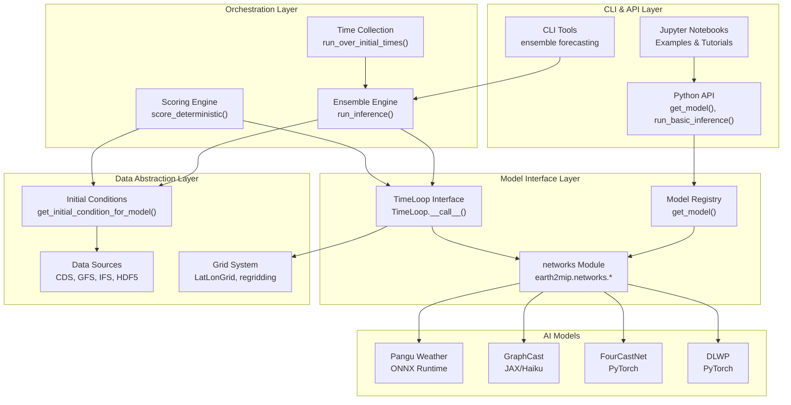
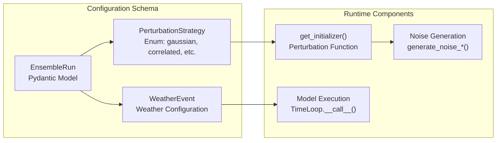
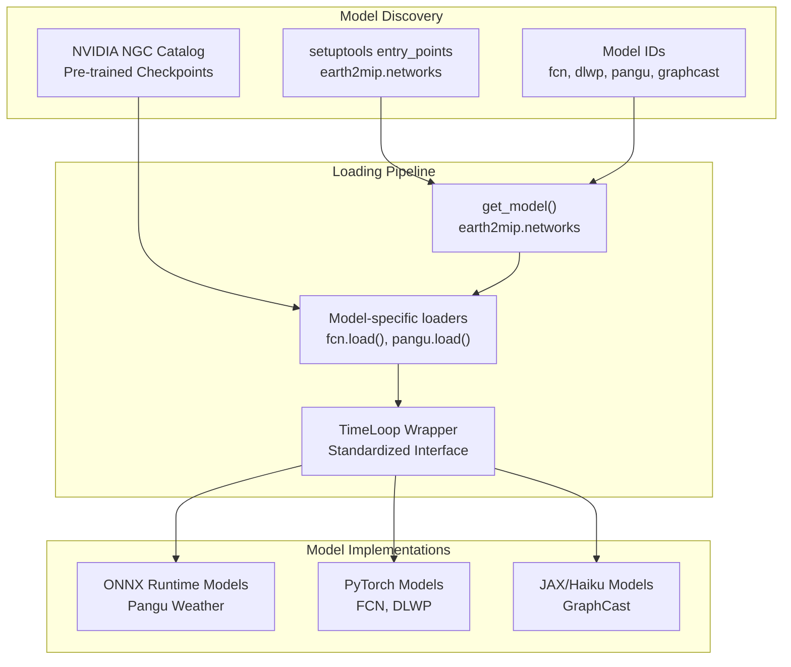
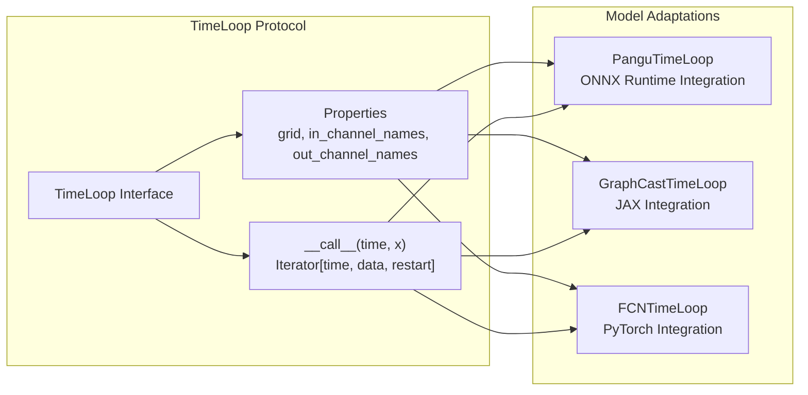
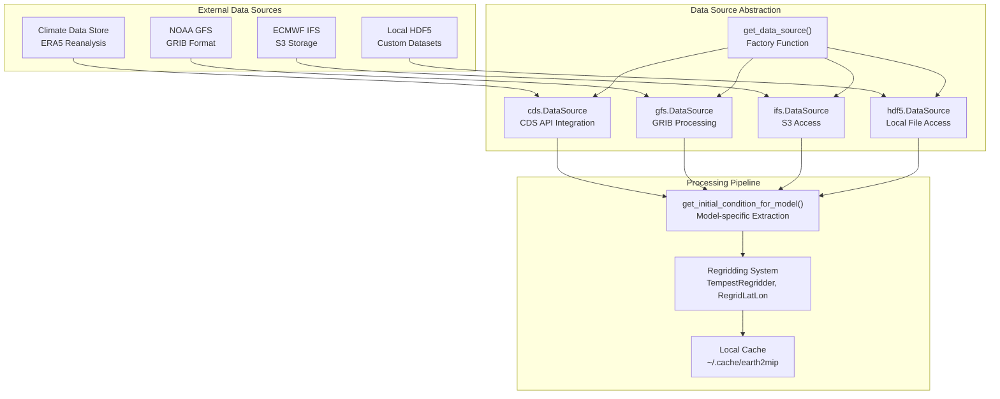
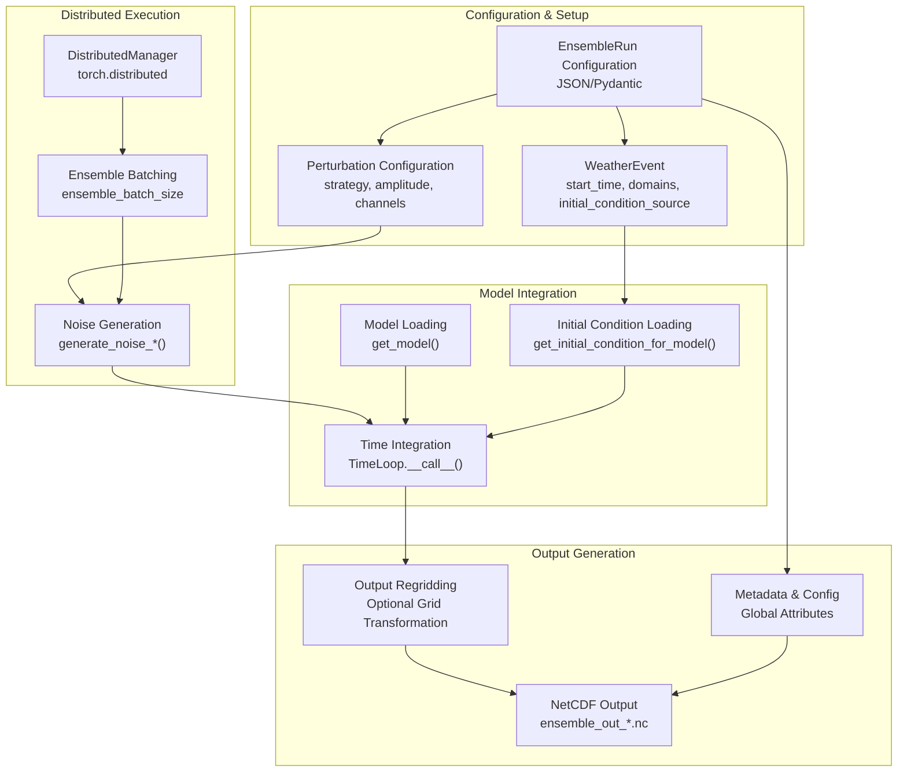

<!-- source: DeepWiki mcp.deepwiki.com · repo NVIDIA/earth2mip · page 1 Overview · fetched 2026-10-26 -->

# Overview

Relevant source files

The following files were used as context for generating this wiki page:

- [Makefile](Makefile)
- [README.md](README.md)
- [earth2mip/ensemble_utils.py](earth2mip/ensemble_utils.py)
- [earth2mip/inference_ensemble.py](earth2mip/inference_ensemble.py)
- [earth2mip/netcdf.py](earth2mip/netcdf.py)
- [earth2mip/schema.py](earth2mip/schema.py)
- [pyproject.toml](pyproject.toml)
- [requirements.txt](requirements.txt)

Earth-2 Model Intercomparison Project (MIP) is a Python-based AI framework that enables climate researchers and scientists to explore and experiment with AI models for weather and climate forecasting. The framework provides a unified interface for running inference with pre-trained model checkpoints, scoring model performance using standard meteorological metrics, and facilitating intercomparison between different AI weather models.

This document provides a high-level architectural overview of the Earth-2 MIP codebase and its major systems. For detailed installation instructions, see [Installation](#2.1). For specific model usage examples, see [Quick Start Examples](#2.2). For in-depth information about individual systems, see the relevant sections on [Model Management](#4), [Data Systems](#5), [Inference and Forecasting](#6), and [Model Evaluation](#7).

## System Architecture

Earth-2 MIP follows a layered architecture that separates concerns between model management, data handling, orchestration, and evaluation. The framework is designed around several key abstractions that enable different AI weather models to work together through common interfaces.

### Core Abstraction Layers

The architecture enables users to interact with AI weather models through multiple interfaces while maintaining consistency in data handling and model execution. The `TimeLoop` interface serves as the central abstraction that standardizes how different AI models are called and integrated into workflows.

**Sources:** [earth2mip/inference_ensemble.py:35-51](), [README.md:13-25](), [pyproject.toml:91-101]()

### Configuration and Schema System

Earth-2 MIP uses a structured configuration system based on Pydantic models to manage complex forecasting workflows:

The `EnsembleRun` schema defines ensemble forecasting parameters including model selection, perturbation strategies, simulation length, and output configuration. This configuration-driven approach enables reproducible experiments and flexible workflow customization.

**Sources:** [earth2mip/schema.py:81-136](), [earth2mip/inference_ensemble.py:208-271]()

## Model Integration Framework  

The framework's plugin architecture allows seamless integration of diverse AI weather models through standardized interfaces:

### Model Registry and Loading System

The `get_model()` function serves as the central entry point for model loading, using setuptools entry points to discover available models and their loading functions. Each model type implements a loader function that returns a `TimeLoop`-compatible interface.

**Sources:** [earth2mip/networks/__init__.py](), [pyproject.toml:91-101](), [earth2mip/inference_ensemble.py:48]()

### TimeLoop Interface Standardization

The `TimeLoop` interface provides a standardized way to interact with AI weather models regardless of their underlying implementation framework. Models expose grid information, channel names, and a callable interface that yields time-stepped forecasts.

**Sources:** [earth2mip/time_loop.py](), [earth2mip/inference_ensemble.py:120-156]()

## Data Flow and Processing Pipeline

Earth-2 MIP implements a flexible data pipeline that can access meteorological data from multiple sources and transform it for model consumption:

### Data Source Architecture

The data source abstraction enables consistent access to heterogeneous meteorological data providers. The `get_initial_condition_for_model()` function handles model-specific data requirements including channel selection, temporal alignment, and spatial regridding.

**Sources:** [earth2mip/initial_conditions.py](), [earth2mip/inference_ensemble.py:327-334]()

## Ensemble Forecasting Workflow

The ensemble forecasting system represents the framework's most sophisticated orchestration capability, supporting distributed computation and multiple perturbation strategies:

### Ensemble Execution Pipeline

The `run_inference()` function orchestrates the complete ensemble workflow, from configuration parsing through distributed execution to output generation. It supports multiple perturbation strategies including Gaussian noise, correlated noise, bred vectors, and spherical Gaussian random fields.

**Sources:** [earth2mip/inference_ensemble.py:301-408](), [earth2mip/ensemble_utils.py:186-232]()

Earth-2 MIP's architecture enables climate researchers to focus on scientific questions rather than implementation details, providing a robust foundation for AI weather model experimentation and evaluation.

---

