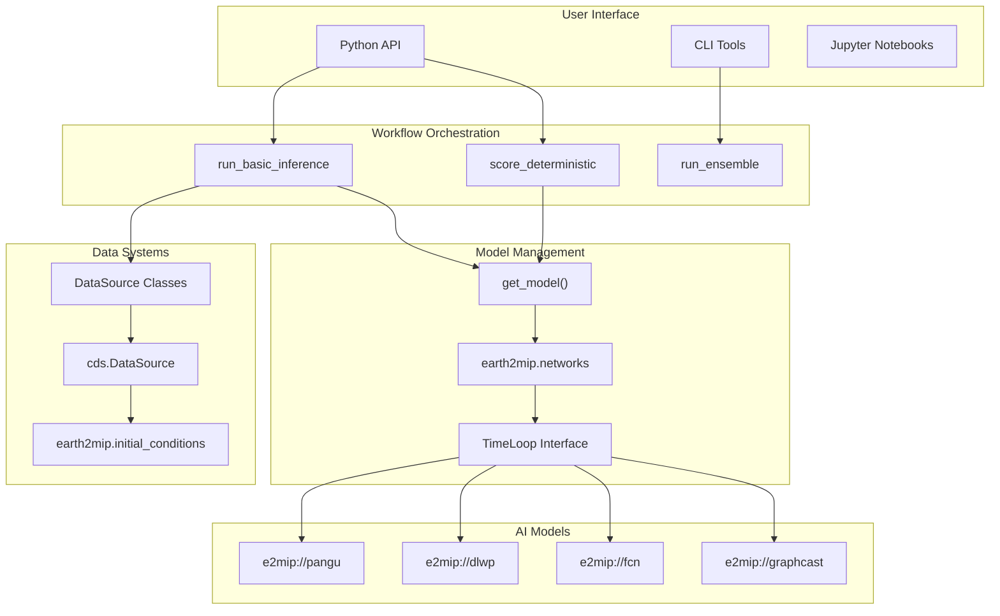
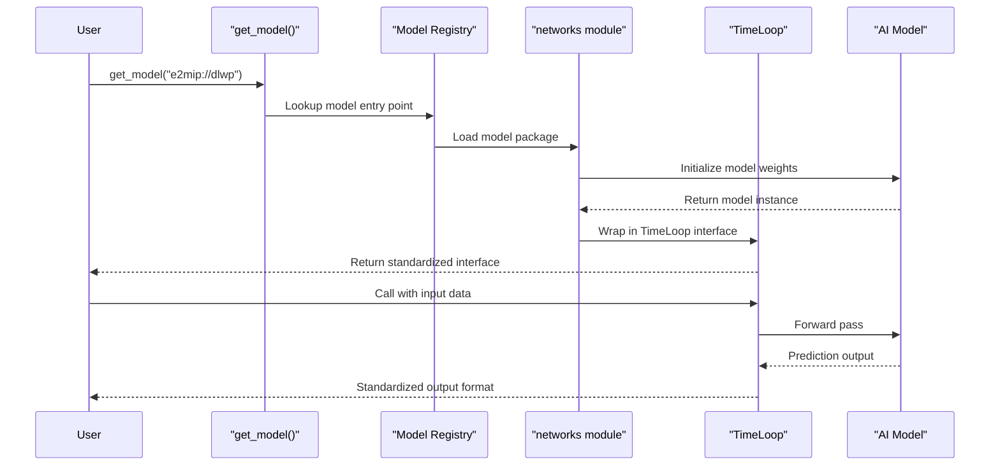

<!-- source: DeepWiki mcp.deepwiki.com · repo NVIDIA/earth2mip · page 2 Getting Started · fetched 2026-10-26 -->

# Getting Started

<details>
<summary>Relevant source files</summary>

The following files were used as context for generating this wiki page:

- [CONTRIBUTING.md](CONTRIBUTING.md)
- [Makefile](Makefile)
- [README.md](README.md)
- [docs/.env](docs/.env)
- [docs/_static/NVIDIA-Logo-V-ForScreen-ForDarkBG.png](docs/_static/NVIDIA-Logo-V-ForScreen-ForDarkBG.png)
- [docs/_static/NVIDIA-Logo-V-ForScreen-ForLightBG.png](docs/_static/NVIDIA-Logo-V-ForScreen-ForLightBG.png)
- [docs/_static/favicon.ico](docs/_static/favicon.ico)
- [pyproject.toml](pyproject.toml)
- [requirements.txt](requirements.txt)

</details>


This page provides an overview of Earth-2 MIP (Model Intercomparison Project) and guides you through the initial steps to start using the framework. It covers the core concepts, system architecture, and points you to detailed installation and usage instructions.

For detailed installation procedures including dependencies and environment setup, see [Installation](#2.1). For hands-on examples and tutorials, see [Quick Start Examples](#2.2).

## What is Earth-2 MIP?

Earth-2 MIP is a Python framework that enables climate researchers and scientists to explore and experiment with AI models for weather and climate forecasting. The framework provides:

- **Unified Model Interface**: A standardized way to load and run different AI weather models through the `TimeLoop` abstraction
- **Ensemble Forecasting**: Tools for running probabilistic forecasts with uncertainty quantification
- **Model Evaluation**: Comprehensive scoring and evaluation metrics for model skill assessment
- **Data Integration**: Seamless access to multiple meteorological data sources (ERA5, GFS, IFS, etc.)

The framework bridges the gap between ML model developers and domain experts by providing consistent interfaces and reference workflows for model comparison and evaluation.

**Sources**: [README.md:13-25](), [pyproject.toml:11-12]()

## Core Architecture Overview

Earth-2 MIP follows a layered architecture that separates concerns between model management, data handling, and workflow orchestration:



**Core Workflow Components**

| Component | Purpose | Key Classes/Functions |
|-----------|---------|----------------------|
| Model Registry | Load and manage AI models | `get_model()`, `earth2mip.networks` |
| TimeLoop Interface | Unified model execution | `TimeLoop`, `TimeStepper` |
| Data Sources | Initial conditions and validation data | `DataSource`, `cds.DataSource` |
| Inference Engines | Run forecasts and ensembles | `run_basic_inference`, `run_ensemble` |
| Scoring Systems | Model evaluation and metrics | `score_deterministic`, scoring modules |

**Sources**: [README.md:49-71](), [pyproject.toml:91-101]()

## Model Loading and Execution Flow

The following diagram shows how models are discovered, loaded, and executed through the registry system:



**Model Registry System**

The framework uses Python entry points to register and discover models. Available models include:

| Model ID | Architecture | Entry Point | Size |
|----------|-------------|-------------|------|
| `e2mip://fcn` | FourCastNet (AFNO) | `earth2mip.networks.fcn:load` | 300MB |
| `e2mip://dlwp` | Deep Learning Weather Prediction | `earth2mip.networks.dlwp:load` | 50MB |
| `e2mip://pangu` | Pangu Weather (Vision Transformer) | `earth2mip.networks.pangu:load` | 2GB |
| `e2mip://graphcast` | GraphCast (Graph Neural Network) | `earth2mip.networks.graphcast:load_time_loop` | 145MB |

**Sources**: [README.md:116-129](), [pyproject.toml:91-101]()

## Key Concepts

### TimeLoop Interface

All AI models in Earth-2 MIP implement the `TimeLoop` interface, which provides:
- Standardized input/output formats (xarray datasets)
- Consistent channel naming and grid specifications  
- Unified time stepping and forecast length control

### Data Sources

The framework abstracts data access through `DataSource` classes that handle:
- Automatic data downloading and caching
- Grid regridding to match model requirements
- Temporal alignment and preprocessing

### Ensemble Workflows

Earth-2 MIP supports probabilistic forecasting through:
- Perturbation strategies (Gaussian, bred vectors, etc.)
- Distributed ensemble execution
- Comprehensive uncertainty quantification

**Sources**: [README.md:56-61](), [README.md:75-83]()

## Basic Usage Pattern

The typical workflow follows this pattern:

```python
# 1. Load a model
from earth2mip.networks import get_model
time_loop = get_model("e2mip://dlwp", device="cuda:0")

# 2. Set up data source  
from earth2mip.initial_conditions import cds
data_source = cds.DataSource(time_loop.in_channel_names)

# 3. Run inference
from earth2mip.inference_ensemble import run_basic_inference
ds = run_basic_inference(
    time_loop, 
    n=10, 
    data_source=data_source, 
    time=datetime.datetime(2018, 1, 1)
)

# 4. Evaluate results
from earth2mip.inference_medium_range import score_deterministic
scores = score_deterministic(
    time_loop,
    data_source=data_source,
    n=10,
    initial_times=[datetime.datetime(2018, 1, 1)]
)
```

**Sources**: [README.md:54-103]()

## Next Steps

1. **Installation**: Follow the detailed setup instructions in [Installation](#2.1) to configure your environment with the required dependencies.

2. **Quick Start**: Work through the practical examples in [Quick Start Examples](#2.2) to run your first weather forecasts and model evaluations.

3. **Model Management**: Learn about loading and using different AI models in [Model Management](#4).

4. **Data Systems**: Understand data sources and initial conditions in [Data Systems](#5).

5. **Advanced Workflows**: Explore ensemble forecasting and evaluation in [Inference and Forecasting](#6) and [Model Evaluation and Scoring](#7).

## System Requirements

- **Python**: 3.10, 3.11, or 3.12
- **GPU**: CUDA-compatible GPU recommended for AI model inference
- **Storage**: Varies by model (50MB to 2GB+ for model weights)
- **Memory**: 8GB+ RAM recommended for ensemble workflows

**Sources**: [pyproject.toml:13](), [README.md:8-9](), [pyproject.toml:15-54]()

---

