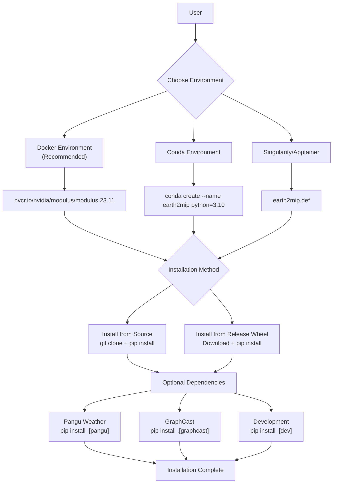
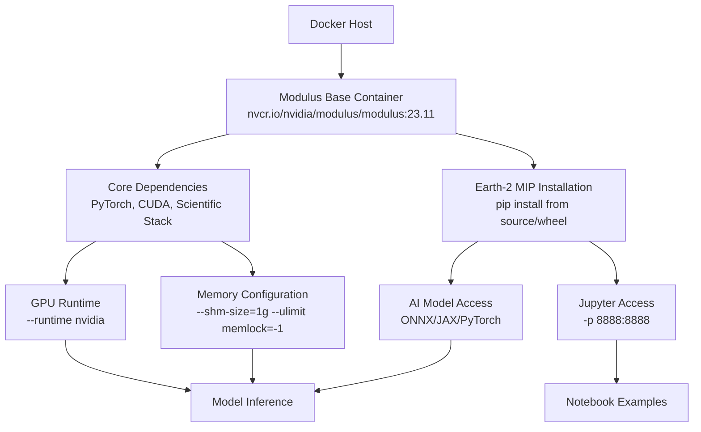
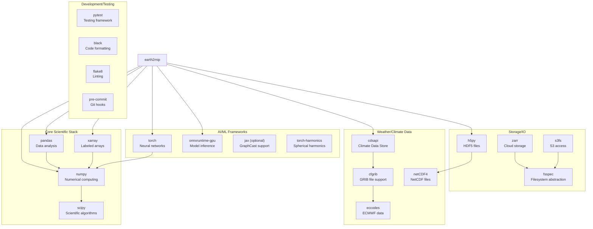
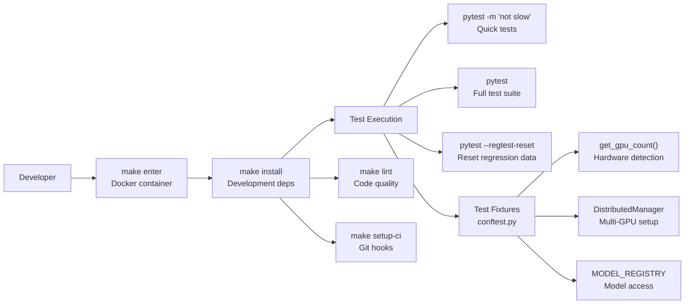

<!-- source: DeepWiki mcp.deepwiki.com · repo NVIDIA/earth2mip · page 2.1 Installation · fetched 2026-10-26 -->

# Installation

<details>
<summary>Relevant source files</summary>

The following files were used as context for generating this wiki page:

- [.licenses/summary_docker.md](.licenses/summary_docker.md)
- [.licenses/summary_pip.md](.licenses/summary_pip.md)
- [CONTRIBUTING.md](CONTRIBUTING.md)
- [conftest.py](conftest.py)
- [docs/.env](docs/.env)
- [docs/_static/NVIDIA-Logo-V-ForScreen-ForDarkBG.png](docs/_static/NVIDIA-Logo-V-ForScreen-ForDarkBG.png)
- [docs/_static/NVIDIA-Logo-V-ForScreen-ForLightBG.png](docs/_static/NVIDIA-Logo-V-ForScreen-ForLightBG.png)
- [docs/_static/favicon.ico](docs/_static/favicon.ico)
- [docs/userguide/install.md](docs/userguide/install.md)
- [earth2mip/datasets/era5/__init__.py](earth2mip/datasets/era5/__init__.py)
- [earth2mip/datasets/hindcast.py](earth2mip/datasets/hindcast.py)
- [earth2mip/initial_conditions/hdf5.py](earth2mip/initial_conditions/hdf5.py)

</details>


This document provides comprehensive installation instructions for Earth-2 MIP, including environment setup, dependency management, and configuration options. Earth-2 MIP is a Python framework for AI weather and climate modeling that requires specific dependencies and environment configuration for optimal performance.

For information about using Earth-2 MIP after installation, see [Quick Start Examples](#2.2). For contributing to the codebase, see [Contributing Guidelines](#9.1).

## Installation Overview

Earth-2 MIP is distributed as a Python package that can be installed from source or release wheels. The framework requires a dedicated environment due to its complex dependency stack and integration with multiple AI model formats (ONNX, JAX, PyTorch).



Sources: [docs/userguide/install.md:1-178]()

## Installation Methods

### Install from Source (Recommended)

The preferred installation method is from source, which ensures compatibility with the latest features and fixes:

```bash
git clone git@github.com:NVIDIA/earth2mip.git
cd earth2mip && pip install .
```

This method downloads the complete repository including examples, documentation, and development tools.

### Install from Release Wheel

For production environments, pre-built wheels are available from GitHub releases:

```bash
curl -L https://github.com/NVIDIA/earth2mip/releases/download/v0.1.0/earth2mip-0.1.0-py3-none-any.whl > earth2mip-0.1.0-py3-none-any.whl
pip install earth2mip-0.1.0-py3-none-any.whl
```

### PyPI Status

Earth-2 MIP is not currently available on PyPI. Use source or wheel installation methods in the interim.

Sources: [docs/userguide/install.md:8-30]()

## Environment Setup

### Docker Environment (Recommended)

Docker provides the most consistent environment and is recommended for both development and production use. Earth-2 MIP leverages the Modulus container ecosystem:

```bash
docker run --rm --shm-size=1g --ulimit memlock=-1 --ulimit stack=67108864 --runtime nvidia -p 8888:8888 -it nvcr.io/nvidia/modulus/modulus:23.11
```

The port mapping (`-p 8888:8888`) is required for Jupyter Lab access when running notebook examples. The `--runtime nvidia` flag enables GPU access for AI model inference.



Sources: [docs/userguide/install.md:66-86]()

### Conda Environment

For users who prefer Conda or cannot use Docker:

```bash
conda create --name earth2mip python=3.10
conda activate earth2mip
git clone git@github.com:NVIDIA/earth2mip.git
cd earth2mip && pip install .
```

For Jupyter notebook support, create an IPython kernel:

```bash
pip install ipykernel
python -m ipykernel install --user --name=earth2mip-kernel
```

### Singularity/Apptainer Environment

High-performance computing environments often use Singularity or Apptainer. A definition file is provided for building containers:

```dockerfile
Bootstrap: docker
FROM: nvcr.io/nvidia/modulus/modulus:23.11

%files
    earth2mip/* /workspace/earth2mip/earth2mip/
    MANIFEST.in /workspace/earth2mip/MANIFEST.in
    setup.cfg /workspace/earth2mip/setup.cfg
    setup.py /workspace/earth2mip/setup.py
    README.md /workspace/earth2mip/README.md
    LICENSE.txt /workspace/earth2mip/LICENSE.txt
    examples/README.md /workspace/earth2mip/examples/README.md

%post
    cd /workspace/earth2mip && pip3 install .
    pip3 install cartopy

%environment
    export HOME=/workspace/earth2mip/

%runscript
    cd ~
```

Build and run the container:

```bash
singularity build --fakeroot --sandbox earth2mip.sif earth2mip.def
singularity exec -B ${PWD}:/workspace/earth2mip --nv earth2mip.sif bash -c 'cd ~'
```

Sources: [docs/userguide/install.md:87-143]()

## Dependency Architecture

Earth-2 MIP has a complex dependency stack that supports multiple AI frameworks and meteorological data sources:



Sources: [.licenses/summary_pip.md:1-124](), [.licenses/summary_docker.md:1-300]()

## Optional Dependencies

### Model-Specific Dependencies

Different AI weather models require specific optional dependencies:

**Pangu Weather Support:**
```bash
pip install .[pangu]
```

**GraphCast Support:**
```bash
pip install .[graphcast]
pip install -r requirements.txt
```

**Development Dependencies:**
```bash
pip install .[dev]
```

**Documentation Building:**
```bash
pip install .[docs]
```

### Testing and Development Setup

For contributors and developers, additional setup is required:

```bash
# Enter development container
make enter

# Install development dependencies
make install

# Run test suite
pytest

# Run quick tests only
pytest -m 'not slow'

# Setup pre-commit hooks
make setup-ci

# Run linting
make lint
```

The test configuration is managed through `conftest.py`, which sets up fixtures for GPU detection, distributed computing, and model registry access:



Sources: [CONTRIBUTING.md:40-72](), [conftest.py:27-55]()

## Configuration and Verification

After installation, verify the setup by checking core imports and dependencies:

```python
import earth2mip
from earth2mip import config
from earth2mip.initial_conditions import cds, gfs, ifs
from earth2mip.networks import get_model
```

The configuration system manages environment variables and registry access. Key configuration points include:

- `MODEL_REGISTRY`: Path to model registry for accessing pre-trained models
- `ERA5_HDF5`: Path to ERA5 reanalysis data for initial conditions
- GPU availability and CUDA configuration for model inference

For data source configuration, Earth-2 MIP supports multiple initial condition providers through a unified interface defined in the `earth2mip.initial_conditions` module.

Sources: [earth2mip/initial_conditions/hdf5.py:28-31](), [conftest.py:24-34]()

---

