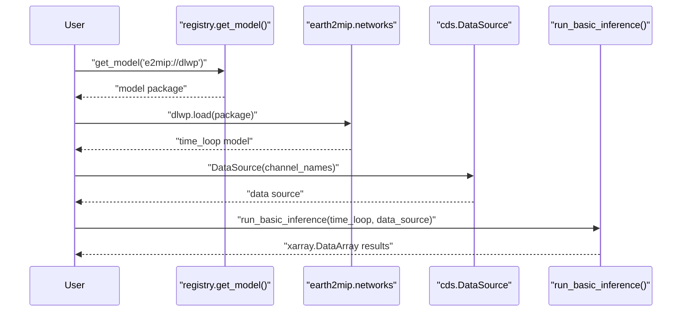
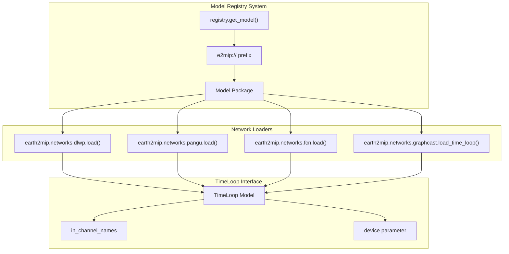
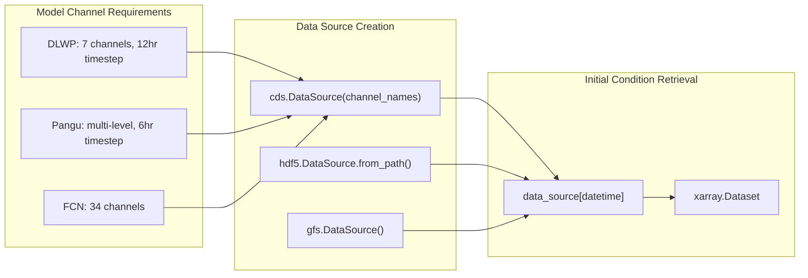
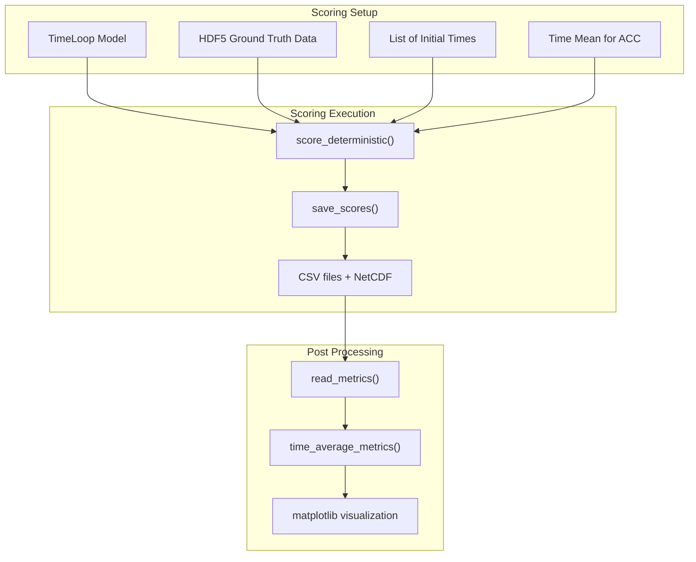

<!-- source: DeepWiki mcp.deepwiki.com · repo NVIDIA/earth2mip · page 2.2 Quick Start Examples · fetched 2026-10-26 -->

# Quick Start Examples

<details>
<summary>Relevant source files</summary>

The following files were used as context for generating this wiki page:

- [.gitignore](.gitignore)
- [Makefile](Makefile)
- [README.md](README.md)
- [examples/.env](examples/.env)
- [examples/02_model_comparison.py](examples/02_model_comparison.py)
- [examples/03_model_scoring.py](examples/03_model_scoring.py)
- [examples/README.rst](examples/README.rst)
- [pyproject.toml](pyproject.toml)
- [requirements.txt](requirements.txt)

</details>


This page demonstrates essential Earth-2 MIP workflows through practical examples. It covers model loading, basic inference, and scoring using the Python API. These examples provide the foundation for more advanced workflows covered in subsequent sections.

For installation instructions, see [Installation](#2.1). For detailed information about the model interface, see [Model Interface (TimeLoop)](#3.2). For comprehensive scoring workflows, see [Model Evaluation and Scoring](#7).

## Basic Model Loading and Inference

Earth-2 MIP provides a unified interface for loading and running different AI weather models through the `earth2mip.networks` module and model registry system.

### Simple Inference Workflow

The most basic workflow involves three steps: loading a model, setting up a data source, and running inference.

**Basic Inference Pattern**



Sources: [README.md:49-71](), [examples/02_model_comparison.py:114-174]()

### Code Example from README

The README demonstrates a complete basic inference workflow:

```python
import datetime
from earth2mip.networks import get_model
from earth2mip.initial_conditions import cds
from earth2mip.inference_ensemble import run_basic_inference

time_loop = get_model("e2mip://dlwp", device="cuda:0")
data_source = cds.DataSource(time_loop.in_channel_names)
ds = run_basic_inference(
    time_loop, 
    n=10, 
    data_source=data_source, 
    time=datetime.datetime(2018, 1, 1)
)
```

This pattern uses:
- `registry.get_model()` or `networks.get_model()` for model loading
- `cds.DataSource` for initial conditions from Climate Data Store
- `run_basic_inference()` for deterministic forecasting

Sources: [README.md:54-71]()

## Model Loading Architecture

Earth-2 MIP uses a plugin-based architecture where models are registered and loaded through a common interface.

**Model Registry and Loading System**



Sources: [README.md:59-67](), [examples/02_model_comparison.py:114-130](), [pyproject.toml:91-101]()

## Data Source Configuration

Different models require different input channels and timesteps. Earth-2 MIP handles this through model-specific data source configuration.

### Data Source Pattern



Sources: [examples/02_model_comparison.py:137-145](), [examples/03_model_scoring.py:113-122]()

## Model Comparison Workflow

The model comparison example shows how to run multiple models with the same initial conditions and compare results.

### Multi-Model Inference Pattern

From the model comparison example:

| Step | DLWP | Pangu |
|------|------|-------|
| **Model Loading** | `dlwp.load(package)` | `pangu.load(package)` |
| **Data Source** | `cds.DataSource(dlwp_model.in_channel_names)` | `cds.DataSource(pangu_model.in_channel_names)` |
| **Inference** | `run_basic_inference(dlwp_model, n=24)` | `run_basic_inference(pangu_model, n=24)` |
| **Output** | NetCDF file with 12hr timesteps | NetCDF file with 6hr timesteps |

The key difference is that models have different timestep requirements:
- DLWP: 12-hour native timestep, outputs every 6 hours
- Pangu: 6-hour native timestep

Sources: [examples/02_model_comparison.py:123-174]()

## Model Scoring Workflow

The scoring example demonstrates evaluation against ground truth data using metrics like RMSE and ACC.

**Scoring Workflow Components**



Sources: [examples/03_model_scoring.py:125-189]()

### Scoring Function Usage

The scoring workflow uses `inference_medium_range.score_deterministic()` and related utilities:

```python
from earth2mip.inference_medium_range import save_scores, time_average_metrics

scores = save_scores(
    model,
    n=28,  # forecast length
    initial_times=initial_times,
    data_source=datasource,
    time_mean=datasource.time_means,
    output_directory=output_dir,
)
```

This produces datasets with dimensions `(lead_time, channel)` containing RMSE and ACC metrics.

Sources: [examples/03_model_scoring.py:139-160](), [README.md:75-103]()

## Common Patterns and Best Practices

### Model Registry Usage

All examples use the `e2mip://` prefix for built-in models:

- `e2mip://dlwp` - Deep Learning Weather Prediction
- `e2mip://pangu` - Pangu Weather (hierarchical 6+24hr)
- `e2mip://fcn` - FourCastNet
- `e2mip://graphcast` - GraphCast

### Device Configuration

Models support GPU acceleration through the device parameter:
```python
time_loop = get_model("e2mip://dlwp", device="cuda:0")
```

### Output Handling

All inference functions return `xarray.DataArray` objects with standardized dimensions:
- `time`: forecast lead times
- `channel`: meteorological variables  
- `lat`, `lon`: spatial coordinates
- `history`: ensemble member (for ensemble forecasts)

### File I/O Patterns

Examples consistently use NetCDF for output storage:
```python
ds.to_netcdf(f"{output_dir}/model_output.nc")
```

Sources: [examples/02_model_comparison.py:161-173](), [examples/03_model_scoring.py:188](), [README.md:59-71]()

---

