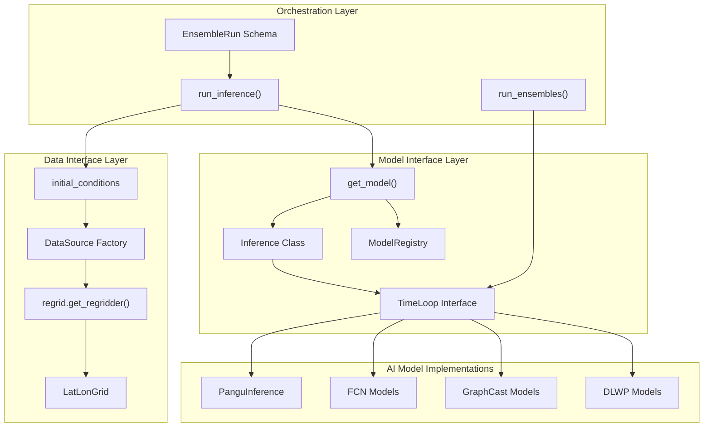
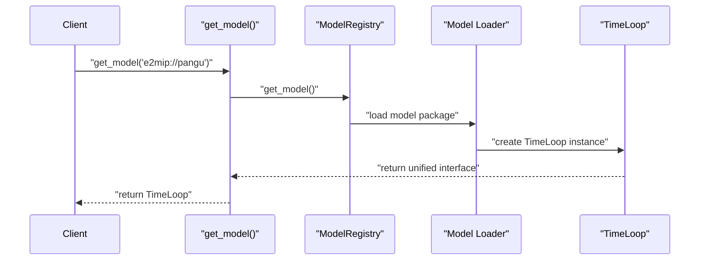
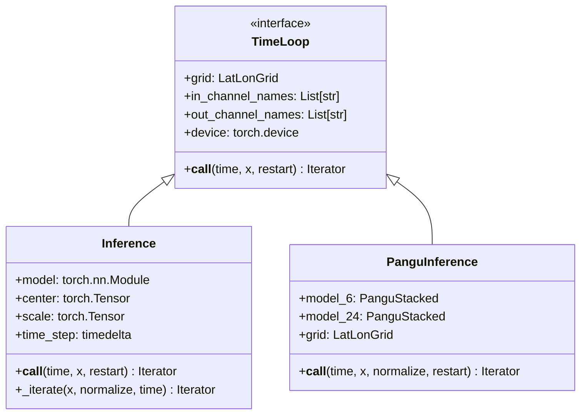
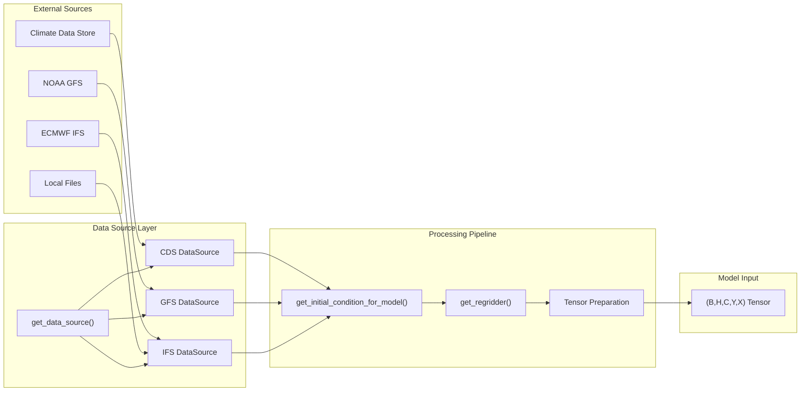
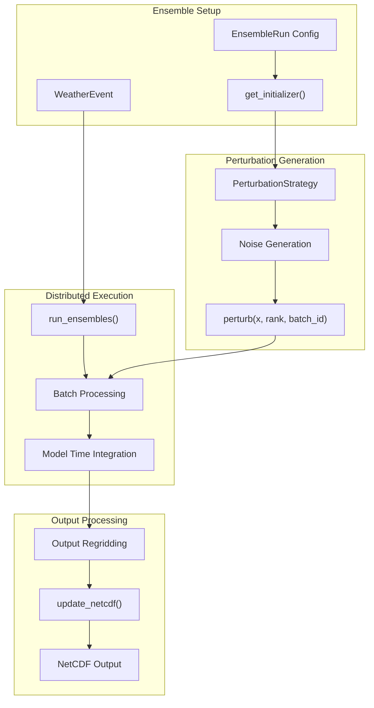
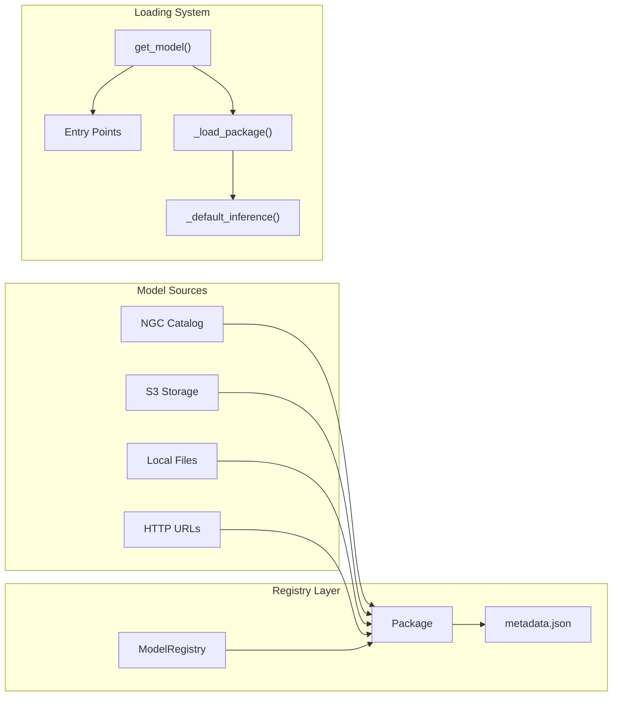
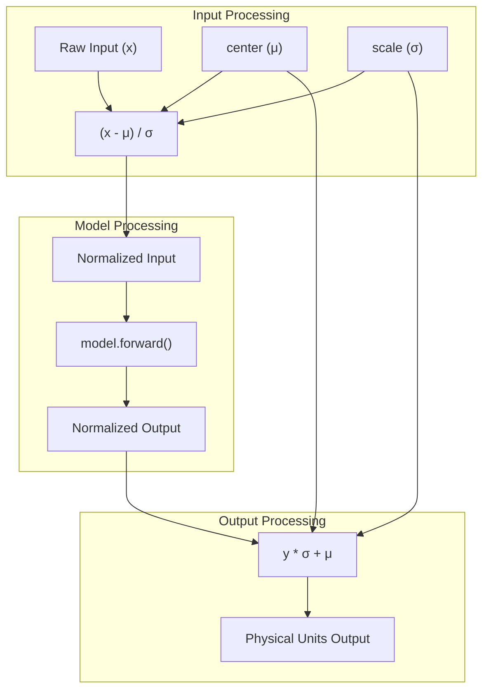

<!-- source: DeepWiki mcp.deepwiki.com · repo NVIDIA/earth2mip · page 3 Core Architecture · fetched 2026-10-26 -->

# Core Architecture

Relevant source files

The following files were used as context for generating this wiki page:

- [earth2mip/ensemble_utils.py](earth2mip/ensemble_utils.py)
- [earth2mip/inference_ensemble.py](earth2mip/inference_ensemble.py)
- [earth2mip/netcdf.py](earth2mip/netcdf.py)
- [earth2mip/networks/__init__.py](earth2mip/networks/__init__.py)
- [earth2mip/networks/pangu.py](earth2mip/networks/pangu.py)
- [earth2mip/schema.py](earth2mip/schema.py)

This page describes the fundamental design patterns, abstractions, and architectural components that form the foundation of Earth-2 MIP. It covers the core interfaces that enable unified access to diverse AI weather models, the orchestration systems for running ensemble forecasts, and the data flow patterns that connect external data sources to model execution.

For detailed information about specific model implementations, see [Supported AI Models](#4.3). For ensemble forecasting workflows, see [Ensemble Forecasting](#6.1). For data source configuration, see [Data Sources](#5.2).

## System Overview

Earth-2 MIP is built around a layered architecture that separates concerns between model management, data handling, and forecast orchestration. The core design enables different AI weather models (ONNX, JAX, PyTorch-based) to work seamlessly together through standardized interfaces.

### Core Architecture Diagram

Sources: [earth2mip/inference_ensemble.py:35](), [earth2mip/networks/__init__.py:44](), [earth2mip/schema.py:81]()

## Core Design Patterns

### Plugin Architecture

Earth-2 MIP uses a plugin-based architecture where AI weather models are loaded dynamically through entry points and model registries. The `get_model` function serves as the central factory that can instantiate any registered model type.

The model loading process abstracts away the differences between model architectures (ONNX, JAX, PyTorch) and provides a unified `TimeLoop` interface for time integration.

Sources: [earth2mip/networks/__init__.py:312-351]()

### TimeLoop Abstraction

The `TimeLoop` interface is the cornerstone abstraction that provides a unified way to run time integration for any AI weather model. All models, regardless of their underlying framework, implement this interface.

The `TimeLoop` interface standardizes model execution by requiring all implementations to:
- Accept initial conditions as tensors with shape `(batch, history, channel, lat, lon)`
- Yield `(time, output, restart)` tuples for each forecast step
- Provide metadata about grids and channel names

Sources: [earth2mip/time_loop.py](), [earth2mip/networks/__init__.py:121-251](), [earth2mip/networks/pangu.py:168-258]()

### Configuration-Driven Execution

Earth-2 MIP uses Pydantic schemas to define type-safe configurations for ensemble runs. The `EnsembleRun` schema encapsulates all parameters needed for a forecast.

| Configuration Aspect | Schema Class | Key Fields |
|----------------------|--------------|------------|
| Ensemble Parameters | `EnsembleRun` | `ensemble_members`, `perturbation_strategy`, `noise_amplitude` |
| Model Metadata | `Model` | `grid`, `in_channels_names`, `time_step`, `entrypoint` |
| Weather Events | `WeatherEvent` | `start_time`, `initial_condition_source`, `domains` |
| Perturbation Strategy | `PerturbationStrategy` | `gaussian`, `correlated`, `bred_vector`, `spherical_grf` |

Sources: [earth2mip/schema.py:81-136](), [earth2mip/schema.py:54-71]()

## Data Flow Architecture

### Initial Conditions Pipeline

The data flow for initial conditions follows a standardized pipeline that transforms external meteorological data into model-ready tensors.

The `get_initial_condition_for_model` function handles the complexity of:
- Selecting appropriate channels for the target model
- Regridding data to match model grid requirements  
- Normalizing and formatting data as PyTorch tensors
- Managing time history for models that require it

Sources: [earth2mip/initial_conditions.py](), [earth2mip/inference_ensemble.py:282](), [earth2mip/inference_ensemble.py:334]()

### Ensemble Orchestration Flow

The ensemble forecasting system coordinates model execution across multiple ensemble members with perturbations.

The `run_ensembles` function manages:
- Distributed processing across multiple GPU ranks
- Batching of ensemble members for memory efficiency
- Perturbation application through the `perturb` function
- Time integration using the model's `TimeLoop` interface
- Output regridding and NetCDF file writing

Sources: [earth2mip/inference_ensemble.py:68-164](), [earth2mip/inference_ensemble.py:208-271]()

## Integration Points

### Model Registry System

The model registry provides a unified interface for discovering and loading models from various sources including NGC (NVIDIA GPU Cloud), local files, and S3 storage.

Model URIs are resolved through different schemes:
- `e2mip://model_name` - Built-in models with entry points
- `ngc://org/model:version` - NGC catalog models  
- `s3://bucket/path` - S3-hosted models
- `file:///local/path` - Local filesystem models

Sources: [earth2mip/networks/__init__.py:341-351](), [earth2mip/model_registry.py]()

### Normalization and Scaling

The `Inference` class handles data normalization and denormalization automatically using pre-computed statistics stored with each model.

The normalization parameters are loaded from `global_means.npy` and `global_stds.npy` files stored in the model package and registered as PyTorch buffers for automatic device management.

Sources: [earth2mip/networks/__init__.py:170-179](), [earth2mip/networks/__init__.py:232-250](), [earth2mip/networks/__init__.py:264-266]()

---

