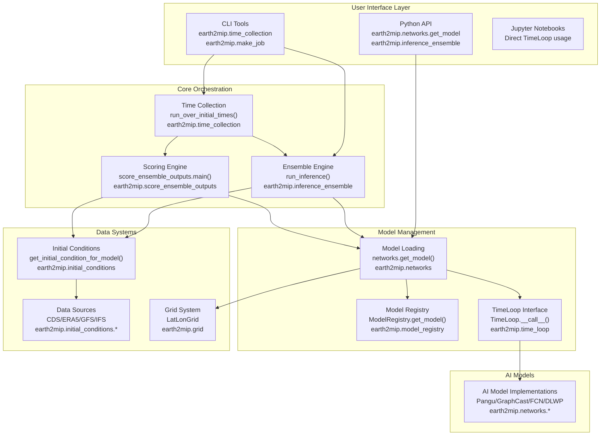
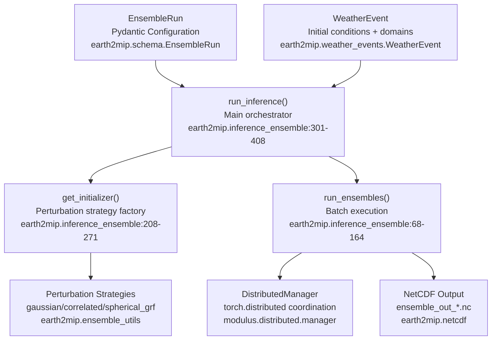
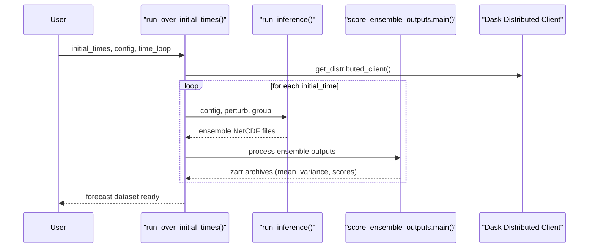
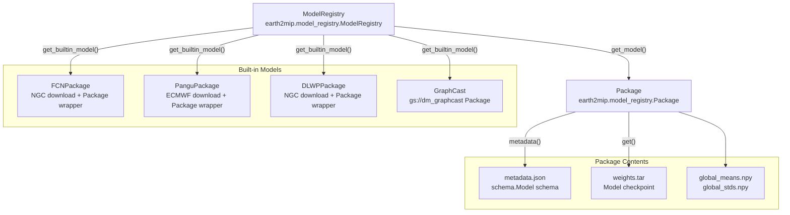
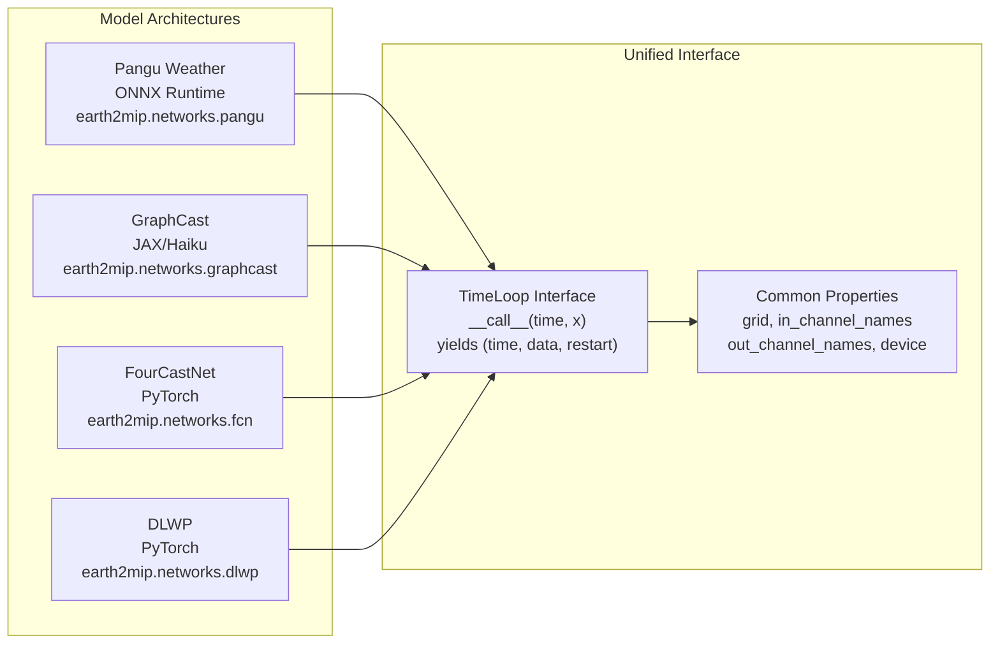
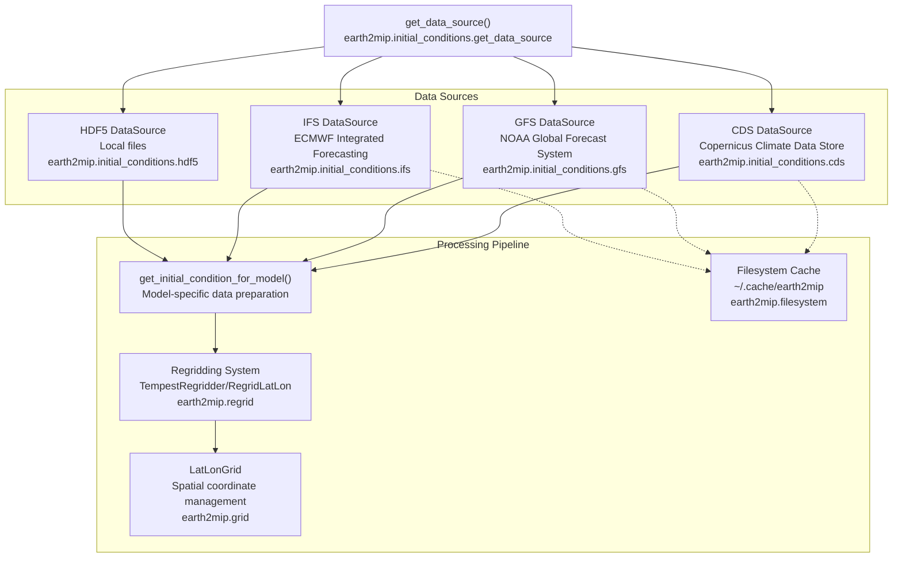
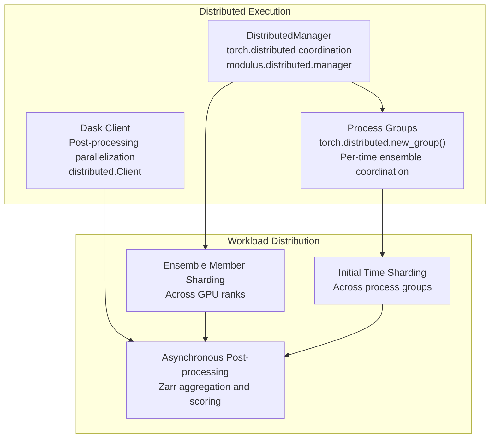

<!-- source: DeepWiki mcp.deepwiki.com · repo NVIDIA/earth2mip · page 3.1 System Overview · fetched 2026-10-26 -->

# System Overview

Relevant source files

The following files were used as context for generating this wiki page:

- [CHANGELOG.md](CHANGELOG.md)
- [earth2mip/_cli_utils.py](earth2mip/_cli_utils.py)
- [earth2mip/_config.py](earth2mip/_config.py)
- [earth2mip/ensemble_utils.py](earth2mip/ensemble_utils.py)
- [earth2mip/inference_ensemble.py](earth2mip/inference_ensemble.py)
- [earth2mip/model_registry.py](earth2mip/model_registry.py)
- [earth2mip/netcdf.py](earth2mip/netcdf.py)
- [earth2mip/schema.py](earth2mip/schema.py)
- [earth2mip/score_ensemble_outputs.py](earth2mip/score_ensemble_outputs.py)
- [earth2mip/time_collection.py](earth2mip/time_collection.py)
- [earth2mip/weather_events.py](earth2mip/weather_events.py)
- [test/_regtest_outputs/test_time_collection.test_run_over_initial_times.out](test/_regtest_outputs/test_time_collection.test_run_over_initial_times.out)
- [test/test_time_collection.py](test/test_time_collection.py)

This document provides a high-level architectural overview of Earth-2 MIP, focusing on how the major systems interact to enable AI-driven weather forecasting. This covers the core orchestration layer, model management infrastructure, and data processing systems that form the foundation of the framework.

For detailed information about specific model implementations, see [Supported AI Models](#4.3). For data source configuration and usage, see [Data Sources](#5.2). For detailed scoring and evaluation methods, see [Model Evaluation and Scoring](#7).

## Architectural Overview

Earth-2 MIP follows a layered architecture that separates user interfaces, orchestration logic, model management, and data handling concerns. The system is designed to support distributed ensemble forecasting across heterogeneous AI weather models while providing unified interfaces for configuration and execution.

**Sources:** [earth2mip/inference_ensemble.py:1-412](), [earth2mip/time_collection.py:1-257](), [earth2mip/score_ensemble_outputs.py:1-183](), [earth2mip/model_registry.py:1-285]()

## Core Orchestration Systems

The orchestration layer manages high-level workflows and coordinates between different subsystems. Three primary orchestrators handle different aspects of forecast execution and evaluation.

### Ensemble Forecasting Engine

The `run_inference` function in `earth2mip.inference_ensemble` serves as the primary orchestrator for ensemble weather forecasting. It coordinates model execution, perturbation generation, and output handling across distributed computing resources.

**Sources:** [earth2mip/inference_ensemble.py:301-408](), [earth2mip/inference_ensemble.py:68-164](), [earth2mip/schema.py:81-136]()

### Time Collection Orchestrator

The `run_over_initial_times` function manages forecasts across multiple initial conditions with parallel execution and post-processing. This system enables hindcast evaluation and operational forecast generation.

**Sources:** [earth2mip/time_collection.py:98-253](), [earth2mip/score_ensemble_outputs.py:64-139]()

## Model Management Systems

The model management layer provides abstraction and standardization for loading and executing different AI weather models through a unified interface.

### Model Registry and Package System

The `ModelRegistry` class handles model discovery, package management, and metadata access. It supports both local file systems and remote repositories including NGC (NVIDIA GPU Cloud).

**Sources:** [earth2mip/model_registry.py:224-285](), [earth2mip/model_registry.py:98-120](), [earth2mip/model_registry.py:141-221]()

### TimeLoop Interface Standardization

All AI models are wrapped through the `TimeLoop` interface, providing a unified API for time-stepping integration regardless of the underlying model architecture (ONNX, JAX, PyTorch).

**Sources:** [earth2mip/time_loop.py](), [earth2mip/networks/]()

## Data Processing Systems

The data layer handles initial condition acquisition, spatial regridding, and format standardization across multiple meteorological data sources.

### Initial Conditions and Data Sources

The initial conditions system provides a factory pattern for accessing different meteorological data sources with automatic caching and format standardization.

**Sources:** [earth2mip/initial_conditions/](), [earth2mip/regrid.py](), [earth2mip/grid.py](), [earth2mip/filesystem.py]()

## Integration Patterns

### Configuration-Driven Execution

Earth-2 MIP uses Pydantic schemas to provide type-safe configuration management across all system components. The `EnsembleRun` schema serves as the primary configuration interface.

| Configuration Component | Schema Class | Purpose |
|------------------------|--------------|---------|
| Ensemble Parameters | `EnsembleRun` | Members, perturbation strategy, simulation length |
| Weather Events | `WeatherEvent` | Initial conditions, domains, diagnostics |
| Perturbation Strategy | `PerturbationStrategy` | Noise generation method and parameters |
| Model Metadata | `Model` | Architecture, channels, grid specifications |

**Sources:** [earth2mip/schema.py:81-136](), [earth2mip/weather_events.py:84-87]()

### Distributed Computing Integration

The system integrates with PyTorch's distributed computing framework and Dask for scalable ensemble processing and post-processing workflows.

**Sources:** [earth2mip/time_collection.py:46-58](), [earth2mip/time_collection.py:154-175](), [earth2mip/inference_ensemble.py:192-195]()

---

