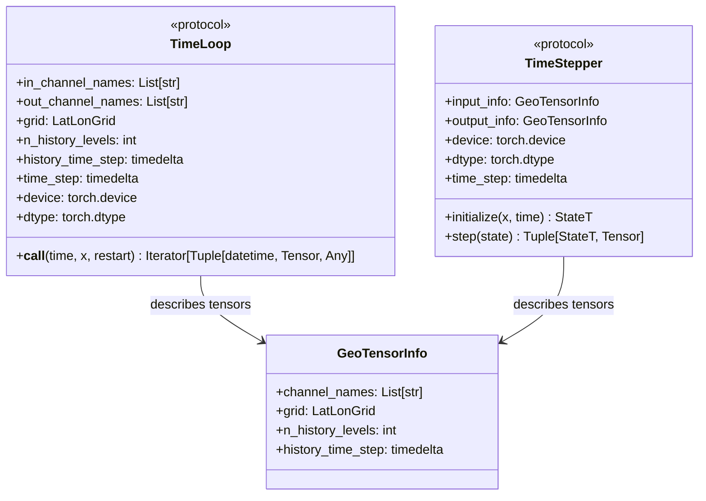
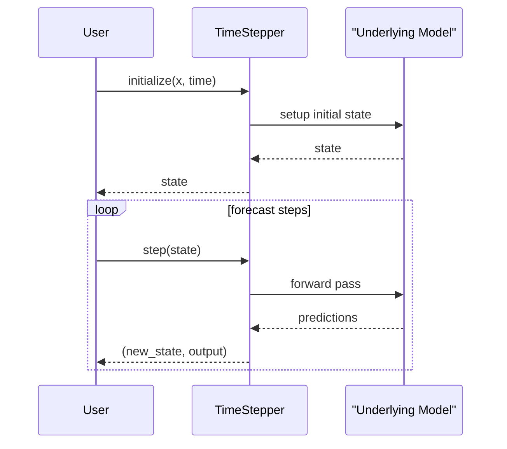
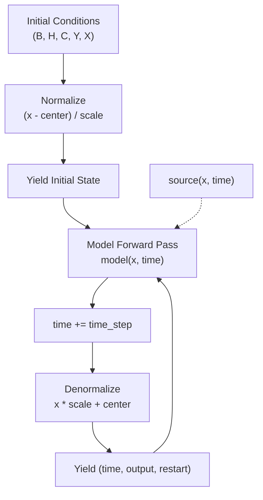
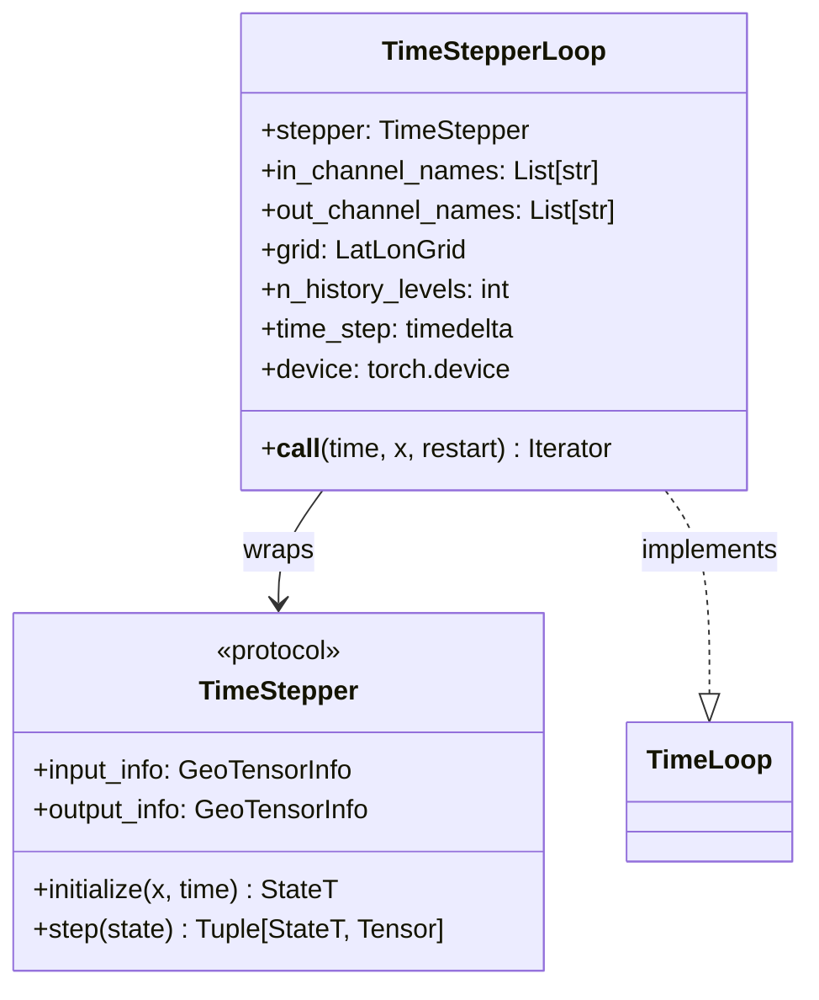
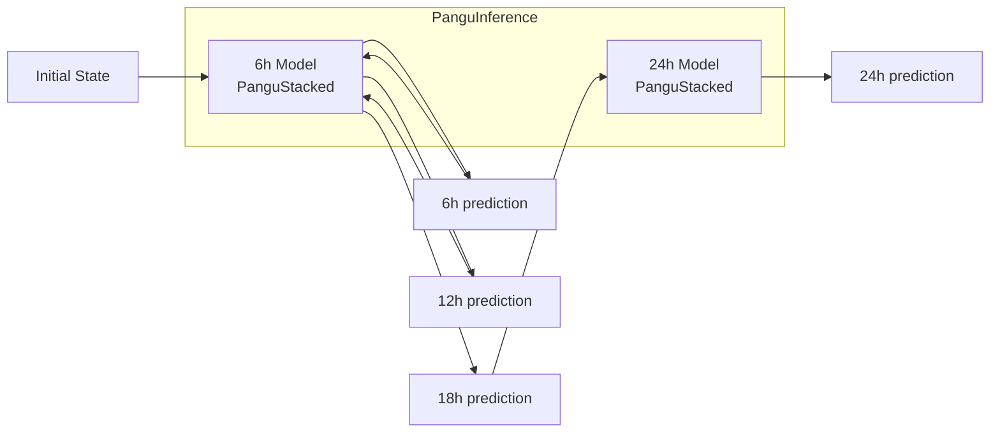
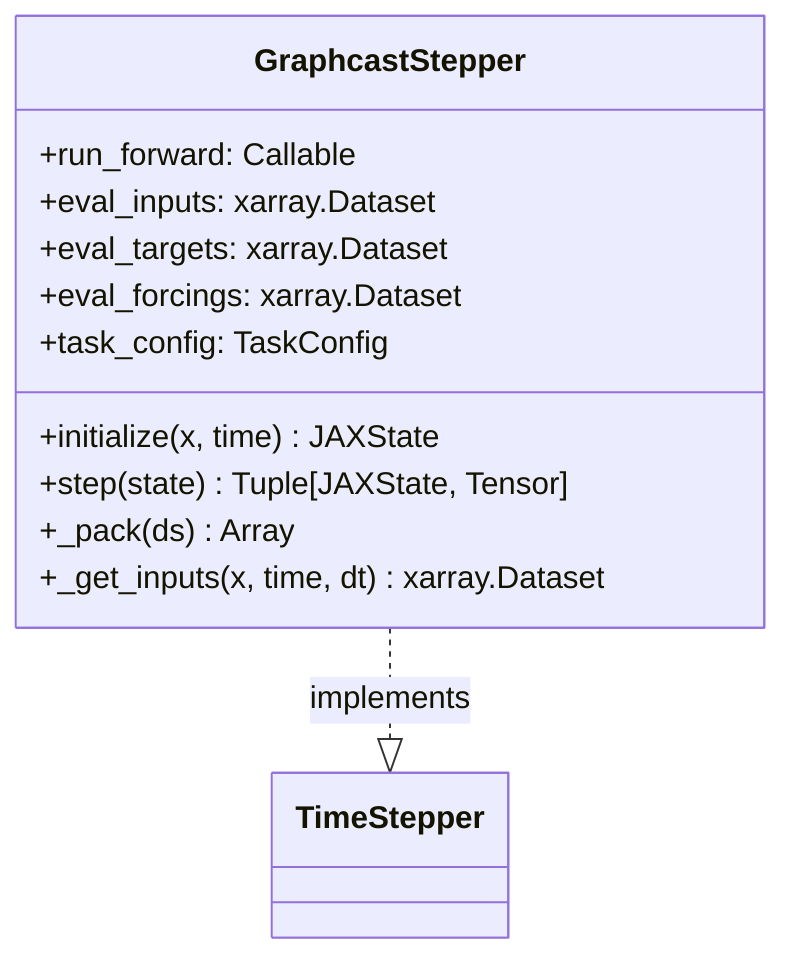
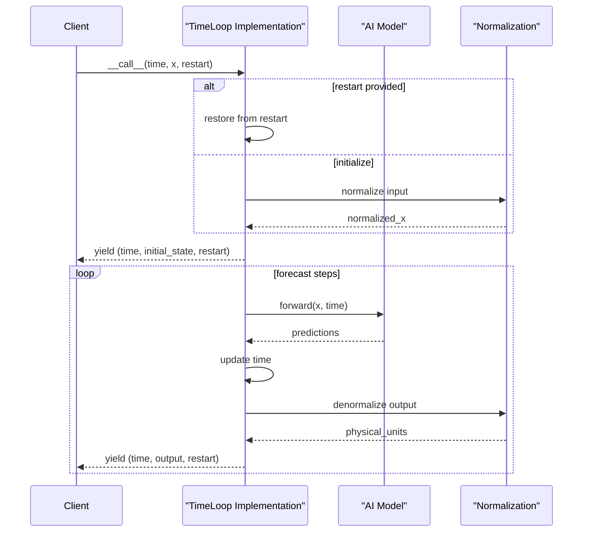
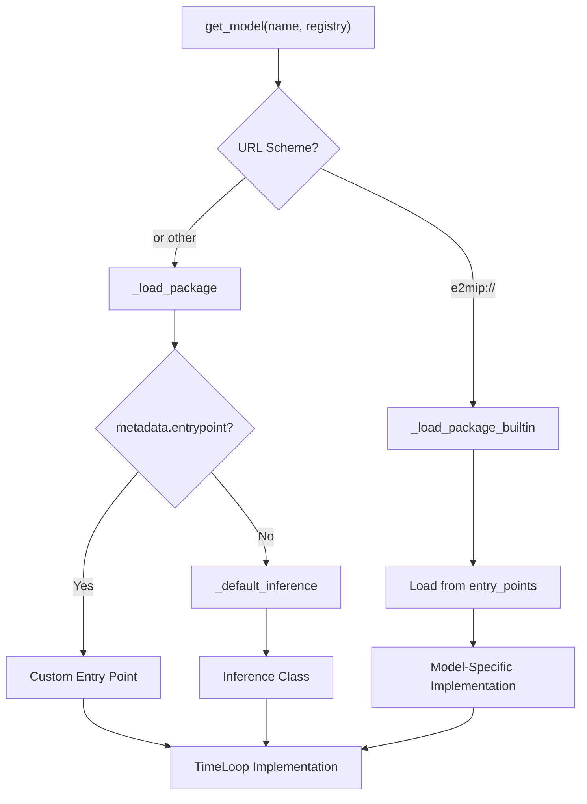

<!-- source: DeepWiki mcp.deepwiki.com · repo NVIDIA/earth2mip · page 3.2 Model Interface (TimeLoop) · fetched 2026-10-26 -->

# Model Interface (TimeLoop)

Relevant source files

The following files were used as context for generating this wiki page:

- [earth2mip/networks/__init__.py](earth2mip/networks/__init__.py)
- [earth2mip/networks/graphcast.py](earth2mip/networks/graphcast.py)
- [earth2mip/networks/pangu.py](earth2mip/networks/pangu.py)
- [earth2mip/time_loop.py](earth2mip/time_loop.py)
- [test/graphcast/multiple_step.py](test/graphcast/multiple_step.py)
- [test/graphcast/reference_inference.py](test/graphcast/reference_inference.py)
- [test/test_time_loop.py](test/test_time_loop.py)

The TimeLoop interface provides a unified abstraction for running inference on AI weather models, regardless of their underlying implementation framework (PyTorch, JAX, ONNX). This interface standardizes how models consume initial conditions, perform time stepping, and produce forecasts, enabling consistent integration across Earth-2 MIP's forecasting workflows.

For information about model loading and registration, see [Model Registry and Package System](#4.1). For details about data preparation and initial conditions, see [Data Interface](#3.3).

## Core Interfaces

### TimeLoop Protocol

The `TimeLoop` protocol defines the primary interface that all weather models must implement. It provides a generator-based API for iterative forecasting where each step produces the next forecast time.

**Sources:** [earth2mip/time_loop.py:43-96](), [earth2mip/time_loop.py:29-41](), [earth2mip/time_loop.py:101-161]()

The key method `__call__` takes initial conditions as a tensor with shape `(batch, n_history_levels, len(in_channel_names), Y, X)` and yields tuples of `(time, output, restart_data)` for each forecast step. The restart data enables checkpointing and resuming forecasts.

### TimeStepper Protocol

The `TimeStepper` protocol provides an alternative functional interface using explicit state management. This design is particularly useful for models implemented in functional frameworks like JAX where state handling is more explicit.

**Sources:** [earth2mip/time_loop.py:101-161](), [earth2mip/networks/graphcast.py:223-421]()

### GeoTensorInfo

The `GeoTensorInfo` dataclass provides metadata that describes how tensors map onto geographical space and time. This ensures consistent interpretation of tensor dimensions across different models and data sources.

| Field | Type | Description |
|-------|------|-------------|
| `channel_names` | `List[str]` | Names of meteorological variables (e.g., "t2m", "u10m") |
| `grid` | `LatLonGrid` | Spatial grid definition with lat/lon coordinates |
| `n_history_levels` | `int` | Number of historical time steps required |
| `history_time_step` | `timedelta` | Time interval between history levels |

**Sources:** [earth2mip/time_loop.py:29-41]()

## Primary Implementations

### Inference Class

The `Inference` class is the main general-purpose implementation of `TimeLoop` designed for PyTorch-based models. It handles normalization, history management, and optional data augmentation.

**Sources:** [earth2mip/networks/__init__.py:121-251]()

Key features of the `Inference` class:

- **Normalization**: Automatically applies channel-wise normalization using provided mean and standard deviation arrays [earth2mip/networks/__init__.py:232-233]()
- **History Management**: Supports models requiring multiple historical time steps [earth2mip/networks/__init__.py:226-230]()
- **Source Integration**: Optional data augmentation through source functions for noise injection or nudging [earth2mip/networks/__init__.py:240-244]()
- **Time Dependency**: Automatically detects whether models require time input [earth2mip/networks/__init__.py:47-66]()

### TimeStepperLoop Adapter

The `TimeStepperLoop` class bridges the functional `TimeStepper` interface to the `TimeLoop` protocol, enabling models implemented with explicit state management to work seamlessly in Earth-2 MIP workflows.

**Sources:** [earth2mip/time_loop.py:163-231]()

## Model-Specific Implementations

### Pangu Weather Implementation

Pangu Weather uses a custom `PanguInference` class that implements the `TimeLoop` protocol directly, handling the specific sub-stepping logic required for this ONNX-based model.

**Sources:** [earth2mip/networks/pangu.py:168-258]()

### GraphCast Implementation

GraphCast uses the `GraphcastStepper` class implementing `TimeStepper`, which handles JAX-based state management and xarray data structures.

**Sources:** [earth2mip/networks/graphcast.py:223-421]()

## Time Stepping Process

The time stepping process follows a consistent pattern across all implementations, with variations in state representation and model invocation:

**Sources:** [earth2mip/networks/__init__.py:190-251](), [earth2mip/time_loop.py:201-231]()

### Input and Output Tensor Shapes

All `TimeLoop` implementations must handle consistent tensor shapes:

| Tensor | Shape | Description |
|--------|-------|-------------|
| Input | `(B, H, C, Y, X)` | Batch, History, Channels, Lat, Lon |
| Output | `(B, C, Y, X)` | Batch, Channels, Lat, Lon (single time step) |

Where:
- `B` = batch size
- `H` = number of history levels (`n_history_levels`)
- `C` = number of channels (`len(channel_names)`)
- `Y, X` = spatial grid dimensions

**Sources:** [earth2mip/time_loop.py:78-84](), [earth2mip/networks/__init__.py:196-201]()

## Integration with Model Loading

The `TimeLoop` interface integrates with Earth-2 MIP's model loading system through the `get_model` function, which automatically wraps loaded models in appropriate `TimeLoop` implementations:

**Sources:** [earth2mip/networks/__init__.py:312-352](), [earth2mip/networks/__init__.py:253-310]()

The loading system automatically determines the appropriate wrapper based on model metadata and entry points, ensuring that all loaded models present a consistent `TimeLoop` interface regardless of their underlying implementation framework.

---

