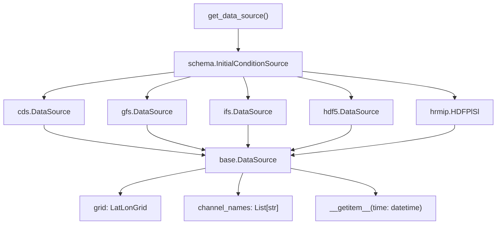
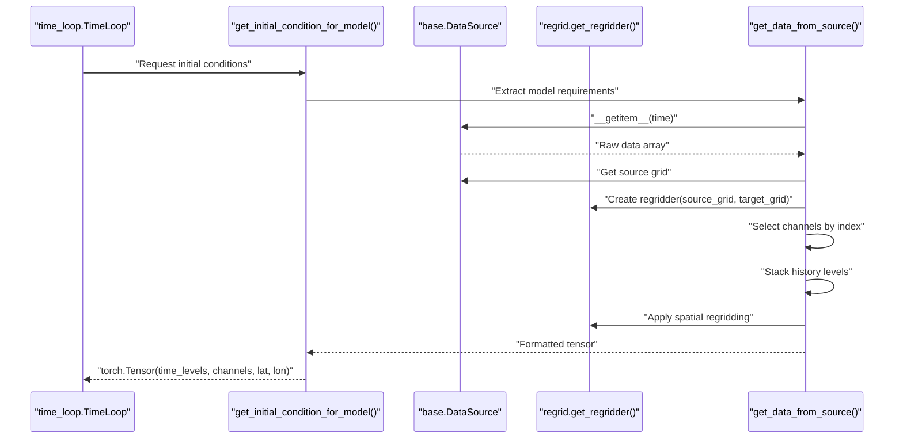
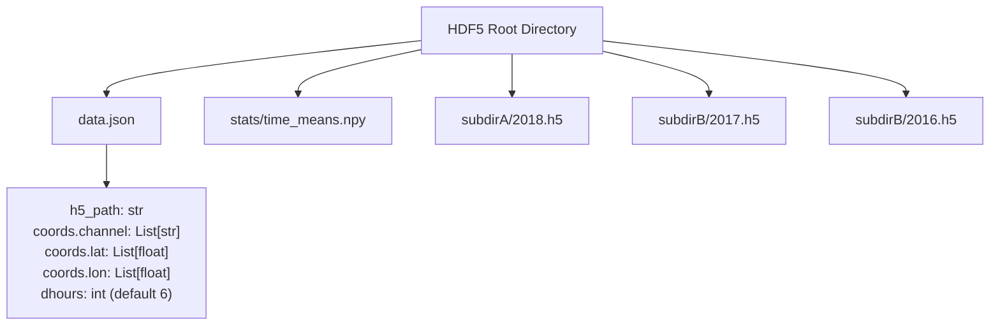
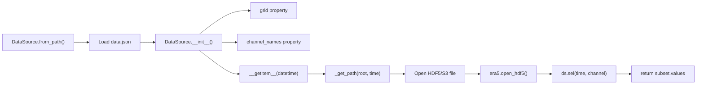
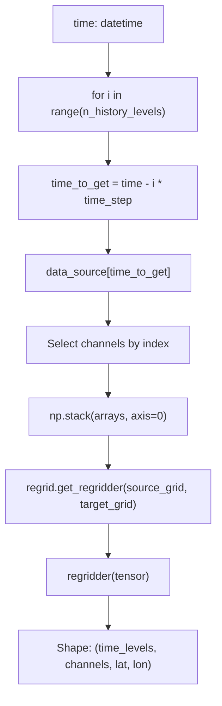
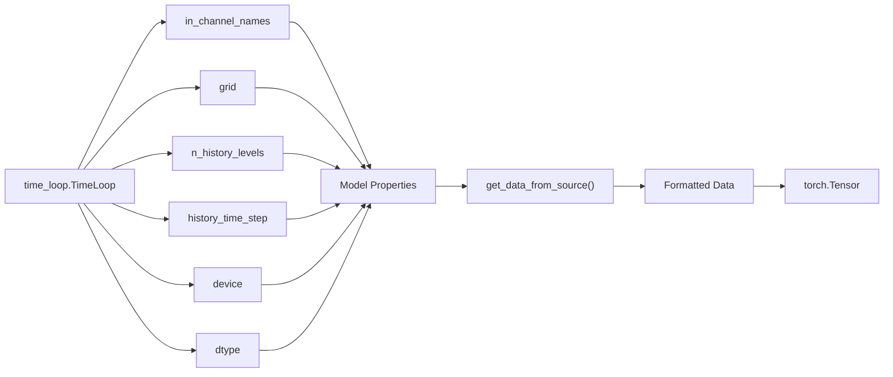

<!-- source: DeepWiki mcp.deepwiki.com · repo NVIDIA/earth2mip · page 3.3 Data Interface · fetched 2026-10-26 -->

# Data Interface

Relevant source files

The following files were used as context for generating this wiki page:

- [conftest.py](conftest.py)
- [docs/userguide/install.md](docs/userguide/install.md)
- [earth2mip/datasets/era5/__init__.py](earth2mip/datasets/era5/__init__.py)
- [earth2mip/datasets/hindcast.py](earth2mip/datasets/hindcast.py)
- [earth2mip/initial_conditions/__init__.py](earth2mip/initial_conditions/__init__.py)
- [earth2mip/initial_conditions/hdf5.py](earth2mip/initial_conditions/hdf5.py)

The Data Interface system provides a unified abstraction layer for accessing meteorological data from various sources and formats. This system handles initial conditions for weather models, coordinate transformations, and data preprocessing to ensure models receive properly formatted input data. For information about model interfaces, see [Model Interface (TimeLoop)](#3.2). For details about specific data sources and regridding, see [Data Sources](#5.2) and [Grids and Regridding](#5.3).

## Data Source Architecture

The Data Interface uses a factory pattern to provide uniform access to heterogeneous meteorological data sources. Each data source implements a common interface while handling source-specific details like authentication, file formats, and coordinate systems.

### Data Source Factory Pattern

Sources: [earth2mip/initial_conditions/__init__.py:36-54]()

### Initial Conditions Processing Pipeline

Sources: [earth2mip/initial_conditions/__init__.py:106-118](), [earth2mip/initial_conditions/__init__.py:57-103]()

## Supported Data Sources

The system supports multiple meteorological data sources through a common interface:

| Source Type | Schema Enum | Implementation | Description |
|-------------|-------------|----------------|-------------|
| ERA5 HDF5 | `schema.InitialConditionSource.era5` | `hdf5.DataSource` | Local/S3 HDF5 files |
| Climate Data Store | `schema.InitialConditionSource.cds` | `cds.DataSource` | Copernicus CDS API |
| NOAA GFS | `schema.InitialConditionSource.gfs` | `gfs.DataSource` | GFS GRIB files |
| ECMWF IFS | `schema.InitialConditionSource.ifs` | `ifs.DataSource` | IFS forecasts |
| HRMIP | `schema.InitialConditionSource.hrmip` | `hrmip.HDFPlSl` | High-resolution data |

Sources: [earth2mip/initial_conditions/__init__.py:41-52]()

## HDF5 Data Format Implementation

The HDF5 data source provides the most complete implementation, supporting both local and remote S3 storage with comprehensive metadata handling.

### HDF5 Directory Structure

Sources: [earth2mip/initial_conditions/hdf5.py:41-56]()

### HDF5 DataSource Implementation

The `hdf5.DataSource` class implements the core data access pattern:

Sources: [earth2mip/initial_conditions/hdf5.py:78-84](), [earth2mip/initial_conditions/hdf5.py:102-115]()

## Data Processing and Regridding

The data interface handles coordinate transformations and format standardization between different data sources and model requirements.

### Processing Pipeline Details

The `get_data_from_source()` function orchestrates the complete data preparation pipeline:

1. **History Level Collection**: Gathers multiple time steps for models requiring temporal context
2. **Channel Selection**: Extracts specific variables based on model requirements  
3. **Spatial Regridding**: Transforms between different grid projections and resolutions
4. **Device/Dtype Conversion**: Ensures compatibility with model computational requirements

Sources: [earth2mip/initial_conditions/__init__.py:82-103]()

## Integration with Model Interface

The Data Interface integrates with the TimeLoop model interface through the `get_initial_condition_for_model()` function, which extracts model-specific requirements and formats data accordingly.

### Model-Data Interface Bridge

Sources: [earth2mip/initial_conditions/__init__.py:106-118]()

The Data Interface serves as the critical bridge between external meteorological data sources and AI weather models, providing the standardized data access layer that enables Earth-2 MIP's model-agnostic architecture.

---

