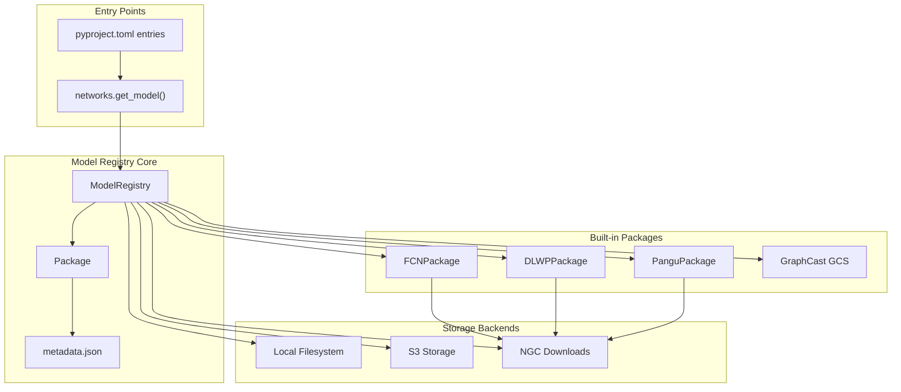
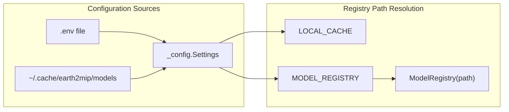
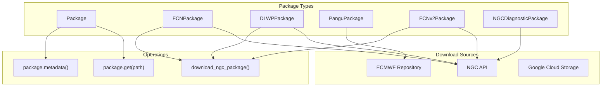
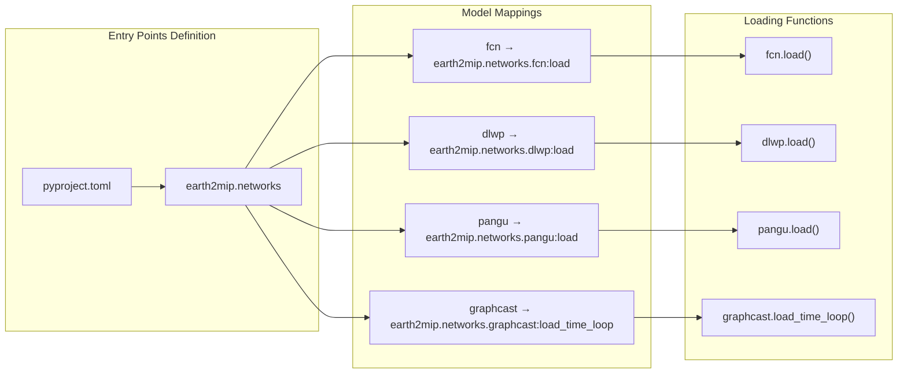
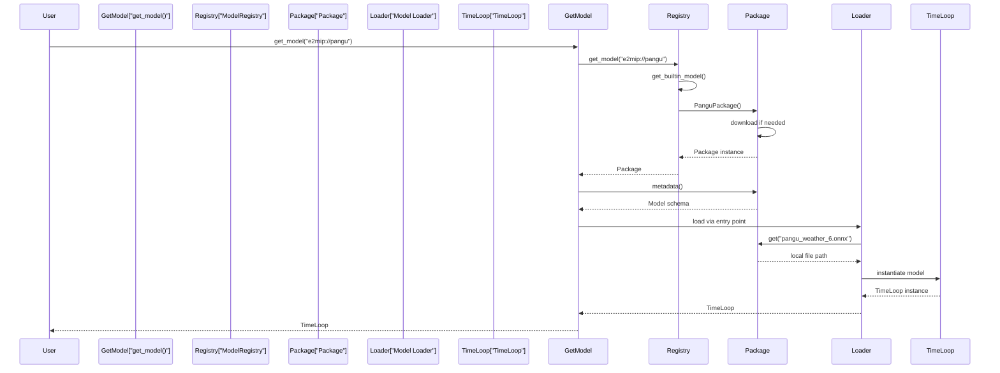
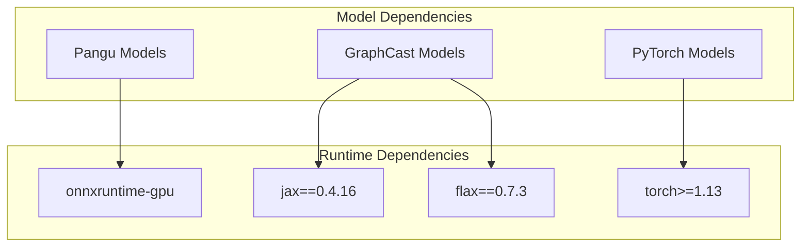
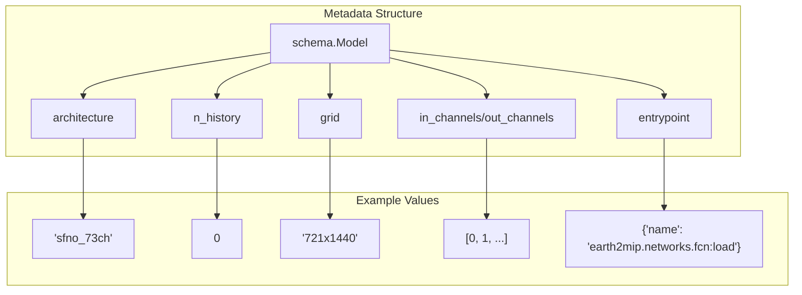

<!-- source: DeepWiki mcp.deepwiki.com · repo NVIDIA/earth2mip · page 4 Model Management · fetched 2026-10-26 -->

# Model Management

Relevant source files

The following files were used as context for generating this wiki page:

- [CHANGELOG.md](CHANGELOG.md)
- [Makefile](Makefile)
- [README.md](README.md)
- [earth2mip/_cli_utils.py](earth2mip/_cli_utils.py)
- [earth2mip/_config.py](earth2mip/_config.py)
- [earth2mip/model_registry.py](earth2mip/model_registry.py)
- [earth2mip/score_ensemble_outputs.py](earth2mip/score_ensemble_outputs.py)
- [earth2mip/weather_events.py](earth2mip/weather_events.py)
- [pyproject.toml](pyproject.toml)
- [requirements.txt](requirements.txt)

This document covers the model management system in Earth-2 MIP, including model registration, package management, and loading interfaces. The system provides a unified way to discover, download, and instantiate AI weather models from various sources including NGC (NVIDIA GPU Cloud), local storage, and cloud storage.

For information about using loaded models for inference, see [Inference and Forecasting](#6). For details about the TimeLoop interface that models implement, see [Model Interface (TimeLoop)](#3.2).

## Model Registry System

The model registry provides centralized management of AI weather model packages through the `ModelRegistry` class. It supports both local filesystem and cloud storage backends, with automatic downloading and caching of model packages.

### Registry Architecture

Sources: [earth2mip/model_registry.py:224-285](), [earth2mip/_config.py:28-34]()

### Registry Configuration

The model registry location is configured through the `MODEL_REGISTRY` setting, which defaults to `~/.cache/earth2mip/models`. The registry supports both local paths and S3 URLs.

Sources: [earth2mip/_config.py:28-34](), [earth2mip/_config.py:51]()

## Package Management

Each model is organized as a package with a standardized directory structure containing model weights, metadata, and normalization statistics.

### Package Structure

The standard package layout includes:

| File | Purpose |
|------|---------|
| `metadata.json` | Model configuration and schema |
| `weights.tar` | Model checkpoint with `model_state` key |
| `global_means.npy` | Normalization means (optional) |
| `global_stds.npy` | Normalization standard deviations (optional) |
| `about.txt` | Optional information and source path |

### Package Types

Sources: [earth2mip/model_registry.py:98-121](), [earth2mip/model_registry.py:141-181](), [earth2mip/model_registry.py:183-222]()

### Built-in Package Handlers

The registry includes specialized package handlers for different model sources:

- **NGC Packages**: `FCNPackage`, `DLWPPackage`, `FCNv2Package` download from NVIDIA GPU Cloud
- **Pangu Models**: `PanguPackage` downloads ONNX files from ECMWF repository  
- **GraphCast**: Direct access to Google Cloud Storage buckets
- **Diagnostic Models**: `NGCDiagnosticPackage` for specialized diagnostic models

## Model Loading Interface

The primary interface for loading models is through the `networks.get_model()` function, which resolves model names through the registry and entry point system.

### Entry Point System

Model loading is configured through Python entry points defined in `pyproject.toml`:

Sources: [pyproject.toml:91-101]()

### Model Loading Flow

Sources: [earth2mip/model_registry.py:233-237](), [earth2mip/model_registry.py:239-262](), [earth2mip/_cli_utils.py:71-78]()

## Supported Models

The system supports multiple AI weather models with different architectures and capabilities:

### Model Catalog

| Model ID | Architecture | Type | Source | Entry Point |
|----------|-------------|------|--------|-------------|
| `fcn` | Adaptive Fourier Neural Operator | Global Weather | NGC | `earth2mip.networks.fcn:load` |
| `dlwp` | Convolutional Encoder-Decoder | Global Weather | NGC | `earth2mip.networks.dlwp:load` |
| `pangu` | Vision Transformer (Hierarchical) | Global Weather | ECMWF | `earth2mip.networks.pangu:load` |
| `pangu_6` | Vision Transformer (6hr) | Global Weather | ECMWF | `earth2mip.networks.pangu:load_6` |
| `pangu_24` | Vision Transformer (24hr) | Global Weather | ECMWF | `earth2mip.networks.pangu:load_24` |
| `fcnv2_sm` | Spherical Harmonics AFNO | Global Weather | NGC | `earth2mip.networks.fcnv2_sm:load` |
| `graphcast` | Graph Neural Network | Global Weather | GCS | `earth2mip.networks.graphcast:load_time_loop` |

### Model Dependencies

Some models require additional dependencies specified as optional extras:

- **Pangu models**: Require `onnxruntime-gpu>=1.15.1`
- **GraphCast models**: Require JAX/Flax stack with specific versions

Sources: [pyproject.toml:62-71](), [README.md:116-129]()

## Configuration and Metadata

### Model Metadata Schema

Each model package includes a `metadata.json` file conforming to the `earth2mip.schema.Model` schema:

Sources: [earth2mip/model_registry.py:43-57](), [earth2mip/model_registry.py:115-119]()

### CLI Integration

The model management system integrates with CLI tools through utility functions that parse model arguments and metadata:

- `add_model_args()`: Adds model-related command line arguments
- `model_from_args()`: Loads models from parsed command line arguments
- Supports custom metadata file override via `--model-metadata`

Sources: [earth2mip/_cli_utils.py:58-78]()

---

