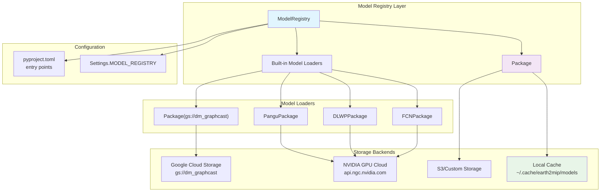
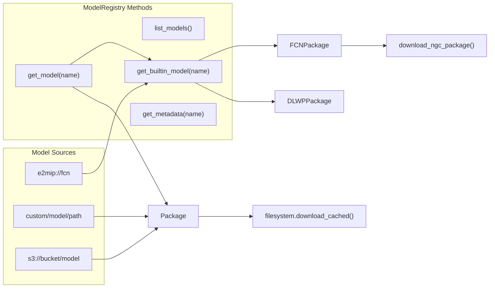
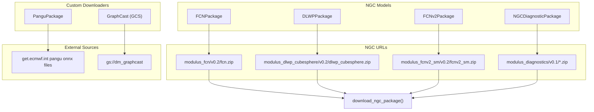
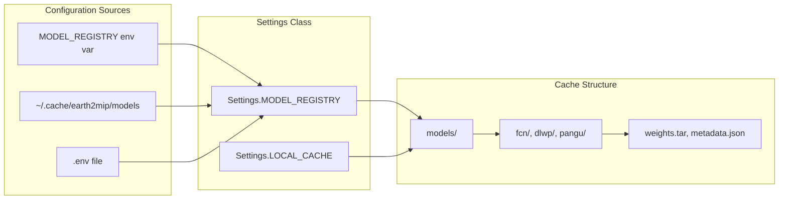
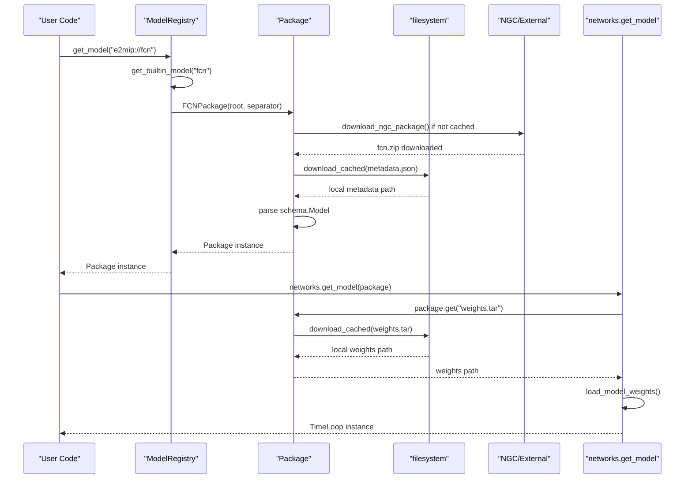

<!-- source: DeepWiki mcp.deepwiki.com · repo NVIDIA/earth2mip · page 4.1 Model Registry and Package System · fetched 2026-10-26 -->

# Model Registry and Package System

<details>
<summary>Relevant source files</summary>

The following files were used as context for generating this wiki page:

- [CHANGELOG.md](CHANGELOG.md)
- [Makefile](Makefile)
- [README.md](README.md)
- [earth2mip/_cli_utils.py](earth2mip/_cli_utils.py)
- [earth2mip/_config.py](earth2mip/_config.py)
- [earth2mip/model_registry.py](earth2mip/model_registry.py)
- [earth2mip/score_ensemble_outputs.py](earth2mip/score_ensemble_outputs.py)
- [earth2mip/weather_events.py](earth2mip/weather_events.py)
- [pyproject.toml](pyproject.toml)
- [requirements.txt](requirements.txt)

</details>


The Model Registry and Package System provides a unified interface for discovering, downloading, and loading AI weather models from various sources. It handles model packages, metadata, and automatic downloading of checkpoints from NVIDIA GPU Cloud (NGC) and other repositories. This system enables seamless integration of different model architectures and frameworks within Earth-2 MIP.

For information about using loaded models for inference, see [Loading and Using Models](#4.2). For details about the supported AI model architectures, see [Supported AI Models](#4.3).

## System Architecture

The model registry implements a plugin-based architecture that separates model discovery from model loading. The system consists of three main layers: the registry interface, package management, and model-specific loaders.

### Registry Architecture Diagram



Sources: [earth2mip/model_registry.py:224-285](), [earth2mip/_config.py:28-34](), [pyproject.toml:91-101]()

## Model Registry Components

### ModelRegistry Class

The `ModelRegistry` class serves as the primary interface for model discovery and package retrieval. It supports both built-in models (prefixed with `e2mip://`) and custom model paths.



Sources: [earth2mip/model_registry.py:224-285]()

### Package Class

The `Package` class provides file system abstraction for model packages, handling downloads, caching, and metadata access across different storage backends.

| Method | Purpose | Implementation |
|--------|---------|----------------|
| `get(path)` | Download file from package | Uses `filesystem.download_cached()` |
| `metadata()` | Load model metadata | Parses `metadata.json` as `schema.Model` |
| `_fullpath(path)` | Construct full file path | Joins root path with separator |

Sources: [earth2mip/model_registry.py:98-120]()

## Package System

### Model Package Structure

Each model package follows a standardized directory structure that enables consistent access across different model types:

```
model_name/
├── metadata.json          # Model configuration and schema
├── weights.tar           # Model checkpoint file  
├── global_means.npy      # Normalization statistics (optional)
├── global_stds.npy       # Normalization statistics (optional)
└── about.txt             # Optional model information
```

### Metadata Schema

The `metadata.json` file contains essential model configuration defined by the `schema.Model` class:

```json
{
    "architecture": "sfno_73ch",
    "n_history": 0,
    "grid": "721x1440", 
    "in_channels": [0, 1],
    "out_channels": [0, 1],
    "entrypoint": {
        "name": "earth2mip.networks.fcn:load"
    }
}
```

Sources: [earth2mip/model_registry.py:43-65](), [earth2mip/schema.py]()

## Built-in Models and NGC Integration

### NGC Package Downloaders

Earth-2 MIP includes specialized package loaders for models hosted on NVIDIA GPU Cloud:



Sources: [earth2mip/model_registry.py:141-182](), [earth2mip/model_registry.py:183-222]()

### Entry Point Registration

Models are registered through Python entry points in `pyproject.toml`, enabling the plugin architecture:

| Model ID | Entry Point | Description |
|----------|-------------|-------------|
| `fcn` | `earth2mip.networks.fcn:load` | FourCastNet global weather model |
| `dlwp` | `earth2mip.networks.dlwp:load` | Deep Learning Weather Prediction |
| `pangu` | `earth2mip.networks.pangu:load` | Pangu Weather hierarchical model |
| `pangu_6` | `earth2mip.networks.pangu:load_6` | Pangu Weather 6-hour model |
| `pangu_24` | `earth2mip.networks.pangu:load_24` | Pangu Weather 24-hour model |
| `graphcast` | `earth2mip.networks.graphcast:load_time_loop` | GraphCast neural weather model |

Sources: [pyproject.toml:91-101]()

## Configuration and Caching

### Model Registry Configuration

The model registry location is configured through the `Settings` class using environment variables or defaults:



Sources: [earth2mip/_config.py:28-52]()

### Filesystem Abstraction

The registry uses the `filesystem` module to provide unified access across storage backends:

| Function | Purpose | Supported Backends |
|----------|---------|-------------------|
| `filesystem.download_cached()` | Download and cache files | S3, GCS, HTTP, Local |
| `filesystem.ls()` | List directory contents | S3, Local |
| `filesystem.pipe()` | Write data to path | S3, Local |

Sources: [earth2mip/filesystem.py](), [earth2mip/model_registry.py:110-117]()

## Model Loading Workflow

### Complete Model Loading Process



Sources: [earth2mip/model_registry.py:233-262](), [earth2mip/networks/__init__.py](), [earth2mip/_cli_utils.py:71-78]()

### Model Resolution Logic

The registry implements a hierarchical model resolution system:

1. **Built-in Model Detection**: Names starting with `e2mip://` are resolved as built-in models
2. **Custom Path Resolution**: Other names are treated as filesystem paths
3. **Package Creation**: Appropriate package loader is instantiated based on model type
4. **Metadata Loading**: Package metadata is loaded and validated against schema
5. **Caching**: Downloaded files are cached locally for subsequent access

Sources: [earth2mip/model_registry.py:234-262]()

---

