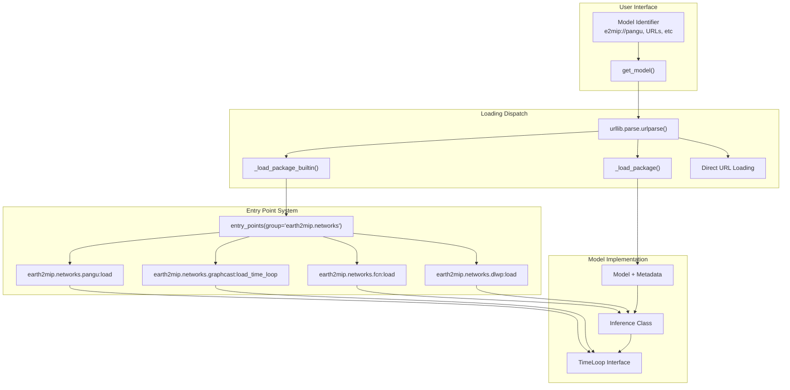
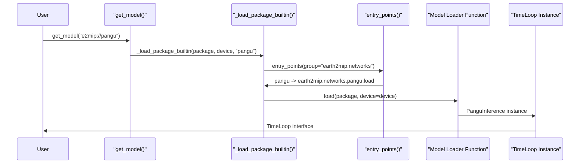
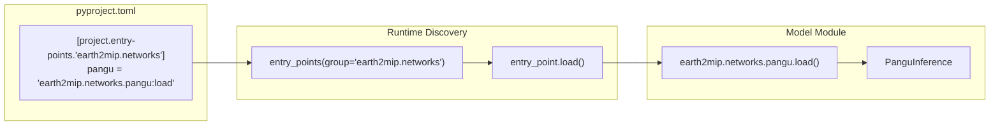
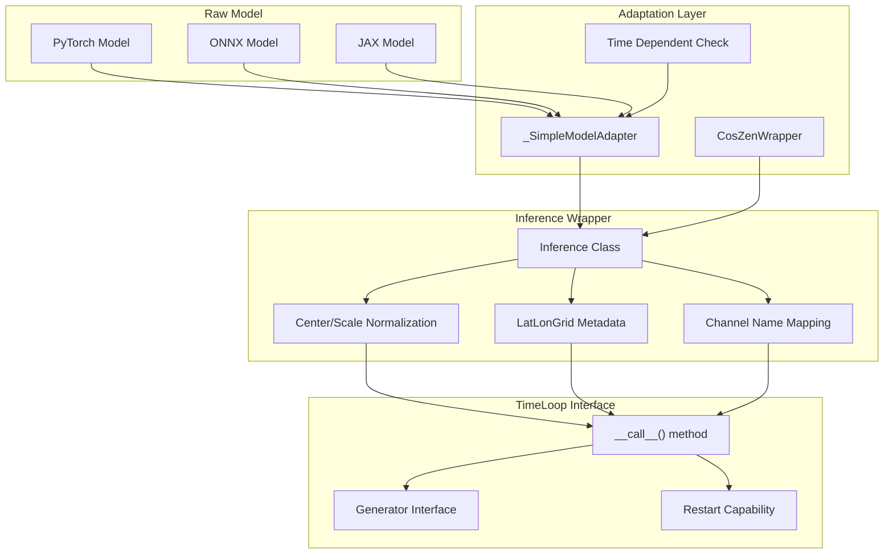
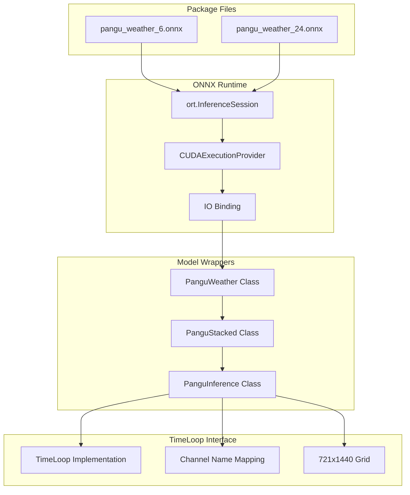

<!-- source: DeepWiki mcp.deepwiki.com · repo NVIDIA/earth2mip · page 4.2 Loading and Using Models · fetched 2026-10-26 -->

# Loading and Using Models

<details>
<summary>Relevant source files</summary>

The following files were used as context for generating this wiki page:

- [Makefile](Makefile)
- [README.md](README.md)
- [earth2mip/networks/__init__.py](earth2mip/networks/__init__.py)
- [earth2mip/networks/pangu.py](earth2mip/networks/pangu.py)
- [pyproject.toml](pyproject.toml)
- [requirements.txt](requirements.txt)

</details>


This document explains how to load and use AI weather models in Earth-2 MIP through the networks interface. It covers model identification, the loading process, and the unified TimeLoop interface that all models implement.

For information about the model registry and package system, see [Model Registry and Package System](#4.1). For details about specific supported models, see [Supported AI Models](#4.3).

## Overview

Earth-2 MIP provides a unified interface for loading and using different AI weather models through the `get_model()` function and the TimeLoop protocol. Models can be loaded from the built-in registry, external URLs, or custom packages, and all models expose a consistent interface for inference.

## Model Loading Architecture



Sources: [earth2mip/networks/__init__.py:312-352](), [pyproject.toml:91-101]()

## The get_model Function

The `get_model()` function is the primary entry point for loading models in Earth-2 MIP. It accepts various model identifiers and returns a TimeLoop interface.

### Function Signature

```python
def get_model(
    model: str,
    registry: ModelRegistry = registry,
    device="cpu",
    metadata: Optional[schema.Model] = None,
) -> time_loop.TimeLoop
```

### Model Identification Systems

Earth-2 MIP supports three main ways to identify and load models:

| Identifier Type | Format | Example | Loading Method |
|-----------------|--------|---------|----------------|
| Built-in Models | `e2mip://model_name` | `e2mip://pangu` | Entry point system |
| Registry Models | `model_name` | `fcn` | Model registry |
| Direct URLs | `scheme://path` | `s3://bucket/model` | Direct package loading |

### Built-in Model Loading



Sources: [earth2mip/networks/__init__.py:282-292](), [earth2mip/networks/__init__.py:341-345]()

## Entry Point Registration System

Models are registered as entry points in `pyproject.toml`, which allows them to be discovered and loaded dynamically.

### Entry Point Configuration

The entry points are defined under the `earth2mip.networks` group:

```toml
[project.entry-points."earth2mip.networks"]
fcn = "earth2mip.networks.fcn:load"
dlwp = "earth2mip.networks.dlwp:load"
pangu = "earth2mip.networks.pangu:load"
pangu_6 = "earth2mip.networks.pangu:load_6"
pangu_24 = "earth2mip.networks.pangu:load_24"
fcnv2_sm = "earth2mip.networks.fcnv2_sm:load"
graphcast = "earth2mip.networks.graphcast:load_time_loop"
```

### Entry Point Discovery



Sources: [pyproject.toml:91-101](), [earth2mip/networks/__init__.py:284-291]()

## The TimeLoop Interface

All models in Earth-2 MIP implement the `TimeLoop` protocol, which provides a unified interface for inference regardless of the underlying model architecture.

### Core TimeLoop Properties

```python
class TimeLoop:
    in_channel_names: List[str]      # Input variable names
    out_channel_names: List[str]     # Output variable names
    grid: LatLonGrid                 # Spatial grid information
    n_history_levels: int            # Number of history time steps
    time_step: timedelta             # Model time step
    device: torch.device             # Device location
```

### TimeLoop Call Interface

```python
def __call__(
    self,
    time: datetime.datetime,
    x: torch.Tensor,
    restart: Optional[Any] = None,
    normalize=True,
) -> Iterator[Tuple[datetime.datetime, torch.Tensor, Any]]
```

Sources: [earth2mip/networks/__init__.py:121-251]()

## The Inference Wrapper Class

Most models are wrapped in the `Inference` class, which adapts different model architectures to the TimeLoop interface.

### Inference Class Architecture



Sources: [earth2mip/networks/__init__.py:121-280](), [earth2mip/networks/__init__.py:97-119]()

## Loading Examples

### Loading Built-in Models

```python
from earth2mip.networks import get_model

# Load Pangu Weather (hierarchical 6+24hr)
pangu = get_model("e2mip://pangu", device="cuda:0")

# Load specific Pangu variants
pangu_6 = get_model("e2mip://pangu_6", device="cuda:0")
pangu_24 = get_model("e2mip://pangu_24", device="cuda:0")

# Load other models
fcn = get_model("e2mip://fcn", device="cuda:0")
dlwp = get_model("e2mip://dlwp", device="cuda:0")
graphcast = get_model("e2mip://graphcast", device="cuda:0")
```

### Loading from Registry

```python
from earth2mip.networks import get_model

# Load model by registry name
model = get_model("fcn", device="cuda:0")
```

### Loading from URLs

```python
from earth2mip.networks import get_model

# Load from S3
model = get_model("s3://bucket/path/to/model", device="cuda:0")

# Load from local file
model = get_model("file:///path/to/local/model", device="cuda:0")
```

### Using Models for Inference

```python
import datetime
import torch

# Load model
time_loop = get_model("e2mip://dlwp", device="cuda:0")

# Check model properties
print(f"Input channels: {time_loop.in_channel_names}")
print(f"Grid: {time_loop.grid}")
print(f"Time step: {time_loop.time_step}")

# Prepare input data (batch, history, channels, lat, lon)
x = torch.randn(1, 1, len(time_loop.in_channel_names), 721, 1440)
x = x.to(time_loop.device)

# Run inference
start_time = datetime.datetime(2018, 1, 1)
for i, (time, output, restart) in enumerate(time_loop(start_time, x)):
    print(f"Step {i}: {time}, Output shape: {output.shape}")
    if i >= 10:  # Run 10 steps
        break
```

Sources: [README.md:47-71](), [earth2mip/networks/__init__.py:190-251]()

## Model-Specific Loading Patterns

### Pangu Weather Example

The Pangu Weather model demonstrates a complex loading pattern with ONNX runtime integration:



Sources: [earth2mip/networks/pangu.py:44-332]()

### Standard PyTorch Model Pattern

Most PyTorch-based models follow a standard pattern using the `Inference` wrapper:

```python
def load(package, *, pretrained=True, device="cpu"):
    # Load the PyTorch model
    model = torch.load(package.get("model.pt"))
    
    # Load normalization statistics
    center = np.load(package.get("global_means.npy"))
    scale = np.load(package.get("global_stds.npy"))
    
    # Create Inference wrapper
    inference = Inference(
        model=model,
        center=center,
        scale=scale,
        grid=grid,
        channel_names=channel_names,
        time_step=time_step,
    )
    inference.to(device)
    return inference
```

Sources: [earth2mip/networks/__init__.py:253-279]()

---

