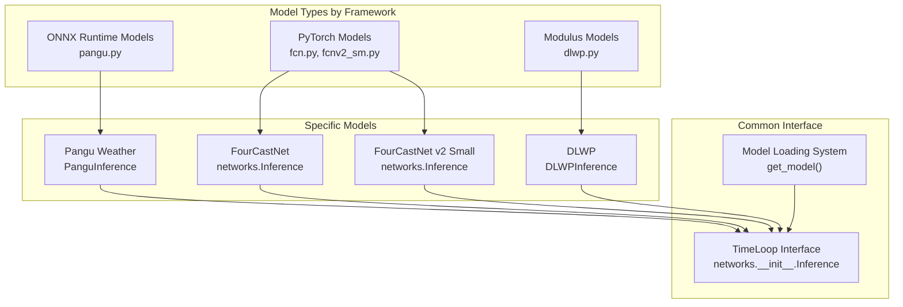
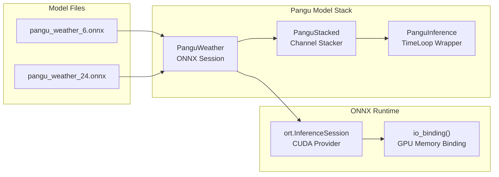
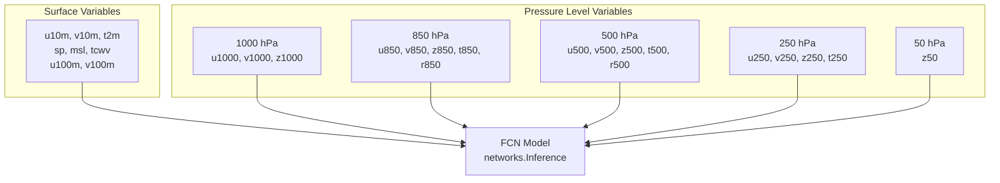
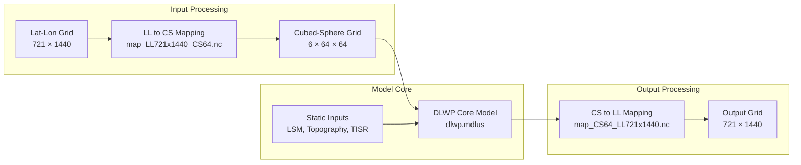
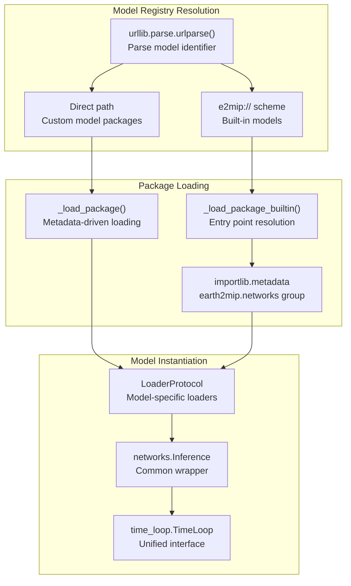

<!-- source: DeepWiki mcp.deepwiki.com · repo NVIDIA/earth2mip · page 4.3 Supported AI Models · fetched 2026-10-26 -->

# Supported AI Models

Relevant source files

The following files were used as context for generating this wiki page:

- [earth2mip/inference_medium_range.py](earth2mip/inference_medium_range.py)
- [earth2mip/networks/__init__.py](earth2mip/networks/__init__.py)
- [earth2mip/networks/dlwp.py](earth2mip/networks/dlwp.py)
- [earth2mip/networks/fcn.py](earth2mip/networks/fcn.py)
- [earth2mip/networks/fcnv2_sm.py](earth2mip/networks/fcnv2_sm.py)
- [earth2mip/networks/pangu.py](earth2mip/networks/pangu.py)

Earth-2 MIP provides support for multiple state-of-the-art AI weather prediction models through a unified interface. This page documents the specific models available, their technical characteristics, and how they integrate into the framework's TimeLoop abstraction.

For information about loading and using these models in practice, see [Loading and Using Models](#4.2). For details about the registry system that manages model packages, see [Model Registry and Package System](#4.1).

## Model Architecture Overview

Earth-2 MIP supports AI weather models built on different deep learning frameworks through a common `TimeLoop` interface. The supported models fall into several architectural categories:

**Model Loading Architecture**

Sources: [earth2mip/networks/__init__.py:312-352](), [earth2mip/networks/pangu.py:260-269](), [earth2mip/networks/fcn.py:58-77]()

## Pangu Weather

Pangu Weather is an ONNX-based global weather prediction model that provides both 6-hour and 24-hour forecasting capabilities.

### Technical Specifications

| Property | Value |
|----------|-------|
| **Framework** | ONNX Runtime with CUDA execution |
| **Grid Resolution** | 0.25° (721 × 1440) |
| **Time Steps** | 6 hours, 24 hours |
| **Variables** | 69 total (65 pressure level + 4 surface) |
| **Input Dimensions** | Pressure levels: (5, 13, 721, 1440), Surface: (4, 721, 1440) |

### Architecture Implementation

**Pangu Model Architecture**

The `PanguInference` class implements a hybrid forecasting strategy using both 6-hour and 24-hour models:

- **Sub-stepping Strategy**: Three 6-hour steps followed by one 24-hour step
- **Channel Configuration**: 65 pressure level variables (5 variables × 13 levels) + 4 surface variables
- **Memory Management**: Direct GPU memory binding through ONNX Runtime's `io_binding` API

Sources: [earth2mip/networks/pangu.py:168-258](), [earth2mip/networks/pangu.py:44-126](), [earth2mip/networks/pangu.py:128-166]()

## FourCastNet (FCN)

FourCastNet is a PyTorch-based global weather model utilizing Fourier Neural Operators for atmospheric prediction.

### Technical Specifications

| Property | Value |
|----------|-------|
| **Framework** | PyTorch with Modulus backend |
| **Grid Resolution** | 0.25° (720 × 1440, excludes south pole) |
| **Time Step** | 6 hours |
| **Variables** | 26 atmospheric variables |
| **Architecture** | Fourier Neural Operator |

### Channel Configuration

The FCN model processes 26 atmospheric variables covering surface, boundary layer, and pressure levels:

**FCN Variable Structure**

Sources: [earth2mip/networks/fcn.py:28-55](), [earth2mip/networks/fcn.py:58-77]()

## FourCastNet v2 Small (FCNv2 SM)

An enhanced version of FourCastNet with increased channel capacity and improved architecture.

### Technical Specifications

| Property | Value |
|----------|-------|
| **Framework** | PyTorch with custom SFNO implementation |
| **Grid Resolution** | 0.25° (721 × 1440) |
| **Time Step** | 6 hours |
| **Variables** | 73 atmospheric variables |
| **Architecture** | Spherical Fourier Neural Operator (SFNO) |

### Implementation Details

The FCNv2 Small model uses a comprehensive 73-channel configuration covering the full atmospheric column:

- **Pressure Levels**: 50, 100, 150, 200, 250, 300, 400, 500, 600, 700, 850, 925, 1000 hPa
- **Variables per Level**: u, v, z, t, r (wind, geopotential, temperature, humidity)
- **Surface Variables**: u10m, v10m, u100m, v100m, t2m, sp, msl, tcwv

Sources: [earth2mip/networks/fcnv2_sm.py:37-111](), [earth2mip/networks/fcnv2_sm.py:139-171]()

## DLWP (Deep Learning Weather Prediction)

DLWP is a cubed-sphere based model that uses specialized grid transformations for global weather prediction.

### Technical Specifications

| Property | Value |
|----------|-------|
| **Framework** | PyTorch with Modulus backend |
| **Grid Representation** | Cubed-sphere (6 × 64 × 64) |
| **Output Grid** | 0.25° lat-lon (721 × 1440) |
| **Time Step** | 6 hours (produces 12-hour forecasts) |
| **Variables** | 7 atmospheric variables |
| **History** | 2 time steps required |

### Grid Transformation Architecture

**DLWP Grid Transformation Pipeline**

### Static Input Augmentation

DLWP enhances atmospheric inputs with static geographical data:

- **Land-Sea Mask**: Binary land/ocean classification
- **Topographic Height**: Normalized surface elevation
- **Top-of-Atmosphere Solar Radiation (TISR)**: Time-dependent solar forcing

Sources: [earth2mip/networks/dlwp.py:125-227](), [earth2mip/networks/dlwp.py:229-260](), [earth2mip/networks/dlwp.py:34-121]()

## Model Loading and Integration

### Universal Loading Interface

All models are accessed through the `get_model` function in `networks.__init__`, which provides a unified loading interface:

**Model Loading Flow**

### Common Model Interface

The `networks.Inference` class provides a standardized wrapper that normalizes different model architectures:

| Interface Method | Purpose |
|------------------|---------|
| `__call__(time, x, restart)` | Main forecasting iterator |
| `in_channel_names` | Input variable names |
| `out_channel_names` | Output variable names |
| `grid` | Spatial grid specification |
| `time_step` | Model native time step |
| `device` | Target computing device |

### Model-Specific Loaders

Each model type implements its own loader function that handles framework-specific initialization:

- **Pangu**: `pangu.load()` - ONNX session management
- **FCN**: `fcn.load()` - Modulus checkpoint loading  
- **FCNv2 SM**: `fcnv2_sm.load()` - Custom weight loading with state dict fixes
- **DLWP**: `dlwp.load()` - Cubed-sphere setup with static data

Sources: [earth2mip/networks/__init__.py:253-279](), [earth2mip/networks/__init__.py:121-251](), [earth2mip/networks/__init__.py:282-310]()

---

