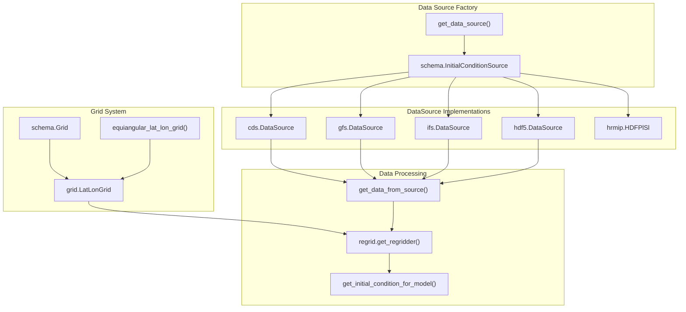
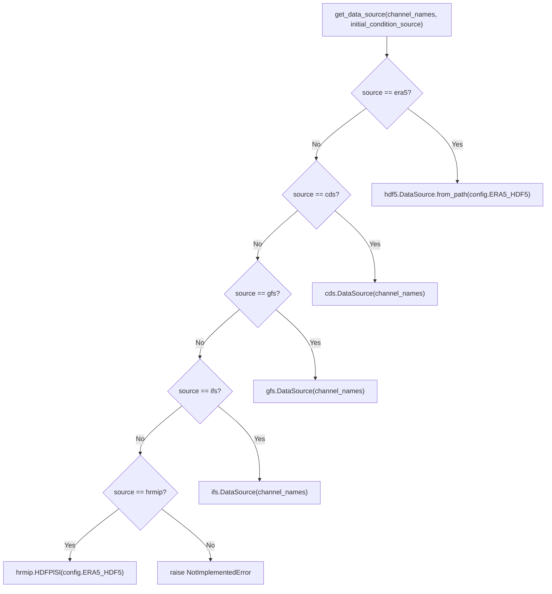
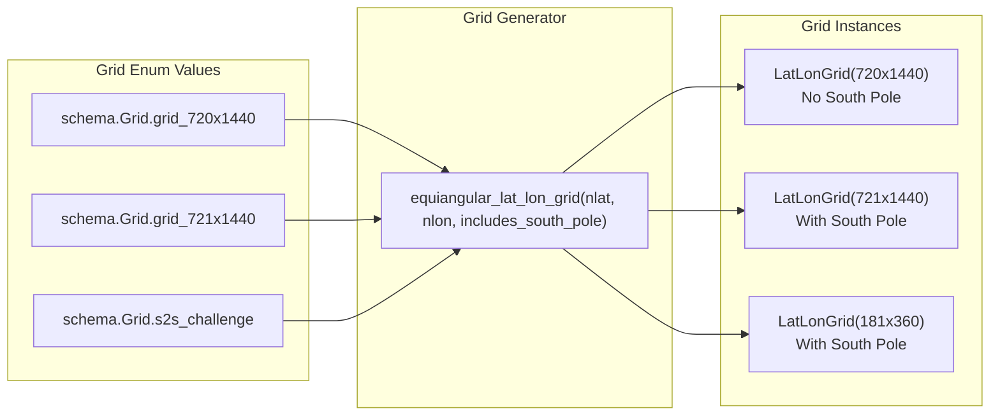
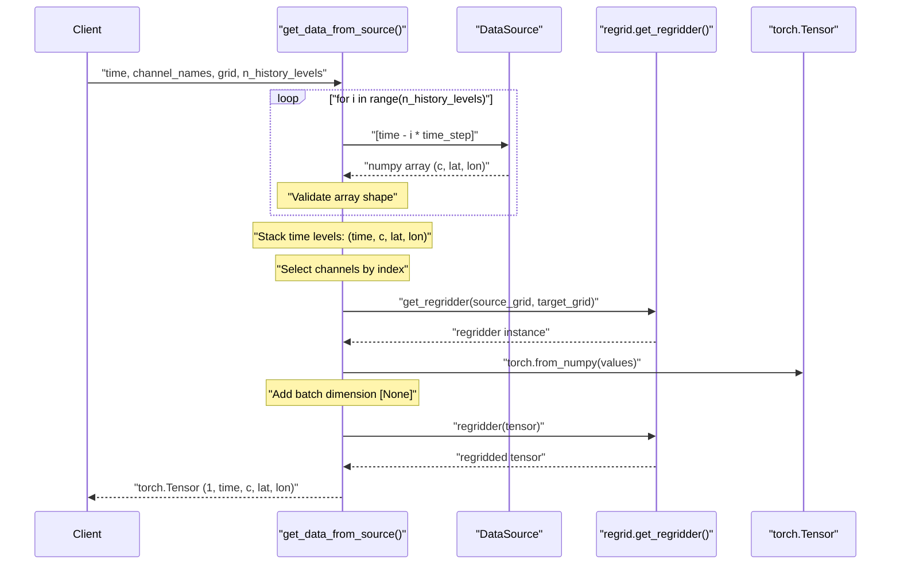

<!-- source: DeepWiki mcp.deepwiki.com · repo NVIDIA/earth2mip · page 5 Data Systems · fetched 2026-10-26 -->

# Data Systems

Relevant source files

The following files were used as context for generating this wiki page:

- [earth2mip/grid.py](earth2mip/grid.py)
- [earth2mip/initial_conditions/__init__.py](earth2mip/initial_conditions/__init__.py)

The Data Systems component of Earth-2 MIP provides a unified interface for accessing meteorological data from multiple sources and transforming it into the formats required by AI weather models. This system handles initial condition data loading, spatial regridding, and caching to support both real-time and historical weather forecasting workflows.

This page covers the data access layer, grid management, and regridding capabilities. For information about how data flows into ensemble forecasting workflows, see [Ensemble Forecasting](#6.1). For details on specific model data requirements, see [Model Interface (TimeLoop)](#3.2).

## Architecture Overview

The data systems architecture follows a factory pattern that abstracts different meteorological data providers behind a common `DataSource` interface. This design enables models to work seamlessly with data from various sources without modification.

**Data Source Factory Architecture**: This diagram shows how the `get_data_source()` factory function creates appropriate DataSource implementations based on the `InitialConditionSource` enum, and how data flows through the regridding system to produce model-ready tensors.

**Sources:** [earth2mip/initial_conditions/__init__.py:36-54](), [earth2mip/grid.py:24-58]()

## DataSource Interface and Factory

The core of the data system is the `DataSource` abstraction that provides a unified interface for accessing meteorological data. The factory function `get_data_source()` creates appropriate implementations based on the specified data source type.

### Factory Function

The `get_data_source()` function serves as the main entry point for creating data source instances:

**DataSource Factory Logic**: Shows the decision tree implemented in `get_data_source()` for creating appropriate DataSource instances based on the `InitialConditionSource` enum value.

**Sources:** [earth2mip/initial_conditions/__init__.py:36-54]()

### Supported Data Sources

| Data Source | Implementation | Purpose | Configuration |
|------------|----------------|---------|---------------|
| `era5` | `hdf5.DataSource` | ERA5 reanalysis from local HDF5 files | `config.ERA5_HDF5` |
| `cds` | `cds.DataSource` | Climate Data Store API access | API credentials |
| `gfs` | `gfs.DataSource` | NOAA GFS operational forecasts | GRIB file access |
| `ifs` | `ifs.DataSource` | ECMWF IFS operational forecasts | S3 or local access |
| `hrmip` | `hrmip.HDFPlSl` | High-resolution model intercomparison | HDF5 specialized format |

**Sources:** [earth2mip/initial_conditions/__init__.py:24](), [earth2mip/initial_conditions/__init__.py:41-52]()

## Grid System

The grid system provides standardized spatial coordinate handling and regridding capabilities for transforming data between different model requirements.

### LatLonGrid Implementation

The `LatLonGrid` class represents regular latitude-longitude grids:

| Property | Type | Description |
|----------|------|-------------|
| `lat` | `List[float]` | Latitude coordinates (90° to -90°) |
| `lon` | `List[float]` | Longitude coordinates (0° to 360°) |
| `shape` | `tuple` | Grid dimensions (nlat, nlon) |

### Standard Grid Configurations

**Standard Grid Configurations**: Shows how the `from_enum()` function maps grid enumeration values to specific `LatLonGrid` instances with different resolutions and pole handling.

**Sources:** [earth2mip/grid.py:35-46](), [earth2mip/grid.py:49-57]()

## Data Processing Pipeline

The data processing pipeline transforms raw meteorological data into model-ready tensors through a series of operations including time selection, channel selection, and spatial regridding.

### Data Retrieval and Processing

The `get_data_from_source()` function orchestrates the complete data processing pipeline:

**Data Processing Pipeline**: Shows the sequence of operations in `get_data_from_source()` from raw data retrieval through regridding to produce model-ready tensors.

**Sources:** [earth2mip/initial_conditions/__init__.py:57-103]()

### Model Integration

The `get_initial_condition_for_model()` function provides a simplified interface for models to obtain initial conditions:

| Parameter | Source | Description |
|-----------|--------|-------------|
| `channel_names` | `time_loop.in_channel_names` | Required atmospheric variables |
| `grid` | `time_loop.grid` | Target spatial grid |
| `n_history_levels` | `time_loop.n_history_levels` | Number of time steps needed |
| `time_step` | `time_loop.history_time_step` | Temporal spacing between levels |
| `device` | `time_loop.device` | Target compute device |
| `dtype` | `time_loop.dtype` | Tensor data type |

**Sources:** [earth2mip/initial_conditions/__init__.py:106-118]()

## Error Handling and Validation

The data systems include comprehensive validation to ensure data consistency:

- **Shape Validation**: Arrays must match expected dimensions `(len(channel_names), *grid.shape)` [earth2mip/initial_conditions/__init__.py:87-90]()
- **Channel Mapping**: Channel names are validated against data source capabilities [earth2mip/initial_conditions/__init__.py:95]()
- **Grid Compatibility**: Source and target grids must be compatible for regridding [earth2mip/initial_conditions/__init__.py:97]()
- **Device Transfer**: Automatic tensor device and dtype conversion [earth2mip/initial_conditions/__init__.py:98]()

**Sources:** [earth2mip/initial_conditions/__init__.py:82-103]()

---

