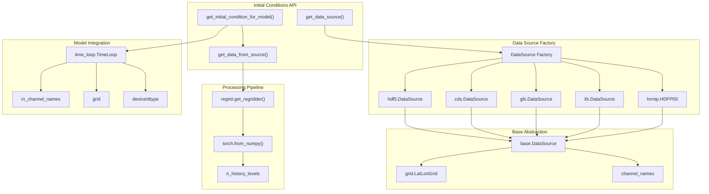
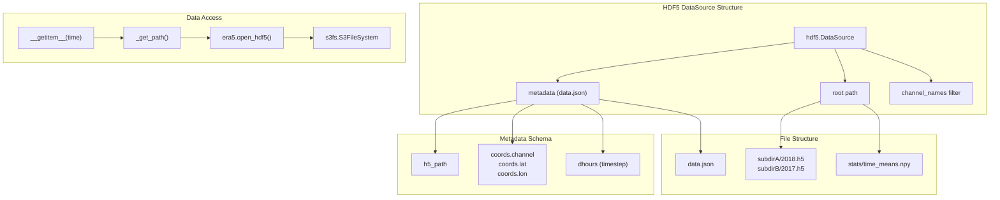
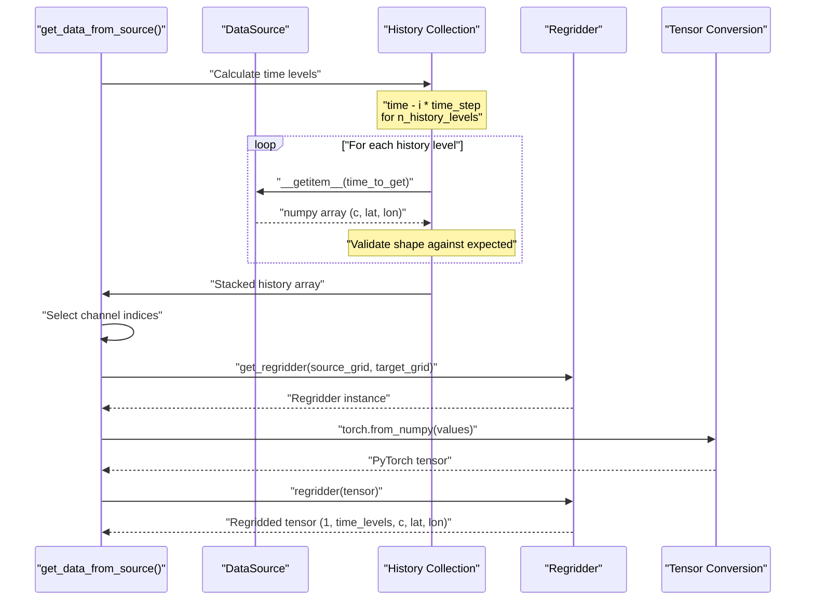
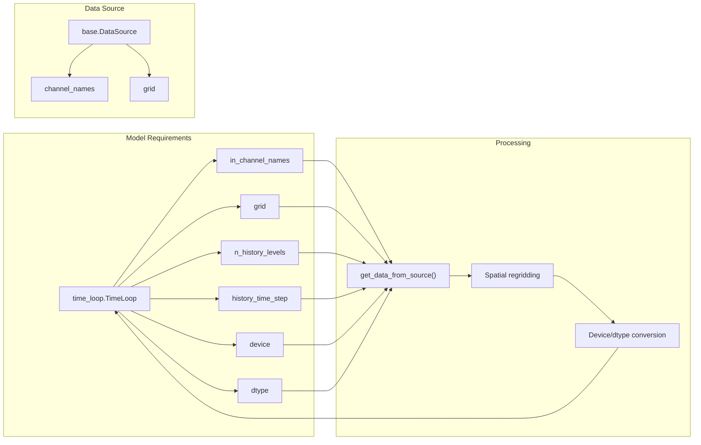

<!-- source: DeepWiki mcp.deepwiki.com · repo NVIDIA/earth2mip · page 5.1 Initial Conditions · fetched 2026-10-26 -->

# Initial Conditions

<details>
<summary>Relevant source files</summary>

The following files were used as context for generating this wiki page:

- [conftest.py](conftest.py)
- [docs/userguide/install.md](docs/userguide/install.md)
- [earth2mip/datasets/era5/__init__.py](earth2mip/datasets/era5/__init__.py)
- [earth2mip/datasets/hindcast.py](earth2mip/datasets/hindcast.py)
- [earth2mip/initial_conditions/__init__.py](earth2mip/initial_conditions/__init__.py)
- [earth2mip/initial_conditions/hdf5.py](earth2mip/initial_conditions/hdf5.py)

</details>


This document covers the initial conditions system in Earth-2 MIP, which provides standardized access to meteorological data for initializing AI weather models. The initial conditions system abstracts different data sources behind a common interface and handles spatial regridding, temporal alignment, and data format conversion for model compatibility.

For information about data processing and regridding capabilities, see [Grids and Regridding](#5.3). For details about specific data source implementations, see [Data Sources](#5.2).

## Overview

The initial conditions system serves as a data abstraction layer that enables AI weather models to access meteorological data from various sources without needing to handle source-specific formats and protocols. The system provides a factory pattern for creating data sources and utilities for converting raw meteorological data into model-ready tensors.

## Architecture



The initial conditions system implements a factory pattern where `get_data_source` creates appropriate data source instances based on the specified source type, and `get_initial_condition_for_model` orchestrates the complete data pipeline from source to model-ready tensors.

Sources: [earth2mip/initial_conditions/__init__.py:36-54]()

## Data Source Types

The system supports multiple meteorological data sources through a common `DataSource` interface:

| Source Type | Schema Enum | Implementation | Description |
|-------------|-------------|----------------|-------------|
| ERA5 | `era5` | `hdf5.DataSource` | ERA5 reanalysis data from HDF5 files |
| CDS | `cds` | `cds.DataSource` | Climate Data Store API access |
| GFS | `gfs` | `gfs.DataSource` | NOAA Global Forecast System |
| IFS | `ifs` | `ifs.DataSource` | ECMWF Integrated Forecasting System |
| HRMIP | `hrmip` | `hrmip.HDFPlSl` | High-Resolution Model Intercomparison Project |

Each data source implements the base `DataSource` interface with methods for:
- `__getitem__(time: datetime.datetime)` - Retrieve data for a specific time
- `grid` property - Spatial grid information
- `channel_names` property - Available meteorological variables

Sources: [earth2mip/initial_conditions/__init__.py:41-54]()

## HDF5 Data Source Implementation

The HDF5 data source is the primary implementation for ERA5 data access:



The HDF5 data source expects a specific directory structure with metadata in `data.json` and yearly HDF5 files organized in subdirectories. It supports both local filesystem and S3 access patterns.

Sources: [earth2mip/initial_conditions/hdf5.py:38-116]()

## Data Processing Pipeline

The `get_data_from_source` function orchestrates the complete data processing pipeline:



The pipeline handles multiple time levels for models requiring historical context, performs channel selection, spatial regridding, and device/dtype conversion.

Sources: [earth2mip/initial_conditions/__init__.py:57-103]()

## Model Integration

The `get_initial_condition_for_model` function provides the primary interface for model integration:



This function extracts all necessary parameters from the model's `TimeLoop` interface and delegates to `get_data_from_source` for the actual data processing.

Sources: [earth2mip/initial_conditions/__init__.py:106-118]()

## Configuration and Environment

Initial conditions rely on environment configuration for default data paths:

| Configuration | Environment Variable | Purpose |
|---------------|---------------------|---------|
| `config.ERA5_HDF5` | `ERA5_HDF5` | Default path for ERA5 HDF5 data |

The system also uses the filesystem abstraction layer for accessing remote data sources and caching downloaded files locally under `~/.cache/earth2mip`.

Sources: [earth2mip/initial_conditions/__init__.py:24](), [earth2mip/initial_conditions/hdf5.py:28]()

## Usage Patterns

### Basic Data Source Creation

```python
# Create data source for specific channels
data_source = get_data_source(
    channel_names=['u10', 'v10', 't2m'],
    initial_condition_source=schema.InitialConditionSource.era5
)
```

### Model Integration

```python
# Get initial conditions for a loaded model
initial_condition = get_initial_condition_for_model(
    time_loop=model,
    data_source=data_source,
    time=datetime.datetime(2018, 1, 1)
)
```

The initial conditions system provides a clean separation between data access concerns and model execution, enabling the same models to work seamlessly with different data sources and the same data sources to work with different model architectures.

Sources: [earth2mip/initial_conditions/__init__.py:36-118]()

---

