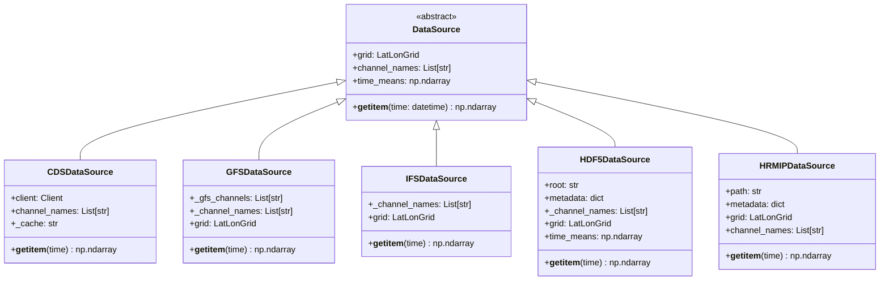
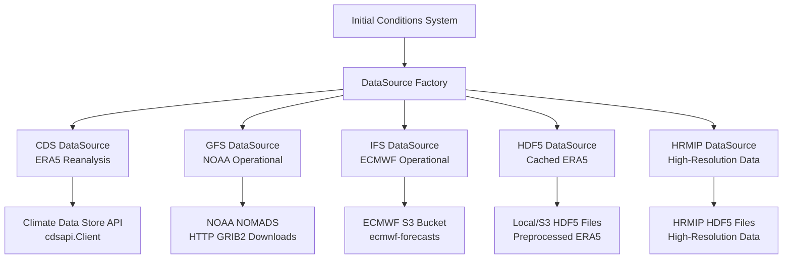
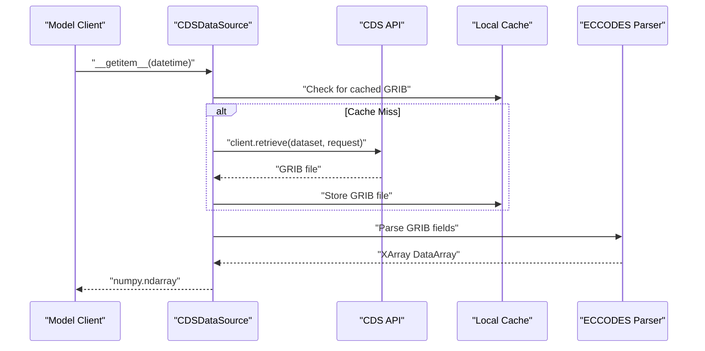
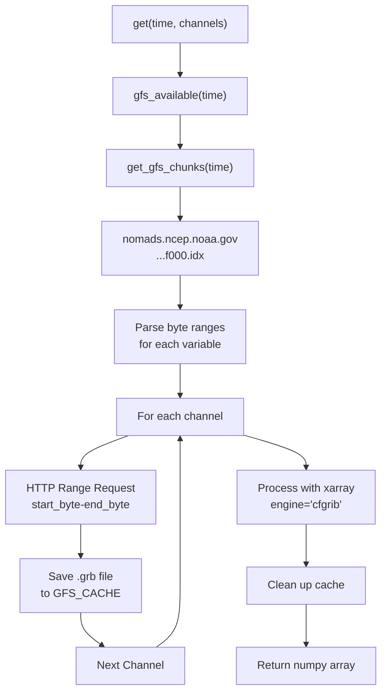

<!-- source: DeepWiki mcp.deepwiki.com · repo NVIDIA/earth2mip · page 5.2 Data Sources · fetched 2026-10-26 -->

# Data Sources

<details>
<summary>Relevant source files</summary>

The following files were used as context for generating this wiki page:

- [conftest.py](conftest.py)
- [docs/userguide/install.md](docs/userguide/install.md)
- [earth2mip/datasets/era5/__init__.py](earth2mip/datasets/era5/__init__.py)
- [earth2mip/datasets/hindcast.py](earth2mip/datasets/hindcast.py)
- [earth2mip/initial_conditions/cds.py](earth2mip/initial_conditions/cds.py)
- [earth2mip/initial_conditions/gfs.py](earth2mip/initial_conditions/gfs.py)
- [earth2mip/initial_conditions/hdf5.py](earth2mip/initial_conditions/hdf5.py)
- [earth2mip/initial_conditions/hrmip.py](earth2mip/initial_conditions/hrmip.py)
- [earth2mip/initial_conditions/ifs.py](earth2mip/initial_conditions/ifs.py)

</details>


This document covers the data source system in Earth-2 MIP, which provides access to meteorological initial conditions from various external providers and formats. Data sources enable models to access real-world atmospheric data for initialization and validation purposes.

For information about how data sources integrate with model workflows, see [Initial Conditions](#5.1). For details about spatial grid handling and coordinate transformations, see [Grids and Regridding](#5.3).

## Data Source Architecture

Earth-2 MIP implements a unified interface for accessing meteorological data from heterogeneous sources. All data sources inherit from a common base class and provide standardized access patterns.

### Core Interface Design



**Sources:** [earth2mip/initial_conditions/base.py](), [earth2mip/initial_conditions/cds.py:104-129](), [earth2mip/initial_conditions/gfs.py:421-436](), [earth2mip/initial_conditions/ifs.py:98-124](), [earth2mip/initial_conditions/hdf5.py:38-116](), [earth2mip/initial_conditions/hrmip.py:67-86]()

### Data Source Factory Pattern



**Sources:** [earth2mip/initial_conditions/cds.py:30](), [earth2mip/initial_conditions/gfs.py:136-145](), [earth2mip/initial_conditions/ifs.py:53-54](), [earth2mip/initial_conditions/hdf5.py:104-108]()

## Available Data Sources

### Climate Data Store (CDS)

The `CDSDataSource` provides access to ERA5 reanalysis data through the Copernicus Climate Data Store API. This source downloads GRIB files on-demand and caches them locally.

| Property | Value |
|----------|--------|
| **Class** | `earth2mip.initial_conditions.cds.DataSource` |
| **Grid Resolution** | 0.25° (721×1440) |
| **Data Format** | GRIB via CDS API |
| **Temporal Coverage** | 1940-present (ERA5) |
| **Update Frequency** | ~5 days behind real-time |

#### Channel Mapping

The CDS source maps Earth-2 MIP channel names to ECMWF parameter codes through `CHANNEL_TO_CODE`:

```python
# Examples from the mapping
CHANNEL_TO_CODE = {
    "z": 129,      # Geopotential
    "u": 131,      # U-component of wind  
    "v": 132,      # V-component of wind
    "t": 130,      # Temperature
    "q": 133,      # Specific humidity
    "t2m": 167,    # 2m temperature
    "u10m": 165,   # 10m U-wind
    "v10m": 166,   # 10m V-wind
    "msl": 151,    # Mean sea level pressure
}
```

#### Request Processing



**Sources:** [earth2mip/initial_conditions/cds.py:43-67](), [earth2mip/initial_conditions/cds.py:126-129](), [earth2mip/initial_conditions/cds.py:182-226](), [earth2mip/initial_conditions/cds.py:254-263]()

### Global Forecast System (GFS)

The `GFSDataSource` provides access to NOAA's operational GFS forecasts through HTTP range requests to NOMADS servers.

| Property | Value |
|----------|--------|
| **Class** | `earth2mip.initial_conditions.gfs.DataSource` |
| **Grid Resolution** | 0.25° (721×1440) |
| **Data Format** | GRIB2 via HTTP |
| **Temporal Coverage** | Real-time operational |
| **Update Frequency** | Every 6 hours |

#### GFS Channel Mapping

The GFS source maintains a comprehensive mapping between Earth-2 MIP channels and GFS variable specifications:

```python
# Example mappings from _get_gfs_name_dict()
gfs_channels = [
    "TMP:2 m above ground",      # t2m
    "UGRD:10 m above ground",    # u10m
    "VGRD:10 m above ground",    # v10m
    "PRES:surface",              # sp
    "PRMSL:",                    # msl
    "UGRD:500 mb",               # u500
    "VGRD:500 mb",               # v500
    "HGT:500 mb",                # z500 (converted to geopotential)
]
```

#### Download Process



**Sources:** [earth2mip/initial_conditions/gfs.py:180-229](), [earth2mip/initial_conditions/gfs.py:87-127](), [earth2mip/initial_conditions/gfs.py:130-178](), [earth2mip/initial_conditions/gfs.py:232-418]()

### Integrated Forecast System (IFS)

The `IFSDataSource` accesses ECMWF's operational IFS HRES forecasts stored in AWS S3.

| Property | Value |
|----------|--------|
| **Class** | `earth2mip.initial_conditions.ifs.DataSource` |
| **Grid Resolution** | 0.4° (variable) |
| **Data Format** | GRIB2 via S3 |
| **Temporal Coverage** | Real-time operational |
| **Update Frequency** | Every 12 hours |

#### Multi-Source Integration

IFS data combines analysis and forecast fields to provide complete initial conditions:

```python
# 0-hour analysis fields
dataset_0h = xarray.open_dataset(analysis_path, engine="cfgrib")

# 12-hour forecast initialized 12 hours earlier  
forecast_12h = xarray.open_dataset(forecast_path, engine="cfgrib")

# Combine sources for different variables
channel_data = [
    _get_channel(c,
        u10m=dataset_0h.u10,    # From analysis
        t2m=forecast_12h.t2m,   # From 12h forecast
        sp=dataset_0h.sp,       # From analysis
        msl=forecast_12h.msl,   # From 12h forecast
        # ...
    ) for c in channels
]
```

**Sources:** [earth2mip/initial_conditions/ifs.py:52-95](), [earth2mip/initial_conditions/ifs.py:31-33](), [earth2mip/initial_conditions/ifs.py:64-82]()

### HDF5 Data Sources

The `HDF5DataSource` provides efficient access to pre-processed ERA5 data stored in HDF5 format, supporting both local and S3-stored files.

| Property | Value |
|----------|--------|
| **Class** | `earth2mip.initial_conditions.hdf5.DataSource` |
| **Grid Resolution** | Configurable via metadata |
| **Data Format** | HDF5 with JSON metadata |
| **Temporal Coverage** | Historical ERA5 data |
| **Update Frequency** | Static datasets |

#### Directory Structure

```
data_root/
├── data.json              # Metadata configuration
├── stats/
│   └── time_means.npy     # Statistical preprocessings
├── train/
│   ├── 2017.h5
│   └── 2018.h5
└── test/
    └── 2019.h5
```

#### Metadata Schema

```json
{
    "h5_path": "fields",
    "coords": {
        "channel": ["u10", "v10", "t2m", "sp", ...],
        "lat": [90.0, 89.75, ..., -90.0],
        "lon": [0.0, 0.25, ..., 359.75]
    },
    "dhours": 6,
    "dims": ["time", "channel", "lat", "lon"]
}
```

**Sources:** [earth2mip/initial_conditions/hdf5.py:38-56](), [earth2mip/initial_conditions/hdf5.py:78-84](), [earth2mip/initial_conditions/hdf5.py:118-122](), [earth2mip/datasets/era5/__init__.py:37-52]()

### HRMIP Data Sources  

The `HRMIPDataSource` handles high-resolution meteorological data with separate pressure level and single level variable storage.

| Property | Value |
|----------|--------|
| **Class** | `earth2mip.initial_conditions.hrmip.HDFPlSl` |
| **Grid Resolution** | 0.25° (721×1440) |
| **Data Format** | HDF5 with pl/sl separation |
| **Temporal Coverage** | High-resolution datasets |
| **Update Frequency** | Static datasets |

**Sources:** [earth2mip/initial_conditions/hrmip.py:67-86](), [earth2mip/initial_conditions/hrmip.py:47-64]()

## Common Interface Patterns

### Time-Based Data Access

All data sources implement the `__getitem__` protocol for datetime-based access:

```python
# Common usage pattern across all sources
data_source = DataSource(channels=["u500", "v500", "t500"])
time = datetime.datetime(2023, 6, 15, 12, 0, 0)
data = data_source[time]  # Returns numpy array (channels, lat, lon)
```

### Grid Standardization

All data sources provide a `grid` property returning a `LatLonGrid` object for spatial coordinate handling:

```python
grid = data_source.grid
assert isinstance(grid, earth2mip.grid.LatLonGrid)
lat_coords = grid.lat  # Latitude coordinates
lon_coords = grid.lon  # Longitude coordinates  
```

### Channel Name Mapping

Data sources handle the translation between Earth-2 MIP standard channel names and provider-specific variable identifiers through internal mapping dictionaries.

**Sources:** [earth2mip/initial_conditions/base.py](), [earth2mip/initial_conditions/cds.py:93-101](), [earth2mip/initial_conditions/gfs.py:232-418](), [earth2mip/initial_conditions/ifs.py:36-50]()

## Integration with Initial Conditions System

Data sources integrate with the broader initial conditions system through the factory pattern and caching infrastructure:


The data source system provides the foundation for reproducible, efficient access to meteorological data across different providers and formats, enabling consistent model initialization regardless of the underlying data source.

**Sources:** [earth2mip/initial_conditions/base.py](), [earth2mip/filesystem.py](), [earth2mip/grid.py]()

---

