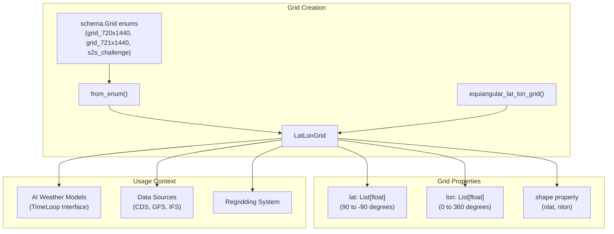
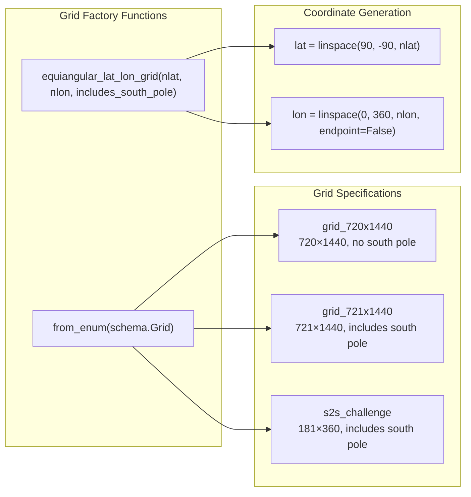
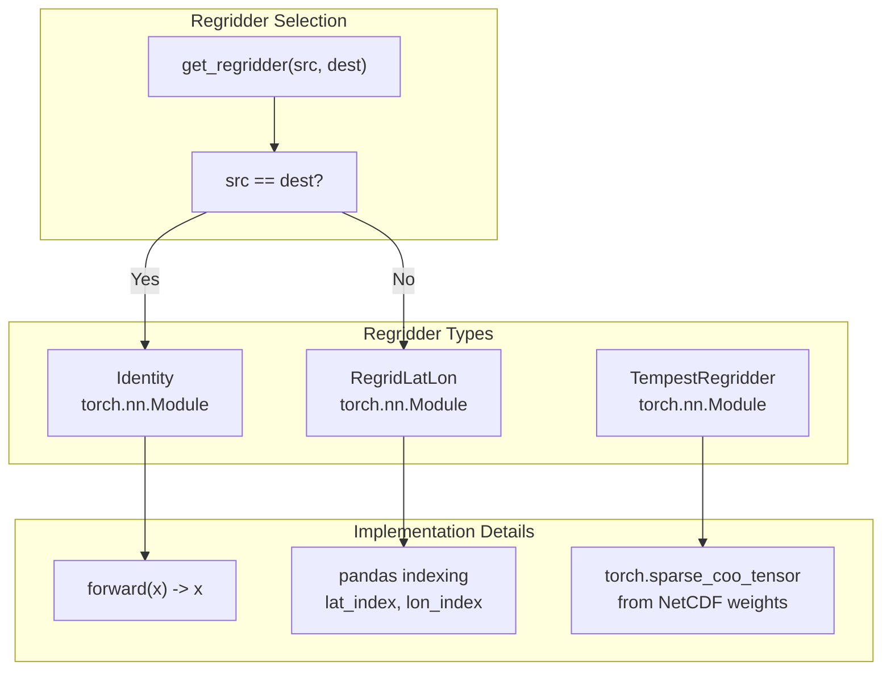
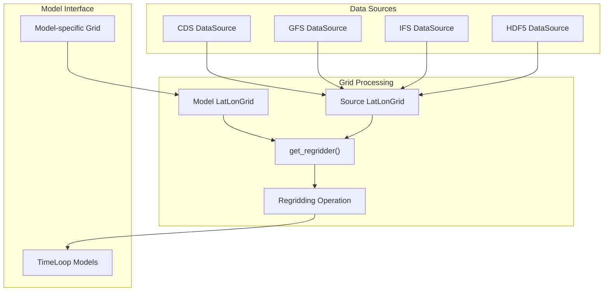

<!-- source: DeepWiki mcp.deepwiki.com · repo NVIDIA/earth2mip · page 5.3 Grids and Regridding · fetched 2026-10-26 -->

# Grids and Regridding

<details>
<summary>Relevant source files</summary>

The following files were used as context for generating this wiki page:

- [earth2mip/_channel_stds.py](earth2mip/_channel_stds.py)
- [earth2mip/grid.py](earth2mip/grid.py)
- [earth2mip/regrid.py](earth2mip/regrid.py)

</details>


This document covers the spatial grid representation and regridding capabilities in Earth-2 MIP. The grid system provides standardized spatial coordinate handling, while regridding enables transformation between different spatial resolutions and coordinate systems. For information about temporal data handling, see [Data Sources](#5.2). For initial condition processing that uses these grids, see [Initial Conditions](#5.1).

## Grid System Overview

Earth-2 MIP uses a unified grid abstraction to handle spatial coordinates across different AI weather models and data sources. The system centers around the `LatLonGrid` class which represents regular latitude-longitude grids commonly used in meteorological data.



**Sources:** [earth2mip/grid.py:24-58]()

## LatLonGrid Implementation

The `LatLonGrid` class provides the core spatial coordinate representation in Earth-2 MIP. It stores latitude and longitude coordinate arrays and computes grid dimensions.

### Core Structure

| Property | Type | Description |
|----------|------|-------------|
| `lat` | `List[float]` | Latitude coordinates from 90° to -90° |
| `lon` | `List[float]` | Longitude coordinates from 0° to 360° |
| `shape` | `tuple` | Grid dimensions as (nlat, nlon) |

### Standard Grid Configurations

Earth-2 MIP supports several predefined grid configurations through the `from_enum()` function:

| Grid Type | Dimensions | South Pole | Use Case |
|-----------|------------|------------|----------|
| `grid_720x1440` | 720×1440 | Excluded | High-resolution global models |
| `grid_721x1440` | 721×1440 | Included | Standard global reanalysis |
| `s2s_challenge` | 181×360 | Included | Sub-seasonal forecasting |

The `equiangular_lat_lon_grid()` function creates regular grids with configurable south pole inclusion:



**Sources:** [earth2mip/grid.py:35-58](), [earth2mip/schema.py]()

## Regridding System

The regridding system transforms data between different spatial grids. Earth-2 MIP provides multiple regridding strategies depending on the relationship between source and destination grids.

### Regridding Classes



**Sources:** [earth2mip/regrid.py:26-87]()

### RegridLatLon Implementation

The `RegridLatLon` class handles regridding between compatible latitude-longitude grids through coordinate indexing:

- **Initialization**: Computes pandas index mappings for latitude and longitude coordinates
- **Validation**: Ensures all destination coordinates exist in source grid
- **Forward pass**: Applies indexing operations to select appropriate grid points

Key implementation details from [earth2mip/regrid.py:61-79]():
- Uses `pandas.Index.get_indexer()` for coordinate matching
- Validates that all indices are found (no -1 values)
- Applies indexing in lat-lon order: `x[..., lat_index, :][..., lon_index]`

### TempestRegridder Implementation

The `TempestRegridder` class uses pre-computed regridding weights from TempestRemap for conservative interpolation:

- **Weight loading**: Reads sparse matrix weights from NetCDF files
- **Sparse operations**: Uses PyTorch sparse tensors for efficient computation
- **Tensor reshaping**: Handles batch and channel dimensions with einops

Implementation from [earth2mip/regrid.py:26-53]():
- Loads `row`, `col`, and `S` arrays from NetCDF files
- Creates `torch.sparse_coo_tensor` for matrix operations
- Applies regridding via sparse matrix multiplication

## Integration with Data Processing

The grid and regridding systems integrate with Earth-2 MIP's data processing pipeline:



**Sources:** [earth2mip/regrid.py:82-86](), [earth2mip/grid.py:24-33]()

### Channel Standardization Context

The grid system works in conjunction with channel standardization for data preprocessing. Channel standard deviations are defined globally and applied consistently across different grid resolutions:

- **Atmospheric variables**: Surface fields (`u10m`, `v10m`, `t2m`, `sp`, `msl`, `tcwv`) and pressure level fields (`u1`-`u1000`, `v1`-`v1000`, etc.)
- **Grid independence**: Standardization values are resolution-agnostic
- **Model compatibility**: Ensures consistent normalization across different model grids

**Sources:** [earth2mip/_channel_stds.py:17-253]()

## Factory Function Usage

The `get_regridder()` function provides a simple interface for obtaining appropriate regridders:

```python
# Returns Identity() if grids are identical
regridder = get_regridder(src_grid, dest_grid)

# Returns RegridLatLon() for compatible lat-lon grids  
regridder = get_regridder(high_res_grid, low_res_grid)
```

This factory pattern enables automatic regridder selection based on grid compatibility, supporting the plugin architecture where different models may require different spatial resolutions.

**Sources:** [earth2mip/regrid.py:82-87]()

---

