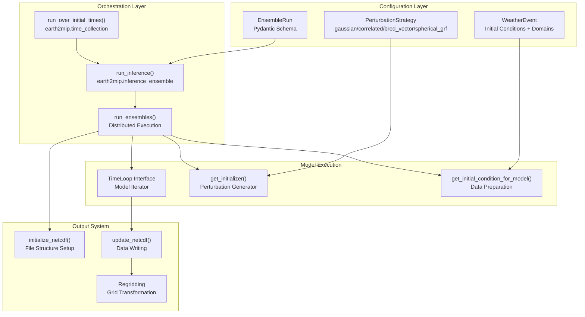
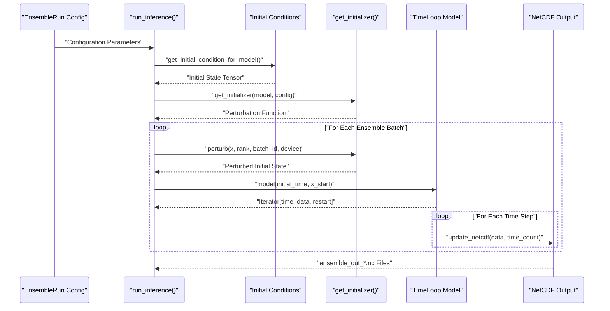
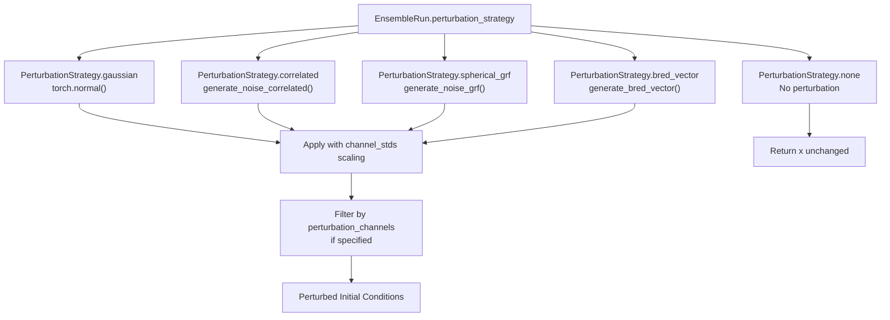

<!-- source: DeepWiki mcp.deepwiki.com · repo NVIDIA/earth2mip · page 6 Inference and Forecasting · fetched 2026-10-26 -->

# Inference and Forecasting

<details>
<summary>Relevant source files</summary>

The following files were used as context for generating this wiki page:

- [earth2mip/ensemble_utils.py](earth2mip/ensemble_utils.py)
- [earth2mip/inference_ensemble.py](earth2mip/inference_ensemble.py)
- [earth2mip/netcdf.py](earth2mip/netcdf.py)
- [earth2mip/schema.py](earth2mip/schema.py)
- [earth2mip/time_collection.py](earth2mip/time_collection.py)
- [test/_regtest_outputs/test_time_collection.test_run_over_initial_times.out](test/_regtest_outputs/test_time_collection.test_run_over_initial_times.out)
- [test/test_time_collection.py](test/test_time_collection.py)

</details>


This document covers Earth-2 MIP's inference and forecasting capabilities, which enable running weather predictions using AI models. The system supports ensemble forecasting with perturbations, deterministic forecasting, and batch processing across multiple initial times. For specific model loading and management, see [Model Management](#4). For evaluation of forecast outputs, see [Model Evaluation and Scoring](#7).

## Overview

Earth-2 MIP provides a comprehensive forecasting framework that orchestrates AI weather models to generate predictions. The system is built around the `TimeLoop` interface and supports multiple forecasting workflows:

- **Ensemble Forecasting**: Multiple forecast members with initial condition perturbations
- **Deterministic Forecasting**: Single forecast runs without perturbations  
- **Time Collection Workflows**: Batch processing across multiple initial times
- **Medium-Range Forecasting**: Extended forecast periods with specialized handling

The forecasting system handles the complete workflow from initial condition preparation through model execution to output generation, with support for distributed computing and various output formats.

## Core Forecasting Architecture

The inference system follows a layered architecture where high-level orchestrators coordinate model execution, perturbation generation, and output handling:

**System Architecture**


Sources: [earth2mip/inference_ensemble.py:301-408](), [earth2mip/time_collection.py:98-137](), [earth2mip/schema.py:81-136]()

## Inference Workflow

The core inference process follows a standardized pattern regardless of the specific forecasting type:

**Inference Execution Flow**


Sources: [earth2mip/inference_ensemble.py:301-408](), [earth2mip/inference_ensemble.py:68-165]()

## Configuration System

Forecasting runs are configured through the `EnsembleRun` schema, which provides comprehensive control over all aspects of the forecast:

| Configuration Category | Key Parameters | Description |
|------------------------|----------------|-------------|
| **Model Selection** | `weather_model` | Model identifier (e.g., "e2mip://pangu") |
| **Ensemble Setup** | `ensemble_members`, `ensemble_batch_size` | Number of members and batching |
| **Simulation Control** | `simulation_length`, `output_frequency` | Duration and output intervals |
| **Perturbations** | `perturbation_strategy`, `noise_amplitude` | Initial condition perturbation method |
| **Output Control** | `output_path`, `output_grid` | Where and how to save results |
| **Weather Event** | `weather_event`, `forecast_name` | Initial conditions and domain specification |

The configuration supports multiple perturbation strategies implemented in `ensemble_utils.py`:

- **`gaussian`**: Simple Gaussian noise perturbations
- **`correlated`**: Spatially correlated (brown) noise using `brown_noise()`
- **`spherical_grf`**: Gaussian Random Fields on the sphere via `GaussianRandomFieldS2`
- **`bred_vector`**: Dynamically bred vectors using `generate_bred_vector()`
- **`none`**: Deterministic run without perturbations

Sources: [earth2mip/schema.py:81-136](), [earth2mip/ensemble_utils.py:148-232]()

## Perturbation Strategies

The perturbation system enables ensemble generation through the `get_initializer()` function, which returns a perturbation function based on the configured strategy:

**Perturbation Strategy Selection**


The perturbation function applies noise scaled by known channel standard deviations from `_channel_stds` and can be restricted to specific channels via `perturbation_channels`.

Sources: [earth2mip/inference_ensemble.py:208-271](), [earth2mip/ensemble_utils.py:26-232]()

## Distributed Execution

Earth-2 MIP supports distributed ensemble forecasting using PyTorch's distributed framework. The system automatically distributes ensemble members across available GPUs:

```python
# Key distributed execution parameters from run_inference()
dist = DistributedManager()
n_ensemble_global = config.ensemble_members
n_ensemble = n_ensemble_global // dist.world_size

# Each rank processes a subset of ensemble members
group_rank = torch.distributed.get_group_rank(group, dist.rank)
output_file_path = os.path.join(output_path, f"ensemble_out_{group_rank}.nc")
```

The distributed execution handles:
- Automatic ensemble member distribution across ranks
- Synchronized random seeding: `torch.manual_seed(seed + dist.rank)`
- Per-rank output files: `ensemble_out_{rank}.nc`
- Process synchronization via `torch.distributed.barrier()`

Sources: [earth2mip/inference_ensemble.py:336-405]()

## Output Generation

The forecasting system generates structured NetCDF output files with CF-1.10 compliance. The output process uses a two-stage approach:

1. **Initialization**: `initialize_netcdf()` sets up file structure, dimensions, and metadata
2. **Updates**: `update_netcdf()` writes model output at each time step

The output files include:
- **Global attributes**: Model metadata, configuration, creation timestamp
- **Coordinate variables**: Time, latitude, longitude with proper CF attributes
- **Data variables**: Forecast fields organized by ensemble member and time
- **Domain support**: Window, MultiPoint, and specialized domain types

Output can be regridded on-the-fly using the regridding system if `output_grid` differs from the model's native grid.

Sources: [earth2mip/netcdf.py:109-157](), [earth2mip/inference_ensemble.py:88-165]()

---

