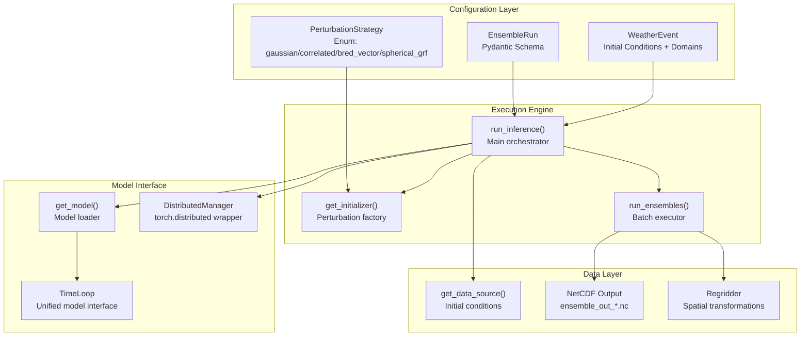
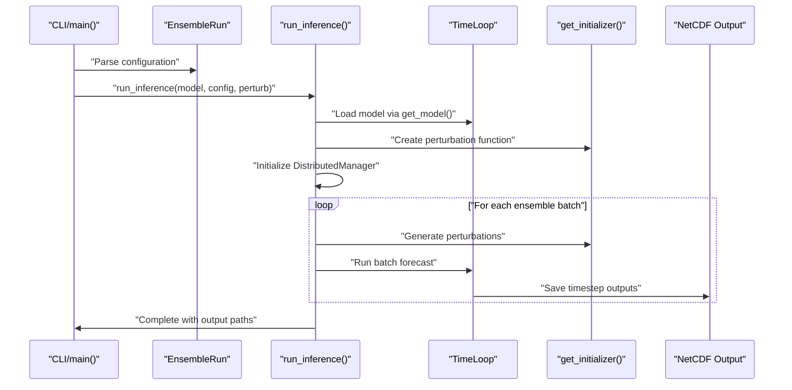
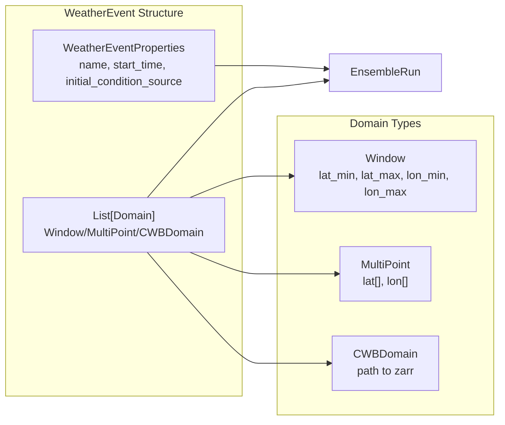
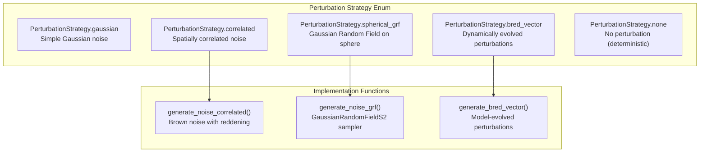
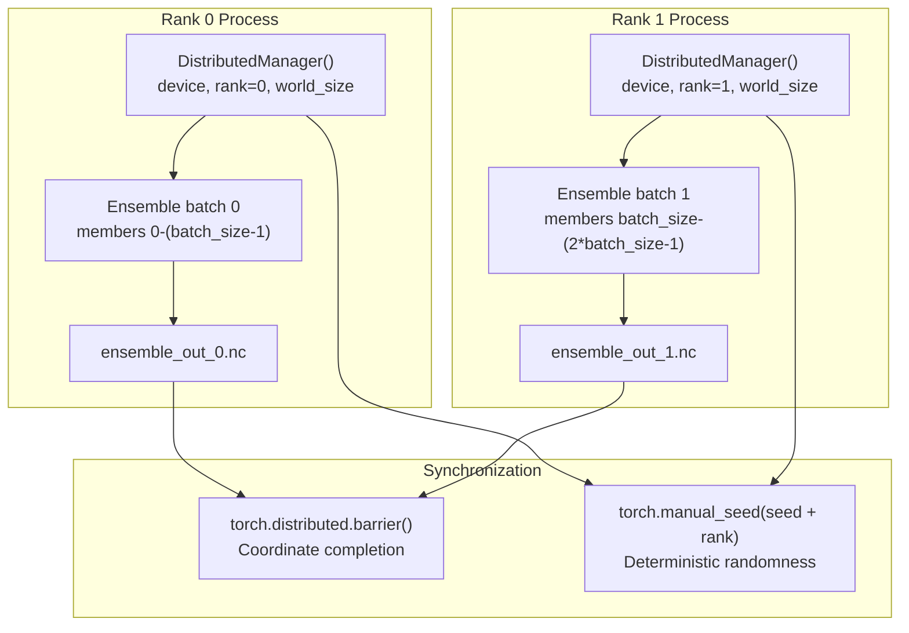
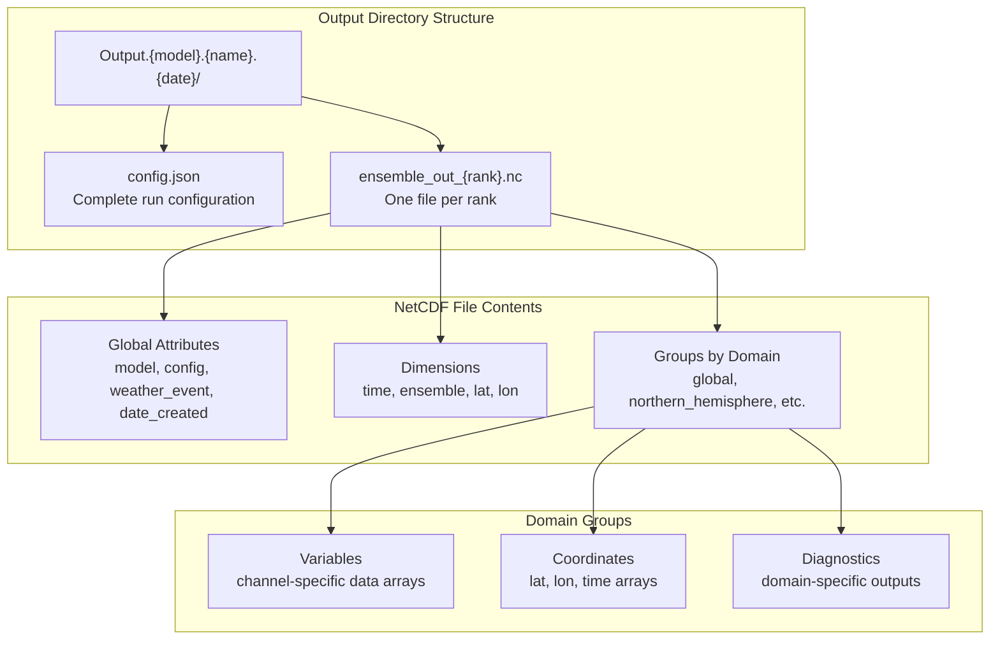
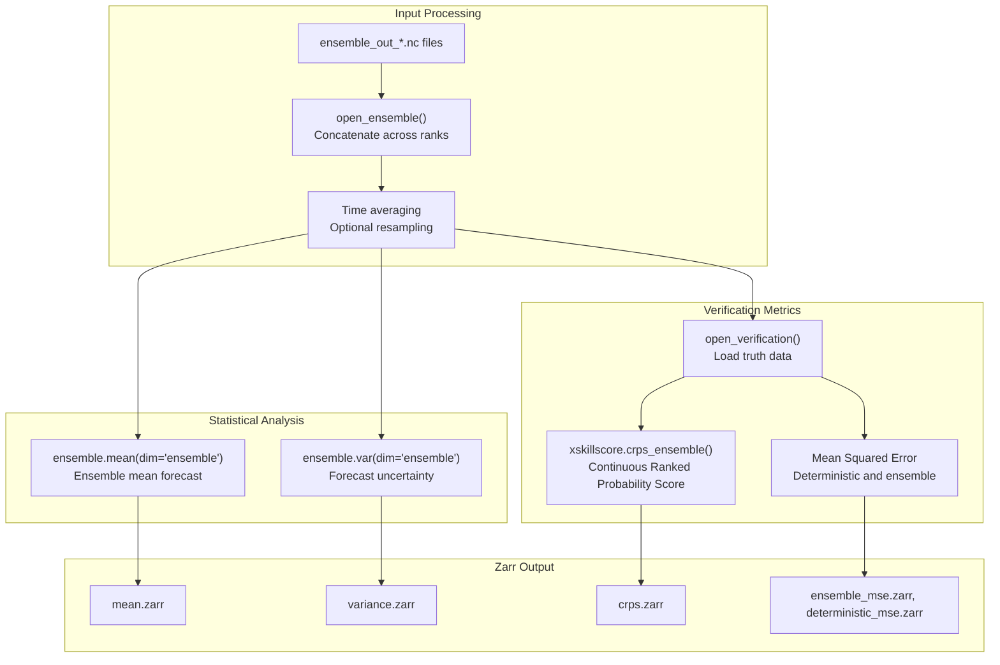

<!-- source: DeepWiki mcp.deepwiki.com · repo NVIDIA/earth2mip · page 6.1 Ensemble Forecasting · fetched 2026-10-26 -->

# Ensemble Forecasting

<details>
<summary>Relevant source files</summary>

The following files were used as context for generating this wiki page:

- [CHANGELOG.md](CHANGELOG.md)
- [earth2mip/_cli_utils.py](earth2mip/_cli_utils.py)
- [earth2mip/_config.py](earth2mip/_config.py)
- [earth2mip/ensemble_utils.py](earth2mip/ensemble_utils.py)
- [earth2mip/inference_ensemble.py](earth2mip/inference_ensemble.py)
- [earth2mip/model_registry.py](earth2mip/model_registry.py)
- [earth2mip/netcdf.py](earth2mip/netcdf.py)
- [earth2mip/schema.py](earth2mip/schema.py)
- [earth2mip/score_ensemble_outputs.py](earth2mip/score_ensemble_outputs.py)
- [earth2mip/weather_events.py](earth2mip/weather_events.py)

</details>


Ensemble forecasting is Earth-2 MIP's primary capability for running probabilistic weather predictions using AI models. This system enables users to generate multiple forecast realizations with different initial condition perturbations to quantify forecast uncertainty and improve prediction skill through ensemble averaging.

This page covers the ensemble forecasting workflow, configuration options, perturbation strategies, and distributed execution capabilities. For information about individual model loading and basic inference, see [Model Management](#4). For details about scoring and evaluation of ensemble outputs, see [Model Evaluation and Scoring](#7).

## System Architecture

The ensemble forecasting system is built around a configurable workflow that integrates model loading, initial condition perturbation, distributed execution, and output management.

### Core Workflow Overview



Sources: [earth2mip/inference_ensemble.py:301-408](), [earth2mip/schema.py:81-136](), [earth2mip/weather_events.py:84-87]()

### Ensemble Execution Flow



Sources: [earth2mip/inference_ensemble.py:166-206](), [earth2mip/inference_ensemble.py:301-408]()

## Configuration System

Ensemble forecasts are configured using the `EnsembleRun` Pydantic schema, which provides comprehensive control over forecast parameters, perturbation strategies, and output options.

### Core Configuration Parameters

| Parameter | Type | Description | Default |
|-----------|------|-------------|---------|
| `weather_model` | `str` | Model identifier (e.g., "e2mip://pangu") | Required |
| `ensemble_members` | `int` | Total number of ensemble members | 1 |
| `simulation_length` | `int` | Forecast length in timesteps | Required |
| `perturbation_strategy` | `PerturbationStrategy` | Noise generation method | `correlated` |
| `noise_amplitude` | `float` | Perturbation magnitude | 0.05 |
| `ensemble_batch_size` | `int` | Members per batch for memory management | 1 |
| `output_frequency` | `int` | Save interval in timesteps | 1 |
| `seed` | `int` | Random seed for reproducibility | 1 |

### Weather Event Configuration



Sources: [earth2mip/schema.py:81-136](), [earth2mip/weather_events.py:34-87]()

## Perturbation Strategies

The ensemble system supports multiple perturbation strategies implemented in `ensemble_utils.py` to generate initial condition uncertainty.

### Available Perturbation Methods



### Perturbation Implementation Details

| Strategy | Implementation | Key Parameters | Use Case |
|----------|----------------|----------------|----------|
| `gaussian` | `torch.normal()` | `noise_amplitude` | Simple, fast testing |
| `correlated` | `brown_noise()` with FFT | `noise_reddening`, `noise_amplitude` | Realistic spatial correlations |
| `spherical_grf` | `GaussianRandomFieldS2` | `grf_noise_alpha`, `grf_noise_tau`, `grf_noise_sigma` | Physically motivated on sphere |
| `bred_vector` | Model integration | `noise_amplitude`, `integration_steps` | Dynamically consistent |

Sources: [earth2mip/ensemble_utils.py:148-233](), [earth2mip/schema.py:73-78]()

## Distributed Execution

Ensemble forecasting supports distributed execution across multiple GPUs and nodes using PyTorch's distributed training infrastructure.

### Distributed Architecture



### Distributed Execution Logic

The system automatically partitions ensemble members across available ranks:

```python
# From inference_ensemble.py:336-346
dist = DistributedManager()
n_ensemble_global = config.ensemble_members
n_ensemble = n_ensemble_global // dist.world_size

# Rank-specific random seeding for reproducibility
seed = config.seed
torch.manual_seed(seed + dist.rank)
np.random.seed(seed + dist.rank)
```

Sources: [earth2mip/inference_ensemble.py:336-346](), [earth2mip/inference_ensemble.py:192-194]()

## Output Management

Ensemble forecasts generate structured NetCDF output files with comprehensive metadata and support for multiple spatial domains.

### Output File Structure



### NetCDF Metadata Schema

The output files include comprehensive metadata following CF conventions:

```python
# From inference_ensemble.py:372-380
nc.model = config.weather_model
nc.config = config.model_dump_json()
nc.weather_event = weather_event.model_dump_json()
nc.date_created = datetime.now().isoformat()
nc.history = " ".join(sys.argv)
nc.institution = "NVIDIA"
nc.Conventions = "CF-1.10"
```

Sources: [earth2mip/inference_ensemble.py:348-408](), [earth2mip/netcdf.py:109-157]()

## Batch Processing and Memory Management

The ensemble system implements efficient batch processing to manage GPU memory usage and enable large ensemble runs.

### Batch Execution Logic

```mermaid
graph LR
    subgraph "Ensemble Batching"
        TotalMembers["Total Ensemble Members<br/>config.ensemble_members"]
        BatchSize["Batch Size<br/>config.ensemble_batch_size"]
        NumBatches["Number of Batches<br/>ceil(total/batch_size)"]
    end
    
    subgraph "Memory Management"
        RepeatIC["x.repeat(batch_size, 1, 1, 1, 1)<br/>Replicate initial conditions"]
        PerturbBatch["perturb(x, rank, batch_id, device)<br/>Apply perturbations"]
        ModelRun["model(initial_time, x_start)<br/>Run batch forecast"]
    end
    
    subgraph "Output Processing"
        RegridData["regridder(data)<br/>Transform to output grid"]
        UpdateNetCDF["update_netcdf()<br/>Save timestep"]
    end
    
    TotalMembers --> BatchSize
    BatchSize --> NumBatches
    NumBatches --> RepeatIC
    RepeatIC --> PerturbBatch
    PerturbBatch --> ModelRun
    ModelRun --> RegridData
    RegridData --> UpdateNetCDF
```



Sources: [earth2mip/inference_ensemble.py:99-165](), [earth2mip/inference_ensemble.py:103-104]()

## Post-Processing and Scoring

Ensemble outputs can be automatically scored and analyzed using the `score_ensemble_outputs.py` module, which computes ensemble statistics and verification metrics.

### Scoring Workflow



Sources: [earth2mip/score_ensemble_outputs.py:44-138]()

## Usage Examples

### Basic Ensemble Configuration

```json
{
  "weather_model": "e2mip://pangu",
  "ensemble_members": 20,
  "simulation_length": 40,
  "perturbation_strategy": "correlated",
  "noise_amplitude": 0.05,
  "noise_reddening": 2.0,
  "ensemble_batch_size": 4,
  "output_frequency": 1,
  "seed": 12345,
  "forecast_name": "2018-01-01-global"
}
```

### Command Line Execution

```bash
# Run ensemble forecast
python -m earth2mip.inference_ensemble config.json

# Score ensemble outputs
python -m earth2mip.score_ensemble_outputs \
  --input_path ./Output.pangu.2018-01-01-global.2024_01_01_00_00_00/ \
  --output_path ./scores/ \
  --time_averaging_window "1D"
```

Sources: [earth2mip/inference_ensemble.py:166-206](), [earth2mip/score_ensemble_outputs.py:141-182]()

---

