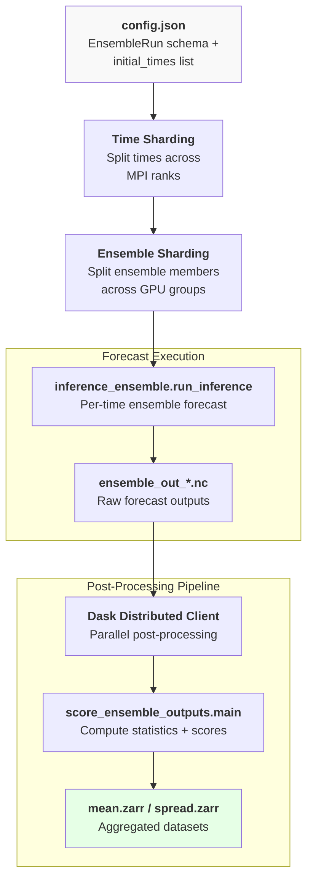
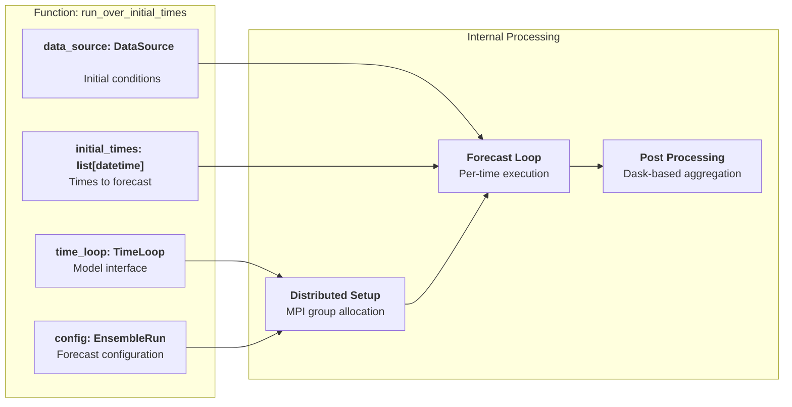
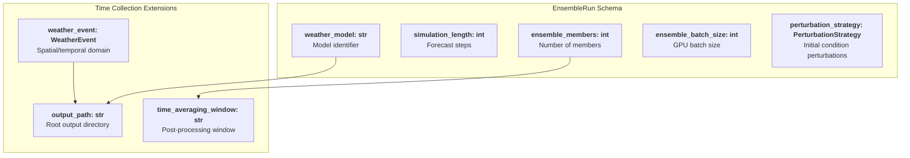
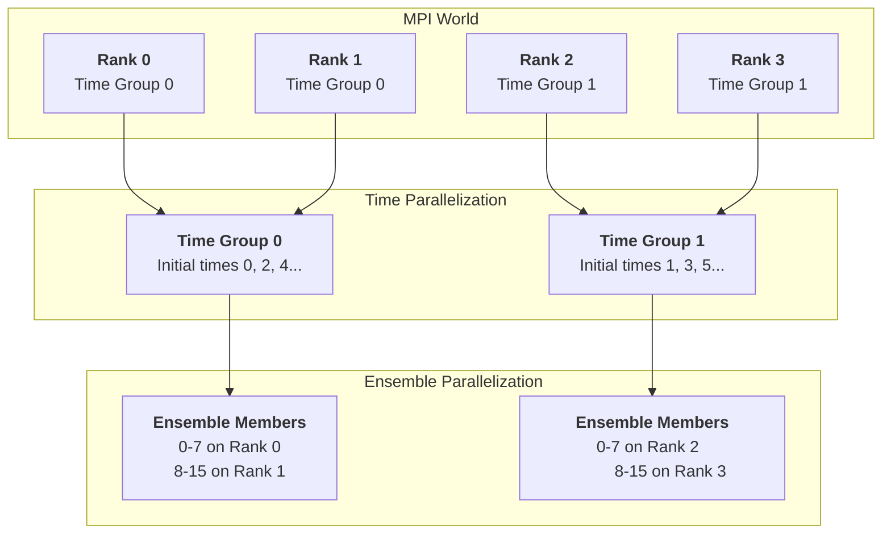
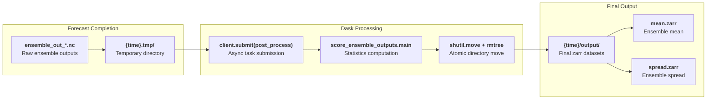

<!-- source: DeepWiki mcp.deepwiki.com · repo NVIDIA/earth2mip · page 6.2 Time Collection Workflows · fetched 2026-10-26 -->

# Time Collection Workflows

<details>
<summary>Relevant source files</summary>

The following files were used as context for generating this wiki page:

- [earth2mip/ensemble_utils.py](earth2mip/ensemble_utils.py)
- [earth2mip/inference_ensemble.py](earth2mip/inference_ensemble.py)
- [earth2mip/netcdf.py](earth2mip/netcdf.py)
- [earth2mip/schema.py](earth2mip/schema.py)
- [earth2mip/time_collection.py](earth2mip/time_collection.py)
- [test/_regtest_outputs/test_time_collection.test_run_over_initial_times.out](test/_regtest_outputs/test_time_collection.test_run_over_initial_times.out)
- [test/test_time_collection.py](test/test_time_collection.py)

</details>


## Purpose and Scope

Time Collection Workflows provide orchestration for running weather forecasts across multiple initial times with distributed computing and automated post-processing. This system enables large-scale hindcast studies, model evaluation campaigns, and operational forecast generation by parallelizing ensemble forecasts across both initial times and ensemble members.

For information about running single-time ensemble forecasts, see [Ensemble Forecasting](#6.1). For details about the scoring and evaluation systems used in post-processing, see [Scoring Systems](#7.1).

## System Overview

Time Collection Workflows coordinate three main phases: distributed forecast execution, ensemble post-processing, and output aggregation. The system automatically manages resource allocation, fault tolerance, and data organization.



Sources: [earth2mip/time_collection.py:98-253](), [earth2mip/time_collection.py:61-95]()

## Core Components

The time collection system is built around several key functions and classes that handle orchestration, distributed computing, and data management.

### Primary Orchestration Function

The `run_over_initial_times()` function serves as the main orchestrator for multi-time forecast workflows:



Sources: [earth2mip/time_collection.py:98-137]()

### Integration Points

Time collection workflows integrate with multiple Earth-2 MIP subsystems:

| Component | Function | Source File |
|-----------|----------|-------------|
| `inference_ensemble.run_inference` | Execute single-time ensemble forecast | [earth2mip/inference_ensemble.py:301-408]() |
| `inference_ensemble.get_initializer` | Generate perturbation functions | [earth2mip/inference_ensemble.py:208-271]() |
| `score_ensemble_outputs.main` | Post-process ensemble outputs | Referenced in [earth2mip/time_collection.py:220-226]() |
| `networks.get_model` | Load model for distributed execution | [earth2mip/time_collection.py:85]() |

Sources: [earth2mip/time_collection.py:201-214](), [earth2mip/time_collection.py:218-234]()

## Configuration Schema

Time collection workflows use the `EnsembleRun` schema with additional protocol-level configuration for managing multiple initial times.

### EnsembleRun Configuration

The base configuration inherits all ensemble forecasting parameters:



Sources: [earth2mip/schema.py:81-136](), [earth2mip/time_collection.py:103-111]()

### Protocol Configuration

Multi-time execution requires additional protocol-level configuration stored in `config.json`:

| Field | Type | Purpose |
|-------|------|---------|
| `protocol.times` | `list[str]` | ISO format initial times |
| `protocol.inference_template` | `EnsembleRun` | Template configuration |
| `protocol.time_averaging_window` | `str` | Post-processing window |
| `protocol.score` | `bool` | Enable scoring metrics |
| `protocol.save_ensemble` | `bool` | Save individual members |

Sources: [earth2mip/time_collection.py:80-95](), [earth2mip/time_collection.py:180-185]()

## Distributed Computing Strategy

Time collection workflows implement a two-level parallelization strategy to efficiently utilize distributed GPU resources.

### Resource Allocation



Sources: [earth2mip/time_collection.py:150-170]()

### Group Formation Logic

The distributed allocation is computed using the following logic from [earth2mip/time_collection.py:150-170]():

```
n_ensemble_batches = ensemble_members // ensemble_batch_size
ranks_per_time = min(n_ensemble_batches, world_size)
time_rank = rank // ranks_per_time
n_time_groups = world_size // ranks_per_time
```

This ensures optimal resource utilization by balancing time-level and ensemble-level parallelism based on the available hardware.

Sources: [earth2mip/time_collection.py:150-170]()

## Post-Processing Pipeline

Each completed forecast triggers an asynchronous post-processing pipeline that computes ensemble statistics and optionally scores against observations.

### Dask Distributed Processing



Sources: [earth2mip/time_collection.py:218-234](), [earth2mip/time_collection.py:172-174]()

### Post-Processing Function

The post-processing workflow is implemented as a closure that gets submitted to the Dask distributed client:

```python
def post_process(d: str) -> None:
    output_path = f"{d}/output/"
    score_ensemble_outputs.main(
        input_path=d,
        output_path=output_path,
        time_averaging_window=time_averaging_window,
        score=score,
        save_ensemble=save_ensemble,
    )
    shutil.move(output_path, output)
    shutil.rmtree(d, ignore_errors=True)
```

Sources: [earth2mip/time_collection.py:218-228]()

## Output Structure

Time collection workflows produce a structured output directory that can be opened as an xarray dataset using the hindcast dataset interface.

### Directory Layout

```
output_path/
├── config.json                    # Protocol configuration
├── 2018-01-01T00:00:00/           # Per-time directories
│   └── output/
│       ├── mean.zarr              # Ensemble mean
│       ├── spread.zarr            # Ensemble spread  
│       └── scores.zarr            # Verification scores (optional)
├── 2018-01-02T00:00:00/
│   └── output/
│       ├── mean.zarr
│       └── spread.zarr
└── ...
```

Sources: [earth2mip/time_collection.py:192-194](), [earth2mip/time_collection.py:227]()

### Dataset Schema

The resulting datasets follow a standardized schema that can be opened using `earth2mip.datasets.hindcast.open_forecast()`:

| Dimension | Description |
|-----------|-------------|
| `initial_time` | Forecast initialization times |
| `time` | Forecast lead times (relative) |  
| `valid_time` | Absolute forecast valid times |
| `lat`, `lon` | Spatial coordinates |

Sources: [test/_regtest_outputs/test_time_collection.test_run_over_initial_times.out:1-35]()

## Usage Examples

### Basic Multi-Time Forecast

The primary interface for time collection workflows is the `run_over_initial_times()` function:

```python
from earth2mip.time_collection import run_over_initial_times
from earth2mip.networks import get_model
from earth2mip.schema import EnsembleRun
import datetime

# Load model
model = get_model("e2mip://pangu", device="cuda")

# Define initial times  
initial_times = [
    datetime.datetime(2018, 1, 1),
    datetime.datetime(2018, 1, 2), 
    datetime.datetime(2018, 1, 3)
]

# Configure ensemble run
config = EnsembleRun(
    weather_model="e2mip://pangu",
    ensemble_members=20,
    simulation_length=40,  # 10 days at 6hr steps
    perturbation_strategy="correlated"
)

# Execute time collection workflow
run_over_initial_times(
    time_loop=model,
    data_source=None,  # Use default for model
    initial_times=initial_times,
    config=config,
    output_path="/path/to/output",
    time_averaging_window="1D",  # Daily averages
    score=True,  # Compute verification scores
    save_ensemble=False  # Save only statistics
)
```

Sources: [test/test_time_collection.py:154-161](), [earth2mip/time_collection.py:98-137]()

### Command Line Interface

Time collection workflows can also be executed via the command line interface:

```bash
# Create job configuration
python -m earth2mip.make_job e2mip://pangu config.json output_dir

# Execute with distributed processing  
torchrun --nnodes=1 --nproc_per_node=4 \
    -m earth2mip.time_collection output_dir
```

Sources: [test/test_time_collection.py:73-87](), [earth2mip/time_collection.py:255-256]()

---

