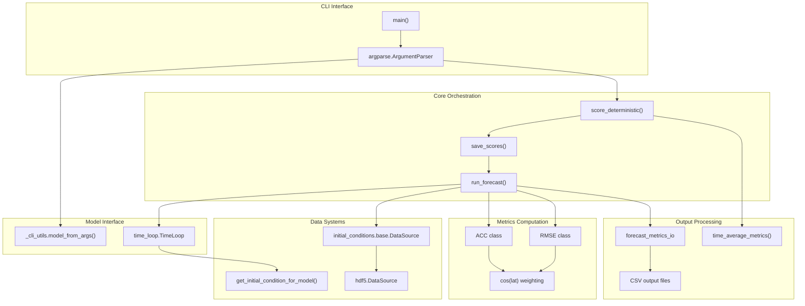
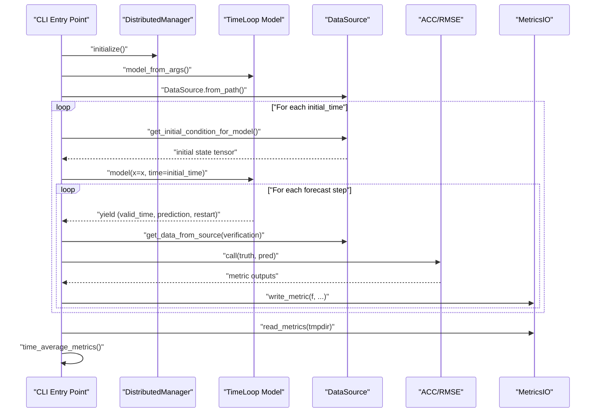
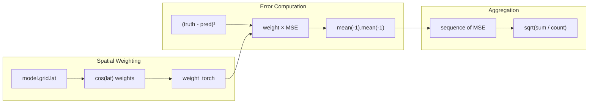
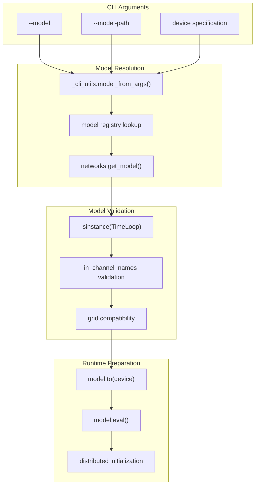
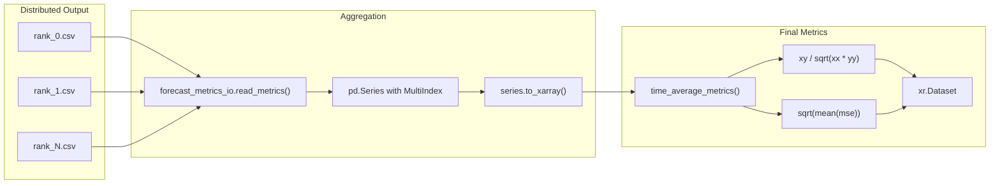

<!-- source: DeepWiki mcp.deepwiki.com · repo NVIDIA/earth2mip · page 6.3 Medium-Range Forecasting · fetched 2026-10-26 -->

# Medium-Range Forecasting

<details>
<summary>Relevant source files</summary>

The following files were used as context for generating this wiki page:

- [earth2mip/forecast_metrics_io.py](earth2mip/forecast_metrics_io.py)
- [earth2mip/inference_medium_range.py](earth2mip/inference_medium_range.py)
- [earth2mip/networks/dlwp.py](earth2mip/networks/dlwp.py)
- [earth2mip/networks/fcn.py](earth2mip/networks/fcn.py)
- [earth2mip/networks/fcnv2_sm.py](earth2mip/networks/fcnv2_sm.py)

</details>


This document covers Earth-2 MIP's medium-range deterministic forecasting capabilities, focusing on single-trajectory weather predictions typically spanning 1-10 days. Medium-range forecasting emphasizes skill assessment through standardized meteorological metrics rather than uncertainty quantification through ensembles.

For ensemble-based forecasting with uncertainty quantification, see [Ensemble Forecasting](#6.1). For multi-time evaluation workflows, see [Time Collection Workflows](#6.2).

## Purpose and Scope

Medium-range forecasting in Earth-2 MIP provides deterministic skill assessment of AI weather models through:

- **Deterministic inference**: Single forward trajectory without perturbations
- **Standardized scoring**: ACC (Anomaly Correlation Coefficient) and RMSE metrics with proper spatial weighting
- **Operational evaluation**: Systematic comparison against reanalysis verification data
- **Distributed computation**: Multi-GPU scoring across time ranges and lead times

## Core Workflow

The medium-range forecasting system follows a standardized evaluation pipeline that integrates model loading, data access, inference execution, and metric computation.

### System Architecture



Sources: [earth2mip/inference_medium_range.py:1-360]()

### Execution Flow



Sources: [earth2mip/inference_medium_range.py:109-177](), [earth2mip/inference_medium_range.py:179-236]()

## Metrics Computation

The medium-range forecasting system implements two primary meteorological skill metrics with proper spatial and temporal averaging.

### Anomaly Correlation Coefficient (ACC)

The `ACC` class computes anomaly correlation coefficients using climatological means and cosine latitude weighting:

| Component | Formula | Purpose |
|-----------|---------|---------|
| `xx` | `mean((truth - climatology)²)` | Truth variance |
| `yy` | `mean((pred - climatology)²)` | Prediction variance |
| `xy` | `mean((pred - climatology)(truth - climatology))` | Covariance |
| `ACC` | `xy / sqrt(xx × yy)` | Final correlation |

Sources: [earth2mip/inference_medium_range.py:62-96]()

### Root Mean Square Error (RMSE)

The `RMSE` class computes spatially-weighted mean square errors:



Sources: [earth2mip/inference_medium_range.py:37-60](), [earth2mip/inference_medium_range.py:128-131]()

## Model Integration

Medium-range forecasting integrates with Earth-2 MIP's model ecosystem through the `TimeLoop` interface, supporting multiple AI architectures.

### Supported Model Types

| Model Family | Implementation | Key Features |
|--------------|----------------|--------------|
| **DLWP** | `DLWPInference` | Cubed-sphere projection, 6-hour steps |
| **FCN v2** | `networks.Inference` | SFNO architecture, 73 channels |
| **FourCastNet** | `networks.Inference` | Standard lat-lon grid |
| **Pangu Weather** | ONNX adapter | Multiple resolutions |
| **GraphCast** | JAX/Haiku backend | Graph neural networks |

Sources: [earth2mip/networks/dlwp.py:34-121](), [earth2mip/networks/fcnv2_sm.py:139-172](), [earth2mip/networks/fcn.py:58-77]()

### Model Loading Pattern



Sources: [earth2mip/inference_medium_range.py:339-343](), [earth2mip/_cli_utils.py]()

## Command Line Interface

The medium-range forecasting system provides a comprehensive CLI for operational evaluation workflows.

### Basic Usage

```bash
python -m earth2mip.inference_medium_range \
    --model "e2mip://fcn" \
    --start-time "2022-01-01T00:00:00" \
    --end-time "2022-01-31T00:00:00" \
    --time-interval "24h" \
    --n 40 \
    /path/to/output/directory
```

### Distributed Execution

For large-scale evaluations across multiple nodes:

```bash
# SLURM array job example
python -m earth2mip.inference_medium_range \
    --model "e2mip://pangu_24" \
    --start-time "2020-01-01T00:00:00" \
    --end-time "2020-12-31T00:00:00" \
    --shard $SLURM_ARRAY_TASK_ID \
    --n-shards $SLURM_ARRAY_TASK_COUNT \
    --n 168 \  # 7 days at 1-hour resolution
    /path/to/output/scores
```

### CLI Arguments

| Argument | Purpose | Default |
|----------|---------|---------|
| `--model` | Model URI or path | Required |
| `--start-time` | Initial time range start | Required |
| `--end-time` | Initial time range end | Required |
| `--time-interval` | Spacing between initial times | Required |
| `--n` | Number of forecast lead times | 4 |
| `--data` | HDF5 data source path | `config.ERA5_HDF5_73` |
| `--shard` | Shard index for distributed runs | 0 |
| `--n-shards` | Total number of shards | 1 |
| `--test` | Minimal test mode | False |

Sources: [earth2mip/inference_medium_range.py:304-356]()

## Output Format and Processing

Medium-range forecasting produces structured CSV output files that support aggregation and analysis across distributed runs.

### CSV Schema

Each metric record contains five fields:

```csv
initial_time_iso,lead_time_hours,channel,metric,value
2022-01-01T00:00:00,24,t2m,mse,652.4
2022-01-01T00:00:00,24,t2m,xx,1824.6
2022-01-01T00:00:00,24,t2m,yy,1456.2
2022-01-01T00:00:00,24,t2m,xy,1203.8
```

### Aggregated Output Structure

The `time_average_metrics()` function produces xarray datasets with standardized dimensions:

```python
netcdf medium_range_scores {
dimensions:
    lead_time = 168 ;  # number of forecast steps
    channel = 73 ;     # model output channels
    initial_time = 365 ; # number of initial times
variables:
    int64 lead_time(lead_time) ;
        lead_time:units = "hours" ;
    string channel(channel) ;
    double acc(lead_time, channel) ;
        acc:_FillValue = NaN ;
    double rmse(lead_time, channel) ;
        rmse:_FillValue = NaN ;
    int64 initial_times(initial_time) ;
        initial_times:units = "days since reference" ;
        initial_times:calendar = "proleptic_gregorian" ;
}
```

### Processing Pipeline



Sources: [earth2mip/inference_medium_range.py:238-251](), [earth2mip/forecast_metrics_io.py:32-71]()

---

