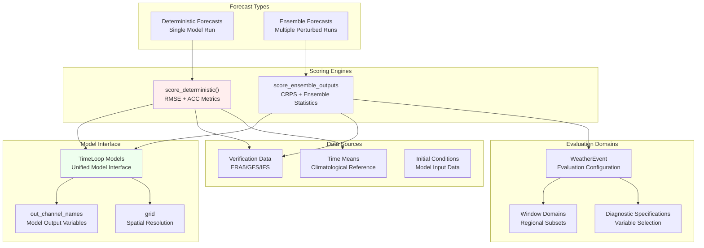
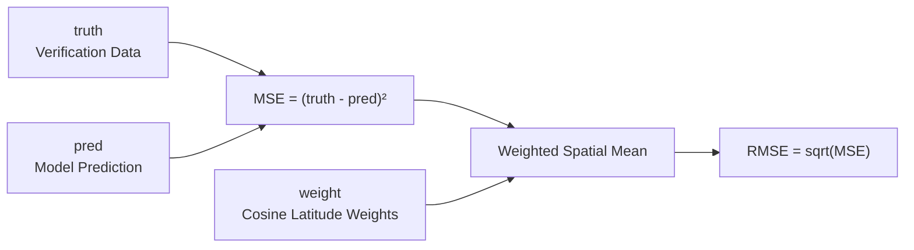
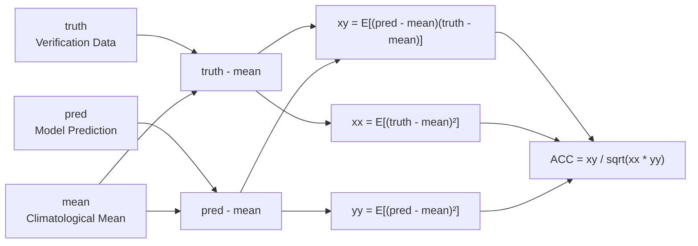
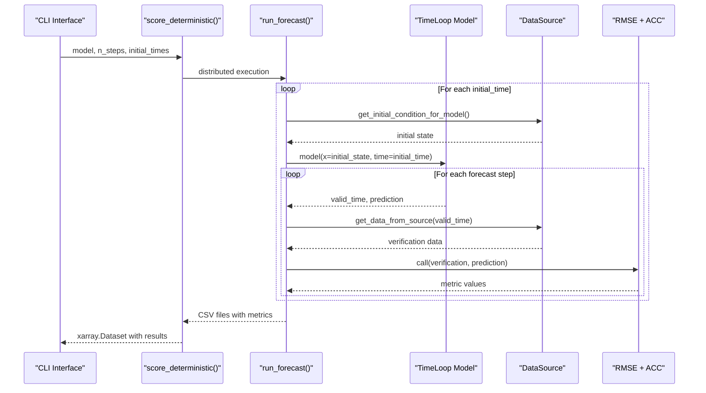
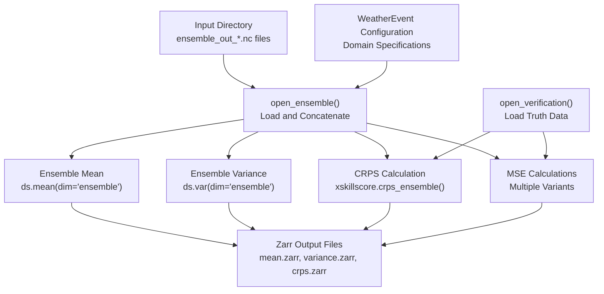
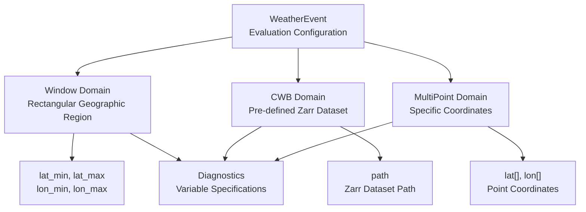
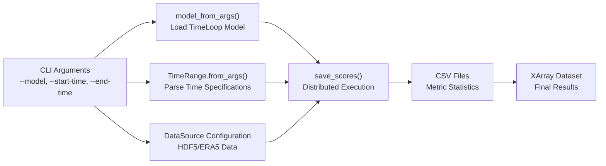

<!-- source: DeepWiki mcp.deepwiki.com · repo NVIDIA/earth2mip · page 7 Model Evaluation and Scoring · fetched 2026-10-26 -->

# Model Evaluation and Scoring

<details>
<summary>Relevant source files</summary>

The following files were used as context for generating this wiki page:

- [CHANGELOG.md](CHANGELOG.md)
- [earth2mip/_cli_utils.py](earth2mip/_cli_utils.py)
- [earth2mip/_config.py](earth2mip/_config.py)
- [earth2mip/inference_medium_range.py](earth2mip/inference_medium_range.py)
- [earth2mip/model_registry.py](earth2mip/model_registry.py)
- [earth2mip/networks/dlwp.py](earth2mip/networks/dlwp.py)
- [earth2mip/networks/fcn.py](earth2mip/networks/fcn.py)
- [earth2mip/networks/fcnv2_sm.py](earth2mip/networks/fcnv2_sm.py)
- [earth2mip/score_ensemble_outputs.py](earth2mip/score_ensemble_outputs.py)
- [earth2mip/weather_events.py](earth2mip/weather_events.py)

</details>


This document covers the model evaluation and scoring systems in Earth-2 MIP, which provide comprehensive tools for assessing AI weather model performance against observational data. The scoring infrastructure supports both deterministic and ensemble forecasts, computes standard meteorological skill metrics, and integrates with the model loading and inference systems.

For information about running ensemble forecasts, see [Ensemble Forecasting](#6.1). For details about model loading and the TimeLoop interface, see [Model Interface (TimeLoop)](#3.2).

## System Architecture

The model evaluation system consists of two main scoring engines that work with different forecast types, a shared model interface, and configurable evaluation domains.



Sources: [earth2mip/inference_medium_range.py:34-303](), [earth2mip/score_ensemble_outputs.py:64-139](), [earth2mip/weather_events.py:84-126]()

## Deterministic Scoring Metrics

The deterministic scoring system computes skill metrics for single forecast runs by comparing model predictions against verification data.

### Core Metrics

| Metric | Class | Description | Formula |
|--------|-------|-------------|---------|
| RMSE | `RMSE` | Root Mean Square Error | `sqrt(E[(truth - pred)²])` |
| ACC | `ACC` | Anomaly Correlation Coefficient | `E[(pred - mean)(truth - mean)] / sqrt(E[(pred - mean)²] E[(truth - mean)²])` |

### RMSE Implementation

The `RMSE` class computes spatially-weighted root mean square errors:



Sources: [earth2mip/inference_medium_range.py:37-60]()

### ACC Implementation

The `ACC` class computes anomaly correlation coefficients using climatological means:



Sources: [earth2mip/inference_medium_range.py:62-97]()

## Deterministic Scoring Workflow

The deterministic scoring workflow runs model forecasts and computes metrics for multiple initial times and lead times.



Sources: [earth2mip/inference_medium_range.py:109-177](), [earth2mip/inference_medium_range.py:179-235]()

### Output Format

The deterministic scoring produces an xarray Dataset with this structure:

```
dimensions:
    lead_time = N ;
    channel = C ;
    initial_time = T ;
variables:
    int64 lead_time(lead_time) ;
    string channel(channel) ;
    double acc(lead_time, channel) ;
    double rmse(lead_time, channel) ;
    int64 initial_times(initial_time) ;
```

Sources: [earth2mip/inference_medium_range.py:194-211]()

## Ensemble Scoring System

The ensemble scoring system processes ensemble forecast outputs stored in NetCDF files and computes probabilistic skill metrics.

### Ensemble Metrics

| Metric | Description | Purpose |
|--------|-------------|---------|
| CRPS | Continuous Ranked Probability Score | Probabilistic skill assessment |
| Ensemble Mean | Average across ensemble members | Central forecast tendency |
| Ensemble Variance | Spread across ensemble members | Forecast uncertainty |
| Ensemble MSE | Mean squared error of ensemble mean | Deterministic skill of ensemble |
| Deterministic MSE | MSE of first ensemble member | Single-member skill |

### Ensemble Processing Workflow



Sources: [earth2mip/score_ensemble_outputs.py:44-138]()

### CRPS Implementation

The ensemble scoring uses the `xskillscore` library to compute CRPS:

```python
crps = xskillscore.crps_ensemble(
    verification,
    ds.chunk(dict(ensemble=-1)),
    issorted=False,
    member_dim="ensemble",
    dim=(),
    keep_attrs=True,
)
```

Sources: [earth2mip/score_ensemble_outputs.py:124-131]()

## Weather Event Configuration

The evaluation system uses `WeatherEvent` configurations to define evaluation domains and diagnostics.

### Domain Types



Sources: [earth2mip/weather_events.py:56-82]()

### Domain Configuration Examples

| Domain Type | Configuration | Use Case |
|-------------|---------------|----------|
| Global | `lat_min=-90, lat_max=90, lon_min=0, lon_max=360` | Global skill assessment |
| Northern Hemisphere | `lat_min=0, lat_max=90, lon_min=0, lon_max=360` | Regional skill assessment |
| Custom Window | User-defined bounds | Targeted geographic regions |

Sources: [earth2mip/weather_events.py:104-119]()

## CLI Integration

The scoring systems integrate with Earth-2 MIP's command-line interface through several entry points.

### Deterministic Scoring CLI



Sources: [earth2mip/inference_medium_range.py:304-359](), [earth2mip/_cli_utils.py:71-78]()

### Ensemble Scoring CLI

The ensemble scoring CLI operates on pre-generated ensemble NetCDF files:

```bash
python -m earth2mip.score_ensemble_outputs \
    --input_path /path/to/ensemble/output \
    --output_path /path/to/scores \
    --time_averaging_window 2W
```

Sources: [earth2mip/score_ensemble_outputs.py:141-182]()

## Model Integration Points

The scoring systems integrate with Earth-2 MIP models through standardized interfaces.

### TimeLoop Interface Requirements

```mermaid
graph TB
    TimeLoopModel["TimeLoop Model<br/>Standardized Interface"]
    
    ChannelNames["out_channel_names<br/>Output Variable Names"]
    GridSpec["grid<br/>LatLonGrid Specification"]
    TimeStep["time_step<br/>Forecast Time Increment"]
    Device["device<br/>GPU/CPU Placement"]
    
    ModelCall["__call__(x, time)<br/>Forecast Generation"]
    DataYield["yield (valid_time, data, restart)<br/>Forecast Outputs"]
    
    TimeLoopModel --> ChannelNames
    TimeLoopModel --> GridSpec
    TimeLoopModel --> TimeStep
    TimeLoopModel --> Device
    
    TimeLoopModel --> ModelCall
    ModelCall --> DataYield
    
    ChannelNames -.-> "Scoring Channel Mapping"
    GridSpec -.-> "Spatial Grid Alignment"
    DataYield -.-> "Metric Computation"
```

Sources: [earth2mip/inference_medium_range.py:122-125](), [earth2mip/networks/dlwp.py:54-75](), [earth2mip/networks/fcn.py:58-77]()

### Channel Name Mapping

The scoring system maps model output channels to verification data channels:

```python
channels = [
    data_source.channel_names.index(name) 
    for name in model.out_channel_names
]
```

This ensures that model predictions are compared against the correct verification variables.

Sources: [earth2mip/inference_medium_range.py:122-124]()

---

