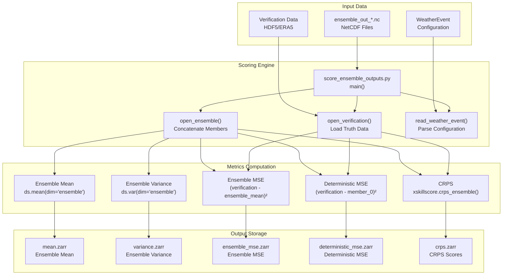
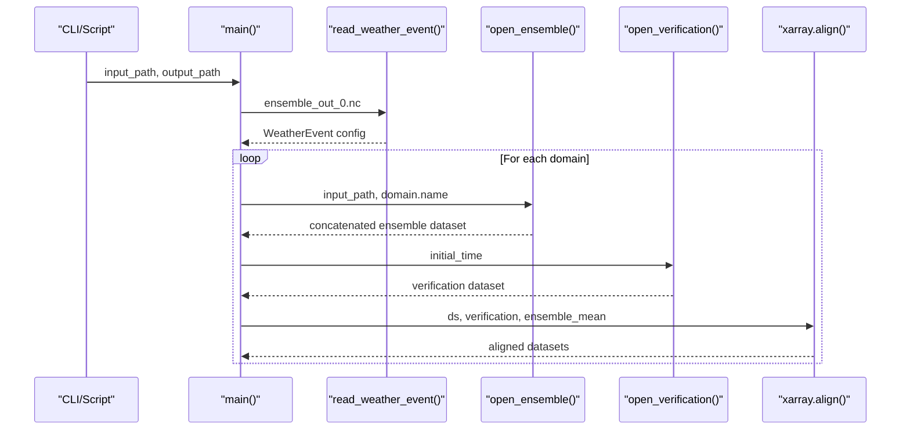
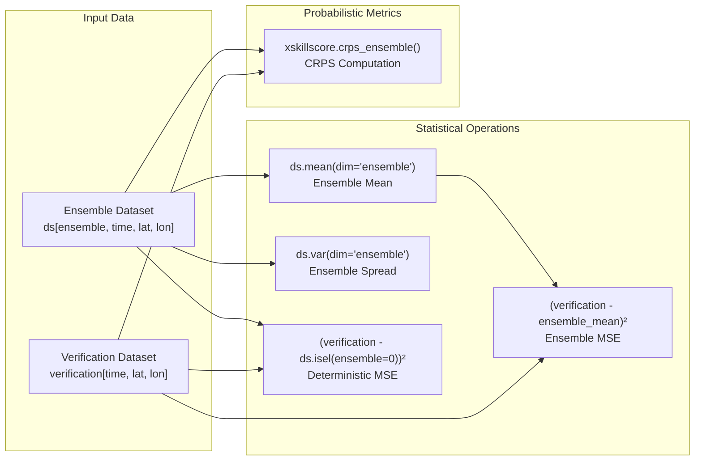
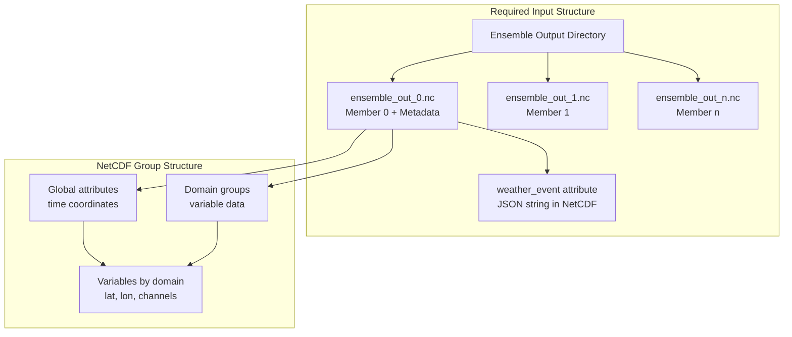
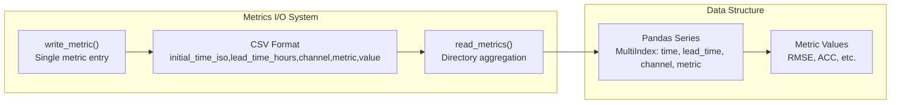
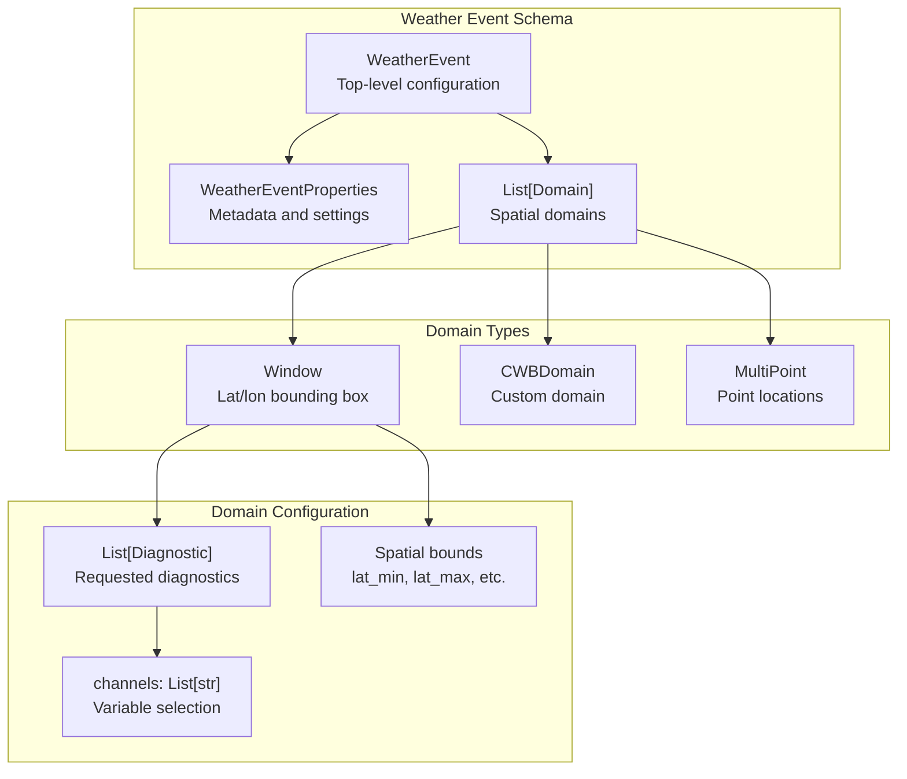

<!-- source: DeepWiki mcp.deepwiki.com · repo NVIDIA/earth2mip · page 7.1 Scoring Systems · fetched 2026-10-26 -->

# Scoring Systems

Relevant source files

The following files were used as context for generating this wiki page:

- [CHANGELOG.md](CHANGELOG.md)
- [earth2mip/_cli_utils.py](earth2mip/_cli_utils.py)
- [earth2mip/_config.py](earth2mip/_config.py)
- [earth2mip/forecast_metrics_io.py](earth2mip/forecast_metrics_io.py)
- [earth2mip/model_registry.py](earth2mip/model_registry.py)
- [earth2mip/score_ensemble_outputs.py](earth2mip/score_ensemble_outputs.py)
- [earth2mip/weather_events.py](earth2mip/weather_events.py)

## Purpose and Scope

The Scoring Systems in Earth-2 MIP provide comprehensive evaluation capabilities for AI weather model forecasts. This system processes ensemble forecast outputs, computes statistical metrics, and generates evaluation datasets for model performance analysis. The scoring infrastructure handles ensemble statistics, deterministic verification, and probabilistic metrics like CRPS (Continuous Ranked Probability Score).

For information about running ensemble forecasts that generate the data scored by these systems, see [Ensemble Forecasting](#6.1). For details about available metrics and their mathematical definitions, see [Metrics and Analysis](#7.2).

## Architecture Overview

The scoring system operates as a post-processing pipeline that consumes ensemble forecast outputs and produces statistical evaluation datasets. The core workflow transforms raw ensemble NetCDF files into structured metrics and statistical summaries.

### Core Scoring Pipeline

**Sources:** [earth2mip/score_ensemble_outputs.py:64-138](), [earth2mip/score_ensemble_outputs.py:44-47](), [earth2mip/score_ensemble_outputs.py:50-54]()

## Core Scoring Workflow

The primary scoring workflow is implemented in the `score_ensemble_outputs.py` module, which processes ensemble forecast directories and generates comprehensive evaluation datasets.

### Data Loading and Preparation

The scoring system loads ensemble forecast data through a standardized interface:

**Sources:** [earth2mip/score_ensemble_outputs.py:57-61](), [earth2mip/score_ensemble_outputs.py:44-47](), [earth2mip/score_ensemble_outputs.py:50-54]()

### File Processing and Organization

The `open_ensemble` function processes multiple NetCDF files from ensemble forecasts:

| Function | Input | Output | Purpose |
|----------|-------|---------|---------|
| `open_ensemble(path, group)` | Directory path, domain group | Concatenated xarray Dataset | Loads and concatenates ensemble members |
| `_open(f, domain, chunks)` | NetCDF file, domain name | Single member Dataset | Loads individual ensemble member |
| `open_verification(time)` | Datetime | Verification Dataset | Loads truth data for scoring |
| `read_weather_event(dir)` | Directory path | WeatherEvent object | Extracts configuration from ensemble output |

**Sources:** [earth2mip/score_ensemble_outputs.py:44-47](), [earth2mip/score_ensemble_outputs.py:37-41](), [earth2mip/score_ensemble_outputs.py:50-54](), [earth2mip/score_ensemble_outputs.py:57-61]()

## Metrics Computation

The scoring system computes multiple statistical and probabilistic metrics for ensemble evaluation.

### Statistical Metrics

**Sources:** [earth2mip/score_ensemble_outputs.py:92-98](), [earth2mip/score_ensemble_outputs.py:116-123](), [earth2mip/score_ensemble_outputs.py:124-132]()

### Time Averaging and Resampling

The scoring system supports temporal aggregation through the `time_averaging_window` parameter:

| Operation | Implementation | Purpose |
|-----------|---------------|---------|
| Time Averaging | `ds.resample(time=time_averaging_window).mean()` | Reduces temporal resolution |
| Verification Alignment | `verification.resample(time=time_averaging_window).mean()` | Matches forecast temporal resolution |
| Attribute Preservation | `keep_attrs=True, skipna=False` | Maintains metadata consistency |

**Sources:** [earth2mip/score_ensemble_outputs.py:86-89](), [earth2mip/score_ensemble_outputs.py:112-115]()

## Data Input and Output Formats

### Input Format Requirements

The scoring system expects specific input data structures:

**Sources:** [earth2mip/score_ensemble_outputs.py:44-47](), [earth2mip/score_ensemble_outputs.py:57-61](), [earth2mip/weather_events.py:84-87]()

### Output Data Products

The scoring system generates multiple output datasets:

| Output File | Content | Format | Use Case |
|-------------|---------|--------|----------|
| `mean.zarr` | Ensemble mean forecasts | Zarr | Deterministic skill assessment |
| `variance.zarr` | Ensemble spread | Zarr | Uncertainty quantification |
| `ensemble_mse.zarr` | Ensemble MSE vs truth | Zarr | Ensemble skill evaluation |
| `deterministic_mse.zarr` | Member 0 MSE vs truth | Zarr | Deterministic baseline |
| `crps.zarr` | CRPS scores | Zarr | Probabilistic skill assessment |
| `ensemble.zarr` | Full ensemble data | Zarr | Complete ensemble archive |

**Sources:** [earth2mip/score_ensemble_outputs.py:93-136](), [earth2mip/score_ensemble_outputs.py:33-34]()

## Integration with Forecast Metrics I/O

The scoring system integrates with a specialized CSV-based metrics storage system for detailed analysis:

### CSV Metrics Format

**Sources:** [earth2mip/forecast_metrics_io.py:74-95](), [earth2mip/forecast_metrics_io.py:32-71](), [earth2mip/forecast_metrics_io.py:18-22]()

### CLI Integration

The scoring system integrates with Earth-2 MIP's CLI infrastructure:

| CLI Component | Function | Purpose |
|---------------|----------|---------|
| `add_model_args()` | Model specification | Links scoring to specific models |
| `model_from_args()` | Model loading | Loads models for verification |
| `TimeRange` class | Time series handling | Manages temporal scoring workflows |

**Sources:** [earth2mip/_cli_utils.py:58-78](), [earth2mip/_cli_utils.py:23-55]()

## Configuration and Environment

### Scoring Configuration

The scoring system uses environment-based configuration:

| Setting | Purpose | Default/Usage |
|---------|---------|---------------|
| `TIME_MEAN` | Time averaging reference | Used in scoring workflows |
| `ERA5_HDF5` | Verification data path | HDF5 verification datasets |
| `LOCAL_CACHE` | Caching directory | `~/.cache/earth2mip` |

**Sources:** [earth2mip/_config.py:55](), [earth2mip/_config.py:50](), [earth2mip/_config.py:52]()

### Weather Event Integration

The scoring system processes weather events through the `WeatherEvent` schema:

**Sources:** [earth2mip/weather_events.py:84-87](), [earth2mip/weather_events.py:34-47](), [earth2mip/weather_events.py:56-80](), [earth2mip/weather_events.py:49-54]()

---

