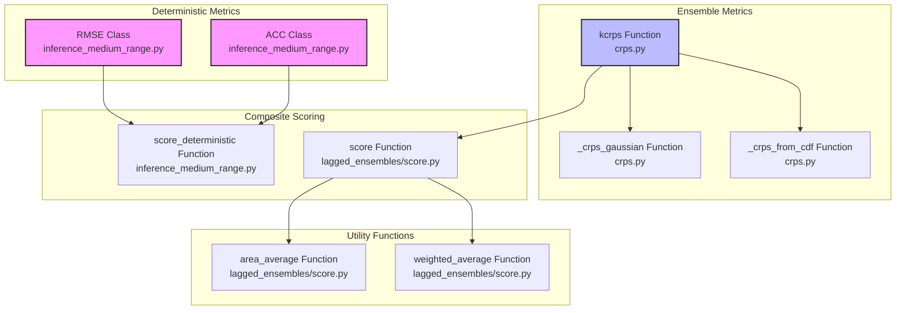
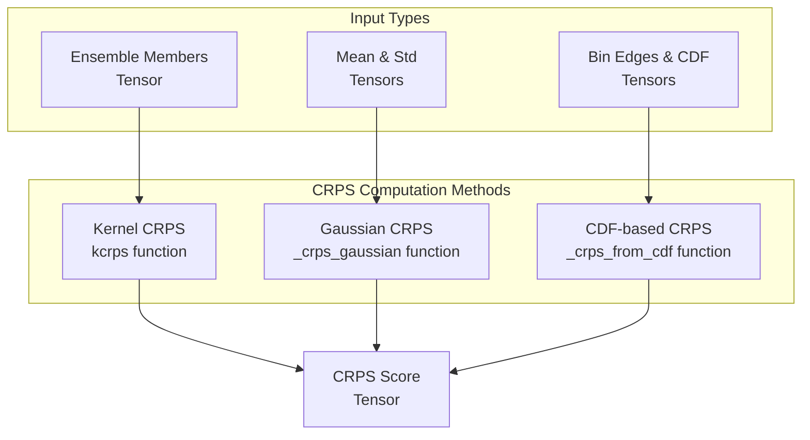
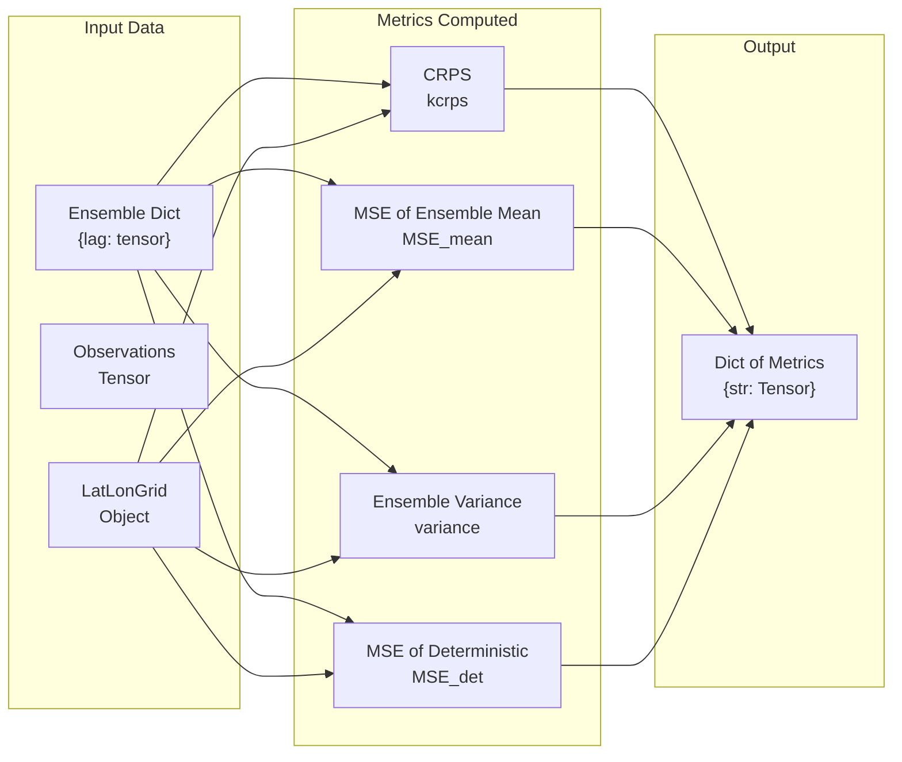

<!-- source: DeepWiki mcp.deepwiki.com · repo NVIDIA/earth2mip · page 7.2 Metrics and Analysis · fetched 2026-10-26 -->

# Metrics and Analysis

<details>
<summary>Relevant source files</summary>

The following files were used as context for generating this wiki page:

- [earth2mip/crps.py](earth2mip/crps.py)
- [earth2mip/inference_medium_range.py](earth2mip/inference_medium_range.py)
- [earth2mip/lagged_ensembles/score.py](earth2mip/lagged_ensembles/score.py)
- [earth2mip/networks/dlwp.py](earth2mip/networks/dlwp.py)
- [earth2mip/networks/fcn.py](earth2mip/networks/fcn.py)
- [earth2mip/networks/fcnv2_sm.py](earth2mip/networks/fcnv2_sm.py)
- [test/lagged_ensembles/test_score.py](test/lagged_ensembles/test_score.py)
- [test/test_crps.py](test/test_crps.py)

</details>


This page covers the available meteorological scoring metrics in Earth-2 MIP and how to compute them. The framework provides implementations for standard verification metrics including RMSE, ACC, and CRPS, along with composite scoring functions for ensemble evaluation.

For information about the overall scoring infrastructure and ensemble output processing, see [Scoring Systems](#7.1). For advanced lagged ensemble evaluation techniques, see [Lagged Ensemble Evaluation](#7.3).

## Available Metrics Overview

Earth-2 MIP implements three main categories of meteorological verification metrics:

| Metric Category | Metrics | Purpose | Use Case |
|----------------|---------|---------|----------|
| **Deterministic** | RMSE, ACC | Single forecast evaluation | Medium-range forecasting |
| **Ensemble** | CRPS | Probabilistic forecast evaluation | Ensemble forecasting |
| **Composite** | Multiple metrics | Comprehensive evaluation | Lagged ensemble analysis |

## Metric Implementation Architecture



Sources: [earth2mip/inference_medium_range.py:37-97](), [earth2mip/crps.py:46-86](), [earth2mip/lagged_ensembles/score.py:36-77]()

## Deterministic Metrics

### RMSE (Root Mean Square Error)

The `RMSE` class computes spatially weighted root mean square error between forecasts and observations.


**Key Features:**
- **Spatial weighting**: Supports latitude-longitude area weighting via `weight` parameter
- **Batched computation**: Processes multiple channels and grid points efficiently  
- **Device support**: Works on both CPU and GPU tensors

**Implementation details:**
- Initialized with optional `weight` tensor for spatial averaging [earth2mip/inference_medium_range.py:40-42]()
- Computes weighted mean squared error in `call` method [earth2mip/inference_medium_range.py:54-56]()
- Final RMSE computed via square root in `gather` method [earth2mip/inference_medium_range.py:58-59]()

### ACC (Anomaly Correlation Coefficient)

The `ACC` class computes the anomaly correlation coefficient, measuring correlation between forecast and observed anomalies relative to climatology.

**Mathematical formulation:**
ACC = E[(pred - mean)(truth - mean)] / √(E[(pred - mean)²] × E[(truth - mean)²])

**Key Features:**
- **Climatological reference**: Requires time mean for anomaly computation
- **Spatial weighting**: Supports area-weighted spatial averaging
- **Correlation-based**: Measures linear relationship between anomalies

**Implementation details:**
- Initialized with climatological `mean` and optional `weight` [earth2mip/inference_medium_range.py:65-70]()
- Computes correlation components (xx, yy, xy) in `call` method [earth2mip/inference_medium_range.py:82-86]()
- Final ACC computed as normalized correlation in `gather` method [earth2mip/inference_medium_range.py:88-96]()

Sources: [earth2mip/inference_medium_range.py:37-97]()

## Ensemble Metrics

### CRPS (Continuous Ranked Probability Score)

CRPS measures the quality of probabilistic forecasts by comparing the cumulative distribution function of forecasts against observations.



**Kernel CRPS Implementation:**
The main `kcrps` function implements the kernel version of CRPS with O(m log m) complexity:

**Mathematical formulation:**
CRPS(X, y) = E[|X - y|] - 0.5 × E[|X - X'|]

**Key Features:**
- **Fair ensemble scoring**: Unbiased estimator option for finite ensembles
- **Efficient computation**: O(m log m) complexity via sorting
- **Memory efficient**: Avoids O(m²) memory usage of naive implementation
- **Spatial preservation**: Computes local CRPS without spatial aggregation

**Implementation details:**
- Core computation in `_kernel_crps_implementation` [earth2mip/crps.py:26-43]()
- Biased/unbiased estimation controlled by `biased` parameter [earth2mip/crps.py:40-42]()
- Ensemble dimension handling via `torch.movedim` [earth2mip/crps.py:85]()

Sources: [earth2mip/crps.py:25-86]()

## Composite Scoring Functions

### Lagged Ensemble Scoring

The `score` function in `lagged_ensembles/score.py` provides comprehensive evaluation for lagged ensemble forecasts.



**Metrics included:**
- **CRPS**: Probabilistic skill of ensemble
- **MSE_mean**: Mean squared error of ensemble mean
- **variance**: Ensemble spread
- **MSE_det**: Mean squared error of deterministic forecast (lag 0 if available)

**Area weighting:**
All metrics are area-weighted using cosine of latitude via `area_average` function [earth2mip/lagged_ensembles/score.py:30-33]().

### Deterministic Scoring Workflow

The `score_deterministic` function provides end-to-end scoring for deterministic forecasts across multiple initial times.

**Workflow:**
1. **Distributed processing**: Splits initial times across available GPUs/processes
2. **Forecast execution**: Runs model inference for each initial time
3. **Metric computation**: Computes RMSE and ACC at each lead time
4. **Data aggregation**: Collects results and computes time-averaged metrics

**Output format:**
Returns an `xarray.Dataset` with dimensions:
- `lead_time`: Forecast lead times in hours
- `channel`: Model output variables
- `initial_time`: Initial forecast times

Sources: [earth2mip/inference_medium_range.py:179-251](), [earth2mip/lagged_ensembles/score.py:36-77]()

## Computing Metrics

### Basic Metric Computation

**RMSE Example:**
```python
# Initialize with area weighting
lat = np.deg2rad(model.grid.lat)
weight = torch.from_numpy(np.cos(lat)[:, np.newaxis])
rmse_metric = RMSE(weight=weight)

# Compute RMSE
mse_outputs = rmse_metric.call(truth_tensor, pred_tensor)
rmse_value = rmse_metric.gather([mse_outputs])
```

**CRPS Example:**
```python
# Ensemble predictions shape: (ensemble_size, ...)
# Observations shape: (...)
crps_scores = kcrps(ensemble_predictions, observations, dim=0, biased=False)
```

### Distributed Scoring

For large-scale evaluation, use the distributed scoring functions:

**Medium-range deterministic scoring:**
```python
scores = score_deterministic(
    model=time_loop_model,
    n=forecast_steps,
    initial_times=time_list,
    data_source=data_source,
    time_mean=climatology_array
)
```

**Lagged ensemble scoring:**
```python
ensemble_dict = {lag: forecast_tensor for lag, forecast_tensor in ensemble_data}
scores = score(grid, ensemble_dict, observations, biased=False)
```

Sources: [earth2mip/inference_medium_range.py:254-301](), [earth2mip/lagged_ensembles/score.py:36-77]()

---

