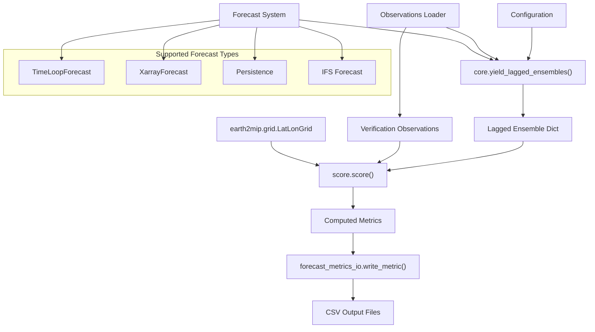
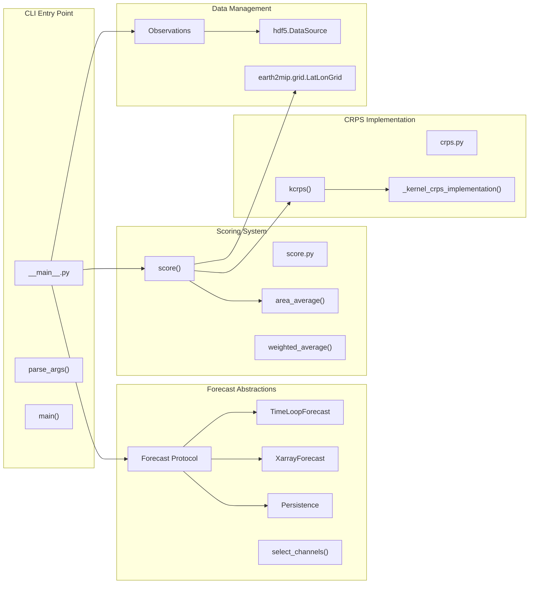

<!-- source: DeepWiki mcp.deepwiki.com · repo NVIDIA/earth2mip · page 7.3 Lagged Ensemble Evaluation · fetched 2026-10-26 -->

# Lagged Ensemble Evaluation

<details>
<summary>Relevant source files</summary>

The following files were used as context for generating this wiki page:

- [earth2mip/crps.py](earth2mip/crps.py)
- [earth2mip/forecasts.py](earth2mip/forecasts.py)
- [earth2mip/lagged_ensembles/__main__.py](earth2mip/lagged_ensembles/__main__.py)
- [earth2mip/lagged_ensembles/score.py](earth2mip/lagged_ensembles/score.py)
- [test/lagged_ensembles/test_score.py](test/lagged_ensembles/test_score.py)
- [test/test_crps.py](test/test_crps.py)

</details>


## Purpose and Scope

This document covers the lagged ensemble evaluation system in Earth-2 MIP, which provides advanced techniques for evaluating AI weather model performance using ensembles created from forecasts with different initialization times. This system allows researchers to assess model skill, uncertainty quantification, and forecast reliability by comparing predictions that are valid at the same time but originated from different initial conditions.

For information about basic model evaluation and scoring, see [Scoring Systems](#7.1). For ensemble forecasting workflows, see [Ensemble Forecasting](#6.1).

## Overview of Lagged Ensembles

Lagged ensembles are a sophisticated evaluation technique where multiple forecasts valid at the same verification time are generated from different initialization times. For example, to evaluate a forecast valid at time T, the system can combine:
- A forecast initialized at T-0 with 0-hour lead time
- A forecast initialized at T-6h with 6-hour lead time  
- A forecast initialized at T-12h with 12-hour lead time

This approach creates an ensemble that captures model uncertainty and provides probabilistic forecast evaluation, enabling more robust assessment of model performance compared to deterministic evaluation.

Sources: [earth2mip/lagged_ensembles/__main__.py:125-138]()

## System Architecture

### Lagged Ensemble Workflow



The lagged ensemble evaluation system follows a pipeline architecture where multiple forecast systems feed into a common evaluation framework. The `core.yield_lagged_ensembles()` function orchestrates the generation of lagged ensembles, while the scoring system provides standardized metrics.

Sources: [earth2mip/lagged_ensembles/__main__.py:38-83](), [earth2mip/lagged_ensembles/core.py](), [earth2mip/forecasts.py:39-51]()

### Core Components Integration



The system integrates multiple Earth-2 MIP components through well-defined interfaces. The `Forecast` protocol provides a unified interface for different forecast types, while the scoring system leverages the CRPS implementation for probabilistic evaluation.

Sources: [earth2mip/lagged_ensembles/__main__.py:17-34](), [earth2mip/forecasts.py:17-51](), [earth2mip/lagged_ensembles/score.py:16-24]()

## Core Components

### Forecast Interface

The lagged ensemble system works with any forecast that implements the `Forecast` protocol defined in `earth2mip.forecasts`. This protocol requires:

- `channel_names` property: List of meteorological variable names
- `grid` property: `earth2mip.grid.LatLonGrid` defining spatial coordinates  
- `__getitem__` method: Iterator yielding forecast tensors with shape `(1, n_channels, n_lat, n_lon)`

Key forecast implementations include:

| Forecast Type | Class | Purpose |
|---------------|--------|---------|
| AI Model | `TimeLoopForecast` | Wraps TimeLoop models for inference |
| Pre-computed | `XarrayForecast` | Uses existing forecast datasets |
| Baseline | `Persistence` | Returns initial conditions as forecast |
| Channel Selection | `select_channels` | Filters specific meteorological variables |

Sources: [earth2mip/forecasts.py:39-51](), [earth2mip/forecasts.py:92-126](), [earth2mip/forecasts.py:128-167]()

### Observations System

The `Observations` class provides asynchronous access to verification data:

```python
class Observations:
    def __init__(self, times, pool, data_source, channel_names, grid, device)
    async def __getitem__(self, i) -> torch.Tensor  # Returns (channel, lat, lon)
```

This class abstracts data loading using thread pools for efficient I/O operations and supports various data sources through the `earth2mip.initial_conditions` interface.

Sources: [earth2mip/lagged_ensembles/__main__.py:85-123]()

### Scoring Metrics

The `score.score()` function computes standardized probabilistic and deterministic metrics:

| Metric | Description | Formula |
|--------|-------------|---------|
| `crps` | Continuous Ranked Probability Score | Area-averaged CRPS using kernel method |
| `MSE_mean` | Mean Squared Error of ensemble mean | `(ensemble_mean - obs)²` |
| `variance` | Ensemble variance | Unbiased variance across ensemble members |
| `MSE_det` | Deterministic MSE | MSE of lag-0 forecast (if available) |

All metrics are area-averaged using cosine latitude weighting and returned as channel-specific tensors.

Sources: [earth2mip/lagged_ensembles/score.py:36-77]()

## CRPS Implementation

The system uses an efficient O(m log m) kernel CRPS implementation that avoids the O(m²) memory requirements of naive approaches:

```python
def kcrps(pred: Tensor, obs: Tensor, dim: int = 0, biased: bool = True)
```

The implementation supports both biased and unbiased estimators. The unbiased version addresses the finite ensemble bias described in Zamo and Naveau (2018), making it suitable for comparing ensembles of different sizes.

Sources: [earth2mip/crps.py:46-86](), [earth2mip/crps.py:25-43]()

## Configuration and Usage

### Command Line Interface

The lagged ensemble evaluation can be run through the CLI with various forecast sources:

```bash
# AI model evaluation
torchrun --nproc_per_node 2 -m earth2mip.lagged_ensembles --model sfno_73ch --inits 10 --leads 5 --lags 4

# Pre-computed forecast evaluation  
python -m earth2mip.lagged_ensembles --forecast_dir /path/to/forecasts --lags 2

# Persistence baseline
python -m earth2mip.lagged_ensembles --persistence --lags 3
```

### Key Parameters

| Parameter | Type | Description | Default |
|-----------|------|-------------|---------|
| `--lags` | int | Number of lag values (±lags) | 4 |
| `--leads` | int | Number of lead times to evaluate | 54 |
| `--channels` | str | Comma-separated channel list | All channels |
| `--crps-unbiased` | flag | Use unbiased CRPS estimator | False |
| `--output` | str | Output directory for CSV files | "." |

The system supports distributed evaluation using PyTorch's distributed training infrastructure, with each rank writing results to separate CSV files.

Sources: [earth2mip/lagged_ensembles/__main__.py:222-246](), [earth2mip/lagged_ensembles/__main__.py:125-138]()

### Output Format

Results are written to CSV files using the `earth2mip.forecast_metrics_io` format with columns:
- `initial_time`: Forecast initialization time
- `lead_time`: Forecast lead time  
- `channel`: Meteorological variable name
- `metric`: Metric name (crps, MSE_mean, etc.)
- `value`: Computed metric value

This format enables easy integration with analysis workflows and comparison across different models and configurations.

Sources: [earth2mip/lagged_ensembles/__main__.py:62-82]()

---

