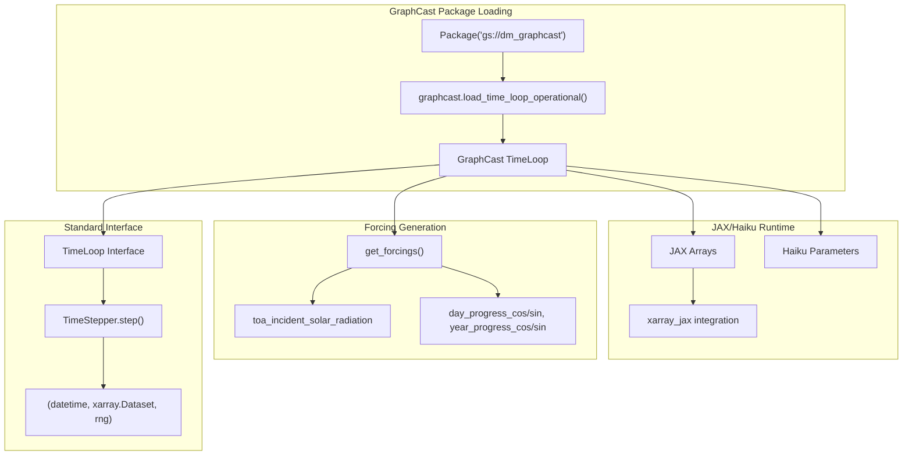
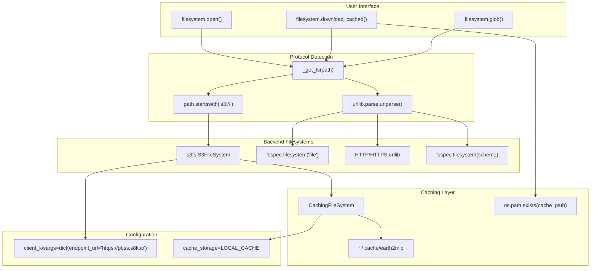
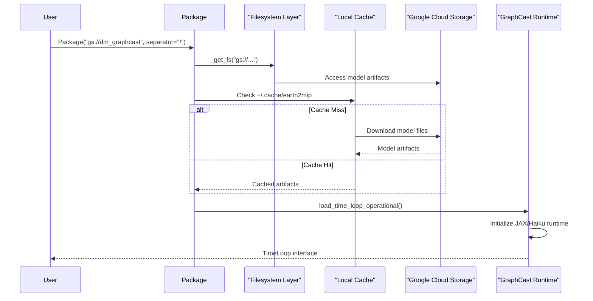

<!-- source: DeepWiki mcp.deepwiki.com · repo NVIDIA/earth2mip · page 8 Advanced Features · fetched 2026-10-26 -->

# Advanced Features

Relevant source files

The following files were used as context for generating this wiki page:

- [docs/userguide/concepts.rst](docs/userguide/concepts.rst)
- [earth2mip/filesystem.py](earth2mip/filesystem.py)
- [examples/utils/workflows/graphcast_simple.py](examples/utils/workflows/graphcast_simple.py)
- [test/graphcast/.gitignore](test/graphcast/.gitignore)
- [test/graphcast/README.md](test/graphcast/README.md)
- [test/test_graphcast.py](test/test_graphcast.py)

## Purpose and Scope

This document covers advanced capabilities and specialized model integrations within Earth-2 MIP that extend beyond the basic model loading and inference workflows. These features enable sophisticated research workflows, support complex model architectures, and provide enterprise-grade data access patterns.

For basic model loading and inference, see [Model Management](#4). For standard ensemble forecasting workflows, see [Inference and Forecasting](#6).

## Overview

Earth-2 MIP's advanced features fall into several categories:

- **Specialized Model Integrations**: Support for complex model architectures like GraphCast that require JAX/Haiku runtime environments
- **Enterprise File System Abstraction**: Unified access to S3, local, and cached storage with transparent caching
- **Advanced Workflow Patterns**: Sophisticated research workflows that combine multiple systems
- **Performance Optimizations**: Caching, distributed computing, and memory management features

These features enable research-grade workflows while maintaining the system's unified interface philosophy.

## Key Advanced Systems

### GraphCast Integration

GraphCast represents one of the most sophisticated AI weather models, requiring JAX/Haiku runtime integration and specialized data handling. The Earth-2 MIP integration provides:

- Native JAX tensor support with device-aware operations
- Custom forcing function generation for solar radiation and temporal features  
- Operational model loading from Google Cloud Storage
- Integration with the standard `TimeLoop` interface despite the underlying complexity

**GraphCast Integration Architecture**

Sources: [test/test_graphcast.py:20-79](), [examples/utils/workflows/graphcast_simple.py:47-62]()

### File System Abstraction Layer

The filesystem module provides a unified interface for accessing data across different storage backends with transparent caching and performance optimization.

**File System Architecture**

Sources: [earth2mip/filesystem.py:33-109]()

## Advanced Integration Patterns

### Model Package Loading with Caching

Advanced models like GraphCast demonstrate sophisticated package loading patterns that combine remote storage access with local caching:

Sources: [examples/utils/workflows/graphcast_simple.py:47-49](), [earth2mip/filesystem.py:55-84]()

### Device-Aware JAX Integration

GraphCast's integration demonstrates advanced device management for JAX tensors:

| Component | Purpose | Implementation |
|-----------|---------|----------------|
| `get_forcings()` | Generate forcing functions | Handles both NumPy and JAX arrays |
| `xarray_jax.jax_data()` | JAX tensor extraction | Device-aware tensor operations |
| Device detection | Ensure tensor consistency | `v.device() == lat.device()` |
| Time features | Solar/temporal forcing | Mathematical forcing computations |

Sources: [test/test_graphcast.py:47-55](), [test/test_graphcast.py:28-45]()

## Performance and Scalability Features

### Caching Strategy

The filesystem layer implements a sophisticated caching strategy using SHA-256 hashing for cache keys:

- **Cache Location**: `~/.cache/earth2mip`
- **Cache Key Generation**: SHA-256 hash of the full path
- **Supported Protocols**: S3, HTTP/HTTPS, local files
- **Race Condition Handling**: Existence checks before download

### Multi-Protocol Support

The system supports multiple storage protocols through a unified interface:

- **S3**: Custom endpoint configuration for NVIDIA's infrastructure
- **HTTP/HTTPS**: Direct URL downloads with caching
- **Local Files**: Pass-through for local development
- **Generic Protocols**: fsspec-based extensibility

Sources: [earth2mip/filesystem.py:55-84](), [earth2mip/filesystem.py:39-53]()

## Testing and Verification

Advanced features include comprehensive testing frameworks, particularly for GraphCast:

- **Reference Implementation Testing**: Comparison against canonical GraphCast outputs
- **Non-deterministic Handling**: Tolerance-based verification for GPU non-determinism  
- **Multi-step Verification**: Extended time series validation
- **Performance Monitoring**: TensorBoard integration for diagnostics

The testing approach recognizes that advanced models like GraphCast have inherent non-determinism due to GPU operations and FP16 precision, requiring sophisticated verification strategies.

Sources: [test/graphcast/README.md:1-20]()

---

