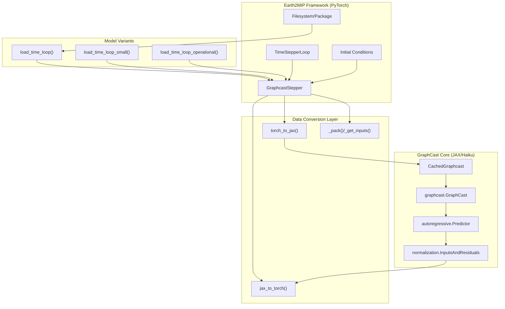
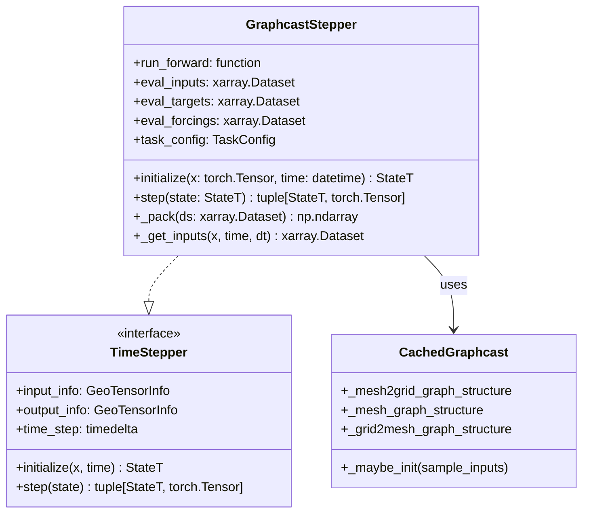
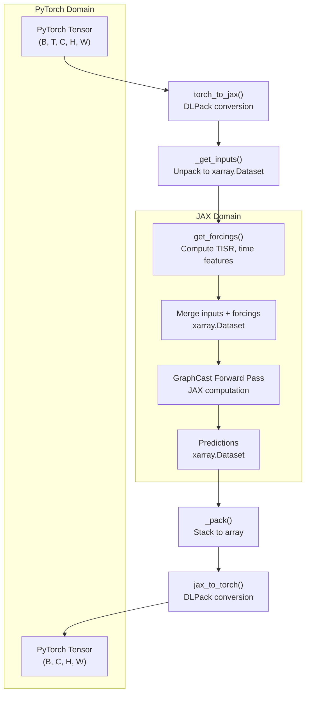
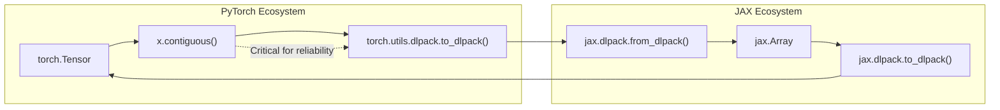
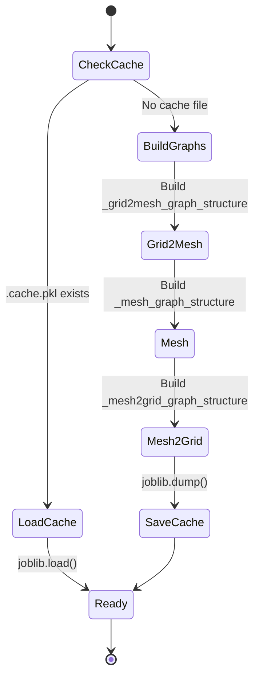
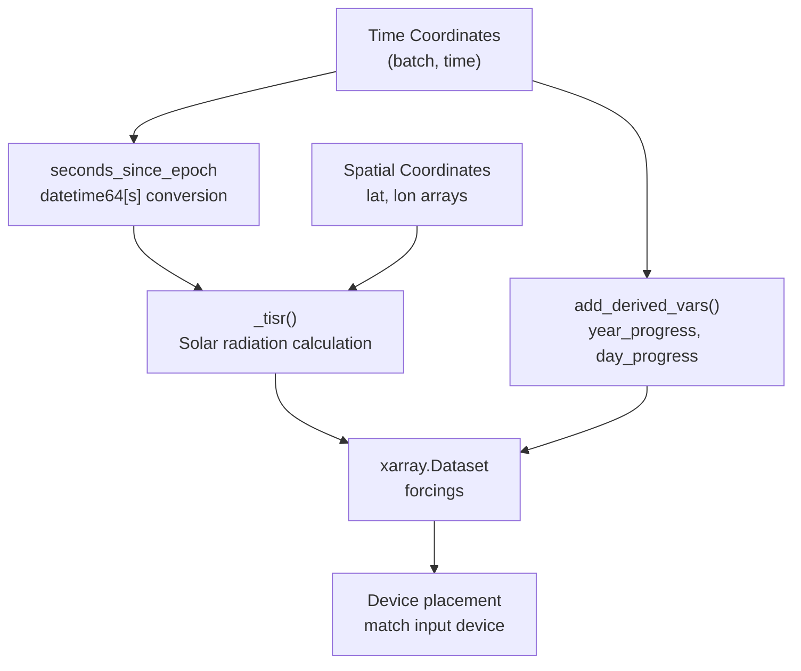

<!-- source: DeepWiki mcp.deepwiki.com · repo NVIDIA/earth2mip · page 8.1 GraphCast Integration · fetched 2026-10-26 -->

# GraphCast Integration

<details>
<summary>Relevant source files</summary>

The following files were used as context for generating this wiki page:

- [docs/userguide/concepts.rst](docs/userguide/concepts.rst)
- [earth2mip/filesystem.py](earth2mip/filesystem.py)
- [earth2mip/networks/graphcast.py](earth2mip/networks/graphcast.py)
- [earth2mip/time_loop.py](earth2mip/time_loop.py)
- [examples/utils/workflows/graphcast_simple.py](examples/utils/workflows/graphcast_simple.py)
- [test/graphcast/.gitignore](test/graphcast/.gitignore)
- [test/graphcast/README.md](test/graphcast/README.md)
- [test/graphcast/multiple_step.py](test/graphcast/multiple_step.py)
- [test/graphcast/reference_inference.py](test/graphcast/reference_inference.py)
- [test/test_graphcast.py](test/test_graphcast.py)
- [test/test_time_loop.py](test/test_time_loop.py)

</details>


This document covers the integration of Google DeepMind's GraphCast weather prediction model into the Earth-2 MIP framework. GraphCast uses JAX and Haiku for implementation, requiring specialized bridge code to integrate with Earth-2 MIP's PyTorch-based infrastructure.

For general model management concepts, see [Model Management](#4). For time loop abstractions, see [Model Interface (TimeLoop)](#3.2).

## Overview

The GraphCast integration provides a complete wrapper that adapts Google's JAX-based GraphCast implementation to work seamlessly within Earth-2 MIP's PyTorch ecosystem. This integration handles tensor conversion between JAX and PyTorch, manages graph structure caching for performance, and provides standardized time-stepping interfaces.



Sources: [earth2mip/networks/graphcast.py:1-733](), [earth2mip/time_loop.py:163-231]()

## Key Components

### GraphcastStepper Class

The `GraphcastStepper` class implements the `TimeStepper` protocol and serves as the primary interface between Earth-2 MIP and GraphCast. It manages the model's state, handles data transformations, and coordinates time stepping.



Sources: [earth2mip/networks/graphcast.py:223-563](), [earth2mip/time_loop.py:101-162]()

### Model Loading Functions

Three model loading functions provide access to different GraphCast variants, each optimized for different use cases:

| Function | Model Variant | Resolution | Pressure Levels | Use Case |
|----------|---------------|------------|-----------------|----------|
| `load_time_loop()` | Full GraphCast | 0.25° | 37 | Research, high accuracy |
| `load_time_loop_small()` | Small GraphCast | 1.0° | 13 | Testing, lower compute |
| `load_time_loop_operational()` | Operational | 0.25° | 13 | Operational forecasting |

Sources: [earth2mip/networks/graphcast.py:696-732]()

## Data Flow Architecture

The GraphCast integration involves complex data transformations between different tensor formats and coordinate systems:



Sources: [earth2mip/networks/graphcast.py:73-81](), [earth2mip/networks/graphcast.py:471-562](), [earth2mip/networks/graphcast.py:179-215]()

## Tensor Conversion Layer

The integration requires seamless conversion between PyTorch and JAX tensors using DLPack:



Sources: [earth2mip/networks/graphcast.py:73-80]()

## Graph Structure Caching

GraphCast's performance is significantly improved through caching of expensive graph structure computations:



Sources: [earth2mip/networks/graphcast.py:83-116]()

## Channel Name Mapping

GraphCast uses specific variable names that must be mapped to Earth-2 MIP's channel naming convention:

```python
CODE_TO_GRAPHCAST_NAME = {
    167: "2m_temperature",
    151: "mean_sea_level_pressure", 
    166: "10m_v_component_of_wind",
    165: "10m_u_component_of_wind",
    260267: "total_precipitation_6hr",
    130: "temperature",
    129: "geopotential",
    # ... additional mappings
}
```

The `get_channel_names()` function converts these to Earth-2 MIP format (e.g., "z500", "t2m", "q925").

Sources: [earth2mip/networks/graphcast.py:54-135]()

## Forcings Computation

GraphCast requires time-dependent forcings that are computed dynamically:



Sources: [earth2mip/networks/graphcast.py:151-215]()

## Usage Example

Basic usage follows the standard Earth-2 MIP pattern:

```python
# Load model through package system
from earth2mip.model_registry import Package
from earth2mip.networks import graphcast

package = Package("gs://dm_graphcast", seperator="/")
time_loop = graphcast.load_time_loop_operational(package)

# Get initial conditions
from earth2mip.initial_conditions import cds
from earth2mip.initial_conditions import get_initial_condition_for_model

time = datetime.datetime(2018, 1, 1)
data_source = cds.DataSource(time_loop.in_channel_names)
x = get_initial_condition_for_model(time_loop, data_source, time)

# Run forecast
stepper = time_loop.stepper
state = stepper.initialize(x, time)
for i in range(10):
    state, output = stepper.step(state)
```

Sources: [examples/utils/workflows/graphcast_simple.py:47-74]()

## Technical Requirements

The GraphCast integration requires specific dependencies and environment setup:

- JAX with GPU support
- Haiku neural network library  
- GraphCast package from DeepMind
- Compatible CUDA/GPU drivers
- Access to GraphCast model weights and statistics

The integration handles device placement automatically, ensuring JAX computations occur on the same device as input PyTorch tensors.

Sources: [earth2mip/networks/graphcast.py:218-221](), [earth2mip/networks/graphcast.py:364-367]()

---

