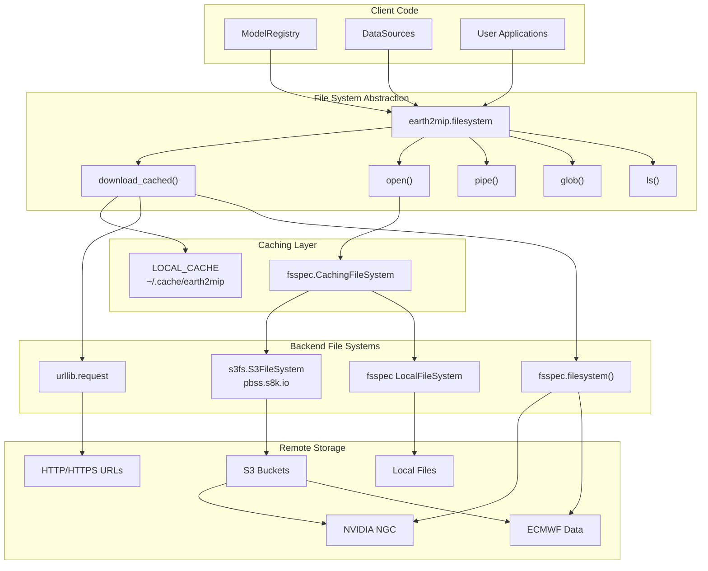
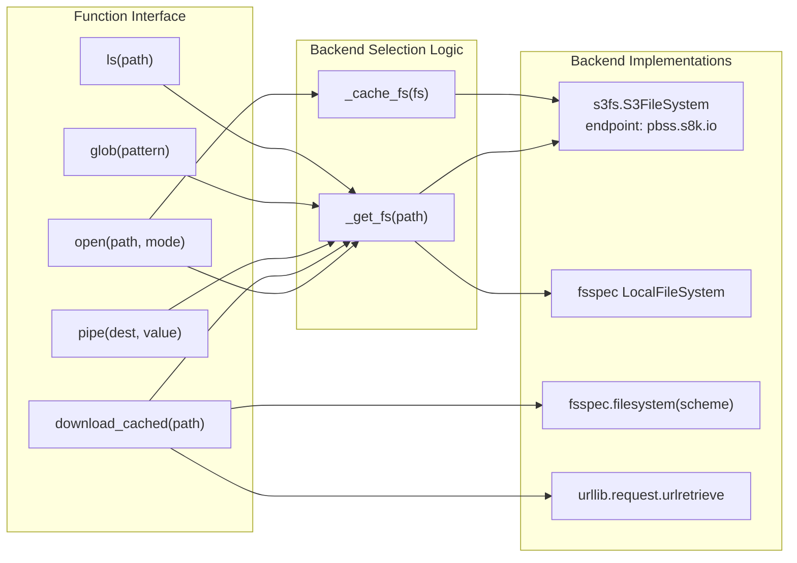
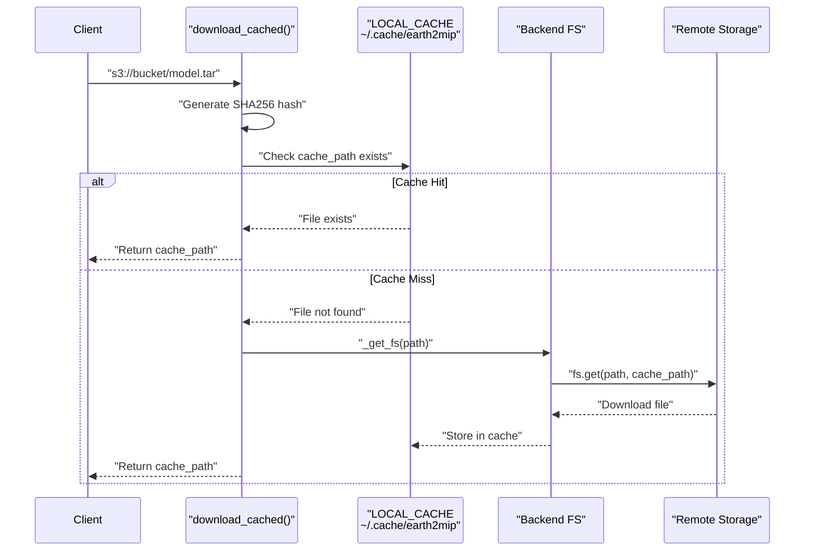
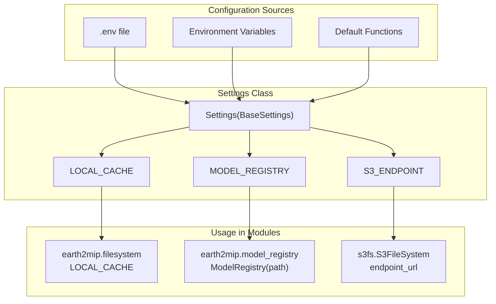
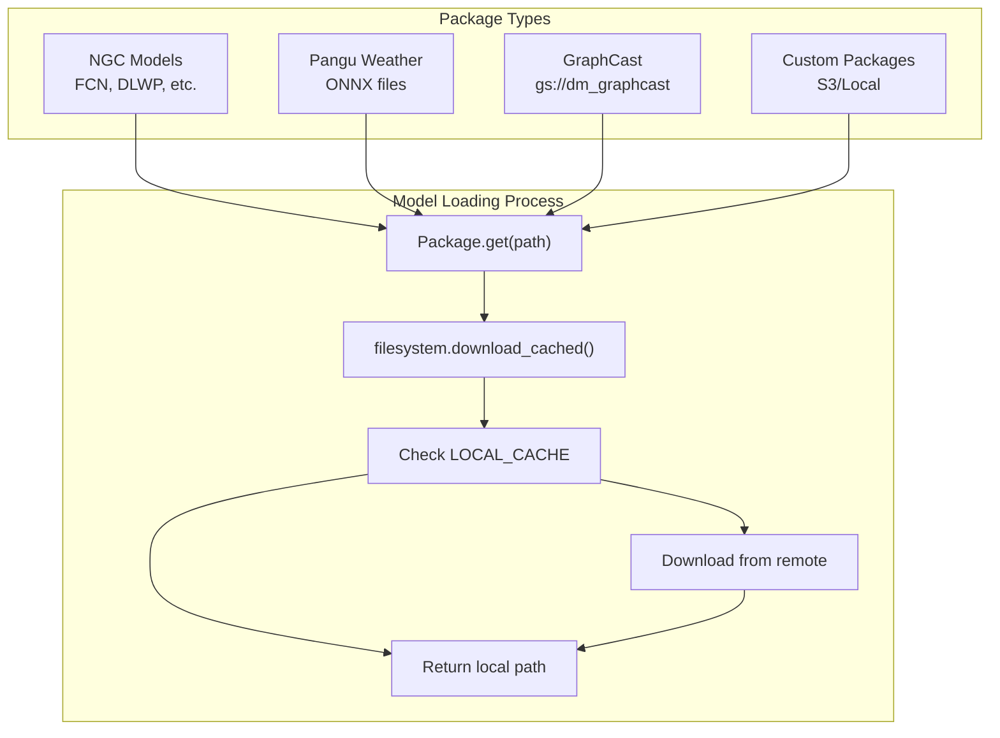

<!-- source: DeepWiki mcp.deepwiki.com · repo NVIDIA/earth2mip · page 8.2 File System and Caching · fetched 2026-10-26 -->

# File System and Caching

<details>
<summary>Relevant source files</summary>

The following files were used as context for generating this wiki page:

- [CHANGELOG.md](CHANGELOG.md)
- [earth2mip/_cli_utils.py](earth2mip/_cli_utils.py)
- [earth2mip/_config.py](earth2mip/_config.py)
- [earth2mip/filesystem.py](earth2mip/filesystem.py)
- [earth2mip/model_registry.py](earth2mip/model_registry.py)
- [earth2mip/score_ensemble_outputs.py](earth2mip/score_ensemble_outputs.py)
- [earth2mip/weather_events.py](earth2mip/weather_events.py)
- [test/test_graphcast.py](test/test_graphcast.py)

</details>


## Purpose and Scope

This document covers Earth-2 MIP's file system abstraction layer and caching mechanisms. The system provides unified access to heterogeneous storage backends including local files, S3 buckets, HTTP endpoints, and other remote file systems. It includes intelligent caching to optimize repeated access to large model files and datasets.

For information about data sources and initial conditions, see [Data Sources](#5.2). For model loading and package management, see [Model Registry and Package System](#4.1).

## Architecture Overview

Earth-2 MIP's file system layer provides a unified interface that abstracts away the complexity of accessing files from different storage backends while maintaining local caching for performance optimization.

### High-Level System Architecture



Sources: [earth2mip/filesystem.py:1-109](), [earth2mip/_config.py:24-34](), [earth2mip/model_registry.py:109-120]()

## File System Abstraction Layer

The core abstraction is provided by the `earth2mip.filesystem` module, which implements a unified interface for file operations across different storage backends.

### Core Functions and Backend Mapping



The system determines the appropriate backend based on URL schemes:

| URL Scheme | Backend | Example |
|------------|---------|---------|
| `s3://` | `s3fs.S3FileSystem` | `s3://bucket/model.tar` |
| `http://`, `https://` | `urllib.request` | `https://api.ngc.nvidia.com/...` |
| `gs://` | `fsspec.filesystem("gs")` | `gs://dm_graphcast/...` |
| `file://` or no scheme | Local filesystem | `/local/path/file.nc` |

Sources: [earth2mip/filesystem.py:39-44](), [earth2mip/filesystem.py:66-79]()

## Caching System

Earth-2 MIP implements a multi-layer caching strategy to optimize access to frequently used files, particularly large model checkpoints and datasets.

### Cache Architecture and Flow



### Cache Key Generation

The caching system uses SHA256 hashes of the full file path as cache keys to ensure uniqueness and avoid collisions:

```python
# From filesystem.py:55-59
sha = hashlib.sha256(path.encode())
filename = sha.hexdigest()
cache_path = os.path.join(LOCAL_CACHE, filename)
```

Sources: [earth2mip/filesystem.py:55-84](), [earth2mip/filesystem.py:30-36]()

## Configuration and Settings

The file system and caching behavior is controlled through the configuration system in `earth2mip._config`.

### Configuration Settings

| Setting | Default Value | Purpose |
|---------|---------------|---------|
| `LOCAL_CACHE` | `~/.cache/earth2mip` | Local cache directory |
| `MODEL_REGISTRY` | `~/.cache/earth2mip/models` | Model package storage |
| `S3_ENDPOINT` | `https://pbss.s8k.io` | S3 service endpoint |

### Configuration Flow



Sources: [earth2mip/_config.py:24-66](), [earth2mip/filesystem.py:30-31](), [earth2mip/filesystem.py:40-41]()

## Usage Patterns

### Model Package Caching

The most common usage pattern is through the model registry system, which leverages the file system abstraction for downloading and caching model packages:



### File System Operations

Common file operations are abstracted through the unified interface:

| Operation | Function | Backend Selection |
|-----------|----------|-------------------|
| Read files | `filesystem.open(path, mode)` | Automatic based on URL scheme |
| Download and cache | `filesystem.download_cached(path)` | SHA256-based local cache |
| Write files | `filesystem.pipe(dest, value)` | Direct backend write |
| List directories | `filesystem.ls(path)` | Backend-specific listing |
| Pattern matching | `filesystem.glob(pattern)` | Backend-specific globbing |

Sources: [earth2mip/model_registry.py:109-120](), [earth2mip/filesystem.py:46-109]()

### Cache Management

The cache system automatically manages storage in the `LOCAL_CACHE` directory:

- **Cache Location**: Default `~/.cache/earth2mip` (configurable via `LOCAL_CACHE` setting)
- **Cache Keys**: SHA256 hashes of full file paths ensure uniqueness
- **Cache Persistence**: Files remain cached until manually removed
- **Concurrent Access**: File existence checks prevent race conditions in downloads

The changelog indicates recent fixes to cache location handling and glob operations for HDF5 files, showing ongoing improvements to the caching system reliability.

Sources: [earth2mip/filesystem.py:55-84](), [CHANGELOG.md:41-42]()

---

