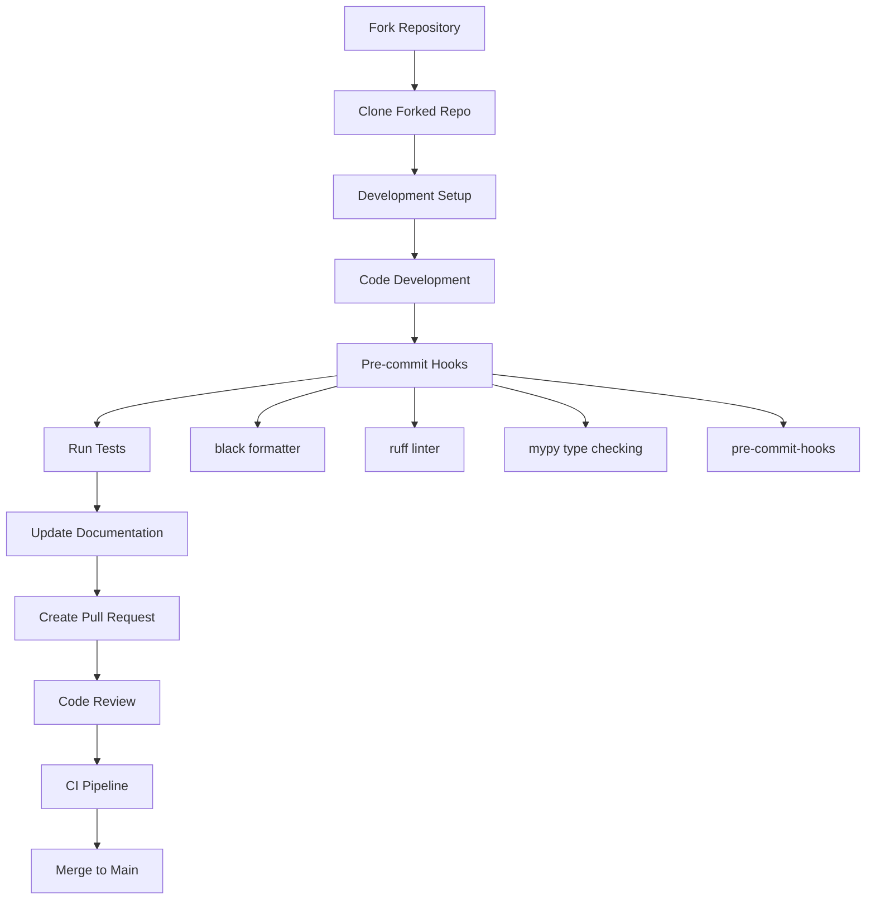
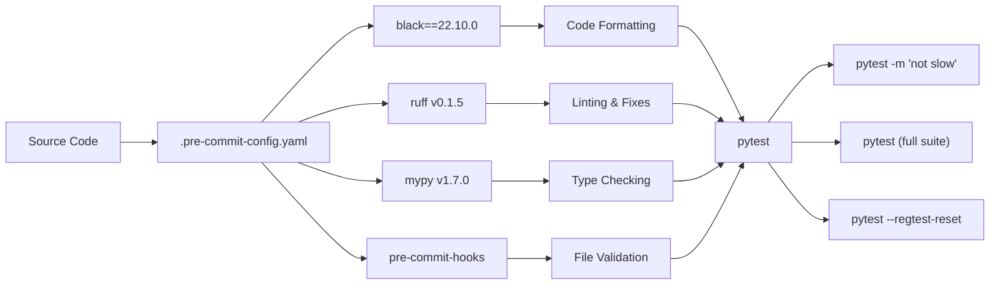
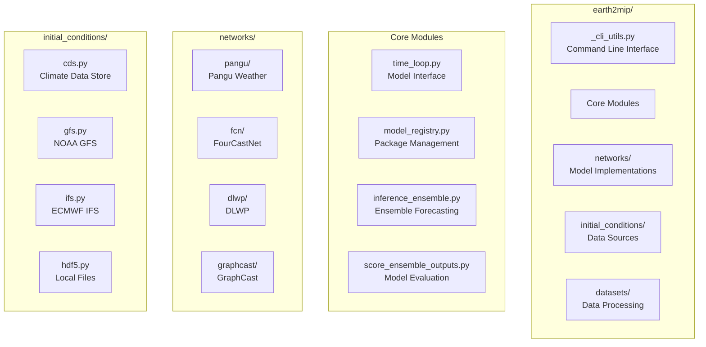

<!-- source: DeepWiki mcp.deepwiki.com · repo NVIDIA/earth2mip · page 9 Development and Contributing · fetched 2026-10-26 -->

# Development and Contributing

<details>
<summary>Relevant source files</summary>

The following files were used as context for generating this wiki page:

- [.pre-commit-config.yaml](.pre-commit-config.yaml)
- [CONTRIBUTING.md](CONTRIBUTING.md)
- [docs/.env](docs/.env)
- [docs/_static/NVIDIA-Logo-V-ForScreen-ForDarkBG.png](docs/_static/NVIDIA-Logo-V-ForScreen-ForDarkBG.png)
- [docs/_static/NVIDIA-Logo-V-ForScreen-ForLightBG.png](docs/_static/NVIDIA-Logo-V-ForScreen-ForLightBG.png)
- [docs/_static/favicon.ico](docs/_static/favicon.ico)
- [docs/userguide/index.md](docs/userguide/index.md)
- [docs/userguide/inference-workflows.rst](docs/userguide/inference-workflows.rst)

</details>


This section provides guidance for developers who want to contribute to the Earth-2 MIP codebase. It covers the development environment, code organization, contribution workflows, and quality assurance processes. For detailed information about specific aspects of development, see [Contributing Guidelines](#9.1), [Testing Framework](#9.2), and [Documentation System](#9.3).

## Overview

Earth-2 MIP is a complex framework with multiple architectural layers that developers can contribute to. The codebase follows established software engineering practices including automated testing, code linting, documentation generation, and standardized contribution workflows.

### Development Areas

The framework is organized into several key development areas where contributions are welcome:

| Area | Primary Components | Entry Points |
|------|-------------------|--------------|
| Core Orchestration | `inference_ensemble.py`, `time_collection.py` | CLI commands, workflow functions |
| Model Integration | `earth2mip/networks/` | Model loaders, TimeLoop implementations |
| Data Systems | `earth2mip/initial_conditions/`, `earth2mip/datasets/` | DataSource implementations |
| AI Model Support | `earth2mip/networks/{pangu,fcn,dlwp}/` | Model-specific adapters |
| Testing Infrastructure | `test/` directory | pytest test modules |
| Documentation | `docs/` directory | Sphinx documentation |

## Development Workflow

The development process follows a standard GitHub workflow with additional quality assurance steps:

### Development Process Flow



Sources: [CONTRIBUTING.md:9-28](), [.pre-commit-config.yaml:15-79]()

### Code Quality Pipeline

The codebase uses several automated tools to maintain code quality:



Sources: [.pre-commit-config.yaml:16-79](), [CONTRIBUTING.md:42-72]()

## Development Environment Setup

### Prerequisites

The development environment requires several components:

1. **Docker Environment**: The primary development environment uses Docker containers
2. **Pre-commit Hooks**: Automated code quality checks before commits
3. **Testing Dependencies**: Additional packages for running the test suite

### Setup Commands

```bash
# Enter the docker development environment
make enter

# Install development dependencies
make install

# Set up pre-commit hooks and git lfs (one-time setup)
make setup-ci

# Run linting manually
make lint
```

Sources: [CONTRIBUTING.md:55-50]()

## Code Organization

The Earth-2 MIP codebase follows a modular architecture with clear separation of concerns:

### Core Module Structure



Sources: [.pre-commit-config.yaml:46-78]()

## Quality Assurance

### Type Checking Configuration

MyPy type checking is configured to gradually improve type coverage across the codebase. Currently, several modules are excluded from type checking but this is being reduced over time:

**Excluded from MyPy**: `examples/`, `test/`, `docs/`, `earth2mip/datasets/`, `earth2mip/networks/`, `earth2mip/initial_conditions/`, and several core modules.

**Goal**: Progressive inclusion of modules in type checking as type annotations are added.

Sources: [.pre-commit-config.yaml:44-78]()

### Testing Strategy

The testing framework supports different test categories:

- **Fast Tests**: Quick unit tests that run in under 10 seconds
- **Slow Tests**: Integration tests and end-to-end workflows
- **Regression Tests**: Tests with reference data that can be reset

```bash
# Quick tests only
pytest -m 'not slow'

# Full test suite
pytest

# Reset regression test data
pytest --regtest-reset
```

Sources: [CONTRIBUTING.md:64-72]()

## Documentation Standards

### Docstring Format

Earth-2 MIP uses Google-style docstrings for all public APIs:

```python
def example_function(param1: str, param2: int) -> bool:
    """Brief description of the function.
    
    Args:
        param1: Description of the first parameter.
        param2: Description of the second parameter.
        
    Returns:
        Description of the return value.
        
    Raises:
        ValueError: When invalid parameters are provided.
    """
```

Sources: [CONTRIBUTING.md:97-100]()

### Documentation Build Process

Documentation is built using Sphinx and supports multiple build targets:

```bash
# Build core and API docs
make docs

# Build full docs including examples (requires execution environment)
make docs-full
```

The documentation system supports versioned releases with a version switcher mechanism configured in `docs/_static/switcher.json`.

Sources: [CONTRIBUTING.md:165-204](), [docs/.env:1-3]()

## Licensing and Legal Requirements

### License Headers

All source code files must include the Apache 2.0 license header:

```python
# SPDX-FileCopyrightText: Copyright (c) 2023 NVIDIA CORPORATION & AFFILIATES.
# SPDX-FileCopyrightText: All rights reserved.
# SPDX-License-Identifier: Apache-2.0
```

### Commit Signing

All commits must be signed off using the Developer Certificate of Origin (DCO):

```bash
git commit -s -m "Add cool feature."
```

This appends a `Signed-off-by` line certifying that you have the right to submit the contribution under the project's license.

Sources: [CONTRIBUTING.md:75-161]()

## Notebook Development

Jupyter notebooks require special handling to maintain clean git history:

### Notebook Cleanup

Before committing notebooks, remove output cells and metadata:

```bash
jupyter nbconvert --ClearOutputPreprocessor.enabled=True --to=notebook --log-level=ERROR <notebook.ipynb>
```

This ensures that notebook outputs and execution metadata don't pollute the git history.

Sources: [CONTRIBUTING.md:30-38]()

## Next Steps

For detailed information about specific development topics:

- **Contribution Process**: See [Contributing Guidelines](#9.1) for the complete pull request workflow
- **Testing Details**: See [Testing Framework](#9.2) for comprehensive testing information  
- **Documentation**: See [Documentation System](#9.3) for Sphinx configuration and documentation building

---

