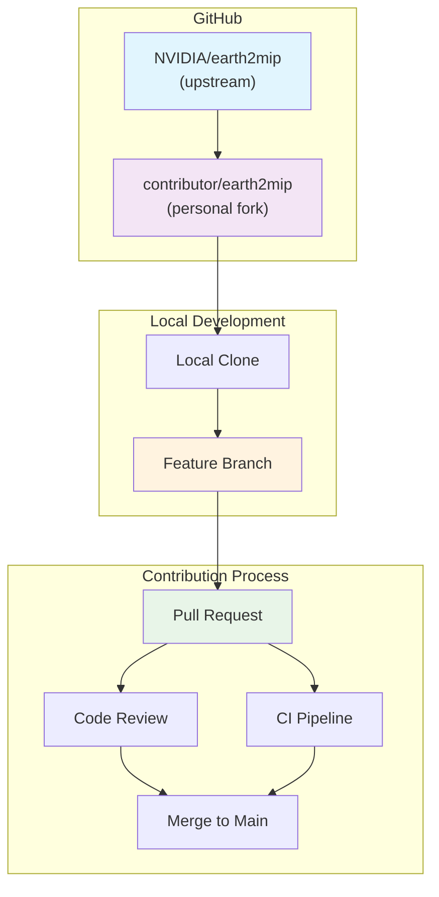
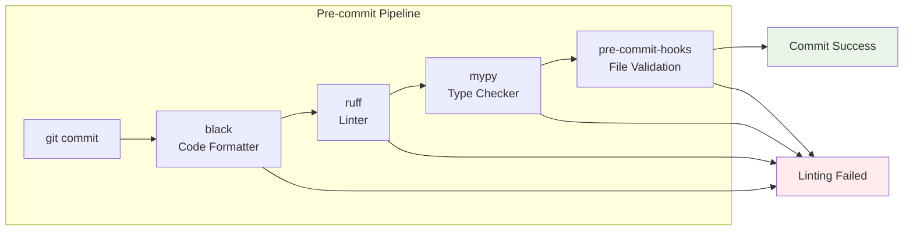
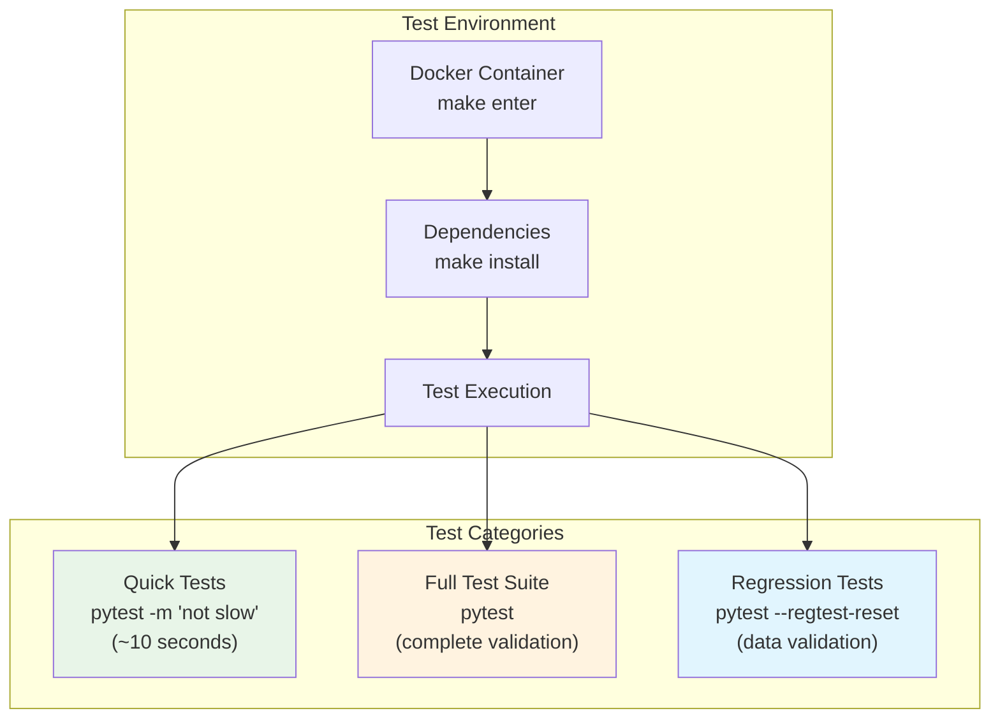
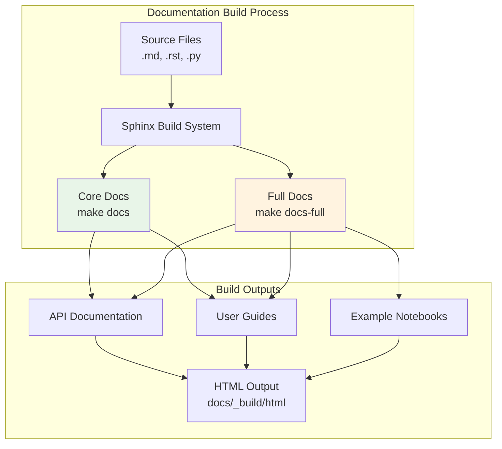
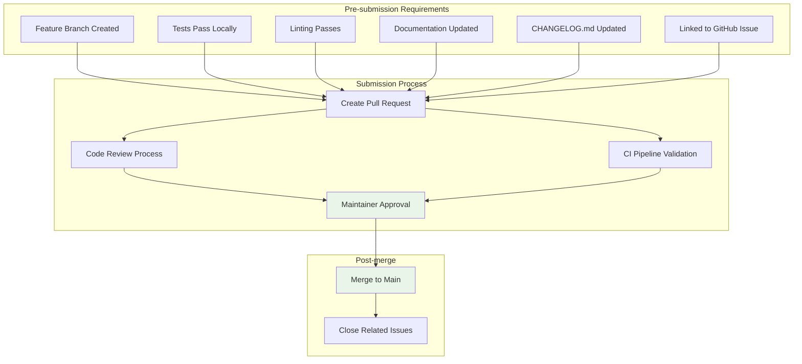

<!-- source: DeepWiki mcp.deepwiki.com · repo NVIDIA/earth2mip · page 9.1 Contributing Guidelines · fetched 2026-10-26 -->

# Contributing Guidelines

<details>
<summary>Relevant source files</summary>

The following files were used as context for generating this wiki page:

- [.pre-commit-config.yaml](.pre-commit-config.yaml)
- [CONTRIBUTING.md](CONTRIBUTING.md)
- [docs/.env](docs/.env)
- [docs/_static/NVIDIA-Logo-V-ForScreen-ForDarkBG.png](docs/_static/NVIDIA-Logo-V-ForScreen-ForDarkBG.png)
- [docs/_static/NVIDIA-Logo-V-ForScreen-ForLightBG.png](docs/_static/NVIDIA-Logo-V-ForScreen-ForLightBG.png)
- [docs/_static/favicon.ico](docs/_static/favicon.ico)
- [docs/userguide/index.md](docs/userguide/index.md)
- [docs/userguide/inference-workflows.rst](docs/userguide/inference-workflows.rst)

</details>


This document provides comprehensive guidelines for contributing code, documentation, and other improvements to the Earth-2 MIP project. It covers the development workflow, code quality standards, testing procedures, and submission requirements for external contributors.

For information about the testing framework and test execution, see [Testing Framework](#9.2). For details about documentation generation and maintenance, see [Documentation System](#9.3).

## Development Workflow

### Fork and Branch Strategy

The Earth-2 MIP project follows a standard GitHub fork-and-pull-request workflow for external contributions. All development work must be done on personal forks of the upstream repository.



**Development Workflow Process:**

1. **Fork the Repository**: Create a personal fork of the [upstream repository](https://github.com/NVIDIA/Earth2-MIP)
2. **Clone and Setup**: Clone the fork locally and configure upstream remote
3. **Create Feature Branch**: Create a descriptive branch name for your changes
4. **Development**: Implement changes following code quality standards
5. **Testing**: Run tests and linting before submission
6. **Pull Request**: Submit PR with detailed description and link to relevant issues
7. **Review Process**: Address feedback from maintainers
8. **Merge**: Changes are merged after approval and CI success

Sources: [CONTRIBUTING.md:9-28]()

### Branch Management

- **Main Branch**: Production-ready code with latest stable features
- **Feature Branches**: Short-lived branches for specific improvements
- **Naming Convention**: Use descriptive names like `feature/ensemble-optimization` or `fix/regridding-memory-leak`

## Code Quality Standards

### Pre-commit Hooks and Linting

Earth-2 MIP uses automated code quality tools to maintain consistent code style and catch issues early in the development process.



**Required Tools Configuration:**

The project uses the following tools configured in [.pre-commit-config.yaml:16-78]():

- **Black** (v22.10.0): Code formatting with click dependency
- **Ruff** (v0.1.5): Fast Python linter with auto-fix capability  
- **MyPy** (v1.7.0): Static type checking (currently excludes many modules)
- **Pre-commit Hooks**: File size limits, trailing whitespace removal

**Setup Commands:**
```bash
# Install pre-commit hooks (one-time setup)
make setup-ci

# Manual linting
make lint

# Run before each commit
git commit -s -m "Your commit message"
```

Sources: [.pre-commit-config.yaml:16-78](), [CONTRIBUTING.md:42-50]()

### Type Checking Exclusions

Currently, MyPy type checking excludes many modules during the transition period. The excluded modules include:

- Core modules: `earth2mip/networks`, `earth2mip/initial_conditions`, `earth2mip/datasets`
- Inference modules: `earth2mip/inference_ensemble.py`, `earth2mip/inference_medium_range.py`
- Utility modules: `earth2mip/filesystem.py`, `earth2mip/grid.py`, `earth2mip/regrid.py`

Sources: [.pre-commit-config.yaml:46-78]()

## Testing Requirements

### Test Execution

The project uses `pytest` as the primary testing framework with support for different test categories based on execution time and dependencies.



**Test Execution Commands:**

```bash
# Enter Docker environment
make enter

# Install test dependencies
make install

# Run quick tests (recommended for development)
pytest -m 'not slow'

# Run full test suite
pytest

# Reset regression test data (when output changes are intentional)
pytest --regtest-reset
```

### Regression Testing

The project includes regression tests that validate output consistency. When making changes that intentionally modify test outputs, contributors must reset the regression data and commit the changes.

Sources: [CONTRIBUTING.md:53-72]()

## Documentation Standards

### Docstring Format

Earth-2 MIP uses Google-style docstrings for all Python code. This format is processed by Sphinx with the Napoleon extension for API documentation generation.

**Example Google-style Docstring:**
```python
def run_inference(model: TimeLoop, initial_conditions: DataSource) -> xr.Dataset:
    """Run weather model inference with specified initial conditions.
    
    Args:
        model: TimeLoop model instance for prediction
        initial_conditions: DataSource providing initial weather state
        
    Returns:
        Dataset containing forecast predictions
        
    Raises:
        ValueError: If model and initial conditions are incompatible
    """
```

**Recommended Tools:**
- VSCode users: [Auto-docstring extension](https://marketplace.visualstudio.com/items?itemName=njpwerner.autodocstring)

Sources: [CONTRIBUTING.md:97-100]()

### Documentation Building

The documentation system supports two build modes depending on requirements and available computational resources.



**Build Commands:**
```bash
# Build core and API documentation (fast)
make docs

# Build complete documentation including executed examples (slow)
make docs-full
```

**Documentation Environment Variables:**
- `DOC_VERSION`: Controls version string in generated docs
- `PLOT_GALLERY`: Controls example gallery generation
- `RUN_STALE_EXAMPLES`: Controls execution of outdated examples

Sources: [CONTRIBUTING.md:163-174](), [docs/.env:1-3]()

### Notebook Handling

Jupyter notebooks must be cleaned of outputs and metadata before committing to maintain repository cleanliness and avoid merge conflicts.

**Required Cleaning Process:**
```bash
# Clean notebook before committing
jupyter nbconvert --ClearOutputPreprocessor.enabled=True --to=notebook --log-level=ERROR <notebook.ipynb>
```

Sources: [CONTRIBUTING.md:30-38]()

## Licensing and Legal Requirements

### File Headers

All source code files must include the Apache 2.0 license header as specified in the project guidelines.

**Required Header Format:**
```python
# SPDX-FileCopyrightText: Copyright (c) 2023 NVIDIA CORPORATION & AFFILIATES.
# SPDX-FileCopyrightText: All rights reserved.
# SPDX-License-Identifier: Apache-2.0
#
# Licensed under the Apache License, Version 2.0 (the "License");
# you may not use this file except in compliance with the License.
# You may obtain a copy of the License at
#
# http://www.apache.org/licenses/LICENSE-2.0
#
# Unless required by applicable law or agreed to in writing, software
# distributed under the License is distributed on an "AS IS" BASIS,
# WITHOUT WARRANTIES OR CONDITIONS OF ANY KIND, either express or implied.
# See the License for the specific language governing permissions and
# limitations under the License.
```

### Developer Certificate of Origin (DCO)

All commits must be signed off using the Developer Certificate of Origin to certify that contributors have the right to submit their changes under the project license.

**Signing Commits:**
```bash
# Sign off on commits
git commit -s -m "Add cool feature."

# This appends: Signed-off-by: Your Name <your@email.com>
```

**DCO Certification:** By signing off, contributors certify that their contribution is original work or they have rights to submit it under the compatible license terms.

Sources: [CONTRIBUTING.md:75-161]()

## Pull Request Requirements

### Submission Checklist

Before submitting a pull request, ensure all requirements are met:



### Review Process

1. **Automated Checks**: CI pipeline validates code quality, tests, and builds
2. **Code Review**: At least one NVIDIA engineer reviews all changes
3. **Feedback Integration**: Address reviewer comments and suggestions
4. **Final Approval**: Maintainer approval required before merge
5. **Issue Closure**: Ensure related GitHub issues are properly linked and closed

### Required Updates

- **CHANGELOG.md**: Document user-facing changes and improvements
- **Documentation**: Update relevant documentation for API changes
- **Tests**: Add or update tests for new functionality
- **Examples**: Update examples if APIs change

Sources: [CONTRIBUTING.md:7-28]()

## Release Documentation

### Version Management

For maintainers creating new documentation versions, the process involves updating version configuration and deploying to GitHub Pages.

**Version Release Steps:**
1. Update `docs/_static/switcher.json` with new version entry
2. Modify `docs/.env` to set `DOC_VERSION` variable
3. Build documentation with `make docs`
4. Deploy to `gh-pages` branch under `v/<version>` directory
5. Revert environment changes and commit switcher updates

**Example Version Entry:**
```json
{
    "name": "1.0.0",
    "version": "1.0.0", 
    "url": "https://nvidia.github.io/earth2mip/v/1.0.0/"
}
```

Sources: [CONTRIBUTING.md:176-203]()

This contributing guidelines framework ensures consistent code quality, thorough testing, and proper documentation for all Earth-2 MIP contributions while maintaining the high standards expected for a production weather modeling framework.

---

