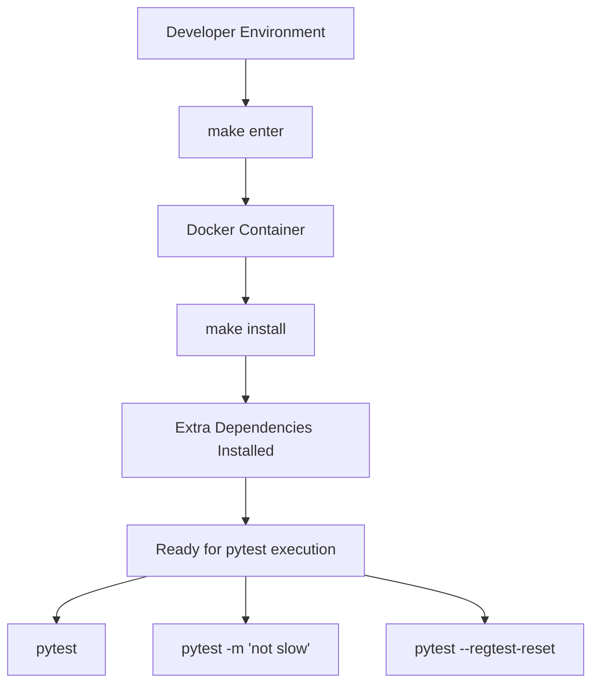
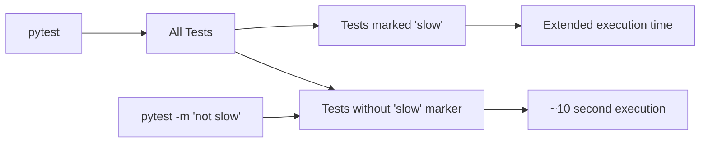
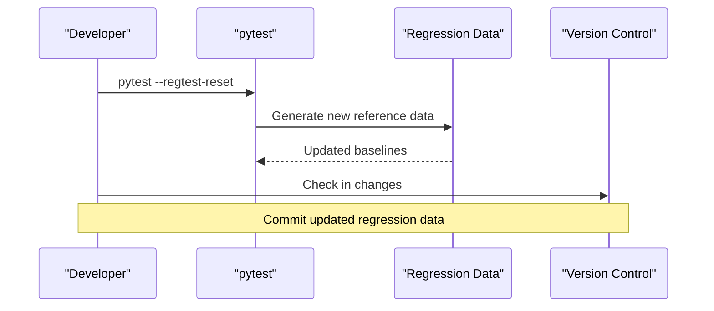
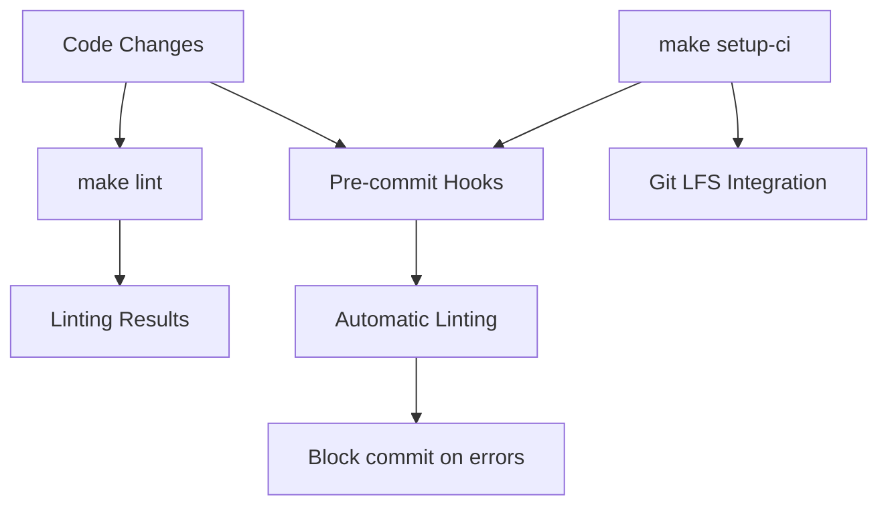
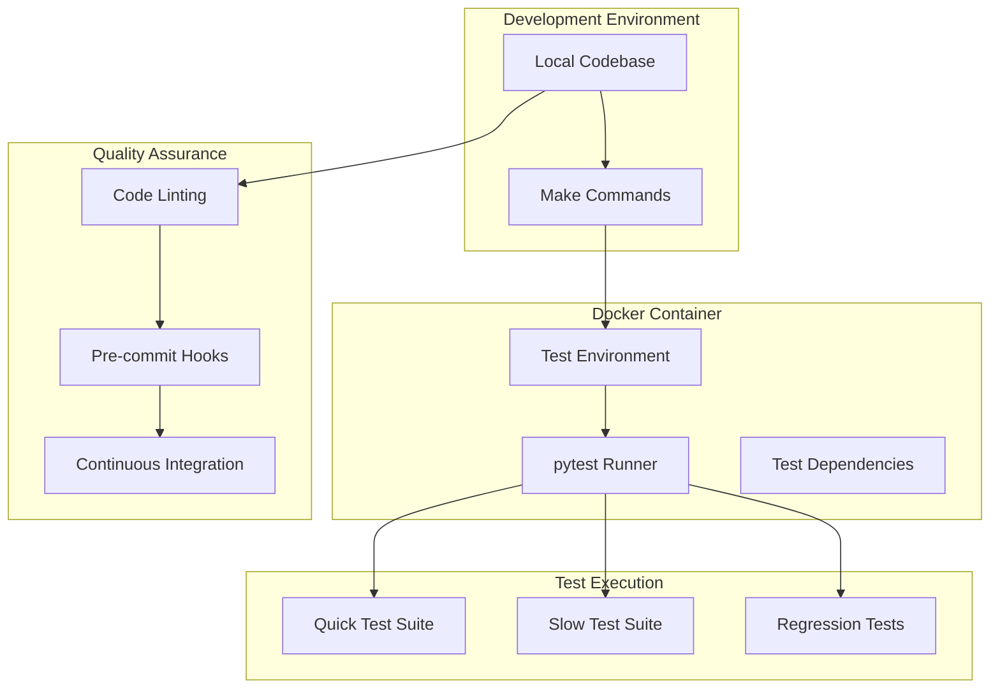

<!-- source: DeepWiki mcp.deepwiki.com · repo NVIDIA/earth2mip · page 9.2 Testing Framework · fetched 2026-10-26 -->

# Testing Framework

Relevant source files

The following files were used as context for generating this wiki page:

- [CONTRIBUTING.md](CONTRIBUTING.md)
- [docs/.env](docs/.env)
- [docs/_static/NVIDIA-Logo-V-ForScreen-ForDarkBG.png](docs/_static/NVIDIA-Logo-V-ForScreen-ForDarkBG.png)
- [docs/_static/NVIDIA-Logo-V-ForScreen-ForLightBG.png](docs/_static/NVIDIA-Logo-V-ForScreen-ForLightBG.png)
- [docs/_static/favicon.ico](docs/_static/favicon.ico)
- [earth2mip/_channel_stds.py](earth2mip/_channel_stds.py)
- [earth2mip/regrid.py](earth2mip/regrid.py)

## Purpose and Scope

This document covers the testing infrastructure and methodologies used in Earth-2 MIP to ensure code quality and correctness. It explains how to run tests, configure the testing environment, and maintain regression test data. For information about contributing code changes that require testing, see [Contributing Guidelines](#9.1). For documentation building and validation processes, see [Documentation System](#9.3).

## Test Execution Environment

Earth-2 MIP uses a Docker-based testing environment to ensure consistent test execution across different development setups. The testing infrastructure relies on `pytest` as the primary test runner with additional tooling for linting and pre-commit validation.

### Docker Environment Setup

**Testing Environment Workflow**

The standard testing workflow involves entering the Docker environment before running tests to ensure all dependencies and environmental configurations are properly set up.

Sources: [CONTRIBUTING.md:55-62]()

### Test Categories and Execution

Earth-2 MIP organizes tests using pytest markers to enable selective test execution based on performance requirements and scope.

| Command | Purpose | Execution Time |
|---------|---------|----------------|
| `pytest` | Run full test suite | Variable |
| `pytest -m 'not slow'` | Run quick tests only | ~10 seconds |
| `pytest --regtest-reset` | Reset regression test data | Variable |

### Test Marker System

**Test Execution Strategy**

The marker system allows developers to run quick feedback loops during development while ensuring comprehensive testing in CI environments.

Sources: [CONTRIBUTING.md:64-66]()

## Regression Testing Infrastructure

Earth-2 MIP implements regression testing to validate that model outputs and system behaviors remain consistent across code changes. The regression testing system uses reference data that can be updated when intentional changes occur.

### Regression Test Data Management

**Regression Data Update Process**

When model implementations or expected outputs change, developers must reset regression data and commit the updates to maintain test validity.

Sources: [CONTRIBUTING.md:68-72]()

## Code Quality and Linting

The testing framework integrates code quality checks through automated linting processes that enforce consistent code style and catch potential issues before they reach production.

### Linting Integration

**Linting Workflow Integration**

The linting system operates both manually through make commands and automatically through pre-commit hooks to ensure code quality at multiple stages of development.

Sources: [CONTRIBUTING.md:42-50]()

### Pre-commit Hook Configuration

The testing framework includes optional pre-commit hooks that automatically validate code quality before commits are allowed. This system requires one-time setup per repository clone.

| Command | Function | Frequency |
|---------|----------|-----------|
| `make lint` | Manual linting execution | On-demand |
| `make setup-ci` | Install pre-commit hooks | Once per clone |
| Pre-commit hooks | Automatic validation | Every commit |

## Testing Infrastructure Architecture

**Complete Testing Framework Architecture**

This architecture shows how the various testing components interact to provide comprehensive validation of Earth-2 MIP codebase changes.

Sources: [CONTRIBUTING.md:40-72]()

## Test Development Guidelines

When developing tests for Earth-2 MIP components, developers should consider the performance characteristics and appropriate marker classification for their tests. Quick tests should focus on unit-level validation and core functionality, while slow tests can include integration scenarios and complex model evaluations.

### Test Organization Principles

- Use `slow` markers for tests requiring significant computational resources
- Implement regression tests for model output validation
- Ensure all tests can run in the Docker environment
- Maintain updated regression data when model behavior changes intentionally

Sources: [CONTRIBUTING.md:64-72]()

---

