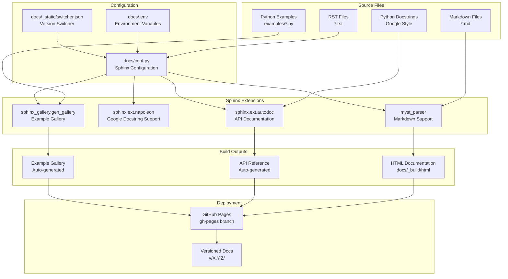
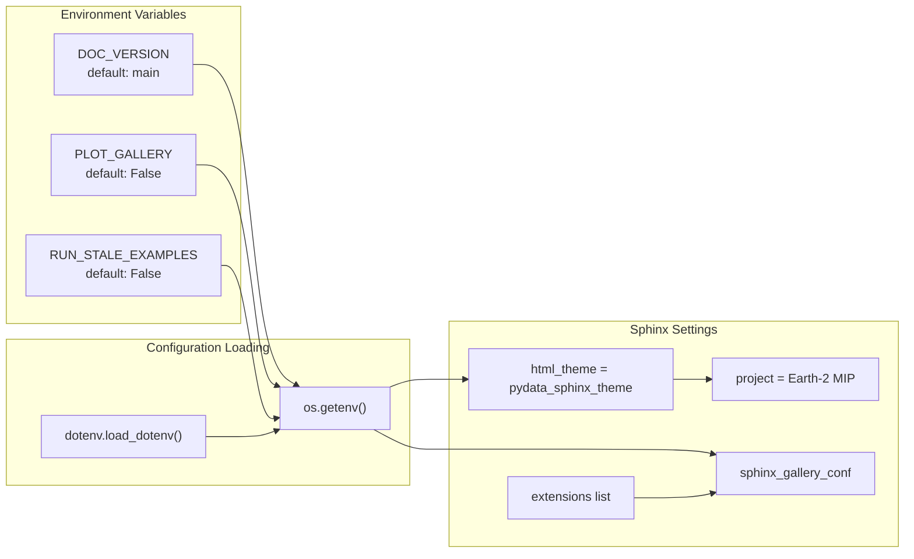
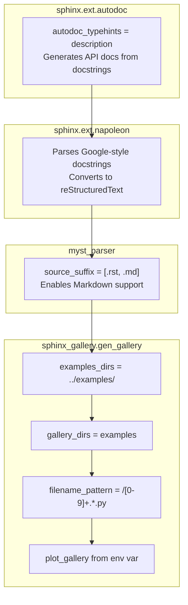
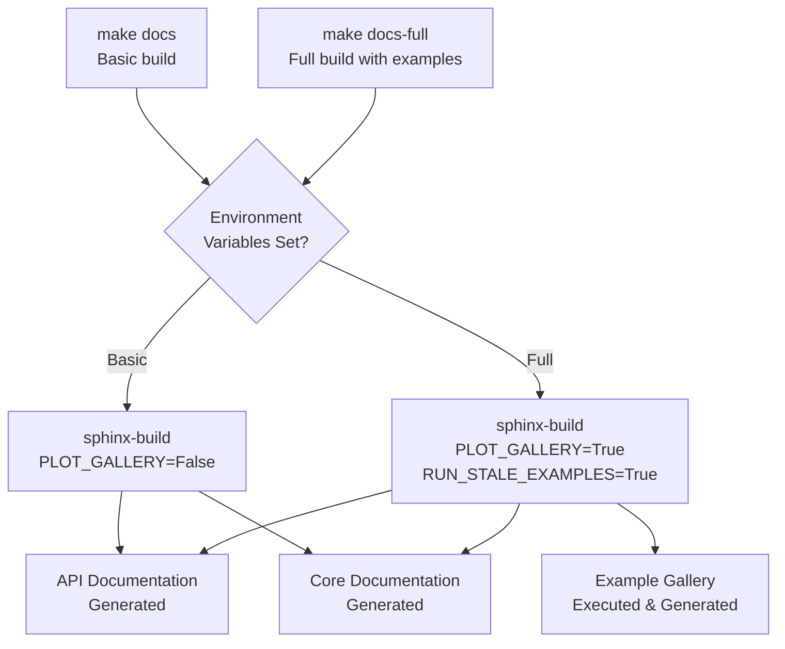
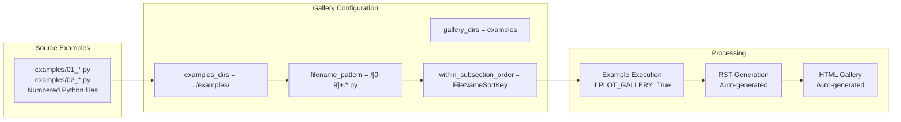
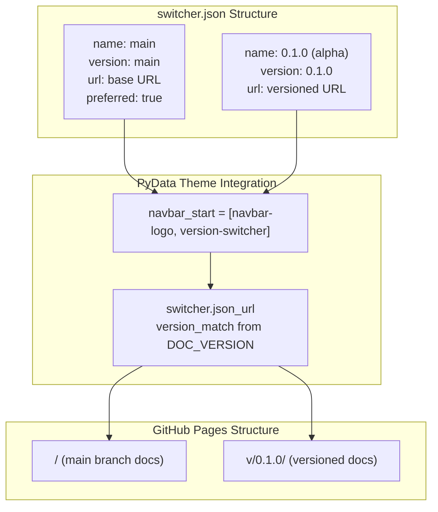
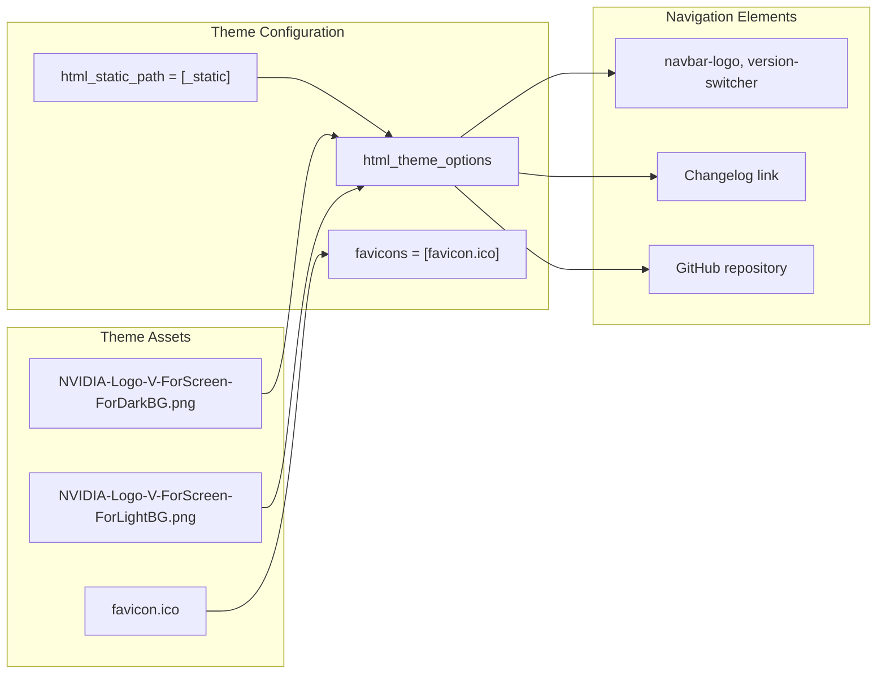

<!-- source: DeepWiki mcp.deepwiki.com · repo NVIDIA/earth2mip · page 9.3 Documentation System · fetched 2026-10-26 -->

# Documentation System

<details>
<summary>Relevant source files</summary>

The following files were used as context for generating this wiki page:

- [CONTRIBUTING.md](CONTRIBUTING.md)
- [docs/.env](docs/.env)
- [docs/_static/NVIDIA-Logo-V-ForScreen-ForDarkBG.png](docs/_static/NVIDIA-Logo-V-ForScreen-ForDarkBG.png)
- [docs/_static/NVIDIA-Logo-V-ForScreen-ForLightBG.png](docs/_static/NVIDIA-Logo-V-ForScreen-ForLightBG.png)
- [docs/_static/favicon.ico](docs/_static/favicon.ico)
- [docs/_static/switcher.json](docs/_static/switcher.json)
- [docs/conf.py](docs/conf.py)
- [docs/make.bat](docs/make.bat)

</details>


## Purpose and Scope

This document describes Earth-2 MIP's documentation system, which uses Sphinx to generate comprehensive documentation including API references, user guides, and executable examples. The system supports versioned documentation with automatic example gallery generation.

For information about contributing to the documentation content, see [Contributing Guidelines](#9.1). For details about the testing framework that validates documentation examples, see [Testing Framework](#9.2).

## Architecture Overview

The documentation system is built on Sphinx with several key components working together to generate both static documentation and interactive example galleries.



**Sources:** [docs/conf.py:1-117](), [CONTRIBUTING.md:163-204]()

## Configuration System

The Sphinx configuration is centralized in `docs/conf.py` with environment-based overrides for different build scenarios.

### Core Configuration



The configuration system supports three key environment variables:

| Variable | Purpose | Default | Impact |
|----------|---------|---------|--------|
| `DOC_VERSION` | Controls version switcher display | `"main"` | Sets version in switcher dropdown |
| `PLOT_GALLERY` | Controls example execution during build | `False` | When `True`, runs all examples |
| `RUN_STALE_EXAMPLES` | Forces re-execution of cached examples | `False` | Overrides sphinx-gallery caching |

**Sources:** [docs/conf.py:29-36](), [docs/.env:1-3]()

### Extension Configuration

The documentation system uses four key Sphinx extensions:



**Sources:** [docs/conf.py:55-116]()

## Build Process

The documentation build process supports two primary modes with different levels of content generation.

### Build Commands



The build process follows this sequence:

1. **Environment Loading**: [docs/conf.py:32]() loads variables from `docs/.env`
2. **Extension Initialization**: [docs/conf.py:55-61]() configures Sphinx extensions
3. **Content Generation**: Extensions process source files based on configuration
4. **Output Generation**: HTML files are written to `docs/_build/html`

**Sources:** [CONTRIBUTING.md:165-174](), [docs/conf.py:108-116]()

### Example Gallery Processing

The sphinx-gallery extension processes Python files in the `examples/` directory:



**Sources:** [docs/conf.py:108-116]()

## Version Management

The documentation system supports multiple versions through a combination of GitHub Pages and a version switcher interface.

### Version Switcher Configuration



The version management process involves:

1. **Configuration Update**: [CONTRIBUTING.md:180-189]() - Add new version to `switcher.json`
2. **Environment Setting**: [CONTRIBUTING.md:191-192]() - Update `DOC_VERSION` in `docs/.env`
3. **Build Generation**: [CONTRIBUTING.md:193-194]() - Run `make docs` to generate HTML
4. **Manual Deployment**: [CONTRIBUTING.md:195-199]() - Copy files to `gh-pages` branch under `v/<version>/`
5. **Branch Cleanup**: [CONTRIBUTING.md:200-203]() - Revert `.env` changes and commit `switcher.json`

**Sources:** [docs/_static/switcher.json:1-13](), [docs/conf.py:82-85](), [CONTRIBUTING.md:176-204]()

## Theme and Styling

The documentation uses the PyData Sphinx Theme with custom configuration for branding and navigation.

### Theme Configuration

| Setting | Value | Purpose |
|---------|-------|---------|
| `html_theme` | `"pydata_sphinx_theme"` | Modern, responsive theme |
| `announcement` | Beta warning message | User awareness |
| `logo.text` | `"Earth-2 MIP"` | Site branding |
| `logo.image_light` | NVIDIA logo (light mode) | Corporate branding |
| `logo.image_dark` | NVIDIA logo (dark mode) | Corporate branding |
| `navbar_align` | `"content"` | Navigation alignment |
| `external_links` | Changelog link | Additional resources |
| `icon_links` | GitHub repository link | Source code access |



**Sources:** [docs/conf.py:71-106](), [docs/_static/]()

## Docstring Standards

The documentation system expects Google-style docstrings throughout the codebase, processed by the Napoleon extension.

### Docstring Format Requirements

```python
def example_function(param1: str, param2: int) -> bool:
    """Brief description of the function.
    
    Longer description providing more detail about the function's
    purpose and behavior.
    
    Args:
        param1: Description of the first parameter.
        param2: Description of the second parameter.
        
    Returns:
        Description of the return value.
        
    Raises:
        ValueError: Description of when this exception is raised.
        
    Example:
        Basic usage example:
        
        >>> result = example_function("hello", 42)
        >>> print(result)
        True
    """
```

The Napoleon extension [docs/conf.py:57]() automatically converts these Google-style docstrings into reStructuredText format for Sphinx processing, enabling rich API documentation generation through the autodoc extension [docs/conf.py:56]().

**Sources:** [CONTRIBUTING.md:97-101](), [docs/conf.py:56-57]()