# Page: Overview

# Overview

<details>
<summary>Relevant source files</summary>

The following files were used as context for generating this wiki page:

- [Makefile](Makefile)
- [README.md](README.md)
- [earth2mip/ensemble_utils.py](earth2mip/ensemble_utils.py)
- [earth2mip/inference_ensemble.py](earth2mip/inference_ensemble.py)
- [earth2mip/netcdf.py](earth2mip/netcdf.py)
- [earth2mip/schema.py](earth2mip/schema.py)
- [pyproject.toml](pyproject.toml)
- [requirements.txt](requirements.txt)

</details>


Earth-2 Model Intercomparison Project (MIP) is a Python-based AI framework that enables climate researchers and scientists to explore and experiment with AI models for weather and climate forecasting. The framework provides a unified interface for running inference with pre-trained model checkpoints, scoring model performance using standard meteorological metrics, and facilitating intercomparison between different AI weather models.

This document provides a high-level architectural overview of the Earth-2 MIP codebase and its major systems. For detailed installation instructions, see [Installation](#2.1). For specific model usage examples, see [Quick Start Examples](#2.2). For in-depth information about individual systems, see the relevant sections on [Model Management](#4), [Data Systems](#5), [Inference and Forecasting](#6), and [Model Evaluation](#7).

## System Architecture

Earth-2 MIP follows a layered architecture that separates concerns between model management, data handling, orchestration, and evaluation. The framework is designed around several key abstractions that enable different AI weather models to work together through common interfaces.

### Core Abstraction Layers

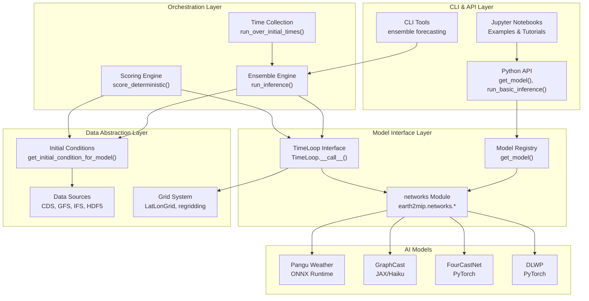

The architecture enables users to interact with AI weather models through multiple interfaces while maintaining consistency in data handling and model execution. The `TimeLoop` interface serves as the central abstraction that standardizes how different AI models are called and integrated into workflows.

**Sources:** [earth2mip/inference_ensemble.py:35-51](), [README.md:13-25](), [pyproject.toml:91-101]()

### Configuration and Schema System

Earth-2 MIP uses a structured configuration system based on Pydantic models to manage complex forecasting workflows:

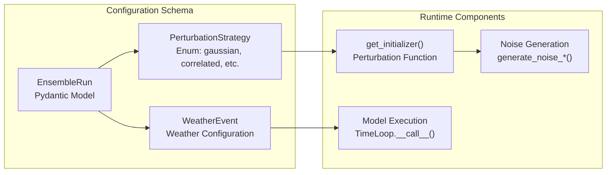

The `EnsembleRun` schema defines ensemble forecasting parameters including model selection, perturbation strategies, simulation length, and output configuration. This configuration-driven approach enables reproducible experiments and flexible workflow customization.

**Sources:** [earth2mip/schema.py:81-136](), [earth2mip/inference_ensemble.py:208-271]()

## Model Integration Framework  

The framework's plugin architecture allows seamless integration of diverse AI weather models through standardized interfaces:

### Model Registry and Loading System

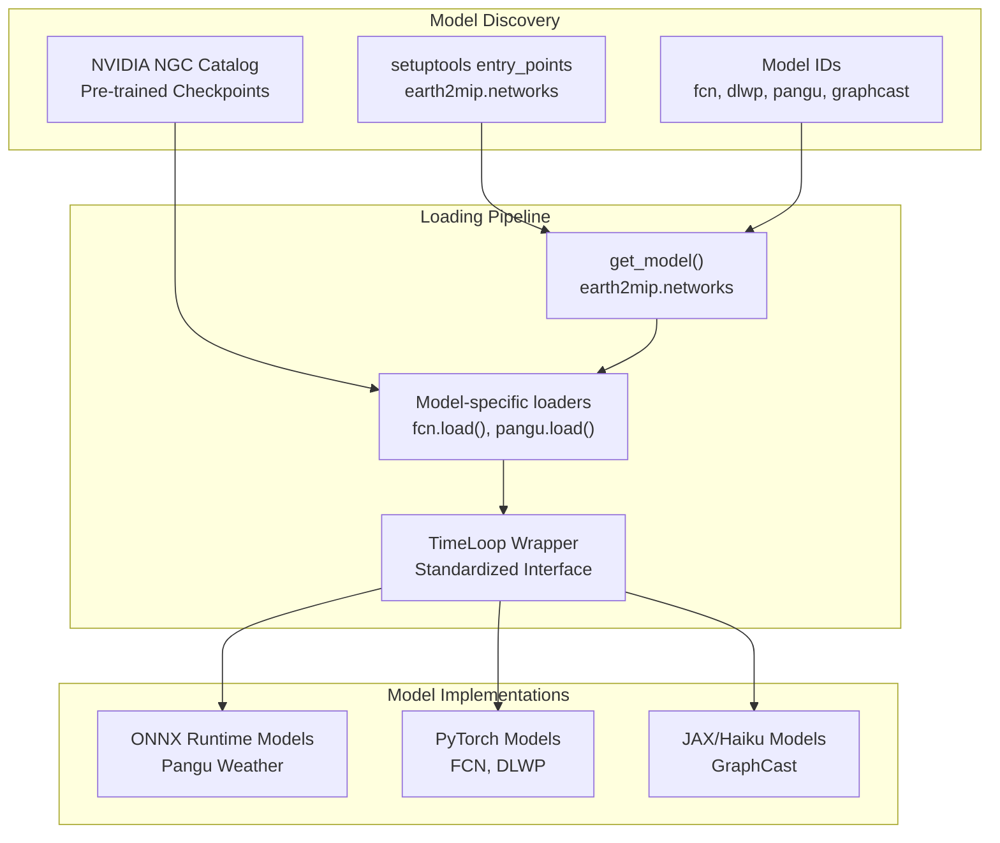

The `get_model()` function serves as the central entry point for model loading, using setuptools entry points to discover available models and their loading functions. Each model type implements a loader function that returns a `TimeLoop`-compatible interface.

**Sources:** [earth2mip/networks/__init__.py](), [pyproject.toml:91-101](), [earth2mip/inference_ensemble.py:48]()

### TimeLoop Interface Standardization

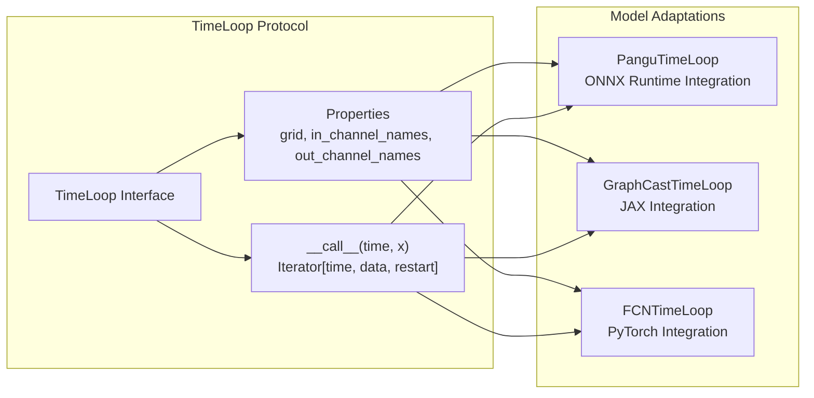

The `TimeLoop` interface provides a standardized way to interact with AI weather models regardless of their underlying implementation framework. Models expose grid information, channel names, and a callable interface that yields time-stepped forecasts.

**Sources:** [earth2mip/time_loop.py](), [earth2mip/inference_ensemble.py:120-156]()

## Data Flow and Processing Pipeline

Earth-2 MIP implements a flexible data pipeline that can access meteorological data from multiple sources and transform it for model consumption:

### Data Source Architecture

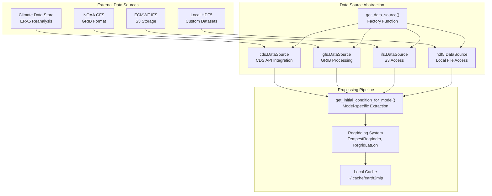

The data source abstraction enables consistent access to heterogeneous meteorological data providers. The `get_initial_condition_for_model()` function handles model-specific data requirements including channel selection, temporal alignment, and spatial regridding.

**Sources:** [earth2mip/initial_conditions.py](), [earth2mip/inference_ensemble.py:327-334]()

## Ensemble Forecasting Workflow

The ensemble forecasting system represents the framework's most sophisticated orchestration capability, supporting distributed computation and multiple perturbation strategies:

### Ensemble Execution Pipeline

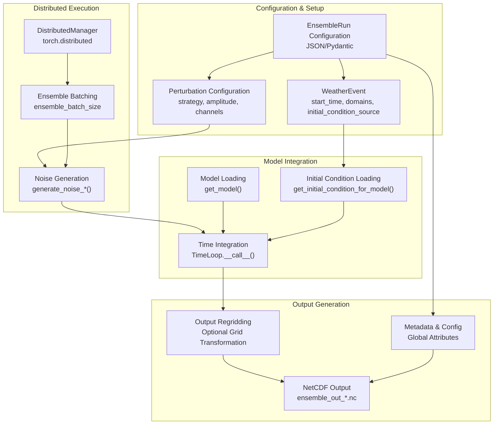

The `run_inference()` function orchestrates the complete ensemble workflow, from configuration parsing through distributed execution to output generation. It supports multiple perturbation strategies including Gaussian noise, correlated noise, bred vectors, and spherical Gaussian random fields.

**Sources:** [earth2mip/inference_ensemble.py:301-408](), [earth2mip/ensemble_utils.py:186-232]()

Earth-2 MIP's architecture enables climate researchers to focus on scientific questions rather than implementation details, providing a robust foundation for AI weather model experimentation and evaluation.

---

# Page: Getting Started

# Getting Started

<details>
<summary>Relevant source files</summary>

The following files were used as context for generating this wiki page:

- [CONTRIBUTING.md](CONTRIBUTING.md)
- [Makefile](Makefile)
- [README.md](README.md)
- [docs/.env](docs/.env)
- [docs/_static/NVIDIA-Logo-V-ForScreen-ForDarkBG.png](docs/_static/NVIDIA-Logo-V-ForScreen-ForDarkBG.png)
- [docs/_static/NVIDIA-Logo-V-ForScreen-ForLightBG.png](docs/_static/NVIDIA-Logo-V-ForScreen-ForLightBG.png)
- [docs/_static/favicon.ico](docs/_static/favicon.ico)
- [pyproject.toml](pyproject.toml)
- [requirements.txt](requirements.txt)

</details>


This page provides an overview of Earth-2 MIP (Model Intercomparison Project) and guides you through the initial steps to start using the framework. It covers the core concepts, system architecture, and points you to detailed installation and usage instructions.

For detailed installation procedures including dependencies and environment setup, see [Installation](#2.1). For hands-on examples and tutorials, see [Quick Start Examples](#2.2).

## What is Earth-2 MIP?

Earth-2 MIP is a Python framework that enables climate researchers and scientists to explore and experiment with AI models for weather and climate forecasting. The framework provides:

- **Unified Model Interface**: A standardized way to load and run different AI weather models through the `TimeLoop` abstraction
- **Ensemble Forecasting**: Tools for running probabilistic forecasts with uncertainty quantification
- **Model Evaluation**: Comprehensive scoring and evaluation metrics for model skill assessment
- **Data Integration**: Seamless access to multiple meteorological data sources (ERA5, GFS, IFS, etc.)

The framework bridges the gap between ML model developers and domain experts by providing consistent interfaces and reference workflows for model comparison and evaluation.

**Sources**: [README.md:13-25](), [pyproject.toml:11-12]()

## Core Architecture Overview

Earth-2 MIP follows a layered architecture that separates concerns between model management, data handling, and workflow orchestration:

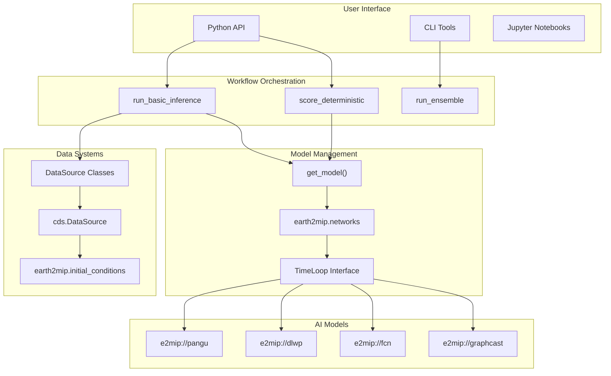

**Core Workflow Components**

| Component | Purpose | Key Classes/Functions |
|-----------|---------|----------------------|
| Model Registry | Load and manage AI models | `get_model()`, `earth2mip.networks` |
| TimeLoop Interface | Unified model execution | `TimeLoop`, `TimeStepper` |
| Data Sources | Initial conditions and validation data | `DataSource`, `cds.DataSource` |
| Inference Engines | Run forecasts and ensembles | `run_basic_inference`, `run_ensemble` |
| Scoring Systems | Model evaluation and metrics | `score_deterministic`, scoring modules |

**Sources**: [README.md:49-71](), [pyproject.toml:91-101]()

## Model Loading and Execution Flow

The following diagram shows how models are discovered, loaded, and executed through the registry system:

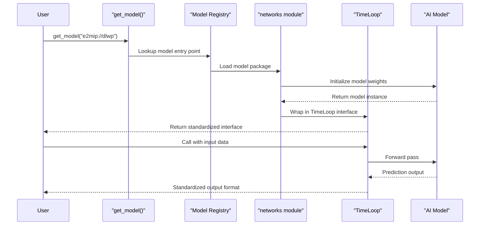

**Model Registry System**

The framework uses Python entry points to register and discover models. Available models include:

| Model ID | Architecture | Entry Point | Size |
|----------|-------------|-------------|------|
| `e2mip://fcn` | FourCastNet (AFNO) | `earth2mip.networks.fcn:load` | 300MB |
| `e2mip://dlwp` | Deep Learning Weather Prediction | `earth2mip.networks.dlwp:load` | 50MB |
| `e2mip://pangu` | Pangu Weather (Vision Transformer) | `earth2mip.networks.pangu:load` | 2GB |
| `e2mip://graphcast` | GraphCast (Graph Neural Network) | `earth2mip.networks.graphcast:load_time_loop` | 145MB |

**Sources**: [README.md:116-129](), [pyproject.toml:91-101]()

## Key Concepts

### TimeLoop Interface

All AI models in Earth-2 MIP implement the `TimeLoop` interface, which provides:
- Standardized input/output formats (xarray datasets)
- Consistent channel naming and grid specifications  
- Unified time stepping and forecast length control

### Data Sources

The framework abstracts data access through `DataSource` classes that handle:
- Automatic data downloading and caching
- Grid regridding to match model requirements
- Temporal alignment and preprocessing

### Ensemble Workflows

Earth-2 MIP supports probabilistic forecasting through:
- Perturbation strategies (Gaussian, bred vectors, etc.)
- Distributed ensemble execution
- Comprehensive uncertainty quantification

**Sources**: [README.md:56-61](), [README.md:75-83]()

## Basic Usage Pattern

The typical workflow follows this pattern:

```python
# 1. Load a model
from earth2mip.networks import get_model
time_loop = get_model("e2mip://dlwp", device="cuda:0")

# 2. Set up data source  
from earth2mip.initial_conditions import cds
data_source = cds.DataSource(time_loop.in_channel_names)

# 3. Run inference
from earth2mip.inference_ensemble import run_basic_inference
ds = run_basic_inference(
    time_loop, 
    n=10, 
    data_source=data_source, 
    time=datetime.datetime(2018, 1, 1)
)

# 4. Evaluate results
from earth2mip.inference_medium_range import score_deterministic
scores = score_deterministic(
    time_loop,
    data_source=data_source,
    n=10,
    initial_times=[datetime.datetime(2018, 1, 1)]
)
```

**Sources**: [README.md:54-103]()

## Next Steps

1. **Installation**: Follow the detailed setup instructions in [Installation](#2.1) to configure your environment with the required dependencies.

2. **Quick Start**: Work through the practical examples in [Quick Start Examples](#2.2) to run your first weather forecasts and model evaluations.

3. **Model Management**: Learn about loading and using different AI models in [Model Management](#4).

4. **Data Systems**: Understand data sources and initial conditions in [Data Systems](#5).

5. **Advanced Workflows**: Explore ensemble forecasting and evaluation in [Inference and Forecasting](#6) and [Model Evaluation and Scoring](#7).

## System Requirements

- **Python**: 3.10, 3.11, or 3.12
- **GPU**: CUDA-compatible GPU recommended for AI model inference
- **Storage**: Varies by model (50MB to 2GB+ for model weights)
- **Memory**: 8GB+ RAM recommended for ensemble workflows

**Sources**: [pyproject.toml:13](), [README.md:8-9](), [pyproject.toml:15-54]()

---

# Page: Installation

# Installation

<details>
<summary>Relevant source files</summary>

The following files were used as context for generating this wiki page:

- [.licenses/summary_docker.md](.licenses/summary_docker.md)
- [.licenses/summary_pip.md](.licenses/summary_pip.md)
- [CONTRIBUTING.md](CONTRIBUTING.md)
- [conftest.py](conftest.py)
- [docs/.env](docs/.env)
- [docs/_static/NVIDIA-Logo-V-ForScreen-ForDarkBG.png](docs/_static/NVIDIA-Logo-V-ForScreen-ForDarkBG.png)
- [docs/_static/NVIDIA-Logo-V-ForScreen-ForLightBG.png](docs/_static/NVIDIA-Logo-V-ForScreen-ForLightBG.png)
- [docs/_static/favicon.ico](docs/_static/favicon.ico)
- [docs/userguide/install.md](docs/userguide/install.md)
- [earth2mip/datasets/era5/__init__.py](earth2mip/datasets/era5/__init__.py)
- [earth2mip/datasets/hindcast.py](earth2mip/datasets/hindcast.py)
- [earth2mip/initial_conditions/hdf5.py](earth2mip/initial_conditions/hdf5.py)

</details>


This document provides comprehensive installation instructions for Earth-2 MIP, including environment setup, dependency management, and configuration options. Earth-2 MIP is a Python framework for AI weather and climate modeling that requires specific dependencies and environment configuration for optimal performance.

For information about using Earth-2 MIP after installation, see [Quick Start Examples](#2.2). For contributing to the codebase, see [Contributing Guidelines](#9.1).

## Installation Overview

Earth-2 MIP is distributed as a Python package that can be installed from source or release wheels. The framework requires a dedicated environment due to its complex dependency stack and integration with multiple AI model formats (ONNX, JAX, PyTorch).

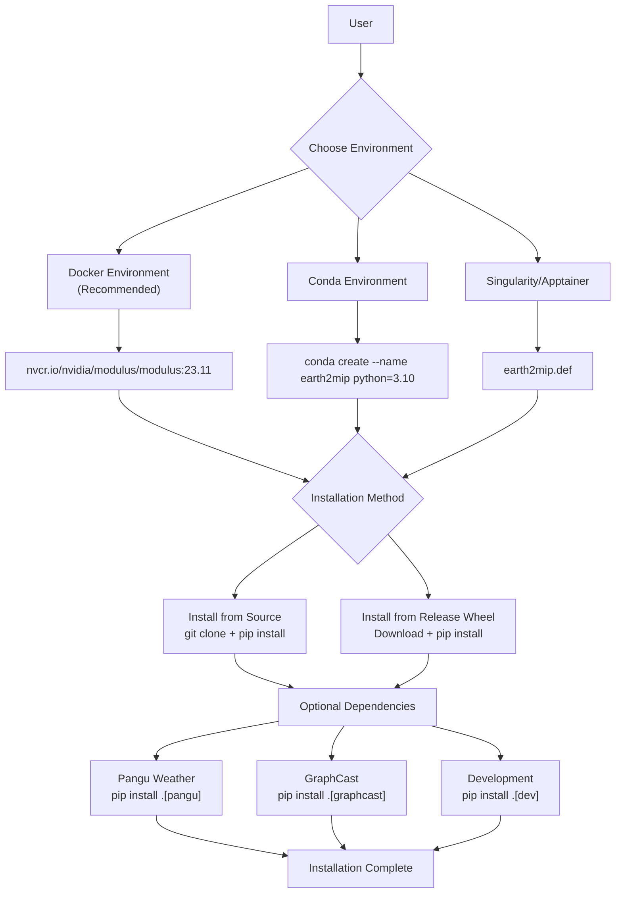

Sources: [docs/userguide/install.md:1-178]()

## Installation Methods

### Install from Source (Recommended)

The preferred installation method is from source, which ensures compatibility with the latest features and fixes:

```bash
git clone git@github.com:NVIDIA/earth2mip.git
cd earth2mip && pip install .
```

This method downloads the complete repository including examples, documentation, and development tools.

### Install from Release Wheel

For production environments, pre-built wheels are available from GitHub releases:

```bash
curl -L https://github.com/NVIDIA/earth2mip/releases/download/v0.1.0/earth2mip-0.1.0-py3-none-any.whl > earth2mip-0.1.0-py3-none-any.whl
pip install earth2mip-0.1.0-py3-none-any.whl
```

### PyPI Status

Earth-2 MIP is not currently available on PyPI. Use source or wheel installation methods in the interim.

Sources: [docs/userguide/install.md:8-30]()

## Environment Setup

### Docker Environment (Recommended)

Docker provides the most consistent environment and is recommended for both development and production use. Earth-2 MIP leverages the Modulus container ecosystem:

```bash
docker run --rm --shm-size=1g --ulimit memlock=-1 --ulimit stack=67108864 --runtime nvidia -p 8888:8888 -it nvcr.io/nvidia/modulus/modulus:23.11
```

The port mapping (`-p 8888:8888`) is required for Jupyter Lab access when running notebook examples. The `--runtime nvidia` flag enables GPU access for AI model inference.

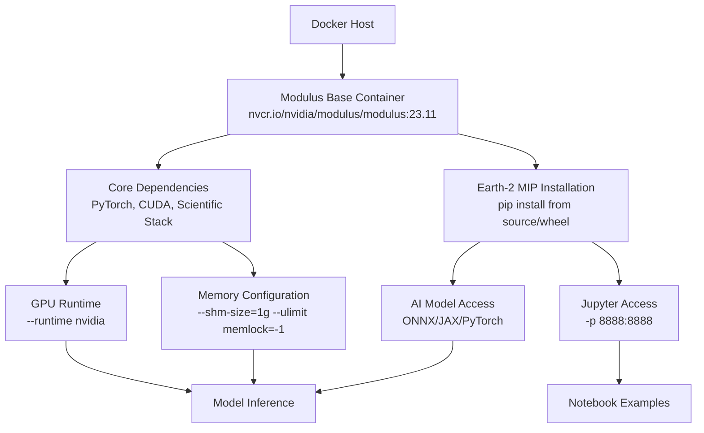

Sources: [docs/userguide/install.md:66-86]()

### Conda Environment

For users who prefer Conda or cannot use Docker:

```bash
conda create --name earth2mip python=3.10
conda activate earth2mip
git clone git@github.com:NVIDIA/earth2mip.git
cd earth2mip && pip install .
```

For Jupyter notebook support, create an IPython kernel:

```bash
pip install ipykernel
python -m ipykernel install --user --name=earth2mip-kernel
```

### Singularity/Apptainer Environment

High-performance computing environments often use Singularity or Apptainer. A definition file is provided for building containers:

```dockerfile
Bootstrap: docker
FROM: nvcr.io/nvidia/modulus/modulus:23.11

%files
    earth2mip/* /workspace/earth2mip/earth2mip/
    MANIFEST.in /workspace/earth2mip/MANIFEST.in
    setup.cfg /workspace/earth2mip/setup.cfg
    setup.py /workspace/earth2mip/setup.py
    README.md /workspace/earth2mip/README.md
    LICENSE.txt /workspace/earth2mip/LICENSE.txt
    examples/README.md /workspace/earth2mip/examples/README.md

%post
    cd /workspace/earth2mip && pip3 install .
    pip3 install cartopy

%environment
    export HOME=/workspace/earth2mip/

%runscript
    cd ~
```

Build and run the container:

```bash
singularity build --fakeroot --sandbox earth2mip.sif earth2mip.def
singularity exec -B ${PWD}:/workspace/earth2mip --nv earth2mip.sif bash -c 'cd ~'
```

Sources: [docs/userguide/install.md:87-143]()

## Dependency Architecture

Earth-2 MIP has a complex dependency stack that supports multiple AI frameworks and meteorological data sources:

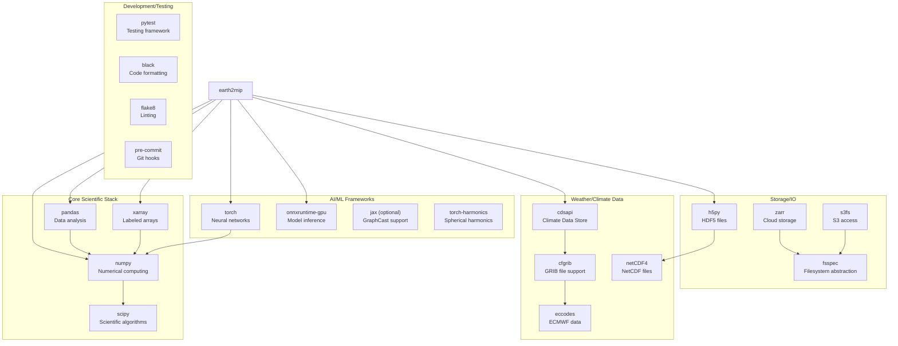

Sources: [.licenses/summary_pip.md:1-124](), [.licenses/summary_docker.md:1-300]()

## Optional Dependencies

### Model-Specific Dependencies

Different AI weather models require specific optional dependencies:

**Pangu Weather Support:**
```bash
pip install .[pangu]
```

**GraphCast Support:**
```bash
pip install .[graphcast]
pip install -r requirements.txt
```

**Development Dependencies:**
```bash
pip install .[dev]
```

**Documentation Building:**
```bash
pip install .[docs]
```

### Testing and Development Setup

For contributors and developers, additional setup is required:

```bash
# Enter development container
make enter

# Install development dependencies
make install

# Run test suite
pytest

# Run quick tests only
pytest -m 'not slow'

# Setup pre-commit hooks
make setup-ci

# Run linting
make lint
```

The test configuration is managed through `conftest.py`, which sets up fixtures for GPU detection, distributed computing, and model registry access:

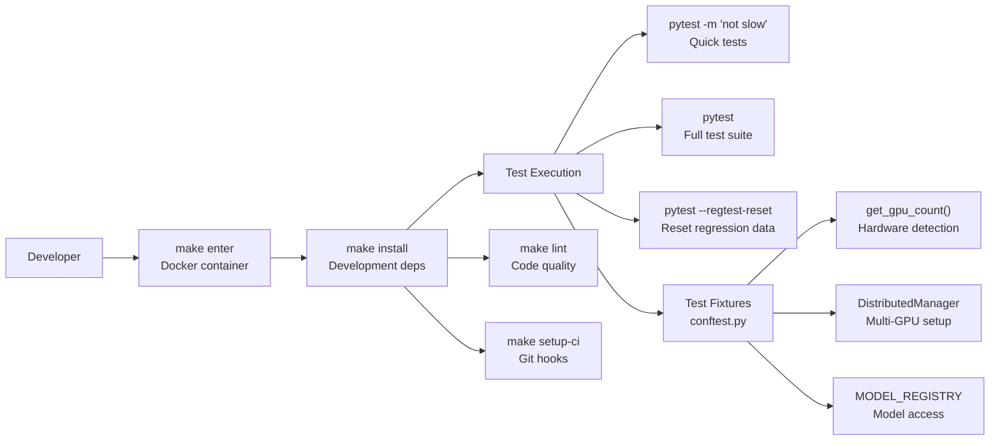

Sources: [CONTRIBUTING.md:40-72](), [conftest.py:27-55]()

## Configuration and Verification

After installation, verify the setup by checking core imports and dependencies:

```python
import earth2mip
from earth2mip import config
from earth2mip.initial_conditions import cds, gfs, ifs
from earth2mip.networks import get_model
```

The configuration system manages environment variables and registry access. Key configuration points include:

- `MODEL_REGISTRY`: Path to model registry for accessing pre-trained models
- `ERA5_HDF5`: Path to ERA5 reanalysis data for initial conditions
- GPU availability and CUDA configuration for model inference

For data source configuration, Earth-2 MIP supports multiple initial condition providers through a unified interface defined in the `earth2mip.initial_conditions` module.

Sources: [earth2mip/initial_conditions/hdf5.py:28-31](), [conftest.py:24-34]()

---

# Page: Quick Start Examples

# Quick Start Examples

<details>
<summary>Relevant source files</summary>

The following files were used as context for generating this wiki page:

- [.gitignore](.gitignore)
- [Makefile](Makefile)
- [README.md](README.md)
- [examples/.env](examples/.env)
- [examples/02_model_comparison.py](examples/02_model_comparison.py)
- [examples/03_model_scoring.py](examples/03_model_scoring.py)
- [examples/README.rst](examples/README.rst)
- [pyproject.toml](pyproject.toml)
- [requirements.txt](requirements.txt)

</details>


This page demonstrates essential Earth-2 MIP workflows through practical examples. It covers model loading, basic inference, and scoring using the Python API. These examples provide the foundation for more advanced workflows covered in subsequent sections.

For installation instructions, see [Installation](#2.1). For detailed information about the model interface, see [Model Interface (TimeLoop)](#3.2). For comprehensive scoring workflows, see [Model Evaluation and Scoring](#7).

## Basic Model Loading and Inference

Earth-2 MIP provides a unified interface for loading and running different AI weather models through the `earth2mip.networks` module and model registry system.

### Simple Inference Workflow

The most basic workflow involves three steps: loading a model, setting up a data source, and running inference.

**Basic Inference Pattern**

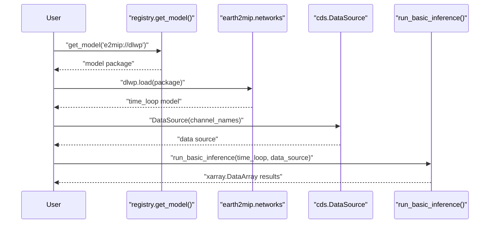

Sources: [README.md:49-71](), [examples/02_model_comparison.py:114-174]()

### Code Example from README

The README demonstrates a complete basic inference workflow:

```python
import datetime
from earth2mip.networks import get_model
from earth2mip.initial_conditions import cds
from earth2mip.inference_ensemble import run_basic_inference

time_loop = get_model("e2mip://dlwp", device="cuda:0")
data_source = cds.DataSource(time_loop.in_channel_names)
ds = run_basic_inference(
    time_loop, 
    n=10, 
    data_source=data_source, 
    time=datetime.datetime(2018, 1, 1)
)
```

This pattern uses:
- `registry.get_model()` or `networks.get_model()` for model loading
- `cds.DataSource` for initial conditions from Climate Data Store
- `run_basic_inference()` for deterministic forecasting

Sources: [README.md:54-71]()

## Model Loading Architecture

Earth-2 MIP uses a plugin-based architecture where models are registered and loaded through a common interface.

**Model Registry and Loading System**

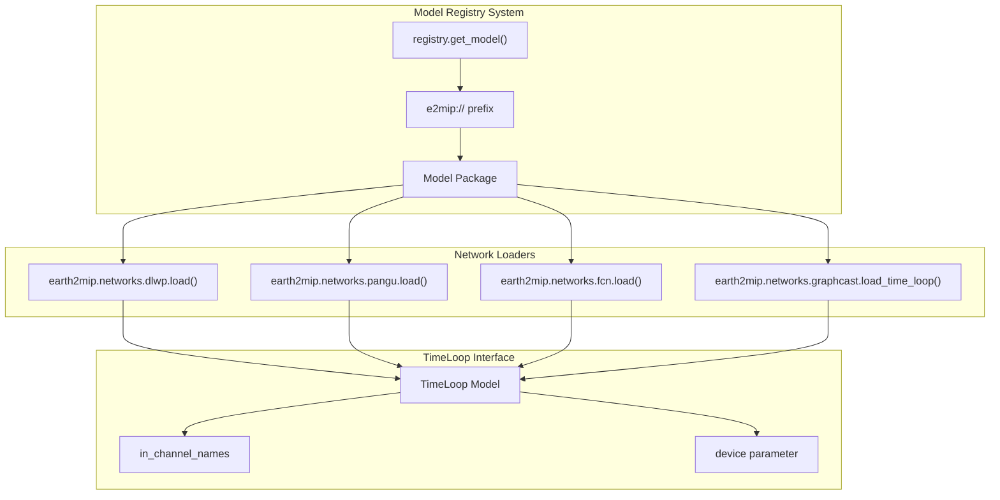

Sources: [README.md:59-67](), [examples/02_model_comparison.py:114-130](), [pyproject.toml:91-101]()

## Data Source Configuration

Different models require different input channels and timesteps. Earth-2 MIP handles this through model-specific data source configuration.

### Data Source Pattern

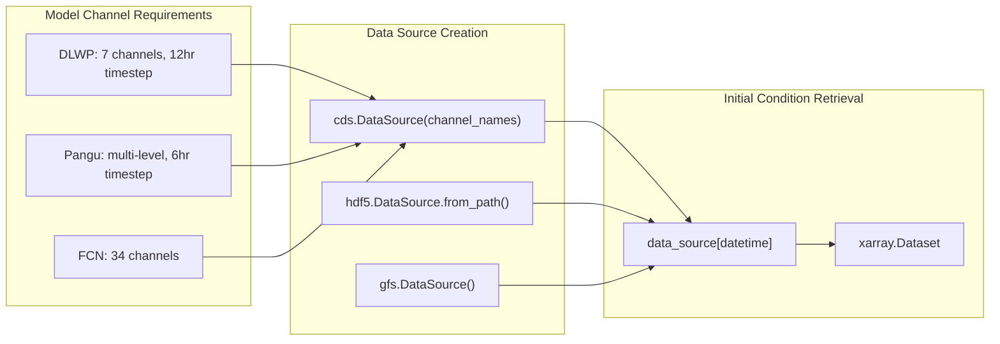

Sources: [examples/02_model_comparison.py:137-145](), [examples/03_model_scoring.py:113-122]()

## Model Comparison Workflow

The model comparison example shows how to run multiple models with the same initial conditions and compare results.

### Multi-Model Inference Pattern

From the model comparison example:

| Step | DLWP | Pangu |
|------|------|-------|
| **Model Loading** | `dlwp.load(package)` | `pangu.load(package)` |
| **Data Source** | `cds.DataSource(dlwp_model.in_channel_names)` | `cds.DataSource(pangu_model.in_channel_names)` |
| **Inference** | `run_basic_inference(dlwp_model, n=24)` | `run_basic_inference(pangu_model, n=24)` |
| **Output** | NetCDF file with 12hr timesteps | NetCDF file with 6hr timesteps |

The key difference is that models have different timestep requirements:
- DLWP: 12-hour native timestep, outputs every 6 hours
- Pangu: 6-hour native timestep

Sources: [examples/02_model_comparison.py:123-174]()

## Model Scoring Workflow

The scoring example demonstrates evaluation against ground truth data using metrics like RMSE and ACC.

**Scoring Workflow Components**

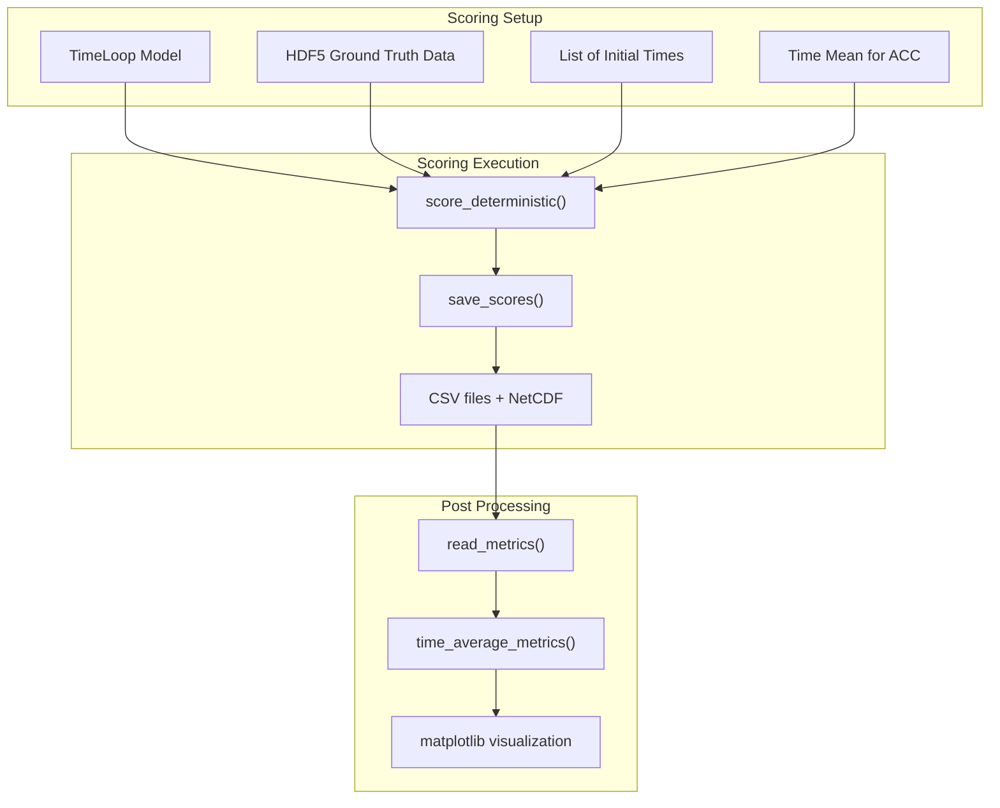

Sources: [examples/03_model_scoring.py:125-189]()

### Scoring Function Usage

The scoring workflow uses `inference_medium_range.score_deterministic()` and related utilities:

```python
from earth2mip.inference_medium_range import save_scores, time_average_metrics

scores = save_scores(
    model,
    n=28,  # forecast length
    initial_times=initial_times,
    data_source=datasource,
    time_mean=datasource.time_means,
    output_directory=output_dir,
)
```

This produces datasets with dimensions `(lead_time, channel)` containing RMSE and ACC metrics.

Sources: [examples/03_model_scoring.py:139-160](), [README.md:75-103]()

## Common Patterns and Best Practices

### Model Registry Usage

All examples use the `e2mip://` prefix for built-in models:

- `e2mip://dlwp` - Deep Learning Weather Prediction
- `e2mip://pangu` - Pangu Weather (hierarchical 6+24hr)
- `e2mip://fcn` - FourCastNet
- `e2mip://graphcast` - GraphCast

### Device Configuration

Models support GPU acceleration through the device parameter:
```python
time_loop = get_model("e2mip://dlwp", device="cuda:0")
```

### Output Handling

All inference functions return `xarray.DataArray` objects with standardized dimensions:
- `time`: forecast lead times
- `channel`: meteorological variables  
- `lat`, `lon`: spatial coordinates
- `history`: ensemble member (for ensemble forecasts)

### File I/O Patterns

Examples consistently use NetCDF for output storage:
```python
ds.to_netcdf(f"{output_dir}/model_output.nc")
```

Sources: [examples/02_model_comparison.py:161-173](), [examples/03_model_scoring.py:188](), [README.md:59-71]()

---

# Page: Core Architecture

# Core Architecture

<details>
<summary>Relevant source files</summary>

The following files were used as context for generating this wiki page:

- [earth2mip/ensemble_utils.py](earth2mip/ensemble_utils.py)
- [earth2mip/inference_ensemble.py](earth2mip/inference_ensemble.py)
- [earth2mip/netcdf.py](earth2mip/netcdf.py)
- [earth2mip/networks/__init__.py](earth2mip/networks/__init__.py)
- [earth2mip/networks/pangu.py](earth2mip/networks/pangu.py)
- [earth2mip/schema.py](earth2mip/schema.py)

</details>


This page describes the fundamental design patterns, abstractions, and architectural components that form the foundation of Earth-2 MIP. It covers the core interfaces that enable unified access to diverse AI weather models, the orchestration systems for running ensemble forecasts, and the data flow patterns that connect external data sources to model execution.

For detailed information about specific model implementations, see [Supported AI Models](#4.3). For ensemble forecasting workflows, see [Ensemble Forecasting](#6.1). For data source configuration, see [Data Sources](#5.2).

## System Overview

Earth-2 MIP is built around a layered architecture that separates concerns between model management, data handling, and forecast orchestration. The core design enables different AI weather models (ONNX, JAX, PyTorch-based) to work seamlessly together through standardized interfaces.

### Core Architecture Diagram

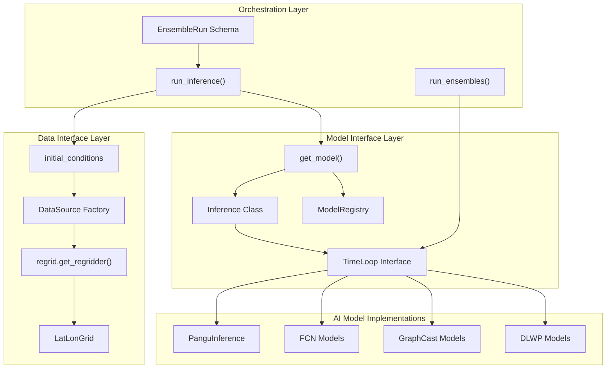

Sources: [earth2mip/inference_ensemble.py:35](), [earth2mip/networks/__init__.py:44](), [earth2mip/schema.py:81]()

## Core Design Patterns

### Plugin Architecture

Earth-2 MIP uses a plugin-based architecture where AI weather models are loaded dynamically through entry points and model registries. The `get_model` function serves as the central factory that can instantiate any registered model type.

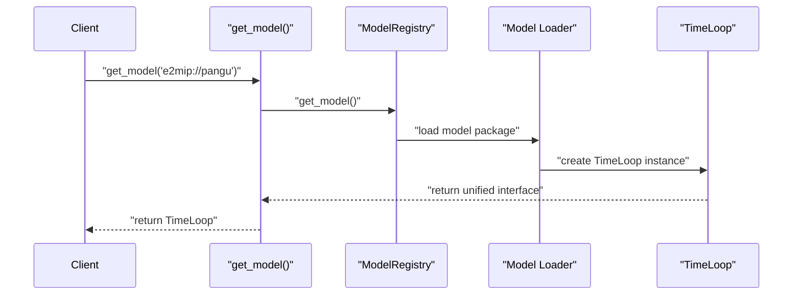

The model loading process abstracts away the differences between model architectures (ONNX, JAX, PyTorch) and provides a unified `TimeLoop` interface for time integration.

Sources: [earth2mip/networks/__init__.py:312-351]()

### TimeLoop Abstraction

The `TimeLoop` interface is the cornerstone abstraction that provides a unified way to run time integration for any AI weather model. All models, regardless of their underlying framework, implement this interface.

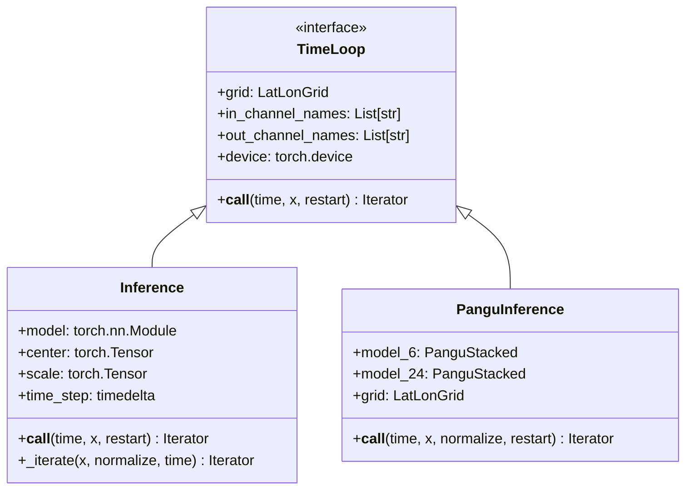

The `TimeLoop` interface standardizes model execution by requiring all implementations to:
- Accept initial conditions as tensors with shape `(batch, history, channel, lat, lon)`
- Yield `(time, output, restart)` tuples for each forecast step
- Provide metadata about grids and channel names

Sources: [earth2mip/time_loop.py](), [earth2mip/networks/__init__.py:121-251](), [earth2mip/networks/pangu.py:168-258]()

### Configuration-Driven Execution

Earth-2 MIP uses Pydantic schemas to define type-safe configurations for ensemble runs. The `EnsembleRun` schema encapsulates all parameters needed for a forecast.

| Configuration Aspect | Schema Class | Key Fields |
|----------------------|--------------|------------|
| Ensemble Parameters | `EnsembleRun` | `ensemble_members`, `perturbation_strategy`, `noise_amplitude` |
| Model Metadata | `Model` | `grid`, `in_channels_names`, `time_step`, `entrypoint` |
| Weather Events | `WeatherEvent` | `start_time`, `initial_condition_source`, `domains` |
| Perturbation Strategy | `PerturbationStrategy` | `gaussian`, `correlated`, `bred_vector`, `spherical_grf` |

Sources: [earth2mip/schema.py:81-136](), [earth2mip/schema.py:54-71]()

## Data Flow Architecture

### Initial Conditions Pipeline

The data flow for initial conditions follows a standardized pipeline that transforms external meteorological data into model-ready tensors.

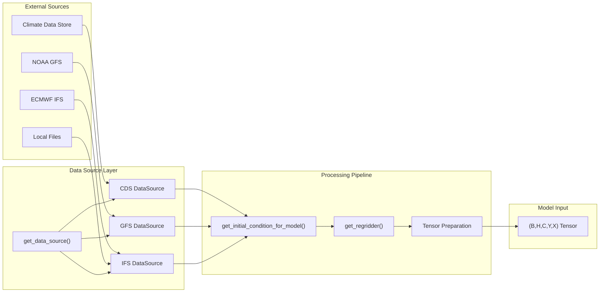

The `get_initial_condition_for_model` function handles the complexity of:
- Selecting appropriate channels for the target model
- Regridding data to match model grid requirements  
- Normalizing and formatting data as PyTorch tensors
- Managing time history for models that require it

Sources: [earth2mip/initial_conditions.py](), [earth2mip/inference_ensemble.py:282](), [earth2mip/inference_ensemble.py:334]()

### Ensemble Orchestration Flow

The ensemble forecasting system coordinates model execution across multiple ensemble members with perturbations.

```mermaid
graph TD
    subgraph "Ensemble Setup"
        Config["EnsembleRun Config"]
        WeatherEvent["WeatherEvent"]
        GetInitializer["get_initializer()"]
    end
    
    subgraph "Perturbation Generation"
        PerturbStrategy["PerturbationStrategy"]
        NoiseGeneration["Noise Generation"]
        PerturbFunction["perturb(x, rank, batch_id)"]
    end
    
    subgraph "Distributed Execution"
        RunEnsembles["run_ensembles()"]
        BatchProcessing["Batch Processing"]
        ModelIteration["Model Time Integration"]
    end
    
    subgraph "Output Processing"
        NetCDFOutput["NetCDF Output"]
        Regridding["Output Regridding"]
        UpdateNetCDF["update_netcdf()"]
    end
    
    Config --> GetInitializer
    WeatherEvent --> RunEnsembles
    GetInitializer --> PerturbStrategy
    PerturbStrategy --> NoiseGeneration
    NoiseGeneration --> PerturbFunction
    
    RunEnsembles --> BatchProcessing
    PerturbFunction --> BatchProcessing
    BatchProcessing --> ModelIteration
    
    ModelIteration --> Regridding
    Regridding --> UpdateNetCDF
    UpdateNetCDF --> NetCDFOutput
```

The `run_ensembles` function manages:
- Distributed processing across multiple GPU ranks
- Batching of ensemble members for memory efficiency
- Perturbation application through the `perturb` function
- Time integration using the model's `TimeLoop` interface
- Output regridding and NetCDF file writing

Sources: [earth2mip/inference_ensemble.py:68-164](), [earth2mip/inference_ensemble.py:208-271]()

## Integration Points

### Model Registry System

The model registry provides a unified interface for discovering and loading models from various sources including NGC (NVIDIA GPU Cloud), local files, and S3 storage.

```mermaid
graph LR
    subgraph "Model Sources"
        NGC["NGC Catalog"]
        S3["S3 Storage"]
        Local["Local Files"]
        HTTP["HTTP URLs"]
    end
    
    subgraph "Registry Layer"
        ModelRegistry["ModelRegistry"]
        Package["Package"]
        Metadata["metadata.json"]
    end
    
    subgraph "Loading System"
        GetModel["get_model()"]
        EntryPoint["Entry Points"]
        DefaultInference["_default_inference()"]
        LoadPackage["_load_package()"]
    end
    
    NGC --> Package
    S3 --> Package
    Local --> Package
    HTTP --> Package
    
    Package --> Metadata
    ModelRegistry --> Package
    
    GetModel --> EntryPoint
    GetModel --> LoadPackage
    LoadPackage --> DefaultInference
```

Model URIs are resolved through different schemes:
- `e2mip://model_name` - Built-in models with entry points
- `ngc://org/model:version` - NGC catalog models  
- `s3://bucket/path` - S3-hosted models
- `file:///local/path` - Local filesystem models

Sources: [earth2mip/networks/__init__.py:341-351](), [earth2mip/model_registry.py]()

### Normalization and Scaling

The `Inference` class handles data normalization and denormalization automatically using pre-computed statistics stored with each model.

```mermaid
graph TB
    subgraph "Input Processing"
        RawInput["Raw Input (x)"]
        Center["center (μ)"]
        Scale["scale (σ)"]
        Normalize["(x - μ) / σ"]
    end
    
    subgraph "Model Processing"
        NormalizedInput["Normalized Input"]
        ModelForward["model.forward()"]
        NormalizedOutput["Normalized Output"]
    end
    
    subgraph "Output Processing"
        Denormalize["y * σ + μ"]
        PhysicalOutput["Physical Units Output"]
    end
    
    RawInput --> Normalize
    Center --> Normalize
    Scale --> Normalize
    Normalize --> NormalizedInput
    
    NormalizedInput --> ModelForward
    ModelForward --> NormalizedOutput
    
    NormalizedOutput --> Denormalize
    Scale --> Denormalize
    Center --> Denormalize
    Denormalize --> PhysicalOutput
```

The normalization parameters are loaded from `global_means.npy` and `global_stds.npy` files stored in the model package and registered as PyTorch buffers for automatic device management.

Sources: [earth2mip/networks/__init__.py:170-179](), [earth2mip/networks/__init__.py:232-250](), [earth2mip/networks/__init__.py:264-266]()

---

# Page: System Overview

# System Overview

<details>
<summary>Relevant source files</summary>

The following files were used as context for generating this wiki page:

- [CHANGELOG.md](CHANGELOG.md)
- [earth2mip/_cli_utils.py](earth2mip/_cli_utils.py)
- [earth2mip/_config.py](earth2mip/_config.py)
- [earth2mip/ensemble_utils.py](earth2mip/ensemble_utils.py)
- [earth2mip/inference_ensemble.py](earth2mip/inference_ensemble.py)
- [earth2mip/model_registry.py](earth2mip/model_registry.py)
- [earth2mip/netcdf.py](earth2mip/netcdf.py)
- [earth2mip/schema.py](earth2mip/schema.py)
- [earth2mip/score_ensemble_outputs.py](earth2mip/score_ensemble_outputs.py)
- [earth2mip/time_collection.py](earth2mip/time_collection.py)
- [earth2mip/weather_events.py](earth2mip/weather_events.py)
- [test/_regtest_outputs/test_time_collection.test_run_over_initial_times.out](test/_regtest_outputs/test_time_collection.test_run_over_initial_times.out)
- [test/test_time_collection.py](test/test_time_collection.py)

</details>


This document provides a high-level architectural overview of Earth-2 MIP, focusing on how the major systems interact to enable AI-driven weather forecasting. This covers the core orchestration layer, model management infrastructure, and data processing systems that form the foundation of the framework.

For detailed information about specific model implementations, see [Supported AI Models](#4.3). For data source configuration and usage, see [Data Sources](#5.2). For detailed scoring and evaluation methods, see [Model Evaluation and Scoring](#7).

## Architectural Overview

Earth-2 MIP follows a layered architecture that separates user interfaces, orchestration logic, model management, and data handling concerns. The system is designed to support distributed ensemble forecasting across heterogeneous AI weather models while providing unified interfaces for configuration and execution.

```mermaid
graph TB
    subgraph "User Interface Layer"
        CLI["CLI Tools<br/>earth2mip.time_collection<br/>earth2mip.make_job"]
        API["Python API<br/>earth2mip.networks.get_model<br/>earth2mip.inference_ensemble"]
        Notebooks["Jupyter Notebooks<br/>Direct TimeLoop usage"]
    end
    
    subgraph "Core Orchestration"
        EnsembleEngine["Ensemble Engine<br/>run_inference()<br/>earth2mip.inference_ensemble"]
        TimeCollection["Time Collection<br/>run_over_initial_times()<br/>earth2mip.time_collection"]
        ScoringEngine["Scoring Engine<br/>score_ensemble_outputs.main()<br/>earth2mip.score_ensemble_outputs"]
    end
    
    subgraph "Model Management"
        ModelRegistry["Model Registry<br/>ModelRegistry.get_model()<br/>earth2mip.model_registry"]
        Networks["Model Loading<br/>networks.get_model()<br/>earth2mip.networks"]
        TimeLoop["TimeLoop Interface<br/>TimeLoop.__call__()<br/>earth2mip.time_loop"]
    end
    
    subgraph "Data Systems"
        InitialConditions["Initial Conditions<br/>get_initial_condition_for_model()<br/>earth2mip.initial_conditions"]
        DataSources["Data Sources<br/>CDS/ERA5/GFS/IFS<br/>earth2mip.initial_conditions.*"]
        GridSystem["Grid System<br/>LatLonGrid<br/>earth2mip.grid"]
    end
    
    subgraph "AI Models"
        Models["AI Model Implementations<br/>Pangu/GraphCast/FCN/DLWP<br/>earth2mip.networks.*"]
    end
    
    CLI --> EnsembleEngine
    CLI --> TimeCollection
    API --> Networks
    
    EnsembleEngine --> Networks
    TimeCollection --> EnsembleEngine
    ScoringEngine --> Networks
    
    Networks --> ModelRegistry
    Networks --> TimeLoop
    
    TimeLoop --> Models
    
    EnsembleEngine --> InitialConditions
    ScoringEngine --> InitialConditions
    
    InitialConditions --> DataSources
    Networks --> GridSystem
    
    TimeCollection --> ScoringEngine
```

**Sources:** [earth2mip/inference_ensemble.py:1-412](), [earth2mip/time_collection.py:1-257](), [earth2mip/score_ensemble_outputs.py:1-183](), [earth2mip/model_registry.py:1-285]()

## Core Orchestration Systems

The orchestration layer manages high-level workflows and coordinates between different subsystems. Three primary orchestrators handle different aspects of forecast execution and evaluation.

### Ensemble Forecasting Engine

The `run_inference` function in `earth2mip.inference_ensemble` serves as the primary orchestrator for ensemble weather forecasting. It coordinates model execution, perturbation generation, and output handling across distributed computing resources.

```mermaid
graph TD
    Config["EnsembleRun<br/>Pydantic Configuration<br/>earth2mip.schema.EnsembleRun"]
    WeatherEvent["WeatherEvent<br/>Initial conditions + domains<br/>earth2mip.weather_events.WeatherEvent"]
    
    GetInitializer["get_initializer()<br/>Perturbation strategy factory<br/>earth2mip.inference_ensemble:208-271"]
    RunInference["run_inference()<br/>Main orchestrator<br/>earth2mip.inference_ensemble:301-408"]
    RunEnsembles["run_ensembles()<br/>Batch execution<br/>earth2mip.inference_ensemble:68-164"]
    
    PerturbStrategies["Perturbation Strategies<br/>gaussian/correlated/spherical_grf<br/>earth2mip.ensemble_utils"]
    DistManager["DistributedManager<br/>torch.distributed coordination<br/>modulus.distributed.manager"]
    NetCDFOutput["NetCDF Output<br/>ensemble_out_*.nc<br/>earth2mip.netcdf"]
    
    Config --> RunInference
    WeatherEvent --> RunInference
    RunInference --> GetInitializer
    GetInitializer --> PerturbStrategies
    RunInference --> RunEnsembles
    RunEnsembles --> DistManager
    RunEnsembles --> NetCDFOutput
```

**Sources:** [earth2mip/inference_ensemble.py:301-408](), [earth2mip/inference_ensemble.py:68-164](), [earth2mip/schema.py:81-136]()

### Time Collection Orchestrator

The `run_over_initial_times` function manages forecasts across multiple initial conditions with parallel execution and post-processing. This system enables hindcast evaluation and operational forecast generation.

```mermaid
sequenceDiagram
    participant User
    participant TimeCollection as "run_over_initial_times()"
    participant InferenceEngine as "run_inference()"
    participant PostProcess as "score_ensemble_outputs.main()"
    participant DaskClient as "Dask Distributed Client"
    
    User->>TimeCollection: initial_times, config, time_loop
    TimeCollection->>DaskClient: get_distributed_client()
    
    loop for each initial_time
        TimeCollection->>InferenceEngine: config, perturb, group
        InferenceEngine-->>TimeCollection: ensemble NetCDF files
        TimeCollection->>PostProcess: process ensemble outputs
        PostProcess-->>TimeCollection: zarr archives (mean, variance, scores)
    end
    
    TimeCollection-->>User: forecast dataset ready
```

**Sources:** [earth2mip/time_collection.py:98-253](), [earth2mip/score_ensemble_outputs.py:64-139]()

## Model Management Systems

The model management layer provides abstraction and standardization for loading and executing different AI weather models through a unified interface.

### Model Registry and Package System

The `ModelRegistry` class handles model discovery, package management, and metadata access. It supports both local file systems and remote repositories including NGC (NVIDIA GPU Cloud).

```mermaid
graph TB
    Registry["ModelRegistry<br/>earth2mip.model_registry.ModelRegistry"]
    Package["Package<br/>earth2mip.model_registry.Package"]
    
    subgraph "Built-in Models"
        FCNPkg["FCNPackage<br/>NGC download + Package wrapper"]
        PanguPkg["PanguPackage<br/>ECMWF download + Package wrapper"]
        DLWPPkg["DLWPPackage<br/>NGC download + Package wrapper"]
        GraphCastPkg["GraphCast<br/>gs://dm_graphcast Package"]
    end
    
    subgraph "Package Contents"
        Metadata["metadata.json<br/>schema.Model schema"]
        Weights["weights.tar<br/>Model checkpoint"]
        Normalization["global_means.npy<br/>global_stds.npy"]
    end
    
    Registry -->|"get_model()"| Package
    Registry -->|"get_builtin_model()"| FCNPkg
    Registry -->|"get_builtin_model()"| PanguPkg
    Registry -->|"get_builtin_model()"| DLWPPkg
    Registry -->|"get_builtin_model()"| GraphCastPkg
    
    Package -->|"get()"| Weights
    Package -->|"metadata()"| Metadata
    Package --> Normalization
```

**Sources:** [earth2mip/model_registry.py:224-285](), [earth2mip/model_registry.py:98-120](), [earth2mip/model_registry.py:141-221]()

### TimeLoop Interface Standardization

All AI models are wrapped through the `TimeLoop` interface, providing a unified API for time-stepping integration regardless of the underlying model architecture (ONNX, JAX, PyTorch).

```mermaid
graph LR
    subgraph "Model Architectures"
        PanguONNX["Pangu Weather<br/>ONNX Runtime<br/>earth2mip.networks.pangu"]
        GraphCastJAX["GraphCast<br/>JAX/Haiku<br/>earth2mip.networks.graphcast"]
        FCNPT["FourCastNet<br/>PyTorch<br/>earth2mip.networks.fcn"]
        DLWPPT["DLWP<br/>PyTorch<br/>earth2mip.networks.dlwp"]
    end
    
    subgraph "Unified Interface"
        TimeLoopInterface["TimeLoop Interface<br/>__call__(time, x)<br/>yields (time, data, restart)"]
        Properties["Common Properties<br/>grid, in_channel_names<br/>out_channel_names, device"]
    end
    
    PanguONNX --> TimeLoopInterface
    GraphCastJAX --> TimeLoopInterface
    FCNPT --> TimeLoopInterface
    DLWPPT --> TimeLoopInterface
    
    TimeLoopInterface --> Properties
```

**Sources:** [earth2mip/time_loop.py](), [earth2mip/networks/]()

## Data Processing Systems

The data layer handles initial condition acquisition, spatial regridding, and format standardization across multiple meteorological data sources.

### Initial Conditions and Data Sources

The initial conditions system provides a factory pattern for accessing different meteorological data sources with automatic caching and format standardization.

```mermaid
graph TD
    DataSourceFactory["get_data_source()<br/>earth2mip.initial_conditions.get_data_source"]
    
    subgraph "Data Sources"
        CDSSource["CDS DataSource<br/>Copernicus Climate Data Store<br/>earth2mip.initial_conditions.cds"]
        GFSSource["GFS DataSource<br/>NOAA Global Forecast System<br/>earth2mip.initial_conditions.gfs"]
        IFSSource["IFS DataSource<br/>ECMWF Integrated Forecasting<br/>earth2mip.initial_conditions.ifs"]
        HDF5Source["HDF5 DataSource<br/>Local files<br/>earth2mip.initial_conditions.hdf5"]
    end
    
    subgraph "Processing Pipeline"
        GetInitialCondition["get_initial_condition_for_model()<br/>Model-specific data preparation"]
        Regridding["Regridding System<br/>TempestRegridder/RegridLatLon<br/>earth2mip.regrid"]
        GridSystem["LatLonGrid<br/>Spatial coordinate management<br/>earth2mip.grid"]
        Cache["Filesystem Cache<br/>~/.cache/earth2mip<br/>earth2mip.filesystem"]
    end
    
    DataSourceFactory --> CDSSource
    DataSourceFactory --> GFSSource
    DataSourceFactory --> IFSSource
    DataSourceFactory --> HDF5Source
    
    CDSSource --> GetInitialCondition
    GFSSource --> GetInitialCondition
    IFSSource --> GetInitialCondition
    HDF5Source --> GetInitialCondition
    
    GetInitialCondition --> Regridding
    Regridding --> GridSystem
    
    CDSSource -.-> Cache
    GFSSource -.-> Cache
    IFSSource -.-> Cache
```

**Sources:** [earth2mip/initial_conditions/](), [earth2mip/regrid.py](), [earth2mip/grid.py](), [earth2mip/filesystem.py]()

## Integration Patterns

### Configuration-Driven Execution

Earth-2 MIP uses Pydantic schemas to provide type-safe configuration management across all system components. The `EnsembleRun` schema serves as the primary configuration interface.

| Configuration Component | Schema Class | Purpose |
|------------------------|--------------|---------|
| Ensemble Parameters | `EnsembleRun` | Members, perturbation strategy, simulation length |
| Weather Events | `WeatherEvent` | Initial conditions, domains, diagnostics |
| Perturbation Strategy | `PerturbationStrategy` | Noise generation method and parameters |
| Model Metadata | `Model` | Architecture, channels, grid specifications |

**Sources:** [earth2mip/schema.py:81-136](), [earth2mip/weather_events.py:84-87]()

### Distributed Computing Integration

The system integrates with PyTorch's distributed computing framework and Dask for scalable ensemble processing and post-processing workflows.

```mermaid
graph TB
    subgraph "Distributed Execution"
        DistManager["DistributedManager<br/>torch.distributed coordination<br/>modulus.distributed.manager"]
        ProcessGroup["Process Groups<br/>torch.distributed.new_group()<br/>Per-time ensemble coordination"]
        DaskClient["Dask Client<br/>Post-processing parallelization<br/>distributed.Client"]
    end
    
    subgraph "Workload Distribution"
        EnsembleSharding["Ensemble Member Sharding<br/>Across GPU ranks"]
        TimeSharding["Initial Time Sharding<br/>Across process groups"]
        PostProcessing["Asynchronous Post-processing<br/>Zarr aggregation and scoring"]
    end
    
    DistManager --> ProcessGroup
    DistManager --> EnsembleSharding
    ProcessGroup --> TimeSharding
    DaskClient --> PostProcessing
    
    EnsembleSharding --> PostProcessing
    TimeSharding --> PostProcessing
```

**Sources:** [earth2mip/time_collection.py:46-58](), [earth2mip/time_collection.py:154-175](), [earth2mip/inference_ensemble.py:192-195]()

---

# Page: Model Interface (TimeLoop)

# Model Interface (TimeLoop)

<details>
<summary>Relevant source files</summary>

The following files were used as context for generating this wiki page:

- [earth2mip/networks/__init__.py](earth2mip/networks/__init__.py)
- [earth2mip/networks/graphcast.py](earth2mip/networks/graphcast.py)
- [earth2mip/networks/pangu.py](earth2mip/networks/pangu.py)
- [earth2mip/time_loop.py](earth2mip/time_loop.py)
- [test/graphcast/multiple_step.py](test/graphcast/multiple_step.py)
- [test/graphcast/reference_inference.py](test/graphcast/reference_inference.py)
- [test/test_time_loop.py](test/test_time_loop.py)

</details>


The TimeLoop interface provides a unified abstraction for running inference on AI weather models, regardless of their underlying implementation framework (PyTorch, JAX, ONNX). This interface standardizes how models consume initial conditions, perform time stepping, and produce forecasts, enabling consistent integration across Earth-2 MIP's forecasting workflows.

For information about model loading and registration, see [Model Registry and Package System](#4.1). For details about data preparation and initial conditions, see [Data Interface](#3.3).

## Core Interfaces

### TimeLoop Protocol

The `TimeLoop` protocol defines the primary interface that all weather models must implement. It provides a generator-based API for iterative forecasting where each step produces the next forecast time.

```mermaid
classDiagram
    class TimeLoop {
        <<protocol>>
        +in_channel_names: List[str]
        +out_channel_names: List[str]
        +grid: LatLonGrid
        +n_history_levels: int
        +history_time_step: timedelta
        +time_step: timedelta
        +device: torch.device
        +dtype: torch.dtype
        +__call__(time, x, restart) Iterator[Tuple[datetime, Tensor, Any]]
    }
    
    class GeoTensorInfo {
        +channel_names: List[str]
        +grid: LatLonGrid
        +n_history_levels: int
        +history_time_step: timedelta
    }
    
    class TimeStepper {
        <<protocol>>
        +input_info: GeoTensorInfo
        +output_info: GeoTensorInfo
        +device: torch.device
        +dtype: torch.dtype
        +time_step: timedelta
        +initialize(x, time) StateT
        +step(state) Tuple[StateT, Tensor]
    }
    
    TimeLoop --> GeoTensorInfo : describes tensors
    TimeStepper --> GeoTensorInfo : describes tensors
```

**Sources:** [earth2mip/time_loop.py:43-96](), [earth2mip/time_loop.py:29-41](), [earth2mip/time_loop.py:101-161]()

The key method `__call__` takes initial conditions as a tensor with shape `(batch, n_history_levels, len(in_channel_names), Y, X)` and yields tuples of `(time, output, restart_data)` for each forecast step. The restart data enables checkpointing and resuming forecasts.

### TimeStepper Protocol

The `TimeStepper` protocol provides an alternative functional interface using explicit state management. This design is particularly useful for models implemented in functional frameworks like JAX where state handling is more explicit.

```mermaid
sequenceDiagram
    participant User
    participant TimeStepper
    participant Model as "Underlying Model"
    
    User->>TimeStepper: initialize(x, time)
    TimeStepper->>Model: setup initial state
    Model-->>TimeStepper: state
    TimeStepper-->>User: state
    
    loop forecast steps
        User->>TimeStepper: step(state)
        TimeStepper->>Model: forward pass
        Model-->>TimeStepper: predictions
        TimeStepper-->>User: (new_state, output)
    end
```

**Sources:** [earth2mip/time_loop.py:101-161](), [earth2mip/networks/graphcast.py:223-421]()

### GeoTensorInfo

The `GeoTensorInfo` dataclass provides metadata that describes how tensors map onto geographical space and time. This ensures consistent interpretation of tensor dimensions across different models and data sources.

| Field | Type | Description |
|-------|------|-------------|
| `channel_names` | `List[str]` | Names of meteorological variables (e.g., "t2m", "u10m") |
| `grid` | `LatLonGrid` | Spatial grid definition with lat/lon coordinates |
| `n_history_levels` | `int` | Number of historical time steps required |
| `history_time_step` | `timedelta` | Time interval between history levels |

**Sources:** [earth2mip/time_loop.py:29-41]()

## Primary Implementations

### Inference Class

The `Inference` class is the main general-purpose implementation of `TimeLoop` designed for PyTorch-based models. It handles normalization, history management, and optional data augmentation.

```mermaid
flowchart TD
    InitialConditions["Initial Conditions<br/>(B, H, C, Y, X)"] --> Normalize["Normalize<br/>(x - center) / scale"]
    Normalize --> YieldInitial["Yield Initial State"]
    YieldInitial --> ForwardPass["Model Forward Pass<br/>model(x, time)"]
    ForwardPass --> UpdateTime["time += time_step"]
    UpdateTime --> Denormalize["Denormalize<br/>x * scale + center"]
    Denormalize --> YieldOutput["Yield (time, output, restart)"]
    YieldOutput --> ForwardPass
    
    Source["source(x, time)"] -.-> ForwardPass
```

**Sources:** [earth2mip/networks/__init__.py:121-251]()

Key features of the `Inference` class:

- **Normalization**: Automatically applies channel-wise normalization using provided mean and standard deviation arrays [earth2mip/networks/__init__.py:232-233]()
- **History Management**: Supports models requiring multiple historical time steps [earth2mip/networks/__init__.py:226-230]()
- **Source Integration**: Optional data augmentation through source functions for noise injection or nudging [earth2mip/networks/__init__.py:240-244]()
- **Time Dependency**: Automatically detects whether models require time input [earth2mip/networks/__init__.py:47-66]()

### TimeStepperLoop Adapter

The `TimeStepperLoop` class bridges the functional `TimeStepper` interface to the `TimeLoop` protocol, enabling models implemented with explicit state management to work seamlessly in Earth-2 MIP workflows.

```mermaid
classDiagram
    class TimeStepperLoop {
        +stepper: TimeStepper
        +in_channel_names: List[str]
        +out_channel_names: List[str]
        +grid: LatLonGrid
        +n_history_levels: int
        +time_step: timedelta
        +device: torch.device
        +__call__(time, x, restart) Iterator
    }
    
    class TimeStepper {
        <<protocol>>
        +input_info: GeoTensorInfo
        +output_info: GeoTensorInfo
        +initialize(x, time) StateT
        +step(state) Tuple[StateT, Tensor]
    }
    
    TimeStepperLoop --> TimeStepper : wraps
    TimeStepperLoop ..|> TimeLoop : implements
```

**Sources:** [earth2mip/time_loop.py:163-231]()

## Model-Specific Implementations

### Pangu Weather Implementation

Pangu Weather uses a custom `PanguInference` class that implements the `TimeLoop` protocol directly, handling the specific sub-stepping logic required for this ONNX-based model.

```mermaid
flowchart LR
    subgraph PanguInference["PanguInference"]
        Model6["6h Model<br/>PanguStacked"] 
        Model24["24h Model<br/>PanguStacked"]
    end
    
    Input["Initial State"] --> Model6
    Model6 --> Step1["6h prediction"]
    Step1 --> Model6
    Model6 --> Step2["12h prediction"] 
    Step2 --> Model6
    Model6 --> Step3["18h prediction"]
    Step3 --> Model24
    Model24 --> Output["24h prediction"]
```

**Sources:** [earth2mip/networks/pangu.py:168-258]()

### GraphCast Implementation

GraphCast uses the `GraphcastStepper` class implementing `TimeStepper`, which handles JAX-based state management and xarray data structures.

```mermaid
classDiagram
    class GraphcastStepper {
        +run_forward: Callable
        +eval_inputs: xarray.Dataset
        +eval_targets: xarray.Dataset
        +eval_forcings: xarray.Dataset
        +task_config: TaskConfig
        +initialize(x, time) JAXState
        +step(state) Tuple[JAXState, Tensor]
        +_pack(ds) Array
        +_get_inputs(x, time, dt) xarray.Dataset
    }
    
    GraphcastStepper ..|> TimeStepper : implements
```

**Sources:** [earth2mip/networks/graphcast.py:223-421]()

## Time Stepping Process

The time stepping process follows a consistent pattern across all implementations, with variations in state representation and model invocation:

```mermaid
sequenceDiagram
    participant Client
    participant TimeLoop as "TimeLoop Implementation"
    participant Model as "AI Model"
    participant Normalizer as "Normalization"
    
    Client->>TimeLoop: __call__(time, x, restart)
    
    alt restart provided
        TimeLoop->>TimeLoop: restore from restart
    else initialize
        TimeLoop->>Normalizer: normalize input
        Normalizer-->>TimeLoop: normalized_x
    end
    
    TimeLoop-->>Client: yield (time, initial_state, restart)
    
    loop forecast steps
        TimeLoop->>Model: forward(x, time)
        Model-->>TimeLoop: predictions
        TimeLoop->>TimeLoop: update time
        TimeLoop->>Normalizer: denormalize output
        Normalizer-->>TimeLoop: physical_units
        TimeLoop-->>Client: yield (time, output, restart)
    end
```

**Sources:** [earth2mip/networks/__init__.py:190-251](), [earth2mip/time_loop.py:201-231]()

### Input and Output Tensor Shapes

All `TimeLoop` implementations must handle consistent tensor shapes:

| Tensor | Shape | Description |
|--------|-------|-------------|
| Input | `(B, H, C, Y, X)` | Batch, History, Channels, Lat, Lon |
| Output | `(B, C, Y, X)` | Batch, Channels, Lat, Lon (single time step) |

Where:
- `B` = batch size
- `H` = number of history levels (`n_history_levels`)
- `C` = number of channels (`len(channel_names)`)
- `Y, X` = spatial grid dimensions

**Sources:** [earth2mip/time_loop.py:78-84](), [earth2mip/networks/__init__.py:196-201]()

## Integration with Model Loading

The `TimeLoop` interface integrates with Earth-2 MIP's model loading system through the `get_model` function, which automatically wraps loaded models in appropriate `TimeLoop` implementations:

```mermaid
flowchart TD
    GetModel["get_model(name, registry)"] --> CheckScheme{"URL Scheme?"}
    
    CheckScheme -->|"e2mip://"| Builtin["_load_package_builtin"]
    CheckScheme -->|"" or other| LoadPackage["_load_package"]
    
    Builtin --> EntryPoint["Load from entry_points"]
    LoadPackage --> CheckEntrypoint{"metadata.entrypoint?"}
    
    CheckEntrypoint -->|Yes| CustomLoader["Custom Entry Point"]
    CheckEntrypoint -->|No| DefaultInference["_default_inference"]
    
    CustomLoader --> TimeLoopImpl["TimeLoop Implementation"]
    DefaultInference --> InferenceClass["Inference Class"]
    EntryPoint --> SpecificImpl["Model-Specific Implementation"]
    
    InferenceClass --> TimeLoopImpl
    SpecificImpl --> TimeLoopImpl
```

**Sources:** [earth2mip/networks/__init__.py:312-352](), [earth2mip/networks/__init__.py:253-310]()

The loading system automatically determines the appropriate wrapper based on model metadata and entry points, ensuring that all loaded models present a consistent `TimeLoop` interface regardless of their underlying implementation framework.

---

# Page: Data Interface

# Data Interface

<details>
<summary>Relevant source files</summary>

The following files were used as context for generating this wiki page:

- [conftest.py](conftest.py)
- [docs/userguide/install.md](docs/userguide/install.md)
- [earth2mip/datasets/era5/__init__.py](earth2mip/datasets/era5/__init__.py)
- [earth2mip/datasets/hindcast.py](earth2mip/datasets/hindcast.py)
- [earth2mip/initial_conditions/__init__.py](earth2mip/initial_conditions/__init__.py)
- [earth2mip/initial_conditions/hdf5.py](earth2mip/initial_conditions/hdf5.py)

</details>


The Data Interface system provides a unified abstraction layer for accessing meteorological data from various sources and formats. This system handles initial conditions for weather models, coordinate transformations, and data preprocessing to ensure models receive properly formatted input data. For information about model interfaces, see [Model Interface (TimeLoop)](#3.2). For details about specific data sources and regridding, see [Data Sources](#5.2) and [Grids and Regridding](#5.3).

## Data Source Architecture

The Data Interface uses a factory pattern to provide uniform access to heterogeneous meteorological data sources. Each data source implements a common interface while handling source-specific details like authentication, file formats, and coordinate systems.

### Data Source Factory Pattern

```mermaid
graph TB
    GetDataSource["get_data_source()"]
    Schema["schema.InitialConditionSource"]
    BaseDataSource["base.DataSource"]
    
    CDSSource["cds.DataSource"]
    GFSSource["gfs.DataSource"] 
    IFSSource["ifs.DataSource"]
    HDF5Source["hdf5.DataSource"]
    HRMIPSource["hrmip.HDFPlSl"]
    
    GetDataSource --> Schema
    Schema --> CDSSource
    Schema --> GFSSource
    Schema --> IFSSource
    Schema --> HDF5Source
    Schema --> HRMIPSource
    
    CDSSource --> BaseDataSource
    GFSSource --> BaseDataSource
    IFSSource --> BaseDataSource
    HDF5Source --> BaseDataSource
    HRMIPSource --> BaseDataSource
    
    BaseDataSource --> GridProperty["grid: LatLonGrid"]
    BaseDataSource --> ChannelNames["channel_names: List[str]"]
    BaseDataSource --> GetItem["__getitem__(time: datetime)"]
```

Sources: [earth2mip/initial_conditions/__init__.py:36-54]()

### Initial Conditions Processing Pipeline

```mermaid
sequenceDiagram
    participant Model as "time_loop.TimeLoop"
    participant InitCond as "get_initial_condition_for_model()"
    participant DataSrc as "base.DataSource"
    participant Regrid as "regrid.get_regridder()"
    participant Process as "get_data_from_source()"
    
    Model->>InitCond: "Request initial conditions"
    InitCond->>Process: "Extract model requirements"
    Process->>DataSrc: "__getitem__(time)"
    DataSrc-->>Process: "Raw data array"
    Process->>DataSrc: "Get source grid"
    Process->>Regrid: "Create regridder(source_grid, target_grid)"
    Process->>Process: "Select channels by index"
    Process->>Process: "Stack history levels"
    Process->>Regrid: "Apply spatial regridding"
    Process-->>InitCond: "Formatted tensor"
    InitCond-->>Model: "torch.Tensor(time_levels, channels, lat, lon)"
```

Sources: [earth2mip/initial_conditions/__init__.py:106-118](), [earth2mip/initial_conditions/__init__.py:57-103]()

## Supported Data Sources

The system supports multiple meteorological data sources through a common interface:

| Source Type | Schema Enum | Implementation | Description |
|-------------|-------------|----------------|-------------|
| ERA5 HDF5 | `schema.InitialConditionSource.era5` | `hdf5.DataSource` | Local/S3 HDF5 files |
| Climate Data Store | `schema.InitialConditionSource.cds` | `cds.DataSource` | Copernicus CDS API |
| NOAA GFS | `schema.InitialConditionSource.gfs` | `gfs.DataSource` | GFS GRIB files |
| ECMWF IFS | `schema.InitialConditionSource.ifs` | `ifs.DataSource` | IFS forecasts |
| HRMIP | `schema.InitialConditionSource.hrmip` | `hrmip.HDFPlSl` | High-resolution data |

Sources: [earth2mip/initial_conditions/__init__.py:41-52]()

## HDF5 Data Format Implementation

The HDF5 data source provides the most complete implementation, supporting both local and remote S3 storage with comprehensive metadata handling.

### HDF5 Directory Structure

```mermaid
graph TD
    Root["HDF5 Root Directory"]
    Metadata["data.json"]
    Stats["stats/time_means.npy"]
    SubdirA["subdirA/2018.h5"]
    SubdirB["subdirB/2017.h5"]
    SubdirC["subdirB/2016.h5"]
    
    Root --> Metadata
    Root --> Stats
    Root --> SubdirA
    Root --> SubdirB
    Root --> SubdirC
    
    Metadata --> MetaContent["h5_path: str<br/>coords.channel: List[str]<br/>coords.lat: List[float]<br/>coords.lon: List[float]<br/>dhours: int (default 6)"]
```

Sources: [earth2mip/initial_conditions/hdf5.py:41-56]()

### HDF5 DataSource Implementation

The `hdf5.DataSource` class implements the core data access pattern:

```mermaid
graph LR
    FromPath["DataSource.from_path()"]
    Constructor["DataSource.__init__()"]
    GridProp["grid property"]
    ChannelProp["channel_names property"]
    GetItem["__getitem__(datetime)"]
    
    FromPath --> LoadMetadata["Load data.json"]
    LoadMetadata --> Constructor
    Constructor --> GridProp
    Constructor --> ChannelProp
    Constructor --> GetItem
    
    GetItem --> GetPath["_get_path(root, time)"]
    GetPath --> OpenFile["Open HDF5/S3 file"]
    OpenFile --> ERA5Open["era5.open_hdf5()"]
    ERA5Open --> SelectData["ds.sel(time, channel)"]
    SelectData --> ReturnArray["return subset.values"]
```

Sources: [earth2mip/initial_conditions/hdf5.py:78-84](), [earth2mip/initial_conditions/hdf5.py:102-115]()

## Data Processing and Regridding

The data interface handles coordinate transformations and format standardization between different data sources and model requirements.

### Processing Pipeline Details

The `get_data_from_source()` function orchestrates the complete data preparation pipeline:

1. **History Level Collection**: Gathers multiple time steps for models requiring temporal context
2. **Channel Selection**: Extracts specific variables based on model requirements  
3. **Spatial Regridding**: Transforms between different grid projections and resolutions
4. **Device/Dtype Conversion**: Ensures compatibility with model computational requirements

```mermaid
graph TD
    TimeRequest["time: datetime"]
    HistoryLoop["for i in range(n_history_levels)"]
    TimeCalc["time_to_get = time - i * time_step"]
    DataExtract["data_source[time_to_get]"]
    
    ChannelSelect["Select channels by index"]
    StackHistory["np.stack(arrays, axis=0)"]
    CreateRegridder["regrid.get_regridder(source_grid, target_grid)"]
    ApplyRegrid["regridder(tensor)"]
    FormatOutput["Shape: (time_levels, channels, lat, lon)"]
    
    TimeRequest --> HistoryLoop
    HistoryLoop --> TimeCalc
    TimeCalc --> DataExtract
    DataExtract --> ChannelSelect
    ChannelSelect --> StackHistory
    StackHistory --> CreateRegridder
    CreateRegridder --> ApplyRegrid
    ApplyRegrid --> FormatOutput
```

Sources: [earth2mip/initial_conditions/__init__.py:82-103]()

## Integration with Model Interface

The Data Interface integrates with the TimeLoop model interface through the `get_initial_condition_for_model()` function, which extracts model-specific requirements and formats data accordingly.

### Model-Data Interface Bridge

```mermaid
graph LR
    TimeLoop["time_loop.TimeLoop"]
    ModelProps["Model Properties"]
    DataFormat["Formatted Data"]
    
    TimeLoop --> InChannels["in_channel_names"]
    TimeLoop --> GridSpec["grid"]
    TimeLoop --> HistoryLevels["n_history_levels"]
    TimeLoop --> TimeStep["history_time_step"]
    TimeLoop --> Device["device"]
    TimeLoop --> Dtype["dtype"]
    
    InChannels --> ModelProps
    GridSpec --> ModelProps
    HistoryLevels --> ModelProps
    TimeStep --> ModelProps
    Device --> ModelProps
    Dtype --> ModelProps
    
    ModelProps --> ProcessData["get_data_from_source()"]
    ProcessData --> DataFormat
    DataFormat --> Tensor["torch.Tensor"]
```

Sources: [earth2mip/initial_conditions/__init__.py:106-118]()

The Data Interface serves as the critical bridge between external meteorological data sources and AI weather models, providing the standardized data access layer that enables Earth-2 MIP's model-agnostic architecture.

---

# Page: Model Management

# Model Management

<details>
<summary>Relevant source files</summary>

The following files were used as context for generating this wiki page:

- [CHANGELOG.md](CHANGELOG.md)
- [Makefile](Makefile)
- [README.md](README.md)
- [earth2mip/_cli_utils.py](earth2mip/_cli_utils.py)
- [earth2mip/_config.py](earth2mip/_config.py)
- [earth2mip/model_registry.py](earth2mip/model_registry.py)
- [earth2mip/score_ensemble_outputs.py](earth2mip/score_ensemble_outputs.py)
- [earth2mip/weather_events.py](earth2mip/weather_events.py)
- [pyproject.toml](pyproject.toml)
- [requirements.txt](requirements.txt)

</details>


This document covers the model management system in Earth-2 MIP, including model registration, package management, and loading interfaces. The system provides a unified way to discover, download, and instantiate AI weather models from various sources including NGC (NVIDIA GPU Cloud), local storage, and cloud storage.

For information about using loaded models for inference, see [Inference and Forecasting](#6). For details about the TimeLoop interface that models implement, see [Model Interface (TimeLoop)](#3.2).

## Model Registry System

The model registry provides centralized management of AI weather model packages through the `ModelRegistry` class. It supports both local filesystem and cloud storage backends, with automatic downloading and caching of model packages.

### Registry Architecture

```mermaid
graph TB
    subgraph "Model Registry Core"
        Registry[ModelRegistry]
        Package[Package]
        Metadata[metadata.json]
    end
    
    subgraph "Storage Backends"
        LocalFS["Local Filesystem"]
        S3["S3 Storage"]
        NGC["NGC Downloads"]
    end
    
    subgraph "Built-in Packages"
        FCNPkg["FCNPackage"]
        DLWPPkg["DLWPPackage"] 
        PanguPkg["PanguPackage"]
        GraphCast["GraphCast GCS"]
    end
    
    subgraph "Entry Points"
        EntryPoints["pyproject.toml entries"]
        NetworksLoad["networks.get_model()"]
    end
    
    Registry --> Package
    Package --> Metadata
    Registry --> LocalFS
    Registry --> S3
    Registry --> NGC
    
    Registry --> FCNPkg
    Registry --> DLWPPkg
    Registry --> PanguPkg
    Registry --> GraphCast
    
    EntryPoints --> NetworksLoad
    NetworksLoad --> Registry
    
    FCNPkg --> NGC
    DLWPPkg --> NGC
    PanguPkg --> NGC
```

Sources: [earth2mip/model_registry.py:224-285](), [earth2mip/_config.py:28-34]()

### Registry Configuration

The model registry location is configured through the `MODEL_REGISTRY` setting, which defaults to `~/.cache/earth2mip/models`. The registry supports both local paths and S3 URLs.

```mermaid
graph LR
    subgraph "Configuration Sources"
        EnvVar[".env file"]
        Default["~/.cache/earth2mip/models"]
        Settings["_config.Settings"]
    end
    
    subgraph "Registry Path Resolution"
        ModelRegistry["ModelRegistry(path)"]
        LocalCache["LOCAL_CACHE"]
        ModelRegPath["MODEL_REGISTRY"]
    end
    
    EnvVar --> Settings
    Default --> Settings
    Settings --> LocalCache
    Settings --> ModelRegPath
    ModelRegPath --> ModelRegistry
```

Sources: [earth2mip/_config.py:28-34](), [earth2mip/_config.py:51]()

## Package Management

Each model is organized as a package with a standardized directory structure containing model weights, metadata, and normalization statistics.

### Package Structure

The standard package layout includes:

| File | Purpose |
|------|---------|
| `metadata.json` | Model configuration and schema |
| `weights.tar` | Model checkpoint with `model_state` key |
| `global_means.npy` | Normalization means (optional) |
| `global_stds.npy` | Normalization standard deviations (optional) |
| `about.txt` | Optional information and source path |

### Package Types

```mermaid
graph TB
    subgraph "Package Types"
        GenericPkg[Package]
        FCNPkg[FCNPackage]
        DLWPPkg[DLWPPackage] 
        PanguPkg[PanguPackage]
        FCNv2Pkg[FCNv2Package]
        DiagPkg[NGCDiagnosticPackage]
    end
    
    subgraph "Download Sources"
        NGC["NGC API"]
        ECMWF["ECMWF Repository"]
        GCS["Google Cloud Storage"]
    end
    
    subgraph "Operations"
        Download["download_ngc_package()"]
        GetFile["package.get(path)"]
        LoadMeta["package.metadata()"]
    end
    
    FCNPkg --> NGC
    DLWPPkg --> NGC
    FCNv2Pkg --> NGC
    DiagPkg --> NGC
    PanguPkg --> ECMWF
    
    FCNPkg --> Download
    DLWPPkg --> Download
    FCNv2Pkg --> Download
    
    GenericPkg --> GetFile
    GenericPkg --> LoadMeta
```

Sources: [earth2mip/model_registry.py:98-121](), [earth2mip/model_registry.py:141-181](), [earth2mip/model_registry.py:183-222]()

### Built-in Package Handlers

The registry includes specialized package handlers for different model sources:

- **NGC Packages**: `FCNPackage`, `DLWPPackage`, `FCNv2Package` download from NVIDIA GPU Cloud
- **Pangu Models**: `PanguPackage` downloads ONNX files from ECMWF repository  
- **GraphCast**: Direct access to Google Cloud Storage buckets
- **Diagnostic Models**: `NGCDiagnosticPackage` for specialized diagnostic models

## Model Loading Interface

The primary interface for loading models is through the `networks.get_model()` function, which resolves model names through the registry and entry point system.

### Entry Point System

Model loading is configured through Python entry points defined in `pyproject.toml`:

```mermaid
graph LR
    subgraph "Entry Points Definition"
        PyProject["pyproject.toml"]
        EntryPoints["earth2mip.networks"]
    end
    
    subgraph "Model Mappings"
        FCNEntry["fcn → earth2mip.networks.fcn:load"]
        DLWPEntry["dlwp → earth2mip.networks.dlwp:load"] 
        PanguEntry["pangu → earth2mip.networks.pangu:load"]
        GraphEntry["graphcast → earth2mip.networks.graphcast:load_time_loop"]
    end
    
    subgraph "Loading Functions"
        FCNLoad["fcn.load()"]
        DLWPLoad["dlwp.load()"]
        PanguLoad["pangu.load()"]
        GraphLoad["graphcast.load_time_loop()"]
    end
    
    PyProject --> EntryPoints
    EntryPoints --> FCNEntry
    EntryPoints --> DLWPEntry
    EntryPoints --> PanguEntry
    EntryPoints --> GraphEntry
    
    FCNEntry --> FCNLoad
    DLWPEntry --> DLWPLoad
    PanguEntry --> PanguLoad
    GraphEntry --> GraphLoad
```

Sources: [pyproject.toml:91-101]()

### Model Loading Flow

```mermaid
sequenceDiagram
    participant User
    participant GetModel["get_model()"]
    participant Registry["ModelRegistry"]
    participant Package["Package"]
    participant Loader["Model Loader"]
    participant TimeLoop["TimeLoop"]
    
    User->>GetModel: get_model("e2mip://pangu")
    GetModel->>Registry: get_model("e2mip://pangu")
    Registry->>Registry: get_builtin_model()
    Registry->>Package: PanguPackage()
    Package->>Package: download if needed
    Package-->>Registry: Package instance
    Registry-->>GetModel: Package
    GetModel->>Package: metadata()
    Package-->>GetModel: Model schema
    GetModel->>Loader: load via entry point
    Loader->>Package: get("pangu_weather_6.onnx")
    Package-->>Loader: local file path
    Loader->>TimeLoop: instantiate model
    TimeLoop-->>Loader: TimeLoop instance
    Loader-->>GetModel: TimeLoop
    GetModel-->>User: TimeLoop
```

Sources: [earth2mip/model_registry.py:233-237](), [earth2mip/model_registry.py:239-262](), [earth2mip/_cli_utils.py:71-78]()

## Supported Models

The system supports multiple AI weather models with different architectures and capabilities:

### Model Catalog

| Model ID | Architecture | Type | Source | Entry Point |
|----------|-------------|------|--------|-------------|
| `fcn` | Adaptive Fourier Neural Operator | Global Weather | NGC | `earth2mip.networks.fcn:load` |
| `dlwp` | Convolutional Encoder-Decoder | Global Weather | NGC | `earth2mip.networks.dlwp:load` |
| `pangu` | Vision Transformer (Hierarchical) | Global Weather | ECMWF | `earth2mip.networks.pangu:load` |
| `pangu_6` | Vision Transformer (6hr) | Global Weather | ECMWF | `earth2mip.networks.pangu:load_6` |
| `pangu_24` | Vision Transformer (24hr) | Global Weather | ECMWF | `earth2mip.networks.pangu:load_24` |
| `fcnv2_sm` | Spherical Harmonics AFNO | Global Weather | NGC | `earth2mip.networks.fcnv2_sm:load` |
| `graphcast` | Graph Neural Network | Global Weather | GCS | `earth2mip.networks.graphcast:load_time_loop` |

### Model Dependencies

Some models require additional dependencies specified as optional extras:

- **Pangu models**: Require `onnxruntime-gpu>=1.15.1`
- **GraphCast models**: Require JAX/Flax stack with specific versions

```mermaid
graph TB
    subgraph "Model Dependencies"
        Pangu["Pangu Models"]
        GraphCast["GraphCast Models"]
        PyTorchModels["PyTorch Models"]
    end
    
    subgraph "Runtime Dependencies"
        ONNX["onnxruntime-gpu"]
        JAX["jax==0.4.16"]
        Flax["flax==0.7.3"]
        PyTorch["torch>=1.13"]
    end
    
    Pangu --> ONNX
    GraphCast --> JAX
    GraphCast --> Flax
    PyTorchModels --> PyTorch
```

Sources: [pyproject.toml:62-71](), [README.md:116-129]()

## Configuration and Metadata

### Model Metadata Schema

Each model package includes a `metadata.json` file conforming to the `earth2mip.schema.Model` schema:

```mermaid
graph TB
    subgraph "Metadata Structure"
        Schema["schema.Model"]
        Architecture["architecture"]
        History["n_history"] 
        Grid["grid"]
        Channels["in_channels/out_channels"]
        Entrypoint["entrypoint"]
    end
    
    subgraph "Example Values"
        ArchEx["'sfno_73ch'"]
        HistEx["0"]
        GridEx["'721x1440'"]
        ChanEx["[0, 1, ...]"]
        EntryEx["{'name': 'earth2mip.networks.fcn:load'}"]
    end
    
    Schema --> Architecture
    Schema --> History
    Schema --> Grid
    Schema --> Channels
    Schema --> Entrypoint
    
    Architecture --> ArchEx
    History --> HistEx
    Grid --> GridEx
    Channels --> ChanEx
    Entrypoint --> EntryEx
```

Sources: [earth2mip/model_registry.py:43-57](), [earth2mip/model_registry.py:115-119]()

### CLI Integration

The model management system integrates with CLI tools through utility functions that parse model arguments and metadata:

- `add_model_args()`: Adds model-related command line arguments
- `model_from_args()`: Loads models from parsed command line arguments
- Supports custom metadata file override via `--model-metadata`

Sources: [earth2mip/_cli_utils.py:58-78]()

---

# Page: Model Registry and Package System

# Model Registry and Package System

<details>
<summary>Relevant source files</summary>

The following files were used as context for generating this wiki page:

- [CHANGELOG.md](CHANGELOG.md)
- [Makefile](Makefile)
- [README.md](README.md)
- [earth2mip/_cli_utils.py](earth2mip/_cli_utils.py)
- [earth2mip/_config.py](earth2mip/_config.py)
- [earth2mip/model_registry.py](earth2mip/model_registry.py)
- [earth2mip/score_ensemble_outputs.py](earth2mip/score_ensemble_outputs.py)
- [earth2mip/weather_events.py](earth2mip/weather_events.py)
- [pyproject.toml](pyproject.toml)
- [requirements.txt](requirements.txt)

</details>


The Model Registry and Package System provides a unified interface for discovering, downloading, and loading AI weather models from various sources. It handles model packages, metadata, and automatic downloading of checkpoints from NVIDIA GPU Cloud (NGC) and other repositories. This system enables seamless integration of different model architectures and frameworks within Earth-2 MIP.

For information about using loaded models for inference, see [Loading and Using Models](#4.2). For details about the supported AI model architectures, see [Supported AI Models](#4.3).

## System Architecture

The model registry implements a plugin-based architecture that separates model discovery from model loading. The system consists of three main layers: the registry interface, package management, and model-specific loaders.

### Registry Architecture Diagram

```mermaid
graph TB
    subgraph "Model Registry Layer"
        ModelRegistry["ModelRegistry"]
        Package["Package"]
        BuiltinModels["Built-in Model Loaders"]
    end
    
    subgraph "Storage Backends"
        LocalCache["Local Cache<br/>~/.cache/earth2mip/models"]
        NGC["NVIDIA GPU Cloud<br/>api.ngc.nvidia.com"]
        GCS["Google Cloud Storage<br/>gs://dm_graphcast"]
        S3["S3/Custom Storage"]
    end
    
    subgraph "Configuration"
        Settings["Settings.MODEL_REGISTRY"]
        EntryPoints["pyproject.toml<br/>entry points"]
    end
    
    subgraph "Model Loaders"
        FCNPackage["FCNPackage"]
        DLWPPackage["DLWPPackage"] 
        PanguPackage["PanguPackage"]
        GraphCastPackage["Package(gs://dm_graphcast)"]
    end
    
    ModelRegistry --> Package
    ModelRegistry --> BuiltinModels
    BuiltinModels --> FCNPackage
    BuiltinModels --> DLWPPackage
    BuiltinModels --> PanguPackage
    BuiltinModels --> GraphCastPackage
    
    Package --> LocalCache
    FCNPackage --> NGC
    DLWPPackage --> NGC
    PanguPackage --> NGC
    GraphCastPackage --> GCS
    
    ModelRegistry --> Settings
    ModelRegistry --> EntryPoints
    
    Package --> S3
    
    style ModelRegistry fill:#e1f5fe
    style Package fill:#f3e5f5
    style LocalCache fill:#e8f5e8
```

Sources: [earth2mip/model_registry.py:224-285](), [earth2mip/_config.py:28-34](), [pyproject.toml:91-101]()

## Model Registry Components

### ModelRegistry Class

The `ModelRegistry` class serves as the primary interface for model discovery and package retrieval. It supports both built-in models (prefixed with `e2mip://`) and custom model paths.

```mermaid
graph LR
    subgraph "ModelRegistry Methods"
        list_models["list_models()"]
        get_model["get_model(name)"]
        get_builtin_model["get_builtin_model(name)"]
        get_metadata["get_metadata(name)"]
    end
    
    subgraph "Model Sources"
        BuiltinModel["e2mip://fcn"]
        CustomPath["custom/model/path"]
        S3Path["s3://bucket/model"]
    end
    
    get_model --> get_builtin_model
    get_model --> Package
    get_builtin_model --> FCNPackage
    get_builtin_model --> DLWPPackage
    
    BuiltinModel --> get_builtin_model
    CustomPath --> Package
    S3Path --> Package
    
    Package --> filesystem_download_cached["filesystem.download_cached()"]
    FCNPackage --> download_ngc_package["download_ngc_package()"]
```

Sources: [earth2mip/model_registry.py:224-285]()

### Package Class

The `Package` class provides file system abstraction for model packages, handling downloads, caching, and metadata access across different storage backends.

| Method | Purpose | Implementation |
|--------|---------|----------------|
| `get(path)` | Download file from package | Uses `filesystem.download_cached()` |
| `metadata()` | Load model metadata | Parses `metadata.json` as `schema.Model` |
| `_fullpath(path)` | Construct full file path | Joins root path with separator |

Sources: [earth2mip/model_registry.py:98-120]()

## Package System

### Model Package Structure

Each model package follows a standardized directory structure that enables consistent access across different model types:

```
model_name/
├── metadata.json          # Model configuration and schema
├── weights.tar           # Model checkpoint file  
├── global_means.npy      # Normalization statistics (optional)
├── global_stds.npy       # Normalization statistics (optional)
└── about.txt             # Optional model information
```

### Metadata Schema

The `metadata.json` file contains essential model configuration defined by the `schema.Model` class:

```json
{
    "architecture": "sfno_73ch",
    "n_history": 0,
    "grid": "721x1440", 
    "in_channels": [0, 1],
    "out_channels": [0, 1],
    "entrypoint": {
        "name": "earth2mip.networks.fcn:load"
    }
}
```

Sources: [earth2mip/model_registry.py:43-65](), [earth2mip/schema.py]()

## Built-in Models and NGC Integration

### NGC Package Downloaders

Earth-2 MIP includes specialized package loaders for models hosted on NVIDIA GPU Cloud:

```mermaid
graph TB
    subgraph "NGC Models"
        FCNPackage["FCNPackage"]
        DLWPPackage["DLWPPackage"] 
        FCNv2Package["FCNv2Package"]
        NGCDiagnosticPackage["NGCDiagnosticPackage"]
    end
    
    subgraph "Custom Downloaders"
        PanguPackage["PanguPackage"]
        GraphCastPackage["GraphCast (GCS)"]
    end
    
    subgraph "NGC URLs"
        FCN_URL["modulus_fcn/v0.2/fcn.zip"]
        DLWP_URL["modulus_dlwp_cubesphere/v0.2/dlwp_cubesphere.zip"]
        FCNv2_URL["modulus_fcnv2_sm/v0.2/fcnv2_sm.zip"]
        Diag_URL["modulus_diagnostics/v0.1/*.zip"]
    end
    
    subgraph "External Sources"
        ECMWF_URL["get.ecmwf.int pangu onnx files"]
        GCS_URL["gs://dm_graphcast"]
    end
    
    FCNPackage --> FCN_URL
    DLWPPackage --> DLWP_URL
    FCNv2Package --> FCNv2_URL
    NGCDiagnosticPackage --> Diag_URL
    
    PanguPackage --> ECMWF_URL
    GraphCastPackage --> GCS_URL
    
    FCN_URL --> download_ngc_package["download_ngc_package()"]
    DLWP_URL --> download_ngc_package
    FCNv2_URL --> download_ngc_package
    Diag_URL --> download_ngc_package
```

Sources: [earth2mip/model_registry.py:141-182](), [earth2mip/model_registry.py:183-222]()

### Entry Point Registration

Models are registered through Python entry points in `pyproject.toml`, enabling the plugin architecture:

| Model ID | Entry Point | Description |
|----------|-------------|-------------|
| `fcn` | `earth2mip.networks.fcn:load` | FourCastNet global weather model |
| `dlwp` | `earth2mip.networks.dlwp:load` | Deep Learning Weather Prediction |
| `pangu` | `earth2mip.networks.pangu:load` | Pangu Weather hierarchical model |
| `pangu_6` | `earth2mip.networks.pangu:load_6` | Pangu Weather 6-hour model |
| `pangu_24` | `earth2mip.networks.pangu:load_24` | Pangu Weather 24-hour model |
| `graphcast` | `earth2mip.networks.graphcast:load_time_loop` | GraphCast neural weather model |

Sources: [pyproject.toml:91-101]()

## Configuration and Caching

### Model Registry Configuration

The model registry location is configured through the `Settings` class using environment variables or defaults:

```mermaid
graph LR
    subgraph "Configuration Sources"
        EnvVar["MODEL_REGISTRY env var"]
        DefaultPath["~/.cache/earth2mip/models"]
        DotEnv[".env file"]
    end
    
    subgraph "Settings Class"
        MODEL_REGISTRY["Settings.MODEL_REGISTRY"] 
        LOCAL_CACHE["Settings.LOCAL_CACHE"]
    end
    
    subgraph "Cache Structure"
        ModelsDir["models/"]
        ModelSubdir["fcn/, dlwp/, pangu/"]
        PackageFiles["weights.tar, metadata.json"]
    end
    
    EnvVar --> MODEL_REGISTRY
    DefaultPath --> MODEL_REGISTRY
    DotEnv --> MODEL_REGISTRY
    
    MODEL_REGISTRY --> ModelsDir
    LOCAL_CACHE --> ModelsDir
    ModelsDir --> ModelSubdir
    ModelSubdir --> PackageFiles
```

Sources: [earth2mip/_config.py:28-52]()

### Filesystem Abstraction

The registry uses the `filesystem` module to provide unified access across storage backends:

| Function | Purpose | Supported Backends |
|----------|---------|-------------------|
| `filesystem.download_cached()` | Download and cache files | S3, GCS, HTTP, Local |
| `filesystem.ls()` | List directory contents | S3, Local |
| `filesystem.pipe()` | Write data to path | S3, Local |

Sources: [earth2mip/filesystem.py](), [earth2mip/model_registry.py:110-117]()

## Model Loading Workflow

### Complete Model Loading Process

```mermaid
sequenceDiagram
    participant User as "User Code"
    participant Registry as "ModelRegistry"
    participant Package as "Package"
    participant Filesystem as "filesystem"
    participant NGC as "NGC/External"
    participant Networks as "networks.get_model"
    
    User->>Registry: get_model("e2mip://fcn")
    Registry->>Registry: get_builtin_model("fcn")
    Registry->>Package: FCNPackage(root, separator)
    Package->>NGC: download_ngc_package() if not cached
    NGC-->>Package: fcn.zip downloaded
    Package->>Filesystem: download_cached(metadata.json)
    Filesystem-->>Package: local metadata path
    Package->>Package: parse schema.Model
    Package-->>Registry: Package instance
    Registry-->>User: Package instance
    
    User->>Networks: networks.get_model(package)
    Networks->>Package: package.get("weights.tar")
    Package->>Filesystem: download_cached(weights.tar)
    Filesystem-->>Package: local weights path
    Package-->>Networks: weights path
    Networks->>Networks: load_model_weights()
    Networks-->>User: TimeLoop instance
```

Sources: [earth2mip/model_registry.py:233-262](), [earth2mip/networks/__init__.py](), [earth2mip/_cli_utils.py:71-78]()

### Model Resolution Logic

The registry implements a hierarchical model resolution system:

1. **Built-in Model Detection**: Names starting with `e2mip://` are resolved as built-in models
2. **Custom Path Resolution**: Other names are treated as filesystem paths
3. **Package Creation**: Appropriate package loader is instantiated based on model type
4. **Metadata Loading**: Package metadata is loaded and validated against schema
5. **Caching**: Downloaded files are cached locally for subsequent access

Sources: [earth2mip/model_registry.py:234-262]()

---

# Page: Loading and Using Models

# Loading and Using Models

<details>
<summary>Relevant source files</summary>

The following files were used as context for generating this wiki page:

- [Makefile](Makefile)
- [README.md](README.md)
- [earth2mip/networks/__init__.py](earth2mip/networks/__init__.py)
- [earth2mip/networks/pangu.py](earth2mip/networks/pangu.py)
- [pyproject.toml](pyproject.toml)
- [requirements.txt](requirements.txt)

</details>


This document explains how to load and use AI weather models in Earth-2 MIP through the networks interface. It covers model identification, the loading process, and the unified TimeLoop interface that all models implement.

For information about the model registry and package system, see [Model Registry and Package System](#4.1). For details about specific supported models, see [Supported AI Models](#4.3).

## Overview

Earth-2 MIP provides a unified interface for loading and using different AI weather models through the `get_model()` function and the TimeLoop protocol. Models can be loaded from the built-in registry, external URLs, or custom packages, and all models expose a consistent interface for inference.

## Model Loading Architecture

```mermaid
graph TD
    subgraph "User Interface"
        GetModel["get_model()"]
        ModelID["Model Identifier<br/>e2mip://pangu, URLs, etc"]
    end
    
    subgraph "Loading Dispatch"
        URLParse["urllib.parse.urlparse()"]
        LoadBuiltin["_load_package_builtin()"]
        LoadPackage["_load_package()"]
        LoadURL["Direct URL Loading"]
    end
    
    subgraph "Entry Point System"
        EntryPoints["entry_points(group='earth2mip.networks')"]
        PanguLoader["earth2mip.networks.pangu:load"]
        FCNLoader["earth2mip.networks.fcn:load"]
        DLWPLoader["earth2mip.networks.dlwp:load"]
        GraphCastLoader["earth2mip.networks.graphcast:load_time_loop"]
    end
    
    subgraph "Model Implementation"
        TimeLoop["TimeLoop Interface"]
        Inference["Inference Class"]
        ModelWrapper["Model + Metadata"]
    end
    
    GetModel --> URLParse
    ModelID --> GetModel
    
    URLParse --> LoadBuiltin
    URLParse --> LoadPackage
    URLParse --> LoadURL
    
    LoadBuiltin --> EntryPoints
    EntryPoints --> PanguLoader
    EntryPoints --> FCNLoader
    EntryPoints --> DLWPLoader
    EntryPoints --> GraphCastLoader
    
    PanguLoader --> TimeLoop
    FCNLoader --> Inference
    DLWPLoader --> Inference
    GraphCastLoader --> TimeLoop
    
    LoadPackage --> ModelWrapper
    ModelWrapper --> Inference
    Inference --> TimeLoop
```

Sources: [earth2mip/networks/__init__.py:312-352](), [pyproject.toml:91-101]()

## The get_model Function

The `get_model()` function is the primary entry point for loading models in Earth-2 MIP. It accepts various model identifiers and returns a TimeLoop interface.

### Function Signature

```python
def get_model(
    model: str,
    registry: ModelRegistry = registry,
    device="cpu",
    metadata: Optional[schema.Model] = None,
) -> time_loop.TimeLoop
```

### Model Identification Systems

Earth-2 MIP supports three main ways to identify and load models:

| Identifier Type | Format | Example | Loading Method |
|-----------------|--------|---------|----------------|
| Built-in Models | `e2mip://model_name` | `e2mip://pangu` | Entry point system |
| Registry Models | `model_name` | `fcn` | Model registry |
| Direct URLs | `scheme://path` | `s3://bucket/model` | Direct package loading |

### Built-in Model Loading

```mermaid
sequenceDiagram
    participant User
    participant GetModel as "get_model()"
    participant BuiltinLoader as "_load_package_builtin()"
    participant EntryPoints as "entry_points()"
    participant ModelLoader as "Model Loader Function"
    participant TimeLoop as "TimeLoop Instance"
    
    User->>GetModel: get_model("e2mip://pangu")
    GetModel->>BuiltinLoader: _load_package_builtin(package, device, "pangu")
    BuiltinLoader->>EntryPoints: entry_points(group="earth2mip.networks")
    EntryPoints->>BuiltinLoader: pangu -> earth2mip.networks.pangu:load
    BuiltinLoader->>ModelLoader: load(package, device=device)
    ModelLoader->>TimeLoop: PanguInference instance
    TimeLoop->>User: TimeLoop interface
```

Sources: [earth2mip/networks/__init__.py:282-292](), [earth2mip/networks/__init__.py:341-345]()

## Entry Point Registration System

Models are registered as entry points in `pyproject.toml`, which allows them to be discovered and loaded dynamically.

### Entry Point Configuration

The entry points are defined under the `earth2mip.networks` group:

```toml
[project.entry-points."earth2mip.networks"]
fcn = "earth2mip.networks.fcn:load"
dlwp = "earth2mip.networks.dlwp:load"
pangu = "earth2mip.networks.pangu:load"
pangu_6 = "earth2mip.networks.pangu:load_6"
pangu_24 = "earth2mip.networks.pangu:load_24"
fcnv2_sm = "earth2mip.networks.fcnv2_sm:load"
graphcast = "earth2mip.networks.graphcast:load_time_loop"
```

### Entry Point Discovery

```mermaid
graph LR
    subgraph "pyproject.toml"
        EntryPointDef["[project.entry-points.'earth2mip.networks']<br/>pangu = 'earth2mip.networks.pangu:load'"]
    end
    
    subgraph "Runtime Discovery"
        EntryPointQuery["entry_points(group='earth2mip.networks')"]
        EntryPointLoad["entry_point.load()"]
    end
    
    subgraph "Model Module"
        LoadFunction["earth2mip.networks.pangu.load()"]
        ModelInstance["PanguInference"]
    end
    
    EntryPointDef --> EntryPointQuery
    EntryPointQuery --> EntryPointLoad
    EntryPointLoad --> LoadFunction
    LoadFunction --> ModelInstance
```

Sources: [pyproject.toml:91-101](), [earth2mip/networks/__init__.py:284-291]()

## The TimeLoop Interface

All models in Earth-2 MIP implement the `TimeLoop` protocol, which provides a unified interface for inference regardless of the underlying model architecture.

### Core TimeLoop Properties

```python
class TimeLoop:
    in_channel_names: List[str]      # Input variable names
    out_channel_names: List[str]     # Output variable names
    grid: LatLonGrid                 # Spatial grid information
    n_history_levels: int            # Number of history time steps
    time_step: timedelta             # Model time step
    device: torch.device             # Device location
```

### TimeLoop Call Interface

```python
def __call__(
    self,
    time: datetime.datetime,
    x: torch.Tensor,
    restart: Optional[Any] = None,
    normalize=True,
) -> Iterator[Tuple[datetime.datetime, torch.Tensor, Any]]
```

Sources: [earth2mip/networks/__init__.py:121-251]()

## The Inference Wrapper Class

Most models are wrapped in the `Inference` class, which adapts different model architectures to the TimeLoop interface.

### Inference Class Architecture

```mermaid
graph TD
    subgraph "Raw Model"
        PyTorchModel["PyTorch Model"]
        ONNXModel["ONNX Model"]
        JAXModel["JAX Model"]
    end
    
    subgraph "Adaptation Layer"
        SimpleAdapter["_SimpleModelAdapter"]
        CosZenWrapper["CosZenWrapper"]
        TimeDependent["Time Dependent Check"]
    end
    
    subgraph "Inference Wrapper"
        InferenceClass["Inference Class"]
        Normalization["Center/Scale Normalization"]
        GridInfo["LatLonGrid Metadata"]
        ChannelNames["Channel Name Mapping"]
    end
    
    subgraph "TimeLoop Interface"
        TimeLoopCall["__call__() method"]
        Iterator["Generator Interface"]
        RestartCapability["Restart Capability"]
    end
    
    PyTorchModel --> SimpleAdapter
    ONNXModel --> SimpleAdapter
    JAXModel --> SimpleAdapter
    
    SimpleAdapter --> InferenceClass
    CosZenWrapper --> InferenceClass
    TimeDependent --> SimpleAdapter
    
    InferenceClass --> Normalization
    InferenceClass --> GridInfo
    InferenceClass --> ChannelNames
    
    Normalization --> TimeLoopCall
    GridInfo --> TimeLoopCall
    ChannelNames --> TimeLoopCall
    
    TimeLoopCall --> Iterator
    TimeLoopCall --> RestartCapability
```

Sources: [earth2mip/networks/__init__.py:121-280](), [earth2mip/networks/__init__.py:97-119]()

## Loading Examples

### Loading Built-in Models

```python
from earth2mip.networks import get_model

# Load Pangu Weather (hierarchical 6+24hr)
pangu = get_model("e2mip://pangu", device="cuda:0")

# Load specific Pangu variants
pangu_6 = get_model("e2mip://pangu_6", device="cuda:0")
pangu_24 = get_model("e2mip://pangu_24", device="cuda:0")

# Load other models
fcn = get_model("e2mip://fcn", device="cuda:0")
dlwp = get_model("e2mip://dlwp", device="cuda:0")
graphcast = get_model("e2mip://graphcast", device="cuda:0")
```

### Loading from Registry

```python
from earth2mip.networks import get_model

# Load model by registry name
model = get_model("fcn", device="cuda:0")
```

### Loading from URLs

```python
from earth2mip.networks import get_model

# Load from S3
model = get_model("s3://bucket/path/to/model", device="cuda:0")

# Load from local file
model = get_model("file:///path/to/local/model", device="cuda:0")
```

### Using Models for Inference

```python
import datetime
import torch

# Load model
time_loop = get_model("e2mip://dlwp", device="cuda:0")

# Check model properties
print(f"Input channels: {time_loop.in_channel_names}")
print(f"Grid: {time_loop.grid}")
print(f"Time step: {time_loop.time_step}")

# Prepare input data (batch, history, channels, lat, lon)
x = torch.randn(1, 1, len(time_loop.in_channel_names), 721, 1440)
x = x.to(time_loop.device)

# Run inference
start_time = datetime.datetime(2018, 1, 1)
for i, (time, output, restart) in enumerate(time_loop(start_time, x)):
    print(f"Step {i}: {time}, Output shape: {output.shape}")
    if i >= 10:  # Run 10 steps
        break
```

Sources: [README.md:47-71](), [earth2mip/networks/__init__.py:190-251]()

## Model-Specific Loading Patterns

### Pangu Weather Example

The Pangu Weather model demonstrates a complex loading pattern with ONNX runtime integration:

```mermaid
graph TD
    subgraph "Package Files"
        ONNX6["pangu_weather_6.onnx"]
        ONNX24["pangu_weather_24.onnx"]
    end
    
    subgraph "ONNX Runtime"
        ORTSession["ort.InferenceSession"]
        CUDAProvider["CUDAExecutionProvider"]
        IOBinding["IO Binding"]
    end
    
    subgraph "Model Wrappers"
        PanguWeather["PanguWeather Class"]
        PanguStacked["PanguStacked Class"]
        PanguInference["PanguInference Class"]
    end
    
    subgraph "TimeLoop Interface"
        TimeLoopImpl["TimeLoop Implementation"]
        ChannelNames["Channel Name Mapping"]
        GridMapping["721x1440 Grid"]
    end
    
    ONNX6 --> ORTSession
    ONNX24 --> ORTSession
    ORTSession --> CUDAProvider
    CUDAProvider --> IOBinding
    
    IOBinding --> PanguWeather
    PanguWeather --> PanguStacked
    PanguStacked --> PanguInference
    
    PanguInference --> TimeLoopImpl
    PanguInference --> ChannelNames
    PanguInference --> GridMapping
```

Sources: [earth2mip/networks/pangu.py:44-332]()

### Standard PyTorch Model Pattern

Most PyTorch-based models follow a standard pattern using the `Inference` wrapper:

```python
def load(package, *, pretrained=True, device="cpu"):
    # Load the PyTorch model
    model = torch.load(package.get("model.pt"))
    
    # Load normalization statistics
    center = np.load(package.get("global_means.npy"))
    scale = np.load(package.get("global_stds.npy"))
    
    # Create Inference wrapper
    inference = Inference(
        model=model,
        center=center,
        scale=scale,
        grid=grid,
        channel_names=channel_names,
        time_step=time_step,
    )
    inference.to(device)
    return inference
```

Sources: [earth2mip/networks/__init__.py:253-279]()

---

# Page: Supported AI Models

# Supported AI Models

<details>
<summary>Relevant source files</summary>

The following files were used as context for generating this wiki page:

- [earth2mip/inference_medium_range.py](earth2mip/inference_medium_range.py)
- [earth2mip/networks/__init__.py](earth2mip/networks/__init__.py)
- [earth2mip/networks/dlwp.py](earth2mip/networks/dlwp.py)
- [earth2mip/networks/fcn.py](earth2mip/networks/fcn.py)
- [earth2mip/networks/fcnv2_sm.py](earth2mip/networks/fcnv2_sm.py)
- [earth2mip/networks/pangu.py](earth2mip/networks/pangu.py)

</details>


Earth-2 MIP provides support for multiple state-of-the-art AI weather prediction models through a unified interface. This page documents the specific models available, their technical characteristics, and how they integrate into the framework's TimeLoop abstraction.

For information about loading and using these models in practice, see [Loading and Using Models](#4.2). For details about the registry system that manages model packages, see [Model Registry and Package System](#4.1).

## Model Architecture Overview

Earth-2 MIP supports AI weather models built on different deep learning frameworks through a common `TimeLoop` interface. The supported models fall into several architectural categories:

```mermaid
graph TB
    subgraph "Model Types by Framework"
        ONNX["ONNX Runtime Models<br/>pangu.py"]
        PyTorch["PyTorch Models<br/>fcn.py, fcnv2_sm.py"]
        Modulus["Modulus Models<br/>dlwp.py"]
    end
    
    subgraph "Common Interface"
        TimeLoop["TimeLoop Interface<br/>networks.__init__.Inference"]
        LoaderSystem["Model Loading System<br/>get_model()"]
    end
    
    subgraph "Specific Models"
        Pangu["Pangu Weather<br/>PanguInference"]
        FCN["FourCastNet<br/>networks.Inference"]
        FCNv2["FourCastNet v2 Small<br/>networks.Inference"] 
        DLWP["DLWP<br/>DLWPInference"]
    end
    
    ONNX --> Pangu
    PyTorch --> FCN
    PyTorch --> FCNv2
    Modulus --> DLWP
    
    Pangu --> TimeLoop
    FCN --> TimeLoop
    FCNv2 --> TimeLoop
    DLWP --> TimeLoop
    
    LoaderSystem --> TimeLoop
```

**Model Loading Architecture**

Sources: [earth2mip/networks/__init__.py:312-352](), [earth2mip/networks/pangu.py:260-269](), [earth2mip/networks/fcn.py:58-77]()

## Pangu Weather

Pangu Weather is an ONNX-based global weather prediction model that provides both 6-hour and 24-hour forecasting capabilities.

### Technical Specifications

| Property | Value |
|----------|-------|
| **Framework** | ONNX Runtime with CUDA execution |
| **Grid Resolution** | 0.25° (721 × 1440) |
| **Time Steps** | 6 hours, 24 hours |
| **Variables** | 69 total (65 pressure level + 4 surface) |
| **Input Dimensions** | Pressure levels: (5, 13, 721, 1440), Surface: (4, 721, 1440) |

### Architecture Implementation

```mermaid
graph LR
    subgraph "Pangu Model Stack"
        PanguWeather["PanguWeather<br/>ONNX Session"]
        PanguStacked["PanguStacked<br/>Channel Stacker"]
        PanguInference["PanguInference<br/>TimeLoop Wrapper"]
    end
    
    subgraph "ONNX Runtime"
        Session["ort.InferenceSession<br/>CUDA Provider"]
        IOBinding["io_binding()<br/>GPU Memory Binding"]
    end
    
    subgraph "Model Files"
        Model6["pangu_weather_6.onnx"]
        Model24["pangu_weather_24.onnx"]
    end
    
    Model6 --> PanguWeather
    Model24 --> PanguWeather
    PanguWeather --> PanguStacked
    PanguStacked --> PanguInference
    
    PanguWeather --> Session
    Session --> IOBinding
```

**Pangu Model Architecture**

The `PanguInference` class implements a hybrid forecasting strategy using both 6-hour and 24-hour models:

- **Sub-stepping Strategy**: Three 6-hour steps followed by one 24-hour step
- **Channel Configuration**: 65 pressure level variables (5 variables × 13 levels) + 4 surface variables
- **Memory Management**: Direct GPU memory binding through ONNX Runtime's `io_binding` API

Sources: [earth2mip/networks/pangu.py:168-258](), [earth2mip/networks/pangu.py:44-126](), [earth2mip/networks/pangu.py:128-166]()

## FourCastNet (FCN)

FourCastNet is a PyTorch-based global weather model utilizing Fourier Neural Operators for atmospheric prediction.

### Technical Specifications

| Property | Value |
|----------|-------|
| **Framework** | PyTorch with Modulus backend |
| **Grid Resolution** | 0.25° (720 × 1440, excludes south pole) |
| **Time Step** | 6 hours |
| **Variables** | 26 atmospheric variables |
| **Architecture** | Fourier Neural Operator |

### Channel Configuration

The FCN model processes 26 atmospheric variables covering surface, boundary layer, and pressure levels:

```mermaid
graph TB
    subgraph "Surface Variables"
        Surface["u10m, v10m, t2m<br/>sp, msl, tcwv<br/>u100m, v100m"]
    end
    
    subgraph "Pressure Level Variables"
        PL1000["1000 hPa<br/>u1000, v1000, z1000"]
        PL850["850 hPa<br/>u850, v850, z850, t850, r850"]
        PL500["500 hPa<br/>u500, v500, z500, t500, r500"]
        PL250["250 hPa<br/>u250, v250, z250, t250"]
        PL50["50 hPa<br/>z50"]
    end
    
    Surface --> FCNModel["FCN Model<br/>networks.Inference"]
    PL1000 --> FCNModel
    PL850 --> FCNModel
    PL500 --> FCNModel
    PL250 --> FCNModel
    PL50 --> FCNModel
```

**FCN Variable Structure**

Sources: [earth2mip/networks/fcn.py:28-55](), [earth2mip/networks/fcn.py:58-77]()

## FourCastNet v2 Small (FCNv2 SM)

An enhanced version of FourCastNet with increased channel capacity and improved architecture.

### Technical Specifications

| Property | Value |
|----------|-------|
| **Framework** | PyTorch with custom SFNO implementation |
| **Grid Resolution** | 0.25° (721 × 1440) |
| **Time Step** | 6 hours |
| **Variables** | 73 atmospheric variables |
| **Architecture** | Spherical Fourier Neural Operator (SFNO) |

### Implementation Details

The FCNv2 Small model uses a comprehensive 73-channel configuration covering the full atmospheric column:

- **Pressure Levels**: 50, 100, 150, 200, 250, 300, 400, 500, 600, 700, 850, 925, 1000 hPa
- **Variables per Level**: u, v, z, t, r (wind, geopotential, temperature, humidity)
- **Surface Variables**: u10m, v10m, u100m, v100m, t2m, sp, msl, tcwv

Sources: [earth2mip/networks/fcnv2_sm.py:37-111](), [earth2mip/networks/fcnv2_sm.py:139-171]()

## DLWP (Deep Learning Weather Prediction)

DLWP is a cubed-sphere based model that uses specialized grid transformations for global weather prediction.

### Technical Specifications

| Property | Value |
|----------|-------|
| **Framework** | PyTorch with Modulus backend |
| **Grid Representation** | Cubed-sphere (6 × 64 × 64) |
| **Output Grid** | 0.25° lat-lon (721 × 1440) |
| **Time Step** | 6 hours (produces 12-hour forecasts) |
| **Variables** | 7 atmospheric variables |
| **History** | 2 time steps required |

### Grid Transformation Architecture

```mermaid
graph LR
    subgraph "Input Processing"
        LLGrid["Lat-Lon Grid<br/>721 × 1440"]
        LLtoCS["LL to CS Mapping<br/>map_LL721x1440_CS64.nc"]
        CSGrid["Cubed-Sphere Grid<br/>6 × 64 × 64"]
    end
    
    subgraph "Model Core"
        DLWPCore["DLWP Core Model<br/>dlwp.mdlus"]
        StaticInputs["Static Inputs<br/>LSM, Topography, TISR"]
    end
    
    subgraph "Output Processing"
        CStoLL["CS to LL Mapping<br/>map_CS64_LL721x1440.nc"]
        OutputGrid["Output Grid<br/>721 × 1440"]
    end
    
    LLGrid --> LLtoCS
    LLtoCS --> CSGrid
    CSGrid --> DLWPCore
    StaticInputs --> DLWPCore
    DLWPCore --> CStoLL
    CStoLL --> OutputGrid
```

**DLWP Grid Transformation Pipeline**

### Static Input Augmentation

DLWP enhances atmospheric inputs with static geographical data:

- **Land-Sea Mask**: Binary land/ocean classification
- **Topographic Height**: Normalized surface elevation
- **Top-of-Atmosphere Solar Radiation (TISR)**: Time-dependent solar forcing

Sources: [earth2mip/networks/dlwp.py:125-227](), [earth2mip/networks/dlwp.py:229-260](), [earth2mip/networks/dlwp.py:34-121]()

## Model Loading and Integration

### Universal Loading Interface

All models are accessed through the `get_model` function in `networks.__init__`, which provides a unified loading interface:

```mermaid
graph TD
    subgraph "Model Registry Resolution"
        URLParse["urllib.parse.urlparse()<br/>Parse model identifier"]
        E2MIPScheme["e2mip:// scheme<br/>Built-in models"]
        DirectPath["Direct path<br/>Custom model packages"]
    end
    
    subgraph "Package Loading"
        BuiltinLoader["_load_package_builtin()<br/>Entry point resolution"]
        PackageLoader["_load_package()<br/>Metadata-driven loading"]
        EntryPoints["importlib.metadata<br/>earth2mip.networks group"]
    end
    
    subgraph "Model Instantiation"
        LoaderProtocol["LoaderProtocol<br/>Model-specific loaders"]
        InferenceWrapper["networks.Inference<br/>Common wrapper"]
        TimeLoopInterface["time_loop.TimeLoop<br/>Unified interface"]
    end
    
    URLParse --> E2MIPScheme
    URLParse --> DirectPath
    
    E2MIPScheme --> BuiltinLoader
    DirectPath --> PackageLoader
    
    BuiltinLoader --> EntryPoints
    PackageLoader --> LoaderProtocol
    
    EntryPoints --> LoaderProtocol
    LoaderProtocol --> InferenceWrapper
    InferenceWrapper --> TimeLoopInterface
```

**Model Loading Flow**

### Common Model Interface

The `networks.Inference` class provides a standardized wrapper that normalizes different model architectures:

| Interface Method | Purpose |
|------------------|---------|
| `__call__(time, x, restart)` | Main forecasting iterator |
| `in_channel_names` | Input variable names |
| `out_channel_names` | Output variable names |
| `grid` | Spatial grid specification |
| `time_step` | Model native time step |
| `device` | Target computing device |

### Model-Specific Loaders

Each model type implements its own loader function that handles framework-specific initialization:

- **Pangu**: `pangu.load()` - ONNX session management
- **FCN**: `fcn.load()` - Modulus checkpoint loading  
- **FCNv2 SM**: `fcnv2_sm.load()` - Custom weight loading with state dict fixes
- **DLWP**: `dlwp.load()` - Cubed-sphere setup with static data

Sources: [earth2mip/networks/__init__.py:253-279](), [earth2mip/networks/__init__.py:121-251](), [earth2mip/networks/__init__.py:282-310]()

---

# Page: Data Systems

# Data Systems

<details>
<summary>Relevant source files</summary>

The following files were used as context for generating this wiki page:

- [earth2mip/grid.py](earth2mip/grid.py)
- [earth2mip/initial_conditions/__init__.py](earth2mip/initial_conditions/__init__.py)

</details>


The Data Systems component of Earth-2 MIP provides a unified interface for accessing meteorological data from multiple sources and transforming it into the formats required by AI weather models. This system handles initial condition data loading, spatial regridding, and caching to support both real-time and historical weather forecasting workflows.

This page covers the data access layer, grid management, and regridding capabilities. For information about how data flows into ensemble forecasting workflows, see [Ensemble Forecasting](#6.1). For details on specific model data requirements, see [Model Interface (TimeLoop)](#3.2).

## Architecture Overview

The data systems architecture follows a factory pattern that abstracts different meteorological data providers behind a common `DataSource` interface. This design enables models to work seamlessly with data from various sources without modification.

```mermaid
graph TB
    subgraph "Data Source Factory"
        GetDataSource["get_data_source()"]
        InitialConditionSource["schema.InitialConditionSource"]
    end
    
    subgraph "DataSource Implementations"
        CDSDataSource["cds.DataSource"]
        GFSDataSource["gfs.DataSource"] 
        IFSDataSource["ifs.DataSource"]
        HDF5DataSource["hdf5.DataSource"]
        HRMIPDataSource["hrmip.HDFPlSl"]
    end
    
    subgraph "Grid System"
        LatLonGrid["grid.LatLonGrid"]
        EquiangularGrid["equiangular_lat_lon_grid()"]
        GridEnum["schema.Grid"]
    end
    
    subgraph "Data Processing"
        GetDataFromSource["get_data_from_source()"]
        Regridder["regrid.get_regridder()"]
        GetInitialCondition["get_initial_condition_for_model()"]
    end
    
    GetDataSource --> InitialConditionSource
    InitialConditionSource --> CDSDataSource
    InitialConditionSource --> GFSDataSource
    InitialConditionSource --> IFSDataSource
    InitialConditionSource --> HDF5DataSource
    InitialConditionSource --> HRMIPDataSource
    
    CDSDataSource --> GetDataFromSource
    GFSDataSource --> GetDataFromSource
    IFSDataSource --> GetDataFromSource
    HDF5DataSource --> GetDataFromSource
    
    GridEnum --> LatLonGrid
    EquiangularGrid --> LatLonGrid
    LatLonGrid --> Regridder
    
    GetDataFromSource --> Regridder
    Regridder --> GetInitialCondition
```

**Data Source Factory Architecture**: This diagram shows how the `get_data_source()` factory function creates appropriate DataSource implementations based on the `InitialConditionSource` enum, and how data flows through the regridding system to produce model-ready tensors.

**Sources:** [earth2mip/initial_conditions/__init__.py:36-54](), [earth2mip/grid.py:24-58]()

## DataSource Interface and Factory

The core of the data system is the `DataSource` abstraction that provides a unified interface for accessing meteorological data. The factory function `get_data_source()` creates appropriate implementations based on the specified data source type.

### Factory Function

The `get_data_source()` function serves as the main entry point for creating data source instances:

```mermaid
flowchart TD
    Start["get_data_source(channel_names, initial_condition_source)"]
    ERA5Check{source == era5?}
    CDSCheck{source == cds?}
    GFSCheck{source == gfs?}
    IFSCheck{source == ifs?}
    HRMIPCheck{source == hrmip?}
    
    ERA5Return["hdf5.DataSource.from_path(config.ERA5_HDF5)"]
    CDSReturn["cds.DataSource(channel_names)"]
    GFSReturn["gfs.DataSource(channel_names)"]
    IFSReturn["ifs.DataSource(channel_names)"]
    HRMIPReturn["hrmip.HDFPlSl(config.ERA5_HDF5)"]
    NotImplemented["raise NotImplementedError"]
    
    Start --> ERA5Check
    ERA5Check -->|Yes| ERA5Return
    ERA5Check -->|No| CDSCheck
    CDSCheck -->|Yes| CDSReturn
    CDSCheck -->|No| GFSCheck
    GFSCheck -->|Yes| GFSReturn
    GFSCheck -->|No| IFSCheck
    IFSCheck -->|Yes| IFSReturn
    IFSCheck -->|No| HRMIPCheck
    HRMIPCheck -->|Yes| HRMIPReturn
    HRMIPCheck -->|No| NotImplemented
```

**DataSource Factory Logic**: Shows the decision tree implemented in `get_data_source()` for creating appropriate DataSource instances based on the `InitialConditionSource` enum value.

**Sources:** [earth2mip/initial_conditions/__init__.py:36-54]()

### Supported Data Sources

| Data Source | Implementation | Purpose | Configuration |
|------------|----------------|---------|---------------|
| `era5` | `hdf5.DataSource` | ERA5 reanalysis from local HDF5 files | `config.ERA5_HDF5` |
| `cds` | `cds.DataSource` | Climate Data Store API access | API credentials |
| `gfs` | `gfs.DataSource` | NOAA GFS operational forecasts | GRIB file access |
| `ifs` | `ifs.DataSource` | ECMWF IFS operational forecasts | S3 or local access |
| `hrmip` | `hrmip.HDFPlSl` | High-resolution model intercomparison | HDF5 specialized format |

**Sources:** [earth2mip/initial_conditions/__init__.py:24](), [earth2mip/initial_conditions/__init__.py:41-52]()

## Grid System

The grid system provides standardized spatial coordinate handling and regridding capabilities for transforming data between different model requirements.

### LatLonGrid Implementation

The `LatLonGrid` class represents regular latitude-longitude grids:

| Property | Type | Description |
|----------|------|-------------|
| `lat` | `List[float]` | Latitude coordinates (90° to -90°) |
| `lon` | `List[float]` | Longitude coordinates (0° to 360°) |
| `shape` | `tuple` | Grid dimensions (nlat, nlon) |

### Standard Grid Configurations

```mermaid
graph LR
    subgraph "Grid Enum Values"
        Grid720["schema.Grid.grid_720x1440"]
        Grid721["schema.Grid.grid_721x1440"] 
        S2SChallenge["schema.Grid.s2s_challenge"]
    end
    
    subgraph "Grid Generator"
        EquiangularFunc["equiangular_lat_lon_grid(nlat, nlon, includes_south_pole)"]
    end
    
    subgraph "Grid Instances"
        Grid720Instance["LatLonGrid(720x1440)<br/>No South Pole"]
        Grid721Instance["LatLonGrid(721x1440)<br/>With South Pole"]
        S2SInstance["LatLonGrid(181x360)<br/>With South Pole"]
    end
    
    Grid720 --> EquiangularFunc
    Grid721 --> EquiangularFunc
    S2SChallenge --> EquiangularFunc
    
    EquiangularFunc --> Grid720Instance
    EquiangularFunc --> Grid721Instance
    EquiangularFunc --> S2SInstance
```

**Standard Grid Configurations**: Shows how the `from_enum()` function maps grid enumeration values to specific `LatLonGrid` instances with different resolutions and pole handling.

**Sources:** [earth2mip/grid.py:35-46](), [earth2mip/grid.py:49-57]()

## Data Processing Pipeline

The data processing pipeline transforms raw meteorological data into model-ready tensors through a series of operations including time selection, channel selection, and spatial regridding.

### Data Retrieval and Processing

The `get_data_from_source()` function orchestrates the complete data processing pipeline:

```mermaid
sequenceDiagram
    participant Client
    participant GetDataFromSource as "get_data_from_source()"
    participant DataSource as "DataSource"
    participant Regridder as "regrid.get_regridder()"
    participant Torch as "torch.Tensor"
    
    Client->>GetDataFromSource: "time, channel_names, grid, n_history_levels"
    
    loop "for i in range(n_history_levels)"
        GetDataFromSource->>DataSource: "[time - i * time_step]"
        DataSource-->>GetDataFromSource: "numpy array (c, lat, lon)"
        Note over GetDataFromSource: "Validate array shape"
    end
    
    Note over GetDataFromSource: "Stack time levels: (time, c, lat, lon)"
    Note over GetDataFromSource: "Select channels by index"
    
    GetDataFromSource->>Regridder: "get_regridder(source_grid, target_grid)"
    Regridder-->>GetDataFromSource: "regridder instance"
    
    GetDataFromSource->>Torch: "torch.from_numpy(values)"
    Note over GetDataFromSource: "Add batch dimension [None]"
    GetDataFromSource->>Regridder: "regridder(tensor)"
    Regridder-->>GetDataFromSource: "regridded tensor"
    
    GetDataFromSource-->>Client: "torch.Tensor (1, time, c, lat, lon)"
```

**Data Processing Pipeline**: Shows the sequence of operations in `get_data_from_source()` from raw data retrieval through regridding to produce model-ready tensors.

**Sources:** [earth2mip/initial_conditions/__init__.py:57-103]()

### Model Integration

The `get_initial_condition_for_model()` function provides a simplified interface for models to obtain initial conditions:

| Parameter | Source | Description |
|-----------|--------|-------------|
| `channel_names` | `time_loop.in_channel_names` | Required atmospheric variables |
| `grid` | `time_loop.grid` | Target spatial grid |
| `n_history_levels` | `time_loop.n_history_levels` | Number of time steps needed |
| `time_step` | `time_loop.history_time_step` | Temporal spacing between levels |
| `device` | `time_loop.device` | Target compute device |
| `dtype` | `time_loop.dtype` | Tensor data type |

**Sources:** [earth2mip/initial_conditions/__init__.py:106-118]()

## Error Handling and Validation

The data systems include comprehensive validation to ensure data consistency:

- **Shape Validation**: Arrays must match expected dimensions `(len(channel_names), *grid.shape)` [earth2mip/initial_conditions/__init__.py:87-90]()
- **Channel Mapping**: Channel names are validated against data source capabilities [earth2mip/initial_conditions/__init__.py:95]()
- **Grid Compatibility**: Source and target grids must be compatible for regridding [earth2mip/initial_conditions/__init__.py:97]()
- **Device Transfer**: Automatic tensor device and dtype conversion [earth2mip/initial_conditions/__init__.py:98]()

**Sources:** [earth2mip/initial_conditions/__init__.py:82-103]()

---

# Page: Initial Conditions

# Initial Conditions

<details>
<summary>Relevant source files</summary>

The following files were used as context for generating this wiki page:

- [conftest.py](conftest.py)
- [docs/userguide/install.md](docs/userguide/install.md)
- [earth2mip/datasets/era5/__init__.py](earth2mip/datasets/era5/__init__.py)
- [earth2mip/datasets/hindcast.py](earth2mip/datasets/hindcast.py)
- [earth2mip/initial_conditions/__init__.py](earth2mip/initial_conditions/__init__.py)
- [earth2mip/initial_conditions/hdf5.py](earth2mip/initial_conditions/hdf5.py)

</details>


This document covers the initial conditions system in Earth-2 MIP, which provides standardized access to meteorological data for initializing AI weather models. The initial conditions system abstracts different data sources behind a common interface and handles spatial regridding, temporal alignment, and data format conversion for model compatibility.

For information about data processing and regridding capabilities, see [Grids and Regridding](#5.3). For details about specific data source implementations, see [Data Sources](#5.2).

## Overview

The initial conditions system serves as a data abstraction layer that enables AI weather models to access meteorological data from various sources without needing to handle source-specific formats and protocols. The system provides a factory pattern for creating data sources and utilities for converting raw meteorological data into model-ready tensors.

## Architecture

```mermaid
graph TB
    subgraph "Initial Conditions API"
        GetDataSource["get_data_source()"]
        GetInitialCondition["get_initial_condition_for_model()"]
        GetDataFromSource["get_data_from_source()"]
    end
    
    subgraph "Data Source Factory"
        SourceFactory["DataSource Factory"]
        ERA5Source["hdf5.DataSource"]
        CDSSource["cds.DataSource"]
        GFSSource["gfs.DataSource"]
        IFSSource["ifs.DataSource"]
        HRMIPSource["hrmip.HDFPlSl"]
    end
    
    subgraph "Base Abstraction"
        BaseDataSource["base.DataSource"]
        GridSystem["grid.LatLonGrid"]
        ChannelNames["channel_names"]
    end
    
    subgraph "Processing Pipeline"
        Regridder["regrid.get_regridder()"]
        TensorConversion["torch.from_numpy()"]
        HistoryLevels["n_history_levels"]
    end
    
    subgraph "Model Integration"
        TimeLoop["time_loop.TimeLoop"]
        ModelChannels["in_channel_names"]
        ModelGrid["grid"]
        ModelDevice["device/dtype"]
    end
    
    GetDataSource --> SourceFactory
    SourceFactory --> ERA5Source
    SourceFactory --> CDSSource
    SourceFactory --> GFSSource
    SourceFactory --> IFSSource
    SourceFactory --> HRMIPSource
    
    ERA5Source --> BaseDataSource
    CDSSource --> BaseDataSource
    GFSSource --> BaseDataSource
    IFSSource --> BaseDataSource
    HRMIPSource --> BaseDataSource
    
    BaseDataSource --> GridSystem
    BaseDataSource --> ChannelNames
    
    GetInitialCondition --> GetDataFromSource
    GetDataFromSource --> Regridder
    Regridder --> TensorConversion
    TensorConversion --> HistoryLevels
    
    TimeLoop --> ModelChannels
    TimeLoop --> ModelGrid
    TimeLoop --> ModelDevice
    
    GetInitialCondition --> TimeLoop
```

The initial conditions system implements a factory pattern where `get_data_source` creates appropriate data source instances based on the specified source type, and `get_initial_condition_for_model` orchestrates the complete data pipeline from source to model-ready tensors.

Sources: [earth2mip/initial_conditions/__init__.py:36-54]()

## Data Source Types

The system supports multiple meteorological data sources through a common `DataSource` interface:

| Source Type | Schema Enum | Implementation | Description |
|-------------|-------------|----------------|-------------|
| ERA5 | `era5` | `hdf5.DataSource` | ERA5 reanalysis data from HDF5 files |
| CDS | `cds` | `cds.DataSource` | Climate Data Store API access |
| GFS | `gfs` | `gfs.DataSource` | NOAA Global Forecast System |
| IFS | `ifs` | `ifs.DataSource` | ECMWF Integrated Forecasting System |
| HRMIP | `hrmip` | `hrmip.HDFPlSl` | High-Resolution Model Intercomparison Project |

Each data source implements the base `DataSource` interface with methods for:
- `__getitem__(time: datetime.datetime)` - Retrieve data for a specific time
- `grid` property - Spatial grid information
- `channel_names` property - Available meteorological variables

Sources: [earth2mip/initial_conditions/__init__.py:41-54]()

## HDF5 Data Source Implementation

The HDF5 data source is the primary implementation for ERA5 data access:

```mermaid
graph TB
    subgraph "HDF5 DataSource Structure"
        DataSource["hdf5.DataSource"]
        Metadata["metadata (data.json)"]
        RootPath["root path"]
        ChannelFilter["channel_names filter"]
    end
    
    subgraph "File Structure"
        DataJSON["data.json"]
        H5Files["subdirA/2018.h5<br/>subdirB/2017.h5"]
        StatsDir["stats/time_means.npy"]
    end
    
    subgraph "Metadata Schema"
        H5Path["h5_path"]
        Coords["coords.channel<br/>coords.lat<br/>coords.lon"]
        DHours["dhours (timestep)"]
    end
    
    subgraph "Data Access"
        GetItem["__getitem__(time)"]
        PathResolver["_get_path()"]
        XArrayOpen["era5.open_hdf5()"]
        S3Support["s3fs.S3FileSystem"]
    end
    
    DataSource --> Metadata
    DataSource --> RootPath
    DataSource --> ChannelFilter
    
    Metadata --> DataJSON
    RootPath --> H5Files
    RootPath --> StatsDir
    
    Metadata --> H5Path
    Metadata --> Coords
    Metadata --> DHours
    
    GetItem --> PathResolver
    PathResolver --> XArrayOpen
    XArrayOpen --> S3Support
```

The HDF5 data source expects a specific directory structure with metadata in `data.json` and yearly HDF5 files organized in subdirectories. It supports both local filesystem and S3 access patterns.

Sources: [earth2mip/initial_conditions/hdf5.py:38-116]()

## Data Processing Pipeline

The `get_data_from_source` function orchestrates the complete data processing pipeline:

```mermaid
sequenceDiagram
    participant API as "get_data_from_source()"
    participant DataSource as "DataSource"
    participant History as "History Collection"
    participant Regrid as "Regridder"
    participant Tensor as "Tensor Conversion"
    
    API->>History: "Calculate time levels"
    Note over History: "time - i * time_step<br/>for n_history_levels"
    
    loop "For each history level"
        History->>DataSource: "__getitem__(time_to_get)"
        DataSource-->>History: "numpy array (c, lat, lon)"
        Note over History: "Validate shape against expected"
    end
    
    History->>API: "Stacked history array"
    API->>API: "Select channel indices"
    API->>Regrid: "get_regridder(source_grid, target_grid)"
    Regrid-->>API: "Regridder instance"
    
    API->>Tensor: "torch.from_numpy(values)"
    Tensor-->>API: "PyTorch tensor"
    API->>Regrid: "regridder(tensor)"
    Regrid-->>API: "Regridded tensor (1, time_levels, c, lat, lon)"
```

The pipeline handles multiple time levels for models requiring historical context, performs channel selection, spatial regridding, and device/dtype conversion.

Sources: [earth2mip/initial_conditions/__init__.py:57-103]()

## Model Integration

The `get_initial_condition_for_model` function provides the primary interface for model integration:

```mermaid
graph LR
    subgraph "Model Requirements"
        TimeLoop["time_loop.TimeLoop"]
        InChannels["in_channel_names"]
        Grid["grid"]
        HistoryLevels["n_history_levels"]
        TimeStep["history_time_step"]
        Device["device"]
        DType["dtype"]
    end
    
    subgraph "Data Source"
        DataSource["base.DataSource"]
        SourceChannels["channel_names"]
        SourceGrid["grid"]
    end
    
    subgraph "Processing"
        GetData["get_data_from_source()"]
        Regridding["Spatial regridding"]
        Conversion["Device/dtype conversion"]
    end
    
    TimeLoop --> InChannels
    TimeLoop --> Grid
    TimeLoop --> HistoryLevels
    TimeLoop --> TimeStep
    TimeLoop --> Device
    TimeLoop --> DType
    
    DataSource --> SourceChannels
    DataSource --> SourceGrid
    
    InChannels --> GetData
    Grid --> GetData
    HistoryLevels --> GetData
    TimeStep --> GetData
    Device --> GetData
    DType --> GetData
    
    GetData --> Regridding
    Regridding --> Conversion
    Conversion --> TimeLoop
```

This function extracts all necessary parameters from the model's `TimeLoop` interface and delegates to `get_data_from_source` for the actual data processing.

Sources: [earth2mip/initial_conditions/__init__.py:106-118]()

## Configuration and Environment

Initial conditions rely on environment configuration for default data paths:

| Configuration | Environment Variable | Purpose |
|---------------|---------------------|---------|
| `config.ERA5_HDF5` | `ERA5_HDF5` | Default path for ERA5 HDF5 data |

The system also uses the filesystem abstraction layer for accessing remote data sources and caching downloaded files locally under `~/.cache/earth2mip`.

Sources: [earth2mip/initial_conditions/__init__.py:24](), [earth2mip/initial_conditions/hdf5.py:28]()

## Usage Patterns

### Basic Data Source Creation

```python
# Create data source for specific channels
data_source = get_data_source(
    channel_names=['u10', 'v10', 't2m'],
    initial_condition_source=schema.InitialConditionSource.era5
)
```

### Model Integration

```python
# Get initial conditions for a loaded model
initial_condition = get_initial_condition_for_model(
    time_loop=model,
    data_source=data_source,
    time=datetime.datetime(2018, 1, 1)
)
```

The initial conditions system provides a clean separation between data access concerns and model execution, enabling the same models to work seamlessly with different data sources and the same data sources to work with different model architectures.

Sources: [earth2mip/initial_conditions/__init__.py:36-118]()

---

# Page: Data Sources

# Data Sources

<details>
<summary>Relevant source files</summary>

The following files were used as context for generating this wiki page:

- [conftest.py](conftest.py)
- [docs/userguide/install.md](docs/userguide/install.md)
- [earth2mip/datasets/era5/__init__.py](earth2mip/datasets/era5/__init__.py)
- [earth2mip/datasets/hindcast.py](earth2mip/datasets/hindcast.py)
- [earth2mip/initial_conditions/cds.py](earth2mip/initial_conditions/cds.py)
- [earth2mip/initial_conditions/gfs.py](earth2mip/initial_conditions/gfs.py)
- [earth2mip/initial_conditions/hdf5.py](earth2mip/initial_conditions/hdf5.py)
- [earth2mip/initial_conditions/hrmip.py](earth2mip/initial_conditions/hrmip.py)
- [earth2mip/initial_conditions/ifs.py](earth2mip/initial_conditions/ifs.py)

</details>


This document covers the data source system in Earth-2 MIP, which provides access to meteorological initial conditions from various external providers and formats. Data sources enable models to access real-world atmospheric data for initialization and validation purposes.

For information about how data sources integrate with model workflows, see [Initial Conditions](#5.1). For details about spatial grid handling and coordinate transformations, see [Grids and Regridding](#5.3).

## Data Source Architecture

Earth-2 MIP implements a unified interface for accessing meteorological data from heterogeneous sources. All data sources inherit from a common base class and provide standardized access patterns.

### Core Interface Design

```mermaid
classDiagram
    class DataSource {
        <<abstract>>
        +grid: LatLonGrid
        +channel_names: List[str]
        +__getitem__(time: datetime) np.ndarray
        +time_means: np.ndarray
    }
    
    class CDSDataSource {
        +client: Client
        +channel_names: List[str]
        +_cache: str
        +__getitem__(time) np.ndarray
    }
    
    class GFSDataSource {
        +_gfs_channels: List[str]
        +_channel_names: List[str]
        +grid: LatLonGrid
        +__getitem__(time) np.ndarray
    }
    
    class IFSDataSource {
        +_channel_names: List[str] 
        +grid: LatLonGrid
        +__getitem__(time) np.ndarray
    }
    
    class HDF5DataSource {
        +root: str
        +metadata: dict
        +_channel_names: List[str]
        +grid: LatLonGrid
        +__getitem__(time) np.ndarray
        +time_means: np.ndarray
    }
    
    class HRMIPDataSource {
        +path: str
        +metadata: dict
        +grid: LatLonGrid
        +channel_names: List[str]
        +__getitem__(time) np.ndarray
    }
    
    DataSource <|-- CDSDataSource
    DataSource <|-- GFSDataSource  
    DataSource <|-- IFSDataSource
    DataSource <|-- HDF5DataSource
    DataSource <|-- HRMIPDataSource
```

**Sources:** [earth2mip/initial_conditions/base.py](), [earth2mip/initial_conditions/cds.py:104-129](), [earth2mip/initial_conditions/gfs.py:421-436](), [earth2mip/initial_conditions/ifs.py:98-124](), [earth2mip/initial_conditions/hdf5.py:38-116](), [earth2mip/initial_conditions/hrmip.py:67-86]()

### Data Source Factory Pattern

```mermaid
flowchart TD
    InitialConditions["Initial Conditions System"] --> DataSourceFactory["DataSource Factory"]
    DataSourceFactory --> CDSSource["CDS DataSource<br/>ERA5 Reanalysis"]
    DataSourceFactory --> GFSSource["GFS DataSource<br/>NOAA Operational"]
    DataSourceFactory --> IFSSource["IFS DataSource<br/>ECMWF Operational"] 
    DataSourceFactory --> HDF5Source["HDF5 DataSource<br/>Cached ERA5"]
    DataSourceFactory --> HRMIPSource["HRMIP DataSource<br/>High-Resolution Data"]
    
    CDSSource --> CDSAPI["Climate Data Store API<br/>cdsapi.Client"]
    GFSSource --> NOAA["NOAA NOMADS<br/>HTTP GRIB2 Downloads"]
    IFSSource --> ECMWFS3["ECMWF S3 Bucket<br/>ecmwf-forecasts"]
    HDF5Source --> LocalHDF5["Local/S3 HDF5 Files<br/>Preprocessed ERA5"]
    HRMIPSource --> HRMIPHDF5["HRMIP HDF5 Files<br/>High-Resolution Data"]
```

**Sources:** [earth2mip/initial_conditions/cds.py:30](), [earth2mip/initial_conditions/gfs.py:136-145](), [earth2mip/initial_conditions/ifs.py:53-54](), [earth2mip/initial_conditions/hdf5.py:104-108]()

## Available Data Sources

### Climate Data Store (CDS)

The `CDSDataSource` provides access to ERA5 reanalysis data through the Copernicus Climate Data Store API. This source downloads GRIB files on-demand and caches them locally.

| Property | Value |
|----------|--------|
| **Class** | `earth2mip.initial_conditions.cds.DataSource` |
| **Grid Resolution** | 0.25° (721×1440) |
| **Data Format** | GRIB via CDS API |
| **Temporal Coverage** | 1940-present (ERA5) |
| **Update Frequency** | ~5 days behind real-time |

#### Channel Mapping

The CDS source maps Earth-2 MIP channel names to ECMWF parameter codes through `CHANNEL_TO_CODE`:

```python
# Examples from the mapping
CHANNEL_TO_CODE = {
    "z": 129,      # Geopotential
    "u": 131,      # U-component of wind  
    "v": 132,      # V-component of wind
    "t": 130,      # Temperature
    "q": 133,      # Specific humidity
    "t2m": 167,    # 2m temperature
    "u10m": 165,   # 10m U-wind
    "v10m": 166,   # 10m V-wind
    "msl": 151,    # Mean sea level pressure
}
```

#### Request Processing

```mermaid
sequenceDiagram
    participant Client as "Model Client"
    participant CDS as "CDSDataSource" 
    participant API as "CDS API"
    participant Cache as "Local Cache"
    participant ECCODES as "ECCODES Parser"
    
    Client->>CDS: "__getitem__(datetime)"
    CDS->>Cache: "Check for cached GRIB"
    alt Cache Miss
        CDS->>API: "client.retrieve(dataset, request)"
        API-->>CDS: "GRIB file"
        CDS->>Cache: "Store GRIB file"
    end
    CDS->>ECCODES: "Parse GRIB fields"
    ECCODES-->>CDS: "XArray DataArray"
    CDS-->>Client: "numpy.ndarray"
```

**Sources:** [earth2mip/initial_conditions/cds.py:43-67](), [earth2mip/initial_conditions/cds.py:126-129](), [earth2mip/initial_conditions/cds.py:182-226](), [earth2mip/initial_conditions/cds.py:254-263]()

### Global Forecast System (GFS)

The `GFSDataSource` provides access to NOAA's operational GFS forecasts through HTTP range requests to NOMADS servers.

| Property | Value |
|----------|--------|
| **Class** | `earth2mip.initial_conditions.gfs.DataSource` |
| **Grid Resolution** | 0.25° (721×1440) |
| **Data Format** | GRIB2 via HTTP |
| **Temporal Coverage** | Real-time operational |
| **Update Frequency** | Every 6 hours |

#### GFS Channel Mapping

The GFS source maintains a comprehensive mapping between Earth-2 MIP channels and GFS variable specifications:

```python
# Example mappings from _get_gfs_name_dict()
gfs_channels = [
    "TMP:2 m above ground",      # t2m
    "UGRD:10 m above ground",    # u10m
    "VGRD:10 m above ground",    # v10m
    "PRES:surface",              # sp
    "PRMSL:",                    # msl
    "UGRD:500 mb",               # u500
    "VGRD:500 mb",               # v500
    "HGT:500 mb",                # z500 (converted to geopotential)
]
```

#### Download Process

```mermaid
flowchart TD
    TimeRequest["get(time, channels)"] --> CheckAvailable["gfs_available(time)"]
    CheckAvailable --> GetIndex["get_gfs_chunks(time)"]
    GetIndex --> IndexURL["nomads.ncep.noaa.gov<br/>...f000.idx"]
    IndexURL --> ParseIndex["Parse byte ranges<br/>for each variable"]
    
    ParseIndex --> DownloadLoop["For each channel"]
    DownloadLoop --> ByteRange["HTTP Range Request<br/>start_byte-end_byte"]
    ByteRange --> GRIBFile["Save .grb file<br/>to GFS_CACHE"]
    GRIBFile --> NextChannel["Next Channel"]
    NextChannel --> DownloadLoop
    
    DownloadLoop --> ProcessGRIB["Process with xarray<br/>engine='cfgrib'"]
    ProcessGRIB --> Cleanup["Clean up cache"]
    Cleanup --> ReturnArray["Return numpy array"]
```

**Sources:** [earth2mip/initial_conditions/gfs.py:180-229](), [earth2mip/initial_conditions/gfs.py:87-127](), [earth2mip/initial_conditions/gfs.py:130-178](), [earth2mip/initial_conditions/gfs.py:232-418]()

### Integrated Forecast System (IFS)

The `IFSDataSource` accesses ECMWF's operational IFS HRES forecasts stored in AWS S3.

| Property | Value |
|----------|--------|
| **Class** | `earth2mip.initial_conditions.ifs.DataSource` |
| **Grid Resolution** | 0.4° (variable) |
| **Data Format** | GRIB2 via S3 |
| **Temporal Coverage** | Real-time operational |
| **Update Frequency** | Every 12 hours |

#### Multi-Source Integration

IFS data combines analysis and forecast fields to provide complete initial conditions:

```python
# 0-hour analysis fields
dataset_0h = xarray.open_dataset(analysis_path, engine="cfgrib")

# 12-hour forecast initialized 12 hours earlier  
forecast_12h = xarray.open_dataset(forecast_path, engine="cfgrib")

# Combine sources for different variables
channel_data = [
    _get_channel(c,
        u10m=dataset_0h.u10,    # From analysis
        t2m=forecast_12h.t2m,   # From 12h forecast
        sp=dataset_0h.sp,       # From analysis
        msl=forecast_12h.msl,   # From 12h forecast
        # ...
    ) for c in channels
]
```

**Sources:** [earth2mip/initial_conditions/ifs.py:52-95](), [earth2mip/initial_conditions/ifs.py:31-33](), [earth2mip/initial_conditions/ifs.py:64-82]()

### HDF5 Data Sources

The `HDF5DataSource` provides efficient access to pre-processed ERA5 data stored in HDF5 format, supporting both local and S3-stored files.

| Property | Value |
|----------|--------|
| **Class** | `earth2mip.initial_conditions.hdf5.DataSource` |
| **Grid Resolution** | Configurable via metadata |
| **Data Format** | HDF5 with JSON metadata |
| **Temporal Coverage** | Historical ERA5 data |
| **Update Frequency** | Static datasets |

#### Directory Structure

```
data_root/
├── data.json              # Metadata configuration
├── stats/
│   └── time_means.npy     # Statistical preprocessings
├── train/
│   ├── 2017.h5
│   └── 2018.h5
└── test/
    └── 2019.h5
```

#### Metadata Schema

```json
{
    "h5_path": "fields",
    "coords": {
        "channel": ["u10", "v10", "t2m", "sp", ...],
        "lat": [90.0, 89.75, ..., -90.0],
        "lon": [0.0, 0.25, ..., 359.75]
    },
    "dhours": 6,
    "dims": ["time", "channel", "lat", "lon"]
}
```

**Sources:** [earth2mip/initial_conditions/hdf5.py:38-56](), [earth2mip/initial_conditions/hdf5.py:78-84](), [earth2mip/initial_conditions/hdf5.py:118-122](), [earth2mip/datasets/era5/__init__.py:37-52]()

### HRMIP Data Sources  

The `HRMIPDataSource` handles high-resolution meteorological data with separate pressure level and single level variable storage.

| Property | Value |
|----------|--------|
| **Class** | `earth2mip.initial_conditions.hrmip.HDFPlSl` |
| **Grid Resolution** | 0.25° (721×1440) |
| **Data Format** | HDF5 with pl/sl separation |
| **Temporal Coverage** | High-resolution datasets |
| **Update Frequency** | Static datasets |

**Sources:** [earth2mip/initial_conditions/hrmip.py:67-86](), [earth2mip/initial_conditions/hrmip.py:47-64]()

## Common Interface Patterns

### Time-Based Data Access

All data sources implement the `__getitem__` protocol for datetime-based access:

```python
# Common usage pattern across all sources
data_source = DataSource(channels=["u500", "v500", "t500"])
time = datetime.datetime(2023, 6, 15, 12, 0, 0)
data = data_source[time]  # Returns numpy array (channels, lat, lon)
```

### Grid Standardization

All data sources provide a `grid` property returning a `LatLonGrid` object for spatial coordinate handling:

```python
grid = data_source.grid
assert isinstance(grid, earth2mip.grid.LatLonGrid)
lat_coords = grid.lat  # Latitude coordinates
lon_coords = grid.lon  # Longitude coordinates  
```

### Channel Name Mapping

Data sources handle the translation between Earth-2 MIP standard channel names and provider-specific variable identifiers through internal mapping dictionaries.

**Sources:** [earth2mip/initial_conditions/base.py](), [earth2mip/initial_conditions/cds.py:93-101](), [earth2mip/initial_conditions/gfs.py:232-418](), [earth2mip/initial_conditions/ifs.py:36-50]()

## Integration with Initial Conditions System

Data sources integrate with the broader initial conditions system through the factory pattern and caching infrastructure:

```mermaid
flowchart LR
    Model["AI Weather Model"] --> ICSystem["Initial Conditions<br/>get_initial_condition_for_model()"]
    ICSystem --> DataSourceFactory["DataSource Factory"]
    DataSourceFactory --> SelectedSource["Selected DataSource<br/>(CDS/GFS/IFS/HDF5)"]
    SelectedSource --> FileSystem["Filesystem Layer<br/>Caching & S3 Support"]
    FileSystem --> RegridSystem["Regridding System<br/>Spatial Interpolation"]
    RegridSystem --> ModelInput["Model Input Tensor"]
```

The data source system provides the foundation for reproducible, efficient access to meteorological data across different providers and formats, enabling consistent model initialization regardless of the underlying data source.

**Sources:** [earth2mip/initial_conditions/base.py](), [earth2mip/filesystem.py](), [earth2mip/grid.py]()

---

# Page: Grids and Regridding

# Grids and Regridding

<details>
<summary>Relevant source files</summary>

The following files were used as context for generating this wiki page:

- [earth2mip/_channel_stds.py](earth2mip/_channel_stds.py)
- [earth2mip/grid.py](earth2mip/grid.py)
- [earth2mip/regrid.py](earth2mip/regrid.py)

</details>


This document covers the spatial grid representation and regridding capabilities in Earth-2 MIP. The grid system provides standardized spatial coordinate handling, while regridding enables transformation between different spatial resolutions and coordinate systems. For information about temporal data handling, see [Data Sources](#5.2). For initial condition processing that uses these grids, see [Initial Conditions](#5.1).

## Grid System Overview

Earth-2 MIP uses a unified grid abstraction to handle spatial coordinates across different AI weather models and data sources. The system centers around the `LatLonGrid` class which represents regular latitude-longitude grids commonly used in meteorological data.

```mermaid
graph TB
    subgraph "Grid Creation"
        SchemaEnum["schema.Grid enums<br/>(grid_720x1440, grid_721x1440, s2s_challenge)"]
        FromEnum["from_enum()"]
        EquiangularGrid["equiangular_lat_lon_grid()"]
        LatLonGrid["LatLonGrid"]
    end
    
    subgraph "Grid Properties"
        LatValues["lat: List[float]<br/>(90 to -90 degrees)"]
        LonValues["lon: List[float]<br/>(0 to 360 degrees)"]
        Shape["shape property<br/>(nlat, nlon)"]
    end
    
    subgraph "Usage Context"
        Models["AI Weather Models<br/>(TimeLoop Interface)"]
        DataSources["Data Sources<br/>(CDS, GFS, IFS)"]
        Regridding["Regridding System"]
    end
    
    SchemaEnum --> FromEnum
    FromEnum --> LatLonGrid
    EquiangularGrid --> LatLonGrid
    
    LatLonGrid --> LatValues
    LatLonGrid --> LonValues
    LatLonGrid --> Shape
    
    LatLonGrid --> Models
    LatLonGrid --> DataSources
    LatLonGrid --> Regridding
```

**Sources:** [earth2mip/grid.py:24-58]()

## LatLonGrid Implementation

The `LatLonGrid` class provides the core spatial coordinate representation in Earth-2 MIP. It stores latitude and longitude coordinate arrays and computes grid dimensions.

### Core Structure

| Property | Type | Description |
|----------|------|-------------|
| `lat` | `List[float]` | Latitude coordinates from 90° to -90° |
| `lon` | `List[float]` | Longitude coordinates from 0° to 360° |
| `shape` | `tuple` | Grid dimensions as (nlat, nlon) |

### Standard Grid Configurations

Earth-2 MIP supports several predefined grid configurations through the `from_enum()` function:

| Grid Type | Dimensions | South Pole | Use Case |
|-----------|------------|------------|----------|
| `grid_720x1440` | 720×1440 | Excluded | High-resolution global models |
| `grid_721x1440` | 721×1440 | Included | Standard global reanalysis |
| `s2s_challenge` | 181×360 | Included | Sub-seasonal forecasting |

The `equiangular_lat_lon_grid()` function creates regular grids with configurable south pole inclusion:

```mermaid
graph LR
    subgraph "Grid Factory Functions"
        EnumGrid["from_enum(schema.Grid)"]
        EquiGrid["equiangular_lat_lon_grid(nlat, nlon, includes_south_pole)"]
    end
    
    subgraph "Grid Specifications"
        Grid720["grid_720x1440<br/>720×1440, no south pole"]
        Grid721["grid_721x1440<br/>721×1440, includes south pole"]
        S2S["s2s_challenge<br/>181×360, includes south pole"]
    end
    
    subgraph "Coordinate Generation"
        LatLinspace["lat = linspace(90, -90, nlat)"]
        LonLinspace["lon = linspace(0, 360, nlon, endpoint=False)"]
    end
    
    EnumGrid --> Grid720
    EnumGrid --> Grid721
    EnumGrid --> S2S
    
    EquiGrid --> LatLinspace
    EquiGrid --> LonLinspace
```

**Sources:** [earth2mip/grid.py:35-58](), [earth2mip/schema.py]()

## Regridding System

The regridding system transforms data between different spatial grids. Earth-2 MIP provides multiple regridding strategies depending on the relationship between source and destination grids.

### Regridding Classes

```mermaid
graph TB
    subgraph "Regridder Selection"
        GetRegridder["get_regridder(src, dest)"]
        GridComparison["src == dest?"]
    end
    
    subgraph "Regridder Types"
        Identity["Identity<br/>torch.nn.Module"]
        RegridLatLon["RegridLatLon<br/>torch.nn.Module"]
        TempestRegridder["TempestRegridder<br/>torch.nn.Module"]
    end
    
    subgraph "Implementation Details"
        IdentityForward["forward(x) -> x"]
        LatLonIndexing["pandas indexing<br/>lat_index, lon_index"]
        SparseMatrix["torch.sparse_coo_tensor<br/>from NetCDF weights"]
    end
    
    GetRegridder --> GridComparison
    GridComparison -->|"Yes"| Identity
    GridComparison -->|"No"| RegridLatLon
    
    Identity --> IdentityForward
    RegridLatLon --> LatLonIndexing
    TempestRegridder --> SparseMatrix
```

**Sources:** [earth2mip/regrid.py:26-87]()

### RegridLatLon Implementation

The `RegridLatLon` class handles regridding between compatible latitude-longitude grids through coordinate indexing:

- **Initialization**: Computes pandas index mappings for latitude and longitude coordinates
- **Validation**: Ensures all destination coordinates exist in source grid
- **Forward pass**: Applies indexing operations to select appropriate grid points

Key implementation details from [earth2mip/regrid.py:61-79]():
- Uses `pandas.Index.get_indexer()` for coordinate matching
- Validates that all indices are found (no -1 values)
- Applies indexing in lat-lon order: `x[..., lat_index, :][..., lon_index]`

### TempestRegridder Implementation

The `TempestRegridder` class uses pre-computed regridding weights from TempestRemap for conservative interpolation:

- **Weight loading**: Reads sparse matrix weights from NetCDF files
- **Sparse operations**: Uses PyTorch sparse tensors for efficient computation
- **Tensor reshaping**: Handles batch and channel dimensions with einops

Implementation from [earth2mip/regrid.py:26-53]():
- Loads `row`, `col`, and `S` arrays from NetCDF files
- Creates `torch.sparse_coo_tensor` for matrix operations
- Applies regridding via sparse matrix multiplication

## Integration with Data Processing

The grid and regridding systems integrate with Earth-2 MIP's data processing pipeline:

```mermaid
graph TB
    subgraph "Data Sources"
        CDS["CDS DataSource"]
        GFS["GFS DataSource"] 
        IFS["IFS DataSource"]
        HDF5["HDF5 DataSource"]
    end
    
    subgraph "Grid Processing"
        SourceGrid["Source LatLonGrid"]
        TargetGrid["Model LatLonGrid"]
        GetRegridder["get_regridder()"]
        RegridOp["Regridding Operation"]
    end
    
    subgraph "Model Interface"
        TimeLoop["TimeLoop Models"]
        ModelGrid["Model-specific Grid"]
    end
    
    CDS --> SourceGrid
    GFS --> SourceGrid
    IFS --> SourceGrid
    HDF5 --> SourceGrid
    
    SourceGrid --> GetRegridder
    TargetGrid --> GetRegridder
    GetRegridder --> RegridOp
    
    RegridOp --> TimeLoop
    ModelGrid --> TargetGrid
```

**Sources:** [earth2mip/regrid.py:82-86](), [earth2mip/grid.py:24-33]()

### Channel Standardization Context

The grid system works in conjunction with channel standardization for data preprocessing. Channel standard deviations are defined globally and applied consistently across different grid resolutions:

- **Atmospheric variables**: Surface fields (`u10m`, `v10m`, `t2m`, `sp`, `msl`, `tcwv`) and pressure level fields (`u1`-`u1000`, `v1`-`v1000`, etc.)
- **Grid independence**: Standardization values are resolution-agnostic
- **Model compatibility**: Ensures consistent normalization across different model grids

**Sources:** [earth2mip/_channel_stds.py:17-253]()

## Factory Function Usage

The `get_regridder()` function provides a simple interface for obtaining appropriate regridders:

```python
# Returns Identity() if grids are identical
regridder = get_regridder(src_grid, dest_grid)

# Returns RegridLatLon() for compatible lat-lon grids  
regridder = get_regridder(high_res_grid, low_res_grid)
```

This factory pattern enables automatic regridder selection based on grid compatibility, supporting the plugin architecture where different models may require different spatial resolutions.

**Sources:** [earth2mip/regrid.py:82-87]()

---

# Page: Inference and Forecasting

# Inference and Forecasting

<details>
<summary>Relevant source files</summary>

The following files were used as context for generating this wiki page:

- [earth2mip/ensemble_utils.py](earth2mip/ensemble_utils.py)
- [earth2mip/inference_ensemble.py](earth2mip/inference_ensemble.py)
- [earth2mip/netcdf.py](earth2mip/netcdf.py)
- [earth2mip/schema.py](earth2mip/schema.py)
- [earth2mip/time_collection.py](earth2mip/time_collection.py)
- [test/_regtest_outputs/test_time_collection.test_run_over_initial_times.out](test/_regtest_outputs/test_time_collection.test_run_over_initial_times.out)
- [test/test_time_collection.py](test/test_time_collection.py)

</details>


This document covers Earth-2 MIP's inference and forecasting capabilities, which enable running weather predictions using AI models. The system supports ensemble forecasting with perturbations, deterministic forecasting, and batch processing across multiple initial times. For specific model loading and management, see [Model Management](#4). For evaluation of forecast outputs, see [Model Evaluation and Scoring](#7).

## Overview

Earth-2 MIP provides a comprehensive forecasting framework that orchestrates AI weather models to generate predictions. The system is built around the `TimeLoop` interface and supports multiple forecasting workflows:

- **Ensemble Forecasting**: Multiple forecast members with initial condition perturbations
- **Deterministic Forecasting**: Single forecast runs without perturbations  
- **Time Collection Workflows**: Batch processing across multiple initial times
- **Medium-Range Forecasting**: Extended forecast periods with specialized handling

The forecasting system handles the complete workflow from initial condition preparation through model execution to output generation, with support for distributed computing and various output formats.

## Core Forecasting Architecture

The inference system follows a layered architecture where high-level orchestrators coordinate model execution, perturbation generation, and output handling:

**System Architecture**
```mermaid
graph TB
    subgraph "Configuration Layer"
        EnsembleRun["EnsembleRun<br/>Pydantic Schema"]
        WeatherEvent["WeatherEvent<br/>Initial Conditions + Domains"]
        PerturbStrategy["PerturbationStrategy<br/>gaussian/correlated/bred_vector/spherical_grf"]
    end
    
    subgraph "Orchestration Layer"
        RunInference["run_inference()<br/>earth2mip.inference_ensemble"]
        TimeCollection["run_over_initial_times()<br/>earth2mip.time_collection"]
        RunEnsembles["run_ensembles()<br/>Distributed Execution"]
    end
    
    subgraph "Model Execution"
        TimeLoop["TimeLoop Interface<br/>Model Iterator"]
        Perturbation["get_initializer()<br/>Perturbation Generator"]
        InitialConditions["get_initial_condition_for_model()<br/>Data Preparation"]
    end
    
    subgraph "Output System"
        NetCDFInit["initialize_netcdf()<br/>File Structure Setup"]
        NetCDFUpdate["update_netcdf()<br/>Data Writing"]
        Regridder["Regridding<br/>Grid Transformation"]
    end
    
    EnsembleRun --> RunInference
    WeatherEvent --> InitialConditions
    PerturbStrategy --> Perturbation
    
    RunInference --> RunEnsembles
    TimeCollection --> RunInference
    
    RunEnsembles --> TimeLoop
    RunEnsembles --> Perturbation
    RunEnsembles --> InitialConditions
    
    RunEnsembles --> NetCDFInit
    TimeLoop --> NetCDFUpdate
    NetCDFUpdate --> Regridder
```

Sources: [earth2mip/inference_ensemble.py:301-408](), [earth2mip/time_collection.py:98-137](), [earth2mip/schema.py:81-136]()

## Inference Workflow

The core inference process follows a standardized pattern regardless of the specific forecasting type:

**Inference Execution Flow**
```mermaid
sequenceDiagram
    participant Config as "EnsembleRun Config"
    participant Orchestrator as "run_inference()"
    participant DataSource as "Initial Conditions"
    participant Perturb as "get_initializer()"
    participant Model as "TimeLoop Model"
    participant Output as "NetCDF Output"
    
    Config->>Orchestrator: "Configuration Parameters"
    Orchestrator->>DataSource: "get_initial_condition_for_model()"
    DataSource-->>Orchestrator: "Initial State Tensor"
    
    Orchestrator->>Perturb: "get_initializer(model, config)"
    Perturb-->>Orchestrator: "Perturbation Function"
    
    loop "For Each Ensemble Batch"
        Orchestrator->>Perturb: "perturb(x, rank, batch_id, device)"
        Perturb-->>Orchestrator: "Perturbed Initial State"
        
        Orchestrator->>Model: "model(initial_time, x_start)"
        Model-->>Orchestrator: "Iterator[time, data, restart]"
        
        loop "For Each Time Step"
            Model->>Output: "update_netcdf(data, time_count)"
        end
    end
    
    Output-->>Orchestrator: "ensemble_out_*.nc Files"
```

Sources: [earth2mip/inference_ensemble.py:301-408](), [earth2mip/inference_ensemble.py:68-165]()

## Configuration System

Forecasting runs are configured through the `EnsembleRun` schema, which provides comprehensive control over all aspects of the forecast:

| Configuration Category | Key Parameters | Description |
|------------------------|----------------|-------------|
| **Model Selection** | `weather_model` | Model identifier (e.g., "e2mip://pangu") |
| **Ensemble Setup** | `ensemble_members`, `ensemble_batch_size` | Number of members and batching |
| **Simulation Control** | `simulation_length`, `output_frequency` | Duration and output intervals |
| **Perturbations** | `perturbation_strategy`, `noise_amplitude` | Initial condition perturbation method |
| **Output Control** | `output_path`, `output_grid` | Where and how to save results |
| **Weather Event** | `weather_event`, `forecast_name` | Initial conditions and domain specification |

The configuration supports multiple perturbation strategies implemented in `ensemble_utils.py`:

- **`gaussian`**: Simple Gaussian noise perturbations
- **`correlated`**: Spatially correlated (brown) noise using `brown_noise()`
- **`spherical_grf`**: Gaussian Random Fields on the sphere via `GaussianRandomFieldS2`
- **`bred_vector`**: Dynamically bred vectors using `generate_bred_vector()`
- **`none`**: Deterministic run without perturbations

Sources: [earth2mip/schema.py:81-136](), [earth2mip/ensemble_utils.py:148-232]()

## Perturbation Strategies

The perturbation system enables ensemble generation through the `get_initializer()` function, which returns a perturbation function based on the configured strategy:

**Perturbation Strategy Selection**
```mermaid
graph TD
    Config["EnsembleRun.perturbation_strategy"]
    
    Config --> Gaussian["PerturbationStrategy.gaussian<br/>torch.normal()"]
    Config --> Correlated["PerturbationStrategy.correlated<br/>generate_noise_correlated()"]
    Config --> GRF["PerturbationStrategy.spherical_grf<br/>generate_noise_grf()"]
    Config --> Bred["PerturbationStrategy.bred_vector<br/>generate_bred_vector()"]
    Config --> None["PerturbationStrategy.none<br/>No perturbation"]
    
    Gaussian --> Apply["Apply with channel_stds scaling"]
    Correlated --> Apply
    GRF --> Apply
    Bred --> Apply
    None --> Deterministic["Return x unchanged"]
    
    Apply --> Channels["Filter by perturbation_channels<br/>if specified"]
    Channels --> Output["Perturbed Initial Conditions"]
```

The perturbation function applies noise scaled by known channel standard deviations from `_channel_stds` and can be restricted to specific channels via `perturbation_channels`.

Sources: [earth2mip/inference_ensemble.py:208-271](), [earth2mip/ensemble_utils.py:26-232]()

## Distributed Execution

Earth-2 MIP supports distributed ensemble forecasting using PyTorch's distributed framework. The system automatically distributes ensemble members across available GPUs:

```python
# Key distributed execution parameters from run_inference()
dist = DistributedManager()
n_ensemble_global = config.ensemble_members
n_ensemble = n_ensemble_global // dist.world_size

# Each rank processes a subset of ensemble members
group_rank = torch.distributed.get_group_rank(group, dist.rank)
output_file_path = os.path.join(output_path, f"ensemble_out_{group_rank}.nc")
```

The distributed execution handles:
- Automatic ensemble member distribution across ranks
- Synchronized random seeding: `torch.manual_seed(seed + dist.rank)`
- Per-rank output files: `ensemble_out_{rank}.nc`
- Process synchronization via `torch.distributed.barrier()`

Sources: [earth2mip/inference_ensemble.py:336-405]()

## Output Generation

The forecasting system generates structured NetCDF output files with CF-1.10 compliance. The output process uses a two-stage approach:

1. **Initialization**: `initialize_netcdf()` sets up file structure, dimensions, and metadata
2. **Updates**: `update_netcdf()` writes model output at each time step

The output files include:
- **Global attributes**: Model metadata, configuration, creation timestamp
- **Coordinate variables**: Time, latitude, longitude with proper CF attributes
- **Data variables**: Forecast fields organized by ensemble member and time
- **Domain support**: Window, MultiPoint, and specialized domain types

Output can be regridded on-the-fly using the regridding system if `output_grid` differs from the model's native grid.

Sources: [earth2mip/netcdf.py:109-157](), [earth2mip/inference_ensemble.py:88-165]()

---

# Page: Ensemble Forecasting

# Ensemble Forecasting

<details>
<summary>Relevant source files</summary>

The following files were used as context for generating this wiki page:

- [CHANGELOG.md](CHANGELOG.md)
- [earth2mip/_cli_utils.py](earth2mip/_cli_utils.py)
- [earth2mip/_config.py](earth2mip/_config.py)
- [earth2mip/ensemble_utils.py](earth2mip/ensemble_utils.py)
- [earth2mip/inference_ensemble.py](earth2mip/inference_ensemble.py)
- [earth2mip/model_registry.py](earth2mip/model_registry.py)
- [earth2mip/netcdf.py](earth2mip/netcdf.py)
- [earth2mip/schema.py](earth2mip/schema.py)
- [earth2mip/score_ensemble_outputs.py](earth2mip/score_ensemble_outputs.py)
- [earth2mip/weather_events.py](earth2mip/weather_events.py)

</details>


Ensemble forecasting is Earth-2 MIP's primary capability for running probabilistic weather predictions using AI models. This system enables users to generate multiple forecast realizations with different initial condition perturbations to quantify forecast uncertainty and improve prediction skill through ensemble averaging.

This page covers the ensemble forecasting workflow, configuration options, perturbation strategies, and distributed execution capabilities. For information about individual model loading and basic inference, see [Model Management](#4). For details about scoring and evaluation of ensemble outputs, see [Model Evaluation and Scoring](#7).

## System Architecture

The ensemble forecasting system is built around a configurable workflow that integrates model loading, initial condition perturbation, distributed execution, and output management.

### Core Workflow Overview

```mermaid
graph TB
    subgraph "Configuration Layer"
        EnsembleRun["EnsembleRun<br/>Pydantic Schema"]
        WeatherEvent["WeatherEvent<br/>Initial Conditions + Domains"]
        PerturbationStrategy["PerturbationStrategy<br/>Enum: gaussian/correlated/bred_vector/spherical_grf"]
    end
    
    subgraph "Execution Engine"
        run_inference["run_inference()<br/>Main orchestrator"]
        get_initializer["get_initializer()<br/>Perturbation factory"]
        run_ensembles["run_ensembles()<br/>Batch executor"]
    end
    
    subgraph "Model Interface"
        get_model["get_model()<br/>Model loader"]
        TimeLoop["TimeLoop<br/>Unified model interface"]
        DistributedManager["DistributedManager<br/>torch.distributed wrapper"]
    end
    
    subgraph "Data Layer"
        get_data_source["get_data_source()<br/>Initial conditions"]
        netcdf_output["NetCDF Output<br/>ensemble_out_*.nc"]
        regridder["Regridder<br/>Spatial transformations"]
    end
    
    EnsembleRun --> run_inference
    WeatherEvent --> run_inference
    PerturbationStrategy --> get_initializer
    
    run_inference --> get_model
    run_inference --> get_initializer
    run_inference --> get_data_source
    run_inference --> run_ensembles
    
    get_model --> TimeLoop
    run_inference --> DistributedManager
    
    run_ensembles --> netcdf_output
    run_ensembles --> regridder
```

Sources: [earth2mip/inference_ensemble.py:301-408](), [earth2mip/schema.py:81-136](), [earth2mip/weather_events.py:84-87]()

### Ensemble Execution Flow

```mermaid
sequenceDiagram
    participant CLI as "CLI/main()"
    participant Config as "EnsembleRun"
    participant Inference as "run_inference()"
    participant Model as "TimeLoop"
    participant Perturb as "get_initializer()"
    participant Storage as "NetCDF Output"
    
    CLI->>Config: "Parse configuration"
    CLI->>Inference: "run_inference(model, config, perturb)"
    
    Inference->>Model: "Load model via get_model()"
    Inference->>Perturb: "Create perturbation function"
    Inference->>Inference: "Initialize DistributedManager"
    
    loop "For each ensemble batch"
        Inference->>Perturb: "Generate perturbations"
        Inference->>Model: "Run batch forecast"
        Model->>Storage: "Save timestep outputs"
    end
    
    Inference->>CLI: "Complete with output paths"
```

Sources: [earth2mip/inference_ensemble.py:166-206](), [earth2mip/inference_ensemble.py:301-408]()

## Configuration System

Ensemble forecasts are configured using the `EnsembleRun` Pydantic schema, which provides comprehensive control over forecast parameters, perturbation strategies, and output options.

### Core Configuration Parameters

| Parameter | Type | Description | Default |
|-----------|------|-------------|---------|
| `weather_model` | `str` | Model identifier (e.g., "e2mip://pangu") | Required |
| `ensemble_members` | `int` | Total number of ensemble members | 1 |
| `simulation_length` | `int` | Forecast length in timesteps | Required |
| `perturbation_strategy` | `PerturbationStrategy` | Noise generation method | `correlated` |
| `noise_amplitude` | `float` | Perturbation magnitude | 0.05 |
| `ensemble_batch_size` | `int` | Members per batch for memory management | 1 |
| `output_frequency` | `int` | Save interval in timesteps | 1 |
| `seed` | `int` | Random seed for reproducibility | 1 |

### Weather Event Configuration

```mermaid
graph LR
    subgraph "WeatherEvent Structure"
        WeatherEventProperties["WeatherEventProperties<br/>name, start_time, initial_condition_source"]
        Domains["List[Domain]<br/>Window/MultiPoint/CWBDomain"]
    end
    
    subgraph "Domain Types"
        Window["Window<br/>lat_min, lat_max, lon_min, lon_max"]
        MultiPoint["MultiPoint<br/>lat[], lon[]"]
        CWBDomain["CWBDomain<br/>path to zarr"]
    end
    
    WeatherEventProperties --> EnsembleRun
    Domains --> EnsembleRun
    Domains --> Window
    Domains --> MultiPoint
    Domains --> CWBDomain
```

Sources: [earth2mip/schema.py:81-136](), [earth2mip/weather_events.py:34-87]()

## Perturbation Strategies

The ensemble system supports multiple perturbation strategies implemented in `ensemble_utils.py` to generate initial condition uncertainty.

### Available Perturbation Methods

```mermaid
graph TB
    subgraph "Perturbation Strategy Enum"
        gaussian["PerturbationStrategy.gaussian<br/>Simple Gaussian noise"]
        correlated["PerturbationStrategy.correlated<br/>Spatially correlated noise"]
        spherical_grf["PerturbationStrategy.spherical_grf<br/>Gaussian Random Field on sphere"]
        bred_vector["PerturbationStrategy.bred_vector<br/>Dynamically evolved perturbations"]
        none["PerturbationStrategy.none<br/>No perturbation (deterministic)"]
    end
    
    subgraph "Implementation Functions"
        generate_noise_correlated["generate_noise_correlated()<br/>Brown noise with reddening"]
        generate_noise_grf["generate_noise_grf()<br/>GaussianRandomFieldS2 sampler"]
        generate_bred_vector["generate_bred_vector()<br/>Model-evolved perturbations"]
    end
    
    correlated --> generate_noise_correlated
    spherical_grf --> generate_noise_grf
    bred_vector --> generate_bred_vector
```

### Perturbation Implementation Details

| Strategy | Implementation | Key Parameters | Use Case |
|----------|----------------|----------------|----------|
| `gaussian` | `torch.normal()` | `noise_amplitude` | Simple, fast testing |
| `correlated` | `brown_noise()` with FFT | `noise_reddening`, `noise_amplitude` | Realistic spatial correlations |
| `spherical_grf` | `GaussianRandomFieldS2` | `grf_noise_alpha`, `grf_noise_tau`, `grf_noise_sigma` | Physically motivated on sphere |
| `bred_vector` | Model integration | `noise_amplitude`, `integration_steps` | Dynamically consistent |

Sources: [earth2mip/ensemble_utils.py:148-233](), [earth2mip/schema.py:73-78]()

## Distributed Execution

Ensemble forecasting supports distributed execution across multiple GPUs and nodes using PyTorch's distributed training infrastructure.

### Distributed Architecture

```mermaid
graph TB
    subgraph "Rank 0 Process"
        DistManager0["DistributedManager()<br/>device, rank=0, world_size"]
        EnsembleBatch0["Ensemble batch 0<br/>members 0-(batch_size-1)"]
        NetCDF0["ensemble_out_0.nc"]
    end
    
    subgraph "Rank 1 Process"
        DistManager1["DistributedManager()<br/>device, rank=1, world_size"]
        EnsembleBatch1["Ensemble batch 1<br/>members batch_size-(2*batch_size-1)"]
        NetCDF1["ensemble_out_1.nc"]
    end
    
    subgraph "Synchronization"
        barrier["torch.distributed.barrier()<br/>Coordinate completion"]
        seed_offset["torch.manual_seed(seed + rank)<br/>Deterministic randomness"]
    end
    
    DistManager0 --> EnsembleBatch0
    DistManager1 --> EnsembleBatch1
    EnsembleBatch0 --> NetCDF0
    EnsembleBatch1 --> NetCDF1
    
    NetCDF0 --> barrier
    NetCDF1 --> barrier
    
    DistManager0 --> seed_offset
    DistManager1 --> seed_offset
```

### Distributed Execution Logic

The system automatically partitions ensemble members across available ranks:

```python
# From inference_ensemble.py:336-346
dist = DistributedManager()
n_ensemble_global = config.ensemble_members
n_ensemble = n_ensemble_global // dist.world_size

# Rank-specific random seeding for reproducibility
seed = config.seed
torch.manual_seed(seed + dist.rank)
np.random.seed(seed + dist.rank)
```

Sources: [earth2mip/inference_ensemble.py:336-346](), [earth2mip/inference_ensemble.py:192-194]()

## Output Management

Ensemble forecasts generate structured NetCDF output files with comprehensive metadata and support for multiple spatial domains.

### Output File Structure

```mermaid
graph TB
    subgraph "Output Directory Structure"
        OutputDir["Output.{model}.{name}.{date}/"]
        ConfigJSON["config.json<br/>Complete run configuration"]
        EnsembleFiles["ensemble_out_{rank}.nc<br/>One file per rank"]
    end
    
    subgraph "NetCDF File Contents"
        GlobalAttrs["Global Attributes<br/>model, config, weather_event, date_created"]
        Dimensions["Dimensions<br/>time, ensemble, lat, lon"]
        Groups["Groups by Domain<br/>global, northern_hemisphere, etc."]
    end
    
    subgraph "Domain Groups"
        Variables["Variables<br/>channel-specific data arrays"]
        Coordinates["Coordinates<br/>lat, lon, time arrays"]
        Diagnostics["Diagnostics<br/>domain-specific outputs"]
    end
    
    OutputDir --> ConfigJSON
    OutputDir --> EnsembleFiles
    EnsembleFiles --> GlobalAttrs
    EnsembleFiles --> Dimensions
    EnsembleFiles --> Groups
    Groups --> Variables
    Groups --> Coordinates
    Groups --> Diagnostics
```

### NetCDF Metadata Schema

The output files include comprehensive metadata following CF conventions:

```python
# From inference_ensemble.py:372-380
nc.model = config.weather_model
nc.config = config.model_dump_json()
nc.weather_event = weather_event.model_dump_json()
nc.date_created = datetime.now().isoformat()
nc.history = " ".join(sys.argv)
nc.institution = "NVIDIA"
nc.Conventions = "CF-1.10"
```

Sources: [earth2mip/inference_ensemble.py:348-408](), [earth2mip/netcdf.py:109-157]()

## Batch Processing and Memory Management

The ensemble system implements efficient batch processing to manage GPU memory usage and enable large ensemble runs.

### Batch Execution Logic

```mermaid
graph LR
    subgraph "Ensemble Batching"
        TotalMembers["Total Ensemble Members<br/>config.ensemble_members"]
        BatchSize["Batch Size<br/>config.ensemble_batch_size"]
        NumBatches["Number of Batches<br/>ceil(total/batch_size)"]
    end
    
    subgraph "Memory Management"
        RepeatIC["x.repeat(batch_size, 1, 1, 1, 1)<br/>Replicate initial conditions"]
        PerturbBatch["perturb(x, rank, batch_id, device)<br/>Apply perturbations"]
        ModelRun["model(initial_time, x_start)<br/>Run batch forecast"]
    end
    
    subgraph "Output Processing"
        RegridData["regridder(data)<br/>Transform to output grid"]
        UpdateNetCDF["update_netcdf()<br/>Save timestep"]
    end
    
    TotalMembers --> BatchSize
    BatchSize --> NumBatches
    NumBatches --> RepeatIC
    RepeatIC --> PerturbBatch
    PerturbBatch --> ModelRun
    ModelRun --> RegridData
    RegridData --> UpdateNetCDF
```

Sources: [earth2mip/inference_ensemble.py:99-165](), [earth2mip/inference_ensemble.py:103-104]()

## Post-Processing and Scoring

Ensemble outputs can be automatically scored and analyzed using the `score_ensemble_outputs.py` module, which computes ensemble statistics and verification metrics.

### Scoring Workflow

```mermaid
graph TB
    subgraph "Input Processing"
        EnsembleFiles["ensemble_out_*.nc files"]
        open_ensemble["open_ensemble()<br/>Concatenate across ranks"]
        TimeAveraging["Time averaging<br/>Optional resampling"]
    end
    
    subgraph "Statistical Analysis"
        EnsembleMean["ensemble.mean(dim='ensemble')<br/>Ensemble mean forecast"]
        EnsembleVariance["ensemble.var(dim='ensemble')<br/>Forecast uncertainty"]
    end
    
    subgraph "Verification Metrics"
        open_verification["open_verification()<br/>Load truth data"]
        CRPS["xskillscore.crps_ensemble()<br/>Continuous Ranked Probability Score"]
        MSE["Mean Squared Error<br/>Deterministic and ensemble"]
    end
    
    subgraph "Zarr Output"
        MeanZarr["mean.zarr"]
        VarianceZarr["variance.zarr"]
        CRPSZarr["crps.zarr"]
        MSEZarr["ensemble_mse.zarr, deterministic_mse.zarr"]
    end
    
    EnsembleFiles --> open_ensemble
    open_ensemble --> TimeAveraging
    TimeAveraging --> EnsembleMean
    TimeAveraging --> EnsembleVariance
    TimeAveraging --> open_verification
    open_verification --> CRPS
    open_verification --> MSE
    
    EnsembleMean --> MeanZarr
    EnsembleVariance --> VarianceZarr
    CRPS --> CRPSZarr
    MSE --> MSEZarr
```

Sources: [earth2mip/score_ensemble_outputs.py:44-138]()

## Usage Examples

### Basic Ensemble Configuration

```json
{
  "weather_model": "e2mip://pangu",
  "ensemble_members": 20,
  "simulation_length": 40,
  "perturbation_strategy": "correlated",
  "noise_amplitude": 0.05,
  "noise_reddening": 2.0,
  "ensemble_batch_size": 4,
  "output_frequency": 1,
  "seed": 12345,
  "forecast_name": "2018-01-01-global"
}
```

### Command Line Execution

```bash
# Run ensemble forecast
python -m earth2mip.inference_ensemble config.json

# Score ensemble outputs
python -m earth2mip.score_ensemble_outputs \
  --input_path ./Output.pangu.2018-01-01-global.2024_01_01_00_00_00/ \
  --output_path ./scores/ \
  --time_averaging_window "1D"
```

Sources: [earth2mip/inference_ensemble.py:166-206](), [earth2mip/score_ensemble_outputs.py:141-182]()

---

# Page: Time Collection Workflows

# Time Collection Workflows

<details>
<summary>Relevant source files</summary>

The following files were used as context for generating this wiki page:

- [earth2mip/ensemble_utils.py](earth2mip/ensemble_utils.py)
- [earth2mip/inference_ensemble.py](earth2mip/inference_ensemble.py)
- [earth2mip/netcdf.py](earth2mip/netcdf.py)
- [earth2mip/schema.py](earth2mip/schema.py)
- [earth2mip/time_collection.py](earth2mip/time_collection.py)
- [test/_regtest_outputs/test_time_collection.test_run_over_initial_times.out](test/_regtest_outputs/test_time_collection.test_run_over_initial_times.out)
- [test/test_time_collection.py](test/test_time_collection.py)

</details>


## Purpose and Scope

Time Collection Workflows provide orchestration for running weather forecasts across multiple initial times with distributed computing and automated post-processing. This system enables large-scale hindcast studies, model evaluation campaigns, and operational forecast generation by parallelizing ensemble forecasts across both initial times and ensemble members.

For information about running single-time ensemble forecasts, see [Ensemble Forecasting](#6.1). For details about the scoring and evaluation systems used in post-processing, see [Scoring Systems](#7.1).

## System Overview

Time Collection Workflows coordinate three main phases: distributed forecast execution, ensemble post-processing, and output aggregation. The system automatically manages resource allocation, fault tolerance, and data organization.

```mermaid
graph TD
    ConfigInput["`**config.json**
    EnsembleRun schema + 
    initial_times list`"]
    
    TimeSharding["`**Time Sharding**
    Split times across 
    MPI ranks`"]
    
    EnsembleSharding["`**Ensemble Sharding** 
    Split ensemble members
    across GPU groups`"]
    
    subgraph "Forecast Execution"
        InferenceLoop["`**inference_ensemble.run_inference**
        Per-time ensemble forecast`"]
        NetCDFOutput["`**ensemble_out_*.nc**
        Raw forecast outputs`"]
    end
    
    subgraph "Post-Processing Pipeline"
        DaskClient["`**Dask Distributed Client**
        Parallel post-processing`"]
        ScoreEnsemble["`**score_ensemble_outputs.main**
        Compute statistics + scores`"]
        ZarrOutput["`**mean.zarr / spread.zarr**
        Aggregated datasets`"]
    end
    
    ConfigInput --> TimeSharding
    TimeSharding --> EnsembleSharding
    EnsembleSharding --> InferenceLoop
    InferenceLoop --> NetCDFOutput
    NetCDFOutput --> DaskClient
    DaskClient --> ScoreEnsemble
    ScoreEnsemble --> ZarrOutput
    
    style ConfigInput fill:#f9f9f9
    style ZarrOutput fill:#e6ffe6
```

Sources: [earth2mip/time_collection.py:98-253](), [earth2mip/time_collection.py:61-95]()

## Core Components

The time collection system is built around several key functions and classes that handle orchestration, distributed computing, and data management.

### Primary Orchestration Function

The `run_over_initial_times()` function serves as the main orchestrator for multi-time forecast workflows:

```mermaid
graph LR
    subgraph "Function: run_over_initial_times"
        TimeLoop["`**time_loop: TimeLoop**
        Model interface`"]
        DataSource["`**data_source: DataSource**  
        Initial conditions`"]
        InitialTimes["`**initial_times: list[datetime]**
        Times to forecast`"]
        Config["`**config: EnsembleRun**
        Forecast configuration`"]
    end
    
    subgraph "Internal Processing"
        DistributedSetup["`**Distributed Setup**
        MPI group allocation`"]
        ForecastLoop["`**Forecast Loop**
        Per-time execution`"]
        PostProcess["`**Post Processing**
        Dask-based aggregation`"]
    end
    
    TimeLoop --> DistributedSetup
    DataSource --> ForecastLoop  
    InitialTimes --> ForecastLoop
    Config --> DistributedSetup
    DistributedSetup --> ForecastLoop
    ForecastLoop --> PostProcess
```

Sources: [earth2mip/time_collection.py:98-137]()

### Integration Points

Time collection workflows integrate with multiple Earth-2 MIP subsystems:

| Component | Function | Source File |
|-----------|----------|-------------|
| `inference_ensemble.run_inference` | Execute single-time ensemble forecast | [earth2mip/inference_ensemble.py:301-408]() |
| `inference_ensemble.get_initializer` | Generate perturbation functions | [earth2mip/inference_ensemble.py:208-271]() |
| `score_ensemble_outputs.main` | Post-process ensemble outputs | Referenced in [earth2mip/time_collection.py:220-226]() |
| `networks.get_model` | Load model for distributed execution | [earth2mip/time_collection.py:85]() |

Sources: [earth2mip/time_collection.py:201-214](), [earth2mip/time_collection.py:218-234]()

## Configuration Schema

Time collection workflows use the `EnsembleRun` schema with additional protocol-level configuration for managing multiple initial times.

### EnsembleRun Configuration

The base configuration inherits all ensemble forecasting parameters:

```mermaid
graph TB
    subgraph "EnsembleRun Schema"
        WeatherModel["`**weather_model: str**
        Model identifier`"]
        SimLength["`**simulation_length: int**
        Forecast steps`"]
        EnsMembers["`**ensemble_members: int**
        Number of members`"]
        BatchSize["`**ensemble_batch_size: int**
        GPU batch size`"]
        PerturbStrategy["`**perturbation_strategy: PerturbationStrategy**
        Initial condition perturbations`"]
    end
    
    subgraph "Time Collection Extensions"
        OutputPath["`**output_path: str**
        Root output directory`"]
        WeatherEvent["`**weather_event: WeatherEvent**
        Spatial/temporal domain`"]
        TimeAvgWindow["`**time_averaging_window: str**
        Post-processing window`"]
    end
    
    WeatherModel --> OutputPath
    EnsMembers --> TimeAvgWindow
    WeatherEvent --> OutputPath
```

Sources: [earth2mip/schema.py:81-136](), [earth2mip/time_collection.py:103-111]()

### Protocol Configuration

Multi-time execution requires additional protocol-level configuration stored in `config.json`:

| Field | Type | Purpose |
|-------|------|---------|
| `protocol.times` | `list[str]` | ISO format initial times |
| `protocol.inference_template` | `EnsembleRun` | Template configuration |
| `protocol.time_averaging_window` | `str` | Post-processing window |
| `protocol.score` | `bool` | Enable scoring metrics |
| `protocol.save_ensemble` | `bool` | Save individual members |

Sources: [earth2mip/time_collection.py:80-95](), [earth2mip/time_collection.py:180-185]()

## Distributed Computing Strategy

Time collection workflows implement a two-level parallelization strategy to efficiently utilize distributed GPU resources.

### Resource Allocation

```mermaid
graph TB
    subgraph "MPI World"
        Rank0["`**Rank 0**
        Time Group 0`"]
        Rank1["`**Rank 1** 
        Time Group 0`"]
        Rank2["`**Rank 2**
        Time Group 1`"] 
        Rank3["`**Rank 3**
        Time Group 1`"]
    end
    
    subgraph "Time Parallelization"
        TimeGroup0["`**Time Group 0**
        Initial times 0, 2, 4...`"]
        TimeGroup1["`**Time Group 1**
        Initial times 1, 3, 5...`"]
    end
    
    subgraph "Ensemble Parallelization"
        EnsGroup0["`**Ensemble Members**
        0-7 on Rank 0
        8-15 on Rank 1`"]
        EnsGroup1["`**Ensemble Members**
        0-7 on Rank 2  
        8-15 on Rank 3`"]
    end
    
    Rank0 --> TimeGroup0
    Rank1 --> TimeGroup0
    Rank2 --> TimeGroup1
    Rank3 --> TimeGroup1
    
    TimeGroup0 --> EnsGroup0
    TimeGroup1 --> EnsGroup1
```

Sources: [earth2mip/time_collection.py:150-170]()

### Group Formation Logic

The distributed allocation is computed using the following logic from [earth2mip/time_collection.py:150-170]():

```
n_ensemble_batches = ensemble_members // ensemble_batch_size
ranks_per_time = min(n_ensemble_batches, world_size)
time_rank = rank // ranks_per_time
n_time_groups = world_size // ranks_per_time
```

This ensures optimal resource utilization by balancing time-level and ensemble-level parallelism based on the available hardware.

Sources: [earth2mip/time_collection.py:150-170]()

## Post-Processing Pipeline

Each completed forecast triggers an asynchronous post-processing pipeline that computes ensemble statistics and optionally scores against observations.

### Dask Distributed Processing

```mermaid
graph LR
    subgraph "Forecast Completion"
        RawNetCDF["`**ensemble_out_*.nc**
        Raw ensemble outputs`"]
        TempDir["`**{time}.tmp/**
        Temporary directory`"]
    end
    
    subgraph "Dask Processing"
        DaskSubmit["`**client.submit(post_process)**
        Async task submission`"]
        ScoreEnsemble["`**score_ensemble_outputs.main**
        Statistics computation`"]
        Cleanup["`**shutil.move + rmtree**
        Atomic directory move`"]
    end
    
    subgraph "Final Output"
        OutputDir["`**{time}/output/**
        Final zarr datasets`"]
        MeanZarr["`**mean.zarr**
        Ensemble mean`"]
        SpreadZarr["`**spread.zarr**
        Ensemble spread`"]
    end
    
    RawNetCDF --> TempDir
    TempDir --> DaskSubmit
    DaskSubmit --> ScoreEnsemble
    ScoreEnsemble --> Cleanup
    Cleanup --> OutputDir
    OutputDir --> MeanZarr
    OutputDir --> SpreadZarr
```

Sources: [earth2mip/time_collection.py:218-234](), [earth2mip/time_collection.py:172-174]()

### Post-Processing Function

The post-processing workflow is implemented as a closure that gets submitted to the Dask distributed client:

```python
def post_process(d: str) -> None:
    output_path = f"{d}/output/"
    score_ensemble_outputs.main(
        input_path=d,
        output_path=output_path,
        time_averaging_window=time_averaging_window,
        score=score,
        save_ensemble=save_ensemble,
    )
    shutil.move(output_path, output)
    shutil.rmtree(d, ignore_errors=True)
```

Sources: [earth2mip/time_collection.py:218-228]()

## Output Structure

Time collection workflows produce a structured output directory that can be opened as an xarray dataset using the hindcast dataset interface.

### Directory Layout

```
output_path/
├── config.json                    # Protocol configuration
├── 2018-01-01T00:00:00/           # Per-time directories
│   └── output/
│       ├── mean.zarr              # Ensemble mean
│       ├── spread.zarr            # Ensemble spread  
│       └── scores.zarr            # Verification scores (optional)
├── 2018-01-02T00:00:00/
│   └── output/
│       ├── mean.zarr
│       └── spread.zarr
└── ...
```

Sources: [earth2mip/time_collection.py:192-194](), [earth2mip/time_collection.py:227]()

### Dataset Schema

The resulting datasets follow a standardized schema that can be opened using `earth2mip.datasets.hindcast.open_forecast()`:

| Dimension | Description |
|-----------|-------------|
| `initial_time` | Forecast initialization times |
| `time` | Forecast lead times (relative) |  
| `valid_time` | Absolute forecast valid times |
| `lat`, `lon` | Spatial coordinates |

Sources: [test/_regtest_outputs/test_time_collection.test_run_over_initial_times.out:1-35]()

## Usage Examples

### Basic Multi-Time Forecast

The primary interface for time collection workflows is the `run_over_initial_times()` function:

```python
from earth2mip.time_collection import run_over_initial_times
from earth2mip.networks import get_model
from earth2mip.schema import EnsembleRun
import datetime

# Load model
model = get_model("e2mip://pangu", device="cuda")

# Define initial times  
initial_times = [
    datetime.datetime(2018, 1, 1),
    datetime.datetime(2018, 1, 2), 
    datetime.datetime(2018, 1, 3)
]

# Configure ensemble run
config = EnsembleRun(
    weather_model="e2mip://pangu",
    ensemble_members=20,
    simulation_length=40,  # 10 days at 6hr steps
    perturbation_strategy="correlated"
)

# Execute time collection workflow
run_over_initial_times(
    time_loop=model,
    data_source=None,  # Use default for model
    initial_times=initial_times,
    config=config,
    output_path="/path/to/output",
    time_averaging_window="1D",  # Daily averages
    score=True,  # Compute verification scores
    save_ensemble=False  # Save only statistics
)
```

Sources: [test/test_time_collection.py:154-161](), [earth2mip/time_collection.py:98-137]()

### Command Line Interface

Time collection workflows can also be executed via the command line interface:

```bash
# Create job configuration
python -m earth2mip.make_job e2mip://pangu config.json output_dir

# Execute with distributed processing  
torchrun --nnodes=1 --nproc_per_node=4 \
    -m earth2mip.time_collection output_dir
```

Sources: [test/test_time_collection.py:73-87](), [earth2mip/time_collection.py:255-256]()

---

# Page: Medium-Range Forecasting

# Medium-Range Forecasting

<details>
<summary>Relevant source files</summary>

The following files were used as context for generating this wiki page:

- [earth2mip/forecast_metrics_io.py](earth2mip/forecast_metrics_io.py)
- [earth2mip/inference_medium_range.py](earth2mip/inference_medium_range.py)
- [earth2mip/networks/dlwp.py](earth2mip/networks/dlwp.py)
- [earth2mip/networks/fcn.py](earth2mip/networks/fcn.py)
- [earth2mip/networks/fcnv2_sm.py](earth2mip/networks/fcnv2_sm.py)

</details>


This document covers Earth-2 MIP's medium-range deterministic forecasting capabilities, focusing on single-trajectory weather predictions typically spanning 1-10 days. Medium-range forecasting emphasizes skill assessment through standardized meteorological metrics rather than uncertainty quantification through ensembles.

For ensemble-based forecasting with uncertainty quantification, see [Ensemble Forecasting](#6.1). For multi-time evaluation workflows, see [Time Collection Workflows](#6.2).

## Purpose and Scope

Medium-range forecasting in Earth-2 MIP provides deterministic skill assessment of AI weather models through:

- **Deterministic inference**: Single forward trajectory without perturbations
- **Standardized scoring**: ACC (Anomaly Correlation Coefficient) and RMSE metrics with proper spatial weighting
- **Operational evaluation**: Systematic comparison against reanalysis verification data
- **Distributed computation**: Multi-GPU scoring across time ranges and lead times

## Core Workflow

The medium-range forecasting system follows a standardized evaluation pipeline that integrates model loading, data access, inference execution, and metric computation.

### System Architecture

```mermaid
graph TB
    subgraph "CLI Interface"
        MainFunc["main()"]
        ArgsParser["argparse.ArgumentParser"]
    end
    
    subgraph "Core Orchestration"
        ScoreDeterministic["score_deterministic()"]
        SaveScores["save_scores()"]
        RunForecast["run_forecast()"]
    end
    
    subgraph "Model Interface"
        TimeLoop["time_loop.TimeLoop"]
        ModelLoader["_cli_utils.model_from_args()"]
    end
    
    subgraph "Data Systems"
        DataSource["initial_conditions.base.DataSource"]
        HDF5Source["hdf5.DataSource"]
        GetInitialCondition["get_initial_condition_for_model()"]
    end
    
    subgraph "Metrics Computation"
        ACC["ACC class"]
        RMSE["RMSE class"]
        WeightComputation["cos(lat) weighting"]
    end
    
    subgraph "Output Processing"
        MetricsIO["forecast_metrics_io"]
        CSVWriter["CSV output files"]
        TimeAveraging["time_average_metrics()"]
    end
    
    MainFunc --> ArgsParser
    ArgsParser --> ModelLoader
    ArgsParser --> ScoreDeterministic
    
    ScoreDeterministic --> SaveScores
    SaveScores --> RunForecast
    
    RunForecast --> TimeLoop
    RunForecast --> DataSource
    RunForecast --> ACC
    RunForecast --> RMSE
    
    TimeLoop --> GetInitialCondition
    DataSource --> HDF5Source
    
    ACC --> WeightComputation
    RMSE --> WeightComputation
    
    RunForecast --> MetricsIO
    MetricsIO --> CSVWriter
    ScoreDeterministic --> TimeAveraging
```

Sources: [earth2mip/inference_medium_range.py:1-360]()

### Execution Flow

```mermaid
sequenceDiagram
    participant CLI as "CLI Entry Point"
    participant Dist as "DistributedManager"
    participant Model as "TimeLoop Model"
    participant Data as "DataSource"
    participant Metrics as "ACC/RMSE"
    participant IO as "MetricsIO"
    
    CLI->>Dist: "initialize()"
    CLI->>Model: "model_from_args()"
    CLI->>Data: "DataSource.from_path()"
    
    loop "For each initial_time"
        CLI->>Data: "get_initial_condition_for_model()"
        Data-->>CLI: "initial state tensor"
        
        CLI->>Model: "model(x=x, time=initial_time)"
        
        loop "For each forecast step"
            Model-->>CLI: "yield (valid_time, prediction, restart)"
            CLI->>Data: "get_data_from_source(verification)"
            CLI->>Metrics: "call(truth, pred)"
            Metrics-->>CLI: "metric outputs"
            CLI->>IO: "write_metric(f, ...)"
        end
    end
    
    CLI->>IO: "read_metrics(tmpdir)"
    CLI->>CLI: "time_average_metrics()"
```

Sources: [earth2mip/inference_medium_range.py:109-177](), [earth2mip/inference_medium_range.py:179-236]()

## Metrics Computation

The medium-range forecasting system implements two primary meteorological skill metrics with proper spatial and temporal averaging.

### Anomaly Correlation Coefficient (ACC)

The `ACC` class computes anomaly correlation coefficients using climatological means and cosine latitude weighting:

| Component | Formula | Purpose |
|-----------|---------|---------|
| `xx` | `mean((truth - climatology)²)` | Truth variance |
| `yy` | `mean((pred - climatology)²)` | Prediction variance |
| `xy` | `mean((pred - climatology)(truth - climatology))` | Covariance |
| `ACC` | `xy / sqrt(xx × yy)` | Final correlation |

Sources: [earth2mip/inference_medium_range.py:62-96]()

### Root Mean Square Error (RMSE)

The `RMSE` class computes spatially-weighted mean square errors:

```mermaid
graph LR
    subgraph "Spatial Weighting"
        LatGrid["model.grid.lat"]
        CosWeight["cos(lat) weights"]
        WeightTensor["weight_torch"]
    end
    
    subgraph "Error Computation"
        TruthPred["(truth - pred)²"]
        WeightedMSE["weight × MSE"]
        SpatialMean["mean(-1).mean(-1)"]
    end
    
    subgraph "Aggregation"
        TimeSequence["sequence of MSE"]
        RMSE["sqrt(sum / count)"]
    end
    
    LatGrid --> CosWeight
    CosWeight --> WeightTensor
    
    TruthPred --> WeightedMSE
    WeightTensor --> WeightedMSE
    WeightedMSE --> SpatialMean
    
    SpatialMean --> TimeSequence
    TimeSequence --> RMSE
```

Sources: [earth2mip/inference_medium_range.py:37-60](), [earth2mip/inference_medium_range.py:128-131]()

## Model Integration

Medium-range forecasting integrates with Earth-2 MIP's model ecosystem through the `TimeLoop` interface, supporting multiple AI architectures.

### Supported Model Types

| Model Family | Implementation | Key Features |
|--------------|----------------|--------------|
| **DLWP** | `DLWPInference` | Cubed-sphere projection, 6-hour steps |
| **FCN v2** | `networks.Inference` | SFNO architecture, 73 channels |
| **FourCastNet** | `networks.Inference` | Standard lat-lon grid |
| **Pangu Weather** | ONNX adapter | Multiple resolutions |
| **GraphCast** | JAX/Haiku backend | Graph neural networks |

Sources: [earth2mip/networks/dlwp.py:34-121](), [earth2mip/networks/fcnv2_sm.py:139-172](), [earth2mip/networks/fcn.py:58-77]()

### Model Loading Pattern

```mermaid
graph TB
    subgraph "CLI Arguments"
        ModelArg["--model"]
        ModelPath["--model-path"] 
        Device["device specification"]
    end
    
    subgraph "Model Resolution"
        CLIUtils["_cli_utils.model_from_args()"]
        Registry["model registry lookup"]
        NetworksLoad["networks.get_model()"]
    end
    
    subgraph "Model Validation"
        TimeLoopCheck["isinstance(TimeLoop)"]
        ChannelCheck["in_channel_names validation"]
        GridCheck["grid compatibility"]
    end
    
    subgraph "Runtime Preparation"
        DeviceTransfer["model.to(device)"]
        EvalMode["model.eval()"]
        DistSetup["distributed initialization"]
    end
    
    ModelArg --> CLIUtils
    ModelPath --> CLIUtils
    Device --> CLIUtils
    
    CLIUtils --> Registry
    Registry --> NetworksLoad
    
    NetworksLoad --> TimeLoopCheck
    TimeLoopCheck --> ChannelCheck
    ChannelCheck --> GridCheck
    
    GridCheck --> DeviceTransfer
    DeviceTransfer --> EvalMode
    EvalMode --> DistSetup
```

Sources: [earth2mip/inference_medium_range.py:339-343](), [earth2mip/_cli_utils.py]()

## Command Line Interface

The medium-range forecasting system provides a comprehensive CLI for operational evaluation workflows.

### Basic Usage

```bash
python -m earth2mip.inference_medium_range \
    --model "e2mip://fcn" \
    --start-time "2022-01-01T00:00:00" \
    --end-time "2022-01-31T00:00:00" \
    --time-interval "24h" \
    --n 40 \
    /path/to/output/directory
```

### Distributed Execution

For large-scale evaluations across multiple nodes:

```bash
# SLURM array job example
python -m earth2mip.inference_medium_range \
    --model "e2mip://pangu_24" \
    --start-time "2020-01-01T00:00:00" \
    --end-time "2020-12-31T00:00:00" \
    --shard $SLURM_ARRAY_TASK_ID \
    --n-shards $SLURM_ARRAY_TASK_COUNT \
    --n 168 \  # 7 days at 1-hour resolution
    /path/to/output/scores
```

### CLI Arguments

| Argument | Purpose | Default |
|----------|---------|---------|
| `--model` | Model URI or path | Required |
| `--start-time` | Initial time range start | Required |
| `--end-time` | Initial time range end | Required |
| `--time-interval` | Spacing between initial times | Required |
| `--n` | Number of forecast lead times | 4 |
| `--data` | HDF5 data source path | `config.ERA5_HDF5_73` |
| `--shard` | Shard index for distributed runs | 0 |
| `--n-shards` | Total number of shards | 1 |
| `--test` | Minimal test mode | False |

Sources: [earth2mip/inference_medium_range.py:304-356]()

## Output Format and Processing

Medium-range forecasting produces structured CSV output files that support aggregation and analysis across distributed runs.

### CSV Schema

Each metric record contains five fields:

```csv
initial_time_iso,lead_time_hours,channel,metric,value
2022-01-01T00:00:00,24,t2m,mse,652.4
2022-01-01T00:00:00,24,t2m,xx,1824.6
2022-01-01T00:00:00,24,t2m,yy,1456.2
2022-01-01T00:00:00,24,t2m,xy,1203.8
```

### Aggregated Output Structure

The `time_average_metrics()` function produces xarray datasets with standardized dimensions:

```python
netcdf medium_range_scores {
dimensions:
    lead_time = 168 ;  # number of forecast steps
    channel = 73 ;     # model output channels
    initial_time = 365 ; # number of initial times
variables:
    int64 lead_time(lead_time) ;
        lead_time:units = "hours" ;
    string channel(channel) ;
    double acc(lead_time, channel) ;
        acc:_FillValue = NaN ;
    double rmse(lead_time, channel) ;
        rmse:_FillValue = NaN ;
    int64 initial_times(initial_time) ;
        initial_times:units = "days since reference" ;
        initial_times:calendar = "proleptic_gregorian" ;
}
```

### Processing Pipeline

```mermaid
graph LR
    subgraph "Distributed Output"
        CSV0["rank_0.csv"]
        CSV1["rank_1.csv"]
        CSVN["rank_N.csv"]
    end
    
    subgraph "Aggregation"
        ReadMetrics["forecast_metrics_io.read_metrics()"]
        PandasSeries["pd.Series with MultiIndex"]
        ToXarray["series.to_xarray()"]
    end
    
    subgraph "Final Metrics"
        TimeAverage["time_average_metrics()"]
        ACCCompute["xy / sqrt(xx * yy)"]
        RMSECompute["sqrt(mean(mse))"]
        XarrayOutput["xr.Dataset"]
    end
    
    CSV0 --> ReadMetrics
    CSV1 --> ReadMetrics
    CSVN --> ReadMetrics
    
    ReadMetrics --> PandasSeries
    PandasSeries --> ToXarray
    ToXarray --> TimeAverage
    
    TimeAverage --> ACCCompute
    TimeAverage --> RMSECompute
    ACCCompute --> XarrayOutput
    RMSECompute --> XarrayOutput
```

Sources: [earth2mip/inference_medium_range.py:238-251](), [earth2mip/forecast_metrics_io.py:32-71]()

---

# Page: Model Evaluation and Scoring

# Model Evaluation and Scoring

<details>
<summary>Relevant source files</summary>

The following files were used as context for generating this wiki page:

- [CHANGELOG.md](CHANGELOG.md)
- [earth2mip/_cli_utils.py](earth2mip/_cli_utils.py)
- [earth2mip/_config.py](earth2mip/_config.py)
- [earth2mip/inference_medium_range.py](earth2mip/inference_medium_range.py)
- [earth2mip/model_registry.py](earth2mip/model_registry.py)
- [earth2mip/networks/dlwp.py](earth2mip/networks/dlwp.py)
- [earth2mip/networks/fcn.py](earth2mip/networks/fcn.py)
- [earth2mip/networks/fcnv2_sm.py](earth2mip/networks/fcnv2_sm.py)
- [earth2mip/score_ensemble_outputs.py](earth2mip/score_ensemble_outputs.py)
- [earth2mip/weather_events.py](earth2mip/weather_events.py)

</details>


This document covers the model evaluation and scoring systems in Earth-2 MIP, which provide comprehensive tools for assessing AI weather model performance against observational data. The scoring infrastructure supports both deterministic and ensemble forecasts, computes standard meteorological skill metrics, and integrates with the model loading and inference systems.

For information about running ensemble forecasts, see [Ensemble Forecasting](#6.1). For details about model loading and the TimeLoop interface, see [Model Interface (TimeLoop)](#3.2).

## System Architecture

The model evaluation system consists of two main scoring engines that work with different forecast types, a shared model interface, and configurable evaluation domains.

```mermaid
graph TB
    subgraph "Forecast Types"
        DeterministicForecast["Deterministic Forecasts<br/>Single Model Run"]
        EnsembleForecast["Ensemble Forecasts<br/>Multiple Perturbed Runs"]
    end
    
    subgraph "Scoring Engines"
        DeterministicScoring["score_deterministic()<br/>RMSE + ACC Metrics"]
        EnsembleScoring["score_ensemble_outputs<br/>CRPS + Ensemble Statistics"]
    end
    
    subgraph "Model Interface"
        TimeLoopModels["TimeLoop Models<br/>Unified Model Interface"]
        ModelChannels["out_channel_names<br/>Model Output Variables"]
        ModelGrid["grid<br/>Spatial Resolution"]
    end
    
    subgraph "Data Sources"
        VerificationData["Verification Data<br/>ERA5/GFS/IFS"]
        TimeMeans["Time Means<br/>Climatological Reference"]
        InitialConditions["Initial Conditions<br/>Model Input Data"]
    end
    
    subgraph "Evaluation Domains"
        WeatherEvents["WeatherEvent<br/>Evaluation Configuration"]
        WindowDomains["Window Domains<br/>Regional Subsets"]
        DiagnosticSpecs["Diagnostic Specifications<br/>Variable Selection"]
    end
    
    DeterministicForecast --> DeterministicScoring
    EnsembleForecast --> EnsembleScoring
    
    DeterministicScoring --> TimeLoopModels
    EnsembleScoring --> TimeLoopModels
    
    TimeLoopModels --> ModelChannels
    TimeLoopModels --> ModelGrid
    
    DeterministicScoring --> VerificationData
    DeterministicScoring --> TimeMeans
    EnsembleScoring --> VerificationData
    
    WeatherEvents --> WindowDomains
    WeatherEvents --> DiagnosticSpecs
    
    EnsembleScoring --> WeatherEvents
    
    style DeterministicScoring fill:#ffeeee
    style EnsembleScoring fill:#eeeeff
    style TimeLoopModels fill:#eeffee
```

Sources: [earth2mip/inference_medium_range.py:34-303](), [earth2mip/score_ensemble_outputs.py:64-139](), [earth2mip/weather_events.py:84-126]()

## Deterministic Scoring Metrics

The deterministic scoring system computes skill metrics for single forecast runs by comparing model predictions against verification data.

### Core Metrics

| Metric | Class | Description | Formula |
|--------|-------|-------------|---------|
| RMSE | `RMSE` | Root Mean Square Error | `sqrt(E[(truth - pred)²])` |
| ACC | `ACC` | Anomaly Correlation Coefficient | `E[(pred - mean)(truth - mean)] / sqrt(E[(pred - mean)²] E[(truth - mean)²])` |

### RMSE Implementation

The `RMSE` class computes spatially-weighted root mean square errors:

```mermaid
graph LR
    TruthData["truth<br/>Verification Data"]
    PredData["pred<br/>Model Prediction"]
    WeightData["weight<br/>Cosine Latitude Weights"]
    
    MSECompute["MSE = (truth - pred)²"]
    WeightedMean["Weighted Spatial Mean"]
    RMSEResult["RMSE = sqrt(MSE)"]
    
    TruthData --> MSECompute
    PredData --> MSECompute
    MSECompute --> WeightedMean
    WeightData --> WeightedMean
    WeightedMean --> RMSEResult
```

Sources: [earth2mip/inference_medium_range.py:37-60]()

### ACC Implementation

The `ACC` class computes anomaly correlation coefficients using climatological means:

```mermaid
graph LR
    TruthData["truth<br/>Verification Data"]
    PredData["pred<br/>Model Prediction"]
    ClimateMean["mean<br/>Climatological Mean"]
    
    TruthAnomaly["truth - mean"]
    PredAnomaly["pred - mean"]
    
    CrossCorr["xy = E[(pred - mean)(truth - mean)]"]
    TruthVar["xx = E[(truth - mean)²]"]
    PredVar["yy = E[(pred - mean)²]"]
    
    ACCResult["ACC = xy / sqrt(xx * yy)"]
    
    TruthData --> TruthAnomaly
    PredData --> PredAnomaly
    ClimateMean --> TruthAnomaly
    ClimateMean --> PredAnomaly
    
    TruthAnomaly --> CrossCorr
    PredAnomaly --> CrossCorr
    TruthAnomaly --> TruthVar
    PredAnomaly --> PredVar
    
    CrossCorr --> ACCResult
    TruthVar --> ACCResult
    PredVar --> ACCResult
```

Sources: [earth2mip/inference_medium_range.py:62-97]()

## Deterministic Scoring Workflow

The deterministic scoring workflow runs model forecasts and computes metrics for multiple initial times and lead times.

```mermaid
sequenceDiagram
    participant CLI as "CLI Interface"
    participant ScoreFunc as "score_deterministic()"
    participant RunForecast as "run_forecast()"
    participant Model as "TimeLoop Model"
    participant DataSource as "DataSource"
    participant Metrics as "RMSE + ACC"
    
    CLI->>ScoreFunc: model, n_steps, initial_times
    ScoreFunc->>RunForecast: distributed execution
    
    loop For each initial_time
        RunForecast->>DataSource: get_initial_condition_for_model()
        DataSource-->>RunForecast: initial state
        RunForecast->>Model: model(x=initial_state, time=initial_time)
        
        loop For each forecast step
            Model-->>RunForecast: valid_time, prediction
            RunForecast->>DataSource: get_data_from_source(valid_time)
            DataSource-->>RunForecast: verification data
            RunForecast->>Metrics: call(verification, prediction)
            Metrics-->>RunForecast: metric values
        end
    end
    
    RunForecast-->>ScoreFunc: CSV files with metrics
    ScoreFunc-->>CLI: xarray.Dataset with results
```

Sources: [earth2mip/inference_medium_range.py:109-177](), [earth2mip/inference_medium_range.py:179-235]()

### Output Format

The deterministic scoring produces an xarray Dataset with this structure:

```
dimensions:
    lead_time = N ;
    channel = C ;
    initial_time = T ;
variables:
    int64 lead_time(lead_time) ;
    string channel(channel) ;
    double acc(lead_time, channel) ;
    double rmse(lead_time, channel) ;
    int64 initial_times(initial_time) ;
```

Sources: [earth2mip/inference_medium_range.py:194-211]()

## Ensemble Scoring System

The ensemble scoring system processes ensemble forecast outputs stored in NetCDF files and computes probabilistic skill metrics.

### Ensemble Metrics

| Metric | Description | Purpose |
|--------|-------------|---------|
| CRPS | Continuous Ranked Probability Score | Probabilistic skill assessment |
| Ensemble Mean | Average across ensemble members | Central forecast tendency |
| Ensemble Variance | Spread across ensemble members | Forecast uncertainty |
| Ensemble MSE | Mean squared error of ensemble mean | Deterministic skill of ensemble |
| Deterministic MSE | MSE of first ensemble member | Single-member skill |

### Ensemble Processing Workflow

```mermaid
graph TD
    InputDir["Input Directory<br/>ensemble_out_*.nc files"]
    WeatherEventConfig["WeatherEvent Configuration<br/>Domain Specifications"]
    
    EnsembleLoader["open_ensemble()<br/>Load and Concatenate"]
    VerificationLoader["open_verification()<br/>Load Truth Data"]
    
    EnsembleMean["Ensemble Mean<br/>ds.mean(dim='ensemble')"]
    EnsembleVar["Ensemble Variance<br/>ds.var(dim='ensemble')"]
    
    CRPSCompute["CRPS Calculation<br/>xskillscore.crps_ensemble()"]
    MSECompute["MSE Calculations<br/>Multiple Variants"]
    
    ZarrOutput["Zarr Output Files<br/>mean.zarr, variance.zarr, crps.zarr"]
    
    InputDir --> EnsembleLoader
    WeatherEventConfig --> EnsembleLoader
    EnsembleLoader --> EnsembleMean
    EnsembleLoader --> EnsembleVar
    EnsembleLoader --> CRPSCompute
    EnsembleLoader --> MSECompute
    
    VerificationLoader --> CRPSCompute
    VerificationLoader --> MSECompute
    
    EnsembleMean --> ZarrOutput
    EnsembleVar --> ZarrOutput
    CRPSCompute --> ZarrOutput
    MSECompute --> ZarrOutput
```

Sources: [earth2mip/score_ensemble_outputs.py:44-138]()

### CRPS Implementation

The ensemble scoring uses the `xskillscore` library to compute CRPS:

```python
crps = xskillscore.crps_ensemble(
    verification,
    ds.chunk(dict(ensemble=-1)),
    issorted=False,
    member_dim="ensemble",
    dim=(),
    keep_attrs=True,
)
```

Sources: [earth2mip/score_ensemble_outputs.py:124-131]()

## Weather Event Configuration

The evaluation system uses `WeatherEvent` configurations to define evaluation domains and diagnostics.

### Domain Types

```mermaid
graph TB
    WeatherEvent["WeatherEvent<br/>Evaluation Configuration"]
    
    WindowDomain["Window Domain<br/>Rectangular Geographic Region"]
    CWBDomain["CWB Domain<br/>Pre-defined Zarr Dataset"]
    MultiPointDomain["MultiPoint Domain<br/>Specific Coordinates"]
    
    WindowProps["lat_min, lat_max<br/>lon_min, lon_max"]
    CWBProps["path<br/>Zarr Dataset Path"]
    MultiPointProps["lat[], lon[]<br/>Point Coordinates"]
    
    Diagnostics["Diagnostics<br/>Variable Specifications"]
    
    WeatherEvent --> WindowDomain
    WeatherEvent --> CWBDomain
    WeatherEvent --> MultiPointDomain
    
    WindowDomain --> WindowProps
    CWBDomain --> CWBProps
    MultiPointDomain --> MultiPointProps
    
    WindowDomain --> Diagnostics
    CWBDomain --> Diagnostics
    MultiPointDomain --> Diagnostics
```

Sources: [earth2mip/weather_events.py:56-82]()

### Domain Configuration Examples

| Domain Type | Configuration | Use Case |
|-------------|---------------|----------|
| Global | `lat_min=-90, lat_max=90, lon_min=0, lon_max=360` | Global skill assessment |
| Northern Hemisphere | `lat_min=0, lat_max=90, lon_min=0, lon_max=360` | Regional skill assessment |
| Custom Window | User-defined bounds | Targeted geographic regions |

Sources: [earth2mip/weather_events.py:104-119]()

## CLI Integration

The scoring systems integrate with Earth-2 MIP's command-line interface through several entry points.

### Deterministic Scoring CLI

```mermaid
graph LR
    CLIArgs["CLI Arguments<br/>--model, --start-time, --end-time"]
    ModelLoad["model_from_args()<br/>Load TimeLoop Model"]
    TimeRange["TimeRange.from_args()<br/>Parse Time Specifications"]
    DataSourceConfig["DataSource Configuration<br/>HDF5/ERA5 Data"]
    
    ScoreExecution["save_scores()<br/>Distributed Execution"]
    CSVOutput["CSV Files<br/>Metric Statistics"]
    XArrayResult["XArray Dataset<br/>Final Results"]
    
    CLIArgs --> ModelLoad
    CLIArgs --> TimeRange
    CLIArgs --> DataSourceConfig
    
    ModelLoad --> ScoreExecution
    TimeRange --> ScoreExecution
    DataSourceConfig --> ScoreExecution
    
    ScoreExecution --> CSVOutput
    CSVOutput --> XArrayResult
```

Sources: [earth2mip/inference_medium_range.py:304-359](), [earth2mip/_cli_utils.py:71-78]()

### Ensemble Scoring CLI

The ensemble scoring CLI operates on pre-generated ensemble NetCDF files:

```bash
python -m earth2mip.score_ensemble_outputs \
    --input_path /path/to/ensemble/output \
    --output_path /path/to/scores \
    --time_averaging_window 2W
```

Sources: [earth2mip/score_ensemble_outputs.py:141-182]()

## Model Integration Points

The scoring systems integrate with Earth-2 MIP models through standardized interfaces.

### TimeLoop Interface Requirements

```mermaid
graph TB
    TimeLoopModel["TimeLoop Model<br/>Standardized Interface"]
    
    ChannelNames["out_channel_names<br/>Output Variable Names"]
    GridSpec["grid<br/>LatLonGrid Specification"]
    TimeStep["time_step<br/>Forecast Time Increment"]
    Device["device<br/>GPU/CPU Placement"]
    
    ModelCall["__call__(x, time)<br/>Forecast Generation"]
    DataYield["yield (valid_time, data, restart)<br/>Forecast Outputs"]
    
    TimeLoopModel --> ChannelNames
    TimeLoopModel --> GridSpec
    TimeLoopModel --> TimeStep
    TimeLoopModel --> Device
    
    TimeLoopModel --> ModelCall
    ModelCall --> DataYield
    
    ChannelNames -.-> "Scoring Channel Mapping"
    GridSpec -.-> "Spatial Grid Alignment"
    DataYield -.-> "Metric Computation"
```

Sources: [earth2mip/inference_medium_range.py:122-125](), [earth2mip/networks/dlwp.py:54-75](), [earth2mip/networks/fcn.py:58-77]()

### Channel Name Mapping

The scoring system maps model output channels to verification data channels:

```python
channels = [
    data_source.channel_names.index(name) 
    for name in model.out_channel_names
]
```

This ensures that model predictions are compared against the correct verification variables.

Sources: [earth2mip/inference_medium_range.py:122-124]()

---

# Page: Scoring Systems

# Scoring Systems

<details>
<summary>Relevant source files</summary>

The following files were used as context for generating this wiki page:

- [CHANGELOG.md](CHANGELOG.md)
- [earth2mip/_cli_utils.py](earth2mip/_cli_utils.py)
- [earth2mip/_config.py](earth2mip/_config.py)
- [earth2mip/forecast_metrics_io.py](earth2mip/forecast_metrics_io.py)
- [earth2mip/model_registry.py](earth2mip/model_registry.py)
- [earth2mip/score_ensemble_outputs.py](earth2mip/score_ensemble_outputs.py)
- [earth2mip/weather_events.py](earth2mip/weather_events.py)

</details>


## Purpose and Scope

The Scoring Systems in Earth-2 MIP provide comprehensive evaluation capabilities for AI weather model forecasts. This system processes ensemble forecast outputs, computes statistical metrics, and generates evaluation datasets for model performance analysis. The scoring infrastructure handles ensemble statistics, deterministic verification, and probabilistic metrics like CRPS (Continuous Ranked Probability Score).

For information about running ensemble forecasts that generate the data scored by these systems, see [Ensemble Forecasting](#6.1). For details about available metrics and their mathematical definitions, see [Metrics and Analysis](#7.2).

## Architecture Overview

The scoring system operates as a post-processing pipeline that consumes ensemble forecast outputs and produces statistical evaluation datasets. The core workflow transforms raw ensemble NetCDF files into structured metrics and statistical summaries.

### Core Scoring Pipeline

```mermaid
graph TB
    subgraph "Input Data"
        EnsembleFiles["ensemble_out_*.nc<br/>NetCDF Files"]
        WeatherEvent["WeatherEvent<br/>Configuration"]
        VerificationData["Verification Data<br/>HDF5/ERA5"]
    end
    
    subgraph "Scoring Engine"
        ScoreEnsembleOutputs["score_ensemble_outputs.py<br/>main()"]
        OpenEnsemble["open_ensemble()<br/>Concatenate Members"]
        OpenVerification["open_verification()<br/>Load Truth Data"]
        ReadWeatherEvent["read_weather_event()<br/>Parse Configuration"]
    end
    
    subgraph "Metrics Computation"
        EnsembleMean["Ensemble Mean<br/>ds.mean(dim='ensemble')"]
        EnsembleVariance["Ensemble Variance<br/>ds.var(dim='ensemble')"]
        EnsembleMSE["Ensemble MSE<br/>(verification - ensemble_mean)²"]
        DeterministicMSE["Deterministic MSE<br/>(verification - member_0)²"]
        CRPS["CRPS<br/>xskillscore.crps_ensemble()"]
    end
    
    subgraph "Output Storage"
        ZarrMean["mean.zarr<br/>Ensemble Mean"]
        ZarrVariance["variance.zarr<br/>Ensemble Variance"]
        ZarrEMSE["ensemble_mse.zarr<br/>Ensemble MSE"]
        ZarrDMSE["deterministic_mse.zarr<br/>Deterministic MSE"]
        ZarrCRPS["crps.zarr<br/>CRPS Scores"]
    end
    
    EnsembleFiles --> ScoreEnsembleOutputs
    WeatherEvent --> ReadWeatherEvent
    VerificationData --> OpenVerification
    
    ScoreEnsembleOutputs --> OpenEnsemble
    ScoreEnsembleOutputs --> OpenVerification
    ScoreEnsembleOutputs --> ReadWeatherEvent
    
    OpenEnsemble --> EnsembleMean
    OpenEnsemble --> EnsembleVariance
    OpenEnsemble --> EnsembleMSE
    OpenEnsemble --> DeterministicMSE
    OpenEnsemble --> CRPS
    
    OpenVerification --> EnsembleMSE
    OpenVerification --> DeterministicMSE
    OpenVerification --> CRPS
    
    EnsembleMean --> ZarrMean
    EnsembleVariance --> ZarrVariance
    EnsembleMSE --> ZarrEMSE
    DeterministicMSE --> ZarrDMSE
    CRPS --> ZarrCRPS
```

**Sources:** [earth2mip/score_ensemble_outputs.py:64-138](), [earth2mip/score_ensemble_outputs.py:44-47](), [earth2mip/score_ensemble_outputs.py:50-54]()

## Core Scoring Workflow

The primary scoring workflow is implemented in the `score_ensemble_outputs.py` module, which processes ensemble forecast directories and generates comprehensive evaluation datasets.

### Data Loading and Preparation

The scoring system loads ensemble forecast data through a standardized interface:

```mermaid
sequenceDiagram
    participant CLI as "CLI/Script"
    participant Main as "main()"
    participant ReadEvent as "read_weather_event()"
    participant OpenEns as "open_ensemble()"
    participant OpenVer as "open_verification()"
    participant Align as "xarray.align()"
    
    CLI->>Main: input_path, output_path
    Main->>ReadEvent: ensemble_out_0.nc
    ReadEvent-->>Main: WeatherEvent config
    
    loop For each domain
        Main->>OpenEns: input_path, domain.name
        OpenEns-->>Main: concatenated ensemble dataset
        Main->>OpenVer: initial_time
        OpenVer-->>Main: verification dataset
        Main->>Align: ds, verification, ensemble_mean
        Align-->>Main: aligned datasets
    end
```

**Sources:** [earth2mip/score_ensemble_outputs.py:57-61](), [earth2mip/score_ensemble_outputs.py:44-47](), [earth2mip/score_ensemble_outputs.py:50-54]()

### File Processing and Organization

The `open_ensemble` function processes multiple NetCDF files from ensemble forecasts:

| Function | Input | Output | Purpose |
|----------|-------|---------|---------|
| `open_ensemble(path, group)` | Directory path, domain group | Concatenated xarray Dataset | Loads and concatenates ensemble members |
| `_open(f, domain, chunks)` | NetCDF file, domain name | Single member Dataset | Loads individual ensemble member |
| `open_verification(time)` | Datetime | Verification Dataset | Loads truth data for scoring |
| `read_weather_event(dir)` | Directory path | WeatherEvent object | Extracts configuration from ensemble output |

**Sources:** [earth2mip/score_ensemble_outputs.py:44-47](), [earth2mip/score_ensemble_outputs.py:37-41](), [earth2mip/score_ensemble_outputs.py:50-54](), [earth2mip/score_ensemble_outputs.py:57-61]()

## Metrics Computation

The scoring system computes multiple statistical and probabilistic metrics for ensemble evaluation.

### Statistical Metrics

```mermaid
graph LR
    subgraph "Input Data"
        EnsembleDS["Ensemble Dataset<br/>ds[ensemble, time, lat, lon]"]
        VerificationDS["Verification Dataset<br/>verification[time, lat, lon]"]
    end
    
    subgraph "Statistical Operations"
        Mean["ds.mean(dim='ensemble')<br/>Ensemble Mean"]
        Variance["ds.var(dim='ensemble')<br/>Ensemble Spread"]
        MSEEns["(verification - ensemble_mean)²<br/>Ensemble MSE"]
        MSEDet["(verification - ds.isel(ensemble=0))²<br/>Deterministic MSE"]
    end
    
    subgraph "Probabilistic Metrics"
        CRPS["xskillscore.crps_ensemble()<br/>CRPS Computation"]
    end
    
    EnsembleDS --> Mean
    EnsembleDS --> Variance
    EnsembleDS --> MSEDet
    EnsembleDS --> CRPS
    
    Mean --> MSEEns
    VerificationDS --> MSEEns
    VerificationDS --> MSEDet
    VerificationDS --> CRPS
```

**Sources:** [earth2mip/score_ensemble_outputs.py:92-98](), [earth2mip/score_ensemble_outputs.py:116-123](), [earth2mip/score_ensemble_outputs.py:124-132]()

### Time Averaging and Resampling

The scoring system supports temporal aggregation through the `time_averaging_window` parameter:

| Operation | Implementation | Purpose |
|-----------|---------------|---------|
| Time Averaging | `ds.resample(time=time_averaging_window).mean()` | Reduces temporal resolution |
| Verification Alignment | `verification.resample(time=time_averaging_window).mean()` | Matches forecast temporal resolution |
| Attribute Preservation | `keep_attrs=True, skipna=False` | Maintains metadata consistency |

**Sources:** [earth2mip/score_ensemble_outputs.py:86-89](), [earth2mip/score_ensemble_outputs.py:112-115]()

## Data Input and Output Formats

### Input Format Requirements

The scoring system expects specific input data structures:

```mermaid
graph TB
    subgraph "Required Input Structure"
        EnsembleDir["Ensemble Output Directory"]
        E0["ensemble_out_0.nc<br/>Member 0 + Metadata"]
        E1["ensemble_out_1.nc<br/>Member 1"]
        En["ensemble_out_n.nc<br/>Member n"]
        WeatherEventAttr["weather_event attribute<br/>JSON string in NetCDF"]
    end
    
    subgraph "NetCDF Group Structure"
        GlobalGroup["Global attributes<br/>time coordinates"]
        DomainGroup["Domain groups<br/>variable data"]
        Variables["Variables by domain<br/>lat, lon, channels"]
    end
    
    EnsembleDir --> E0
    EnsembleDir --> E1
    EnsembleDir --> En
    
    E0 --> WeatherEventAttr
    E0 --> GlobalGroup
    E0 --> DomainGroup
    
    GlobalGroup --> Variables
    DomainGroup --> Variables
```

**Sources:** [earth2mip/score_ensemble_outputs.py:44-47](), [earth2mip/score_ensemble_outputs.py:57-61](), [earth2mip/weather_events.py:84-87]()

### Output Data Products

The scoring system generates multiple output datasets:

| Output File | Content | Format | Use Case |
|-------------|---------|--------|----------|
| `mean.zarr` | Ensemble mean forecasts | Zarr | Deterministic skill assessment |
| `variance.zarr` | Ensemble spread | Zarr | Uncertainty quantification |
| `ensemble_mse.zarr` | Ensemble MSE vs truth | Zarr | Ensemble skill evaluation |
| `deterministic_mse.zarr` | Member 0 MSE vs truth | Zarr | Deterministic baseline |
| `crps.zarr` | CRPS scores | Zarr | Probabilistic skill assessment |
| `ensemble.zarr` | Full ensemble data | Zarr | Complete ensemble archive |

**Sources:** [earth2mip/score_ensemble_outputs.py:93-136](), [earth2mip/score_ensemble_outputs.py:33-34]()

## Integration with Forecast Metrics I/O

The scoring system integrates with a specialized CSV-based metrics storage system for detailed analysis:

### CSV Metrics Format

```mermaid
graph LR
    subgraph "Metrics I/O System"
        WriteMetric["write_metric()<br/>Single metric entry"]
        ReadMetrics["read_metrics()<br/>Directory aggregation"]
        CSVFormat["CSV Format<br/>initial_time_iso,lead_time_hours,channel,metric,value"]
    end
    
    subgraph "Data Structure"
        TimeSeries["Pandas Series<br/>MultiIndex: time, lead_time, channel, metric"]
        MetricValue["Metric Values<br/>RMSE, ACC, etc."]
    end
    
    WriteMetric --> CSVFormat
    CSVFormat --> ReadMetrics
    ReadMetrics --> TimeSeries
    TimeSeries --> MetricValue
```

**Sources:** [earth2mip/forecast_metrics_io.py:74-95](), [earth2mip/forecast_metrics_io.py:32-71](), [earth2mip/forecast_metrics_io.py:18-22]()

### CLI Integration

The scoring system integrates with Earth-2 MIP's CLI infrastructure:

| CLI Component | Function | Purpose |
|---------------|----------|---------|
| `add_model_args()` | Model specification | Links scoring to specific models |
| `model_from_args()` | Model loading | Loads models for verification |
| `TimeRange` class | Time series handling | Manages temporal scoring workflows |

**Sources:** [earth2mip/_cli_utils.py:58-78](), [earth2mip/_cli_utils.py:23-55]()

## Configuration and Environment

### Scoring Configuration

The scoring system uses environment-based configuration:

| Setting | Purpose | Default/Usage |
|---------|---------|---------------|
| `TIME_MEAN` | Time averaging reference | Used in scoring workflows |
| `ERA5_HDF5` | Verification data path | HDF5 verification datasets |
| `LOCAL_CACHE` | Caching directory | `~/.cache/earth2mip` |

**Sources:** [earth2mip/_config.py:55](), [earth2mip/_config.py:50](), [earth2mip/_config.py:52]()

### Weather Event Integration

The scoring system processes weather events through the `WeatherEvent` schema:

```mermaid
graph TB
    subgraph "Weather Event Schema"
        WeatherEvent["WeatherEvent<br/>Top-level configuration"]
        Properties["WeatherEventProperties<br/>Metadata and settings"]
        Domains["List[Domain]<br/>Spatial domains"]
    end
    
    subgraph "Domain Types"
        Window["Window<br/>Lat/lon bounding box"]
        CWBDomain["CWBDomain<br/>Custom domain"]
        MultiPoint["MultiPoint<br/>Point locations"]
    end
    
    subgraph "Domain Configuration"
        Diagnostics["List[Diagnostic]<br/>Requested diagnostics"]
        Channels["channels: List[str]<br/>Variable selection"]
        Spatial["Spatial bounds<br/>lat_min, lat_max, etc."]
    end
    
    WeatherEvent --> Properties
    WeatherEvent --> Domains
    
    Domains --> Window
    Domains --> CWBDomain
    Domains --> MultiPoint
    
    Window --> Diagnostics
    Window --> Spatial
    Diagnostics --> Channels
```

**Sources:** [earth2mip/weather_events.py:84-87](), [earth2mip/weather_events.py:34-47](), [earth2mip/weather_events.py:56-80](), [earth2mip/weather_events.py:49-54]()

---

# Page: Metrics and Analysis

# Metrics and Analysis

<details>
<summary>Relevant source files</summary>

The following files were used as context for generating this wiki page:

- [earth2mip/crps.py](earth2mip/crps.py)
- [earth2mip/inference_medium_range.py](earth2mip/inference_medium_range.py)
- [earth2mip/lagged_ensembles/score.py](earth2mip/lagged_ensembles/score.py)
- [earth2mip/networks/dlwp.py](earth2mip/networks/dlwp.py)
- [earth2mip/networks/fcn.py](earth2mip/networks/fcn.py)
- [earth2mip/networks/fcnv2_sm.py](earth2mip/networks/fcnv2_sm.py)
- [test/lagged_ensembles/test_score.py](test/lagged_ensembles/test_score.py)
- [test/test_crps.py](test/test_crps.py)

</details>


This page covers the available meteorological scoring metrics in Earth-2 MIP and how to compute them. The framework provides implementations for standard verification metrics including RMSE, ACC, and CRPS, along with composite scoring functions for ensemble evaluation.

For information about the overall scoring infrastructure and ensemble output processing, see [Scoring Systems](#7.1). For advanced lagged ensemble evaluation techniques, see [Lagged Ensemble Evaluation](#7.3).

## Available Metrics Overview

Earth-2 MIP implements three main categories of meteorological verification metrics:

| Metric Category | Metrics | Purpose | Use Case |
|----------------|---------|---------|----------|
| **Deterministic** | RMSE, ACC | Single forecast evaluation | Medium-range forecasting |
| **Ensemble** | CRPS | Probabilistic forecast evaluation | Ensemble forecasting |
| **Composite** | Multiple metrics | Comprehensive evaluation | Lagged ensemble analysis |

## Metric Implementation Architecture

```mermaid
graph TB
    subgraph "Deterministic Metrics"
        RMSE["RMSE Class<br/>inference_medium_range.py"]
        ACC["ACC Class<br/>inference_medium_range.py"]
    end
    
    subgraph "Ensemble Metrics"
        KCRPS["kcrps Function<br/>crps.py"]
        CRPSGaussian["_crps_gaussian Function<br/>crps.py"]
        CRPSCDF["_crps_from_cdf Function<br/>crps.py"]
    end
    
    subgraph "Composite Scoring"
        LaggedScore["score Function<br/>lagged_ensembles/score.py"]
        ScoreDeterministic["score_deterministic Function<br/>inference_medium_range.py"]
    end
    
    subgraph "Utility Functions"
        AreaAverage["area_average Function<br/>lagged_ensembles/score.py"]
        WeightedAverage["weighted_average Function<br/>lagged_ensembles/score.py"]
    end
    
    RMSE --> ScoreDeterministic
    ACC --> ScoreDeterministic
    KCRPS --> LaggedScore
    KCRPS --> CRPSGaussian
    KCRPS --> CRPSCDF
    LaggedScore --> AreaAverage
    LaggedScore --> WeightedAverage
    
    style RMSE fill:#f9f,stroke:#333,stroke-width:2px
    style ACC fill:#f9f,stroke:#333,stroke-width:2px
    style KCRPS fill:#bbf,stroke:#333,stroke-width:2px
```

Sources: [earth2mip/inference_medium_range.py:37-97](), [earth2mip/crps.py:46-86](), [earth2mip/lagged_ensembles/score.py:36-77]()

## Deterministic Metrics

### RMSE (Root Mean Square Error)

The `RMSE` class computes spatially weighted root mean square error between forecasts and observations.

```mermaid
graph LR
    Input["Prediction & Truth<br/>Tensors"]
    MSE["MSE Computation<br/>call method"]
    Weighting["Spatial Weighting<br/>_mean method"]
    Output["RMSE Value<br/>gather method"]
    
    Input --> MSE
    MSE --> Weighting
    Weighting --> Output
```

**Key Features:**
- **Spatial weighting**: Supports latitude-longitude area weighting via `weight` parameter
- **Batched computation**: Processes multiple channels and grid points efficiently  
- **Device support**: Works on both CPU and GPU tensors

**Implementation details:**
- Initialized with optional `weight` tensor for spatial averaging [earth2mip/inference_medium_range.py:40-42]()
- Computes weighted mean squared error in `call` method [earth2mip/inference_medium_range.py:54-56]()
- Final RMSE computed via square root in `gather` method [earth2mip/inference_medium_range.py:58-59]()

### ACC (Anomaly Correlation Coefficient)

The `ACC` class computes the anomaly correlation coefficient, measuring correlation between forecast and observed anomalies relative to climatology.

**Mathematical formulation:**
ACC = E[(pred - mean)(truth - mean)] / √(E[(pred - mean)²] × E[(truth - mean)²])

**Key Features:**
- **Climatological reference**: Requires time mean for anomaly computation
- **Spatial weighting**: Supports area-weighted spatial averaging
- **Correlation-based**: Measures linear relationship between anomalies

**Implementation details:**
- Initialized with climatological `mean` and optional `weight` [earth2mip/inference_medium_range.py:65-70]()
- Computes correlation components (xx, yy, xy) in `call` method [earth2mip/inference_medium_range.py:82-86]()
- Final ACC computed as normalized correlation in `gather` method [earth2mip/inference_medium_range.py:88-96]()

Sources: [earth2mip/inference_medium_range.py:37-97]()

## Ensemble Metrics

### CRPS (Continuous Ranked Probability Score)

CRPS measures the quality of probabilistic forecasts by comparing the cumulative distribution function of forecasts against observations.

```mermaid
graph TB
    subgraph "CRPS Computation Methods"
        KernelCRPS["Kernel CRPS<br/>kcrps function"]
        GaussianCRPS["Gaussian CRPS<br/>_crps_gaussian function"]
        CDFCRPS["CDF-based CRPS<br/>_crps_from_cdf function"]
    end
    
    subgraph "Input Types"
        EnsembleData["Ensemble Members<br/>Tensor"]
        GaussianParams["Mean & Std<br/>Tensors"]
        CDFData["Bin Edges & CDF<br/>Tensors"]
    end
    
    EnsembleData --> KernelCRPS
    GaussianParams --> GaussianCRPS
    CDFData --> CDFCRPS
    
    KernelCRPS --> CRPSOutput["CRPS Score<br/>Tensor"]
    GaussianCRPS --> CRPSOutput
    CDFCRPS --> CRPSOutput
```

**Kernel CRPS Implementation:**
The main `kcrps` function implements the kernel version of CRPS with O(m log m) complexity:

**Mathematical formulation:**
CRPS(X, y) = E[|X - y|] - 0.5 × E[|X - X'|]

**Key Features:**
- **Fair ensemble scoring**: Unbiased estimator option for finite ensembles
- **Efficient computation**: O(m log m) complexity via sorting
- **Memory efficient**: Avoids O(m²) memory usage of naive implementation
- **Spatial preservation**: Computes local CRPS without spatial aggregation

**Implementation details:**
- Core computation in `_kernel_crps_implementation` [earth2mip/crps.py:26-43]()
- Biased/unbiased estimation controlled by `biased` parameter [earth2mip/crps.py:40-42]()
- Ensemble dimension handling via `torch.movedim` [earth2mip/crps.py:85]()

Sources: [earth2mip/crps.py:25-86]()

## Composite Scoring Functions

### Lagged Ensemble Scoring

The `score` function in `lagged_ensembles/score.py` provides comprehensive evaluation for lagged ensemble forecasts.

```mermaid
graph LR
    subgraph "Input Data"
        Ensemble["Ensemble Dict<br/>{lag: tensor}"]
        Observations["Observations<br/>Tensor"]
        Grid["LatLonGrid<br/>Object"]
    end
    
    subgraph "Metrics Computed"
        CRPS["CRPS<br/>kcrps"]
        MSEMean["MSE of Ensemble Mean<br/>MSE_mean"]
        Variance["Ensemble Variance<br/>variance"]
        MSEDet["MSE of Deterministic<br/>MSE_det"]
    end
    
    subgraph "Output"
        ScoredMetrics["Dict of Metrics<br/>{str: Tensor}"]
    end
    
    Ensemble --> CRPS
    Ensemble --> MSEMean
    Ensemble --> Variance
    Ensemble --> MSEDet
    
    CRPS --> ScoredMetrics
    MSEMean --> ScoredMetrics
    Variance --> ScoredMetrics
    MSEDet --> ScoredMetrics
    
    Grid --> CRPS
    Grid --> MSEMean
    Grid --> Variance
    Grid --> MSEDet
```

**Metrics included:**
- **CRPS**: Probabilistic skill of ensemble
- **MSE_mean**: Mean squared error of ensemble mean
- **variance**: Ensemble spread
- **MSE_det**: Mean squared error of deterministic forecast (lag 0 if available)

**Area weighting:**
All metrics are area-weighted using cosine of latitude via `area_average` function [earth2mip/lagged_ensembles/score.py:30-33]().

### Deterministic Scoring Workflow

The `score_deterministic` function provides end-to-end scoring for deterministic forecasts across multiple initial times.

**Workflow:**
1. **Distributed processing**: Splits initial times across available GPUs/processes
2. **Forecast execution**: Runs model inference for each initial time
3. **Metric computation**: Computes RMSE and ACC at each lead time
4. **Data aggregation**: Collects results and computes time-averaged metrics

**Output format:**
Returns an `xarray.Dataset` with dimensions:
- `lead_time`: Forecast lead times in hours
- `channel`: Model output variables
- `initial_time`: Initial forecast times

Sources: [earth2mip/inference_medium_range.py:179-251](), [earth2mip/lagged_ensembles/score.py:36-77]()

## Computing Metrics

### Basic Metric Computation

**RMSE Example:**
```python
# Initialize with area weighting
lat = np.deg2rad(model.grid.lat)
weight = torch.from_numpy(np.cos(lat)[:, np.newaxis])
rmse_metric = RMSE(weight=weight)

# Compute RMSE
mse_outputs = rmse_metric.call(truth_tensor, pred_tensor)
rmse_value = rmse_metric.gather([mse_outputs])
```

**CRPS Example:**
```python
# Ensemble predictions shape: (ensemble_size, ...)
# Observations shape: (...)
crps_scores = kcrps(ensemble_predictions, observations, dim=0, biased=False)
```

### Distributed Scoring

For large-scale evaluation, use the distributed scoring functions:

**Medium-range deterministic scoring:**
```python
scores = score_deterministic(
    model=time_loop_model,
    n=forecast_steps,
    initial_times=time_list,
    data_source=data_source,
    time_mean=climatology_array
)
```

**Lagged ensemble scoring:**
```python
ensemble_dict = {lag: forecast_tensor for lag, forecast_tensor in ensemble_data}
scores = score(grid, ensemble_dict, observations, biased=False)
```

Sources: [earth2mip/inference_medium_range.py:254-301](), [earth2mip/lagged_ensembles/score.py:36-77]()

---

# Page: Lagged Ensemble Evaluation

# Lagged Ensemble Evaluation

<details>
<summary>Relevant source files</summary>

The following files were used as context for generating this wiki page:

- [earth2mip/crps.py](earth2mip/crps.py)
- [earth2mip/forecasts.py](earth2mip/forecasts.py)
- [earth2mip/lagged_ensembles/__main__.py](earth2mip/lagged_ensembles/__main__.py)
- [earth2mip/lagged_ensembles/score.py](earth2mip/lagged_ensembles/score.py)
- [test/lagged_ensembles/test_score.py](test/lagged_ensembles/test_score.py)
- [test/test_crps.py](test/test_crps.py)

</details>


## Purpose and Scope

This document covers the lagged ensemble evaluation system in Earth-2 MIP, which provides advanced techniques for evaluating AI weather model performance using ensembles created from forecasts with different initialization times. This system allows researchers to assess model skill, uncertainty quantification, and forecast reliability by comparing predictions that are valid at the same time but originated from different initial conditions.

For information about basic model evaluation and scoring, see [Scoring Systems](#7.1). For ensemble forecasting workflows, see [Ensemble Forecasting](#6.1).

## Overview of Lagged Ensembles

Lagged ensembles are a sophisticated evaluation technique where multiple forecasts valid at the same verification time are generated from different initialization times. For example, to evaluate a forecast valid at time T, the system can combine:
- A forecast initialized at T-0 with 0-hour lead time
- A forecast initialized at T-6h with 6-hour lead time  
- A forecast initialized at T-12h with 12-hour lead time

This approach creates an ensemble that captures model uncertainty and provides probabilistic forecast evaluation, enabling more robust assessment of model performance compared to deterministic evaluation.

Sources: [earth2mip/lagged_ensembles/__main__.py:125-138]()

## System Architecture

### Lagged Ensemble Workflow

```mermaid
graph TD
    Config["Configuration"] --> CoreGen["core.yield_lagged_ensembles()"]
    ObsLoader["Observations Loader"] --> CoreGen
    ForecastSys["Forecast System"] --> CoreGen
    
    CoreGen --> LaggedEns["Lagged Ensemble Dict"]
    ObsLoader --> VerifyObs["Verification Observations"]
    
    LaggedEns --> Scorer["score.score()"]
    VerifyObs --> Scorer
    GridInfo["earth2mip.grid.LatLonGrid"] --> Scorer
    
    Scorer --> Metrics["Computed Metrics"]
    Metrics --> OutputWriter["forecast_metrics_io.write_metric()"]
    OutputWriter --> CSVFiles["CSV Output Files"]
    
    subgraph "Supported Forecast Types"
        TimeLoopFcast["TimeLoopForecast"]
        XarrayFcast["XarrayForecast"] 
        PersistenceFcast["Persistence"]
        IFSFcast["IFS Forecast"]
    end
    
    ForecastSys --> TimeLoopFcast
    ForecastSys --> XarrayFcast
    ForecastSys --> PersistenceFcast
    ForecastSys --> IFSFcast
```

The lagged ensemble evaluation system follows a pipeline architecture where multiple forecast systems feed into a common evaluation framework. The `core.yield_lagged_ensembles()` function orchestrates the generation of lagged ensembles, while the scoring system provides standardized metrics.

Sources: [earth2mip/lagged_ensembles/__main__.py:38-83](), [earth2mip/lagged_ensembles/core.py](), [earth2mip/forecasts.py:39-51]()

### Core Components Integration

```mermaid
graph LR
    subgraph "CLI Entry Point"
        MainModule["__main__.py"]
        ParseArgs["parse_args()"]
        MainFunc["main()"]
    end
    
    subgraph "Forecast Abstractions"
        ForecastProtocol["Forecast Protocol"]
        TimeLoopForecast["TimeLoopForecast"]
        XarrayForecast["XarrayForecast"]
        Persistence["Persistence"]
        SelectChannels["select_channels()"]
    end
    
    subgraph "Scoring System"
        ScoreModule["score.py"]
        ScoreFunc["score()"]
        AreaAverage["area_average()"]
        WeightedAverage["weighted_average()"]
    end
    
    subgraph "CRPS Implementation"
        CRPSModule["crps.py"]
        KCRPSFunc["kcrps()"]
        KernelImpl["_kernel_crps_implementation()"]
    end
    
    subgraph "Data Management"
        ObsClass["Observations"]
        DataSource["hdf5.DataSource"]
        GridSystem["earth2mip.grid.LatLonGrid"]
    end
    
    MainModule --> ForecastProtocol
    MainModule --> ObsClass
    MainModule --> ScoreFunc
    
    ForecastProtocol --> TimeLoopForecast
    ForecastProtocol --> XarrayForecast
    ForecastProtocol --> Persistence
    
    ScoreFunc --> KCRPSFunc
    ScoreFunc --> AreaAverage
    
    KCRPSFunc --> KernelImpl
    
    ObsClass --> DataSource
    ScoreFunc --> GridSystem
```

The system integrates multiple Earth-2 MIP components through well-defined interfaces. The `Forecast` protocol provides a unified interface for different forecast types, while the scoring system leverages the CRPS implementation for probabilistic evaluation.

Sources: [earth2mip/lagged_ensembles/__main__.py:17-34](), [earth2mip/forecasts.py:17-51](), [earth2mip/lagged_ensembles/score.py:16-24]()

## Core Components

### Forecast Interface

The lagged ensemble system works with any forecast that implements the `Forecast` protocol defined in `earth2mip.forecasts`. This protocol requires:

- `channel_names` property: List of meteorological variable names
- `grid` property: `earth2mip.grid.LatLonGrid` defining spatial coordinates  
- `__getitem__` method: Iterator yielding forecast tensors with shape `(1, n_channels, n_lat, n_lon)`

Key forecast implementations include:

| Forecast Type | Class | Purpose |
|---------------|--------|---------|
| AI Model | `TimeLoopForecast` | Wraps TimeLoop models for inference |
| Pre-computed | `XarrayForecast` | Uses existing forecast datasets |
| Baseline | `Persistence` | Returns initial conditions as forecast |
| Channel Selection | `select_channels` | Filters specific meteorological variables |

Sources: [earth2mip/forecasts.py:39-51](), [earth2mip/forecasts.py:92-126](), [earth2mip/forecasts.py:128-167]()

### Observations System

The `Observations` class provides asynchronous access to verification data:

```python
class Observations:
    def __init__(self, times, pool, data_source, channel_names, grid, device)
    async def __getitem__(self, i) -> torch.Tensor  # Returns (channel, lat, lon)
```

This class abstracts data loading using thread pools for efficient I/O operations and supports various data sources through the `earth2mip.initial_conditions` interface.

Sources: [earth2mip/lagged_ensembles/__main__.py:85-123]()

### Scoring Metrics

The `score.score()` function computes standardized probabilistic and deterministic metrics:

| Metric | Description | Formula |
|--------|-------------|---------|
| `crps` | Continuous Ranked Probability Score | Area-averaged CRPS using kernel method |
| `MSE_mean` | Mean Squared Error of ensemble mean | `(ensemble_mean - obs)²` |
| `variance` | Ensemble variance | Unbiased variance across ensemble members |
| `MSE_det` | Deterministic MSE | MSE of lag-0 forecast (if available) |

All metrics are area-averaged using cosine latitude weighting and returned as channel-specific tensors.

Sources: [earth2mip/lagged_ensembles/score.py:36-77]()

## CRPS Implementation

The system uses an efficient O(m log m) kernel CRPS implementation that avoids the O(m²) memory requirements of naive approaches:

```python
def kcrps(pred: Tensor, obs: Tensor, dim: int = 0, biased: bool = True)
```

The implementation supports both biased and unbiased estimators. The unbiased version addresses the finite ensemble bias described in Zamo and Naveau (2018), making it suitable for comparing ensembles of different sizes.

Sources: [earth2mip/crps.py:46-86](), [earth2mip/crps.py:25-43]()

## Configuration and Usage

### Command Line Interface

The lagged ensemble evaluation can be run through the CLI with various forecast sources:

```bash
# AI model evaluation
torchrun --nproc_per_node 2 -m earth2mip.lagged_ensembles --model sfno_73ch --inits 10 --leads 5 --lags 4

# Pre-computed forecast evaluation  
python -m earth2mip.lagged_ensembles --forecast_dir /path/to/forecasts --lags 2

# Persistence baseline
python -m earth2mip.lagged_ensembles --persistence --lags 3
```

### Key Parameters

| Parameter | Type | Description | Default |
|-----------|------|-------------|---------|
| `--lags` | int | Number of lag values (±lags) | 4 |
| `--leads` | int | Number of lead times to evaluate | 54 |
| `--channels` | str | Comma-separated channel list | All channels |
| `--crps-unbiased` | flag | Use unbiased CRPS estimator | False |
| `--output` | str | Output directory for CSV files | "." |

The system supports distributed evaluation using PyTorch's distributed training infrastructure, with each rank writing results to separate CSV files.

Sources: [earth2mip/lagged_ensembles/__main__.py:222-246](), [earth2mip/lagged_ensembles/__main__.py:125-138]()

### Output Format

Results are written to CSV files using the `earth2mip.forecast_metrics_io` format with columns:
- `initial_time`: Forecast initialization time
- `lead_time`: Forecast lead time  
- `channel`: Meteorological variable name
- `metric`: Metric name (crps, MSE_mean, etc.)
- `value`: Computed metric value

This format enables easy integration with analysis workflows and comparison across different models and configurations.

Sources: [earth2mip/lagged_ensembles/__main__.py:62-82]()

---

# Page: Advanced Features

# Advanced Features

<details>
<summary>Relevant source files</summary>

The following files were used as context for generating this wiki page:

- [docs/userguide/concepts.rst](docs/userguide/concepts.rst)
- [earth2mip/filesystem.py](earth2mip/filesystem.py)
- [examples/utils/workflows/graphcast_simple.py](examples/utils/workflows/graphcast_simple.py)
- [test/graphcast/.gitignore](test/graphcast/.gitignore)
- [test/graphcast/README.md](test/graphcast/README.md)
- [test/test_graphcast.py](test/test_graphcast.py)

</details>


## Purpose and Scope

This document covers advanced capabilities and specialized model integrations within Earth-2 MIP that extend beyond the basic model loading and inference workflows. These features enable sophisticated research workflows, support complex model architectures, and provide enterprise-grade data access patterns.

For basic model loading and inference, see [Model Management](#4). For standard ensemble forecasting workflows, see [Inference and Forecasting](#6).

## Overview

Earth-2 MIP's advanced features fall into several categories:

- **Specialized Model Integrations**: Support for complex model architectures like GraphCast that require JAX/Haiku runtime environments
- **Enterprise File System Abstraction**: Unified access to S3, local, and cached storage with transparent caching
- **Advanced Workflow Patterns**: Sophisticated research workflows that combine multiple systems
- **Performance Optimizations**: Caching, distributed computing, and memory management features

These features enable research-grade workflows while maintaining the system's unified interface philosophy.

## Key Advanced Systems

### GraphCast Integration

GraphCast represents one of the most sophisticated AI weather models, requiring JAX/Haiku runtime integration and specialized data handling. The Earth-2 MIP integration provides:

- Native JAX tensor support with device-aware operations
- Custom forcing function generation for solar radiation and temporal features  
- Operational model loading from Google Cloud Storage
- Integration with the standard `TimeLoop` interface despite the underlying complexity

**GraphCast Integration Architecture**

```mermaid
graph TB
    subgraph "GraphCast Package Loading"
        GCPackage["Package('gs://dm_graphcast')"]
        GCLoader["graphcast.load_time_loop_operational()"]
        GCTimeLoop["GraphCast TimeLoop"]
    end
    
    subgraph "JAX/Haiku Runtime"
        JAXTensors["JAX Arrays"]
        HaikuParams["Haiku Parameters"]
        XArrayJAX["xarray_jax integration"]
    end
    
    subgraph "Forcing Generation"
        GetForcings["get_forcings()"]
        SolarRad["toa_incident_solar_radiation"]
        TimeFeatures["day_progress_cos/sin, year_progress_cos/sin"]
    end
    
    subgraph "Standard Interface"
        TimeLoopAPI["TimeLoop Interface"]
        TimeStepper["TimeStepper.step()"]
        StateManagement["(datetime, xarray.Dataset, rng)"]
    end
    
    GCPackage --> GCLoader
    GCLoader --> GCTimeLoop
    GCTimeLoop --> TimeLoopAPI
    
    GCTimeLoop --> JAXTensors
    GCTimeLoop --> HaikuParams
    JAXTensors --> XArrayJAX
    
    GCTimeLoop --> GetForcings
    GetForcings --> SolarRad
    GetForcings --> TimeFeatures
    
    TimeLoopAPI --> TimeStepper
    TimeStepper --> StateManagement
```

Sources: [test/test_graphcast.py:20-79](), [examples/utils/workflows/graphcast_simple.py:47-62]()

### File System Abstraction Layer

The filesystem module provides a unified interface for accessing data across different storage backends with transparent caching and performance optimization.

**File System Architecture**

```mermaid
graph TB
    subgraph "User Interface"
        FSOpen["filesystem.open()"]
        FSDownload["filesystem.download_cached()"]
        FSGlob["filesystem.glob()"]
    end
    
    subgraph "Protocol Detection"
        GetFS["_get_fs(path)"]
        S3Check["path.startswith('s3://')"]
        URLParse["urllib.parse.urlparse()"]
    end
    
    subgraph "Backend Filesystems"
        S3FS["s3fs.S3FileSystem"]
        LocalFS["fsspec.filesystem('file')"]
        HTTPFS["HTTP/HTTPS urllib"]
        GenericFS["fsspec.filesystem(scheme)"]
    end
    
    subgraph "Caching Layer"
        CacheFS["CachingFileSystem"]
        LocalCache["~/.cache/earth2mip"]
        CacheCheck["os.path.exists(cache_path)"]
    end
    
    subgraph "Configuration"
        S3Endpoint["client_kwargs=dict(endpoint_url='https://pbss.s8k.io')"]
        CacheStorage["cache_storage=LOCAL_CACHE"]
    end
    
    FSOpen --> GetFS
    FSDownload --> GetFS
    FSGlob --> GetFS
    
    GetFS --> S3Check
    GetFS --> URLParse
    
    S3Check --> S3FS
    URLParse --> LocalFS
    URLParse --> HTTPFS
    URLParse --> GenericFS
    
    S3FS --> CacheFS
    CacheFS --> LocalCache
    FSDownload --> CacheCheck
    
    S3FS --> S3Endpoint
    CacheFS --> CacheStorage
```

Sources: [earth2mip/filesystem.py:33-109]()

## Advanced Integration Patterns

### Model Package Loading with Caching

Advanced models like GraphCast demonstrate sophisticated package loading patterns that combine remote storage access with local caching:

```mermaid
sequenceDiagram
    participant User
    participant Package
    participant FS as "Filesystem Layer"
    participant Cache as "Local Cache"
    participant GCS as "Google Cloud Storage"
    participant GraphCast as "GraphCast Runtime"
    
    User->>Package: Package("gs://dm_graphcast", separator="/")
    Package->>FS: _get_fs("gs://...")
    FS->>GCS: Access model artifacts
    
    Package->>Cache: Check ~/.cache/earth2mip
    alt Cache Miss
        Cache->>GCS: Download model files
        GCS-->>Cache: Model artifacts
    else Cache Hit
        Cache-->>Package: Cached artifacts
    end
    
    Package->>GraphCast: load_time_loop_operational()
    GraphCast->>GraphCast: Initialize JAX/Haiku runtime
    GraphCast-->>User: TimeLoop interface
```

Sources: [examples/utils/workflows/graphcast_simple.py:47-49](), [earth2mip/filesystem.py:55-84]()

### Device-Aware JAX Integration

GraphCast's integration demonstrates advanced device management for JAX tensors:

| Component | Purpose | Implementation |
|-----------|---------|----------------|
| `get_forcings()` | Generate forcing functions | Handles both NumPy and JAX arrays |
| `xarray_jax.jax_data()` | JAX tensor extraction | Device-aware tensor operations |
| Device detection | Ensure tensor consistency | `v.device() == lat.device()` |
| Time features | Solar/temporal forcing | Mathematical forcing computations |

Sources: [test/test_graphcast.py:47-55](), [test/test_graphcast.py:28-45]()

## Performance and Scalability Features

### Caching Strategy

The filesystem layer implements a sophisticated caching strategy using SHA-256 hashing for cache keys:

- **Cache Location**: `~/.cache/earth2mip`
- **Cache Key Generation**: SHA-256 hash of the full path
- **Supported Protocols**: S3, HTTP/HTTPS, local files
- **Race Condition Handling**: Existence checks before download

### Multi-Protocol Support

The system supports multiple storage protocols through a unified interface:

- **S3**: Custom endpoint configuration for NVIDIA's infrastructure
- **HTTP/HTTPS**: Direct URL downloads with caching
- **Local Files**: Pass-through for local development
- **Generic Protocols**: fsspec-based extensibility

Sources: [earth2mip/filesystem.py:55-84](), [earth2mip/filesystem.py:39-53]()

## Testing and Verification

Advanced features include comprehensive testing frameworks, particularly for GraphCast:

- **Reference Implementation Testing**: Comparison against canonical GraphCast outputs
- **Non-deterministic Handling**: Tolerance-based verification for GPU non-determinism  
- **Multi-step Verification**: Extended time series validation
- **Performance Monitoring**: TensorBoard integration for diagnostics

The testing approach recognizes that advanced models like GraphCast have inherent non-determinism due to GPU operations and FP16 precision, requiring sophisticated verification strategies.

Sources: [test/graphcast/README.md:1-20]()

---

# Page: GraphCast Integration

# GraphCast Integration

<details>
<summary>Relevant source files</summary>

The following files were used as context for generating this wiki page:

- [docs/userguide/concepts.rst](docs/userguide/concepts.rst)
- [earth2mip/filesystem.py](earth2mip/filesystem.py)
- [earth2mip/networks/graphcast.py](earth2mip/networks/graphcast.py)
- [earth2mip/time_loop.py](earth2mip/time_loop.py)
- [examples/utils/workflows/graphcast_simple.py](examples/utils/workflows/graphcast_simple.py)
- [test/graphcast/.gitignore](test/graphcast/.gitignore)
- [test/graphcast/README.md](test/graphcast/README.md)
- [test/graphcast/multiple_step.py](test/graphcast/multiple_step.py)
- [test/graphcast/reference_inference.py](test/graphcast/reference_inference.py)
- [test/test_graphcast.py](test/test_graphcast.py)
- [test/test_time_loop.py](test/test_time_loop.py)

</details>


This document covers the integration of Google DeepMind's GraphCast weather prediction model into the Earth-2 MIP framework. GraphCast uses JAX and Haiku for implementation, requiring specialized bridge code to integrate with Earth-2 MIP's PyTorch-based infrastructure.

For general model management concepts, see [Model Management](#4). For time loop abstractions, see [Model Interface (TimeLoop)](#3.2).

## Overview

The GraphCast integration provides a complete wrapper that adapts Google's JAX-based GraphCast implementation to work seamlessly within Earth-2 MIP's PyTorch ecosystem. This integration handles tensor conversion between JAX and PyTorch, manages graph structure caching for performance, and provides standardized time-stepping interfaces.

```mermaid
graph TB
    subgraph "Earth2MIP Framework (PyTorch)"
        TL["TimeStepperLoop"]
        GS["GraphcastStepper"]
        IC["Initial Conditions"]
        FS["Filesystem/Package"]
    end
    
    subgraph "GraphCast Core (JAX/Haiku)"
        CG["CachedGraphcast"]
        GC["graphcast.GraphCast"]
        AR["autoregressive.Predictor"]
        NORM["normalization.InputsAndResiduals"]
    end
    
    subgraph "Data Conversion Layer"
        J2T["jax_to_torch()"]
        T2J["torch_to_jax()"]
        PACK["_pack()/_get_inputs()"]
    end
    
    subgraph "Model Variants"
        FULL["load_time_loop()"]
        SMALL["load_time_loop_small()"]
        OPS["load_time_loop_operational()"]
    end
    
    TL --> GS
    GS --> J2T
    GS --> T2J
    GS --> PACK
    
    T2J --> CG
    CG --> GC
    GC --> AR
    AR --> NORM
    NORM --> J2T
    
    FULL --> GS
    SMALL --> GS
    OPS --> GS
    
    FS --> FULL
    IC --> GS
```

Sources: [earth2mip/networks/graphcast.py:1-733](), [earth2mip/time_loop.py:163-231]()

## Key Components

### GraphcastStepper Class

The `GraphcastStepper` class implements the `TimeStepper` protocol and serves as the primary interface between Earth-2 MIP and GraphCast. It manages the model's state, handles data transformations, and coordinates time stepping.

```mermaid
classDiagram
    class GraphcastStepper {
        +run_forward: function
        +eval_inputs: xarray.Dataset
        +eval_targets: xarray.Dataset
        +eval_forcings: xarray.Dataset
        +task_config: TaskConfig
        +initialize(x: torch.Tensor, time: datetime) StateT
        +step(state: StateT) tuple[StateT, torch.Tensor]
        +_pack(ds: xarray.Dataset) np.ndarray
        +_get_inputs(x, time, dt) xarray.Dataset
    }
    
    class CachedGraphcast {
        +_maybe_init(sample_inputs)
        +_mesh2grid_graph_structure
        +_mesh_graph_structure
        +_grid2mesh_graph_structure
    }
    
    class TimeStepper {
        <<interface>>
        +input_info: GeoTensorInfo
        +output_info: GeoTensorInfo
        +time_step: timedelta
        +initialize(x, time) StateT
        +step(state) tuple[StateT, torch.Tensor]
    }
    
    GraphcastStepper ..|> TimeStepper
    GraphcastStepper --> CachedGraphcast : uses
```

Sources: [earth2mip/networks/graphcast.py:223-563](), [earth2mip/time_loop.py:101-162]()

### Model Loading Functions

Three model loading functions provide access to different GraphCast variants, each optimized for different use cases:

| Function | Model Variant | Resolution | Pressure Levels | Use Case |
|----------|---------------|------------|-----------------|----------|
| `load_time_loop()` | Full GraphCast | 0.25° | 37 | Research, high accuracy |
| `load_time_loop_small()` | Small GraphCast | 1.0° | 13 | Testing, lower compute |
| `load_time_loop_operational()` | Operational | 0.25° | 13 | Operational forecasting |

Sources: [earth2mip/networks/graphcast.py:696-732]()

## Data Flow Architecture

The GraphCast integration involves complex data transformations between different tensor formats and coordinate systems:

```mermaid
flowchart TD
    START["PyTorch Tensor<br/>(B, T, C, H, W)"]
    
    START --> T2J["torch_to_jax()<br/>DLPack conversion"]
    T2J --> UNPACK["_get_inputs()<br/>Unpack to xarray.Dataset"]
    
    UNPACK --> FORCINGS["get_forcings()<br/>Compute TISR, time features"]
    FORCINGS --> INPUTS["Merge inputs + forcings<br/>xarray.Dataset"]
    
    INPUTS --> GRAPHCAST["GraphCast Forward Pass<br/>JAX computation"]
    GRAPHCAST --> PREDICTIONS["Predictions<br/>xarray.Dataset"]
    
    PREDICTIONS --> PACK["_pack()<br/>Stack to array"]
    PACK --> J2T["jax_to_torch()<br/>DLPack conversion"]
    J2T --> END["PyTorch Tensor<br/>(B, C, H, W)"]
    
    subgraph "JAX Domain"
        FORCINGS
        INPUTS
        GRAPHCAST
        PREDICTIONS
    end
    
    subgraph "PyTorch Domain"
        START
        END
    end
```

Sources: [earth2mip/networks/graphcast.py:73-81](), [earth2mip/networks/graphcast.py:471-562](), [earth2mip/networks/graphcast.py:179-215]()

## Tensor Conversion Layer

The integration requires seamless conversion between PyTorch and JAX tensors using DLPack:

```mermaid
graph LR
    subgraph "PyTorch Ecosystem"
        PT["torch.Tensor"]
        CONTIGUOUS["x.contiguous()"]
        DLPACK_OUT["torch.utils.dlpack.to_dlpack()"]
    end
    
    subgraph "JAX Ecosystem"
        JAX["jax.Array"]
        DLPACK_IN["jax.dlpack.from_dlpack()"]
        JAX_DLPACK_OUT["jax.dlpack.to_dlpack()"]
    end
    
    PT --> CONTIGUOUS
    CONTIGUOUS --> DLPACK_OUT
    DLPACK_OUT --> DLPACK_IN
    DLPACK_IN --> JAX
    
    JAX --> JAX_DLPACK_OUT
    JAX_DLPACK_OUT --> PT
    
    CONTIGUOUS -.-> |"Critical for reliability"| DLPACK_OUT
```

Sources: [earth2mip/networks/graphcast.py:73-80]()

## Graph Structure Caching

GraphCast's performance is significantly improved through caching of expensive graph structure computations:

```mermaid
stateDiagram-v2
    [*] --> CheckCache
    CheckCache --> LoadCache : .cache.pkl exists
    CheckCache --> BuildGraphs : No cache file
    
    BuildGraphs --> Grid2Mesh : Build _grid2mesh_graph_structure
    Grid2Mesh --> Mesh : Build _mesh_graph_structure  
    Mesh --> Mesh2Grid : Build _mesh2grid_graph_structure
    Mesh2Grid --> SaveCache : joblib.dump()
    
    LoadCache --> Ready : joblib.load()
    SaveCache --> Ready
    
    Ready --> [*]
```

Sources: [earth2mip/networks/graphcast.py:83-116]()

## Channel Name Mapping

GraphCast uses specific variable names that must be mapped to Earth-2 MIP's channel naming convention:

```python
CODE_TO_GRAPHCAST_NAME = {
    167: "2m_temperature",
    151: "mean_sea_level_pressure", 
    166: "10m_v_component_of_wind",
    165: "10m_u_component_of_wind",
    260267: "total_precipitation_6hr",
    130: "temperature",
    129: "geopotential",
    # ... additional mappings
}
```

The `get_channel_names()` function converts these to Earth-2 MIP format (e.g., "z500", "t2m", "q925").

Sources: [earth2mip/networks/graphcast.py:54-135]()

## Forcings Computation

GraphCast requires time-dependent forcings that are computed dynamically:

```mermaid
graph TD
    TIME["Time Coordinates<br/>(batch, time)"]
    COORDS["Spatial Coordinates<br/>lat, lon arrays"]
    
    TIME --> SECONDS["seconds_since_epoch<br/>datetime64[s] conversion"]
    SECONDS --> TISR["_tisr()<br/>Solar radiation calculation"]
    COORDS --> TISR
    
    TIME --> DERIVED["add_derived_vars()<br/>year_progress, day_progress"]
    
    TISR --> FORCINGS["xarray.Dataset<br/>forcings"]
    DERIVED --> FORCINGS
    
    FORCINGS --> DEVICE["Device placement<br/>match input device"]
```

Sources: [earth2mip/networks/graphcast.py:151-215]()

## Usage Example

Basic usage follows the standard Earth-2 MIP pattern:

```python
# Load model through package system
from earth2mip.model_registry import Package
from earth2mip.networks import graphcast

package = Package("gs://dm_graphcast", seperator="/")
time_loop = graphcast.load_time_loop_operational(package)

# Get initial conditions
from earth2mip.initial_conditions import cds
from earth2mip.initial_conditions import get_initial_condition_for_model

time = datetime.datetime(2018, 1, 1)
data_source = cds.DataSource(time_loop.in_channel_names)
x = get_initial_condition_for_model(time_loop, data_source, time)

# Run forecast
stepper = time_loop.stepper
state = stepper.initialize(x, time)
for i in range(10):
    state, output = stepper.step(state)
```

Sources: [examples/utils/workflows/graphcast_simple.py:47-74]()

## Technical Requirements

The GraphCast integration requires specific dependencies and environment setup:

- JAX with GPU support
- Haiku neural network library  
- GraphCast package from DeepMind
- Compatible CUDA/GPU drivers
- Access to GraphCast model weights and statistics

The integration handles device placement automatically, ensuring JAX computations occur on the same device as input PyTorch tensors.

Sources: [earth2mip/networks/graphcast.py:218-221](), [earth2mip/networks/graphcast.py:364-367]()

---

# Page: File System and Caching

# File System and Caching

<details>
<summary>Relevant source files</summary>

The following files were used as context for generating this wiki page:

- [CHANGELOG.md](CHANGELOG.md)
- [earth2mip/_cli_utils.py](earth2mip/_cli_utils.py)
- [earth2mip/_config.py](earth2mip/_config.py)
- [earth2mip/filesystem.py](earth2mip/filesystem.py)
- [earth2mip/model_registry.py](earth2mip/model_registry.py)
- [earth2mip/score_ensemble_outputs.py](earth2mip/score_ensemble_outputs.py)
- [earth2mip/weather_events.py](earth2mip/weather_events.py)
- [test/test_graphcast.py](test/test_graphcast.py)

</details>


## Purpose and Scope

This document covers Earth-2 MIP's file system abstraction layer and caching mechanisms. The system provides unified access to heterogeneous storage backends including local files, S3 buckets, HTTP endpoints, and other remote file systems. It includes intelligent caching to optimize repeated access to large model files and datasets.

For information about data sources and initial conditions, see [Data Sources](#5.2). For model loading and package management, see [Model Registry and Package System](#4.1).

## Architecture Overview

Earth-2 MIP's file system layer provides a unified interface that abstracts away the complexity of accessing files from different storage backends while maintaining local caching for performance optimization.

### High-Level System Architecture

```mermaid
graph TB
    subgraph "Client Code"
        ModelRegistry["ModelRegistry"]
        DataSources["DataSources"]
        UserCode["User Applications"]
    end
    
    subgraph "File System Abstraction"
        FSModule["earth2mip.filesystem"]
        DownloadCached["download_cached()"]
        OpenFunc["open()"]
        PipeFunc["pipe()"]
        GlobFunc["glob()"]
        LsFunc["ls()"]
    end
    
    subgraph "Caching Layer"
        LocalCache["LOCAL_CACHE<br/>~/.cache/earth2mip"]
        CachedFS["fsspec.CachingFileSystem"]
    end
    
    subgraph "Backend File Systems"
        S3FS["s3fs.S3FileSystem<br/>pbss.s8k.io"]
        LocalFS["fsspec LocalFileSystem"]
        HTTPFS["urllib.request"]
        GenericFS["fsspec.filesystem()"]
    end
    
    subgraph "Remote Storage"
        S3Bucket["S3 Buckets"]
        NGC["NVIDIA NGC"]
        ECMWF["ECMWF Data"]
        LocalFiles["Local Files"]
        HTTPEndpoints["HTTP/HTTPS URLs"]
    end
    
    ModelRegistry --> FSModule
    DataSources --> FSModule
    UserCode --> FSModule
    
    FSModule --> DownloadCached
    FSModule --> OpenFunc
    FSModule --> PipeFunc
    FSModule --> GlobFunc
    FSModule --> LsFunc
    
    DownloadCached --> LocalCache
    OpenFunc --> CachedFS
    
    CachedFS --> S3FS
    CachedFS --> LocalFS
    DownloadCached --> HTTPFS
    DownloadCached --> GenericFS
    
    S3FS --> S3Bucket
    LocalFS --> LocalFiles
    HTTPFS --> HTTPEndpoints
    GenericFS --> NGC
    GenericFS --> ECMWF
    
    S3Bucket --> NGC
    S3Bucket --> ECMWF
```

Sources: [earth2mip/filesystem.py:1-109](), [earth2mip/_config.py:24-34](), [earth2mip/model_registry.py:109-120]()

## File System Abstraction Layer

The core abstraction is provided by the `earth2mip.filesystem` module, which implements a unified interface for file operations across different storage backends.

### Core Functions and Backend Mapping

```mermaid
graph LR
    subgraph "Function Interface"
        Open["open(path, mode)"]
        Download["download_cached(path)"]
        Pipe["pipe(dest, value)"]
        Glob["glob(pattern)"]
        Ls["ls(path)"]
    end
    
    subgraph "Backend Selection Logic"
        GetFS["_get_fs(path)"]
        CacheFS["_cache_fs(fs)"]
    end
    
    subgraph "Backend Implementations"
        S3Backend["s3fs.S3FileSystem<br/>endpoint: pbss.s8k.io"]
        LocalBackend["fsspec LocalFileSystem"]
        FSSpecBackend["fsspec.filesystem(scheme)"]
        UrlLib["urllib.request.urlretrieve"]
    end
    
    Open --> GetFS
    Download --> GetFS
    Pipe --> GetFS
    Glob --> GetFS
    Ls --> GetFS
    
    GetFS --> S3Backend
    GetFS --> LocalBackend
    
    Download --> FSSpecBackend
    Download --> UrlLib
    
    Open --> CacheFS
    CacheFS --> S3Backend
```

The system determines the appropriate backend based on URL schemes:

| URL Scheme | Backend | Example |
|------------|---------|---------|
| `s3://` | `s3fs.S3FileSystem` | `s3://bucket/model.tar` |
| `http://`, `https://` | `urllib.request` | `https://api.ngc.nvidia.com/...` |
| `gs://` | `fsspec.filesystem("gs")` | `gs://dm_graphcast/...` |
| `file://` or no scheme | Local filesystem | `/local/path/file.nc` |

Sources: [earth2mip/filesystem.py:39-44](), [earth2mip/filesystem.py:66-79]()

## Caching System

Earth-2 MIP implements a multi-layer caching strategy to optimize access to frequently used files, particularly large model checkpoints and datasets.

### Cache Architecture and Flow

```mermaid
sequenceDiagram
    participant Client
    participant DownloadCached as "download_cached()"
    participant LocalCache as "LOCAL_CACHE<br/>~/.cache/earth2mip"
    participant Backend as "Backend FS"
    participant Remote as "Remote Storage"
    
    Client->>DownloadCached: "s3://bucket/model.tar"
    DownloadCached->>DownloadCached: "Generate SHA256 hash"
    DownloadCached->>LocalCache: "Check cache_path exists"
    
    alt Cache Hit
        LocalCache-->>DownloadCached: "File exists"
        DownloadCached-->>Client: "Return cache_path"
    else Cache Miss
        LocalCache-->>DownloadCached: "File not found"
        DownloadCached->>Backend: "_get_fs(path)"
        Backend->>Remote: "fs.get(path, cache_path)"
        Remote-->>Backend: "Download file"
        Backend-->>LocalCache: "Store in cache"
        DownloadCached-->>Client: "Return cache_path"
    end
```

### Cache Key Generation

The caching system uses SHA256 hashes of the full file path as cache keys to ensure uniqueness and avoid collisions:

```python
# From filesystem.py:55-59
sha = hashlib.sha256(path.encode())
filename = sha.hexdigest()
cache_path = os.path.join(LOCAL_CACHE, filename)
```

Sources: [earth2mip/filesystem.py:55-84](), [earth2mip/filesystem.py:30-36]()

## Configuration and Settings

The file system and caching behavior is controlled through the configuration system in `earth2mip._config`.

### Configuration Settings

| Setting | Default Value | Purpose |
|---------|---------------|---------|
| `LOCAL_CACHE` | `~/.cache/earth2mip` | Local cache directory |
| `MODEL_REGISTRY` | `~/.cache/earth2mip/models` | Model package storage |
| `S3_ENDPOINT` | `https://pbss.s8k.io` | S3 service endpoint |

### Configuration Flow

```mermaid
graph TB
    subgraph "Configuration Sources"
        EnvFile[".env file"]
        EnvVars["Environment Variables"]
        Defaults["Default Functions"]
    end
    
    subgraph "Settings Class"
        SettingsClass["Settings(BaseSettings)"]
        LocalCacheField["LOCAL_CACHE"]
        ModelRegistryField["MODEL_REGISTRY"]
        S3EndpointField["S3_ENDPOINT"]
    end
    
    subgraph "Usage in Modules"
        FilesystemModule["earth2mip.filesystem<br/>LOCAL_CACHE"]
        ModelRegistryModule["earth2mip.model_registry<br/>ModelRegistry(path)"]
        S3FSInit["s3fs.S3FileSystem<br/>endpoint_url"]
    end
    
    EnvFile --> SettingsClass
    EnvVars --> SettingsClass
    Defaults --> SettingsClass
    
    SettingsClass --> LocalCacheField
    SettingsClass --> ModelRegistryField
    SettingsClass --> S3EndpointField
    
    LocalCacheField --> FilesystemModule
    ModelRegistryField --> ModelRegistryModule
    S3EndpointField --> S3FSInit
```

Sources: [earth2mip/_config.py:24-66](), [earth2mip/filesystem.py:30-31](), [earth2mip/filesystem.py:40-41]()

## Usage Patterns

### Model Package Caching

The most common usage pattern is through the model registry system, which leverages the file system abstraction for downloading and caching model packages:

```mermaid
graph TB
    subgraph "Model Loading Process"
        GetModel["Package.get(path)"]
        DownloadCached["filesystem.download_cached()"]
        CheckCache["Check LOCAL_CACHE"]
        Download["Download from remote"]
        ReturnPath["Return local path"]
    end
    
    subgraph "Package Types"
        NGC["NGC Models<br/>FCN, DLWP, etc."]
        Pangu["Pangu Weather<br/>ONNX files"]
        GraphCast["GraphCast<br/>gs://dm_graphcast"]
        Custom["Custom Packages<br/>S3/Local"]
    end
    
    NGC --> GetModel
    Pangu --> GetModel
    GraphCast --> GetModel
    Custom --> GetModel
    
    GetModel --> DownloadCached
    DownloadCached --> CheckCache
    CheckCache --> Download
    CheckCache --> ReturnPath
    Download --> ReturnPath
```

### File System Operations

Common file operations are abstracted through the unified interface:

| Operation | Function | Backend Selection |
|-----------|----------|-------------------|
| Read files | `filesystem.open(path, mode)` | Automatic based on URL scheme |
| Download and cache | `filesystem.download_cached(path)` | SHA256-based local cache |
| Write files | `filesystem.pipe(dest, value)` | Direct backend write |
| List directories | `filesystem.ls(path)` | Backend-specific listing |
| Pattern matching | `filesystem.glob(pattern)` | Backend-specific globbing |

Sources: [earth2mip/model_registry.py:109-120](), [earth2mip/filesystem.py:46-109]()

### Cache Management

The cache system automatically manages storage in the `LOCAL_CACHE` directory:

- **Cache Location**: Default `~/.cache/earth2mip` (configurable via `LOCAL_CACHE` setting)
- **Cache Keys**: SHA256 hashes of full file paths ensure uniqueness
- **Cache Persistence**: Files remain cached until manually removed
- **Concurrent Access**: File existence checks prevent race conditions in downloads

The changelog indicates recent fixes to cache location handling and glob operations for HDF5 files, showing ongoing improvements to the caching system reliability.

Sources: [earth2mip/filesystem.py:55-84](), [CHANGELOG.md:41-42]()

---

# Page: Development and Contributing

# Development and Contributing

<details>
<summary>Relevant source files</summary>

The following files were used as context for generating this wiki page:

- [.pre-commit-config.yaml](.pre-commit-config.yaml)
- [CONTRIBUTING.md](CONTRIBUTING.md)
- [docs/.env](docs/.env)
- [docs/_static/NVIDIA-Logo-V-ForScreen-ForDarkBG.png](docs/_static/NVIDIA-Logo-V-ForScreen-ForDarkBG.png)
- [docs/_static/NVIDIA-Logo-V-ForScreen-ForLightBG.png](docs/_static/NVIDIA-Logo-V-ForScreen-ForLightBG.png)
- [docs/_static/favicon.ico](docs/_static/favicon.ico)
- [docs/userguide/index.md](docs/userguide/index.md)
- [docs/userguide/inference-workflows.rst](docs/userguide/inference-workflows.rst)

</details>


This section provides guidance for developers who want to contribute to the Earth-2 MIP codebase. It covers the development environment, code organization, contribution workflows, and quality assurance processes. For detailed information about specific aspects of development, see [Contributing Guidelines](#9.1), [Testing Framework](#9.2), and [Documentation System](#9.3).

## Overview

Earth-2 MIP is a complex framework with multiple architectural layers that developers can contribute to. The codebase follows established software engineering practices including automated testing, code linting, documentation generation, and standardized contribution workflows.

### Development Areas

The framework is organized into several key development areas where contributions are welcome:

| Area | Primary Components | Entry Points |
|------|-------------------|--------------|
| Core Orchestration | `inference_ensemble.py`, `time_collection.py` | CLI commands, workflow functions |
| Model Integration | `earth2mip/networks/` | Model loaders, TimeLoop implementations |
| Data Systems | `earth2mip/initial_conditions/`, `earth2mip/datasets/` | DataSource implementations |
| AI Model Support | `earth2mip/networks/{pangu,fcn,dlwp}/` | Model-specific adapters |
| Testing Infrastructure | `test/` directory | pytest test modules |
| Documentation | `docs/` directory | Sphinx documentation |

## Development Workflow

The development process follows a standard GitHub workflow with additional quality assurance steps:

### Development Process Flow

```mermaid
flowchart TD
    Fork["Fork Repository"] --> Clone["Clone Forked Repo"]
    Clone --> Setup["Development Setup"]
    Setup --> Develop["Code Development"]
    Develop --> PreCommit["Pre-commit Hooks"]
    PreCommit --> Test["Run Tests"]
    Test --> Docs["Update Documentation"]
    Docs --> PR["Create Pull Request"]
    PR --> Review["Code Review"]
    Review --> CI["CI Pipeline"]
    CI --> Merge["Merge to Main"]
    
    PreCommit --> Black["black formatter"]
    PreCommit --> Ruff["ruff linter"]
    PreCommit --> MyPy["mypy type checking"]
    PreCommit --> Hooks["pre-commit-hooks"]
```

Sources: [CONTRIBUTING.md:9-28](), [.pre-commit-config.yaml:15-79]()

### Code Quality Pipeline

The codebase uses several automated tools to maintain code quality:

```mermaid
flowchart LR
    Code["Source Code"] --> PreCommit[".pre-commit-config.yaml"]
    PreCommit --> Black["black==22.10.0"]
    PreCommit --> Ruff["ruff v0.1.5"]
    PreCommit --> MyPy["mypy v1.7.0"]
    PreCommit --> Checks["pre-commit-hooks"]
    
    Black --> Format["Code Formatting"]
    Ruff --> Lint["Linting & Fixes"]
    MyPy --> Types["Type Checking"]
    Checks --> Validate["File Validation"]
    
    Format --> Tests["pytest"]
    Lint --> Tests
    Types --> Tests
    Validate --> Tests
    
    Tests --> FastTests["pytest -m 'not slow'"]
    Tests --> SlowTests["pytest (full suite)"]
    Tests --> Regtest["pytest --regtest-reset"]
```

Sources: [.pre-commit-config.yaml:16-79](), [CONTRIBUTING.md:42-72]()

## Development Environment Setup

### Prerequisites

The development environment requires several components:

1. **Docker Environment**: The primary development environment uses Docker containers
2. **Pre-commit Hooks**: Automated code quality checks before commits
3. **Testing Dependencies**: Additional packages for running the test suite

### Setup Commands

```bash
# Enter the docker development environment
make enter

# Install development dependencies
make install

# Set up pre-commit hooks and git lfs (one-time setup)
make setup-ci

# Run linting manually
make lint
```

Sources: [CONTRIBUTING.md:55-50]()

## Code Organization

The Earth-2 MIP codebase follows a modular architecture with clear separation of concerns:

### Core Module Structure

```mermaid
graph TB
    subgraph "earth2mip/"
        CLI["_cli_utils.py<br/>Command Line Interface"]
        Core["Core Modules"]
        Networks["networks/<br/>Model Implementations"]
        InitCond["initial_conditions/<br/>Data Sources"]
        Datasets["datasets/<br/>Data Processing"]
    end
    
    subgraph "Core Modules"
        TimeLoop["time_loop.py<br/>Model Interface"]
        Registry["model_registry.py<br/>Package Management"]
        Inference["inference_ensemble.py<br/>Ensemble Forecasting"]
        Scoring["score_ensemble_outputs.py<br/>Model Evaluation"]
    end
    
    subgraph "networks/"
        Pangu["pangu/<br/>Pangu Weather"]
        FCN["fcn/<br/>FourCastNet"]
        DLWP["dlwp/<br/>DLWP"]
        GraphCast["graphcast/<br/>GraphCast"]
    end
    
    subgraph "initial_conditions/"
        CDS["cds.py<br/>Climate Data Store"]
        GFS["gfs.py<br/>NOAA GFS"]
        IFS["ifs.py<br/>ECMWF IFS"]
        HDF5["hdf5.py<br/>Local Files"]
    end
```

Sources: [.pre-commit-config.yaml:46-78]()

## Quality Assurance

### Type Checking Configuration

MyPy type checking is configured to gradually improve type coverage across the codebase. Currently, several modules are excluded from type checking but this is being reduced over time:

**Excluded from MyPy**: `examples/`, `test/`, `docs/`, `earth2mip/datasets/`, `earth2mip/networks/`, `earth2mip/initial_conditions/`, and several core modules.

**Goal**: Progressive inclusion of modules in type checking as type annotations are added.

Sources: [.pre-commit-config.yaml:44-78]()

### Testing Strategy

The testing framework supports different test categories:

- **Fast Tests**: Quick unit tests that run in under 10 seconds
- **Slow Tests**: Integration tests and end-to-end workflows
- **Regression Tests**: Tests with reference data that can be reset

```bash
# Quick tests only
pytest -m 'not slow'

# Full test suite
pytest

# Reset regression test data
pytest --regtest-reset
```

Sources: [CONTRIBUTING.md:64-72]()

## Documentation Standards

### Docstring Format

Earth-2 MIP uses Google-style docstrings for all public APIs:

```python
def example_function(param1: str, param2: int) -> bool:
    """Brief description of the function.
    
    Args:
        param1: Description of the first parameter.
        param2: Description of the second parameter.
        
    Returns:
        Description of the return value.
        
    Raises:
        ValueError: When invalid parameters are provided.
    """
```

Sources: [CONTRIBUTING.md:97-100]()

### Documentation Build Process

Documentation is built using Sphinx and supports multiple build targets:

```bash
# Build core and API docs
make docs

# Build full docs including examples (requires execution environment)
make docs-full
```

The documentation system supports versioned releases with a version switcher mechanism configured in `docs/_static/switcher.json`.

Sources: [CONTRIBUTING.md:165-204](), [docs/.env:1-3]()

## Licensing and Legal Requirements

### License Headers

All source code files must include the Apache 2.0 license header:

```python
# SPDX-FileCopyrightText: Copyright (c) 2023 NVIDIA CORPORATION & AFFILIATES.
# SPDX-FileCopyrightText: All rights reserved.
# SPDX-License-Identifier: Apache-2.0
```

### Commit Signing

All commits must be signed off using the Developer Certificate of Origin (DCO):

```bash
git commit -s -m "Add cool feature."
```

This appends a `Signed-off-by` line certifying that you have the right to submit the contribution under the project's license.

Sources: [CONTRIBUTING.md:75-161]()

## Notebook Development

Jupyter notebooks require special handling to maintain clean git history:

### Notebook Cleanup

Before committing notebooks, remove output cells and metadata:

```bash
jupyter nbconvert --ClearOutputPreprocessor.enabled=True --to=notebook --log-level=ERROR <notebook.ipynb>
```

This ensures that notebook outputs and execution metadata don't pollute the git history.

Sources: [CONTRIBUTING.md:30-38]()

## Next Steps

For detailed information about specific development topics:

- **Contribution Process**: See [Contributing Guidelines](#9.1) for the complete pull request workflow
- **Testing Details**: See [Testing Framework](#9.2) for comprehensive testing information  
- **Documentation**: See [Documentation System](#9.3) for Sphinx configuration and documentation building

---

# Page: Contributing Guidelines

# Contributing Guidelines

<details>
<summary>Relevant source files</summary>

The following files were used as context for generating this wiki page:

- [.pre-commit-config.yaml](.pre-commit-config.yaml)
- [CONTRIBUTING.md](CONTRIBUTING.md)
- [docs/.env](docs/.env)
- [docs/_static/NVIDIA-Logo-V-ForScreen-ForDarkBG.png](docs/_static/NVIDIA-Logo-V-ForScreen-ForDarkBG.png)
- [docs/_static/NVIDIA-Logo-V-ForScreen-ForLightBG.png](docs/_static/NVIDIA-Logo-V-ForScreen-ForLightBG.png)
- [docs/_static/favicon.ico](docs/_static/favicon.ico)
- [docs/userguide/index.md](docs/userguide/index.md)
- [docs/userguide/inference-workflows.rst](docs/userguide/inference-workflows.rst)

</details>


This document provides comprehensive guidelines for contributing code, documentation, and other improvements to the Earth-2 MIP project. It covers the development workflow, code quality standards, testing procedures, and submission requirements for external contributors.

For information about the testing framework and test execution, see [Testing Framework](#9.2). For details about documentation generation and maintenance, see [Documentation System](#9.3).

## Development Workflow

### Fork and Branch Strategy

The Earth-2 MIP project follows a standard GitHub fork-and-pull-request workflow for external contributions. All development work must be done on personal forks of the upstream repository.

```mermaid
graph TB
    subgraph "GitHub"
        upstream["NVIDIA/earth2mip<br/>(upstream)"]
        fork["contributor/earth2mip<br/>(personal fork)"]
    end
    
    subgraph "Local Development"
        local["Local Clone"]
        feature["Feature Branch"]
    end
    
    subgraph "Contribution Process"
        pr["Pull Request"]
        review["Code Review"]
        ci["CI Pipeline"]
        merge["Merge to Main"]
    end
    
    upstream --> fork
    fork --> local
    local --> feature
    feature --> pr
    pr --> review
    pr --> ci
    review --> merge
    ci --> merge
    
    style upstream fill:#e1f5fe
    style fork fill:#f3e5f5
    style feature fill:#fff3e0
    style pr fill:#e8f5e8
```

**Development Workflow Process:**

1. **Fork the Repository**: Create a personal fork of the [upstream repository](https://github.com/NVIDIA/Earth2-MIP)
2. **Clone and Setup**: Clone the fork locally and configure upstream remote
3. **Create Feature Branch**: Create a descriptive branch name for your changes
4. **Development**: Implement changes following code quality standards
5. **Testing**: Run tests and linting before submission
6. **Pull Request**: Submit PR with detailed description and link to relevant issues
7. **Review Process**: Address feedback from maintainers
8. **Merge**: Changes are merged after approval and CI success

Sources: [CONTRIBUTING.md:9-28]()

### Branch Management

- **Main Branch**: Production-ready code with latest stable features
- **Feature Branches**: Short-lived branches for specific improvements
- **Naming Convention**: Use descriptive names like `feature/ensemble-optimization` or `fix/regridding-memory-leak`

## Code Quality Standards

### Pre-commit Hooks and Linting

Earth-2 MIP uses automated code quality tools to maintain consistent code style and catch issues early in the development process.

```mermaid
graph LR
    subgraph "Pre-commit Pipeline"
        commit["git commit"]
        black["black<br/>Code Formatter"]
        ruff["ruff<br/>Linter"]
        mypy["mypy<br/>Type Checker"]
        hooks["pre-commit-hooks<br/>File Validation"]
    end
    
    commit --> black
    black --> ruff
    ruff --> mypy
    mypy --> hooks
    hooks --> success["Commit Success"]
    
    black --> fail["Linting Failed"]
    ruff --> fail
    mypy --> fail
    hooks --> fail
    
    style success fill:#e8f5e8
    style fail fill:#ffebee
```

**Required Tools Configuration:**

The project uses the following tools configured in [.pre-commit-config.yaml:16-78]():

- **Black** (v22.10.0): Code formatting with click dependency
- **Ruff** (v0.1.5): Fast Python linter with auto-fix capability  
- **MyPy** (v1.7.0): Static type checking (currently excludes many modules)
- **Pre-commit Hooks**: File size limits, trailing whitespace removal

**Setup Commands:**
```bash
# Install pre-commit hooks (one-time setup)
make setup-ci

# Manual linting
make lint

# Run before each commit
git commit -s -m "Your commit message"
```

Sources: [.pre-commit-config.yaml:16-78](), [CONTRIBUTING.md:42-50]()

### Type Checking Exclusions

Currently, MyPy type checking excludes many modules during the transition period. The excluded modules include:

- Core modules: `earth2mip/networks`, `earth2mip/initial_conditions`, `earth2mip/datasets`
- Inference modules: `earth2mip/inference_ensemble.py`, `earth2mip/inference_medium_range.py`
- Utility modules: `earth2mip/filesystem.py`, `earth2mip/grid.py`, `earth2mip/regrid.py`

Sources: [.pre-commit-config.yaml:46-78]()

## Testing Requirements

### Test Execution

The project uses `pytest` as the primary testing framework with support for different test categories based on execution time and dependencies.

```mermaid
graph TB
    subgraph "Test Categories"
        quick["Quick Tests<br/>pytest -m 'not slow'<br/>(~10 seconds)"]
        full["Full Test Suite<br/>pytest<br/>(complete validation)"]
        regression["Regression Tests<br/>pytest --regtest-reset<br/>(data validation)"]
    end
    
    subgraph "Test Environment"
        docker["Docker Container<br/>make enter"]
        deps["Dependencies<br/>make install"]
        execution["Test Execution"]
    end
    
    docker --> deps
    deps --> execution
    execution --> quick
    execution --> full
    execution --> regression
    
    style quick fill:#e8f5e8
    style full fill:#fff3e0
    style regression fill:#e1f5fe
```

**Test Execution Commands:**

```bash
# Enter Docker environment
make enter

# Install test dependencies
make install

# Run quick tests (recommended for development)
pytest -m 'not slow'

# Run full test suite
pytest

# Reset regression test data (when output changes are intentional)
pytest --regtest-reset
```

### Regression Testing

The project includes regression tests that validate output consistency. When making changes that intentionally modify test outputs, contributors must reset the regression data and commit the changes.

Sources: [CONTRIBUTING.md:53-72]()

## Documentation Standards

### Docstring Format

Earth-2 MIP uses Google-style docstrings for all Python code. This format is processed by Sphinx with the Napoleon extension for API documentation generation.

**Example Google-style Docstring:**
```python
def run_inference(model: TimeLoop, initial_conditions: DataSource) -> xr.Dataset:
    """Run weather model inference with specified initial conditions.
    
    Args:
        model: TimeLoop model instance for prediction
        initial_conditions: DataSource providing initial weather state
        
    Returns:
        Dataset containing forecast predictions
        
    Raises:
        ValueError: If model and initial conditions are incompatible
    """
```

**Recommended Tools:**
- VSCode users: [Auto-docstring extension](https://marketplace.visualstudio.com/items?itemName=njpwerner.autodocstring)

Sources: [CONTRIBUTING.md:97-100]()

### Documentation Building

The documentation system supports two build modes depending on requirements and available computational resources.

```mermaid
graph TB
    subgraph "Documentation Build Process"
        source["Source Files<br/>.md, .rst, .py"]
        sphinx["Sphinx Build System"]
        core["Core Docs<br/>make docs"]
        full["Full Docs<br/>make docs-full"]
    end
    
    subgraph "Build Outputs"
        api["API Documentation"]
        examples["Example Notebooks"]
        guides["User Guides"]
        html["HTML Output<br/>docs/_build/html"]
    end
    
    source --> sphinx
    sphinx --> core
    sphinx --> full
    core --> api
    core --> guides
    full --> api
    full --> guides
    full --> examples
    
    api --> html
    guides --> html
    examples --> html
    
    style core fill:#e8f5e8
    style full fill:#fff3e0
```

**Build Commands:**
```bash
# Build core and API documentation (fast)
make docs

# Build complete documentation including executed examples (slow)
make docs-full
```

**Documentation Environment Variables:**
- `DOC_VERSION`: Controls version string in generated docs
- `PLOT_GALLERY`: Controls example gallery generation
- `RUN_STALE_EXAMPLES`: Controls execution of outdated examples

Sources: [CONTRIBUTING.md:163-174](), [docs/.env:1-3]()

### Notebook Handling

Jupyter notebooks must be cleaned of outputs and metadata before committing to maintain repository cleanliness and avoid merge conflicts.

**Required Cleaning Process:**
```bash
# Clean notebook before committing
jupyter nbconvert --ClearOutputPreprocessor.enabled=True --to=notebook --log-level=ERROR <notebook.ipynb>
```

Sources: [CONTRIBUTING.md:30-38]()

## Licensing and Legal Requirements

### File Headers

All source code files must include the Apache 2.0 license header as specified in the project guidelines.

**Required Header Format:**
```python
# SPDX-FileCopyrightText: Copyright (c) 2023 NVIDIA CORPORATION & AFFILIATES.
# SPDX-FileCopyrightText: All rights reserved.
# SPDX-License-Identifier: Apache-2.0
#
# Licensed under the Apache License, Version 2.0 (the "License");
# you may not use this file except in compliance with the License.
# You may obtain a copy of the License at
#
# http://www.apache.org/licenses/LICENSE-2.0
#
# Unless required by applicable law or agreed to in writing, software
# distributed under the License is distributed on an "AS IS" BASIS,
# WITHOUT WARRANTIES OR CONDITIONS OF ANY KIND, either express or implied.
# See the License for the specific language governing permissions and
# limitations under the License.
```

### Developer Certificate of Origin (DCO)

All commits must be signed off using the Developer Certificate of Origin to certify that contributors have the right to submit their changes under the project license.

**Signing Commits:**
```bash
# Sign off on commits
git commit -s -m "Add cool feature."

# This appends: Signed-off-by: Your Name <your@email.com>
```

**DCO Certification:** By signing off, contributors certify that their contribution is original work or they have rights to submit it under the compatible license terms.

Sources: [CONTRIBUTING.md:75-161]()

## Pull Request Requirements

### Submission Checklist

Before submitting a pull request, ensure all requirements are met:

```mermaid
graph TB
    subgraph "Pre-submission Requirements"
        branch["Feature Branch Created"]
        tests["Tests Pass Locally"]
        lint["Linting Passes"]
        docs["Documentation Updated"]
        changelog["CHANGELOG.md Updated"]
        issue["Linked to GitHub Issue"]
    end
    
    subgraph "Submission Process"
        pr["Create Pull Request"]
        review["Code Review Process"]
        ci["CI Pipeline Validation"]
        approval["Maintainer Approval"]
    end
    
    subgraph "Post-merge"
        merge["Merge to Main"]
        close["Close Related Issues"]
    end
    
    branch --> pr
    tests --> pr
    lint --> pr
    docs --> pr
    changelog --> pr
    issue --> pr
    
    pr --> review
    pr --> ci
    review --> approval
    ci --> approval
    approval --> merge
    merge --> close
    
    style approval fill:#e8f5e8
    style merge fill:#e8f5e8
```

### Review Process

1. **Automated Checks**: CI pipeline validates code quality, tests, and builds
2. **Code Review**: At least one NVIDIA engineer reviews all changes
3. **Feedback Integration**: Address reviewer comments and suggestions
4. **Final Approval**: Maintainer approval required before merge
5. **Issue Closure**: Ensure related GitHub issues are properly linked and closed

### Required Updates

- **CHANGELOG.md**: Document user-facing changes and improvements
- **Documentation**: Update relevant documentation for API changes
- **Tests**: Add or update tests for new functionality
- **Examples**: Update examples if APIs change

Sources: [CONTRIBUTING.md:7-28]()

## Release Documentation

### Version Management

For maintainers creating new documentation versions, the process involves updating version configuration and deploying to GitHub Pages.

**Version Release Steps:**
1. Update `docs/_static/switcher.json` with new version entry
2. Modify `docs/.env` to set `DOC_VERSION` variable
3. Build documentation with `make docs`
4. Deploy to `gh-pages` branch under `v/<version>` directory
5. Revert environment changes and commit switcher updates

**Example Version Entry:**
```json
{
    "name": "1.0.0",
    "version": "1.0.0", 
    "url": "https://nvidia.github.io/earth2mip/v/1.0.0/"
}
```

Sources: [CONTRIBUTING.md:176-203]()

This contributing guidelines framework ensures consistent code quality, thorough testing, and proper documentation for all Earth-2 MIP contributions while maintaining the high standards expected for a production weather modeling framework.

---

# Page: Testing Framework

# Testing Framework

<details>
<summary>Relevant source files</summary>

The following files were used as context for generating this wiki page:

- [CONTRIBUTING.md](CONTRIBUTING.md)
- [docs/.env](docs/.env)
- [docs/_static/NVIDIA-Logo-V-ForScreen-ForDarkBG.png](docs/_static/NVIDIA-Logo-V-ForScreen-ForDarkBG.png)
- [docs/_static/NVIDIA-Logo-V-ForScreen-ForLightBG.png](docs/_static/NVIDIA-Logo-V-ForScreen-ForLightBG.png)
- [docs/_static/favicon.ico](docs/_static/favicon.ico)
- [earth2mip/_channel_stds.py](earth2mip/_channel_stds.py)
- [earth2mip/regrid.py](earth2mip/regrid.py)

</details>


## Purpose and Scope

This document covers the testing infrastructure and methodologies used in Earth-2 MIP to ensure code quality and correctness. It explains how to run tests, configure the testing environment, and maintain regression test data. For information about contributing code changes that require testing, see [Contributing Guidelines](#9.1). For documentation building and validation processes, see [Documentation System](#9.3).

## Test Execution Environment

Earth-2 MIP uses a Docker-based testing environment to ensure consistent test execution across different development setups. The testing infrastructure relies on `pytest` as the primary test runner with additional tooling for linting and pre-commit validation.

### Docker Environment Setup

```mermaid
graph TD
    Dev["Developer Environment"] --> MakeEnter["make enter"]
    MakeEnter --> DockerContainer["Docker Container"]
    DockerContainer --> MakeInstall["make install"]
    MakeInstall --> ExtraDeps["Extra Dependencies Installed"]
    ExtraDeps --> PytestReady["Ready for pytest execution"]
    
    PytestReady --> PytestAll["pytest"]
    PytestReady --> PytestQuick["pytest -m 'not slow'"]
    PytestReady --> PytestRegtest["pytest --regtest-reset"]
```

**Testing Environment Workflow**

The standard testing workflow involves entering the Docker environment before running tests to ensure all dependencies and environmental configurations are properly set up.

Sources: [CONTRIBUTING.md:55-62]()

### Test Categories and Execution

Earth-2 MIP organizes tests using pytest markers to enable selective test execution based on performance requirements and scope.

| Command | Purpose | Execution Time |
|---------|---------|----------------|
| `pytest` | Run full test suite | Variable |
| `pytest -m 'not slow'` | Run quick tests only | ~10 seconds |
| `pytest --regtest-reset` | Reset regression test data | Variable |

### Test Marker System

```mermaid
graph LR
    AllTests["All Tests"] --> SlowMarker["Tests marked 'slow'"]
    AllTests --> QuickTests["Tests without 'slow' marker"]
    
    QuickTests --> FastExecution["~10 second execution"]
    SlowMarker --> LongExecution["Extended execution time"]
    
    PytestCommand["pytest"] --> AllTests
    PytestQuick["pytest -m 'not slow'"] --> QuickTests
```

**Test Execution Strategy**

The marker system allows developers to run quick feedback loops during development while ensuring comprehensive testing in CI environments.

Sources: [CONTRIBUTING.md:64-66]()

## Regression Testing Infrastructure

Earth-2 MIP implements regression testing to validate that model outputs and system behaviors remain consistent across code changes. The regression testing system uses reference data that can be updated when intentional changes occur.

### Regression Test Data Management

```mermaid
sequenceDiagram
    participant Dev as "Developer"
    participant Pytest as "pytest"
    participant RegData as "Regression Data"
    participant VCS as "Version Control"
    
    Dev->>Pytest: pytest --regtest-reset
    Pytest->>RegData: Generate new reference data
    RegData-->>Pytest: Updated baselines
    Dev->>VCS: Check in changes
    Note over Dev,VCS: Commit updated regression data
```

**Regression Data Update Process**

When model implementations or expected outputs change, developers must reset regression data and commit the updates to maintain test validity.

Sources: [CONTRIBUTING.md:68-72]()

## Code Quality and Linting

The testing framework integrates code quality checks through automated linting processes that enforce consistent code style and catch potential issues before they reach production.

### Linting Integration

```mermaid
graph TB
    CodeChanges["Code Changes"] --> ManualLint["make lint"]
    CodeChanges --> PreCommitHooks["Pre-commit Hooks"]
    
    ManualLint --> LintResults["Linting Results"]
    PreCommitHooks --> AutoLint["Automatic Linting"]
    AutoLint --> BlockCommit["Block commit on errors"]
    
    SetupCI["make setup-ci"] --> PreCommitHooks
    SetupCI --> GitLFS["Git LFS Integration"]
```

**Linting Workflow Integration**

The linting system operates both manually through make commands and automatically through pre-commit hooks to ensure code quality at multiple stages of development.

Sources: [CONTRIBUTING.md:42-50]()

### Pre-commit Hook Configuration

The testing framework includes optional pre-commit hooks that automatically validate code quality before commits are allowed. This system requires one-time setup per repository clone.

| Command | Function | Frequency |
|---------|----------|-----------|
| `make lint` | Manual linting execution | On-demand |
| `make setup-ci` | Install pre-commit hooks | Once per clone |
| Pre-commit hooks | Automatic validation | Every commit |

## Testing Infrastructure Architecture

```mermaid
graph TB
    subgraph "Development Environment"
        LocalCode["Local Codebase"]
        MakeCommands["Make Commands"]
    end
    
    subgraph "Docker Container"
        TestEnv["Test Environment"]
        PytestRunner["pytest Runner"]
        Dependencies["Test Dependencies"]
    end
    
    subgraph "Test Execution"
        QuickTests["Quick Test Suite"]
        SlowTests["Slow Test Suite"]
        RegressionTests["Regression Tests"]
    end
    
    subgraph "Quality Assurance"
        Linting["Code Linting"]
        PreCommit["Pre-commit Hooks"]
        CI["Continuous Integration"]
    end
    
    LocalCode --> MakeCommands
    MakeCommands --> TestEnv
    TestEnv --> PytestRunner
    PytestRunner --> QuickTests
    PytestRunner --> SlowTests
    PytestRunner --> RegressionTests
    
    LocalCode --> Linting
    Linting --> PreCommit
    PreCommit --> CI
```

**Complete Testing Framework Architecture**

This architecture shows how the various testing components interact to provide comprehensive validation of Earth-2 MIP codebase changes.

Sources: [CONTRIBUTING.md:40-72]()

## Test Development Guidelines

When developing tests for Earth-2 MIP components, developers should consider the performance characteristics and appropriate marker classification for their tests. Quick tests should focus on unit-level validation and core functionality, while slow tests can include integration scenarios and complex model evaluations.

### Test Organization Principles

- Use `slow` markers for tests requiring significant computational resources
- Implement regression tests for model output validation
- Ensure all tests can run in the Docker environment
- Maintain updated regression data when model behavior changes intentionally

Sources: [CONTRIBUTING.md:64-72]()

---

# Page: Documentation System

# Documentation System

<details>
<summary>Relevant source files</summary>

The following files were used as context for generating this wiki page:

- [CONTRIBUTING.md](CONTRIBUTING.md)
- [docs/.env](docs/.env)
- [docs/_static/NVIDIA-Logo-V-ForScreen-ForDarkBG.png](docs/_static/NVIDIA-Logo-V-ForScreen-ForDarkBG.png)
- [docs/_static/NVIDIA-Logo-V-ForScreen-ForLightBG.png](docs/_static/NVIDIA-Logo-V-ForScreen-ForLightBG.png)
- [docs/_static/favicon.ico](docs/_static/favicon.ico)
- [docs/_static/switcher.json](docs/_static/switcher.json)
- [docs/conf.py](docs/conf.py)
- [docs/make.bat](docs/make.bat)

</details>


## Purpose and Scope

This document describes Earth-2 MIP's documentation system, which uses Sphinx to generate comprehensive documentation including API references, user guides, and executable examples. The system supports versioned documentation with automatic example gallery generation.

For information about contributing to the documentation content, see [Contributing Guidelines](#9.1). For details about the testing framework that validates documentation examples, see [Testing Framework](#9.2).

## Architecture Overview

The documentation system is built on Sphinx with several key components working together to generate both static documentation and interactive example galleries.

```mermaid
graph TB
    subgraph "Source Files"
        RST["RST Files<br/>*.rst"]
        MD["Markdown Files<br/>*.md"]
        PY["Python Examples<br/>examples/*.py"]
        DOCSTRINGS["Python Docstrings<br/>Google Style"]
    end
    
    subgraph "Configuration"
        CONF["docs/conf.py<br/>Sphinx Configuration"]
        ENV["docs/.env<br/>Environment Variables"]
        SWITCHER["docs/_static/switcher.json<br/>Version Switcher"]
    end
    
    subgraph "Sphinx Extensions"
        AUTODOC["sphinx.ext.autodoc<br/>API Documentation"]
        NAPOLEON["sphinx.ext.napoleon<br/>Google Docstring Support"]
        MYST["myst_parser<br/>Markdown Support"]
        GALLERY["sphinx_gallery.gen_gallery<br/>Example Gallery"]
    end
    
    subgraph "Build Outputs"
        HTML["HTML Documentation<br/>docs/_build/html"]
        EXAMPLES["Example Gallery<br/>Auto-generated"]
        API["API Reference<br/>Auto-generated"]
    end
    
    subgraph "Deployment"
        GHPAGES["GitHub Pages<br/>gh-pages branch"]
        VERSIONS["Versioned Docs<br/>v/X.Y.Z/"]
    end
    
    RST --> CONF
    MD --> MYST
    PY --> GALLERY
    DOCSTRINGS --> AUTODOC
    
    CONF --> AUTODOC
    CONF --> NAPOLEON
    CONF --> MYST
    CONF --> GALLERY
    
    ENV --> CONF
    SWITCHER --> CONF
    
    AUTODOC --> API
    GALLERY --> EXAMPLES
    MYST --> HTML
    
    HTML --> GHPAGES
    API --> GHPAGES
    EXAMPLES --> GHPAGES
    
    GHPAGES --> VERSIONS
```

**Sources:** [docs/conf.py:1-117](), [CONTRIBUTING.md:163-204]()

## Configuration System

The Sphinx configuration is centralized in `docs/conf.py` with environment-based overrides for different build scenarios.

### Core Configuration

```mermaid
graph LR
    subgraph "Environment Variables"
        DOC_VERSION["DOC_VERSION<br/>default: main"]
        PLOT_GALLERY["PLOT_GALLERY<br/>default: False"]
        RUN_STALE["RUN_STALE_EXAMPLES<br/>default: False"]
    end
    
    subgraph "Configuration Loading"
        DOTENV["dotenv.load_dotenv()"]
        GETENV["os.getenv()"]
    end
    
    subgraph "Sphinx Settings"
        PROJECT["project = Earth-2 MIP"]
        EXTENSIONS["extensions list"]
        THEME["html_theme = pydata_sphinx_theme"]
        GALLERY_CONF["sphinx_gallery_conf"]
    end
    
    DOC_VERSION --> GETENV
    PLOT_GALLERY --> GETENV
    RUN_STALE --> GETENV
    
    DOTENV --> GETENV
    GETENV --> THEME
    GETENV --> GALLERY_CONF
    
    EXTENSIONS --> GALLERY_CONF
    THEME --> PROJECT
```

The configuration system supports three key environment variables:

| Variable | Purpose | Default | Impact |
|----------|---------|---------|--------|
| `DOC_VERSION` | Controls version switcher display | `"main"` | Sets version in switcher dropdown |
| `PLOT_GALLERY` | Controls example execution during build | `False` | When `True`, runs all examples |
| `RUN_STALE_EXAMPLES` | Forces re-execution of cached examples | `False` | Overrides sphinx-gallery caching |

**Sources:** [docs/conf.py:29-36](), [docs/.env:1-3]()

### Extension Configuration

The documentation system uses four key Sphinx extensions:

```mermaid
graph TB
    subgraph "sphinx.ext.autodoc"
        AUTODOC_CONFIG["autodoc_typehints = description<br/>Generates API docs from docstrings"]
    end
    
    subgraph "sphinx.ext.napoleon"
        NAPOLEON_CONFIG["Parses Google-style docstrings<br/>Converts to reStructuredText"]
    end
    
    subgraph "myst_parser"
        MYST_CONFIG["source_suffix = [.rst, .md]<br/>Enables Markdown support"]
    end
    
    subgraph "sphinx_gallery.gen_gallery"
        GALLERY_EXAMPLES["examples_dirs = ../examples/"]
        GALLERY_DIRS["gallery_dirs = examples"]
        GALLERY_PATTERN["filename_pattern = /[0-9]+.*.py"]
        GALLERY_PLOT["plot_gallery from env var"]
    end
    
    AUTODOC_CONFIG --> NAPOLEON_CONFIG
    NAPOLEON_CONFIG --> MYST_CONFIG
    MYST_CONFIG --> GALLERY_EXAMPLES
    GALLERY_EXAMPLES --> GALLERY_DIRS
    GALLERY_DIRS --> GALLERY_PATTERN
    GALLERY_PATTERN --> GALLERY_PLOT
```

**Sources:** [docs/conf.py:55-116]()

## Build Process

The documentation build process supports two primary modes with different levels of content generation.

### Build Commands

```mermaid
flowchart TD
    MAKE_DOCS["make docs<br/>Basic build"]
    MAKE_DOCS_FULL["make docs-full<br/>Full build with examples"]
    
    ENV_CHECK{"Environment<br/>Variables Set?"}
    
    BASIC_BUILD["sphinx-build<br/>PLOT_GALLERY=False"]
    FULL_BUILD["sphinx-build<br/>PLOT_GALLERY=True<br/>RUN_STALE_EXAMPLES=True"]
    
    API_DOCS["API Documentation<br/>Generated"]
    CORE_DOCS["Core Documentation<br/>Generated"]
    EXAMPLE_GALLERY["Example Gallery<br/>Executed & Generated"]
    
    MAKE_DOCS --> ENV_CHECK
    MAKE_DOCS_FULL --> ENV_CHECK
    
    ENV_CHECK -->|Basic| BASIC_BUILD
    ENV_CHECK -->|Full| FULL_BUILD
    
    BASIC_BUILD --> API_DOCS
    BASIC_BUILD --> CORE_DOCS
    
    FULL_BUILD --> API_DOCS
    FULL_BUILD --> CORE_DOCS
    FULL_BUILD --> EXAMPLE_GALLERY
```

The build process follows this sequence:

1. **Environment Loading**: [docs/conf.py:32]() loads variables from `docs/.env`
2. **Extension Initialization**: [docs/conf.py:55-61]() configures Sphinx extensions
3. **Content Generation**: Extensions process source files based on configuration
4. **Output Generation**: HTML files are written to `docs/_build/html`

**Sources:** [CONTRIBUTING.md:165-174](), [docs/conf.py:108-116]()

### Example Gallery Processing

The sphinx-gallery extension processes Python files in the `examples/` directory:

```mermaid
graph LR
    subgraph "Source Examples"
        PY_FILES["examples/01_*.py<br/>examples/02_*.py<br/>Numbered Python files"]
    end
    
    subgraph "Gallery Configuration"
        EXAMPLES_DIR["examples_dirs = ../examples/"]
        GALLERY_DIR["gallery_dirs = examples"]
        FILENAME_PATTERN["filename_pattern = /[0-9]+.*.py"]
        SORT_ORDER["within_subsection_order = FileNameSortKey"]
    end
    
    subgraph "Processing"
        EXECUTION["Example Execution<br/>if PLOT_GALLERY=True"]
        RST_GEN["RST Generation<br/>Auto-generated"]
        HTML_GEN["HTML Gallery<br/>Auto-generated"]
    end
    
    PY_FILES --> EXAMPLES_DIR
    EXAMPLES_DIR --> FILENAME_PATTERN
    FILENAME_PATTERN --> SORT_ORDER
    SORT_ORDER --> EXECUTION
    EXECUTION --> RST_GEN
    RST_GEN --> HTML_GEN
```

**Sources:** [docs/conf.py:108-116]()

## Version Management

The documentation system supports multiple versions through a combination of GitHub Pages and a version switcher interface.

### Version Switcher Configuration

```mermaid
graph TB
    subgraph "switcher.json Structure"
        MAIN["name: main<br/>version: main<br/>url: base URL<br/>preferred: true"]
        RELEASES["name: 0.1.0 (alpha)<br/>version: 0.1.0<br/>url: versioned URL"]
    end
    
    subgraph "PyData Theme Integration"
        NAVBAR["navbar_start = [navbar-logo, version-switcher]"]
        SWITCHER_CONFIG["switcher.json_url<br/>version_match from DOC_VERSION"]
    end
    
    subgraph "GitHub Pages Structure"
        ROOT["/ (main branch docs)"]
        VERSIONED["v/0.1.0/ (versioned docs)"]
    end
    
    MAIN --> NAVBAR
    RELEASES --> NAVBAR
    NAVBAR --> SWITCHER_CONFIG
    SWITCHER_CONFIG --> ROOT
    SWITCHER_CONFIG --> VERSIONED
```

The version management process involves:

1. **Configuration Update**: [CONTRIBUTING.md:180-189]() - Add new version to `switcher.json`
2. **Environment Setting**: [CONTRIBUTING.md:191-192]() - Update `DOC_VERSION` in `docs/.env`
3. **Build Generation**: [CONTRIBUTING.md:193-194]() - Run `make docs` to generate HTML
4. **Manual Deployment**: [CONTRIBUTING.md:195-199]() - Copy files to `gh-pages` branch under `v/<version>/`
5. **Branch Cleanup**: [CONTRIBUTING.md:200-203]() - Revert `.env` changes and commit `switcher.json`

**Sources:** [docs/_static/switcher.json:1-13](), [docs/conf.py:82-85](), [CONTRIBUTING.md:176-204]()

## Theme and Styling

The documentation uses the PyData Sphinx Theme with custom configuration for branding and navigation.

### Theme Configuration

| Setting | Value | Purpose |
|---------|-------|---------|
| `html_theme` | `"pydata_sphinx_theme"` | Modern, responsive theme |
| `announcement` | Beta warning message | User awareness |
| `logo.text` | `"Earth-2 MIP"` | Site branding |
| `logo.image_light` | NVIDIA logo (light mode) | Corporate branding |
| `logo.image_dark` | NVIDIA logo (dark mode) | Corporate branding |
| `navbar_align` | `"content"` | Navigation alignment |
| `external_links` | Changelog link | Additional resources |
| `icon_links` | GitHub repository link | Source code access |

```mermaid
graph LR
    subgraph "Theme Assets"
        LOGO_LIGHT["NVIDIA-Logo-V-ForScreen-ForLightBG.png"]
        LOGO_DARK["NVIDIA-Logo-V-ForScreen-ForDarkBG.png"]
        FAVICON["favicon.ico"]
    end
    
    subgraph "Theme Configuration"
        THEME_OPTIONS["html_theme_options"]
        STATIC_PATH["html_static_path = [_static]"]
        FAVICONS["favicons = [favicon.ico]"]
    end
    
    subgraph "Navigation Elements"
        NAVBAR_START["navbar-logo, version-switcher"]
        EXTERNAL_LINKS["Changelog link"]
        ICON_LINKS["GitHub repository"]
    end
    
    LOGO_LIGHT --> THEME_OPTIONS
    LOGO_DARK --> THEME_OPTIONS
    FAVICON --> FAVICONS
    
    THEME_OPTIONS --> NAVBAR_START
    THEME_OPTIONS --> EXTERNAL_LINKS
    THEME_OPTIONS --> ICON_LINKS
    
    STATIC_PATH --> THEME_OPTIONS
```

**Sources:** [docs/conf.py:71-106](), [docs/_static/]()

## Docstring Standards

The documentation system expects Google-style docstrings throughout the codebase, processed by the Napoleon extension.

### Docstring Format Requirements

```python
def example_function(param1: str, param2: int) -> bool:
    """Brief description of the function.
    
    Longer description providing more detail about the function's
    purpose and behavior.
    
    Args:
        param1: Description of the first parameter.
        param2: Description of the second parameter.
        
    Returns:
        Description of the return value.
        
    Raises:
        ValueError: Description of when this exception is raised.
        
    Example:
        Basic usage example:
        
        >>> result = example_function("hello", 42)
        >>> print(result)
        True
    """
```

The Napoleon extension [docs/conf.py:57]() automatically converts these Google-style docstrings into reStructuredText format for Sphinx processing, enabling rich API documentation generation through the autodoc extension [docs/conf.py:56]().

**Sources:** [CONTRIBUTING.md:97-101](), [docs/conf.py:56-57]()